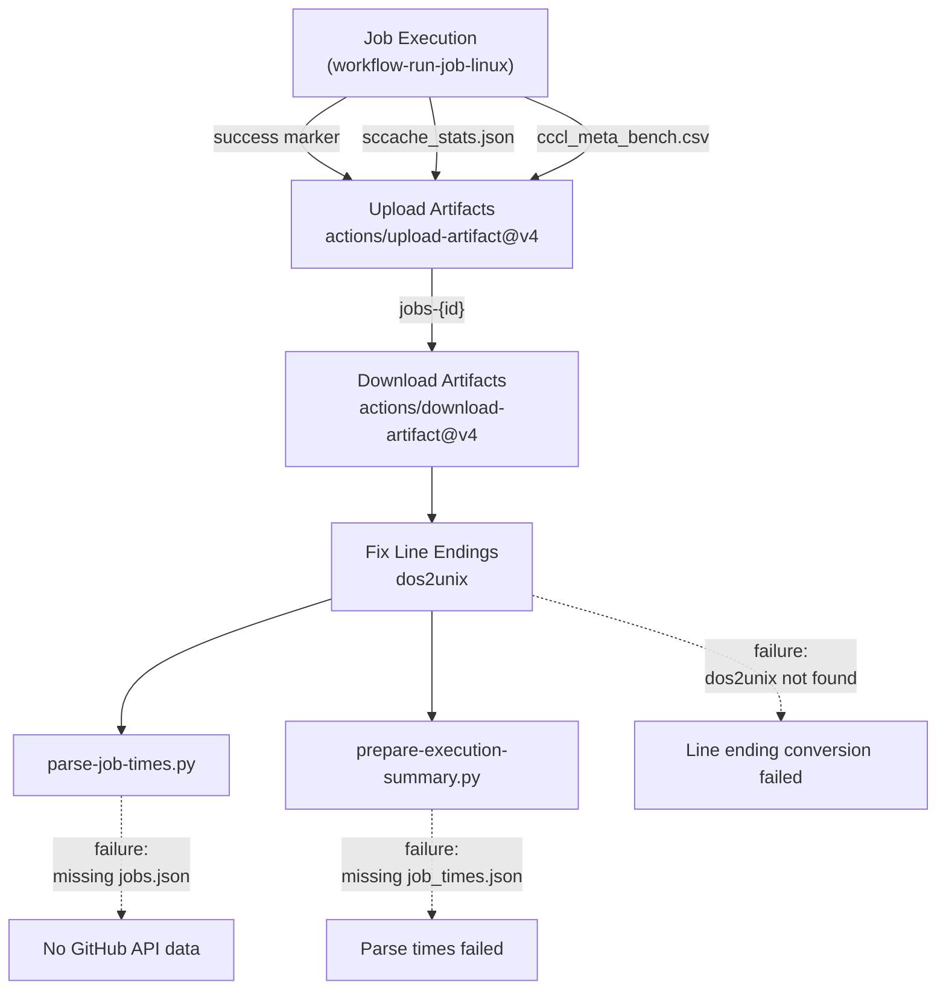
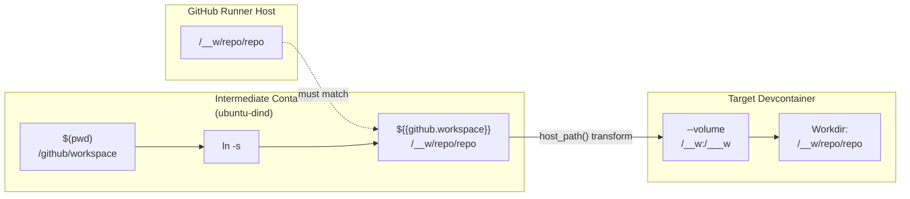
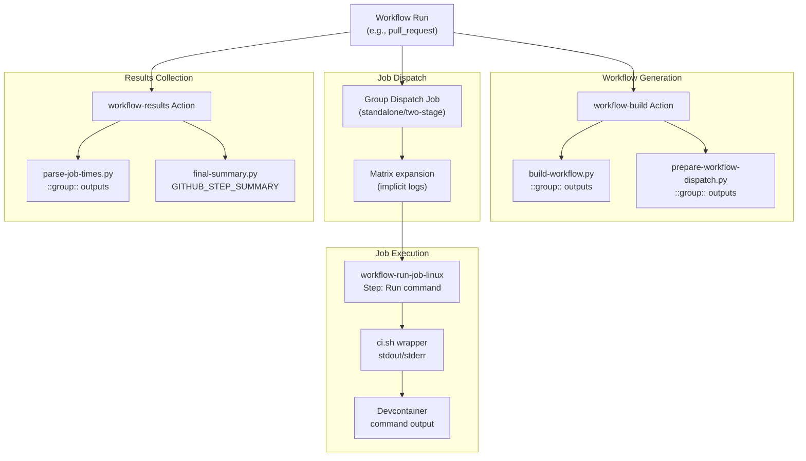
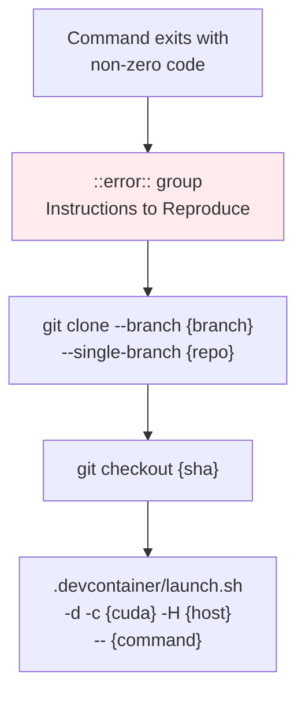
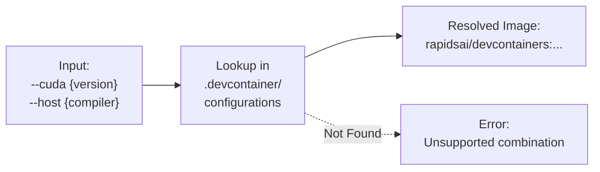
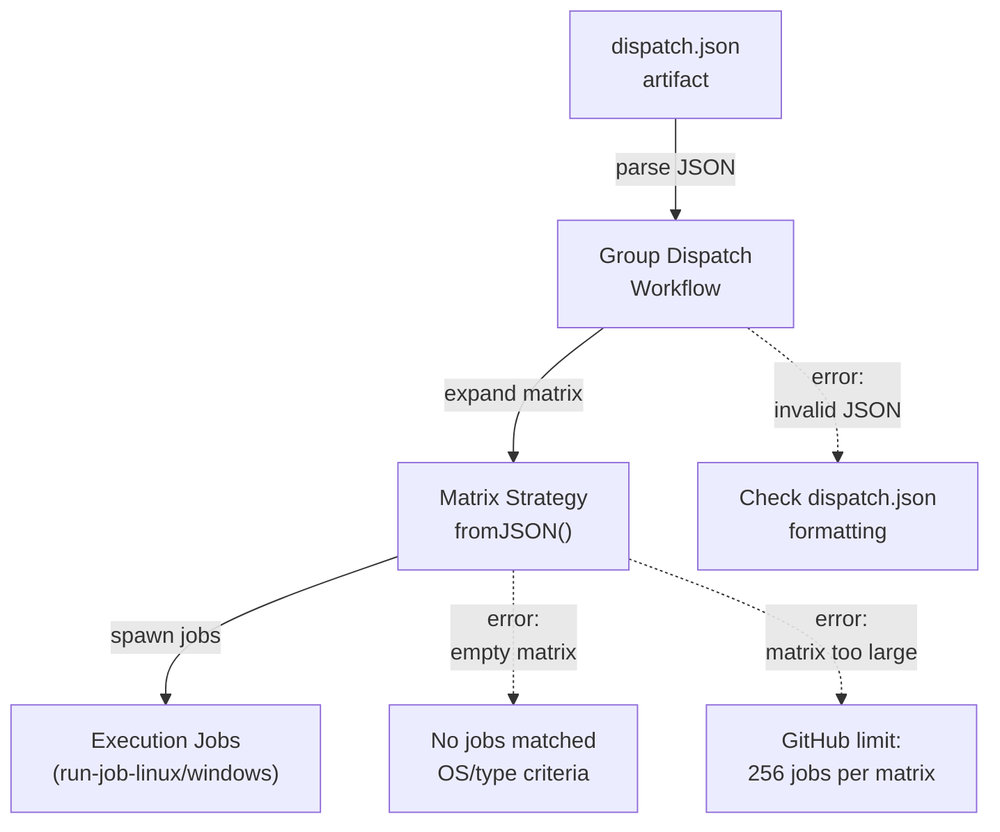
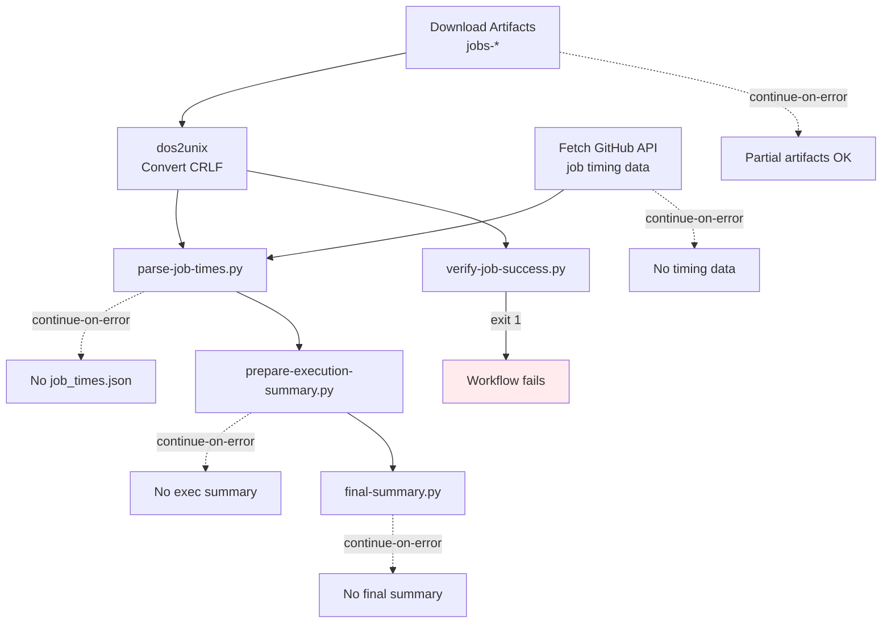
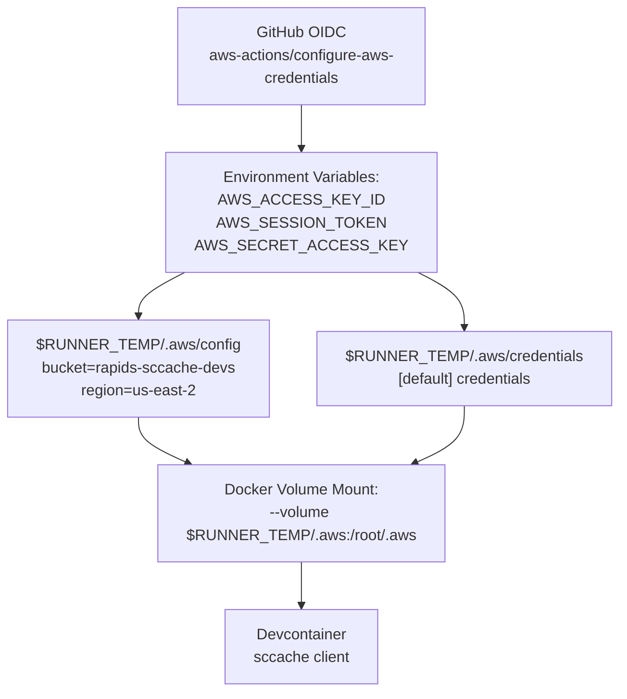
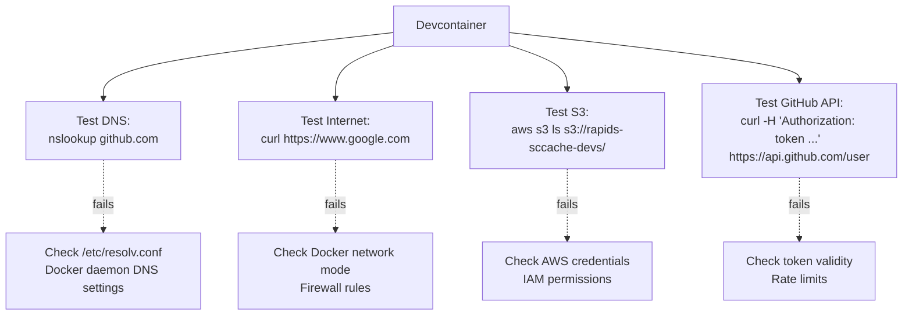

<!-- source: DeepWiki mcp.deepwiki.com · repo NVIDIA/cccl-gha · page 8.4 Troubleshooting Guide · fetched 2026-10-26 -->

# Troubleshooting Guide

<details>
<summary>Relevant source files</summary>

The following files were used as context for generating this wiki page:

- [.github/actions/workflow-results/action.yml](.github/actions/workflow-results/action.yml)
- [.github/actions/workflow-run-job-linux/action.yml](.github/actions/workflow-run-job-linux/action.yml)

</details>


This page provides practical guidance for diagnosing and resolving failures in the CCCL GitHub Actions workflow system. It covers common error patterns, log analysis techniques, local reproduction strategies, and component-specific debugging approaches. For information about the overall system architecture, see [System Architecture](#1.1). For details on individual components, refer to [Job Execution](#5) and [Results and Reporting](#6).

## Common Failure Patterns

### Job Execution Failures

The most common failure point is during the actual job execution phase. These failures are characterized by a non-zero exit code from the command executed inside the devcontainer.

**Failure Indicators:**
- Job artifacts contain no `success` marker file at `jobs/{job_id}/success`
- Error output includes reproduction instructions formatted by `ci.sh`
- GitHub Actions logs show exit code from the command execution

**Typical Causes:**
- Compilation errors (syntax errors, missing dependencies, incompatible flags)
- Test failures (assertion failures, segmentation faults, timeouts)
- Environment configuration issues (missing environment variables, incorrect paths)
- Resource exhaustion (out-of-memory, disk space issues)

Sources: [.github/actions/workflow-run-job-linux/action.yml:89-109]()

### Artifact Collection Failures

The results collection phase can fail when job artifacts are incomplete or malformed, typically manifesting as `continue-on-error: true` steps succeeding but producing invalid data.



**Debugging Artifact Collection Issues:**

| Symptom | Likely Cause | Solution |
|---------|--------------|----------|
| `jobs.json` missing | GitHub API rate limit or permissions | Check `github_token` is provided and has appropriate scope |
| `job_times.json` missing | `parse-job-times.py` failed | Check logs for Python traceback, verify `workflow.json` structure |
| Line ending errors on Windows artifacts | Windows CRLF not converted | Verify `dos2unix` installation step succeeded |
| No job artifacts downloaded | All jobs failed before artifact upload | Check individual job logs for early failures |
| Partial artifact tree | Some jobs crashed without cleanup | Review jobs with no `success` marker but also no clear failure log |

Sources: [.github/actions/workflow-results/action.yml:30-58](), [.github/actions/workflow-run-job-linux/action.yml:166-201]()

### Docker-Outside-of-Docker (DOOD) Path Issues

Linux jobs use a DOOD strategy where path mismatches between the intermediate container and the host can cause mount failures.



**Common Path-Related Errors:**

- **Mount path not found**: Occurs when `host_path()` function fails to transform container paths to host paths
- **Working directory mismatch**: Environment variables reference container paths but Docker sees host paths
- **AWS credentials inaccessible**: The `.aws` mount uses `$RUNNER_TEMP` which must be transformed correctly

**Debugging Steps:**
1. Check the "Run command" step output for path information:
   ```
   [host]      github.workspace: /__w/repo/repo
   [container] GITHUB_WORKSPACE: /github/workspace
   [container]              PWD: /github/workspace
   ```
2. Verify the symlink creation succeeded: `ln -s "$(pwd)" "${{github.workspace}}"`
3. Examine the `host_path()` function transformation at [.github/actions/workflow-run-job-linux/action.yml:138-140]()
4. Check that volume mounts reference the correct paths in the `launch.sh` invocation

Sources: [.github/actions/workflow-run-job-linux/action.yml:78-164]()

## Understanding Logs and Artifacts

### GitHub Actions Workflow Logs

GitHub Actions logs are organized hierarchically: workflow run → job → step. Each component of the CCCL workflow system produces logs at different levels.

**Log Locations by Component:**



**Key Log Sections:**

| Log Section | Location | Contains |
|-------------|----------|----------|
| Workflow generation | `workflow-build` job → `build-workflow.py` step | Matrix processing, tag explosion, job definitions |
| Dispatch preparation | `workflow-build` job → `prepare-workflow-dispatch.py` step | Split by OS/type, dispatch group creation |
| Job execution preamble | Individual job → "Run command" step header | Path setup, symlink creation, environment info |
| Actual command output | Individual job → "Run command" step body | Build/test output, compilation logs, test results |
| Reproduction instructions | Individual job → "Run command" step (on failure) | Exact commands to reproduce locally |
| Artifact preparation | Individual job → "Prepare job artifacts" step | Success marker, sccache stats, benchmark data |
| Results download | `workflow-results` job → "Download job artifacts" step | Artifact tree structure |
| Timing analysis | `workflow-results` job → "Parse job times" step | Job duration calculation |
| Final summary | `workflow-results` job → "Prepare final summary" step → `GITHUB_STEP_SUMMARY` | Aggregated results, pass rates, culprit analysis |

Sources: [.github/actions/workflow-results/action.yml:92-128](), [.github/actions/workflow-run-job-linux/action.yml:66-165]()

### Artifact Structure

Artifacts uploaded by jobs follow a specific directory structure that the results collection system expects:

```
jobs/
├── {job_id_1}/
│   ├── success                    # Marker file indicating successful completion
│   ├── sccache_stats.json        # Compilation cache statistics
│   ├── cccl_meta_bench.csv       # Benchmark results (if applicable)
│   ├── cccl_meta_bench.db        # Benchmark database (if applicable)
│   └── cccl_meta_bench.log       # Benchmark logs (if applicable)
├── {job_id_2}/
│   └── success
└── {job_id_3}/
    ├── sccache_stats.json
    └── cccl_meta_bench.csv
```

**Interpreting Missing Artifacts:**

- **No `success` marker**: Job failed before the "Prepare job artifacts" step
- **No `sccache_stats.json`**: Build did not use sccache, or sccache stats not generated
- **No benchmark files**: Job is not a benchmark job, or benchmark execution failed
- **Empty job directory**: Job failed very early (e.g., Docker launch failure)

Sources: [.github/actions/workflow-run-job-linux/action.yml:166-201]()

### Interpreting the Final Summary

The final summary displayed in `GITHUB_STEP_SUMMARY` and PR comments provides hierarchical pass/fail statistics. Understanding its structure is critical for debugging.

**Summary Structure:**
```
Execution Summary:
├── Overall: X/Y jobs passed (Z%)
├── By Project:
│   ├── Project A: X/Y (Z%)
│   │   ├── By compiler: gcc10 X/Y, gcc11 X/Y
│   │   ├── By cuda: 12.0 X/Y, 12.6 X/Y
│   │   └── Likely culprit: cuda=11.1 (0% pass rate)
│   └── Project B: X/Y (Z%)
└── Sccache Statistics:
    ├── Total hits: X
    └── Hit rate: Y%
```

**"Likely Culprit" Detection:**

The summary identifies specific tag values responsible for all failures in a dimension. This logic is implemented in `prepare-execution-summary.py` and looks for tag values with 0% pass rate.

**Example Interpretation:**
```
libcudacxx: 45/50 (90%)
  Likely culprit: std=11 (0/5, 0%)
```
This indicates that all failures in the `libcudacxx` project had `std=11` as a common tag, suggesting C++11 compatibility issues.

Sources: [.github/actions/workflow-results/action.yml:99-128]()

## Reproducing Failures Locally

### Using the Reproduction Instructions

Every job failure includes formatted reproduction instructions in the logs. These instructions are generated by the `ci.sh` wrapper script and provide the exact commands needed to reproduce the failure.

**Reproduction Instruction Format:**



**Example from Logs:**
```
::error:: To replicate this failure locally, follow the steps below:
1. Clone the repository, and navigate to the correct branch and commit:
   git clone --branch feature-branch --single-branch https://github.com/NVIDIA/cccl.git && cd cccl && git checkout abc123def456

2. Run the failed command inside the same Docker container used by this CI job:
   .devcontainer/launch.sh -d -c 12.0 -H gcc11 -- ci/test_libcudacxx.sh
```

**Key Parameters:**
- `-d`: Detach mode (optional, runs container in background)
- `-c {cuda}`: CUDA version (e.g., `11.1`, `12.0`, `12.6`)
- `-H {host}`: Host compiler (e.g., `gcc9`, `gcc10`, `gcc11`, `clang16`)
- `--`: Separator between launch.sh options and the command to execute

Sources: [.github/actions/workflow-run-job-linux/action.yml:89-109]()

### Manual Local Execution

For debugging, you may want to run commands interactively rather than through `ci.sh`.

**Interactive Container Launch:**
```bash
# Launch an interactive shell in the devcontainer
.devcontainer/launch.sh -c 12.0 -H gcc11

# Inside the container, manually execute the command
cd /path/to/repo
export CI=true
bash ci/test_libcudacxx.sh
```

**Mounting Local Files for Debugging:**
```bash
# Add custom volume mounts to access debugging tools
.devcontainer/launch.sh \
  -c 12.0 \
  -H gcc11 \
  --volume "$HOME/debug-scripts:/debug:ro" \
  -- /debug/custom-test.sh
```

**GPU Access for Local Reproduction:**

If reproducing a GPU-specific failure, ensure the Docker container has GPU access:
```bash
# Check that NVIDIA_VISIBLE_DEVICES is set
echo $NVIDIA_VISIBLE_DEVICES  # e.g., "0" or "0,1"

# Launch with GPU access (automatically handled by launch.sh)
.devcontainer/launch.sh --gpus "device=${NVIDIA_VISIBLE_DEVICES}" -c 12.0 -H gcc11 -- ci/test_thrust_gpu.sh
```

Sources: [.github/actions/workflow-run-job-linux/action.yml:131-164]()

### Debugging Devcontainer Selection

The `launch.sh` script selects devcontainer images based on CUDA and host compiler combinations. If a job fails with "image not found" errors, verify the devcontainer mapping.

**Devcontainer Selection Logic:**


**Verification Steps:**
1. Check `.devcontainer/` directory for configurations matching the CUDA/compiler pair
2. Run `make_devcontainers.sh --list` to see all available combinations (if implemented)
3. Verify the image exists in the container registry: `docker pull rapidsai/devcontainers:{tag}`

For more information on devcontainer system, see [Devcontainer System](#5.3).

Sources: [.github/actions/workflow-run-job-linux/action.yml:144-164]()

## Component-Specific Debugging

### Workflow Generation Issues

Failures during the workflow generation phase prevent jobs from being dispatched.

**Common Generation Errors:**

| Error Message | Location | Cause | Solution |
|---------------|----------|-------|----------|
| "Required tag missing" | `build-workflow.py` validation | Job definition lacks mandatory tags | Add missing tags to `matrix.yaml` |
| "Invalid tag value" | `build-workflow.py` validation | Tag value not in allowed list | Check allowed values in schema |
| "Exclusion pattern invalid" | `build-workflow.py` exclusions | Malformed exclusion rule | Fix exclusion syntax in `matrix.yaml` |
| "Circular tag dependency" | `build-workflow.py` derived tags | Derived tag depends on itself | Review derived tag definitions |

**Debugging Workflow Generation:**
1. Download the `workflow` artifact from the workflow run
2. Examine `workflow.json` for the expected job definitions
3. Check `job_ids.json` for job ID mappings
4. Review `runner_summary.json` for runner allocation

**Manual Generation Testing:**
```bash
# Run the generation pipeline locally
python3 .github/actions/workflow-build/build-workflow.py \
  --matrix ci/matrix.yaml \
  --workflows pull_request \
  --output workflow.json

# Check for errors in the output
cat workflow.json | jq '.jobs | length'
```

For detailed information on the generation pipeline, see [Workflow Generation](#3) and [build-workflow.py Pipeline](#3.1).

Sources: [.github/actions/workflow-results/action.yml:30-34]()

### Job Dispatch Failures

Dispatch failures occur when the group dispatch workflows fail to properly invoke execution workflows.

**Dispatch Failure Indicators:**
- No jobs appear in the "dispatched" section of the GitHub Actions UI
- Dispatch group jobs show "skipped" status
- `dispatch.json` is empty or malformed

**Debugging Dispatch Issues:**


**Resolution Steps:**
1. Download the `workflow` artifact and examine `dispatch.json`
2. Verify JSON syntax: `cat dispatch.json | jq .`
3. Check that the appropriate OS/type keys exist and contain arrays
4. Count jobs per matrix: `cat dispatch.json | jq '.linux_standalone | length'`
5. If matrix exceeds 256 jobs, review job filtering in `prepare-workflow-dispatch.py`

For more information on dispatch architecture, see [Job Dispatch](#4).

Sources: [.github/actions/workflow-results/action.yml:30-42]()

### Results Collection Failures

The results collection phase is resilient (most steps use `continue-on-error: true`), but understanding failures helps interpret incomplete results.

**Results Collection Flow with Failure Points:**



**Interpreting Partial Results:**

- **No timing data**: GitHub API call failed, but success/failure status still available
- **No execution summary**: Timing data missing, but job artifacts still processed
- **No final summary**: All data collection failed, but `verify-job-success.py` still determines pass/fail

**Common API Rate Limit Issues:**

If the GitHub API returns 403 or 429 errors:
1. Check if `github_token` input is provided: [.github/actions/workflow-results/action.yml:5-7]()
2. Verify token has `actions:read` scope
3. If rate limit exceeded, wait or use a different token

Sources: [.github/actions/workflow-results/action.yml:30-127](), [.github/actions/workflow-results/action.yml:155-178]()

### AWS Credentials and sccache Issues

Compilation caching via sccache requires AWS credentials configured correctly.

**AWS Configuration Setup:**



**Common AWS/sccache Errors:**

| Error Message | Cause | Solution |
|---------------|-------|----------|
| "Unable to locate credentials" | `.aws` volume mount failed | Check `host_path()` transformation of `$RUNNER_TEMP` |
| "Access Denied" to S3 bucket | OIDC role lacks permissions | Verify IAM role `gha-oidc-NVIDIA` has S3 access |
| "sccache server failed to start" | Port already in use, or misconfiguration | Check sccache logs, restart server |
| "No such file or directory: sccache" | Binary not in PATH | Verify devcontainer includes sccache |
| Missing `sccache_stats.json` | Stats not collected before job end | Check if job calls sccache stats command |

**Debugging sccache:**

Inside a devcontainer:
```bash
# Check sccache is available
which sccache

# Start sccache server manually
sccache --start-server

# Check server status
sccache --show-stats

# Verify AWS credentials are accessible
ls -la /root/.aws/
cat /root/.aws/config
# (Do NOT cat credentials in logs - security risk)

# Test S3 access
aws s3 ls s3://rapids-sccache-devs/ --region us-east-2
```

For more information on sccache configuration, see [Environment Setup](#5.4) and [Distributed Compilation Caching](#7.2).

Sources: [.github/actions/workflow-run-job-linux/action.yml:60-129](), [.github/actions/workflow-run-job-linux/action.yml:186]()

## Advanced Debugging Techniques

### Analyzing Job Timing Data

Performance issues can be diagnosed using the `job_times.json` artifact generated by `parse-job-times.py`.

**Job Timing Structure:**
```json
{
  "job_id_123": {
    "runner": "linux-amd64-gpu-v100-latest-1",
    "started": "2024-01-01T12:00:00Z",
    "completed": "2024-01-01T12:15:30Z",
    "total_seconds": 930,
    "steps": {
      "Run command": {
        "started": "2024-01-01T12:01:00Z",
        "completed": "2024-01-01T12:14:00Z",
        "duration_seconds": 780
      }
    },
    "overhead_seconds": 150
  }
}
```

**Performance Analysis:**
- **High overhead**: Indicates slow artifact download, Docker image pull, or environment setup
- **Long "Run command" duration**: Actual build/test taking longer than expected
- **Inconsistent timing**: May indicate runner resource contention

**Calculating Overhead:**

Overhead is the time spent outside the "Run command" step, calculated as:
```
overhead = total_job_time - run_command_time
```

High overhead (>20% of total time) suggests:
- Slow artifact download (producer/consumer jobs)
- Docker image pull delays (check image size, registry latency)
- Slow repository checkout (large repo or slow network)

Sources: [.github/actions/workflow-results/action.yml:92-97]()

### Inspecting the CI Wrapper Script

Every job executes through a generated `ci.sh` wrapper script that provides error handling and reproduction instructions.

**CI Wrapper Breakdown:**

```bash
#! /usr/bin/env bash
set -eo pipefail                          # Exit on error, pipe failures

echo -e "\e[1;34mRunning as '$(whoami)' user in $(pwd):\e[0m"
echo -e "\e[1;34m${COMMAND}\e[0m"

eval "${COMMAND}" || exit_code=$?         # Execute command, capture exit code

if [ ! -z "$exit_code" ]; then
  # Generate reproduction instructions
  echo -e "::group::️❗ \e[1;31mInstructions to Reproduce CI Failure Locally\e[0m"
  echo "::error:: To replicate this failure locally, follow the steps below:"
  # ... (reproduction instructions)
  exit $exit_code                         # Propagate failure
fi
```

**Key Features:**
- **Error capture**: `|| exit_code=$?` prevents immediate script exit, allowing error reporting
- **Colored output**: ANSI escape codes for visibility (stripped in CI logs)
- **GitHub annotations**: `::error::` and `::group::` directives for UI integration

**Debugging ci.sh Failures:**

If the wrapper itself fails (not the command):
1. Check that `set -eo pipefail` is not causing premature exit
2. Verify `$COMMAND` environment variable is set correctly
3. Test command evaluation: `bash -c "eval \"${COMMAND}\""`

Sources: [.github/actions/workflow-run-job-linux/action.yml:89-109]()

### Debugging Docker Networking Issues

Container networking problems can prevent access to AWS S3, GitHub, or other external services.

**Network Debugging Checklist:**



**Inside Container Diagnostics:**
```bash
# Check network connectivity
ping -c 3 8.8.8.8                 # Basic internet
curl -I https://github.com         # HTTPS/GitHub access
nslookup s3.us-east-2.amazonaws.com # AWS DNS

# Check container network mode
docker inspect $(hostname) | jq '.[0].HostConfig.NetworkMode'

# Review container DNS configuration
cat /etc/resolv.conf
```

Sources: [.github/actions/workflow-run-job-linux/action.yml:144-164]()

### Enabling Verbose Logging

For deep debugging, increase log verbosity in various components.

**Python Script Debugging:**

Add `--verbose` or debug prints:
```bash
# Edit the workflow-results action.yml to add verbose flags
python3 "${GITHUB_ACTION_PATH}/parse-job-times.py" --verbose workflow/workflow.json results/jobs.json
```

**Docker Execution Debugging:**

Add `set -x` to see all executed commands:
```bash
# In the ci.sh generation, change the first line to:
set -exo pipefail
```

**launch.sh Debugging:**

The `launch.sh` script already uses `set -x` at [.github/actions/workflow-run-job-linux/action.yml:143]() to show Docker command construction.

**GitHub Actions Debugging:**

Enable step debugging by setting repository secrets:
- `ACTIONS_STEP_DEBUG=true`: Detailed step logs
- `ACTIONS_RUNNER_DEBUG=true`: Runner diagnostics

Sources: [.github/actions/workflow-run-job-linux/action.yml:143-164]()

### Manual Artifact Investigation

When automated results collection fails, manually inspect artifacts using the GitHub API or CLI.

**Using GitHub CLI:**
```bash
# List all artifacts for a workflow run
gh run view <run-id> --json artifacts

# Download specific artifact
gh run download <run-id> -n workflow
gh run download <run-id> -n jobs-<job-id>

# Extract and inspect
unzip workflow.zip
cat workflow/workflow.json | jq '.jobs[] | select(.id == "job_id_123")'
```

**Artifact Analysis:**
```bash
# Check which jobs succeeded
find jobs -name 'success' -printf '%h\n' | sed 's|jobs/||'

# List jobs with sccache stats
find jobs -name 'sccache_stats.json' -printf '%h\n' | sed 's|jobs/||'

# Compare expected vs actual jobs
comm -3 \
  <(cat workflow/job_ids.json | jq -r 'keys[]' | sort) \
  <(find jobs -mindepth 1 -maxdepth 1 -type d -printf '%f\n' | sort)
```

Sources: [.github/actions/workflow-results/action.yml:30-57]()

---

This troubleshooting guide provides the essential diagnostic techniques for resolving issues in the CCCL GitHub Actions workflow system. For component-specific details, refer to the appropriate sections: [Workflow Generation](#3), [Job Execution](#5), and [Results and Reporting](#6). For information on extending the system, see [Development and Contributing](#9).

---

