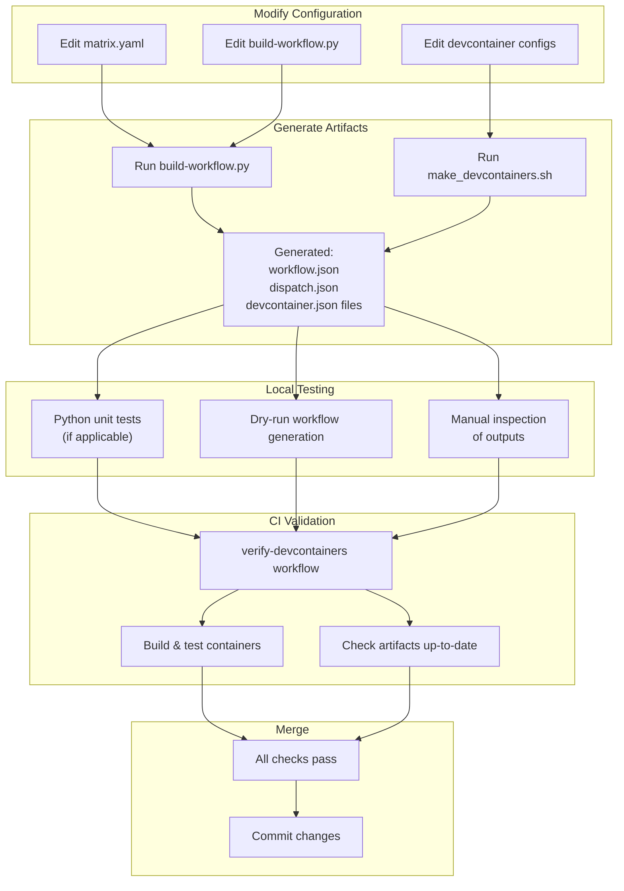
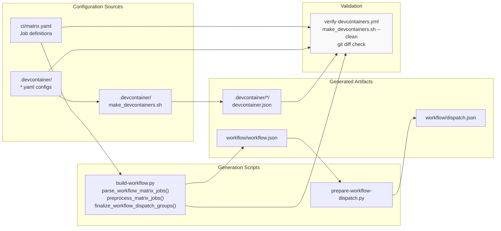
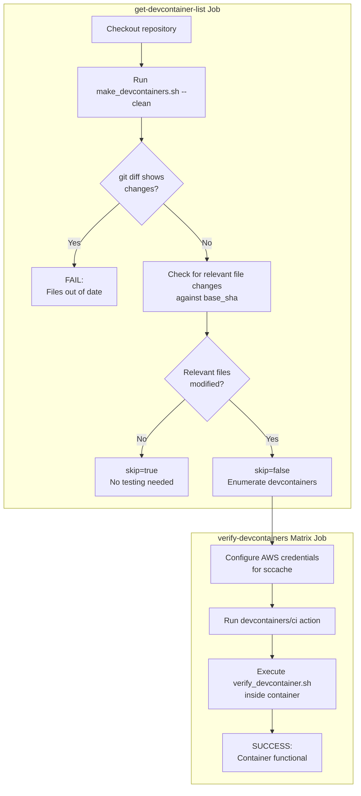
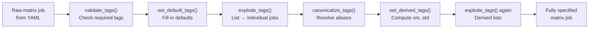

<!-- source: DeepWiki mcp.deepwiki.com · repo NVIDIA/cccl-gha · page 9 Development and Contributing · fetched 2026-10-26 -->

# Development and Contributing

<details>
<summary>Relevant source files</summary>

The following files were used as context for generating this wiki page:

- [.github/actions/workflow-build/build-workflow.py](.github/actions/workflow-build/build-workflow.py)
- [.github/workflows/verify-devcontainers.yml](.github/workflows/verify-devcontainers.yml)

</details>


This page provides guidance for developers who want to extend, modify, or contribute to the cccl-gha workflow orchestration system. It covers development environment setup, testing procedures, and strategies for extending the system with new functionality.

For information about using the system to define CI jobs, see [Configuration Guide](#2). For troubleshooting existing workflows, see [Troubleshooting Guide](#8.4). For detailed system requirements and dependencies, see [System Requirements](#9.1).

---

## Development Workflow Overview

The development cycle for cccl-gha follows a standard modify-test-validate pattern with automated verification to ensure generated artifacts remain synchronized with their source configurations.



**Sources:** [.github/actions/workflow-build/build-workflow.py:1-1140](), [.github/workflows/verify-devcontainers.yml:1-142]()

---

## Key Files and Their Relationships

Understanding which files affect which outputs is critical for making targeted modifications without unintended side effects.



**Sources:** [.github/actions/workflow-build/build-workflow.py:1-1140](), [.github/workflows/verify-devcontainers.yml:1-142]()

---

## Making Configuration Changes

### Modifying Job Definitions

To add or modify CI job configurations, edit `ci/matrix.yaml`. The structure follows a hierarchical tag-based system where jobs are defined by combinations of tags like `project`, `ctk`, `cxx`, `gpu`, etc.

```yaml
workflows:
  pull_request:
    - {project: libcudacxx, ctk: "12.0", cxx: gcc12, std: 20, gpu: v100}
```

**Key Functions in build-workflow.py:**
- [`parse_workflow_matrix_jobs(args, workflow_name)`](.github/actions/workflow-build/build-workflow.py:922-959)() - Entry point for parsing a workflow
- [`preprocess_matrix_jobs(matrix_jobs, is_exclusion_matrix)`](.github/actions/workflow-build/build-workflow.py:902-919)() - Validates, sets defaults, explodes lists
- [`validate_tags(matrix_job, ignore_required)`](.github/actions/workflow-build/build-workflow.py:811-832)() - Ensures all required tags present
- [`set_default_tags(matrix_job)`](.github/actions/workflow-build/build-workflow.py:834-843)() - Fills in default values
- [`explode_tags(matrix_job, explode_tag)`](.github/actions/workflow-build/build-workflow.py:886-899)() - Converts list values to individual jobs

**Sources:** [.github/actions/workflow-build/build-workflow.py:811-959]()

### Adding New Tags

To add a new configuration dimension (e.g., a new compiler option), modify the `tags` section in `matrix.yaml` and update the processing pipeline:

| Step | Function | Purpose |
|------|----------|---------|
| 1. Define tag | `matrix.yaml` `tags:` section | Specify `required`, `default`, validation rules |
| 2. Canonicalization | [`canonicalize_tags()`](.github/actions/workflow-build/build-workflow.py:845-849)() | Normalize aliases to canonical form |
| 3. Derived values | [`set_derived_tags()`](.github/actions/workflow-build/build-workflow.py:852-875)() | Compute dependent values (e.g., `sm` from `gpu`) |
| 4. Job generation | [`generate_dispatch_job_*()` functions](.github/actions/workflow-build/build-workflow.py:393-445)() | Use tag in name/runner/command generation |

**Sources:** [.github/actions/workflow-build/build-workflow.py:113-173](), [.github/actions/workflow-build/build-workflow.py:845-875]()

### Modifying Devcontainer Generation

Devcontainer configurations are generated from templates. To modify the generation logic:

1. Edit templates in `.devcontainer/*.yaml`
2. Update [`.devcontainer/make_devcontainers.sh`]() script
3. Run `make_devcontainers.sh --verbose --clean` to regenerate
4. Commit both templates and generated `devcontainer.json` files

**Sources:** [.github/workflows/verify-devcontainers.yml:37-49]()

---

## Testing Changes Locally

### Dry-Run Workflow Generation

Test workflow generation without triggering actual CI jobs:

```bash
# Generate workflow for pull_request jobs
python3 .github/actions/workflow-build/build-workflow.py \
  ci/matrix.yaml \
  --workflows pull_request

# Check outputs
cat workflow/workflow.json
cat workflow/job_list.txt
cat workflow/runner_summary.json
```

The script produces three key outputs:
- `workflow/workflow.json` - Complete job specifications organized by dispatch group
- `workflow/job_list.txt` - Human-readable job listing with IDs
- `workflow/runner_summary.json` - Runner allocation statistics

**Sources:** [.github/actions/workflow-build/build-workflow.py:979-1023]()

### Testing with Dirty Projects Filter

Simulate PR-triggered CI that only runs jobs for modified projects:

```bash
python3 .github/actions/workflow-build/build-workflow.py \
  ci/matrix.yaml \
  --workflows pull_request \
  --dirty-projects libcudacxx cub
```

This uses the same filtering logic as the actual CI system when `inspect-changes-script` detects modified files.

**Sources:** [.github/actions/workflow-build/build-workflow.py:947-949]()

### Validating Devcontainers

Run the verification checks locally:

```bash
# Regenerate devcontainers and check for changes
./.devcontainer/make_devcontainers.sh --verbose --clean

# Should produce no git diff
git diff --stat
git status --porcelain
```

If changes are detected, the generated files were out of sync with templates. Commit the regenerated files.

**Sources:** [.github/workflows/verify-devcontainers.yml:37-49]()

---

## CI Validation System

The `verify-devcontainers` workflow enforces that all generated files remain synchronized with their source configurations.

### Verification Workflow Architecture



**Sources:** [.github/workflows/verify-devcontainers.yml:1-142]()

### Verification Steps

**Step 1: File Synchronization Check** ([verify-devcontainers.yml:37-49]())

Ensures generated devcontainer files match their generation scripts:

```yaml
- name: Run the script to generate devcontainer files
  run: |
    ./.devcontainer/make_devcontainers.sh --verbose --clean
- name: Check for changes
  run: |
    if [[ $(git diff --stat) != '' || $(git status --porcelain | grep '^??') != '' ]]; then
      git diff --minimal
      echo "::error:: Dev Container files are out of date..."
      exit 1
    fi
```

**Step 2: Change Detection** ([verify-devcontainers.yml:50-86]())

Skips expensive container builds if no relevant files changed:

```bash
file_regex="^(.devcontainer|ci/matrix.yaml|.github/actions/workflow-build/build-workflow.py)"
relevant_dirty_files=$(echo "${all_dirty_files}" | grep -E "${file_regex}" || true)
```

**Step 3: Container Functional Testing** ([verify-devcontainers.yml:96-142]())

Builds and tests each devcontainer using `devcontainers/ci` action:

```yaml
- name: Run in devcontainer
  uses: devcontainers/ci@v0.3
  with:
    configFile: ${{ matrix.devcontainer.path }}
    runCmd: |
      .devcontainer/verify_devcontainer.sh
```

**Sources:** [.github/workflows/verify-devcontainers.yml:1-142]()

---

## Common Development Tasks

### Adding a New Job Type

To add a new job type (e.g., `benchmark`):

1. **Define in matrix.yaml:**
   ```yaml
   jobs:
     benchmark:
       name: "Benchmark"
       gpu: true
       needs: build  # Optional dependency
       invoke:
         prefix: "benchmark"
         args: ""
   ```

2. **Add script:** Create `ci/benchmark_<project>.sh` (Linux) or `ci/windows/benchmark_<project>.ps1` (Windows)

3. **Update generation logic:** The existing [`generate_dispatch_job_command()`](.github/actions/workflow-build/build-workflow.py:415-445)() will automatically handle the new job type based on the `invoke` configuration.

4. **Test:** Run `build-workflow.py --workflows pull_request` and verify the new job appears in `workflow/job_list.txt`

**Sources:** [.github/actions/workflow-build/build-workflow.py:259-281](), [.github/actions/workflow-build/build-workflow.py:415-445]()

### Adding Exclusion Rules

Exclude invalid job combinations using the `exclude` workflow:

```yaml
workflows:
  exclude:
    - {ctk: "11.0", cxx: gcc12}  # GCC 12 not available in CTK 11.0 containers
    - {cudacxx: clang, gpu: v100}  # Clang CUDA doesn't support V100
```

Exclusions are processed by [`remove_excluded_jobs()`](.github/actions/workflow-build/build-workflow.py:796-808)() which uses [`apply_matrix_job_exclusion()`](.github/actions/workflow-build/build-workflow.py:753-793)() to match and filter jobs.

**Sources:** [.github/actions/workflow-build/build-workflow.py:749-808]()

### Modifying Job Naming Convention

Job names are generated by [`generate_dispatch_job_name()`](.github/actions/workflow-build/build-workflow.py:362-376)(). To modify the format:

```python
def generate_dispatch_job_name(matrix_job, job_type):
    job_info = get_job_type_info(job_type)
    std_str = ("C++" + str(matrix_job['std']) + " ") if 'std' in matrix_job else ''
    cpu_str = matrix_job['cpu']
    gpu_str = (', ' + matrix_job['gpu'].upper()) if job_info['gpu'] else ""
    # ... build name string
    return f"[{config_tag}] {job_info['name']}({cpu_str}{gpu_str}){extra_info}"
```

Changes here affect how jobs appear in GitHub Actions UI and PR comments.

**Sources:** [.github/actions/workflow-build/build-workflow.py:362-376]()

---

## Debugging Workflow Generation

### Understanding the Pipeline

The [`preprocess_matrix_jobs()`](.github/actions/workflow-build/build-workflow.py:902-919)() function applies transformations in a specific order:



**Sources:** [.github/actions/workflow-build/build-workflow.py:902-919]()

### Common Errors and Solutions

| Error | Cause | Solution |
|-------|-------|----------|
| `Missing required tag 'X'` | Job definition lacks required tag | Add tag to matrix.yaml or set default in `tags:` section |
| `Unknown tag 'X'` | Typo or unregistered tag | Check spelling, add to `tags:` if new |
| `Unknown CTK version 'X'` | Version not in `ctk_versions:` | Add version or use `aka:` alias |
| `ci-dispatch-two-stage.yml currently only supports a single producer` | Multiple producers in two-stage job | Combine into single build job or use separate dispatch groups |
| Dev Container files are out of date | Generated files not committed | Run `make_devcontainers.sh --clean` and commit |

**Sources:** [.github/actions/workflow-build/build-workflow.py:811-832](), [.github/actions/workflow-build/build-workflow.py:583-599]()

### Tracing Job Generation

Each generated job includes an `origin` object with source location information:

```python
def generate_dispatch_job_origin(matrix_job, job_type):
    origin = matrix_job['origin'].copy()  # filename, line number, original input
    origin_job = matrix_job.copy()
    # Transforms tags for execution summary
    origin['matrix_job'] = origin_job
    return origin
```

This enables [`error_message_with_matrix_job()`](.github/actions/workflow-build/build-workflow.py:109-110)() to provide precise error locations:

```
ci/matrix.yaml:42 (job 3): Missing required tag 'ctk'
  Input: {project: libcudacxx, cxx: gcc12, std: 20}
```

**Sources:** [.github/actions/workflow-build/build-workflow.py:109-110](), [.github/actions/workflow-build/build-workflow.py:448-478]()

---

## Extension Points

### Custom Tag Processing

To add custom tag processing logic, add a new function to the pipeline in [`preprocess_matrix_jobs()`](.github/actions/workflow-build/build-workflow.py:902-919)():

```python
def preprocess_matrix_jobs(matrix_jobs, is_exclusion_matrix=False):
    result = []
    for matrix_job in matrix_jobs:
        validate_tags(matrix_job)
        set_default_tags(matrix_job)
        for job in explode_tags(matrix_job):
            canonicalize_tags(job)
            set_derived_tags(job)
            # ADD CUSTOM PROCESSING HERE
            custom_tag_processing(job)
            result.extend(explode_tags(job))
    return result
```

### Custom Dispatch Strategies

The system currently supports two dispatch patterns (standalone and two-stage). To add a new pattern:

1. **Define job relationships** in [`generate_dispatch_group_jobs()`](.github/actions/workflow-build/build-workflow.py:507-539)()
2. **Create dispatch workflow** similar to `workflow-dispatch-two-stage-*.yml`
3. **Update preparation** in `prepare-workflow-dispatch.py` to split jobs accordingly

**Sources:** [.github/actions/workflow-build/build-workflow.py:507-539]()

### Runner Selection Logic

Customize runner selection by modifying [`generate_dispatch_job_runner()`](.github/actions/workflow-build/build-workflow.py:379-390)():

```python
def generate_dispatch_job_runner(matrix_job, job_type):
    runner_os = "windows" if is_windows(matrix_job) else "linux"
    cpu = matrix_job['cpu']
    
    job_info = get_job_type_info(job_type)
    if not job_info['gpu']:
        return f"{runner_os}-{cpu}-cpu16"
    
    gpu = get_gpu(matrix_job['gpu'])
    suffix = "-testing" if gpu['testing'] else ""
    
    return f"{runner_os}-{cpu}-gpu-{gpu['id']}-latest-1{suffix}"
```

**Sources:** [.github/actions/workflow-build/build-workflow.py:379-390]()

---

## Contributing Guidelines

### Pre-Commit Checklist

Before submitting a pull request:

- [ ] Run `build-workflow.py --workflows pull_request` locally and verify output
- [ ] Run `.devcontainer/make_devcontainers.sh --clean` and commit any changes
- [ ] Ensure no `git diff` after regenerating files
- [ ] Test exclusion rules if modified
- [ ] Verify runner counts in `workflow/runner_summary.json` are reasonable
- [ ] Check that `workflow/job_list.txt` contains expected jobs

### PR Validation

All PRs automatically trigger:

1. **Devcontainer Verification** - Ensures generated files are synchronized
2. **Container Build Tests** - Validates all devcontainer configurations work
3. **Change Detection** - Skips irrelevant tests if no configuration files changed

The `verify-devcontainers` workflow uses [`inspect-changes`](.github/workflows/verify-devcontainers.yml:50-86)() to determine if testing is necessary based on file regex:

```bash
file_regex="^(.devcontainer|ci/matrix.yaml|.github/actions/workflow-build/build-workflow.py)"
```

**Sources:** [.github/workflows/verify-devcontainers.yml:50-86]()

### Code Style

- **Python**: Follow PEP 8, use meaningful function names like `canonicalize_host_compiler_name()` rather than abbreviations
- **YAML**: Use consistent indentation (2 spaces), quote string values when ambiguous
- **Shell Scripts**: Use `set -euo pipefail`, quote variables, handle errors explicitly
- **Documentation**: Update wiki pages when adding new features, include code citations

**Sources:** [.github/actions/workflow-build/build-workflow.py:1-1140]()

---

