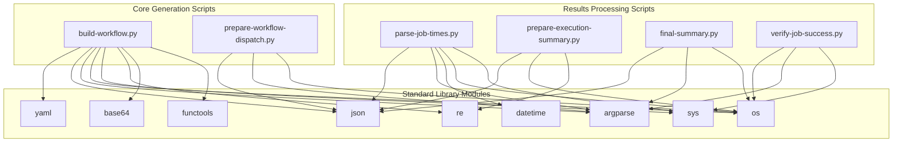
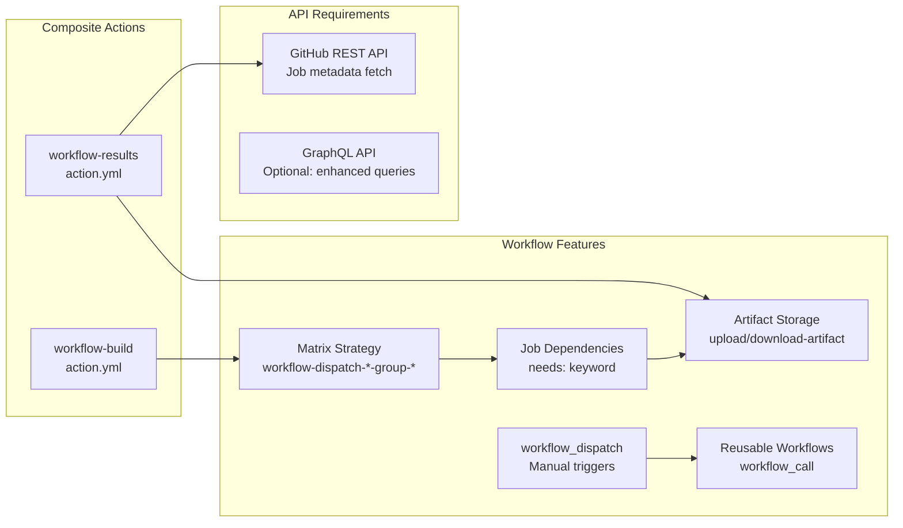
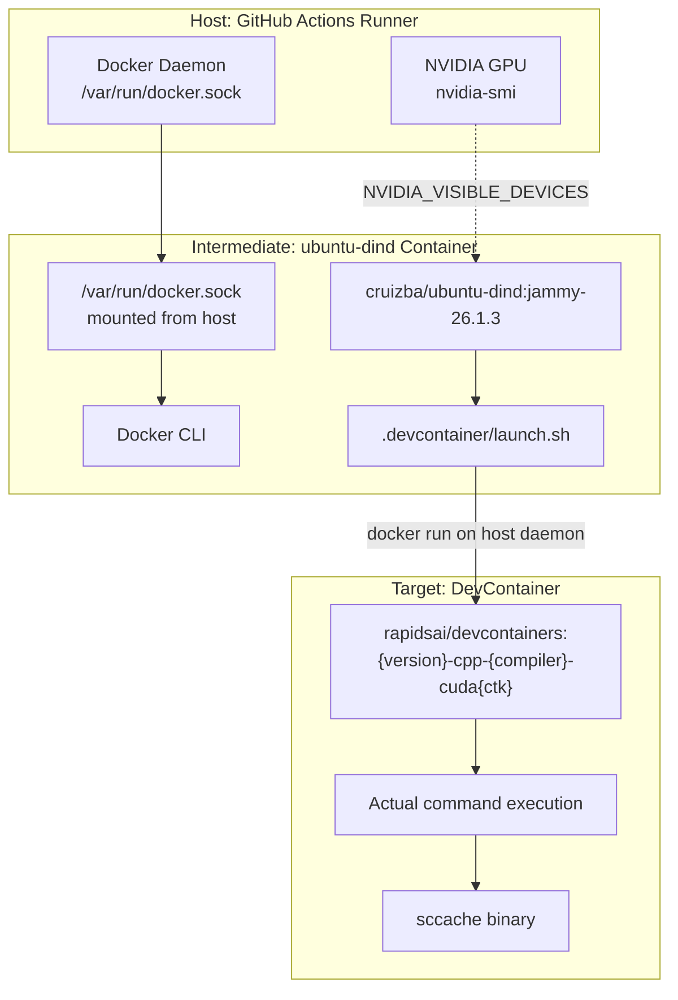
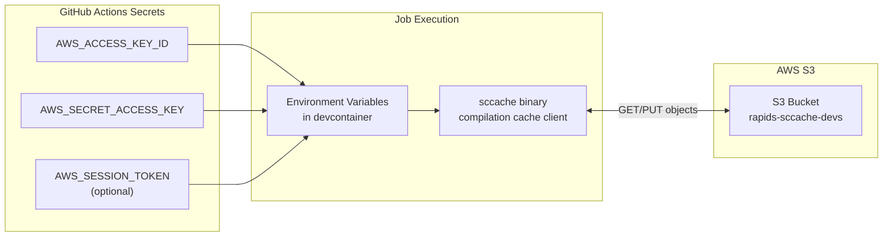
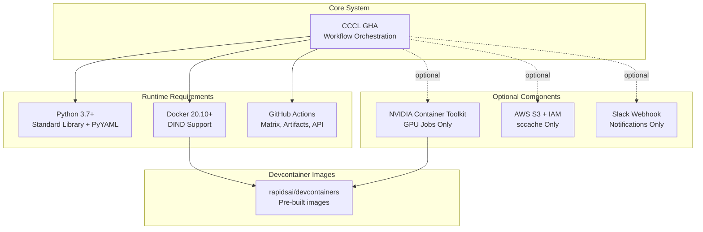

<!-- source: DeepWiki mcp.deepwiki.com · repo NVIDIA/cccl-gha · page 9.1 System Requirements · fetched 2026-10-26 -->

# System Requirements

<details>
<summary>Relevant source files</summary>

The following files were used as context for generating this wiki page:

- [.github/actions/workflow-build/build-workflow.py](.github/actions/workflow-build/build-workflow.py)
- [.github/actions/workflow-results/parse-job-times.py](.github/actions/workflow-results/parse-job-times.py)

</details>


This page documents the technical prerequisites for developing, extending, or deploying the CCCL GitHub Actions workflow orchestration system. It covers Python dependencies, GitHub Actions capabilities, Docker configurations, and external service integrations required for the system to function.

For information about testing and validation procedures, see [Testing and Validation](#9.2). For guidance on modifying the system, see [Extending the System](#9.3).

## Python Environment

The workflow generation and results processing scripts require Python 3 with specific standard library modules.

### Python Version

**Minimum Version:** Python 3.7+

The scripts use f-string syntax and type hints that require Python 3.7 or later. The system has been tested primarily with Python 3.9 and 3.10.

### Standard Library Dependencies

All Python scripts rely exclusively on the standard library. No third-party packages are required.

**Required Modules:**

| Module | Used By | Purpose |
|--------|---------|---------|
| `argparse` | build-workflow.py, parse-job-times.py, prepare-workflow-dispatch.py, prepare-execution-summary.py, final-summary.py, verify-job-success.py | Command-line argument parsing |
| `yaml` | build-workflow.py | Parse matrix.yaml configuration |
| `json` | All scripts | JSON serialization/deserialization |
| `os` | All scripts | File system operations, environment variables |
| `sys` | All scripts | System-specific parameters, stderr output |
| `re` | build-workflow.py, prepare-execution-summary.py | Regular expression pattern matching |
| `base64` | build-workflow.py | GUID generation via base64 encoding |
| `struct` | build-workflow.py | Binary data packing for GUID generation |
| `copy` | build-workflow.py | Deep copying of matrix job objects |
| `functools` | build-workflow.py | Function decorators for memoization |
| `datetime` | parse-job-times.py | Time parsing and duration calculations |

**Diagram: Python Script Dependencies**



Sources: [.github/actions/workflow-build/build-workflow.py:56-65](), [.github/actions/workflow-results/parse-job-times.py:1-8]()

### File System Requirements

The scripts require read/write access to specific directories:

- **Read Access:**
  - `ci/matrix.yaml` - Job configuration definitions
  - `.devcontainer/` - Container configuration files
  - GitHub Actions artifact downloads

- **Write Access:**
  - `workflow/` directory - Generated JSON files (workflow.json, dispatch.json, job_ids.json, runner_summary.json)
  - `results/` directory - Job timing and success marker files
  - `execution/` directory - Execution summary files

Sources: [.github/actions/workflow-build/build-workflow.py:1019-1028](), [.github/actions/workflow-results/parse-job-times.py:110-111]()

## GitHub Actions Requirements

The system relies on specific GitHub Actions features and configurations.

### Required GitHub Actions Features

**Diagram: GitHub Actions Feature Dependencies**



**Feature Details:**

| Feature | Minimum Version | Purpose |
|---------|-----------------|---------|
| Matrix Strategy | GitHub Actions v2+ | Parallel job execution across multiple configurations |
| `needs:` Dependencies | GitHub Actions v2+ | Producer/consumer two-stage workflow orchestration |
| Artifacts API | GitHub Actions v2+ | Transfer build outputs between producer/consumer jobs |
| `workflow_dispatch` | GitHub Actions v2+ | Manual workflow triggers with input parameters |
| Composite Actions | GitHub Actions v2+ | Reusable action definitions (workflow-build, workflow-results) |
| GitHub REST API | v3 | Fetch job timing metadata via `/repos/{owner}/{repo}/actions/runs/{run_id}/jobs` |

Sources: Architecture diagrams (Diagram 3, Diagram 6)

### Required Permissions

GitHub Actions workflows require the following token permissions:

```yaml
permissions:
  contents: read          # Read repository code
  actions: read           # Read workflow run metadata
  pull-requests: write    # Post PR comments with results
  issues: write          # Optional: Issue comment fallback
```

The `GITHUB_TOKEN` must have sufficient permissions to:
1. Download artifacts from the current workflow run
2. Fetch job metadata via REST API
3. Post comments to pull requests (for result summaries)

Sources: [.github/actions/workflow-results/parse-job-times.py:10-15]()

### Self-Hosted Runner Requirements

The system assumes access to self-hosted runners with specific labels:

**Linux Runners:**
- `linux-amd64-cpu16` - CPU-only jobs (16 cores)
- `linux-amd64-gpu-{gpu_id}-latest-1` - GPU jobs (e.g., `linux-amd64-gpu-t4-latest-1`)
- `linux-amd64-gpu-{gpu_id}-latest-1-testing` - Testing GPU runners

**Windows Runners:**
- `windows-amd64-cpu16` - CPU-only jobs
- `windows-amd64-gpu-{gpu_id}-latest-1` - GPU jobs

The runner label format is generated by `generate_dispatch_job_runner()` in [.github/actions/workflow-build/build-workflow.py:379-390]().

Sources: [.github/actions/workflow-build/build-workflow.py:379-390]()

## Docker Requirements

The execution environment depends on Docker for container isolation and reproducibility.

### Docker Engine Version

**Minimum Version:** Docker Engine 20.10+

Required for:
- BuildKit support (used in devcontainer builds)
- Docker Compose v2 specification support
- NVIDIA Container Runtime integration (for GPU jobs)

### Docker-in-Docker (DIND) Configuration

**Diagram: Docker Environment Hierarchy**



**Linux Execution Pattern (DOOD - Docker-outside-of-Docker):**

The system uses a Docker-outside-of-Docker pattern to avoid nested Docker performance issues:

1. **Host Runner:** Runs Docker daemon with GPU support
2. **Intermediate Container (`cruizba/ubuntu-dind:jammy-26.1.3`):**
   - Mounts host Docker socket at `/var/run/docker.sock`
   - Contains Docker CLI but uses host daemon
   - Executes `.devcontainer/launch.sh` script
   - Path symlinks ensure consistency between container and host paths

3. **Target DevContainer (`rapidsai/devcontainers:*`):**
   - Launched by intermediate container using host daemon
   - Contains compilers, CUDA toolkit, and build tools
   - Executes actual build/test commands

Sources: Architecture diagrams (Diagram 4), [.github/actions/workflow-build/build-workflow.py:404-412]()

### NVIDIA Container Toolkit

**Required for GPU Jobs:**

- **NVIDIA Container Toolkit:** Version 1.11.0+
- **NVIDIA Driver:** Version compatible with CUDA toolkit versions used (see matrix.yaml)
- **Docker GPU Runtime:** Must be configured as default runtime or explicitly specified

**Configuration Check:**
```bash
# Verify NVIDIA runtime is available
docker run --rm --gpus all nvidia/cuda:11.8.0-base-ubuntu22.04 nvidia-smi
```

The `--gpus` flag is automatically added to GPU jobs by `.devcontainer/launch.sh` based on the `NVIDIA_VISIBLE_DEVICES` environment variable.

Sources: Architecture diagrams (Diagram 4)

### DevContainer Images

The system requires access to pre-built devcontainer images:

**Image Naming Convention:**
```
rapidsai/devcontainers:{version}-cpp-{compiler}-cuda{ctk}
```

**Example Images:**
- `rapidsai/devcontainers:24.10-cpp-gcc12-cuda11.8`
- `rapidsai/devcontainers:24.10-cpp-clang16-cuda12.0`
- `rapidsai/devcontainers:24.10-cuda12.0-cl2022` (Windows)

The `devcontainer_version` is specified in `matrix.yaml` and images are generated by `generate_dispatch_job_image()` in [.github/actions/workflow-build/build-workflow.py:404-412]().

**Windows Container Requirements:**

Windows jobs run native Docker containers (not DIND) with images using the `cl` (MSVC) compiler tag.

Sources: [.github/actions/workflow-build/build-workflow.py:404-412]()

## AWS Prerequisites

The system integrates with AWS S3 for distributed compilation caching via sccache.

### AWS S3 Bucket

**Required Bucket:**
- **Name:** Configurable (commonly `rapids-sccache-devs` or similar)
- **Region:** Should match runner location for optimal performance
- **Purpose:** Store compilation artifacts for sccache distributed caching

**Diagram: AWS Integration Flow**



### AWS Credentials

**Required GitHub Secrets:**

| Secret Name | Required | Purpose |
|-------------|----------|---------|
| `AWS_ACCESS_KEY_ID` | Yes | AWS IAM access key for S3 authentication |
| `AWS_SECRET_ACCESS_KEY` | Yes | AWS IAM secret key for S3 authentication |
| `AWS_SESSION_TOKEN` | No | Temporary session token for role assumption |
| `AWS_REGION` | No | AWS region (defaults to `us-east-1`) |

**IAM Permissions Required:**

The AWS credentials must have the following S3 permissions:

```json
{
  "Version": "2012-10-17",
  "Statement": [
    {
      "Effect": "Allow",
      "Action": [
        "s3:GetObject",
        "s3:PutObject",
        "s3:ListBucket"
      ],
      "Resource": [
        "arn:aws:s3:::rapids-sccache-devs",
        "arn:aws:s3:::rapids-sccache-devs/*"
      ]
    }
  ]
}
```

The credentials are passed to devcontainers via volume mount of `~/.aws/` directory, as configured in `.devcontainer/launch.sh`.

Sources: Architecture diagrams (Diagram 4)

### Sccache Configuration

**Environment Variables:**

The following environment variables configure sccache behavior within devcontainers:

| Variable | Value | Purpose |
|----------|-------|---------|
| `SCCACHE_BUCKET` | Bucket name | S3 bucket for cache storage |
| `SCCACHE_REGION` | AWS region | S3 bucket region |
| `SCCACHE_IDLE_TIMEOUT` | `0` | Keep sccache server running |
| `SCCACHE_S3_USE_SSL` | `true` | Use HTTPS for S3 |

These are typically set in `.devcontainer/launch.sh` before launching the target container.

Sources: Architecture diagrams (Diagram 4, Diagram 5)

## External Service Requirements

Beyond AWS, the system integrates with additional external services.

### Slack Integration

**Optional Notification Service:**

- **Webhook URL:** Stored in GitHub secret `SLACK_WEBHOOK_URL`
- **Purpose:** Post workflow results to Slack channels
- **Channels:**
  - Log channel: All workflow summaries
  - Alert channel: Failure notifications only

**Required Webhook Permissions:**
- Post to specified channels
- Upload files (for detailed logs, optional)

Slack integration is optional; workflows function without it.

Sources: Architecture diagrams (Diagram 1, Diagram 5)

### GitHub API Access

**API Endpoints Used:**

1. **Jobs API:** `GET /repos/{owner}/{repo}/actions/runs/{run_id}/jobs`
   - Fetches job timing metadata
   - Used by `parse-job-times.py`
   - Requires `actions: read` permission

2. **Issues/PR Comments API:** `POST /repos/{owner}/{repo}/issues/{issue_number}/comments`
   - Posts execution summaries to PRs
   - Used by `final-summary.py`
   - Requires `pull-requests: write` permission

3. **Artifacts API:** `actions/download-artifact@v4`
   - Downloads job artifacts for results processing
   - Built-in action handles authentication

Sources: [.github/actions/workflow-results/parse-job-times.py:10-15]()

## Development Environment Setup

For local development and testing of the workflow generation system.

### Local Development Requirements

**Minimum Setup:**

```bash
# Python 3.7+ with standard library
python3 --version

# PyYAML for matrix.yaml parsing
pip install pyyaml

# Git for repository access
git --version

# Optional: Docker for testing devcontainer scripts
docker --version
```

**Testing Workflow Generation Locally:**

```bash
# Generate workflows for pull_request trigger
python3 .github/actions/workflow-build/build-workflow.py \
  ci/matrix.yaml \
  --workflows pull_request

# Inspect generated workflow.json
cat workflow/workflow.json | jq .

# Validate dispatch.json structure
python3 .github/actions/workflow-build/prepare-workflow-dispatch.py \
  workflow/workflow.json
```

Sources: [.github/actions/workflow-build/build-workflow.py:1104-1139]()

### Validation Tools

**DevContainer Verification:**

The `verify-devcontainers` workflow ensures devcontainer configurations are up-to-date:

- Requires `devcontainers/ci` GitHub Action
- Tests each devcontainer image can be built
- Validates `make_devcontainers.sh` produces no changes

**Matrix Validation:**

The `build-workflow.py` script performs extensive validation:
- Tag validation ([.github/actions/workflow-build/build-workflow.py:811-832]())
- Compiler version canonicalization ([.github/actions/workflow-build/build-workflow.py:139-172]())
- CTK version validation ([.github/actions/workflow-build/build-workflow.py:113-123]())
- Exclusion rule application ([.github/actions/workflow-build/build-workflow.py:796-808]())

Sources: [.github/actions/workflow-build/build-workflow.py:811-832](), Architecture diagrams (Diagram 7)

## Summary of Dependencies

**Diagram: Complete Dependency Graph**



All components are required unless marked as optional. GPU support, AWS/sccache integration, and Slack notifications can be disabled for basic workflow generation and execution.

Sources: Architecture diagrams (all diagrams), [.github/actions/workflow-build/build-workflow.py:1-1140](), [.github/actions/workflow-results/parse-job-times.py:1-130]()

---

