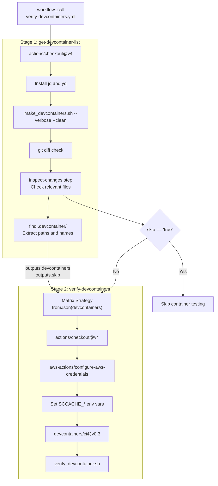
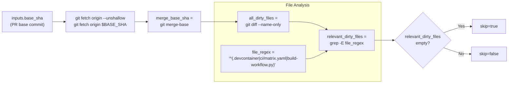
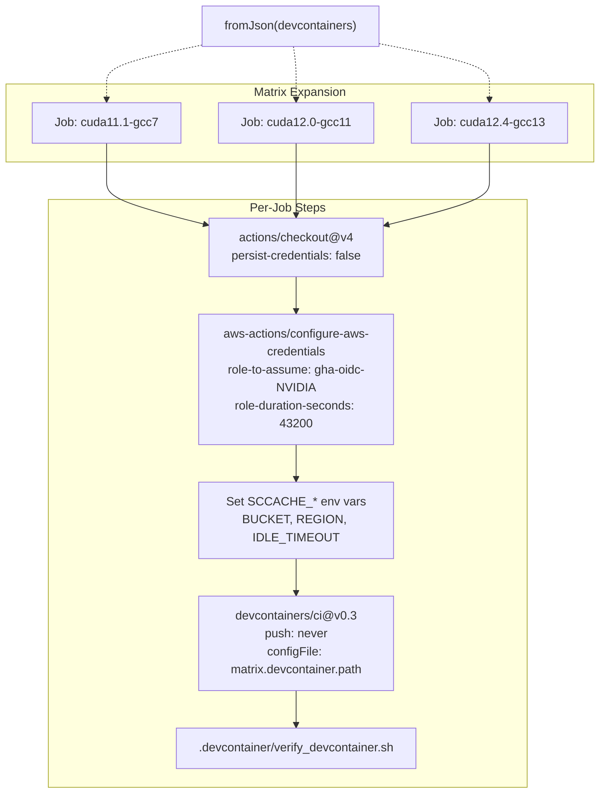
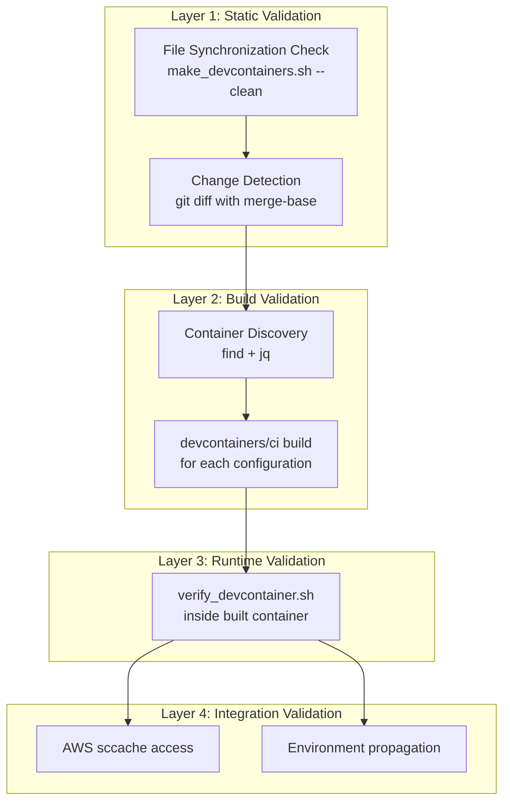

<!-- source: DeepWiki mcp.deepwiki.com · repo NVIDIA/cccl-gha · page 9.2 Testing and Validation · fetched 2026-10-26 -->

# Testing and Validation

<details>
<summary>Relevant source files</summary>

The following files were used as context for generating this wiki page:

- [.github/workflows/verify-devcontainers.yml](.github/workflows/verify-devcontainers.yml)

</details>


This document covers the testing and validation infrastructure for the cccl-gha system, focusing on the `verify-devcontainers` workflow that ensures devcontainer configurations remain functional and synchronized with their generation scripts. This page describes the automated checks that prevent configuration drift and verify container buildability.

For information about devcontainer runtime execution in CI jobs, see [Devcontainer System](#5.3). For troubleshooting CI failures, see [Troubleshooting Guide](#8.4).

---

## Purpose and Scope

The testing and validation system serves three primary functions:

1. **Configuration Synchronization**: Ensures checked-in devcontainer files match their generation scripts
2. **Build Verification**: Validates that each devcontainer image can be successfully built
3. **Runtime Testing**: Confirms containers can execute basic validation commands

The system is triggered during pull requests and workflow calls, with intelligent change detection to skip validation when unrelated files are modified.

Sources: [.github/workflows/verify-devcontainers.yml:1-142]()

---

## Verification Workflow Architecture

The `verify-devcontainers.yml` workflow implements a two-stage validation process: a preliminary stage that checks file synchronization and determines which containers need testing, followed by a parallelized stage that builds and tests each devcontainer.



**Workflow Stages**

| Stage | Job Name | Purpose | Key Outputs |
|-------|----------|---------|-------------|
| 1 | `get-devcontainer-list` | Verify file synchronization and identify containers to test | `skip`, `devcontainers` |
| 2 | `verify-devcontainers` | Build and test each devcontainer in parallel | Job success/failure status |

Sources: [.github/workflows/verify-devcontainers.yml:1-142]()

---

## File Synchronization Validation

The first critical check ensures that devcontainer configuration files remain synchronized with their generation script. This prevents manual edits from creating drift between the source-of-truth generation logic and the checked-in files.

### Generation Script Execution

The workflow executes the generation script with clean mode to regenerate all devcontainer files:

```bash
./.devcontainer/make_devcontainers.sh --verbose --clean
```

The `--clean` flag removes existing generated files before regenerating them, ensuring a pristine state. The `--verbose` flag provides detailed output for debugging failures.

**File:** [.github/workflows/verify-devcontainers.yml:37-39]()

### Diff Detection

After regeneration, the workflow checks for any modifications or untracked files:

```bash
if [[ $(git diff --stat) != '' || $(git status --porcelain | grep '^??') != '' ]]; then
  git diff --minimal
  git status --porcelain
  echo "::error:: Dev Container files are out of date or there are untracked files."
  exit 1
fi
```

This check detects two types of discrepancies:
- **Modified files**: Existing devcontainer files that differ from generated output
- **Untracked files**: New files created by the generation script that weren't committed

**File:** [.github/workflows/verify-devcontainers.yml:40-49]()

### Failure Resolution

When this check fails, developers must:
1. Run `.devcontainer/make_devcontainers.sh` locally
2. Review the generated changes
3. Commit the updated files to the pull request

Sources: [.github/workflows/verify-devcontainers.yml:37-49]()

---

## Change Detection and Conditional Execution

To optimize CI resource usage, the workflow implements intelligent change detection that skips container testing when unrelated files are modified.



### Relevant File Patterns

The change detection logic filters for files that could affect devcontainer functionality:

| Pattern | Description |
|---------|-------------|
| `^.devcontainer` | Devcontainer configuration files and scripts |
| `ci/matrix.yaml` | Matrix definitions that determine container requirements |
| `.github/actions/workflow-build/build-workflow.py` | Workflow generation logic that may affect container selection |

**File:** [.github/workflows/verify-devcontainers.yml:72]()

### Merge Base Calculation

The workflow uses `git merge-base` to find the common ancestor between the PR head and base, ensuring accurate diff calculation even when the PR branch is behind the target branch:

```bash
merge_base_sha=$(git merge-base $GITHUB_SHA $BASE_SHA)
all_dirty_files=$(git diff --name-only "${merge_base_sha}" "${GITHUB_SHA}")
```

**File:** [.github/workflows/verify-devcontainers.yml:59-67]()

### Conditional Job Execution

The `verify-devcontainers` job consumes the `skip` output to conditionally execute:

```yaml
needs: get-devcontainer-list
if: ${{ needs.get-devcontainer-list.outputs.skip != 'true' }}
```

When skipped, the entire matrix of container tests is bypassed, saving significant compute resources on PRs that only modify documentation or non-container code.

**File:** [.github/workflows/verify-devcontainers.yml:99]()

Sources: [.github/workflows/verify-devcontainers.yml:50-86](), [.github/workflows/verify-devcontainers.yml:96-99]()

---

## Devcontainer List Extraction

The workflow dynamically discovers all devcontainer configurations in the repository and prepares them for matrix execution.

### Discovery Process

```bash
devcontainers=$(find .devcontainer/ -name 'devcontainer.json' | while read -r devcontainer; do
  jq --arg path "$devcontainer" '{path: $path, name: .name}' "$devcontainer"
done | jq -s -c .)
```

This command:
1. Finds all `devcontainer.json` files recursively under `.devcontainer/`
2. Extracts the `path` (file location) and `name` (container display name) for each
3. Combines results into a single JSON array using `jq -s -c`

**File:** [.github/workflows/verify-devcontainers.yml:91-94]()

### Output Structure

The `devcontainers` output is a JSON array of objects:

```json
[
  {
    "path": ".devcontainer/cuda11.1-gcc7/devcontainer.json",
    "name": "cuda11.1-gcc7"
  },
  {
    "path": ".devcontainer/cuda12.0-gcc11/devcontainer.json",
    "name": "cuda12.0-gcc11"
  }
]
```

This structure is consumed by the matrix strategy in the next stage.

Sources: [.github/workflows/verify-devcontainers.yml:87-94]()

---

## Parallel Container Testing

The second stage builds and tests each devcontainer using a parallelized matrix strategy with `fail-fast: false` to ensure all containers are validated even if some fail.



### Matrix Configuration

```yaml
strategy:
  fail-fast: false
  matrix:
    devcontainer: ${{fromJson(needs.get-devcontainer-list.outputs.devcontainers)}}
```

**Key Settings:**
- `fail-fast: false`: Allows all containers to be tested even if one fails, providing comprehensive coverage
- `matrix.devcontainer`: Each element contains `path` and `name` properties from the discovery phase

**File:** [.github/workflows/verify-devcontainers.yml:101-104]()

### AWS Credential Configuration

AWS credentials are configured to enable sccache functionality within the containers, preventing authentication hangs:

```yaml
- name: Get AWS credentials for sccache bucket
  uses: aws-actions/configure-aws-credentials@v4
  with:
    role-to-assume: arn:aws:iam::279114543810:role/gha-oidc-NVIDIA
    aws-region: us-east-2
    role-duration-seconds: 43200 # 12 hours
```

The 12-hour duration ensures credentials remain valid for long-running builds.

**File:** [.github/workflows/verify-devcontainers.yml:116-121]()

### Environment Variable Propagation

Critical environment variables are set before container execution and explicitly passed to the devcontainer:

```yaml
- name: Set environment variables
  run: |
    echo "SCCACHE_BUCKET=rapids-sccache-devs" >> $GITHUB_ENV
    echo "SCCACHE_REGION=us-east-2" >> $GITHUB_ENV
    echo "SCCACHE_IDLE_TIMEOUT=32768" >> $GITHUB_ENV
    echo "SCCACHE_S3_USE_SSL=true" >> $GITHUB_ENV
    echo "SCCACHE_S3_NO_CREDENTIALS=false" >> $GITHUB_ENV
```

These are propagated into the container via the `env:` field in `devcontainers/ci`:

```yaml
env: |
  SCCACHE_REGION=${{ env.SCCACHE_REGION }}
  AWS_ACCESS_KEY_ID=${{ env.AWS_ACCESS_KEY_ID }}
  AWS_SESSION_TOKEN=${{ env.AWS_SESSION_TOKEN }}
  AWS_SECRET_ACCESS_KEY=${{ env.AWS_SECRET_ACCESS_KEY }}
```

**Files:** [.github/workflows/verify-devcontainers.yml:122-128](), [.github/workflows/verify-devcontainers.yml:135-139]()

Sources: [.github/workflows/verify-devcontainers.yml:101-142]()

---

## Devcontainer Build and Execution

The workflow uses the `devcontainers/ci@v0.3` action to build and run each devcontainer.

### Build Configuration

```yaml
- name: Run in devcontainer
  uses: devcontainers/ci@v0.3
  with:
    push: never
    configFile: ${{ matrix.devcontainer.path }}
    runCmd: |
      .devcontainer/verify_devcontainer.sh
```

**Configuration Details:**

| Parameter | Value | Purpose |
|-----------|-------|---------|
| `push` | `never` | Prevents pushing built images to registries (testing only) |
| `configFile` | `matrix.devcontainer.path` | Specifies which devcontainer.json to build |
| `runCmd` | `verify_devcontainer.sh` | Command executed inside the built container |

**File:** [.github/workflows/verify-devcontainers.yml:130-141]()

### Verification Script Execution

The `verify_devcontainer.sh` script runs inside the built container to perform runtime validation. While the script content is not provided in the available files, typical verification steps include:

- Checking compiler availability and versions
- Verifying CUDA toolkit installation (for CUDA containers)
- Testing basic build tool functionality
- Validating environment variable propagation

The script must exit with status 0 for the container to be considered valid.

### Build Failure Handling

With `fail-fast: false`, individual container build failures do not halt the entire workflow. This allows:
- Identification of multiple broken containers in a single run
- Isolation of failures to specific configurations
- Comprehensive test coverage across all devcontainers

Sources: [.github/workflows/verify-devcontainers.yml:130-142]()

---

## Permissions and Security

The workflow employs a least-privilege permission model with specific grants for required operations.

### Default Permissions

```yaml
permissions:
  contents: read
```

At the workflow level, only read access to repository contents is granted.

**File:** [.github/workflows/verify-devcontainers.yml:16-17]()

### Job-Level Permission Escalation

The `verify-devcontainers` job requires additional permissions for AWS OIDC authentication:

```yaml
permissions:
  id-token: write
  contents: read
```

**Permission Purposes:**

| Permission | Access Level | Purpose |
|------------|--------------|---------|
| `id-token` | `write` | Required for OIDC token generation for AWS authentication |
| `contents` | `read` | Required for repository checkout |

**File:** [.github/workflows/verify-devcontainers.yml:105-107]()

### Credential Management

The workflow disables credential persistence in Git checkouts to prevent credential leakage:

```yaml
uses: actions/checkout@v4
with:
  persist-credentials: false
```

This ensures that the `GITHUB_TOKEN` used for checkout is not stored in the Git configuration, preventing unauthorized access from container code.

**Files:** [.github/workflows/verify-devcontainers.yml:28-30](), [.github/workflows/verify-devcontainers.yml:109-112]()

Sources: [.github/workflows/verify-devcontainers.yml:16-17](), [.github/workflows/verify-devcontainers.yml:105-112]()

---

## Shell Configuration

The workflow enforces strict error handling through Bash shell options:

```yaml
defaults:
  run:
    shell: bash -euo pipefail {0}
```

**Shell Options:**

| Option | Effect |
|--------|--------|
| `-e` | Exit immediately if any command returns non-zero status |
| `-u` | Treat unset variables as errors |
| `-o pipefail` | Propagate failures from any command in a pipeline |

These options ensure that errors in validation scripts or commands are immediately caught and reported, preventing silent failures.

**File:** [.github/workflows/verify-devcontainers.yml:12-14]()

Sources: [.github/workflows/verify-devcontainers.yml:12-14]()

---

## Testing Strategy Summary

The verification workflow implements a multi-layered testing strategy:



**Validation Layers:**

1. **Static Validation**: Ensures configuration files are synchronized and filters for relevant changes
2. **Build Validation**: Verifies each devcontainer image can be successfully built
3. **Runtime Validation**: Confirms containers can execute validation commands
4. **Integration Validation**: Tests external service integration (AWS, environment variables)

This layered approach provides comprehensive coverage while optimizing execution time through early failure detection and conditional execution.

Sources: [.github/workflows/verify-devcontainers.yml:1-142]()

---

## Usage in CI Pipelines

The `verify-devcontainers` workflow is designed to be called from other workflows using `workflow_call`:

```yaml
name: Verify devcontainers
on:
  workflow_call:
    inputs:
      base_sha:
        type: string
        description: 'For PRs, set the base SHA to conditionally run this workflow only when relevant files are modified.'
        required: false
```

**Integration Pattern:**

```yaml
# In a parent workflow (e.g., pull_request.yml)
jobs:
  verify-containers:
    uses: ./.github/workflows/verify-devcontainers.yml
    with:
      base_sha: ${{ github.event.pull_request.base.sha }}
```

**Input Parameters:**

| Input | Type | Required | Purpose |
|-------|------|----------|---------|
| `base_sha` | `string` | No | PR base commit SHA for change detection; omit to force full validation |

When `base_sha` is omitted, the workflow skips change detection and validates all devcontainers unconditionally.

**File:** [.github/workflows/verify-devcontainers.yml:3-9]()

Sources: [.github/workflows/verify-devcontainers.yml:3-9]()

---

