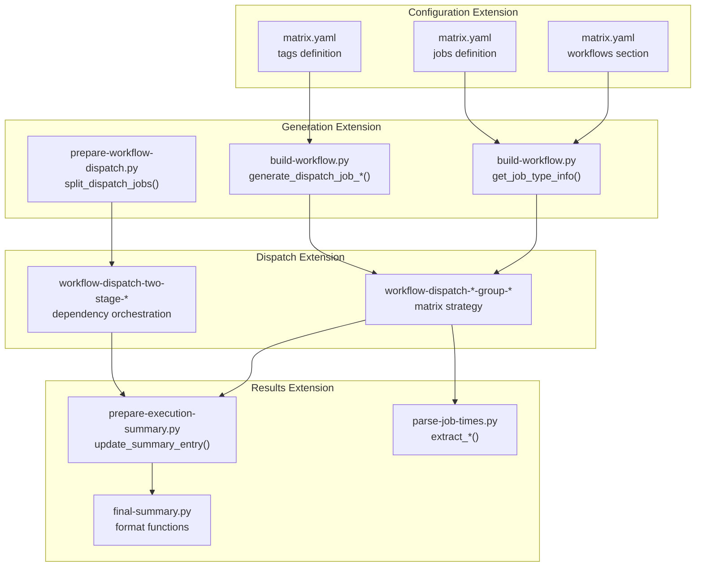
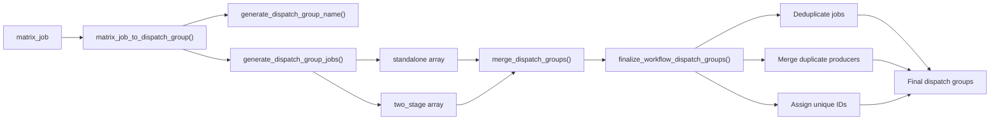
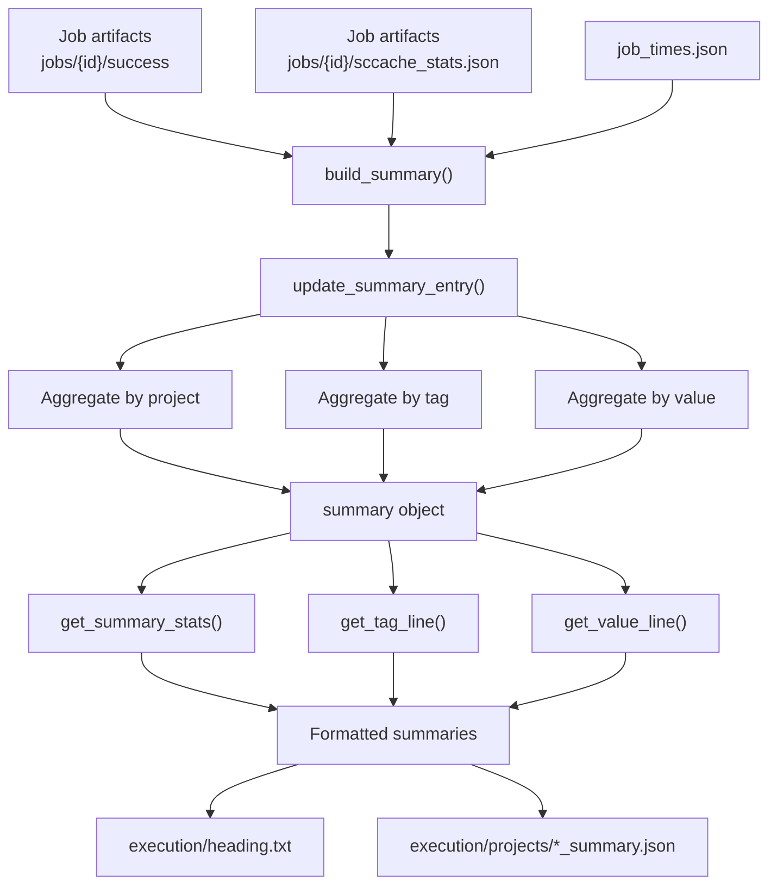

<!-- source: DeepWiki mcp.deepwiki.com · repo NVIDIA/cccl-gha · page 9.3 Extending the System · fetched 2026-10-26 -->

# Extending the System

<details>
<summary>Relevant source files</summary>

The following files were used as context for generating this wiki page:

- [.github/actions/workflow-build/build-workflow.py](.github/actions/workflow-build/build-workflow.py)
- [.github/actions/workflow-results/prepare-execution-summary.py](.github/actions/workflow-results/prepare-execution-summary.py)

</details>


## Purpose and Scope

This page provides guidance for developers who want to extend the cccl-gha workflow orchestration system. It covers the primary extension points and modification patterns for:

- Adding new job types (e.g., benchmark, sanitizer checks)
- Supporting new platforms (e.g., ARM64, macOS)
- Customizing dispatch logic (e.g., new execution patterns)
- Adding result processors (e.g., custom metrics, analysis)

For general system architecture understanding, see [System Architecture](#1.1). For testing extended functionality, see [Testing and Validation](#9.2). For configuration syntax reference, see [Configuration Guide](#2).

---

## Extension Point Architecture

The system has four primary extension points corresponding to its processing phases:

**Extension Point Overview**



**Sources:** [.github/actions/workflow-build/build-workflow.py](), [.github/actions/workflow-results/prepare-execution-summary.py]()

---

## Adding New Job Types

New job types are defined through a multi-layer approach that spans configuration, generation, and execution.

### Configuration Layer

Add the job definition to `matrix.yaml` under the `jobs` section:

```yaml
jobs:
  benchmark:
    name: "Benchmark"
    gpu: true
    needs: build
    invoke:
      prefix: benchmark
      args: "--verify"
```

The job definition schema includes:

| Field | Required | Description |
|-------|----------|-------------|
| `name` | No | Human-readable job name (defaults to capitalized job ID) |
| `gpu` | No | Whether job requires GPU access (default: `false`) |
| `needs` | No | Producer job dependency for two-stage pattern |
| `invoke.prefix` | No | Script name prefix (default: job ID) |
| `invoke.args` | No | Additional command-line arguments |

**Sources:** [.github/actions/workflow-build/build-workflow.py:260-282]()

### Generation Layer

The `get_job_type_info()` function retrieves job configuration and applies defaults. This function is memoized for performance:

```python
@memoize_result
def get_job_type_info(job):
    if not job in matrix_yaml['jobs'].keys():
        raise Exception(f"Unknown job '{job}'...")
    
    result = matrix_yaml['jobs'][job]
    result['id'] = job
    
    # Apply defaults
    if not 'name' in result:
        result['name'] = job.capitalize()
    # ... additional defaults
```

**Key generation functions** that reference job type information:

| Function | Line Range | Purpose |
|----------|------------|---------|
| `get_job_type_info()` | [260-282]() | Retrieve and normalize job configuration |
| `generate_dispatch_job_name()` | [362-376]() | Format human-readable job display name |
| `generate_dispatch_job_runner()` | [379-391]() | Select appropriate runner based on GPU requirement |
| `generate_dispatch_job_command()` | [415-445]() | Construct invocation command with parameters |
| `generate_dispatch_group_jobs()` | [507-539]() | Organize jobs into standalone/two-stage patterns |

**Sources:** [.github/actions/workflow-build/build-workflow.py:260-539]()

### Execution Layer

Create invocation scripts that the dispatch system will call. Scripts must follow naming conventions based on the `invoke.prefix` setting:

**Linux:**
```
./ci/{prefix}_{project_id}.sh
```

**Windows:**
```
./ci/windows/{prefix}_{project_id}.ps1
```

The command generation logic automatically constructs these paths and appends standard arguments (`-std`, `-arch`, `-cuda`, `-cmake-options`):

**Sources:** [.github/actions/workflow-build/build-workflow.py:415-445]()

### Dependency Handling

If your job has a `needs` field, it will automatically be organized into a two-stage producer/consumer pattern. The `generate_dispatch_group_jobs()` function handles this:

```python
two_stage = {}  # {producer: set([consumer, ...])}
for job_type in job_types:
    job_info = get_job_type_info(job_type)
    dep = job_info['needs']
    if dep:
        if dep in two_stage:
            two_stage[dep].add(job_type)
        else:
            two_stage[dep] = set([job_type])
```

**Sources:** [.github/actions/workflow-build/build-workflow.py:517-526]()

---

## Supporting New Platforms

### Adding New Runner Types

Runners are specified through a naming convention pattern in `generate_dispatch_job_runner()`:

```
{os}-{cpu}-{resource_type}-{details}
```

Examples:
- `linux-amd64-cpu16`
- `linux-amd64-gpu-t4-latest-1`
- `windows-amd64-cpu16`

**Runner selection logic:**

```python
def generate_dispatch_job_runner(matrix_job, job_type):
    runner_os = "windows" if is_windows(matrix_job) else "linux"
    cpu = matrix_job['cpu']
    
    job_info = get_job_type_info(job_type)
    if not job_info['gpu']:
        return f"{runner_os}-{cpu}-cpu16"
    
    gpu = get_gpu(matrix_job['gpu'])
    suffix = "-testing" if gpu['testing'] else ""
    
    return f"{runner_os}-{cpu}-gpu-{gpu['id']}-latest-1{suffix}"
```

To add ARM64 support, you would:

1. **Add CPU architecture to matrix.yaml:**

```yaml
tags:
  cpu:
    required: true
    values: ['amd64', 'arm64']
```

2. **Ensure runners exist** with naming: `linux-arm64-cpu16`

3. **Add platform-specific devcontainers** if needed (see Devcontainer System below)

**Sources:** [.github/actions/workflow-build/build-workflow.py:379-391]()

### Devcontainer System Extension

Devcontainers are constructed based on CUDA toolkit version and host compiler:

```python
def generate_dispatch_job_image(matrix_job, job_type):
    devcontainer_version = matrix_yaml['devcontainer_version']
    ctk = matrix_job['ctk']
    host_compiler = generate_dispatch_job_host_compiler(matrix_job, job_type)
    
    if is_windows(matrix_job):
        return f"rapidsai/devcontainers:{devcontainer_version}-cuda{ctk}-{host_compiler}"
    
    return f"rapidsai/devcontainers:{devcontainer_version}-cpp-{host_compiler}-cuda{ctk}"
```

The `print_devcontainer_info()` function extracts all unique CTK/compiler combinations to generate devcontainer configurations:

**Sources:** [.github/actions/workflow-build/build-workflow.py:404-413](), [.github/actions/workflow-build/build-workflow.py:1050-1085]()

### Platform Detection

Platform-specific behavior is controlled by the `is_windows()` function, which checks the host compiler's `container_tag`:

```python
def is_windows(matrix_job):
    host_compiler = get_host_compiler(matrix_job['cxx'])
    return host_compiler['container_tag'] == 'cl'
```

This affects:
- Script path selection (`.sh` vs `.ps1`)
- Devcontainer image selection
- Runner naming

To add macOS support, you would need to:

1. Add detection logic for macOS compilers
2. Update path generation for macOS scripts
3. Modify devcontainer selection (or skip containerization)
4. Update runner selection logic

**Sources:** [.github/actions/workflow-build/build-workflow.py:340-343]()

---

## Customizing Dispatch Logic

### Dispatch Group Organization

**Dispatch Group Generation Flow**



**Sources:** [.github/actions/workflow-build/build-workflow.py:542-722]()

### Group Name Generation

Group names organize jobs in the GitHub Actions UI. The naming convention is:

```
{project_name} CTK{version} {compiler_info}
```

This is generated by `generate_dispatch_group_name()`:

```python
def generate_dispatch_group_name(matrix_job):
    project = get_project(matrix_job['project'])
    ctk = matrix_job['ctk']
    device_compiler = get_device_compiler(matrix_job)
    host_compiler = get_host_compiler(matrix_job['cxx'])
    
    compiler_info = ""
    if device_compiler['id'] == 'nvcc':
        compiler_info = f"{device_compiler['name']} {host_compiler['name']}"
    # ...
    
    return f"{project['name']} CTK{ctk} {compiler_info}"
```

To customize grouping, modify this function. For example, to group by GPU architecture:

```python
return f"{project['name']} SM{matrix_job['sm']} {compiler_info}"
```

**Sources:** [.github/actions/workflow-build/build-workflow.py:345-359]()

### Deduplication and Finalization

The `finalize_workflow_dispatch_groups()` function performs critical post-processing:

**Finalization Operations:**

| Operation | Line Range | Purpose |
|-----------|------------|---------|
| Validate single producer | [587-599]() | Ensure two-stage jobs have exactly one producer |
| Merge duplicate producers | [602-640]() | Combine consumers for identical producers |
| Remove duplicate standalones | [643-651]() | Eliminate redundant standalone jobs |
| Check producer/consumer conflicts | [654-682]() | Remove standalones that appear in two-stage |
| Assign unique IDs | [708-720]() | Generate compact GUIDs for dispatch workflows |

**Sources:** [.github/actions/workflow-build/build-workflow.py:583-722]()

### Custom Execution Patterns

To add a new execution pattern beyond standalone/two-stage:

1. **Extend the dispatch group schema** in `generate_dispatch_group_jobs()`:

```python
dispatch_group_jobs = {
    "standalone": [],
    "two_stage": [],
    "three_stage": []  # New pattern
}
```

2. **Add generation logic** for the new pattern
3. **Create corresponding dispatch workflow** (e.g., `workflow-dispatch-three-stage-*.yml`)
4. **Update `prepare-workflow-dispatch.py`** to split jobs into the new category

**Sources:** [.github/actions/workflow-build/build-workflow.py:507-539]()

---

## Adding Result Processors

### Summary Generation Architecture

**Result Processing Pipeline**



**Sources:** [.github/actions/workflow-results/prepare-execution-summary.py:102-162](), [.github/actions/workflow-results/prepare-execution-summary.py:195-316]()

### Extending Summary Data

The `update_summary_entry()` function is the primary integration point for new metrics:

```python
def update_summary_entry(entry, job, job_times=None):
    # Success/failure tracking
    if job_succeeded(job):
        entry['passed'] += 1
    else:
        entry['failed'] += 1
    
    # Timing information
    if job_times:
        time_info = job_times[job["id"]]
        entry['job_time'] += time_info["job_seconds"]
        entry['command_time'] += time_info["command_seconds"]
    
    # Sccache statistics
    sccache_stats = get_sccache_stats(job["id"])
    if sccache_stats:
        # Process and aggregate
```

To add custom metrics (e.g., memory usage, code coverage):

1. **Create artifact file** in job execution: `jobs/{id}/custom_metric.json`

2. **Add retrieval function:**

```python
@functools.lru_cache(maxsize=None)
def get_custom_metric(job_id):
    metric_file = f'jobs/{job_id}/custom_metric.json'
    if os.path.exists(metric_file):
        with open(metric_file) as f:
            return json.load(f)
    return None
```

3. **Extend `update_summary_entry()`:**

```python
custom_metric = get_custom_metric(job["id"])
if custom_metric:
    if 'custom' not in entry:
        entry['custom'] = {'total': 0, 'count': 0}
    entry['custom']['total'] += custom_metric['value']
    entry['custom']['count'] += 1
```

4. **Add display formatting** in `get_summary_stats()`:

```python
if 'custom' in summary:
    custom = summary['custom']
    avg = custom['total'] / custom['count']
    stats += f' | Custom: {avg:.2f}'
```

**Sources:** [.github/actions/workflow-results/prepare-execution-summary.py:55-99](), [.github/actions/workflow-results/prepare-execution-summary.py:195-221]()

### Hierarchical Aggregation

The `build_summary()` function creates a three-level hierarchy:

1. **Overall summary** - All jobs
2. **Per-project summary** - Jobs grouped by project
3. **Per-tag-value summary** - Jobs grouped by each tag's values

This structure is built by iterating through jobs and calling `update_summary_entry()` at each level:

```python
for job in jobs:
    update_summary_entry(summary, job, job_times)
    
    matrix_job = job["origin"]["matrix_job"]
    project = matrix_job["project"]
    
    # Project level
    update_summary_entry(projects[project], job, job_times)
    
    # Tag/value level
    for tag in matrix_job.keys():
        value = str(matrix_job[tag])
        update_summary_entry(tags[tag]['values'][value], job, job_times)
```

**Sources:** [.github/actions/workflow-results/prepare-execution-summary.py:102-162]()

### Culprit Detection Logic

The system automatically identifies "likely culprits" - tag values responsible for all failures in a dimension. This is implemented through tag ranking:

```python
def rank_tag(tag_summary):
    num_values = len(tag_summary['values'])
    num_failing_values = sum(1 for v in tag_summary['values'].values() 
                            if v['failed'] > 0)
    
    if num_values > 1:
        if num_failing_values == 1:
            return 0  # Likely culprit - one failing value
        elif num_failing_values > 0 and num_failing_values < num_values:
            return 1  # Mixed results
    elif tag_failures > 0:
        return 2  # All values fail
    return 3  # No failures
```

Tags are sorted by this rank, placing likely culprits first in the output. To customize detection logic, modify the `rank_tag()` function or the flag assignment in `get_tag_line()` and `get_value_line()`.

**Sources:** [.github/actions/workflow-results/prepare-execution-summary.py:145-160](), [.github/actions/workflow-results/prepare-execution-summary.py:249-280]()

### Custom Output Formats

The final summary generation occurs in `final-summary.py` (not shown in provided files), which consumes the intermediate JSON files:

- `execution/heading.txt` - Overall status
- `execution/projects/*_summary.json` - Per-project details

To add custom output destinations:

1. **Generate additional JSON/text files** in `prepare-execution-summary.py`
2. **Create new formatting script** that reads these files
3. **Integrate into workflow-results action** by adding steps

**Sources:** [.github/actions/workflow-results/prepare-execution-summary.py:319-345]()

---

## Code Extension Checklist

When extending the system, verify modifications at each layer:

| Layer | Files to Modify | Validation |
|-------|----------------|------------|
| **Configuration** | `ci/matrix.yaml` | Schema validation in `validate_tags()` |
| **Generation** | `build-workflow.py` | Run with `--workflows test` to verify output |
| **Dispatch** | `workflow-dispatch-*.yml` | Check generated `dispatch.json` structure |
| **Execution** | `ci/*.sh`, `ci/windows/*.ps1` | Test locally or in devcontainer |
| **Results** | `prepare-execution-summary.py` | Verify output JSON structure |

**Key validation functions:**

- [build-workflow.py:811-833]() - `validate_tags()`: Ensures all required tags present
- [build-workflow.py:583-722]() - `finalize_workflow_dispatch_groups()`: Validates dispatch structure
- [prepare-execution-summary.py:12-14]() - `job_succeeded()`: Validates artifact presence

**Sources:** [.github/actions/workflow-build/build-workflow.py](), [.github/actions/workflow-results/prepare-execution-summary.py]()