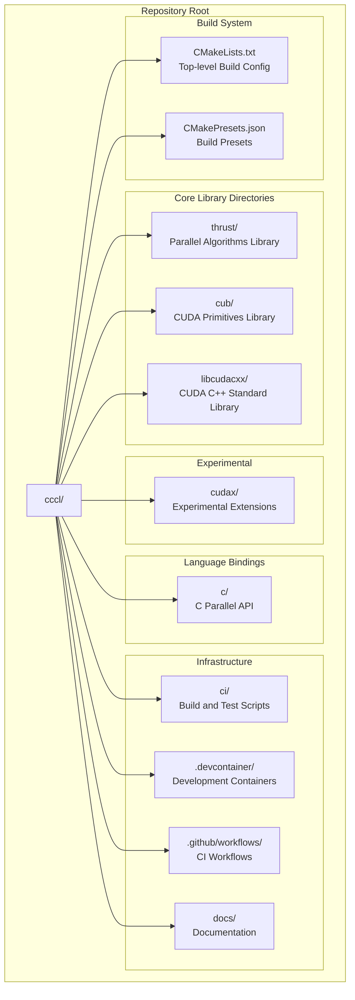
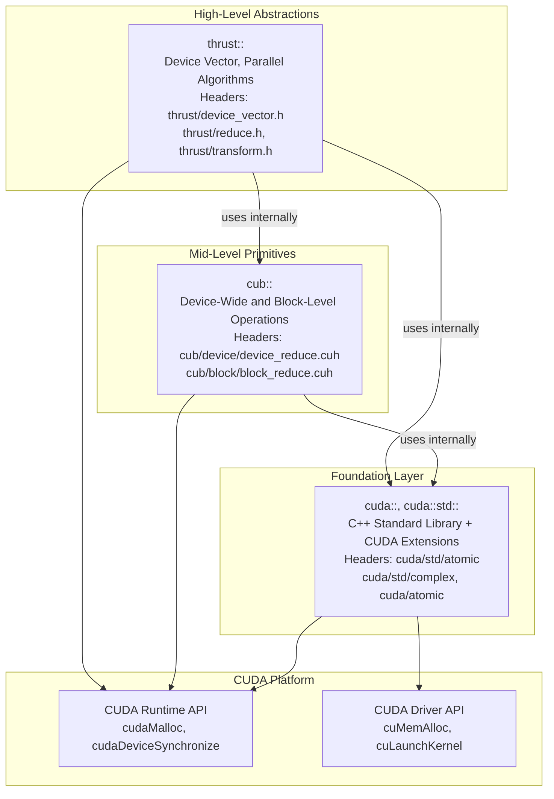
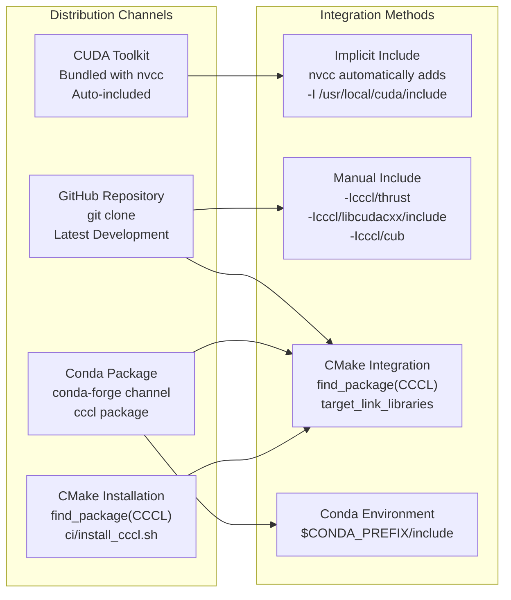

<!-- source: DeepWiki mcp.deepwiki.com · repo NVIDIA/cccl · page 1 Overview · fetched 2026-10-26 -->

# Overview

Relevant source files

The following files were used as context for generating this wiki page:

- [CONTRIBUTING.md](CONTRIBUTING.md)
- [README.md](README.md)

This page provides a high-level introduction to the CUDA Core Compute Libraries (CCCL) repository, its mission, architecture, and how the three core libraries work together. For detailed installation instructions, see [Installation and Setup](#1.2). For working code examples, see [Quick Start Examples](#1.3). For in-depth documentation of each library, see [Core Libraries](#2).

## What is CCCL

CCCL is a unified repository that consolidates three essential CUDA C++ libraries into a single development toolkit. The repository combines **Thrust**, **CUB**, and **libcudacxx** to provide a comprehensive set of building blocks for CUDA C++ developers. All components are header-only, requiring no separate compilation or linking steps.

The mission of CCCL is to make CUDA development more delightful by providing high-quality, high-performance, and easy-to-use C++ abstractions. These libraries fill the same role for CUDA C++ that the Standard C++ Library fills for Standard C++: providing general-purpose, speed-of-light tools that allow developers to focus on solving domain-specific problems.

**Sources:** [README.md:6-32]()

## Repository Structure

The CCCL repository is organized into distinct directories for each library component, along with supporting infrastructure:

**Sources:** [README.md:10-14](), [README.md:476-478]()

## Library Abstraction Levels

The three core libraries operate at different abstraction levels, with clear dependency relationships. Higher-level libraries build upon lower-level ones to provide progressively easier-to-use interfaces:

**Sources:** [README.md:22-32]()

### Thrust: High-Level Parallel Algorithms

**Thrust** provides a C++ parallel algorithms library inspired by the C++ Standard Library. It offers containers like `thrust::device_vector` and algorithms like `thrust::reduce`, `thrust::transform`, and `thrust::sort`. The high-level interface greatly enhances programmer productivity while enabling performance portability through configurable backends.

Key headers: `thrust/device_vector.h`, `thrust/execution_policy.h`, `thrust/reduce.h`

**Sources:** [README.md:25]()

### CUB: Low-Level CUDA Primitives

**CUB** is a CUDA-specific library designed for speed-of-light parallel algorithms. It provides:
- **Device-wide algorithms**: `cub::DeviceReduce`, `cub::DeviceScan`, `cub::DeviceRadixSort`
- **Block-level primitives**: `cub::BlockReduce`, `cub::BlockScan`, `cub::BlockLoad`

These primitives are building blocks for creating custom, high-performance kernels.

Key headers: `cub/device/device_reduce.cuh`, `cub/block/block_reduce.cuh`

For detailed documentation, see [CUB](#2.2).

**Sources:** [README.md:27]()

### libcudacxx: CUDA C++ Standard Library

**libcudacxx** provides an implementation of the C++ Standard Library that works in both host and device code. It includes:
- Standard library components: `cuda::std::atomic`, `cuda::std::complex`, `cuda::std::span`
- CUDA-specific abstractions: `cuda::atomic_ref`, synchronization primitives, cache control
- Extended floating-point types: `__nv_bfloat16`, `__nv_fp8_e4m3`

Key headers: `cuda/std/atomic`, `cuda/atomic`, `cuda/std/complex`

For detailed documentation, see [libcudacxx](#2.3).

**Sources:** [README.md:29]()

## Header-Only Design

All CCCL components are header-only libraries. There is no separate compilation or linking step required to use them. Users simply include the necessary headers and compile their code with `nvcc` or another CUDA-capable compiler.

This design provides several benefits:
- **No build artifacts**: No `.so`, `.dll`, or `.a` files to manage
- **Easy integration**: Include headers and compile
- **Inline optimization**: Compiler can optimize across library boundaries
- **Version flexibility**: Different projects can use different CCCL versions without conflicts

**Sources:** [README.md:112-113]()

## Example: Combining All Three Libraries

The following example from the repository demonstrates how Thrust, CUB, and libcudacxx work together. A custom kernel uses `cub::BlockReduce` to sum array elements within each block, then uses `cuda::atomic_ref` from libcudacxx to combine block results. The same operation is performed using Thrust's `reduce` algorithm for comparison.

[README.md:46-105]() shows this complete working example, which can be run interactively on Godbolt.

Key elements demonstrated:
- **libcudacxx**: `cuda::std::span`, `cuda::atomic_ref`, `cuda::memory_order_relaxed`
- **CUB**: `cub::BlockReduce<int, block_size>`
- **Thrust**: `thrust::device_vector`, `thrust::reduce`, `thrust::fill`

**Sources:** [README.md:34-105]()

## Distribution and Installation Options

CCCL is distributed through multiple channels to support different user workflows:

**Sources:** [README.md:110-214]()

### CUDA Toolkit (Simplest)

When compiling with `nvcc`, CCCL headers are automatically included from the CUDA Toolkit installation (typically `/usr/local/cuda/include`). No additional configuration is required.

**Sources:** [README.md:115-119]()

### GitHub (Latest Development)

Users can clone the repository and add include paths manually. This allows using newer CCCL versions with older CUDA Toolkits (backward compatible, but not forward compatible).

**Sources:** [README.md:128-140]()

### Conda (Versioned Releases)

CCCL packages are available via `conda-forge`. The `cuda-cccl` metapackage installs the CCCL version that shipped with a specific CUDA Toolkit version.

**Sources:** [README.md:172-204]()

### CMake Installation

The repository provides CMake-based installation with presets for different configurations. The `ci/install_cccl.sh` convenience script simplifies installation to a custom prefix.

**Sources:** [README.md:141-170](), [README.md:206-214]()

## Versioning and Compatibility

CCCL uses semantic versioning (`MAJOR.MINOR.PATCH`) with the following key properties:

| Property | Policy |
|----------|--------|
| **Backward Compatibility** | CCCL version `X.Y` works with CTK versions from the current and previous major series |
| **Forward Compatibility** | Never supported; older CCCL cannot work with newer CTK |
| **API Breaking Changes** | Only occur with major version increments, aligned with CTK major releases |
| **ABI Stability** | `thrust::` and `cub::` namespaces may break ABI anytime; `cuda::` uses inline namespace versioning |

Version macros are available in:
- `<cuda/version>`: `CCCL_MAJOR_VERSION`, `CCCL_MINOR_VERSION`, `CCCL_PATCH_VERSION`
- `<thrust/version.h>`: `THRUST_VERSION`, `THRUST_MAJOR_VERSION`
- `<cub/version.h>`: `CUB_VERSION`, `CUB_MAJOR_VERSION`
- `<cuda/std/version>`: `_LIBCUDACXX_CUDA_API_VERSION`

For complete versioning details, see [Versioning Policy](#6.1) and [API and ABI Stability](#6.2).

**Sources:** [README.md:229-261](), [README.md:319-441]()

## Supported Platforms

CCCL supports:

| Component | Support |
|-----------|---------|
| **CUDA Toolkits** | CCCL 3.x supports CTK 12.x and 13.x |
| **Host Compilers** | GCC (≥7.x), Clang, MSVC, NVHPC |
| **C++ Standards** | C++17, C++20 |
| **GPU Architectures** | All architectures supported by current CTK (e.g., ≥sm_75 for CTK 13.x) |
| **Operating Systems** | Linux, Windows (same as CUDA Toolkit) |

The definitive testing matrix is maintained in [ci/matrix.yaml:1-end](). For the complete platform support policy, see [Platform and Compiler Support](#6.3).

**Sources:** [README.md:220-317]()

## Development and Contribution

CCCL uses a modern development workflow with:
- **Development Containers**: Consistent environments mirroring CI configurations in [.devcontainer/]()
- **CMake Presets**: Pre-configured build settings in [CMakePresets.json:1-end]()
- **Build Scripts**: Convenience scripts in [ci/build_*.sh]() and [ci/test_*.sh]()
- **Matrix Testing**: Comprehensive testing across toolchains defined in [ci/matrix.yaml:1-end]()

For contributing, see the [Contributor Guide](CONTRIBUTING.md) and [Build System and Development](#3).

**Sources:** [README.md:216-218](), [CONTRIBUTING.md:1-276]()

## Navigation

- **Next Steps**: [What is CCCL](#1.1) provides a deeper explanation of CCCL's purpose and design philosophy
- **Getting Started**: [Installation and Setup](#1.2) covers all installation methods in detail
- **Examples**: [Quick Start Examples](#1.3) shows minimal working code for each library
- **Library Details**: [Core Libraries](#2) documents Thrust, CUB, libcudacxx, and CUDAX
- **Building and Testing**: [Build System and Development](#3) explains the build infrastructure
- **CI/CD**: [CI/CD Infrastructure](#4) details the continuous integration pipeline

**Sources:** [README.md:1-515]()

---

