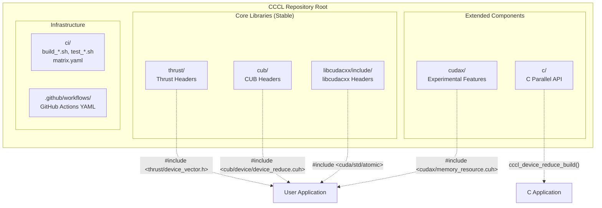
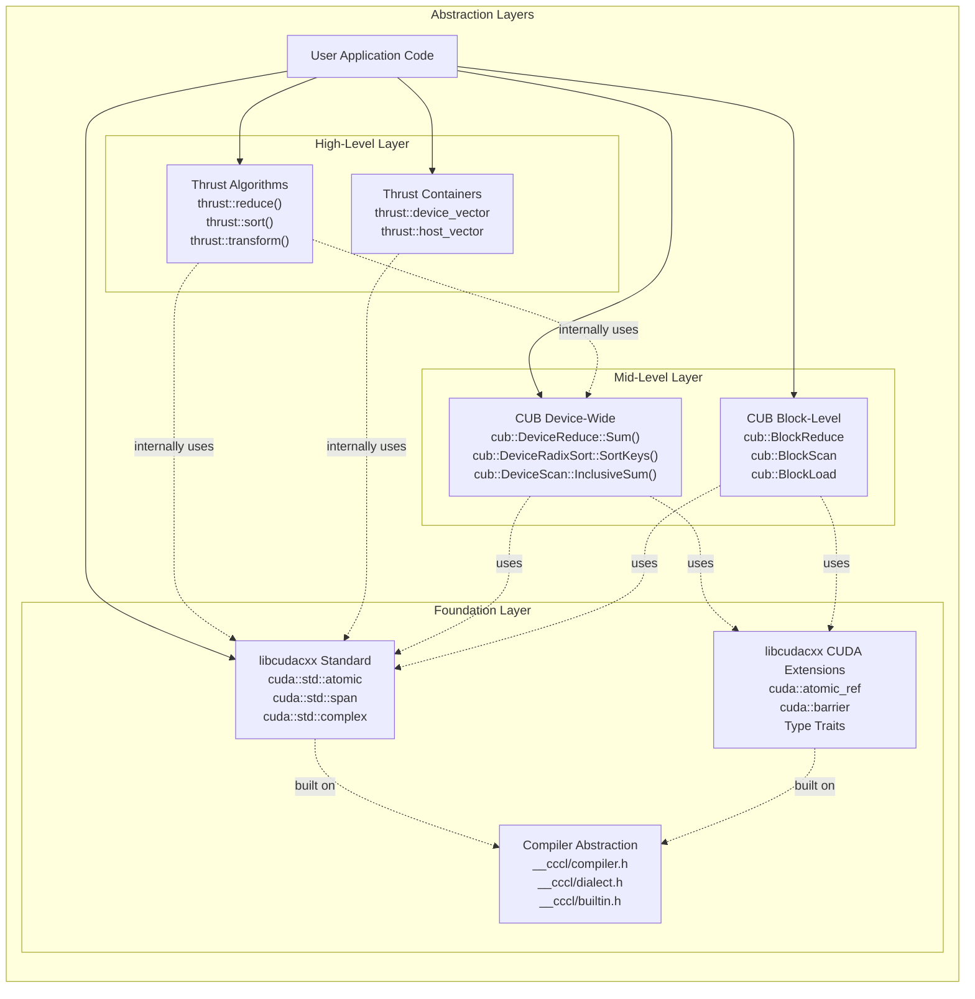
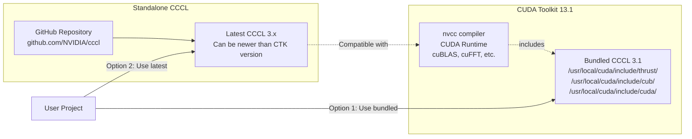

<!-- source: DeepWiki mcp.deepwiki.com · repo NVIDIA/cccl · page 1.1 What is CCCL · fetched 2026-10-26 -->

# What is CCCL

<details>
<summary>Relevant source files</summary>

The following files were used as context for generating this wiki page:

- [CONTRIBUTING.md](CONTRIBUTING.md)
- [README.md](README.md)

</details>


**Purpose:** This page defines the CUDA Core Compute Libraries (CCCL) as a unified repository containing Thrust, CUB, and libcudacxx. It explains the role of each library, the header-only design philosophy, and how these components integrate to provide building blocks for CUDA C++ development.

**Scope:** This page covers the conceptual overview and structure of CCCL. For installation instructions, see [Installation and Setup](#1.2). For detailed documentation of individual libraries, see [Core Libraries](#2). For versioning policies, see [Versioning Policy](#6.1).

---

## Overview

CCCL (CUDA Core Compute Libraries) is a unified repository that consolidates three essential CUDA C++ libraries: Thrust, CUB, and libcudacxx. The mission is to provide CUDA C++ developers with building blocks that make it easier to write safe and efficient code.

Prior to unification, these libraries were developed independently in separate repositories but with overlapping goals. Bringing them together streamlines development and broadens the ability to leverage CUDA C++ capabilities. The repository also includes experimental features (CUDAX) and language bindings (C Parallel API).

**Sources:** [README.md:6-18](), [README.md:20-32]()

---

## Repository Structure

CCCL organizes its components in a flat directory structure at the repository root:

| Directory | Component | Description |
|-----------|-----------|-------------|
| `thrust/` | Thrust library | High-level parallel algorithms with STL-like interface |
| `cub/` | CUB library | Low-level CUDA primitives for device-wide and block-level operations |
| `libcudacxx/` | libcudacxx library | CUDA C++ Standard Library, host and device compatible |
| `cudax/` | CUDAX (experimental) | Experimental memory resources, execution policies, and Sequential Task Framework |
| `c/` | C Parallel API | JIT-compiled C language bindings wrapping CUB primitives |
| `ci/` | CI infrastructure | Build scripts, test scripts, matrix configuration |
| `.github/workflows/` | GitHub Actions | CI/CD workflow definitions |

**Diagram: CCCL Repository Component Layout**



**Sources:** [README.md:10-14](), [CONTRIBUTING.md:76-104]()

---

## The Three Core Libraries

### Thrust: High-Level Parallel Algorithms

Thrust is a C++ parallel algorithms library inspired by the C++ Standard Library. It provides a high-level interface for common parallel patterns, greatly enhancing programmer productivity while maintaining performance portability.

**Key characteristics:**
- STL-like interface with algorithms such as `thrust::reduce`, `thrust::sort`, `thrust::transform`
- Container abstractions including `thrust::device_vector` and `thrust::host_vector`
- Configurable execution policies (`thrust::device`, `thrust::host`, etc.)
- Built on top of CUB and libcudacxx internally

**Example header:** `<thrust/device_vector.h>`, `<thrust/reduce.h>`, `<thrust/execution_policy.h>`

**Sources:** [README.md:25](), [README.md:46-106]()

### CUB: Low-Level CUDA Primitives

CUB provides speed-of-light parallel algorithms optimized for CUDA GPUs. It offers both device-wide algorithms for end-to-end operations and cooperative algorithms for use within custom CUDA kernels.

**Key characteristics:**
- Device-wide primitives: `cub::DeviceReduce`, `cub::DeviceScan`, `cub::DeviceRadixSort`, `cub::DeviceSelect`
- Block-level primitives: `cub::BlockReduce`, `cub::BlockScan`, `cub::BlockLoad`, `cub::BlockStore`
- Warp-level primitives for fine-grained parallelism
- Architecture-specific tuning and policy selection via `PolicyHub`
- Uses libcudacxx for type traits and utilities

**Example header:** `<cub/device/device_reduce.cuh>`, `<cub/block/block_reduce.cuh>`

**Sources:** [README.md:27](), [README.md:46-71]()

### libcudacxx: CUDA C++ Standard Library

libcudacxx is the CUDA C++ Standard Library providing an implementation of the C++ Standard Library that works identically in both host and device code. It serves as the foundation for both Thrust and CUB.

**Key characteristics:**
- Standard library components: `cuda::std::atomic`, `cuda::std::complex`, `cuda::std::span`, `cuda::std::optional`
- Extended floating-point types: `__half`, `__nv_bfloat16`, `__nv_fp8_e4m3`, `__nv_fp8_e5m2`
- Compiler abstraction layer: `__cccl/compiler.h`, `__cccl/dialect.h`, `__cccl/builtin.h`
- CUDA-specific features: `cuda::atomic_ref`, memory synchronization primitives, TMA descriptors
- Header location: `libcudacxx/include/cuda/std/` for standard library, `libcudacxx/include/cuda/` for CUDA extensions

**Example header:** `<cuda/std/atomic>`, `<cuda/atomic>`, `<cuda/std/complex>`

**Sources:** [README.md:29](), [README.md:46-71]()

---

## Library Dependency Relationships

The three core libraries have well-defined dependency relationships, with higher-level libraries building on lower-level ones.

**Diagram: Library Dependency Flow**



**Sources:** [README.md:22-32](), [README.md:46-71]()

---

## Additional Components

### CUDAX: Experimental Extensions

CUDAX contains experimental features that may eventually be promoted to stable components or influence the design of future CUDA features. It is located in the `cudax/` directory.

**Key features:**
- Memory resource abstractions (`cuda::mr::device_memory_resource`, `cuda::mr::pinned_memory_pool`)
- Execution policy components
- Sequential Task Framework (STF) for graph-based task execution with `cudax::stream_ctx` and `cudax::graph_ctx`

**Note:** CUDAX APIs are unstable and subject to breaking changes without major version increments.

**Sources:** [README.md:10-14]()

### C Parallel API: Language Bindings

The C Parallel API provides C language bindings for CUB device-wide primitives through JIT compilation. Located in the `c/` directory, it enables non-C++ languages to leverage CUB functionality.

**Key characteristics:**
- Functions like `cccl_device_reduce_build()`, `cccl_device_sort_build()` generate device code at runtime
- Uses NVRTC (NVIDIA Runtime Compilation) for JIT compilation
- Links via LTO-IR (Link Time Optimization - Intermediate Representation)
- Header: `c/parallel/include/cccl_c/device_reduce.h`

**Sources:** [README.md:10-14]()

---

## Header-Only Design Philosophy

All CCCL libraries are **header-only**, meaning there are no compiled binary artifacts to link against. Users simply `#include` the headers they need, and the compiler generates the necessary code during compilation.

**Implications of header-only design:**

| Aspect | Description |
|--------|-------------|
| **Integration** | No linking step required; simply add include paths |
| **Distribution** | Only header files need to be distributed |
| **Versioning** | No ABI compatibility concerns for `thrust::` and `cub::` namespaces (though `cuda::` namespace uses ABI versioning) |
| **Compilation** | Code is compiled with user's chosen compiler flags and optimizations |
| **Templates** | Extensive use of C++ templates enables compile-time specialization |

**Basic usage pattern:**

```cpp
// User code simply includes desired headers
#include <thrust/device_vector.h>
#include <cub/device/device_reduce.cuh>
#include <cuda/std/atomic>

// No linking required; everything is compiled together
```

**Installation methods (all provide header access):**
1. **CUDA Toolkit**: Headers automatically available when using `nvcc` (e.g., `/usr/local/cuda/include`)
2. **GitHub**: Clone repository and add include paths: `-Icccl/thrust -Icccl/libcudacxx/include -Icccl/cub`
3. **CMake**: Use `find_package(CCCL)` after installation via `cmake . && make install`
4. **Conda**: Install via `conda install cccl` from `conda-forge` channel

**Sources:** [README.md:112-214](), [CONTRIBUTING.md:66-68]()

---

## Unified Versioning

As of version 2.2.0, all CCCL components share a unified semantic version `MAJOR.MINOR.PATCH`. This simplifies dependency management and ensures consistency across the repository.

**Version query mechanisms:**

| Library | Header | Version Macros |
|---------|--------|----------------|
| CCCL (unified) | `<cuda/version>` | `CCCL_MAJOR_VERSION`, `CCCL_MINOR_VERSION`, `CCCL_PATCH_VERSION`, `CCCL_VERSION` |
| libcudacxx | `<cuda/std/version>` | `_LIBCUDACXX_CUDA_API_VERSION_MAJOR`, `_LIBCUDACXX_CUDA_API_VERSION` |
| Thrust | `<thrust/version.h>` | `THRUST_MAJOR_VERSION`, `THRUST_VERSION` |
| CUB | `<cub/version.h>` | `CUB_MAJOR_VERSION`, `CUB_VERSION` |

**Version format:**
- CCCL/libcudacxx: `MMMmmmppp` (e.g., `002005000` for version 2.5.0)
- Thrust/CUB: `MMMmmmpp` (e.g., `00200500` for version 2.5.0)

**Backward compatibility:**
- CCCL version `X.Y` is compatible with CUDA Toolkit major versions `N` and `N-1`
- CCCL version 3.x supports CTK 12.x and 13.x
- CCCL version 2.x supports CTK 11.1-11.8 and 12.x

**Note:** Only the latest CCCL version receives updates; bug fixes are not backported to older releases.

**Sources:** [README.md:319-386](), [README.md:227-263](), [README.md:452-473]()

---

## Relationship to CUDA Toolkit

CCCL is distributed both as part of the CUDA Toolkit and as a standalone repository. The CUDA Toolkit includes a specific version of CCCL, but users can upgrade CCCL independently.

**Distribution relationship:**



**Compatibility rules:**
- ✅ Newer CCCL + Older CUDA Toolkit (within supported major versions)
- ❌ Older CCCL + Newer CUDA Toolkit (forward incompatibility)

**Sources:** [README.md:115-131](), [README.md:227-263]()

---

## Example: Using All Three Libraries Together

The following example demonstrates how Thrust, CUB, and libcudacxx work together in a single application, showing their complementary roles:

```cpp
// From README.md:46-106
#include <thrust/device_vector.h>        // Thrust container
#include <thrust/execution_policy.h>     // Thrust execution policy
#include <cub/block/block_reduce.cuh>    // CUB block primitive
#include <cuda/atomic>                   // libcudacxx atomic
#include <cuda/std/span>                 // libcudacxx standard library

// Custom kernel using CUB block primitive and libcudacxx atomic
template <int block_size>
__global__ void reduce(cuda::std::span<int const> data, 
                       cuda::std::span<int> result) {
  using BlockReduce = cub::BlockReduce<int, block_size>;
  __shared__ typename BlockReduce::TempStorage temp_storage;
  
  int sum = /* ... */;
  sum = BlockReduce(temp_storage).Sum(sum);  // CUB
  
  if (threadIdx.x == 0) {
    cuda::atomic_ref<int, cuda::thread_scope_device> atomic_result(/*...*/);
    atomic_result.fetch_add(sum, cuda::memory_order_relaxed);  // libcudacxx
  }
}

int main() {
  thrust::device_vector<int> data(1000);  // Thrust container
  thrust::fill(data.begin(), data.end(), 1);  // Thrust algorithm
  
  // Launch custom kernel using CUB + libcudacxx
  reduce<256><<</*...*/>>>(/*...*/);
  
  // Use Thrust high-level algorithm for comparison
  int thrust_result = thrust::reduce(thrust::device, data.begin(), data.end(), 0);
}
```

**Library roles in this example:**
- **Thrust**: Provides `device_vector` for memory management and `reduce` algorithm for high-level operations
- **CUB**: Provides `BlockReduce` for efficient intra-block reduction in custom kernel
- **libcudacxx**: Provides `atomic_ref` for safe atomic operations and `span` for non-owning array views

**Sources:** [README.md:34-106]()

---

