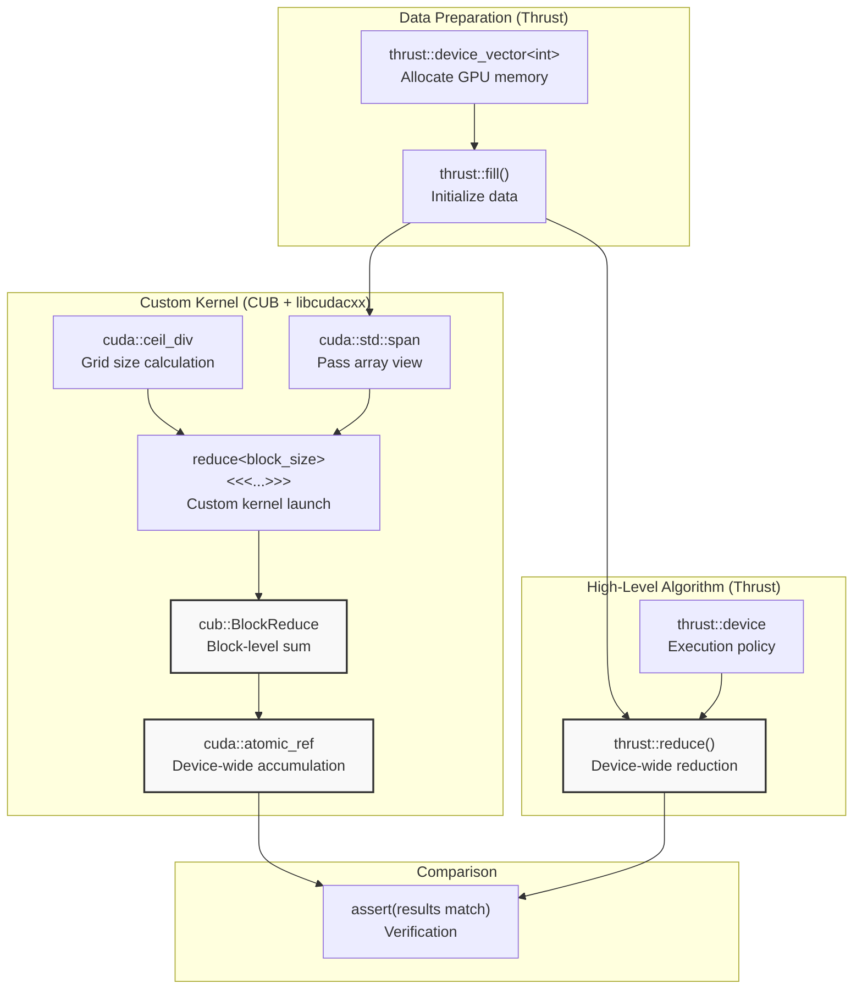
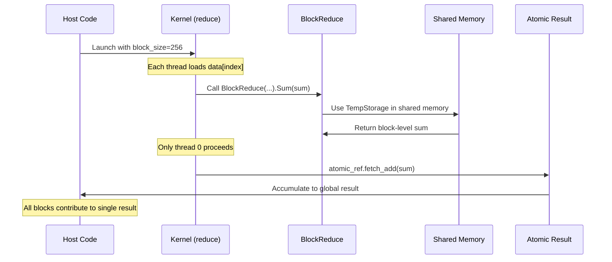

<!-- source: DeepWiki mcp.deepwiki.com · repo NVIDIA/cccl · page 1.3 Quick Start Examples · fetched 2026-10-26 -->

# Quick Start Examples

<details>
<summary>Relevant source files</summary>

The following files were used as context for generating this wiki page:

- [CONTRIBUTING.md](CONTRIBUTING.md)
- [README.md](README.md)
- [cub/benchmarks/bench/reduce/base.cuh](cub/benchmarks/bench/reduce/base.cuh)
- [cub/benchmarks/bench/reduce/deterministic.cu](cub/benchmarks/bench/reduce/deterministic.cu)
- [cub/benchmarks/bench/reduce/nondeterministic.cu](cub/benchmarks/bench/reduce/nondeterministic.cu)
- [cub/benchmarks/bench/transform_reduce/sum.cu](cub/benchmarks/bench/transform_reduce/sum.cu)
- [cub/cub/detail/rfa.cuh](cub/cub/detail/rfa.cuh)
- [cub/cub/device/device_reduce.cuh](cub/cub/device/device_reduce.cuh)
- [cub/cub/device/dispatch/dispatch_reduce_deterministic.cuh](cub/cub/device/dispatch/dispatch_reduce_deterministic.cuh)
- [cub/cub/device/dispatch/dispatch_reduce_nondeterministic.cuh](cub/cub/device/dispatch/dispatch_reduce_nondeterministic.cuh)
- [cub/cub/device/dispatch/dispatch_streaming_reduce.cuh](cub/cub/device/dispatch/dispatch_streaming_reduce.cuh)
- [cub/cub/device/dispatch/kernels/kernel_reduce.cuh](cub/cub/device/dispatch/kernels/kernel_reduce.cuh)
- [cub/cub/device/dispatch/tuning/tuning_reduce.cuh](cub/cub/device/dispatch/tuning/tuning_reduce.cuh)
- [cub/cub/grid/grid_even_share.cuh](cub/cub/grid/grid_even_share.cuh)
- [cub/test/catch2_test_device_reduce_deterministic.cu](cub/test/catch2_test_device_reduce_deterministic.cu)
- [cub/test/catch2_test_device_reduce_env.cu](cub/test/catch2_test_device_reduce_env.cu)
- [cub/test/catch2_test_device_reduce_env_api.cu](cub/test/catch2_test_device_reduce_env_api.cu)
- [cub/test/catch2_test_device_reduce_nondeterministic.cu](cub/test/catch2_test_device_reduce_nondeterministic.cu)
- [cub/test/catch2_test_device_segmented_reduce_large_offsets.cu](cub/test/catch2_test_device_segmented_reduce_large_offsets.cu)
- [cub/test/catch2_test_grid_even_share.cu](cub/test/catch2_test_grid_even_share.cu)
- [cub/test/catch2_test_launch_helper.h](cub/test/catch2_test_launch_helper.h)
- [cub/test/test_device_reduce_env_fail.cu](cub/test/test_device_reduce_env_fail.cu)
- [cub/test/test_device_reduce_unsupported_env_fail.cu](cub/test/test_device_reduce_unsupported_env_fail.cu)
- [thrust/thrust/type_traits/unwrap_contiguous_iterator.h](thrust/thrust/type_traits/unwrap_contiguous_iterator.h)

</details>


## Purpose and Scope

This page provides practical examples demonstrating how to use CCCL's three core libraries—Thrust, CUB, and libcudacxx—both individually and together. These examples illustrate the typical workflow for writing CUDA C++ code with CCCL and show how the libraries complement each other at different abstraction levels.

For installation instructions, see [Installation and Setup](#1.2). For detailed documentation of each library's API, see [Core Libraries](#2).

## Overview

CCCL enables developers to write CUDA code at three complementary levels:

| Library | Abstraction Level | Use Case |
|---------|------------------|----------|
| **Thrust** | High-level algorithms | Device-wide operations, STL-like containers and algorithms |
| **CUB** | Block/warp primitives | Custom kernel building blocks for maximum performance |
| **libcudacxx** | Standard library + hardware | C++ standard library for device code, CUDA-specific hardware abstractions |

The example in [README.md:34-106]() demonstrates all three libraries working together in a single program, showing both custom kernel development (using CUB and libcudacxx) and high-level algorithm usage (using Thrust).

## Integrated Example: Parallel Reduction

The primary example demonstrates computing a reduction (sum) in two ways: first with a custom kernel using CUB and libcudacxx, then with Thrust's high-level `reduce` algorithm.

### Example Structure



**Diagram: Library Component Usage in Reduction Example**

Sources: [README.md:34-106]()

### Code Components Breakdown

The example at [README.md:46-106]() uses the following CCCL components:

#### Thrust Components

| Symbol | Purpose | Line Reference |
|--------|---------|----------------|
| `thrust::device_vector<int>` | GPU-resident dynamic array | [README.md:77-78]() |
| `thrust::fill()` | Initialize all elements to a value | [README.md:78]() |
| `thrust::reduce()` | Device-wide sum reduction | [README.md:98]() |
| `thrust::device` | Execution policy for GPU execution | [README.md:98]() |
| `thrust::raw_pointer_cast()` | Extract raw pointer from device_vector | [README.md:86-87]() |

#### CUB Components

| Symbol | Purpose | Line Reference |
|--------|---------|----------------|
| `cub::BlockReduce<int, block_size>` | Block-level reduction primitive | [README.md:57]() |
| `BlockReduce::TempStorage` | Shared memory allocation type | [README.md:58]() |
| `BlockReduce(...).Sum()` | Compute sum across block threads | [README.md:65]() |

#### libcudacxx Components

| Symbol | Purpose | Line Reference |
|--------|---------|----------------|
| `cuda::std::span<T>` | Non-owning array view (device code) | [README.md:52, 56]() |
| `cuda::atomic_ref<T, Scope>` | Atomic operations on existing memory | [README.md:68]() |
| `cuda::thread_scope_device` | Atomic scope across entire device | [README.md:68]() |
| `cuda::memory_order_relaxed` | Memory ordering for atomics | [README.md:69]() |
| `cuda::ceil_div()` | Ceiling division utility | [README.md:85]() |

Sources: [README.md:46-106]()

### Custom Kernel Execution Flow

The custom kernel demonstrates how CUB and libcudacxx work together within a CUDA kernel:



**Diagram: Custom Kernel Execution Sequence**

The kernel at [README.md:56-71]() performs these steps:
1. **Load**: Each thread loads one element from `cuda::std::span` input ([README.md:60-64]())
2. **Block Reduce**: All threads in block use `cub::BlockReduce` to compute partial sum ([README.md:65]())
3. **Atomic Accumulate**: Thread 0 adds block sum to global result using `cuda::atomic_ref` ([README.md:67-70]())

Sources: [README.md:56-71]()

### Compilation and Execution

To compile the example (assuming CCCL headers are in include path):

```bash
nvcc -Icccl/thrust -Icccl/libcudacxx/include -Icccl/cub example.cu -o example
./example
```

If using CCCL from the CUDA Toolkit, no include paths are needed:

```bash
nvcc example.cu -o example
./example
```

Expected output:
```
Custom kernel sum: 1000
Thrust reduce sum: 1000
```

The example is also available on [Godbolt](https://godbolt.org/z/aMx4j9f4T) for online experimentation (as linked in [README.md:44]()).

Sources: [README.md:134-137]()

## Library-Specific Usage Patterns

### Thrust: High-Level Algorithms

Thrust provides the simplest interface for parallel operations. The reduction using `thrust::reduce()` at [README.md:98]() requires just one line:

```cpp
int result = thrust::reduce(thrust::device, data.begin(), data.end(), 0);
```

Key aspects:
- **Execution policy**: `thrust::device` specifies GPU execution
- **Iterator interface**: Works with `begin()`/`end()` from containers
- **Initial value**: Fourth argument (0) is the reduction identity

### CUB: Block-Level Primitives

CUB components are used inside custom CUDA kernels. The pattern at [README.md:57-65]() shows typical usage:

1. **Define type alias**: `using BlockReduce = cub::BlockReduce<int, block_size>`
2. **Allocate shared memory**: `__shared__ typename BlockReduce::TempStorage temp_storage`
3. **Instantiate and use**: `BlockReduce(temp_storage).Sum(sum)`

This pattern applies to all CUB block primitives (`BlockScan`, `BlockLoad`, `BlockStore`, etc.).

### libcudacxx: Standard Library for Device Code

libcudacxx enables using C++ standard library features in device code:

- **Views**: `cuda::std::span` provides bounds-checked array access ([README.md:52]())
- **Atomics**: `cuda::atomic_ref` wraps existing memory for atomic operations ([README.md:68]())
- **Utilities**: Functions like `cuda::ceil_div` work in both host and device code ([README.md:85]())

Sources: [README.md:46-106]()

## Compilation Requirements

The example requires the following includes:

| Header | Provides | Line Reference |
|--------|----------|----------------|
| `<thrust/execution_policy.h>` | Execution policies (device, host) | [README.md:47]() |
| `<thrust/device_vector.h>` | GPU memory container | [README.md:48]() |
| `<cub/block/block_reduce.cuh>` | Block reduction primitive | [README.md:49]() |
| `<cuda/atomic>` | Atomic operations | [README.md:50]() |
| `<cuda/cmath>` | Math utilities (ceil_div) | [README.md:51]() |
| `<cuda/std/span>` | Array view type | [README.md:52]() |

Note: The `.cuh` extension indicates CUDA-specific headers (CUB), while standard-style headers (Thrust, libcudacxx) use typical C++ naming.

Sources: [README.md:47-53]()

## Next Steps

After understanding these examples:

- **For Thrust**: See [Thrust](#2.1) for comprehensive algorithm documentation
- **For CUB**: See [Device-Wide Operations](#2.2.1) and [Block-Level Primitives](#2.2.2)
- **For libcudacxx**: See [Standard Library Components](#2.3.1) and [Hardware Abstractions](#2.3.2)
- **Building tests**: See [Building and Testing](#3) for development workflow
- **CMake integration**: See [CMake Build Configuration](#3.1) for project integration

The example source code is fully functional and can be used as a starting template for CCCL projects. The live Godbolt link at [README.md:44]() allows immediate experimentation without local setup.

Sources: [README.md:1-106](), [CONTRIBUTING.md:1-259]()

---

