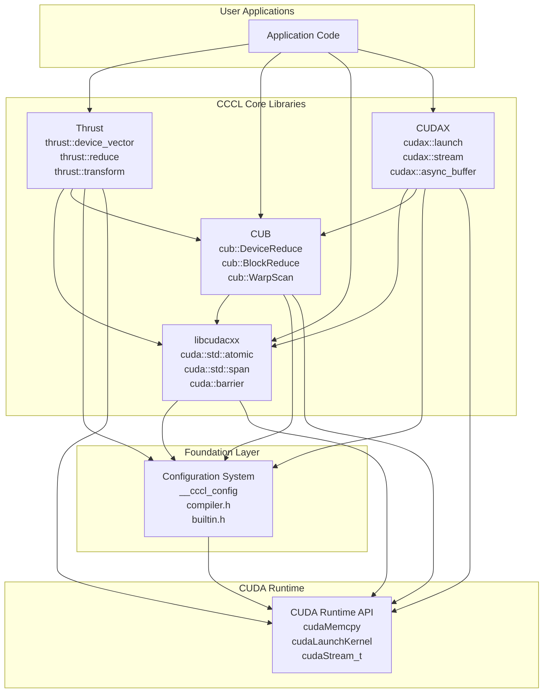
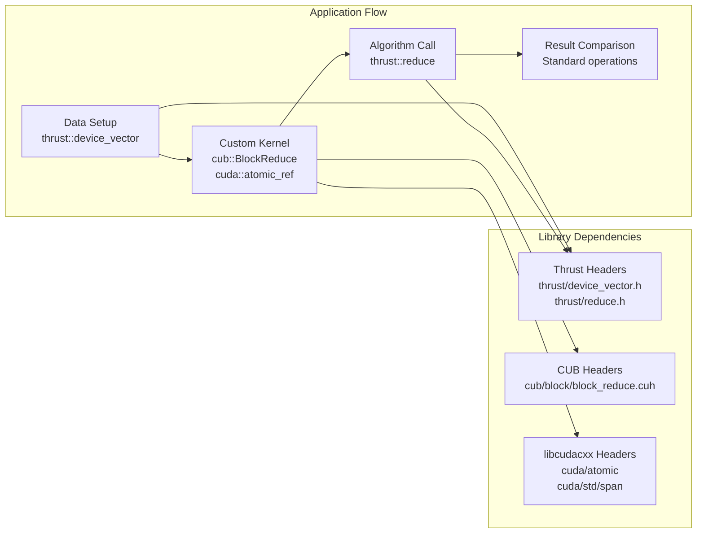

<!-- source: DeepWiki mcp.deepwiki.com · repo NVIDIA/cccl · page 2 Core Libraries · fetched 2026-10-26 -->

# Core Libraries

<details>
<summary>Relevant source files</summary>

The following files were used as context for generating this wiki page:

- [CONTRIBUTING.md](CONTRIBUTING.md)
- [README.md](README.md)

</details>


This document provides an overview of the four main libraries that comprise CCCL (CUDA Core Compute Libraries) and their architectural relationships. It covers the purpose, scope, and key components of Thrust, CUB, libcudacxx, and CUDAX, along with their integration patterns and code organization.

For detailed implementation internals and dispatch mechanisms, see [Architecture and Internals](#3). For build configuration and development setup, see [Development Guide](#4).

## Overview

CCCL unifies four complementary libraries that provide different levels of abstraction for CUDA C++ development:

| Library | Purpose | Abstraction Level | Target Use Cases |
|---------|---------|-------------------|------------------|
| **Thrust** | Parallel algorithms | High-level | Application development, performance portability |
| **CUB** | CUDA primitives | Low-level | Custom kernel development, speed-of-light performance |
| **libcudacxx** | Standard library | Foundation | Host/device compatibility, standard compliance |
| **CUDAX** | Experimental features | Cutting-edge | Task graphs, async execution, memory management |

## CCCL Architecture



Sources: [README.md:10-31](), [README.md:46-106]()

## Library Components

### Thrust: High-Level Parallel Algorithms

Thrust provides STL-like parallel algorithms with performance portability across execution backends. It abstracts away the complexity of parallel programming while maintaining high performance.

**Key Components:**
- `thrust::device_vector` - GPU memory container
- `thrust::host_vector` - CPU memory container  
- Algorithm functions: `thrust::reduce`, `thrust::transform`, `thrust::sort`
- Execution policies: `thrust::device`, `thrust::host`, `thrust::seq`

**Example Integration Pattern:**
```cpp
#include <thrust/device_vector.h>
#include <thrust/reduce.h>

thrust::device_vector<int> data(N);
int result = thrust::reduce(thrust::device, data.begin(), data.end(), 0);
```

Sources: [README.md:25](), [README.md:76-78](), [README.md:97-98]()

### CUB: CUDA Block Primitives

CUB provides speed-optimized building blocks for custom CUDA kernel development, including device-wide algorithms and cooperative thread block primitives.

**Key Components:**
- Device algorithms: `cub::DeviceReduce`, `cub::DeviceRadixSort`, `cub::DeviceScan`
- Block primitives: `cub::BlockReduce`, `cub::BlockScan`, `cub::BlockLoad`
- Warp primitives: `cub::WarpReduce`, `cub::WarpScan`, `cub::WarpShuffle`

**Example Integration Pattern:**
```cpp
#include <cub/block/block_reduce.cuh>

using BlockReduce = cub::BlockReduce<int, block_size>;
__shared__ typename BlockReduce::TempStorage temp_storage;
int sum = BlockReduce(temp_storage).Sum(thread_data);
```

Sources: [README.md:27](), [README.md:55-70]()

### libcudacxx: CUDA Standard Library

libcudacxx extends the C++ Standard Library to work seamlessly in both host and device code, providing CUDA-specific synchronization primitives and mathematical functions.

**Key Components:**
- Standard containers: `cuda::std::span`, `cuda::std::array`, `cuda::std::optional`
- Atomic operations: `cuda::atomic_ref`, `cuda::atomic<T>`
- Synchronization: `cuda::barrier`, `cuda::binary_semaphore`
- Mathematical functions: `cuda::ceil_div`, precision-specific math for `__half` and `__nv_bfloat16`

**Example Integration Pattern:**
```cpp
#include <cuda/atomic>
#include <cuda/std/span>

cuda::atomic_ref<int, cuda::thread_scope_device> atomic_result(result[0]);
atomic_result.fetch_add(sum, cuda::memory_order_relaxed);
```

Sources: [README.md:29](), [README.md:67-69](), [README.md:85-86]()

### CUDAX: Experimental Features

CUDAX provides cutting-edge abstractions for advanced CUDA programming patterns, including task graph management, kernel launch abstractions, and stream-ordered memory management.

**Key Components:**
- Launch system: `cudax::launch`, kernel configuration management
- Streaming Task Framework: `cudax::stream_context`, dependency tracking
- Memory resources: `cudax::async_buffer`, `cudax::memory_resource`
- Device abstractions: `cudax::device`, `cudax::stream`, `cudax::event`

**Example Integration Pattern:**
```cpp
#include <cudax/launch.h>
#include <cudax/stream.h>

auto stream = cudax::stream::create();
cudax::launch(stream, kernel_config, kernel_func, args...);
```

Sources: [README.md:36]() (implied from experimental nature), architectural diagrams

## Library Integration Patterns

### Unified Example Usage

The following demonstrates how all four libraries work together in a typical CCCL application:



Sources: [README.md:36-106]()

### Header Organization

| Library | Include Pattern | Key Headers |
|---------|----------------|-------------|
| Thrust | `#include <thrust/...>` | `thrust/device_vector.h`, `thrust/reduce.h`, `thrust/transform.h` |
| CUB | `#include <cub/...>` | `cub/cub.cuh`, `cub/block/block_reduce.cuh`, `cub/device/device_reduce.cuh` |
| libcudacxx | `#include <cuda/...>` | `cuda/atomic`, `cuda/std/span`, `cuda/barrier` |
| CUDAX | `#include <cudax/...>` | `cudax/launch.h`, `cudax/stream.h`, `cudax/memory_resource.h` |

Sources: [README.md:121-125](), [README.md:134-137]()

---

