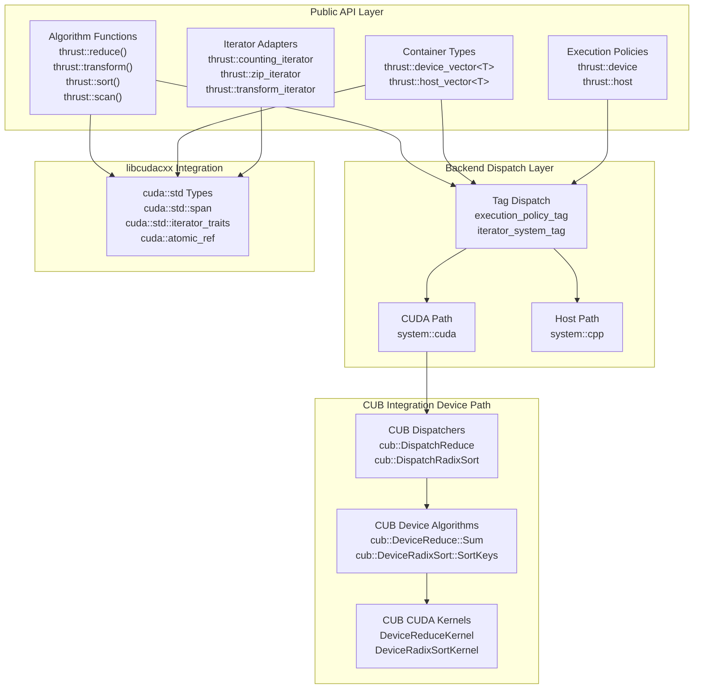
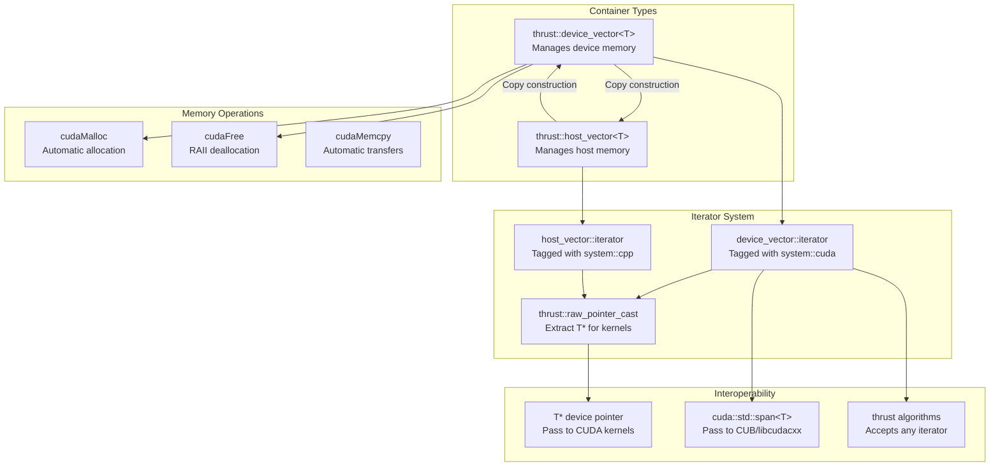
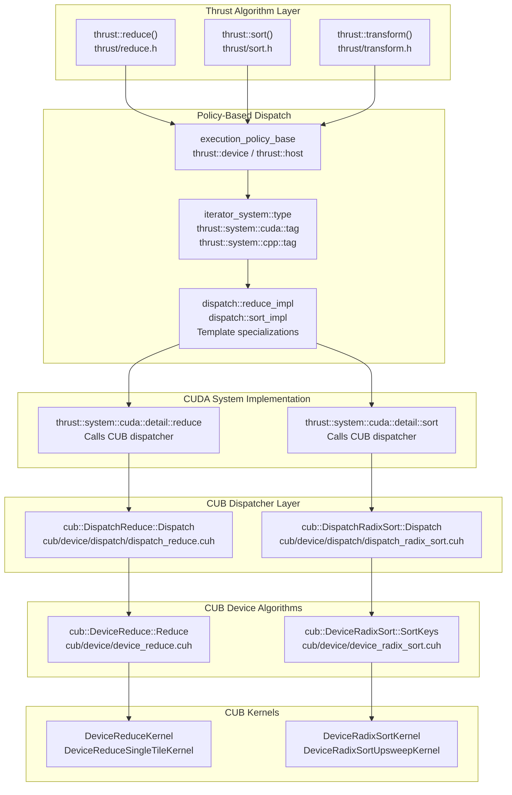
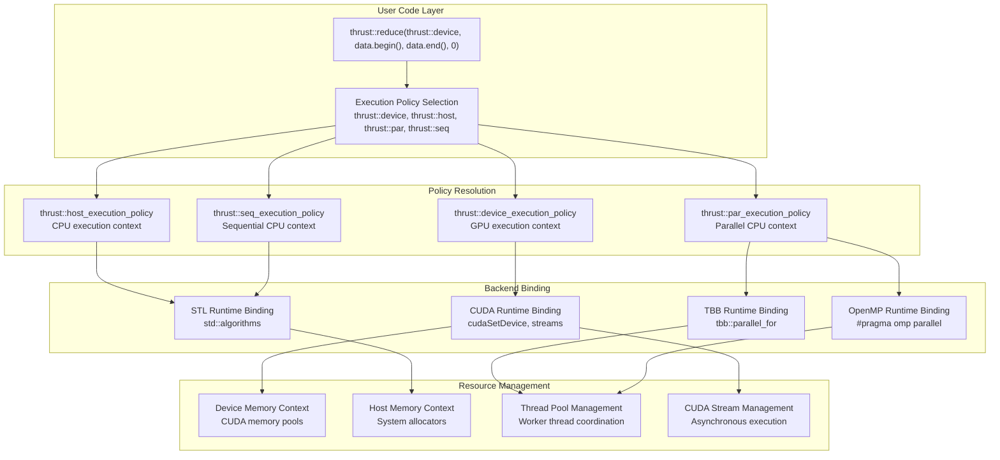
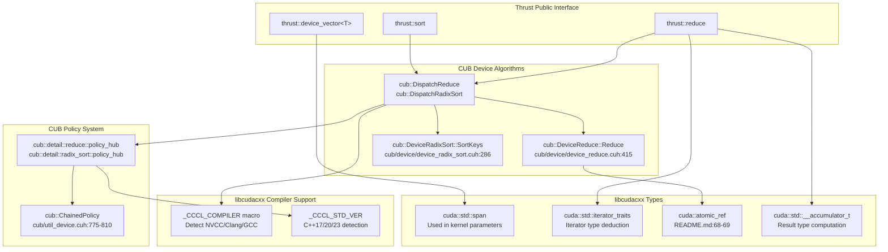

<!-- source: DeepWiki mcp.deepwiki.com · repo NVIDIA/cccl · page 2.1 Thrust · fetched 2026-10-26 -->

# Thrust

<details>
<summary>Relevant source files</summary>

The following files were used as context for generating this wiki page:

- [CONTRIBUTING.md](CONTRIBUTING.md)
- [README.md](README.md)
- [c/parallel/src/for.cu](c/parallel/src/for.cu)
- [c/parallel/src/merge_sort.cu](c/parallel/src/merge_sort.cu)
- [c/parallel/src/radix_sort.cu](c/parallel/src/radix_sort.cu)
- [c/parallel/src/reduce.cu](c/parallel/src/reduce.cu)
- [c/parallel/src/scan.cu](c/parallel/src/scan.cu)
- [c/parallel/src/segmented_reduce.cu](c/parallel/src/segmented_reduce.cu)
- [c/parallel/src/segmented_sort.cu](c/parallel/src/segmented_sort.cu)
- [c/parallel/src/three_way_partition.cu](c/parallel/src/three_way_partition.cu)
- [c/parallel/src/transform.cu](c/parallel/src/transform.cu)
- [c/parallel/src/unique_by_key.cu](c/parallel/src/unique_by_key.cu)
- [cub/benchmarks/bench/radix_sort/keys.cu](cub/benchmarks/bench/radix_sort/keys.cu)
- [cub/benchmarks/bench/radix_sort/pairs.cu](cub/benchmarks/bench/radix_sort/pairs.cu)
- [cub/benchmarks/bench/radix_sort/policy_selector.h](cub/benchmarks/bench/radix_sort/policy_selector.h)
- [cub/cub/detail/arch_dispatch.cuh](cub/cub/detail/arch_dispatch.cuh)
- [cub/cub/detail/launcher/cuda_driver.cuh](cub/cub/detail/launcher/cuda_driver.cuh)
- [cub/cub/detail/launcher/cuda_runtime.cuh](cub/cub/detail/launcher/cuda_runtime.cuh)
- [cub/cub/device/device_radix_sort.cuh](cub/cub/device/device_radix_sort.cuh)
- [cub/cub/device/device_segmented_reduce.cuh](cub/cub/device/device_segmented_reduce.cuh)
- [cub/cub/device/dispatch/dispatch_common.cuh](cub/cub/device/dispatch/dispatch_common.cuh)
- [cub/cub/device/dispatch/dispatch_fixed_size_segmented_reduce.cuh](cub/cub/device/dispatch/dispatch_fixed_size_segmented_reduce.cuh)
- [cub/cub/device/dispatch/dispatch_merge_sort.cuh](cub/cub/device/dispatch/dispatch_merge_sort.cuh)
- [cub/cub/device/dispatch/dispatch_radix_sort.cuh](cub/cub/device/dispatch/dispatch_radix_sort.cuh)
- [cub/cub/device/dispatch/dispatch_reduce.cuh](cub/cub/device/dispatch/dispatch_reduce.cuh)
- [cub/cub/device/dispatch/dispatch_segmented_radix_sort.cuh](cub/cub/device/dispatch/dispatch_segmented_radix_sort.cuh)
- [cub/cub/device/dispatch/dispatch_segmented_reduce.cuh](cub/cub/device/dispatch/dispatch_segmented_reduce.cuh)
- [cub/cub/device/dispatch/dispatch_segmented_sort.cuh](cub/cub/device/dispatch/dispatch_segmented_sort.cuh)
- [cub/cub/device/dispatch/kernels/kernel_radix_sort.cuh](cub/cub/device/dispatch/kernels/kernel_radix_sort.cuh)
- [cub/cub/device/dispatch/kernels/kernel_segmented_radix_sort.cuh](cub/cub/device/dispatch/kernels/kernel_segmented_radix_sort.cuh)
- [cub/cub/device/dispatch/kernels/kernel_segmented_reduce.cuh](cub/cub/device/dispatch/kernels/kernel_segmented_reduce.cuh)
- [cub/cub/device/dispatch/tuning/common.cuh](cub/cub/device/dispatch/tuning/common.cuh)
- [cub/cub/device/dispatch/tuning/tuning_radix_sort.cuh](cub/cub/device/dispatch/tuning/tuning_radix_sort.cuh)
- [cub/cub/util_device.cuh](cub/cub/util_device.cuh)
- [cub/test/catch2_test_arch_dispatch.cu](cub/test/catch2_test_arch_dispatch.cu)
- [cub/test/catch2_test_device_radix_sort_custom_policy_hub.cu](cub/test/catch2_test_device_radix_sort_custom_policy_hub.cu)

</details>


Thrust is CCCL's high-level C++ parallel algorithms library that provides an STL-like interface for GPU computing. It offers familiar algorithms (`thrust::reduce`, `thrust::transform`, `thrust::sort`) that work seamlessly with GPU data, building internally on [CUB](#2.2) device algorithms for performance and [libcudacxx](#2.3) for standard library functionality.

## Purpose and Design Philosophy

Thrust serves as the high-level algorithmic interface within CCCL, modeled after the C++ Standard Library. It provides:

- **STL-like API**: Familiar algorithm names (`reduce`, `transform`, `sort`, `scan`) that match C++ standard library conventions
- **Performance Portability**: Same code executes on GPUs (CUDA backend), multi-core CPUs (TBB, OpenMP), or sequential CPU
- **Transparent GPU Programming**: `thrust::device_vector` manages device memory automatically, hiding `cudaMalloc`/`cudaFree` complexity
- **Internal CUB Integration**: Device algorithms dispatch to optimized `cub::DeviceReduce`, `cub::DeviceTransform`, etc. for speed-of-light performance

The library inspired the parallel algorithms added to C++17, demonstrating its influence on the C++ standard itself.

Sources: [README.md:25-26](), [README.md:10-18]()

**Thrust Architecture: STL-Like Interface to CUB Primitives**



Sources: [README.md:36-44](), [README.md:47-71](), [cub/cub/device/dispatch/dispatch_reduce.cuh:147-186]()

## STL-Like Algorithm Interface

Thrust provides familiar algorithm names that mirror the C++ Standard Library, making GPU programming accessible to C++ developers. The example below demonstrates the similarity to standard C++:

```cpp
// Standard C++ on CPU
std::vector<int> data(1000, 1);
int cpu_result = std::reduce(data.begin(), data.end(), 0);

// Thrust on GPU - same algorithm names
thrust::device_vector<int> data(1000, 1);
int gpu_result = thrust::reduce(thrust::device, data.begin(), data.end(), 0);
```

**Core Algorithm Categories**

| Algorithm Category | Thrust Functions | CUB Backend |
|-------------------|------------------|-------------|
| Reductions | `thrust::reduce`, `thrust::transform_reduce` | `cub::DeviceReduce::Reduce`, `cub::DeviceReduce::Sum` |
| Transformations | `thrust::transform`, `thrust::for_each` | `cub::DeviceTransform` |
| Sorting | `thrust::sort`, `thrust::sort_by_key` | `cub::DeviceRadixSort::SortKeys`, `cub::DeviceRadixSort::SortPairs` |
| Scans | `thrust::inclusive_scan`, `thrust::exclusive_scan` | `cub::DeviceScan::InclusiveScan`, `cub::DeviceScan::ExclusiveSum` |
| Selections | `thrust::copy_if`, `thrust::unique` | `cub::DeviceSelect::If`, `cub::DeviceSelect::Unique` |

The following example from the repository demonstrates using Thrust, CUB, and libcudacxx together:

```cpp
// From README.md example
#include <thrust/device_vector.h>
#include <cub/block/block_reduce.cuh>
#include <cuda/atomic>

// Thrust manages device memory
thrust::device_vector<int> data(N);
thrust::fill(data.begin(), data.end(), 1);

// Thrust algorithm for comparison
int thrust_result = thrust::reduce(thrust::device, data.begin(), data.end(), 0);
```

Sources: [README.md:34-106](), [cub/cub/device/dispatch/dispatch_reduce.cuh:147-186]()

## Container System

Thrust's container system provides STL-like vectors that automatically manage GPU memory. `thrust::device_vector<T>` handles `cudaMalloc`, `cudaFree`, and host-device transfers transparently.

**Container Memory Management and Interoperability**



Example usage:

```cpp
// Automatic GPU memory management
thrust::device_vector<int> d_vec(1000);
thrust::fill(d_vec.begin(), d_vec.end(), 42);

// Automatic host-device transfer
thrust::host_vector<int> h_vec = d_vec;  // Copies from GPU to CPU

// Extract raw pointer for custom kernels
int* raw_ptr = thrust::raw_pointer_cast(d_vec.data());
my_cuda_kernel<<<grid, block>>>(raw_ptr, d_vec.size());
```

Sources: [README.md:77-87]()

## Internal Architecture: Building on CUB

Thrust's device algorithms internally dispatch to CUB for GPU execution. The dispatch mechanism uses iterator system tags to select the appropriate backend at compile time.

**Thrust-to-CUB Dispatch Mechanism**



**Example: `thrust::reduce` to `cub::DeviceReduce` Call Chain**

1. User calls `thrust::reduce(thrust::device, data.begin(), data.end(), 0)`
2. Iterator system tag is `thrust::system::cuda::tag` (from `device_vector::iterator`)
3. Dispatches to `thrust::system::cuda::detail::reduce()` 
4. Creates `cub::DispatchReduce` with policy hub
5. Calls `cub::DispatchReduce::Dispatch()` which allocates temp storage
6. Launches `cub::DeviceReduceKernel` or `cub::DeviceReduceSingleTileKernel` depending on problem size

Sources: [cub/cub/device/dispatch/dispatch_reduce.cuh:147-255](), [cub/cub/device/dispatch/dispatch_reduce.cuh:490-534](), [README.md:36-44]()

## Execution Policy System

Thrust's execution policies provide fine-grained control over algorithm execution while maintaining portability. The policy system enables developers to explicitly specify execution preferences or rely on automatic backend selection based on data location and iterator types.

| Execution Policy | Backend | Use Case | Memory Access |
|-----------------|---------|----------|---------------|
| `thrust::device` | CUDA GPU | Device data processing | Device memory optimized |
| `thrust::host` | Sequential CPU | Host data processing | Host memory optimized |
| `thrust::par` | Parallel CPU | Multi-core processing | Host memory with threading |
| `thrust::seq` | Sequential CPU | Single-threaded processing | Host memory sequential |

**Policy-Based Execution Model**



Sources: [README.md:98]()

## Integration with CCCL Components

Thrust builds on CUB and libcudacxx to deliver high-level algorithms with optimal performance:

**CCCL Component Usage in Thrust**



**Key Integration Points:**

| Component | Thrust Uses | File Reference |
|-----------|-------------|----------------|
| CUB Device Reduce | `thrust::reduce` → `cub::DeviceReduce::Reduce` | [cub/device/device_reduce.cuh:415-500]() |
| CUB Device Sort | `thrust::sort` → `cub::DeviceRadixSort::SortKeys` | [cub/device/device_radix_sort.cuh:286-350]() |
| CUB Policy System | Optimal kernel configuration per architecture | [cub/util_device.cuh:775-850]() |
| libcudacxx span | Pass ranges to kernels | [README.md:52]() |
| libcudacxx atomic | Block reductions in custom kernels | [README.md:68-69]() |
| libcudacxx type traits | Iterator and accumulator type deduction | [cub/device/dispatch/dispatch_reduce.cuh:172]() |

The example from [README.md:46-105]() demonstrates all three libraries working together: `thrust::device_vector` for memory, `cub::BlockReduce` for custom kernels, and `cuda::atomic_ref` for synchronization.

Sources: [README.md:36-106](), [cub/cub/device/dispatch/dispatch_reduce.cuh:147-186](), [cub/cub/util_device.cuh:775-810]()

## Performance and Optimization Patterns

Thrust is designed to deliver high performance through several optimization strategies including algorithm fusion, memory access pattern optimization, and backend-specific tuning. The library automatically selects optimal implementations based on data characteristics and execution context.

Common optimization patterns include:

- **Iterator Fusion**: Combining multiple operations into single kernel launches
- **Memory Coalescing**: Optimizing memory access patterns for GPU architectures  
- **Backend Selection**: Automatic selection of optimal execution backend
- **Algorithm Specialization**: Specialized implementations for common data types and operations

Sources: [README.md:25-32]()

---

