<!-- source: DeepWiki mcp.deepwiki.com · repo NVIDIA/cccl · page 2.2 CUB · fetched 2026-10-26 -->

# CUB

<details>
<summary>Relevant source files</summary>

The following files were used as context for generating this wiki page:

- [CONTRIBUTING.md](CONTRIBUTING.md)
- [README.md](README.md)
- [c/parallel/src/for.cu](c/parallel/src/for.cu)
- [c/parallel/src/merge_sort.cu](c/parallel/src/merge_sort.cu)
- [c/parallel/src/radix_sort.cu](c/parallel/src/radix_sort.cu)
- [c/parallel/src/reduce.cu](c/parallel/src/reduce.cu)
- [c/parallel/src/scan.cu](c/parallel/src/scan.cu)
- [c/parallel/src/segmented_reduce.cu](c/parallel/src/segmented_reduce.cu)
- [c/parallel/src/segmented_sort.cu](c/parallel/src/segmented_sort.cu)
- [c/parallel/src/three_way_partition.cu](c/parallel/src/three_way_partition.cu)
- [c/parallel/src/transform.cu](c/parallel/src/transform.cu)
- [c/parallel/src/unique_by_key.cu](c/parallel/src/unique_by_key.cu)
- [cub/benchmarks/bench/radix_sort/keys.cu](cub/benchmarks/bench/radix_sort/keys.cu)
- [cub/benchmarks/bench/radix_sort/pairs.cu](cub/benchmarks/bench/radix_sort/pairs.cu)
- [cub/benchmarks/bench/radix_sort/policy_selector.h](cub/benchmarks/bench/radix_sort/policy_selector.h)
- [cub/cub/detail/arch_dispatch.cuh](cub/cub/detail/arch_dispatch.cuh)
- [cub/cub/detail/launcher/cuda_driver.cuh](cub/cub/detail/launcher/cuda_driver.cuh)
- [cub/cub/detail/launcher/cuda_runtime.cuh](cub/cub/detail/launcher/cuda_runtime.cuh)
- [cub/cub/device/device_radix_sort.cuh](cub/cub/device/device_radix_sort.cuh)
- [cub/cub/device/device_segmented_reduce.cuh](cub/cub/device/device_segmented_reduce.cuh)
- [cub/cub/device/dispatch/dispatch_common.cuh](cub/cub/device/dispatch/dispatch_common.cuh)
- [cub/cub/device/dispatch/dispatch_fixed_size_segmented_reduce.cuh](cub/cub/device/dispatch/dispatch_fixed_size_segmented_reduce.cuh)
- [cub/cub/device/dispatch/dispatch_merge_sort.cuh](cub/cub/device/dispatch/dispatch_merge_sort.cuh)
- [cub/cub/device/dispatch/dispatch_radix_sort.cuh](cub/cub/device/dispatch/dispatch_radix_sort.cuh)
- [cub/cub/device/dispatch/dispatch_reduce.cuh](cub/cub/device/dispatch/dispatch_reduce.cuh)
- [cub/cub/device/dispatch/dispatch_segmented_radix_sort.cuh](cub/cub/device/dispatch/dispatch_segmented_radix_sort.cuh)
- [cub/cub/device/dispatch/dispatch_segmented_reduce.cuh](cub/cub/device/dispatch/dispatch_segmented_reduce.cuh)
- [cub/cub/device/dispatch/dispatch_segmented_sort.cuh](cub/cub/device/dispatch/dispatch_segmented_sort.cuh)
- [cub/cub/device/dispatch/kernels/kernel_radix_sort.cuh](cub/cub/device/dispatch/kernels/kernel_radix_sort.cuh)
- [cub/cub/device/dispatch/kernels/kernel_segmented_radix_sort.cuh](cub/cub/device/dispatch/kernels/kernel_segmented_radix_sort.cuh)
- [cub/cub/device/dispatch/kernels/kernel_segmented_reduce.cuh](cub/cub/device/dispatch/kernels/kernel_segmented_reduce.cuh)
- [cub/cub/device/dispatch/tuning/common.cuh](cub/cub/device/dispatch/tuning/common.cuh)
- [cub/cub/device/dispatch/tuning/tuning_radix_sort.cuh](cub/cub/device/dispatch/tuning/tuning_radix_sort.cuh)
- [cub/cub/util_device.cuh](cub/cub/util_device.cuh)
- [cub/test/catch2_test_arch_dispatch.cu](cub/test/catch2_test_arch_dispatch.cu)
- [cub/test/catch2_test_device_radix_sort_custom_policy_hub.cu](cub/test/catch2_test_device_radix_sort_custom_policy_hub.cu)

</details>


## Purpose and Scope

CUB (CUDA UnBound) is a low-level, CUDA-specific library providing highly optimized parallel primitives and device-wide algorithms for CUDA kernel developers. This document introduces CUB's architecture, design principles, and usage patterns.

For high-level parallel algorithms with STL-like interfaces, see [Thrust](#2.1). For detailed coverage of individual CUB algorithms, see [Device-Wide Operations](#2.2.1) and [Block-Level Primitives](#2.2.2). For the C language interface with JIT compilation, see [C Parallel API](#2.2.3).

**Sources**: [README.md:1-106](), [cub/cub/util_device.cuh:1-872]()

---

## Overview and Design Philosophy

CUB provides two categories of primitives:

1. **Device-wide algorithms** - Parallel operations that process data across entire GPU memory spaces, automatically handling work distribution, kernel launches, and temporary storage
2. **Block-level primitives** - Cooperative operations for use within custom CUDA kernels, enabling efficient thread block coordination

CUB is designed for **speed-of-light performance** across all GPU architectures through:
- Architecture-specific tuning policies selected at compile-time or runtime
- Header-only design for zero deployment overhead
- Template-based abstractions with zero-cost abstractions
- Direct integration with libcudacxx for standard library functionality

**Key Design Principles**:
- **Policy-based tuning**: Algorithm behavior configured through policy structures rather than magic constants
- **Dispatch architecture**: Three-layer design separating API, dispatch logic, and execution
- **Zero-copy abstractions**: Templates resolved at compile-time with no runtime overhead
- **libcudacxx foundation**: All CUB components build on libcudacxx types and utilities

**Sources**: [README.md:20-32](), [cub/cub/util_device.cuh:602-850]()

---

## CUB Library Structure

### Namespace and Component Organization

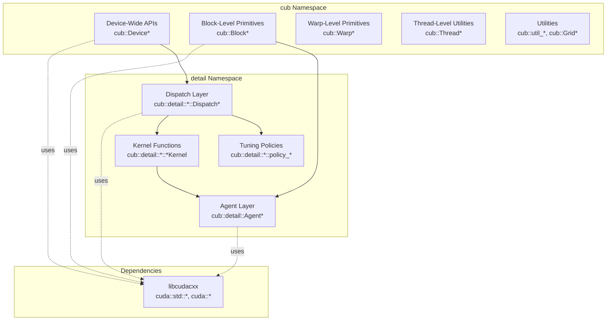

**CUB Namespace Hierarchy**:

| Namespace | Purpose | Example Components |
|-----------|---------|-------------------|
| `cub::` | Public API | `DeviceReduce`, `BlockScan`, `WarpReduce` |
| `cub::detail` | Internal implementation | Dispatch classes, policy selectors |
| `cub::detail::reduce` | Algorithm-specific details | `dispatch()`, `policy_selector` |
| `cub::detail::radix_sort` | Algorithm-specific details | `DeviceRadixSortKernelSource` |

**Sources**: [cub/cub/util_device.cuh:51-867](), [cub/cub/device/dispatch/dispatch_reduce.cuh:1-850](), [README.md:12-14]()

---

## Three-Layer Architecture

### Architecture Diagram

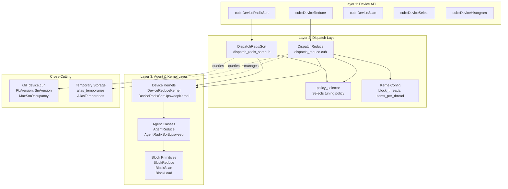

### Layer Responsibilities

**Layer 1 - Device API** (`cub/cub/device/*.cuh`):
- Public-facing static methods (e.g., `DeviceReduce::Sum()`)
- Input validation and type deduction
- Manages `DoubleBuffer` for in-place operations
- Delegates to dispatch layer

**Layer 2 - Dispatch Layer** (`cub/cub/device/dispatch/*.cuh`):
- Policy selection based on architecture and data types
- Kernel configuration (grid size, block size, shared memory)
- Temporary storage allocation via `alias_temporaries()`
- Multi-pass algorithm orchestration
- Kernel launch coordination

**Layer 3 - Agent & Kernel Layer**:
- CUDA kernel entry points
- Agent classes implementing thread-block logic
- Direct use of block-level primitives
- Cooperative thread operations

**Sources**: [cub/cub/device/dispatch/dispatch_reduce.cuh:142-535](), [cub/cub/device/dispatch/dispatch_radix_sort.cuh:198-850](), [cub/cub/util_device.cuh:705-763]()

---

## Device Utility System

### Device Property Queries

CUB provides utilities for querying device properties and selecting optimal configurations:

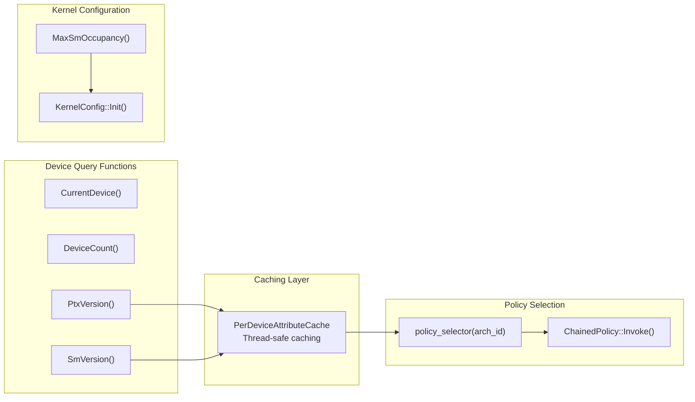

**Key Utility Functions** ([cub/cub/util_device.cuh:67-600]()):

| Function | Purpose | Caching |
|----------|---------|---------|
| `CurrentDevice()` | Returns current CUDA device ID | No |
| `DeviceCount()` | Returns number of CUDA devices | Yes (static) |
| `PtxVersion(int& ptx_version)` | Queries PTX version for current device | Yes (per-device) |
| `SmVersion(int& sm_version, int device)` | Queries SM compute capability | Yes (per-device) |
| `MaxSmOccupancy(...)` | Computes max active blocks per SM | No |

**Caching Strategy**: `PerDeviceAttributeCache` uses atomic operations for thread-safe, lazy initialization of per-device attributes, avoiding repeated CUDA runtime queries.

**Sources**: [cub/cub/util_device.cuh:67-461](), [cub/cub/util_device.cuh:156-270]()

---

## Policy-Based Tuning System

### Policy Selection Flow

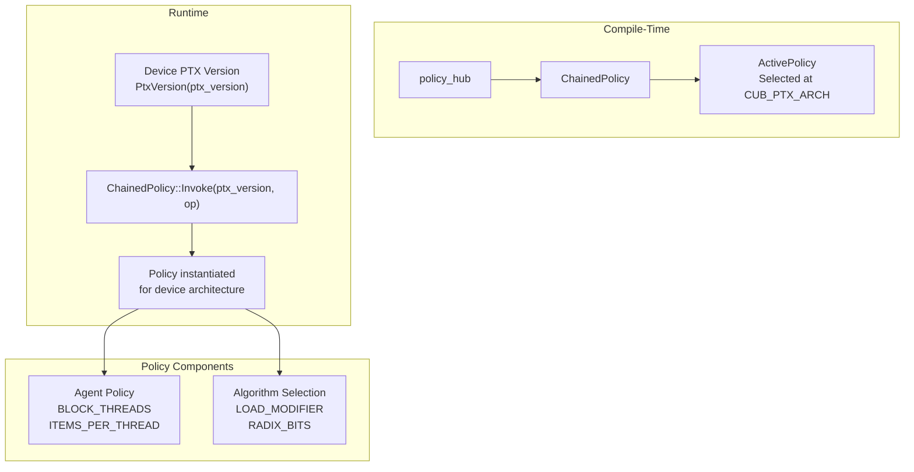

### Policy Structure Example

**Reduce Policy** ([cub/cub/device/dispatch/tuning/tuning_reduce.cuh]()):

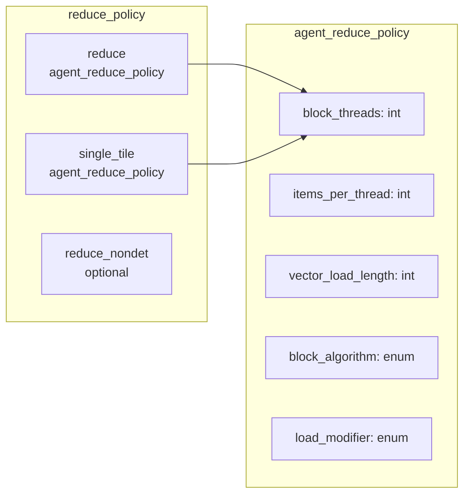

**Key Policy Parameters**:

| Parameter | Purpose | Typical Values |
|-----------|---------|---------------|
| `block_threads` | Threads per block | 128, 256, 512 |
| `items_per_thread` | Items processed per thread | 4, 8, 16, 20 |
| `radix_bits` | Bits per digit (radix sort) | 4, 5, 6, 8 |
| `load_modifier` | Cache hint for loads | `LOAD_DEFAULT`, `LOAD_LDG`, `LOAD_CA` |
| `block_algorithm` | Scan/reduce algorithm | `BLOCK_REDUCE_RAKING`, `BLOCK_REDUCE_WARP_REDUCTIONS` |

**Sources**: [cub/cub/device/dispatch/tuning/tuning_radix_sort.cuh:1-800](), [cub/cub/util_device.cuh:692-704](), [cub/cub/device/dispatch/dispatch_reduce.cuh:46-140]()

---

## Dispatch Mechanism Details

### DispatchReduce Example

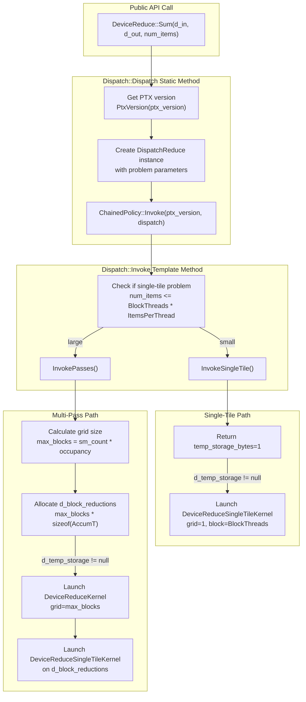

**Dispatch Responsibilities** ([cub/cub/device/dispatch/dispatch_reduce.cuh:185-535]()):

1. **Policy Selection**: Instantiate `DispatchReduce` with `PolicyHub` or `policy_selector`
2. **Temporary Storage**: Calculate and allocate via `alias_temporaries()`
3. **Algorithm Choice**: Select single-tile vs. multi-pass based on problem size
4. **Kernel Launch**: Configure and launch CUDA kernels with selected policy
5. **Error Handling**: Check for launch failures and synchronization errors

**Sources**: [cub/cub/device/dispatch/dispatch_reduce.cuh:142-535](), [cub/cub/device/dispatch/dispatch_reduce.cuh:596-729]()

---

## Kernel Configuration System

### KernelConfig Structure

The `KernelConfig` struct ([cub/cub/util_device.cuh:728-761]()) encapsulates kernel launch parameters:

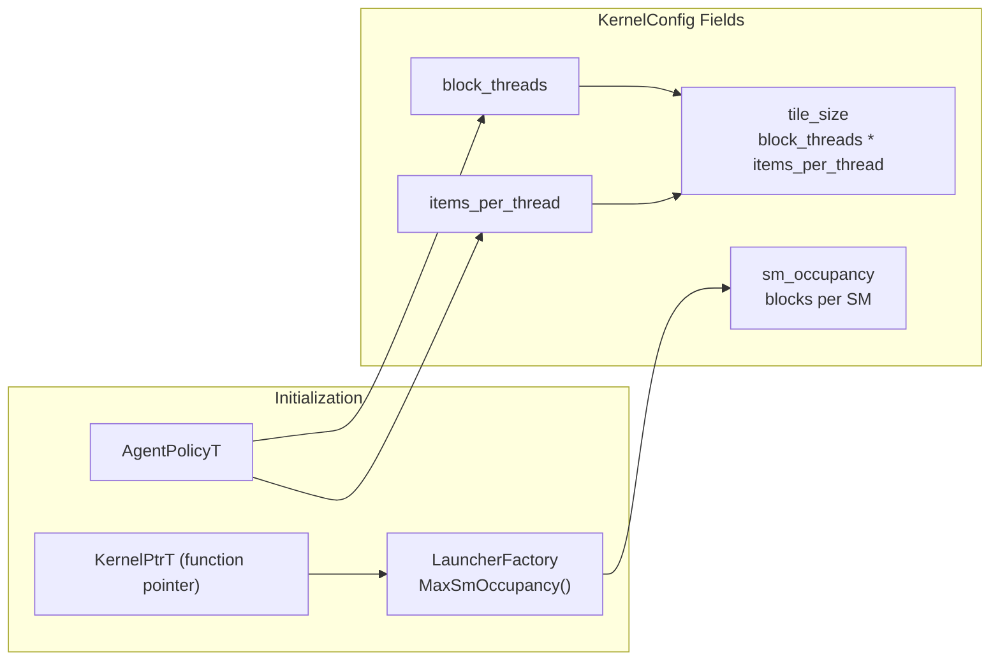

**Usage Pattern**:

```cpp
// From dispatch_reduce.cuh
detail::KernelConfig reduce_config;
reduce_config.Init(reduce_kernel, active_policy.Reduce(), launcher_factory);

int reduce_device_occupancy = reduce_config.sm_occupancy * sm_count;
int max_blocks = reduce_device_occupancy * subscription_factor;
```

**Sources**: [cub/cub/util_device.cuh:705-763](), [cub/cub/device/dispatch/dispatch_reduce.cuh:330-360]()

---

## Temporary Storage Management

### Storage Aliasing System

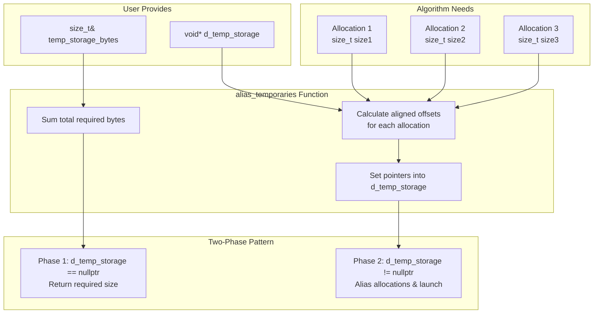

**Two-Phase Allocation Pattern**:

```cpp
// Phase 1: Query required storage
size_t temp_storage_bytes = 0;
DeviceReduce::Sum(nullptr, temp_storage_bytes, d_in, d_out, num_items);

// Allocate temporary storage
void* d_temp_storage;
cudaMalloc(&d_temp_storage, temp_storage_bytes);

// Phase 2: Execute with allocated storage
DeviceReduce::Sum(d_temp_storage, temp_storage_bytes, d_in, d_out, num_items);
```

**Sources**: [cub/cub/device/dispatch/dispatch_reduce.cuh:355-375](), [cub/cub/device/dispatch/dispatch_radix_sort.cuh:239-356]()

---

## Header Organization

### CUB File Structure

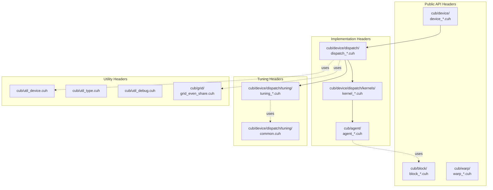

**Key Include Patterns**:

| Header Type | Example | Purpose |
|-------------|---------|---------|
| Device API | `<cub/device/device_reduce.cuh>` | User-facing algorithms |
| Block Primitives | `<cub/block/block_reduce.cuh>` | Cooperative operations |
| Dispatch | `<cub/device/dispatch/dispatch_reduce.cuh>` | Implementation details |
| Utilities | `<cub/util_device.cuh>` | Common utilities |
| Configuration | `<cub/config.cuh>` | Version & configuration macros |

**Sources**: [cub/cub/device/device_radix_sort.cuh:1-20](), [cub/cub/util_device.cuh:1-50](), [cub/cub/device/dispatch/dispatch_reduce.cuh:1-44]()

---

## Integration with libcudacxx

### CUB's libcudacxx Dependencies

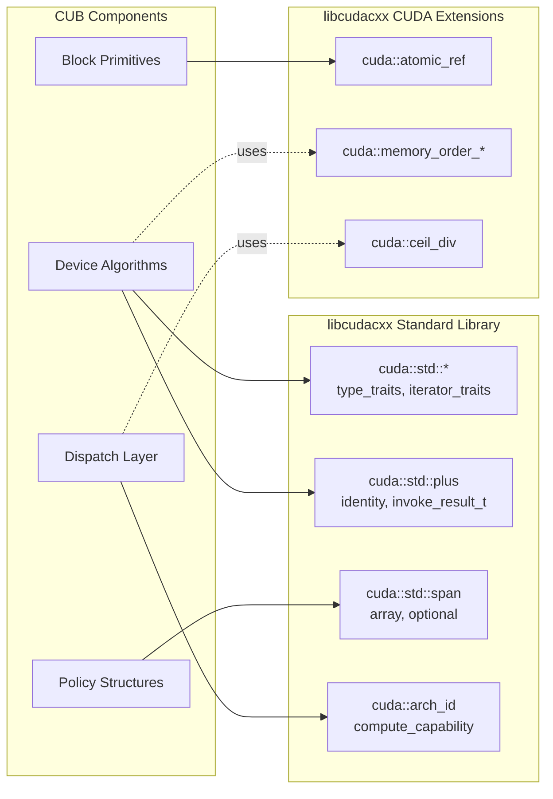

**libcudacxx Integration Points** ([cub/cub/device/dispatch/dispatch_reduce.cuh:33-35]()):

- **Type Traits**: `::cuda::std::__accumulator_t`, `::cuda::std::invoke_result_t`, `::cuda::std::iter_value_t`
- **Functional**: `::cuda::std::plus`, `::cuda::std::identity`, `::cuda::std::maximum`, `::cuda::std::minimum`
- **Containers**: `::cuda::std::span`, `::cuda::std::array`, `::cuda::std::optional`
- **Architecture**: `::cuda::arch_id`, `::cuda::compute_capability`, `::cuda::to_arch_id()`
- **Math**: `::cuda::ceil_div()`, `::cuda::ceil_ilog2()`

**Sources**: [cub/cub/device/dispatch/dispatch_reduce.cuh:33-35](), [cub/cub/util_device.cuh:26-33](), [README.md:46-52]()

---

## Usage Patterns

### Basic Device Algorithm Usage

```cpp
// Example from README.md
#include <cub/device/device_reduce.cuh>
#include <thrust/device_vector.h>

thrust::device_vector<int> data(1000);
thrust::fill(data.begin(), data.end(), 1);

// Two-phase allocation pattern
void* d_temp_storage = nullptr;
size_t temp_storage_bytes = 0;

// Phase 1: Query temp storage size
cub::DeviceReduce::Sum(d_temp_storage, temp_storage_bytes, 
                       data.data().get(), result_ptr, 1000);

// Allocate temp storage
cudaMalloc(&d_temp_storage, temp_storage_bytes);

// Phase 2: Execute reduction
cub::DeviceReduce::Sum(d_temp_storage, temp_storage_bytes,
                       data.data().get(), result_ptr, 1000);
```

### Custom Kernel with Block Primitives

```cpp
// Example from README.md
#include <cub/block/block_reduce.cuh>

template <int block_size>
__global__ void reduce_kernel(const int* data, int* result, int n) {
    using BlockReduce = cub::BlockReduce<int, block_size>;
    __shared__ typename BlockReduce::TempStorage temp_storage;
    
    int thread_data = (threadIdx.x < n) ? data[threadIdx.x] : 0;
    int aggregate = BlockReduce(temp_storage).Sum(thread_data);
    
    if (threadIdx.x == 0) {
        atomicAdd(result, aggregate);
    }
}
```

**Sources**: [README.md:34-106](), [cub/cub/device/device_radix_sort.cuh:30-200]()

---

## Key Device-Wide Algorithms

### Algorithm Summary Table

| Algorithm | Header | Primary Classes | Key Features |
|-----------|--------|-----------------|--------------|
| Reduce | `device_reduce.cuh` | `DeviceReduce`, `DispatchReduce` | Sum, Min, Max, custom ops; single-tile & multi-pass |
| Scan | `device_scan.cuh` | `DeviceScan`, `DispatchScan` | Inclusive/Exclusive; prefix sum with look-back |
| Radix Sort | `device_radix_sort.cuh` | `DeviceRadixSort`, `DispatchRadixSort` | Keys/Pairs; onesweep & multi-pass algorithms |
| Merge Sort | `device_merge_sort.cuh` | `DeviceMergeSort`, `DispatchMergeSort` | Stable sort; custom comparators |
| Select | `device_select.cuh` | `DeviceSelect`, `DispatchSelect` | Partition, unique, flagged selection |
| Histogram | `device_histogram.cuh` | `DeviceHistogram` | Even/range binning; multi-channel |
| Transform | `device_transform.cuh` | `DeviceTransform` | Unary/binary element-wise operations |

**Algorithm Categories**:

1. **Reductions**: `DeviceReduce`, `DeviceSegmentedReduce`
2. **Scans**: `DeviceScan`, `DeviceSegmentedScan`
3. **Sorting**: `DeviceRadixSort`, `DeviceMergeSort`, `DeviceSegmentedSort`
4. **Selection**: `DeviceSelect`, `DevicePartition`, `DeviceUnique`
5. **Data Movement**: `DeviceCopy`, `DeviceMemcpy`
6. **Histograms**: `DeviceHistogram`

**Sources**: [cub/cub/device/device_reduce.cuh:1-600](), [cub/cub/device/device_radix_sort.cuh:1-200](), [cub/cub/device/device_segmented_reduce.cuh:1-100]()

---

## C Parallel API Integration

CUB provides a C language interface with JIT compilation capabilities. This is covered in detail in [C Parallel API and JIT Compilation](#2.2.3), but the integration points are:

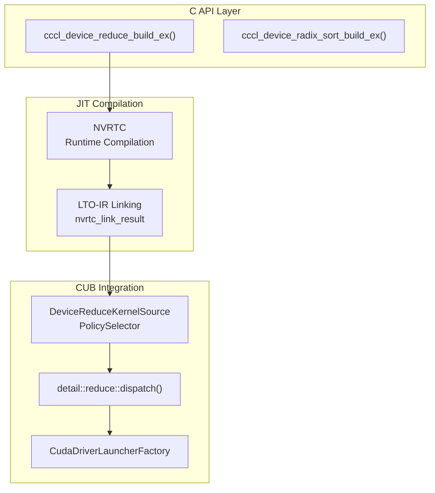

**Key Files**:
- [c/parallel/src/reduce.cu:1-450]() - C API for reduce with JIT
- [c/parallel/src/radix_sort.cu:1-400]() - C API for radix sort
- [c/parallel/src/transform.cu:1-450]() - C API for transform

**Sources**: [c/parallel/src/reduce.cu:1-100](), [c/parallel/src/radix_sort.cu:1-50](), [cub/cub/detail/launcher/cuda_driver.cuh:1-100]()

---

## Performance Considerations

### Tuning Guidelines

**Policy Tuning Parameters**:

1. **Block Size** (`block_threads`): Balance occupancy vs. per-block resources
   - Larger blocks: Better occupancy, more shared memory pressure
   - Smaller blocks: Lower latency, less shared memory usage
   - Typical values: 128, 256, 512

2. **Items Per Thread** (`items_per_thread`): Amortize overhead across work
   - More items: Better instruction-level parallelism
   - Fewer items: Better load balance for irregular workloads
   - Typical values: 4-20 depending on register pressure

3. **Algorithm Selection**:
   - `BLOCK_REDUCE_RAKING`: Lower latency for small blocks
   - `BLOCK_REDUCE_WARP_REDUCTIONS`: Better for larger blocks
   - `LOAD_LDG`: Use read-only cache (Kepler+)
   - `LOAD_CA`: Cache at all levels

**Architecture-Specific Considerations** ([cub/cub/device/dispatch/tuning/tuning_radix_sort.cuh:200-800]()):

- **Volta+ (SM70+)**: Leverage independent thread scheduling
- **Ampere+ (SM80+)**: Use async copy instructions (`PREFETCH`, `ASYNC_COPY`)
- **Hopper+ (SM90+)**: TMA descriptors for bulk data movement

**Sources**: [cub/cub/device/dispatch/tuning/tuning_radix_sort.cuh:1-200](), [cub/cub/device/dispatch/tuning/tuning_reduce.cuh:1-300]()

---

## Version and Compatibility

### Version Macros

CUB version is synchronized with CCCL version:

| Macro | Description | Example |
|-------|-------------|---------|
| `CUB_MAJOR_VERSION` | Major version | 3 |
| `CUB_MINOR_VERSION` | Minor version | 1 |
| `CUB_SUBMINOR_VERSION` | Patch version | 0 |
| `CUB_VERSION` | Concatenated (MMMmmmpp) | 3010000 |

These are consistent with `CCCL_VERSION` macros as described in [README.md:376-386]().

### ABI Considerations

- **`cub::` namespace**: No ABI stability guarantees; may change between minor versions
- **`thrust::` dependency**: Thrust internally uses CUB; version compatibility required
- **PTX version sensitivity**: Kernels compiled with different architectures in `__CUDA_ARCH_LIST__` must match runtime PTX version

**Sources**: [README.md:380-410](), [cub/cub/util_device.cuh:795-810]()

---

