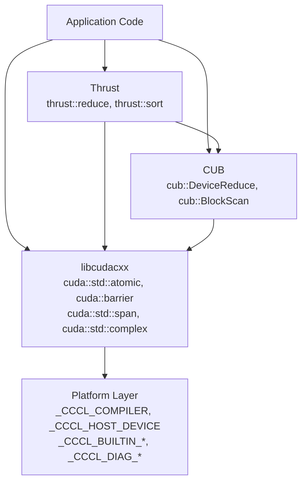
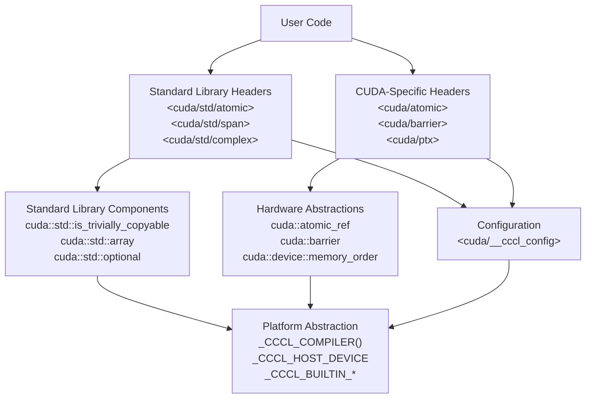

<!-- source: DeepWiki mcp.deepwiki.com · repo NVIDIA/cccl · page 2.3 libcudacxx · fetched 2026-10-26 -->

# libcudacxx

<details>
<summary>Relevant source files</summary>

The following files were used as context for generating this wiki page:

- [CONTRIBUTING.md](CONTRIBUTING.md)
- [README.md](README.md)
- [docs/libcudacxx/extended_api/type_traits/is_floating_point.rst](docs/libcudacxx/extended_api/type_traits/is_floating_point.rst)
- [lib/cmake/thrust/FindTBB.cmake](lib/cmake/thrust/FindTBB.cmake)
- [libcudacxx/include/cuda/__type_traits/is_floating_point.h](libcudacxx/include/cuda/__type_traits/is_floating_point.h)
- [libcudacxx/include/cuda/std/__atomic/functions/cuda_ptx_generated_helper.h](libcudacxx/include/cuda/std/__atomic/functions/cuda_ptx_generated_helper.h)
- [libcudacxx/include/cuda/std/__cccl/compiler.h](libcudacxx/include/cuda/std/__cccl/compiler.h)
- [libcudacxx/include/cuda/std/__cccl/cuda_toolkit.h](libcudacxx/include/cuda/std/__cccl/cuda_toolkit.h)
- [libcudacxx/include/cuda/std/__cccl/diagnostic.h](libcudacxx/include/cuda/std/__cccl/diagnostic.h)
- [libcudacxx/include/cuda/std/__cccl/dialect.h](libcudacxx/include/cuda/std/__cccl/dialect.h)
- [libcudacxx/include/cuda/std/__cccl/extended_data_types.h](libcudacxx/include/cuda/std/__cccl/extended_data_types.h)
- [libcudacxx/include/cuda/std/__cccl/system_header.h](libcudacxx/include/cuda/std/__cccl/system_header.h)
- [libcudacxx/include/cuda/std/__functional/bind_front.h](libcudacxx/include/cuda/std/__functional/bind_front.h)
- [libcudacxx/include/cuda/std/__functional/not_fn.h](libcudacxx/include/cuda/std/__functional/not_fn.h)
- [libcudacxx/include/cuda/std/__internal/atomic.h](libcudacxx/include/cuda/std/__internal/atomic.h)
- [libcudacxx/include/cuda/std/__internal/features.h](libcudacxx/include/cuda/std/__internal/features.h)
- [libcudacxx/include/cuda/std/__type_traits/is_extended_floating_point.h](libcudacxx/include/cuda/std/__type_traits/is_extended_floating_point.h)
- [libcudacxx/include/cuda/std/__type_traits/type_list.h](libcudacxx/include/cuda/std/__type_traits/type_list.h)
- [libcudacxx/include/cuda/std/__utility/declval.h](libcudacxx/include/cuda/std/__utility/declval.h)
- [libcudacxx/test/libcudacxx/cuda/iterators/transform_input_output_iterator/types.h](libcudacxx/test/libcudacxx/cuda/iterators/transform_input_output_iterator/types.h)
- [libcudacxx/test/libcudacxx/cuda/iterators/transform_output_iterator/types.h](libcudacxx/test/libcudacxx/cuda/iterators/transform_output_iterator/types.h)
- [libcudacxx/test/libcudacxx/cuda/test_platform.pass.cpp](libcudacxx/test/libcudacxx/cuda/test_platform.pass.cpp)
- [libcudacxx/test/libcudacxx/cuda/type_list.pass.cpp](libcudacxx/test/libcudacxx/cuda/type_list.pass.cpp)
- [libcudacxx/test/libcudacxx/libcxx/utilities/meta/meta.unary/meta.unary.cat/is_floating_point.pass.cpp](libcudacxx/test/libcudacxx/libcxx/utilities/meta/meta.unary/meta.unary.cat/is_floating_point.pass.cpp)
- [libcudacxx/test/libcudacxx/std/utilities/memory/ptr.align/align.pass.cpp](libcudacxx/test/libcudacxx/std/utilities/memory/ptr.align/align.pass.cpp)
- [libcudacxx/test/libcudacxx/std/utilities/meta/meta.unary/meta.unary.cat/is_floating_point.pass.cpp](libcudacxx/test/libcudacxx/std/utilities/meta/meta.unary/meta.unary.cat/is_floating_point.pass.cpp)
- [libcudacxx/test/support/test_macros.h](libcudacxx/test/support/test_macros.h)

</details>


libcudacxx is the CUDA C++ Standard Library—a header-only library that provides C++ standard library components that work identically on both host (CPU) and device (GPU). It serves as the foundational layer of CCCL, enabling type-safe, portable code across different compilers, CUDA toolkits, and GPU architectures.

**Key capabilities:**
- C++ standard library components in the `cuda::std::` namespace (atomics, type traits, algorithms, containers)
- CUDA-specific hardware abstractions (barriers, synchronization primitives, atomic operations)
- Cross-compiler platform abstraction layer
- Seamless host/device code compatibility

libcudacxx underpins both Thrust (high-level algorithms) and CUB (low-level primitives), providing the type system, atomics, and compiler abstraction they require.

**Sources:** [README.md:14](), [README.md:29]()

## Role in CCCL

libcudacxx as the Foundation Layer



libcudacxx provides the foundation that Thrust and CUB build upon:
- **Type system**: `cuda::std::is_trivially_copyable`, `cuda::std::__type_list` for metaprogramming
- **Standard containers**: `cuda::std::array`, `cuda::std::span`, `cuda::std::tuple`
- **Synchronization**: `cuda::atomic`, `cuda::atomic_ref`, `cuda::barrier`
- **Platform abstraction**: Compiler detection, builtin wrappers, execution space annotations

**Sources:** [README.md:22-32](), [libcudacxx/include/cuda/std/__type_traits/type_list.h:1-100]()

## Architecture Overview

Header Organization and Dependencies



libcudacxx is organized into three major subsystems:

1. **Standard Library Components** ([2.3.1](#2.3.1)): C++ standard library types and utilities (`cuda::std::` namespace)
   - Type traits: `cuda::std::is_floating_point`, `cuda::std::is_trivially_copyable`
   - Containers: `cuda::std::array`, `cuda::std::span`, `cuda::std::tuple`
   - Utilities: `cuda::std::optional`, `cuda::std::variant`, `cuda::std::complex`

2. **Hardware Abstractions** ([2.3.2](#2.3.2)): CUDA-specific primitives (`cuda::` namespace)
   - Atomics: `cuda::atomic`, `cuda::atomic_ref`
   - Synchronization: `cuda::barrier`, `cuda::pipeline`
   - Memory utilities: `cuda::std::align`, address space detection

3. **Compiler and Platform Abstraction** ([2.3.3](#2.3.3)): Cross-compiler portability layer
   - Compiler detection: `_CCCL_COMPILER(NVCC)`, `_CCCL_COMPILER(CLANG, >=, 14)`
   - Builtin wrappers: `_CCCL_BUILTIN_POPCOUNT`, `_CCCL_BUILTIN_IS_CONSTANT_EVALUATED`
   - Execution space: `_CCCL_HOST_DEVICE`, `_CCCL_DEVICE`, `_CCCL_HOST`

**Sources:** [libcudacxx/include/cuda/__cccl_config:1-36](), [libcudacxx/include/cuda/std/__cccl/compiler.h:1-220](), [README.md:29]()

## Host/Device Compatibility

Dual-Execution Example

The following example demonstrates libcudacxx's core capability—providing standard library components that work identically on host and device:

```cpp
#include <cuda/std/span>
#include <cuda/std/complex>
#include <cuda/atomic>

// Same function works on CPU and GPU
_CCCL_HOST_DEVICE void process(cuda::std::span<int> data) {
    for (int& val : data) {
        val *= 2;  // cuda::std::span iteration works on both host and device
    }
}

// Complex numbers work on both host and device
_CCCL_HOST_DEVICE cuda::std::complex<float> compute(float x, float y) {
    return cuda::std::complex<float>(x, y) * cuda::std::complex<float>(2.0f, 1.0f);
}

// Atomics work across host and device
__global__ void kernel(int* counter) {
    cuda::atomic_ref<int, cuda::thread_scope_device> ref(*counter);
    ref.fetch_add(1, cuda::memory_order_relaxed);
}
```

Key features enabling compatibility:
- **Execution space annotations**: `_CCCL_HOST_DEVICE` marks functions for both compilation passes
- **Type-generic algorithms**: Container types like `cuda::std::span` work with both host and device memory
- **Automatic backend selection**: Atomics automatically select CUDA intrinsics on device, compiler builtins on host

**Sources:** [libcudacxx/include/cuda/std/__cccl/execution_space.h:1-50](), [README.md:46-105]()

## Versioning and Compatibility

libcudacxx follows CCCL's unified semantic versioning scheme:

| Component | Version Macro | Value Format | Example |
|-----------|---------------|--------------|---------|
| CCCL Unified | `CCCL_MAJOR_VERSION` | Integer | `2` |
| libcudacxx Major | `_LIBCUDACXX_CUDA_API_VERSION_MAJOR` | Integer | `2` |
| libcudacxx Minor | `_LIBCUDACXX_CUDA_API_VERSION_MINOR` | Integer | `3` |
| libcudacxx Patch | `_LIBCUDACXX_CUDA_API_VERSION_PATCH` | Integer | `0` |
| libcudacxx Full | `_LIBCUDACXX_CUDA_API_VERSION` | `MMMmmmppp` | `002003000` |
| Internal Version | `_LIBCUDACXX_VERSION` | Integer | `10000` |

**ABI Versioning**: Unlike `thrust::` and `cub::` namespaces (which may break ABI at any time), symbols in the `cuda::` namespace embed ABI version numbers in inline namespaces. This allows multiple ABI versions to coexist. For details, see [libcudacxx ABI Versioning](libcudacxx/docs/releases/versioning.md).

**Sources:** [README.md:372-383](), [README.md:399-405]()

## Integration and Usage

### Including libcudacxx

The simplest way to use libcudacxx is through the CUDA Toolkit:

```cpp
#include <cuda/std/atomic>     // cuda::std::atomic
#include <cuda/std/span>       // cuda::std::span
#include <cuda/atomic>         // cuda::atomic_ref
#include <cuda/barrier>        // cuda::barrier
```

All libcudacxx headers automatically include [cuda/__cccl_config]() which provides the platform abstraction layer.

### Execution Space Annotations

Use execution space macros from [execution_space.h]() to declare host/device functions:

```cpp
_CCCL_HOST_DEVICE int add(int a, int b) {
    return a + b;  // Works on both CPU and GPU
}

_CCCL_DEVICE void kernel_only() {
    // Device-only code
}

_CCCL_HOST void host_only() {
    // Host-only code
}
```

### Compiler Requirements

Minimum requirements as enforced by [libcudacxx/include/cuda/std/__internal/cpp_dialect.h:39-42]():

| Component | Requirement | Enforcement |
|-----------|-------------|-------------|
| C++ Standard | C++17 or newer | Compilation error if not met |
| GCC | Version 7.0+ | Deprecation warning [cub/cub/util_cpp_dialect.cuh:73-74]() |
| Clang | Version 7.0+ | Deprecation warning [cub/cub/util_cpp_dialect.cuh:75-76]() |
| MSVC | Version 19.20+ (VS 2019) | Deprecation warning [cub/cub/util_cpp_dialect.cuh:77-79]() |
| CUDA | Version 12.0+ | Compilation error [libcudacxx/include/cuda/std/__cccl/compiler.h:171-174]() |

To suppress deprecation warnings: Define `CCCL_IGNORE_DEPRECATED_COMPILER` or `CCCL_IGNORE_DEPRECATED_CPP_DIALECT` before including headers.

**Sources:** [libcudacxx/include/cuda/std/__internal/cpp_dialect.h:23-44](), [cub/cub/util_cpp_dialect.cuh:54-92](), [thrust/thrust/detail/config/cpp_dialect.h:43-78]()

### Build System Integration

When using GitHub or conda sources, specify include paths explicitly:

```bash
# CMake
target_include_directories(myapp PRIVATE
    /path/to/cccl/libcudacxx/include
    /path/to/cccl/thrust
    /path/to/cccl/cub
)

# Manual compilation
nvcc -I/path/to/cccl/libcudacxx/include \
     -I/path/to/cccl/thrust \
     -I/path/to/cccl/cub \
     main.cu -o main
```

**Important**: Use `-I` (not `-isystem`) to avoid conflicts with CTK-bundled CCCL headers. All CCCL headers use `#pragma system_header` to suppress warnings [README.md:136-139]().

For CMake Package Manager integration, see the [basic example](examples/basic).

**Sources:** [README.md:133-140](), [README.md:206-214]()

---

