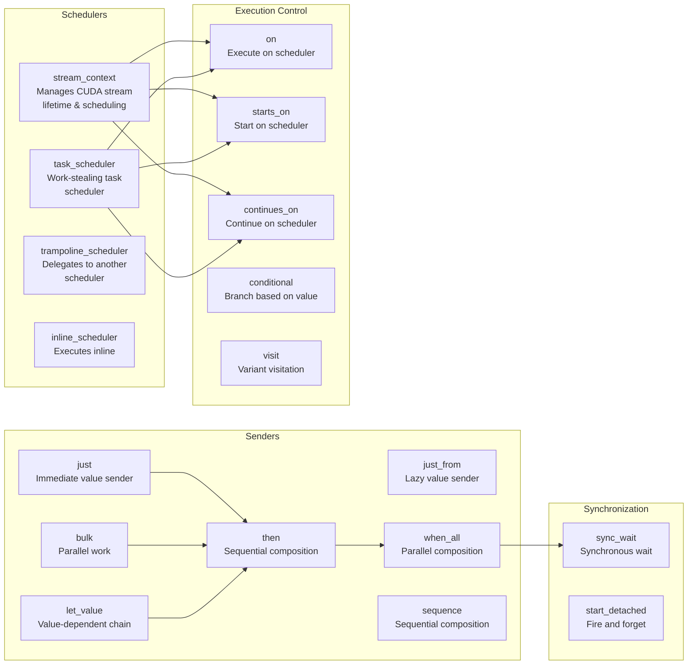
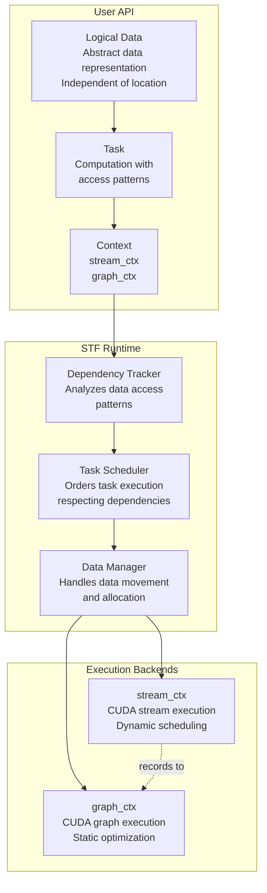
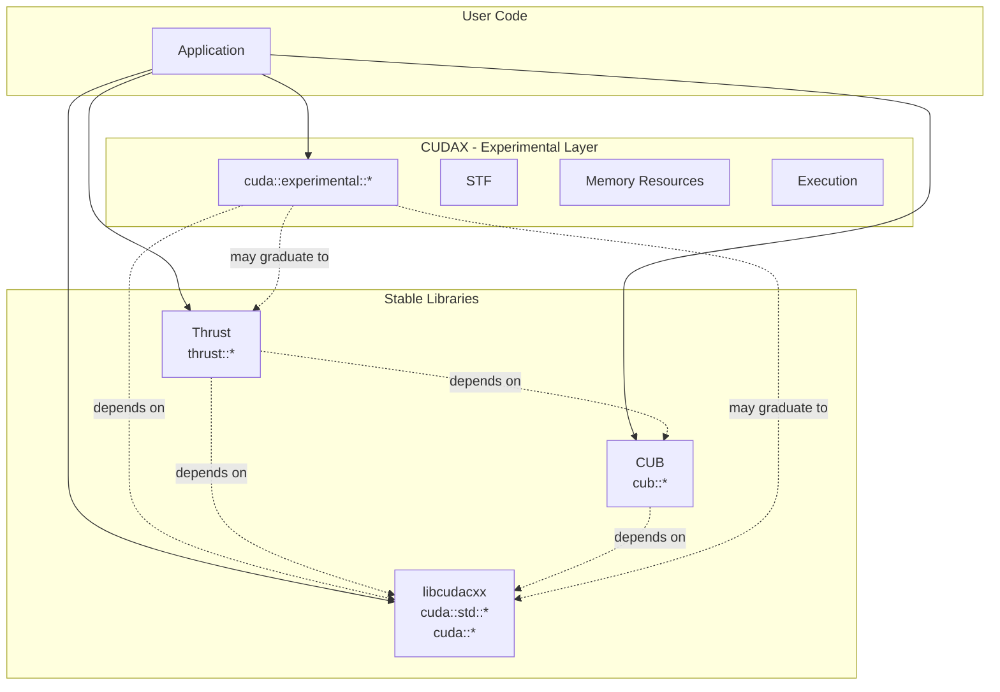

<!-- source: DeepWiki mcp.deepwiki.com · repo NVIDIA/cccl · page 2.4 CUDAX · fetched 2026-10-26 -->

# CUDAX

<details>
<summary>Relevant source files</summary>

The following files were used as context for generating this wiki page:

- [CONTRIBUTING.md](CONTRIBUTING.md)
- [README.md](README.md)
- [cudax/include/cuda/experimental/execution.cuh](cudax/include/cuda/experimental/execution.cuh)
- [cudax/include/cuda/experimental/memory_resource.cuh](cudax/include/cuda/experimental/memory_resource.cuh)
- [cudax/test/CMakeLists.txt](cudax/test/CMakeLists.txt)

</details>


**Purpose**: This page introduces CUDAX, CCCL's experimental library containing cutting-edge features that may eventually be integrated into the stable components. CUDAX provides memory resource abstractions, execution policies, the Sequential Task Framework (STF), and other experimental utilities.

**Scope**: This document covers the overall architecture, core components, and design philosophy of CUDAX. For detailed documentation of specific subsystems, see:
- [Memory Resources and Execution](#2.4.1) - Memory resource abstractions and execution policy components
- [Sequential Task Framework (STF)](#2.4.2) - Task-based programming model with automatic dependency management

CUDAX is explicitly **experimental**. APIs may change without deprecation warnings, and features may be removed or substantially redesigned based on user feedback and evolving requirements.

## Overview and Design Philosophy

CUDAX serves as an incubation space for experimental CUDA C++ features before they stabilize and potentially migrate to libcudacxx, CUB, or Thrust. It builds exclusively on libcudacxx (see [libcudacxx](#2.3)) and does not depend on CUB or Thrust, maintaining a clean separation from the stable library layers.

The library is organized into several functional domains:
- **Memory Resources**: Polymorphic memory allocation abstractions compatible with C++17 `<memory_resource>`
- **Execution Framework**: Sender/receiver-based asynchronous execution model
- **Sequential Task Framework (STF)**: High-level task graph programming with automatic dependency tracking
- **Device Utilities**: Stream and graph wrappers, kernel launch helpers, green context management
- **Containers**: Experimental container types like `uninitialized_buffer`
- **Algorithms**: Basic device algorithms (fill, copy)
- **cuFile Integration**: CUDA Direct Storage wrappers

**Sources**: [README.md:1-33](), [cudax/include/cuda/experimental/memory_resource.cuh:1-26](), [cudax/include/cuda/experimental/execution.cuh:1-53]()

## CUDAX Architecture

```mermaid
graph TB
    subgraph "CUDAX Components"
        MemRes["Memory Resources<br/>cuda::experimental::mr"]
        ExecPol["Execution Framework<br/>cuda::experimental::exec"]
        STF["Sequential Task Framework<br/>cuda::experimental::stf"]
        DevUtils["Device Utilities"]
        Containers["Containers"]
        Algos["Algorithms"]
        CuFile["cuFile Integration"]
    end
    
    subgraph "Memory Resource Types"
        DevPool["device_memory_pool"]
        ManagedPool["managed_memory_pool"]
        PinnedPool["pinned_memory_pool"]
        AnyRes["any_resource"]
        SharedRes["shared_resource"]
    end
    
    subgraph "Execution Components"
        Schedulers["Schedulers<br/>stream_context<br/>task_scheduler<br/>trampoline_scheduler"]
        Senders["Senders<br/>just, bulk, then<br/>when_all, let_value"]
        Policies["Execution Policies<br/>policy"]
        SyncOps["Synchronization<br/>sync_wait<br/>start_detached"]
    end
    
    subgraph "Device Utilities"
        Stream["stream"]
        Graph["graph"]
        Launch["launch"]
        GreenCtx["green_context"]
        Kernel["kernel"]
    end
    
    subgraph "Foundation"
        libcudacxx["libcudacxx<br/>cuda::std::*<br/>cuda::atomic<br/>cuda::barrier"]
    end
    
    MemRes --> DevPool & ManagedPool & PinnedPool & AnyRes & SharedRes
    ExecPol --> Schedulers & Senders & Policies & SyncOps
    STF -.->|uses| ExecPol
    STF -.->|uses| MemRes
    DevUtils --> Stream & Graph & Launch & GreenCtx & Kernel
    
    MemRes -.->|uses| libcudacxx
    ExecPol -.->|uses| libcudacxx
    STF -.->|uses| libcudacxx
    DevUtils -.->|uses| libcudacxx
    Containers -.->|uses| libcudacxx
    Algos -.->|uses| libcudacxx
    CuFile -.->|uses| libcudacxx
```



**Title**: CUDAX Component Architecture and Dependencies

This diagram shows CUDAX's modular organization. All components build on libcudacxx without depending on CUB or Thrust. The STF sits at the highest abstraction level, consuming both memory resources and the execution framework.

**Sources**: [cudax/test/CMakeLists.txt:1-145](), [cudax/include/cuda/experimental/memory_resource.cuh:1-26](), [cudax/include/cuda/experimental/execution.cuh:1-53]()

## Memory Resources System

CUDAX provides a comprehensive memory resource abstraction layer that follows the C++17 `std::pmr` model. These resources enable polymorphic, customizable memory allocation strategies.

### Memory Resource Types

| Resource Type | Header | Purpose |
|--------------|--------|---------|
| `device_memory_pool` | `cuda/__memory_pool/device_memory_pool.h` | Device memory pooling |
| `managed_memory_pool` | `cuda/__memory_pool/managed_memory_pool.h` | Unified memory pooling |
| `pinned_memory_pool` | `cuda/__memory_pool/pinned_memory_pool.h` | Host pinned memory pooling |
| `any_resource` | `cuda/__memory_resource/any_resource.h` | Type-erased memory resource |
| `shared_resource` | `cuda/__memory_resource/shared_resource.h` | Reference-counted resource wrapper |
| `synchronous_resource_adapter` | `cuda/__memory_resource/synchronous_resource_adapter.h` | Adapts async resources to sync interface |

Memory resources implement a common interface defined in [cuda/__memory_resource/resource.h](). Properties can be queried and specified through [cuda/__memory_resource/properties.h]().

Legacy compatibility is maintained through [cuda/__memory_resource/legacy_managed_memory_resource.h]() and [cuda/__memory_resource/legacy_pinned_memory_resource.h]().

For detailed documentation, see [Memory Resources and Execution](#2.4.1).

**Sources**: [cudax/include/cuda/experimental/memory_resource.cuh:14-23]()

## Execution Framework

CUDAX's execution framework provides a sender/receiver-based model for composing asynchronous CUDA operations. This design is inspired by C++ Standard Library proposals for asynchronous execution (P2300).



**Title**: CUDAX Execution Framework Components

### Core Execution Concepts

The framework is built on three fundamental concepts:
1. **Schedulers**: Objects that create execution contexts (e.g., `stream_context`, `task_scheduler`)
2. **Senders**: Objects representing asynchronous work that produce values (e.g., `just`, `bulk`, `then`)
3. **Receivers**: Objects that consume values produced by senders

### Key Execution Components

| Component | File | Description |
|-----------|------|-------------|
| `stream_context` | `__execution/stream_context.cuh` | CUDA stream-based scheduler |
| `task_scheduler` | `__execution/task_scheduler.cuh` | Work-stealing task scheduler |
| `inline_scheduler` | `__execution/inline_scheduler.cuh` | Inline execution scheduler |
| `just` | `__execution/just.cuh` | Create sender with immediate values |
| `bulk` | `__execution/bulk.cuh` | Parallel bulk execution |
| `then` | `__execution/then.cuh` | Sequential composition |
| `when_all` | `__execution/when_all.cuh` | Join multiple senders |
| `sync_wait` | `__execution/sync_wait.cuh` | Synchronously wait for completion |

Completion signatures describe what values, errors, or stopped signals a sender can produce, defined in [cuda/experimental/__execution/completion_signatures.cuh]().

For comprehensive documentation, see [Memory Resources and Execution](#2.4.1).

**Sources**: [cudax/include/cuda/experimental/execution.cuh:15-50](), [cudax/test/CMakeLists.txt:39-61]()

## Sequential Task Framework (STF)

The Sequential Task Framework provides a high-level programming model where developers describe tasks and their data dependencies, and the runtime automatically manages scheduling, data movement, and synchronization.

### STF Programming Model



**Title**: Sequential Task Framework Architecture

### Key STF Concepts

1. **Logical Data**: Abstract representation of data that can be instantiated in multiple memory spaces
2. **Tasks**: Computational units with declared access patterns (read, write, read-write)
3. **Automatic Dependency Analysis**: Runtime determines execution order by analyzing data access patterns
4. **Context Abstraction**: Backend-agnostic execution through `stream_ctx` or `graph_ctx`

The STF testing infrastructure is located in [cudax/test/stf/]() (as indicated by [cudax/test/CMakeLists.txt:141-144]()), though STF tests are conditionally compiled when `cudax_ENABLE_CUDASTF` is set and the compiler is not MSVC.

For complete STF documentation, see [Sequential Task Framework (STF)](#2.4.2).

**Sources**: [cudax/test/CMakeLists.txt:141-144](), [README.md:22-23]()

## Device Utilities

CUDAX provides several utility abstractions that wrap CUDA runtime features with modern C++ interfaces.

### Stream Management

The `stream` component provides RAII wrappers for CUDA streams, ensuring proper cleanup and lifetime management.

**Test Location**: [cudax/test/stream/stream_smoke.cu]()

### Graph Management

The `graph` component wraps CUDA graphs, providing a type-safe interface for graph creation and execution.

**Test Location**: [cudax/test/graph/graph_smoke.cu]()

### Launch Utilities

The `launch` component provides simplified kernel launch interfaces with improved type safety.

**Test Location**: [cudax/test/launch/launch_smoke.cu]()

### Green Context

Green context support enables lightweight execution contexts for improved scheduling flexibility.

**Test Location**: [cudax/test/green_context/green_ctx_smoke.cu]()

### Kernel and Library References

CUDAX provides `kernel` and `library` reference types that enable type-safe kernel and shared library management.

**Test Locations**: [cudax/test/kernel/kernel_ref.cu](), [cudax/test/library/library_ref.cu](), [cudax/test/library/library.cu]()

**Sources**: [cudax/test/CMakeLists.txt:35-106]()

## Containers and Algorithms

### Containers

CUDAX provides experimental container types designed for GPU programming:

| Container | Test Location | Purpose |
|-----------|---------------|---------|
| `uninitialized_buffer` | [cudax/test/containers/uninitialized_buffer.cu]() | Buffer with explicit initialization control |

### Algorithms

Basic device algorithms are provided with a modern C++ interface:

| Algorithm | Test Location | Description |
|-----------|---------------|-------------|
| `fill` | [cudax/test/algorithm/fill.cu]() | Fill device memory with a value |
| `copy` | [cudax/test/algorithm/copy.cu]() | Copy between device memory regions |

### cuCollections Integration

CUDAX includes integration with cuCollections (cuco), providing GPU-accelerated data structures:

- **Hashers**: Custom hash functions for GPU data structures ([cudax/test/cuco/utility/test_hashers.cu]())
- **HyperLogLog**: Approximate distinct counting ([cudax/test/cuco/hyperloglog/test_hyperloglog.cu]())

**Sources**: [cudax/test/CMakeLists.txt:76-111]()

## cuFile Integration

When `cudax_ENABLE_CUFILE` is enabled, CUDAX provides wrappers for CUDA Direct Storage (GDS) functionality:

| Component | Test Location | Purpose |
|-----------|---------------|---------|
| `driver_attributes` | [cudax/test/cufile/driver_attributes.cu]() | Query cuFile driver properties |
| `driver_register` | [cudax/test/cufile/driver_register.cu]() | Register/unregister buffers with cuFile driver |
| `cufile` | [cudax/test/cufile/cufile.cu]() | File I/O operations |
| `cufile_ref` | [cudax/test/cufile/cufile_ref.cu]() | Reference-counted file handles |
| `open_mode` | [cudax/test/cufile/open_mode.cu]() | File open mode abstractions |

All cuFile tests link against `CUDA::cuFile`.

**Sources**: [cudax/test/CMakeLists.txt:113-138]()

## Utility Features

CUDAX includes various utility functions for common CUDA programming patterns:

- **Device Management**: `ensure_current_device` utility ensures operations execute on the correct GPU ([cudax/test/utility/ensure_current_device.cu]())

**Sources**: [cudax/test/CMakeLists.txt:76-78]()

## Integration with CCCL



**Title**: CUDAX Integration within CCCL

CUDAX occupies a unique position in CCCL:

1. **Dependency Isolation**: CUDAX depends only on libcudacxx, not on CUB or Thrust
2. **Experimental Status**: APIs can change without following CCCL's normal deprecation policy
3. **Graduation Path**: Successful features may be promoted to stable libraries
4. **Header-Only**: Like all CCCL components, CUDAX is header-only

To use CUDAX, include the appropriate header:
```cpp
#include <cuda/experimental/memory_resource.cuh>  // Memory resources
#include <cuda/experimental/execution.cuh>         // Execution framework
#include <cuda/experimental/stf.cuh>               // Sequential Task Framework
```

**Sources**: [README.md:10-33](), [cudax/include/cuda/experimental/memory_resource.cuh:1-26](), [cudax/include/cuda/experimental/execution.cuh:1-53]()

## Building and Testing CUDAX

CUDAX tests are built conditionally based on CMake options:

- Standard CUDAX features are always available when building the test suite
- STF tests require `cudax_ENABLE_CUDASTF` and are excluded on MSVC ([cudax/test/CMakeLists.txt:141-144]())
- cuFile tests require `cudax_ENABLE_CUFILE` ([cudax/test/CMakeLists.txt:113]())

To build and test CUDAX:
```bash
# Configure with CUDAX enabled
cmake --preset cudax-cpp20

# Build all CUDAX tests
cmake --build --preset cudax-cpp20

# Run CUDAX tests
ctest --preset cudax-cpp20
```

All CUDAX test targets follow the naming convention `cudax.test.<component>` (e.g., `cudax.test.execution`, `cudax.test.stf`).

**Sources**: [cudax/test/CMakeLists.txt:1-145](), [CONTRIBUTING.md:106-151]()

## Stability and Versioning

**Important**: CUDAX is explicitly experimental. Unlike the stable CCCL components (Thrust, CUB, libcudacxx), CUDAX:

- **Does not follow semantic versioning guarantees** for its API
- **May introduce breaking changes** in any release
- **May remove features** without deprecation warnings
- **May substantially redesign** APIs based on feedback

Users of CUDAX should:
1. Pin to specific CCCL versions if stability is required
2. Monitor release notes for breaking changes
3. Provide feedback to shape future stable APIs
4. Be prepared to update code when upgrading CCCL versions

Features in CUDAX are candidates for eventual stabilization and may graduate to libcudacxx, CUB, or Thrust once they mature.

**Sources**: [README.md:1-33]()

---

