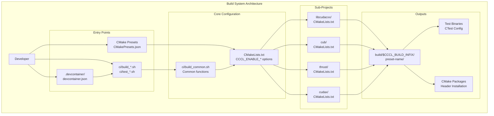
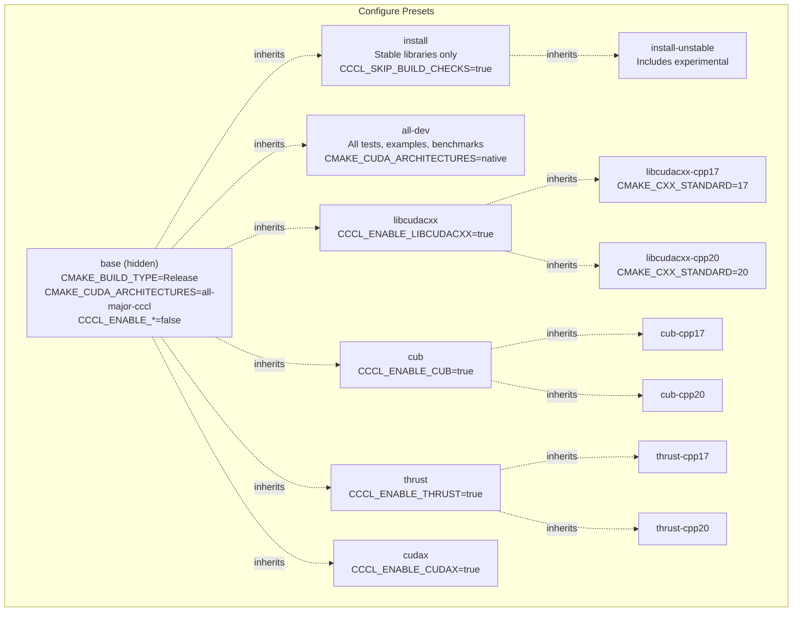
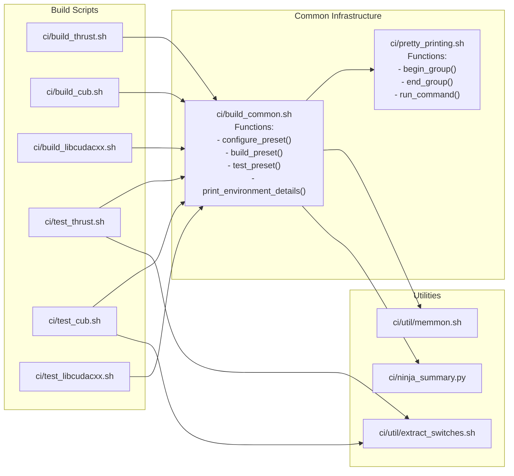
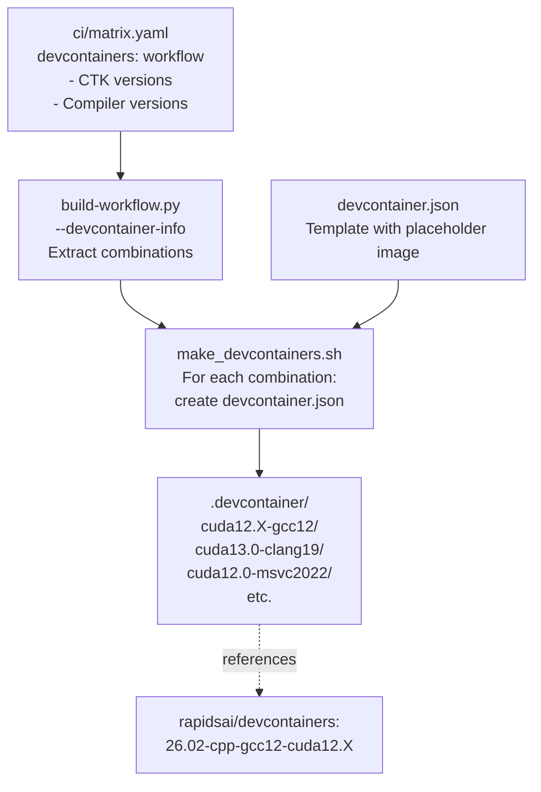

<!-- source: DeepWiki mcp.deepwiki.com · repo NVIDIA/cccl · page 3 Build System and Development · fetched 2026-10-26 -->

# Build System and Development

<details>
<summary>Relevant source files</summary>

The following files were used as context for generating this wiki page:

- [.devcontainer/make_devcontainers.sh](.devcontainer/make_devcontainers.sh)
- [.github/problem-matchers/problem-matcher.json](.github/problem-matchers/problem-matcher.json)
- [CMakeLists.txt](CMakeLists.txt)
- [CMakePresets.json](CMakePresets.json)
- [CONTRIBUTING.md](CONTRIBUTING.md)
- [README.md](README.md)
- [ci/build_common.sh](ci/build_common.sh)
- [ci/build_cub.sh](ci/build_cub.sh)
- [ci/build_libcudacxx.sh](ci/build_libcudacxx.sh)
- [ci/build_thrust.sh](ci/build_thrust.sh)
- [ci/matrix.yaml](ci/matrix.yaml)
- [ci/ninja_summary.py](ci/ninja_summary.py)
- [ci/nvrtc_libcudacxx.sh](ci/nvrtc_libcudacxx.sh)
- [ci/test_cub.sh](ci/test_cub.sh)
- [ci/test_libcudacxx.sh](ci/test_libcudacxx.sh)
- [ci/test_thrust.sh](ci/test_thrust.sh)
- [ci/upload_cub_test_artifacts.sh](ci/upload_cub_test_artifacts.sh)
- [ci/windows/test_cub.ps1](ci/windows/test_cub.ps1)

</details>


This page documents CCCL's CMake-based build infrastructure, preset configurations, testing frameworks, and development environment setup. It covers how to configure, build, and test CCCL components locally and in CI environments.

For information about the CI/CD pipeline and matrix testing strategy, see [CI/CD Infrastructure](#4). For details on installation methods for end users, see [Installation and Setup](#1.2).

## Overview

CCCL uses a CMake-based build system designed for header-only libraries. While the libraries themselves require no compilation, the build system enables:
- Generating and running comprehensive test suites
- Building examples and benchmarks
- Installing headers and CMake package configuration files
- Supporting multiple compilers, CUDA versions, and C++ standards
- Reproducible development environments via DevContainers

The build system is organized around three key concepts:
1. **CMake Presets**: Pre-configured build settings in [CMakePresets.json:1-741]()
2. **Build Scripts**: Shell scripts in `ci/` that wrap CMake invocations
3. **DevContainers**: Docker-based development environments that mirror CI



**Sources**: [CMakeLists.txt:1-128](), [CMakePresets.json:1-741](), [ci/build_common.sh:1-423]()

## CMake Configuration Structure

The root [CMakeLists.txt:1-128]() detects whether CCCL is the top-level project or included via `add_subdirectory()`, then conditionally enables developer build features.

### Top-Level CMake Variables

| Variable | Default | Purpose |
|----------|---------|---------|
| `CCCL_ENABLE_LIBCUDACXX` | `OFF` | Enable libcudacxx tests and examples |
| `CCCL_ENABLE_CUB` | `OFF` | Enable CUB tests and examples |
| `CCCL_ENABLE_THRUST` | `OFF` | Enable Thrust tests and examples |
| `CCCL_ENABLE_CUDAX` | `OFF` | Enable CUDAX tests and examples (requires `CCCL_ENABLE_UNSTABLE`) |
| `CCCL_ENABLE_TESTING` | `OFF` | Enable CCCL packaging tests |
| `CCCL_ENABLE_EXAMPLES` | `OFF` | Enable CCCL packaging examples |
| `CCCL_ENABLE_BENCHMARKS` | `OFF` | Enable benchmarks (not supported with NVHPC) |
| `CCCL_ENABLE_C_PARALLEL` | `OFF` | Enable C Parallel API |
| `CCCL_ENABLE_C_EXPERIMENTAL_STF` | `OFF` | Enable CUDASTF C API |
| `CCCL_ENABLE_UNSTABLE` | `OFF` | Gate for experimental projects |

**Sources**: [CMakeLists.txt:47-78]()

### Project Detection and Configuration Flow

```mermaid
graph TD
    Start["CMake Invocation"]
    
    CheckToplevel{"CCCL_TOPLEVEL_PROJECT?"}
    SetToplevel["Detect: CMAKE_SOURCE_DIR ==<br/>CMAKE_CURRENT_LIST_DIR"]
    
    EnableCXX["project(CCCL LANGUAGES CXX)"]
    
    CheckSkipChecks{"CCCL_SKIP_BUILD_CHECKS?"}
    RequireCMake321["cmake_minimum_required(3.21)"]
    CheckArchs["cccl_check_cuda_architectures()"]
    DevChecks["cccl_dev_build_checks()"]
    
    AddSubprojects["add_subdirectory(libcudacxx)<br/>add_subdirectory(cub)<br/>add_subdirectory(thrust)"]
    
    CheckUnstable{"CCCL_ENABLE_UNSTABLE?"}
    AddCUDAX["add_subdirectory(cudax)"]
    
    CheckC{"CCCL_ENABLE_C_PARALLEL or<br/>CCCL_ENABLE_C_EXPERIMENTAL_STF?"}
    AddC["add_subdirectory(c)"]
    
    CheckTesting{"CCCL_ENABLE_TESTING?"}
    AddTests["add_subdirectory(ci)<br/>add_subdirectory(test)"]
    
    InstallRules["include(cmake/CCCLInstallRules.cmake)"]
    
    Start --> CheckToplevel
    CheckToplevel -->|Yes| SetToplevel
    CheckToplevel -->|No| EnableCXX
    SetToplevel --> EnableCXX
    
    EnableCXX --> InstallRules
    InstallRules --> CheckSkipChecks
    
    CheckSkipChecks -->|No and Toplevel| RequireCMake321
    CheckSkipChecks -->|Yes or not Toplevel| AddSubprojects
    RequireCMake321 --> CheckArchs
    CheckArchs --> DevChecks
    DevChecks --> AddSubprojects
    
    AddSubprojects --> CheckUnstable
    CheckUnstable -->|Yes| AddCUDAX
    CheckUnstable -->|No| CheckC
    AddCUDAX --> CheckC
    
    CheckC -->|Yes| AddC
    CheckC -->|No| CheckTesting
    AddC --> CheckTesting
    
    CheckTesting -->|Yes| AddTests
    CheckTesting -->|No| End[End]
    AddTests --> End
```



**Sources**: [CMakeLists.txt:1-128]()

### CUDA Architecture Handling

CCCL provides special values for `CMAKE_CUDA_ARCHITECTURES` that are resolved by [cmake/CCCLCheckCudaArchitectures.cmake]():

- `all-major-cccl`: All major architectures supported by current CTK
- `all-cccl`: All architectures supported by current CTK
- `native`: Detect GPU on current system

These are resolved before passing to downstream CMake configuration.

**Sources**: [CMakeLists.txt:38-41](), [CMakePresets.json:16]()

## CMake Presets

CMake Presets provide pre-configured build settings. CCCL defines presets for installation, development, and per-component testing.

### Preset Hierarchy



**Sources**: [CMakePresets.json:8-341]()

### Key Presets

| Preset Name | Purpose | Key Settings |
|-------------|---------|--------------|
| `install` | Installation rules only | `CCCL_SKIP_BUILD_CHECKS=true`, stable libs only |
| `install-unstable` | Installation with experimental | Includes `cudax_ENABLE_INSTALL_RULES=true` |
| `all-dev` | Full development build | All tests, examples, benchmarks enabled |
| `libcudacxx` | libcudacxx tests | `LIBCUDACXX_ENABLE_LIBCUDACXX_TESTS=true` |
| `libcudacxx-nvrtc` | NVRTC testing | `LIBCUDACXX_TEST_WITH_NVRTC=true` |
| `cub` | CUB tests/examples | `CUB_ENABLE_HEADER_TESTING=true` |
| `thrust` | Thrust multiconfig tests | All backend systems enabled |
| `cudax` | CUDAX tests | `cudax_ENABLE_CUDASTF=true` |

**Sources**: [CMakePresets.json:34-263]()

### Preset Usage

```bash
# List available presets
cmake --list-presets

# Configure with preset
cmake --preset=cub-cpp20

# Build with preset
cmake --build --preset=cub-cpp20

# Test with preset
ctest --preset=cub-cpp20
```

Build directories are created at `build/$CCCL_BUILD_INFIX/<preset-name>/` where `CCCL_BUILD_INFIX` is set by DevContainers to isolate builds between different toolchains.

**Sources**: [CONTRIBUTING.md:106-152](), [ci/build_common.sh:142-169]()

## Build Scripts

Build scripts in `ci/` provide a wrapper around CMake presets with common options and error handling. These scripts are used both locally and in CI.

### Build Script Architecture



**Sources**: [ci/build_common.sh:1-423](), [ci/build_thrust.sh:1-21](), [ci/build_cub.sh:1-46]()

### Build Script Options

All build scripts accept common options defined in [ci/build_common.sh:24-46]():

| Option | Description | Default |
|--------|-------------|---------|
| `-cxx <compiler>` | Host compiler | `$CXX` or `g++` |
| `-std <standard>` | C++ standard (17, 20) | `17` |
| `-cuda <compiler>` | CUDA compiler | `$CUDACXX` or `nvcc` |
| `-arch <archs>` | CUDA architectures (semicolon-separated) | Preset default |
| `-cmake-options <opts>` | Additional CMake options | None |
| `-configure` | Configure only, don't build | Build enabled |
| `-v`/`-verbose` | Enable verbose output | Disabled |

**Sources**: [ci/build_common.sh:66-94]()

### Build Workflow Functions

The core workflow functions in [ci/build_common.sh:284-422]() are:

#### `configure_preset()`

```bash
configure_preset "$BUILD_NAME" "$PRESET" "$CMAKE_OPTIONS"
```

Configures CMake with the specified preset. Sets up symlinks at `build/preset-latest` and `build/latest` for convenience. Handles retry logic on CI to work around network issues during CPM dependency fetch.

**Sources**: [ci/build_common.sh:284-317]()

#### `build_preset()`

```bash
build_preset "$BUILD_NAME" "$PRESET"
```

Builds the configured preset. Tracks:
- sccache statistics via `sccache --show-adv-stats`
- Memory usage via `util/memmon.sh` 
- Build timing via `ninja_summary.py`

**Sources**: [ci/build_common.sh:319-377]()

#### `test_preset()`

```bash
test_preset "$BUILD_NAME" "$PRESET" "$GPU_REQUIRED"
```

Runs CTest for the specified preset. Checks for GPU availability if required. Generates test timing summary.

**Sources**: [ci/build_common.sh:379-408]()

### Example: Building CUB

The [ci/build_cub.sh:1-46]() script demonstrates typical usage:

```bash
#!/bin/bash
set -euo pipefail

source "$(dirname "${BASH_SOURCE[0]}")/build_common.sh"

print_environment_details

ENABLE_CCCL_BENCHMARKS="false"
ENABLE_CUB_RDC="false"

if [[ "$CUDA_COMPILER" == *nvcc* ]]; then
    ENABLE_CUB_RDC="true"
    if [[ -z "${DISABLE_CUB_BENCHMARKS}" ]]; then
        ENABLE_CCCL_BENCHMARKS="true"
    fi
fi

PRESET="cub"

CMAKE_OPTIONS=(
    -DCMAKE_CXX_STANDARD=$CXX_STANDARD
    -DCMAKE_CUDA_STANDARD=$CXX_STANDARD
    -DCCCL_ENABLE_BENCHMARKS=$ENABLE_CCCL_BENCHMARKS
    -DCUB_ENABLE_RDC_TESTS=$ENABLE_CUB_RDC
)

configure_and_build_preset "CUB" "$PRESET" "${CMAKE_OPTIONS[*]}"
```

**Sources**: [ci/build_cub.sh:1-46]()

## Testing Infrastructure

CCCL uses CTest as the primary test driver. Different components have different testing requirements.

### Test Organization

```mermaid
graph TB
    subgraph "libcudacxx Tests"
        LibCUDACXXCTest["CTest Tests<br/>C2H framework"]
        LibCUDACXXLit["Lit Tests<br/>LLVM testing framework"]
        LibCUDACXXNVRTC["NVRTC Tests<br/>Runtime compilation"]
        LibCUDACXXCodegen["Codegen Tests<br/>Verify PTX output"]
    end
    
    subgraph "CUB Tests"
        CUBNoLid["No-LID Tests<br/>Block/warp primitives<br/>Old device tests"]
        CUBLid0["LID-0 Tests<br/>Host-launched algorithms"]
        CUBLid1["LID-1 Tests<br/>Device-launched algorithms"]
        CUBLid2["LID-2 Tests<br/>Graph-captured algorithms"]
    end
    
    subgraph "Thrust Tests"
        ThrustCPU["CPU Tests<br/>Sequential, TBB, OMP"]
        ThrustGPU["GPU Tests<br/>CUDA backend"]
    end
    
    subgraph "CUDAX Tests"
        CUDAXCore["Core Tests"]
        CUDAXSTF["STF Tests"]
    end
    
    subgraph "Test Execution"
        CTest["ctest<br/>--preset=<name>"]
        FilterRegex["Filter by regex<br/>-R / -E options"]
    end
    
    CTest --> LibCUDACXXCTest
    CTest --> LibCUDACXXLit
    CTest --> CUBNoLid
    CTest --> CUBLid0
    CTest --> ThrustCPU
    CTest --> ThrustGPU
    CTest --> CUDAXCore
    
    CTest --> FilterRegex
```



**Sources**: [CMakePresets.json:462-738](), [ci/test_cub.sh:1-141]()

### CUB Testing: Launch Variant System

CUB tests are organized by "Launch ID" (LID) to test different invocation patterns:

- **No-LID**: Block/warp primitives, old device tests, examples (no `lid_X` in name)
- **LID-0**: Device algorithms launched from host
- **LID-1**: Device algorithms launched from device
- **LID-2**: Device algorithms captured in CUDA graphs

This organization enables parallel CI jobs to run different subsets independently.

**Sources**: [ci/test_cub.sh:1-141](), [ci/matrix.yaml:438-447]()

### Test Presets

CTest presets in [CMakePresets.json:462-738]() define filtering rules:

```json
{
  "name": "cub-lid0",
  "inherits": "cub",
  "filter": {
    "include": {
      "name": "^cub.*\\.lid_0.*$"
    }
  }
}
```

This allows running specific test subsets:

```bash
# Run only CUB LID-0 tests
ctest --preset=cub-lid0

# Run all CUB tests
ctest --preset=cub

# Run only Thrust GPU tests
ctest --preset=thrust-gpu
```

**Sources**: [CMakePresets.json:587-643]()

### libcudacxx Testing: Lit Framework

libcudacxx uses LLVM's "lit" testing framework for source-level tests. The [ci/test_libcudacxx.sh:1-22]() script runs both CTest and lit:

```bash
configure_preset libcudacxx "$PRESET" "$CMAKE_OPTIONS"

test_preset "libcudacxx (CTest)" "libcudacxx-ctest"

sccache -z > /dev/null || :
test_preset "libcudacxx (lit)" "libcudacxx-lit"
sccache --show-adv-stats || :
```

Lit tests are source files with embedded directives like:
- `// RUN: %{compile} && %{run}`
- `// REQUIRES: c++20`

**Sources**: [ci/test_libcudacxx.sh:1-22](), [CMakePresets.json:515-552]()

### Test Artifact Management

In CI, build and test steps are separate jobs. Build jobs create test artifacts that are uploaded, then test jobs download and execute them. The [ci/upload_cub_test_artifacts.sh:1-99]() script demonstrates this:

```bash
# Determine which test variants are needed by downstream jobs
consumers=$(ci/util/workflow/get_consumers.sh)
preset_variants=()
if grep -q "TestGPU" <<< "$consumers"; then
  preset_variants+=("no_lid")
fi
# ... more variants

# Package only the required binaries
for preset_variant in ${preset_variants[@]}; do
  ci/util/artifacts/stage.sh "$artifact_prefix-$preset_variant" \
      "$build_dir_regex/bin/.*\.$preset_variant.*" > /dev/null
  ci/util/artifacts/upload_stage_packed.sh "$artifact_prefix-$preset_variant"
done
```

**Sources**: [ci/upload_cub_test_artifacts.sh:1-99](), [ci/test_cub.sh:106-115]()

## Development Containers

CCCL provides Docker-based development containers that mirror CI environments. This ensures local builds match CI behavior.

### DevContainer Generation

The [.devcontainer/make_devcontainers.sh:1-216]() script generates a `devcontainer.json` file for each unique combination of CUDA version, compiler, and host compiler version defined in [ci/matrix.yaml:1-317]().



**Sources**: [.devcontainer/make_devcontainers.sh:1-216](), [ci/matrix.yaml:302-316]()

### DevContainer Configuration

Each generated [devcontainer.json]() includes:

```json
{
  "image": "rapidsai/devcontainers:26.02-cpp-gcc12-cuda12.X",
  "name": "cuda12.X-gcc12",
  "runArgs": ["--init", "--name", "..."],
  "containerEnv": {
    "DEVCONTAINER_NAME": "cuda12.X-gcc12",
    "CCCL_BUILD_INFIX": "cuda12.X-gcc12",
    "CCCL_CUDA_VERSION": "12.X",
    "CCCL_HOST_COMPILER": "gcc",
    "CCCL_HOST_COMPILER_VERSION": "12"
  }
}
```

The `CCCL_BUILD_INFIX` environment variable isolates build directories between different containers: `build/cuda12.X-gcc12/<preset-name>/`.

**Sources**: [.devcontainer/make_devcontainers.sh:22-74](), [ci/build_common.sh:142-156]()

### Using DevContainers

```bash
# Generate devcontainer configurations
cd .devcontainer
./make_devcontainers.sh

# Open in VS Code (select from Command Palette)
# Dev Containers: Reopen in Container

# Or use from command line
devcontainer open .devcontainer/cuda13.0-gcc14
```

Inside a DevContainer, the environment is pre-configured with the correct compilers:

```bash
# CXX and CUDACXX are set automatically
echo $DEVCONTAINER_NAME  # e.g., "cuda13.0-gcc14"
echo $CCCL_BUILD_INFIX   # e.g., "cuda13.0-gcc14"

# Build scripts use these automatically
./ci/build_cub.sh -std 20
```

**Sources**: [CONTRIBUTING.md:15-17](), [.devcontainer/README.md (referenced)]()

### Internal vs Public DevContainers

The system supports both public DevContainers (from `rapidsai/devcontainers`) and internal ones for development of unreleased CUDA versions:

```bash
readonly cuda99_8_gcc=$( make_compiler_entry "gcc"  "$CUDA99_GCC_VERSION"  "gcc"   "99.8" "false" "true")
readonly cuda99_9_gcc=$( make_compiler_entry "gcc"  "$CUDA99_GCC_VERSION"  "gcc"   "99.9" "false" "true")
```

Internal images use a different registry: `gitlab-master.nvidia.com:5005/cccl/cccl-devcontainers`.

**Sources**: [.devcontainer/make_devcontainers.sh:164-186]()

## Build Performance and Caching

### Compilation Caching with sccache

CCCL uses [sccache](https://github.com/mozilla/sccache) to cache compilation results. The [ci/build_common.sh:336-374]() build process tracks cache statistics:

```bash
# Reset statistics before build
sccache -z > /dev/null || :

# Build with caching
cmake --build --preset="$PRESET" -v

# Report statistics (CI only)
if [ -n "${GITHUB_ACTIONS:-}" ]; then
    sccache --show-adv-stats --stats-format=json > "${sccache_json}"
    run_command "📊 sccache stats" sccache --show-adv-stats
fi
```

**Sources**: [ci/build_common.sh:336-374]()

### Memory Monitoring

On CI, memory usage is tracked during builds using [ci/util/memmon.sh]():

```bash
# Track memory usage on CI
if [[ -n "${GITHUB_ACTIONS:-}" ]]; then
  util/memmon.sh --start \
      --log-threshold ${MEMMON_LOG_THRESHOLD:-2} \
      --print-threshold ${MEMMON_PRINT_THRESHOLD:-5} \
      --log-file "$memmon_log" \
      --poll ${MEMMON_POLL_INTERVAL:-5}
fi
```

This helps identify builds that consume excessive memory and may need optimization.

**Sources**: [ci/build_common.sh:338-356]()

### Build Timing Analysis

The [ci/ninja_summary.py:1-391]() script analyzes `.ninja_log` files to identify slow build steps:

```bash
./ninja_summary.py -C ${BUILD_DIR}/${PRESET}
```

Output includes:
- Longest build steps by weighted time
- Time by build-step type (`.obj`, `.dll`, linking, etc.)
- Parallelism factor

The "weighted" time is elapsed time divided by concurrent tasks, approximating the impact on total build time.

**Sources**: [ci/ninja_summary.py:1-391](), [ci/build_common.sh:363-371]()

### Parallel Build Control

Build parallelism is controlled by the `PARALLEL_LEVEL` environment variable:

```bash
# Default: number of cores minus one
readonly PARALLEL_LEVEL=${PARALLEL_LEVEL:=$(nproc --all --ignore=1)}
export CMAKE_BUILD_PARALLEL_LEVEL="${PARALLEL_LEVEL}"
export CTEST_PARALLEL_LEVEL="1"
```

Test parallelism is limited to 1 by default to avoid GPU resource contention.

**Sources**: [ci/build_common.sh:140-172](), [README.md:27-28]()

## Windows Build Support

CCCL includes PowerShell scripts for Windows builds. The [ci/windows/test_cub.ps1:1-69]() script demonstrates the Windows analog of Linux build scripts:

```powershell
Import-Module "$PSScriptRoot/build_common.psm1" `
    -ArgumentList @($CXX_STANDARD, $CUDA_ARCH, $CMAKE_OPTIONS)

test_preset "CUB ($PRESET)" "$PRESET"
```

Windows scripts follow the same structure but use PowerShell cmdlets instead of Bash functions.

**Sources**: [ci/windows/test_cub.ps1:1-69]()

## Build Timeouts and Limits

CI builds enforce timeouts to prevent jobs from running indefinitely:

```bash
# Kill build/test steps that exceed this time
: "${CCCL_CI_COMMAND_TIMEOUT:=5.5h}"

run_ci_timed_command() {
    if [[ -n "${GITHUB_ACTIONS:-}" ]]; then
        if command -v timeout &> /dev/null; then
            run_command "${group_name}" timeout "${CCCL_CI_COMMAND_TIMEOUT}" "${command[@]}"
        fi
    fi
}
```

The 5.5-hour default allows time for GitHub Actions to upload logs and artifacts before the 6-hour job limit.

**Sources**: [ci/build_common.sh:182-257]()

## Environment Details Logging

The build system logs comprehensive environment information for reproducibility:

```bash
print_environment_details() {
  begin_group "⚙️ Environment Details"
  
  echo "free -h:"
  free -h || :
  
  print_var_values \
      BUILD_DIR \
      CXX_STANDARD \
      CXX \
      CUDACXX \
      CUDAHOSTCXX \
      NVCC_VERSION \
      CMAKE_BUILD_PARALLEL_LEVEL \
      CCCL_BUILD_INFIX
  
  git log -1 --format=short
  nvidia-smi
  sccache --version
  cmake --version
  ctest --version
  
  end_group
}
```

This is called at the start of every build/test script.

**Sources**: [ci/build_common.sh:186-239]()

---

**Page Sources**: [CMakeLists.txt:1-128](), [CMakePresets.json:1-741](), [ci/build_common.sh:1-423](), [ci/build_thrust.sh:1-21](), [ci/build_cub.sh:1-46](), [ci/build_libcudacxx.sh:1-15](), [ci/test_cub.sh:1-141](), [ci/test_thrust.sh:1-64](), [ci/test_libcudacxx.sh:1-22](), [.devcontainer/make_devcontainers.sh:1-216](), [ci/matrix.yaml:1-317](), [README.md:108-219](), [CONTRIBUTING.md:1-276]()

---

