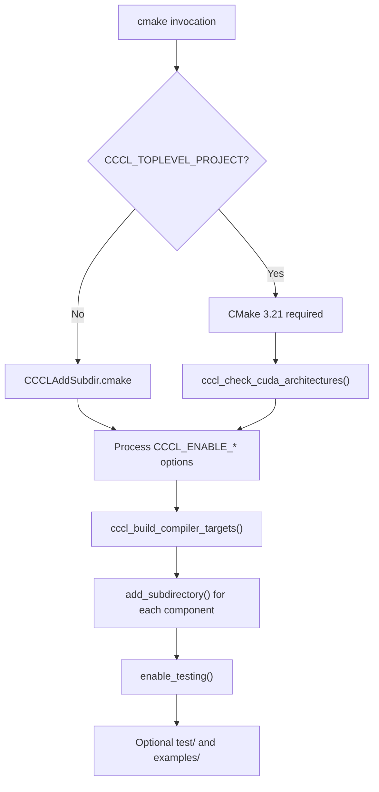
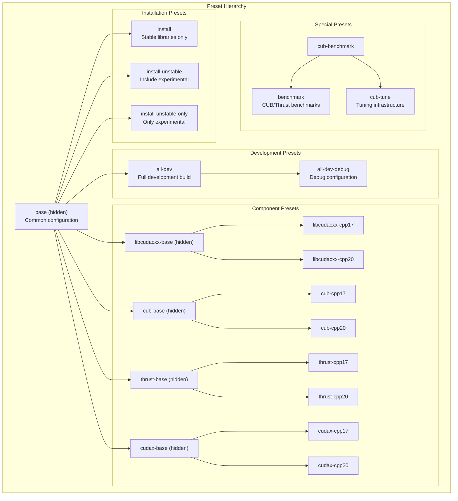
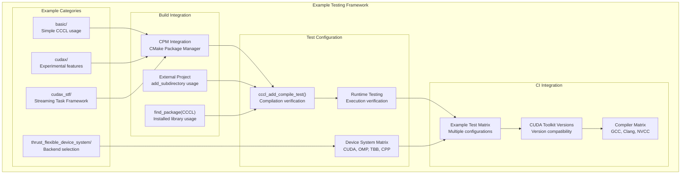

<!-- source: DeepWiki mcp.deepwiki.com · repo NVIDIA/cccl · page 3.1 CMake Build Configuration · fetched 2026-10-26 -->

# CMake Build Configuration

<details>
<summary>Relevant source files</summary>

The following files were used as context for generating this wiki page:

- [.devcontainer/make_devcontainers.sh](.devcontainer/make_devcontainers.sh)
- [.github/problem-matchers/problem-matcher.json](.github/problem-matchers/problem-matcher.json)
- [CMakeLists.txt](CMakeLists.txt)
- [CMakePresets.json](CMakePresets.json)
- [ci/build_common.sh](ci/build_common.sh)
- [ci/build_cub.sh](ci/build_cub.sh)
- [ci/build_libcudacxx.sh](ci/build_libcudacxx.sh)
- [ci/build_thrust.sh](ci/build_thrust.sh)
- [ci/matrix.yaml](ci/matrix.yaml)
- [ci/ninja_summary.py](ci/ninja_summary.py)
- [ci/nvrtc_libcudacxx.sh](ci/nvrtc_libcudacxx.sh)
- [ci/test_cub.sh](ci/test_cub.sh)
- [ci/test_libcudacxx.sh](ci/test_libcudacxx.sh)
- [ci/test_thrust.sh](ci/test_thrust.sh)
- [ci/upload_cub_test_artifacts.sh](ci/upload_cub_test_artifacts.sh)
- [ci/windows/test_cub.ps1](ci/windows/test_cub.ps1)

</details>


This document explains the CMake-based build system for CCCL (CUDA Core Compute Libraries), focusing on configuration options, presets, and component-level build control. Since CCCL consists of header-only libraries, the build system's primary purpose is configuring and building tests, examples, and benchmarks rather than the libraries themselves.

The build system is designed for two primary use cases: end-user integration (via `add_subdirectory` or `find_package`) and developer builds (building tests and examples). This page focuses on the latter.

## CMake System Architecture

CCCL's CMake system is organized hierarchically with a root `CMakeLists.txt` coordinating component-specific builds and a set of utility modules providing shared functionality.

### Top-Level CMake Structure

```mermaid
graph TD
    Root["CMakeLists.txt"]
    
    subgraph "Component Subdirectories"
        LibCuda["libcudacxx/CMakeLists.txt"]
        CUB["cub/CMakeLists.txt"]
        Thrust["thrust/CMakeLists.txt"]
        CUDAX["cudax/CMakeLists.txt"]
        C["c/CMakeLists.txt"]
    end
    
    subgraph "Shared CMake Modules"
        InstallRules["CCCLInstallRules.cmake"]
        AddSubdir["CCCLAddSubdir.cmake"]
        CheckCudaArch["CCCLCheckCudaArchitectures.cmake"]
        BuildCompiler["CCCLBuildCompilerTargets.cmake"]
        ConfigTarget["CCCLConfigureTarget.cmake"]
        TestParams["CCCLTestParams.cmake"]
    end
    
    subgraph "Build Outputs"
        TestDir["test/CMakeLists.txt"]
        ExamplesDir["examples/CMakeLists.txt"]
    end
    
    Root --> LibCuda
    Root --> CUB
    Root --> Thrust
    Root --> CUDAX
    Root --> C
    Root --> TestDir
    Root --> ExamplesDir
    
    Root --> InstallRules
    Root --> AddSubdir
    Root --> CheckCudaArch
    Root --> BuildCompiler
    Root --> ConfigTarget
    Root --> TestParams
```



The root `CMakeLists.txt` detects whether CCCL is the top-level project or being included via `add_subdirectory()`. This detection controls which features are enabled:

- **Top-level project** (`CCCL_TOPLEVEL_PROJECT=ON`): Full developer build with all CMake utilities enabled, requires CMake 3.21+
- **Subproject** (`CCCL_TOPLEVEL_PROJECT=OFF`): Minimal configuration for header-only library consumption, requires only CMake 3.15+

Sources: [CMakeLists.txt:10-36]()

## CMake Configuration Variables

CCCL exposes numerous CMake options to control which components are built and how they are configured. All boolean options default to `OFF` unless specified otherwise.

### Component Enable Options

These options control which libraries have their developer builds (tests, examples, benchmarks) enabled:

| Variable | Description |
|----------|-------------|
| `CCCL_ENABLE_LIBCUDACXX` | Build libcudacxx tests and utilities |
| `CCCL_ENABLE_CUB` | Build CUB tests, examples, and benchmarks |
| `CCCL_ENABLE_THRUST` | Build Thrust tests and examples |
| `CCCL_ENABLE_CUDAX` | Build CUDAX tests and examples (requires `CCCL_ENABLE_UNSTABLE=ON`) |
| `CCCL_ENABLE_C_PARALLEL` | Build CCCL C Parallel Library |
| `CCCL_ENABLE_C_EXPERIMENTAL_STF` | Build CUDA C STF Library |

### Cross-Component Options

These options control features that span multiple components:

| Variable | Description |
|----------|-------------|
| `CCCL_ENABLE_TESTING` | Enable cross-component test directory (`test/`) |
| `CCCL_ENABLE_EXAMPLES` | Enable cross-component examples directory (`examples/`) |
| `CCCL_ENABLE_BENCHMARKS` | Enable benchmark builds (automatically disabled for NVHPC compiler) |
| `CCCL_ENABLE_UNSTABLE` | Enable unstable/experimental projects (gates `CCCL_ENABLE_CUDAX`) |
| `CCCL_USE_LIBCXX` | Use libc++ when compiling and linking |

### Component-Specific Options

Each component provides additional options. For example, CUB provides:

- `CUB_ENABLE_DIALECT_CPP17` / `CUB_ENABLE_DIALECT_CPP20`: Enable specific C++ standard dialect tests
- `CUB_ENABLE_TESTING`: Component-specific test control
- `CUB_ENABLE_EXAMPLES`: Component-specific example control
- `CUB_ENABLE_RDC_TESTS`: Enable relocatable device code tests

Sources: [CMakeLists.txt:37-64]()

### CUDA Architecture Configuration

CCCL uses `CMAKE_CUDA_ARCHITECTURES` to control target GPU architectures. The system provides special handling for CCCL-specific architecture values:

| Value | Expansion |
|-------|-----------|
| `all-major-cccl` | All major SM architectures supported by CCCL |
| `native` | Architectures of GPUs detected on the build system |
| Standard values | e.g., `"70;75;80"`, `"89-real"`, `"90-virtual"` |

The `cccl_check_cuda_architectures()` function in `CCCLCheckCudaArchitectures.cmake` processes these special values during top-level builds.

Sources: [CMakeLists.txt:32-34](), [CMakePresets.json:16,59]()

### Configuration Workflow



Sources: [CMakeLists.txt:1-102]()

## CMake Presets System

CCCL provides a comprehensive set of CMake presets in `CMakePresets.json` that define standardized configurations for common build scenarios. Presets encapsulate combinations of CMake variables, reducing the need for manual configuration.

### Preset Architecture



### Base Preset Configuration

The `base` preset (hidden) defines common defaults inherited by all other presets:

```
Generator: Ninja
Build Directory: ${sourceDir}/build/$env{CCCL_BUILD_INFIX}/${presetName}
Build Type: Release
CUDA Architectures: all-major-cccl
Component Enables: All OFF by default
Install Rules: Enabled for all stable components
```

Sources: [CMakePresets.json:10-31]()

### Component-Specific Presets

Each component provides presets for different C++ standards. For example, CUB provides:

- `cub-cpp17`: CUB tests with C++17 standard
- `cub-cpp20`: CUB tests with C++20 standard

These inherit from `cub-base`, which enables:
- `CCCL_ENABLE_CUB=true`
- `CUB_ENABLE_TESTING=true`
- `CUB_ENABLE_EXAMPLES=true`

Sources: [CMakePresets.json:180-206]()

### Development Preset: all-dev

The `all-dev` preset provides a comprehensive development environment:

```
CUDA Architectures: native (GPUs on build system)
Enabled Components: All (libcudacxx, CUB, Thrust, cudax, examples, tests, benchmarks)
C++ Standards: C++17 and C++20 for all components
Backend Systems: CUDA, OMP, TBB, CPP (for Thrust)
Special Features: Header testing, CUDASTF enabled
```

This is the recommended preset for full local development.

Sources: [CMakePresets.json:56-96]()

### Using Presets

List available presets:
```bash
cmake --list-presets
```

Configure with a preset:
```bash
cmake --preset=thrust-cpp17
```

Build with a preset:
```bash
cmake --build --preset=thrust-cpp17
```

Test with a preset:
```bash
ctest --preset=thrust-cpp17
```

Override preset values:
```bash
cmake --preset=cub-cpp20 -DCMAKE_CUDA_ARCHITECTURES=89
```

Sources: [CMakePresets.json:1-752]()

### Build and Test Presets

In addition to configure presets, `CMakePresets.json` defines build and test presets that control the build and test execution phases:

**Build Presets** specify which targets to build. For example:
- `libcudacxx-cpp17`: Builds standard libcudacxx test targets
- `libcudacxx-nvrtc-cpp17`: Builds only the NVRTC compiler test target

**Test Presets** control CTest execution with filtering. For example:
- `cub-nolid-cpp17`: Runs CUB tests excluding launch configuration ID variants
- `cub-lid0-cpp17`: Runs only launch ID 0 tests
- `thrust-gpu-cpp17`: Runs only GPU-based Thrust tests
- `thrust-cpu-cpp17`: Runs only CPU-based Thrust tests

Sources: [CMakePresets.json:340-752]()

## Build Script Integration

CCCL provides shell scripts in the `ci/` directory that wrap CMake configuration and build commands. These scripts are used both in CI and for local development, providing a consistent interface across environments.

### build_common.sh

The `build_common.sh` script provides shared functionality for all build scripts:

**Environment Setup:**
- Validates and resolves compiler paths
- Sets environment variables: `CXX`, `CUDACXX`, `CUDAHOSTCXX`, `CXX_STANDARD`
- Determines parallel build level (`PARALLEL_LEVEL`)
- Creates build directory structure

**Configuration Functions:**
- `configure_preset()`: Runs `cmake --preset=` with options
- `build_preset()`: Runs `cmake --build --preset=`
- `test_preset()`: Runs `ctest --preset=`
- `configure_and_build_preset()`: Combines configure and build

**Command Line Options:**
| Option | Description |
|--------|-------------|
| `-cxx <compiler>` | Host compiler (default: `$CXX` or `g++`) |
| `-cuda <compiler>` | CUDA compiler (default: `$CUDACXX` or `nvcc`) |
| `-std <standard>` | C++ standard (default: 17) |
| `-arch <archs>` | CUDA architectures (default: preset value) |
| `-cmake-options "<opts>"` | Additional CMake options |
| `-configure` | Configure only, do not build |
| `-v` / `-verbose` | Enable verbose output |

Sources: [ci/build_common.sh:1-395]()

### Component Build Scripts

Each component has a dedicated build script that sources `build_common.sh` and invokes presets:

**ci/build_thrust.sh:**
```bash
PRESET="thrust-cpp$CXX_STANDARD"
configure_and_build_preset "Thrust" "$PRESET" "$CMAKE_OPTIONS"
```

**ci/build_cub.sh:**
```bash
PRESET="cub-cpp$CXX_STANDARD"
CMAKE_OPTIONS="-DCCCL_ENABLE_BENCHMARKS=$ENABLE_CCCL_BENCHMARKS"
configure_and_build_preset "CUB" "$PRESET" "$CMAKE_OPTIONS"
```

**ci/build_libcudacxx.sh:**
```bash
PRESET="libcudacxx-cpp${CXX_STANDARD}"
configure_and_build_preset "libcudacxx" "$PRESET" "$CMAKE_OPTIONS"
```

Sources: [ci/build_thrust.sh:1-21](), [ci/build_cub.sh:1-44](), [ci/build_libcudacxx.sh:1-15]()

### Build Directory Structure

The build system creates a structured directory hierarchy:

```
build/
├── $CCCL_BUILD_INFIX/          # Per-devcontainer build root
│   ├── thrust-cpp17/            # Per-preset build directory
│   │   ├── CMakeCache.txt
│   │   ├── build.ninja
│   │   ├── ctest.log
│   │   └── sccache_stats.json
│   ├── cub-cpp20/
│   └── libcudacxx-cpp17/
├── latest -> $CCCL_BUILD_INFIX/  # Symlink to most recent
└── preset-latest -> $CCCL_BUILD_INFIX/<preset>/  # Symlink to most recent preset
```

The `CCCL_BUILD_INFIX` environment variable (typically set by devcontainers to the container name) ensures that builds from different environments don't conflict.

Sources: [ci/build_common.sh:142-169](), [CMakePresets.json:13]()

### Environment Variables

The build scripts recognize and set several environment variables:

**Input Variables:**
- `CXX`: Host compiler path
- `CUDACXX`: CUDA compiler path
- `CCCL_BUILD_INFIX`: Build directory infix (devcontainer name)
- `PARALLEL_LEVEL`: Number of parallel build jobs
- `GITHUB_ACTIONS`: CI environment detection

**Output Variables:**
- `CMAKE_BUILD_PARALLEL_LEVEL`: Parallelism for CMake
- `CTEST_PARALLEL_LEVEL`: Parallelism for CTest (set to 1)
- `CUDAHOSTCXX`: CUDA host compiler path

Sources: [ci/build_common.sh:14-177]()

### Example Usage

Configure and build CUB with Clang:
```bash
cd cccl/ci
./build_cub.sh -cxx clang++-15 -std 20 -arch 80
```

Configure only without building:
```bash
./build_thrust.sh -cxx g++-11 -std 17 -configure
```

Pass additional CMake options:
```bash
./build_libcudacxx.sh -cmake-options "-DCMAKE_BUILD_TYPE=Debug"
```

Sources: [ci/build_common.sh:38-45]()

## Configuration Best Practices

### Compiler Selection

The build system automatically detects compilers from environment variables but allows explicit override:

**Via Environment Variables:**
```bash
export CXX=clang++-15
export CUDACXX=nvcc
cmake --preset=cub-cpp17
```

**Via Command Line:**
```bash
cmake --preset=cub-cpp17 -DCMAKE_CXX_COMPILER=clang++-15
```

**Via Build Script:**
```bash
ci/build_cub.sh -cxx clang++-15 -cuda nvcc
```

The build scripts validate that compilers exist in `PATH` and resolve them to full paths.

Sources: [ci/build_common.sh:96-112]()

### Architecture Configuration

For development, use `native` to target GPUs on your system:
```bash
cmake --preset=cub-cpp17 -DCMAKE_CUDA_ARCHITECTURES=native
```

For CI/production, specify explicit architectures:
```bash
cmake --preset=cub-cpp17 -DCMAKE_CUDA_ARCHITECTURES="70;75;80;86;89;90"
```

The `all-dev` preset defaults to `native` for fast local builds.

Sources: [CMakePresets.json:59]()

### Incremental Builds

The build system supports incremental builds. After initial configuration:

```bash
# Configure once
cmake --preset=thrust-cpp17

# Build multiple times
cmake --build --preset=thrust-cpp17

# Build specific target
cmake --build --preset=thrust-cpp17 --target thrust.test.reduce
```

Build artifacts are isolated per preset in separate directories, allowing multiple configurations simultaneously.

Sources: [CMakePresets.json:13](), [ci/build_common.sh:146-169]()

### Parallel Builds

Control parallelism via `PARALLEL_LEVEL` environment variable:

```bash
PARALLEL_LEVEL=16 ci/build_cub.sh -cxx g++-11 -std 20
```

The default is `nproc - 1`. This is translated to `CMAKE_BUILD_PARALLEL_LEVEL`.

Sources: [ci/build_common.sh:140,171]()

### Build Caching with sccache

The build scripts integrate with `sccache` for compiler caching:

```bash
# sccache is automatically detected and used if available
ci/build_thrust.sh -cxx g++-11

# Statistics are printed after builds in CI
```

sccache dramatically speeds up rebuilds and CI by caching compilation results.

Sources: [ci/build_common.sh:309,333-334]()

## Examples and Integration Testing

The examples directory contains integration tests that verify CCCL can be properly consumed by external projects.

### Example Test Structure



Sources: [examples/CMakeLists.txt:1-73](), [examples/basic/](), [examples/cudax/]()

## Installation and Packaging

CCCL supports multiple installation methods, from simple header copying to full CMake package integration.

### Installation Methods

| Method | Command | Use Case |
|--------|---------|----------|
| Simple Install | `cmake . && make install` | Header-only installation |
| Preset Install | `cmake --preset install` | Standard configuration |
| Unstable Install | `cmake --preset install-unstable` | Include experimental features |
| Script Install | `ci/install_cccl.sh /path` | Automated installation |

### CMake Package Integration
```cmake
find_package(CCCL REQUIRED)
target_link_libraries(my_target CCCL::CCCL)
```

The installation system generates proper CMake config files that allow downstream projects to easily consume CCCL through the standard `find_package` mechanism.

Sources: [README.md:141-170](), [ci/install_cccl.sh](), [cmake/CCCLInstallRules.cmake]()

---

