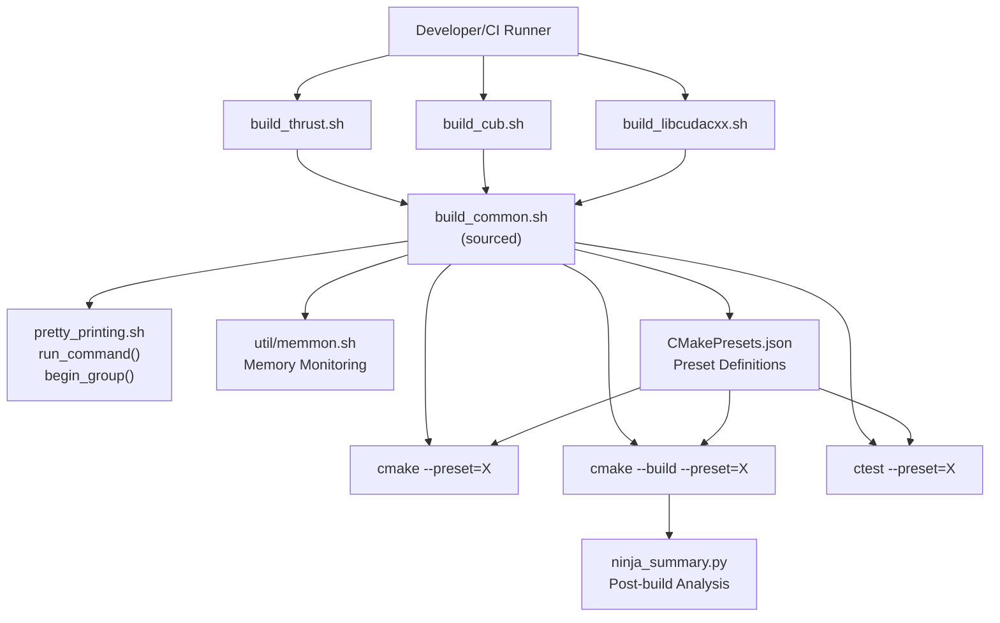
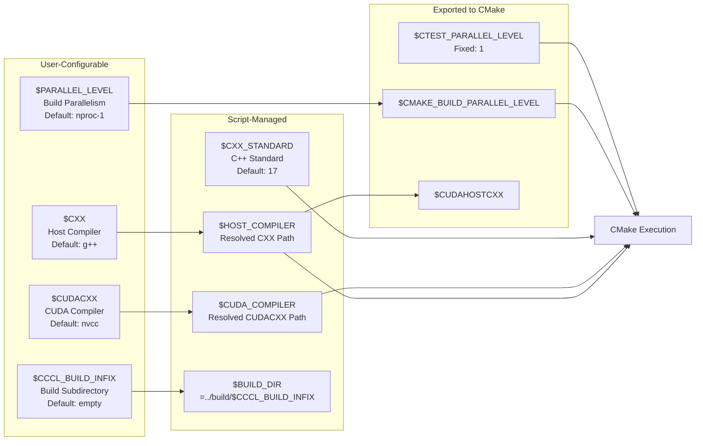
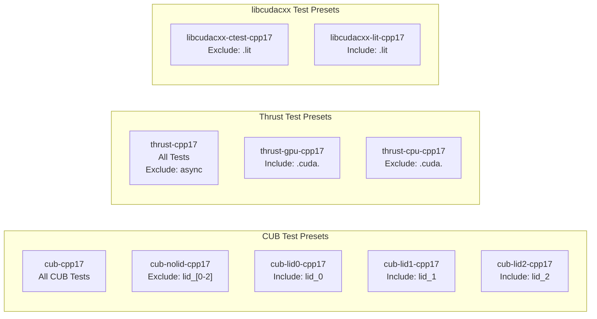
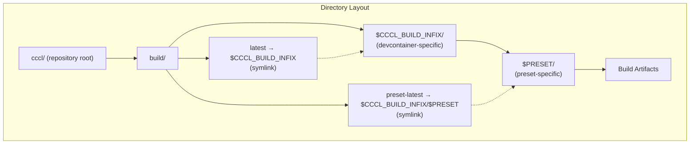
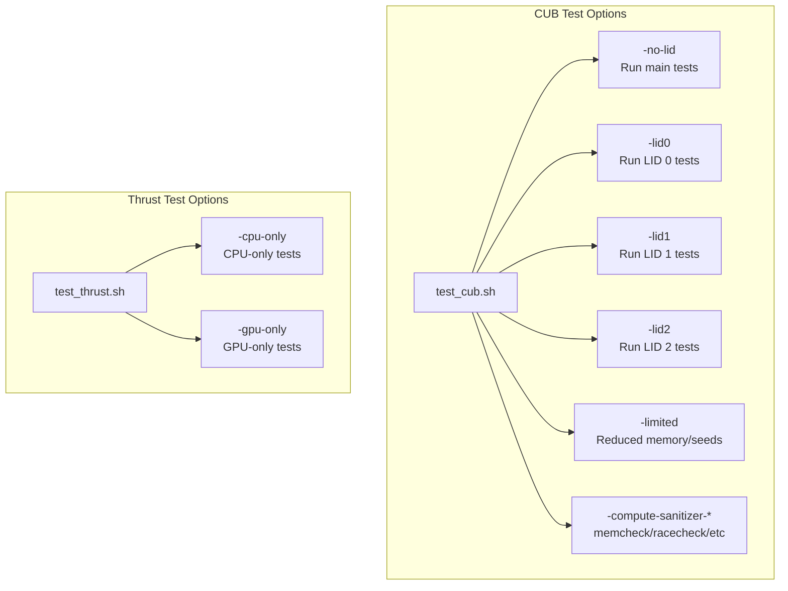

<!-- source: DeepWiki mcp.deepwiki.com · repo NVIDIA/cccl · page 3.2 Build Scripts and Presets · fetched 2026-10-26 -->

# Build Scripts and Presets

<details>
<summary>Relevant source files</summary>

The following files were used as context for generating this wiki page:

- [.devcontainer/make_devcontainers.sh](.devcontainer/make_devcontainers.sh)
- [.github/problem-matchers/problem-matcher.json](.github/problem-matchers/problem-matcher.json)
- [CMakeLists.txt](CMakeLists.txt)
- [CMakePresets.json](CMakePresets.json)
- [CONTRIBUTING.md](CONTRIBUTING.md)
- [README.md](README.md)
- [ci/build_common.sh](ci/build_common.sh)
- [ci/build_cub.sh](ci/build_cub.sh)
- [ci/build_libcudacxx.sh](ci/build_libcudacxx.sh)
- [ci/build_thrust.sh](ci/build_thrust.sh)
- [ci/matrix.yaml](ci/matrix.yaml)
- [ci/ninja_summary.py](ci/ninja_summary.py)
- [ci/nvrtc_libcudacxx.sh](ci/nvrtc_libcudacxx.sh)
- [ci/test_cub.sh](ci/test_cub.sh)
- [ci/test_libcudacxx.sh](ci/test_libcudacxx.sh)
- [ci/test_thrust.sh](ci/test_thrust.sh)
- [ci/upload_cub_test_artifacts.sh](ci/upload_cub_test_artifacts.sh)
- [ci/windows/test_cub.ps1](ci/windows/test_cub.ps1)

</details>


## Purpose and Scope

This document describes CCCL's build script infrastructure and CMake preset system, which provide standardized ways to configure, build, and test the CCCL libraries. The build scripts ([ci/build_*.sh]()) wrap CMake commands with common functionality, while [CMakePresets.json]() defines reusable configurations for different library, compiler, and C++ standard combinations.

For information about the overall CMake build system architecture, see [CMake Build Configuration](#3.1). For testing infrastructure details, see [Testing Infrastructure](#3.3). For development container setup, see [Development Containers](#3.4).

---

## Build Script Architecture

The build infrastructure centers on [ci/build_common.sh:1-395](), a sourced script that provides common functions and environment setup for all library-specific build scripts. Each library has a corresponding build script that sources `build_common.sh` and invokes its functions with library-specific parameters.

### Script Invocation Flow



**Sources:** [ci/build_common.sh:1-395](), [ci/build_thrust.sh:1-21](), [ci/build_cub.sh:1-44](), [ci/build_libcudacxx.sh:1-15]()

---

## Core Functions in build_common.sh

The [ci/build_common.sh]() script provides five primary functions that library-specific scripts invoke:

| Function | Purpose | Key Operations |
|----------|---------|----------------|
| `configure_preset()` | Configure a CMake preset | Calls `cmake --preset=$PRESET`, retries on CI, creates symlink to preset directory |
| `build_preset()` | Build a CMake preset | Calls `cmake --build --preset=$PRESET`, runs sccache, memory monitor, ninja summary |
| `test_preset()` | Test a CMake preset | Calls `ctest --preset=$PRESET`, generates test time summaries, checks for GPU if required |
| `configure_and_build_preset()` | Combined configure+build | Convenience wrapper calling both operations |
| `print_environment_details()` | Display build environment | Shows compiler versions, CUDA info, environment variables, nvidia-smi output |

### Key Environment Variables

[ci/build_common.sh:13-21,142-177]() defines and uses these environment variables:



**Sources:** [ci/build_common.sh:13-21](), [ci/build_common.sh:142-177]()

---

## Command-Line Interface

The build scripts accept standardized command-line arguments parsed by [ci/build_common.sh:66-94]():

| Option | Argument | Description | Example |
|--------|----------|-------------|---------|
| `-cxx` | compiler | Host compiler path or name | `-cxx g++-11` |
| `-cuda` | compiler | CUDA compiler path or name | `-cuda nvcc` |
| `-std` | standard | C++ standard version (11/14/17/20/23) | `-std 20` |
| `-arch` | architectures | CUDA architectures (semicolon-separated) | `-arch "70;80;90"` |
| `-cmake-options` | options | Additional CMake flags | `-cmake-options "-DCMAKE_BUILD_TYPE=Debug"` |
| `-configure` | none | Only configure, do not build | `-configure` |
| `-v` / `-verbose` | none | Enable shell tracing (`set -x`) | `-v` |
| `-disable-benchmarks` | none | Force-disable CUB benchmarks | `-disable-benchmarks` |

### Usage Examples

```bash
# Basic usage with default compilers and C++17
$ ./ci/build_thrust.sh

# Specify compiler and standard
$ ./ci/build_cub.sh -cxx clang++-15 -std 20

# Configure only for inspection
$ ./ci/build_libcudacxx.sh -configure -arch 90

# Full customization
$ PARALLEL_LEVEL=16 ./ci/build_thrust.sh \
    -cxx g++-12 \
    -cuda /usr/local/cuda-12.3/bin/nvcc \
    -std 20 \
    -arch "80-real;90-virtual" \
    -cmake-options "-DCMAKE_BUILD_TYPE=RelWithDebInfo" \
    -v
```

**Sources:** [ci/build_common.sh:24-46](), [ci/build_common.sh:66-94]()

---

## CMake Presets Structure

[CMakePresets.json:1-753]() defines three types of presets: **configure presets** (define build configuration), **build presets** (define build targets), and **test presets** (define test execution parameters). Presets use inheritance to avoid duplication.

### Preset Inheritance Hierarchy

```mermaid
graph TB
    base["base (hidden)<br/>CMAKE_BUILD_TYPE=Release<br/>CMAKE_CUDA_ARCHITECTURES=all-major-cccl<br/>All CCCL_ENABLE_*=false"]
    
    subgraph "Installation Presets"
        install["install<br/>Stable Libraries Only"]
        install_unstable["install-unstable<br/>Include cudax"]
        install_unstable_only["install-unstable-only<br/>Only cudax"]
    end
    
    subgraph "Library-Specific Bases (hidden)"
        libcudacxx_base["libcudacxx-base<br/>CCCL_ENABLE_LIBCUDACXX=true<br/>LIBCUDACXX_ENABLE_LIBCUDACXX_TESTS=true"]
        cub_base["cub-base<br/>CCCL_ENABLE_CUB=true<br/>CUB_ENABLE_TESTING=true"]
        thrust_base["thrust-base<br/>CCCL_ENABLE_THRUST=true<br/>THRUST_ENABLE_MULTICONFIG=true"]
        cudax_base["cudax-base<br/>CCCL_ENABLE_CUDAX=true<br/>cudax_ENABLE_TESTING=true"]
    end
    
    subgraph "C++ Standard Variants"
        libcudacxx_cpp17["libcudacxx-cpp17<br/>CMAKE_CXX_STANDARD=17"]
        libcudacxx_cpp20["libcudacxx-cpp20<br/>CMAKE_CXX_STANDARD=20"]
        cub_cpp17["cub-cpp17"]
        cub_cpp20["cub-cpp20"]
        thrust_cpp17["thrust-cpp17"]
        thrust_cpp20["thrust-cpp20"]
        cudax_cpp17["cudax-cpp17"]
        cudax_cpp20["cudax-cpp20"]
    end
    
    subgraph "Special Presets"
        all_dev["all-dev<br/>All Libraries + Tests<br/>CMAKE_CUDA_ARCHITECTURES=native"]
        all_dev_debug["all-dev-debug<br/>CMAKE_BUILD_TYPE=Debug<br/>CMAKE_CUDA_FLAGS=-G"]
        cub_benchmark["cub-benchmark<br/>CCCL_ENABLE_BENCHMARKS=true"]
    end
    
    base --> install
    base --> install_unstable
    base --> install_unstable_only
    base --> libcudacxx_base
    base --> cub_base
    base --> thrust_base
    base --> cudax_base
    base --> all_dev
    base --> cub_benchmark
    
    libcudacxx_base --> libcudacxx_cpp17
    libcudacxx_base --> libcudacxx_cpp20
    cub_base --> cub_cpp17
    cub_base --> cub_cpp20
    thrust_base --> thrust_cpp17
    thrust_base --> thrust_cpp20
    cudax_base --> cudax_cpp17
    cudax_base --> cudax_cpp20
    
    all_dev --> all_dev_debug
```



**Sources:** [CMakePresets.json:8-339]()

---

## Preset Naming Conventions

Presets follow consistent naming patterns that map to build scripts and test execution:

### Configure Preset Names

| Pattern | Example | Purpose |
|---------|---------|---------|
| `{library}-cpp{std}` | `thrust-cpp17` | Standard library build with specific C++ standard |
| `{library}-base` | `cub-base` | Hidden base preset for inheritance |
| `{library}-nvrtc-cpp{std}` | `libcudacxx-nvrtc-cpp20` | NVRTC-specific testing configuration |
| `all-dev` | `all-dev` | All libraries enabled for local development |
| `all-dev-debug` | `all-dev-debug` | Debug build with device-side debugging |

### Test Preset Names with Filtering

Test presets add filtering capabilities to split test execution:



**Sources:** [CMakePresets.json:453-751](), [ci/test_cub.sh:117-127](), [ci/test_thrust.sh:48-57]()

---

## Build Directory Structure

The build system creates a hierarchical directory structure organized by devcontainer name and preset:



### Path Resolution

[ci/build_common.sh:142-169]() implements this structure:

| Variable | Value | Description |
|----------|-------|-------------|
| `BUILD_ROOT` | `../build` | Absolute path to build root |
| `CCCL_BUILD_INFIX` | From environment or empty | Subdirectory for devcontainer builds |
| `BUILD_DIR` | `$BUILD_ROOT/$CCCL_BUILD_INFIX` | Per-devcontainer build directory |
| Preset dir | `$BUILD_DIR/$PRESET` | Final build directory |

### Symlinks for Convenience

Two symlinks provide quick access to recent builds:

1. **`build/latest`** → Most recent devcontainer build directory (updated on every script run)
2. **`build/preset-latest`** → Most recent preset within current devcontainer (updated by `symlink_latest_preset()`)

**Example:**

```bash
# After running: ./ci/build_cub.sh -std 17
# Directory structure:
cccl/
├── build/
│   ├── cuda12.3-gcc12/           # CCCL_BUILD_INFIX from devcontainer
│   │   ├── cub-cpp17/            # Preset directory
│   │   │   ├── CMakeCache.txt
│   │   │   ├── build.ninja
│   │   │   ├── ctest.log
│   │   │   ├── sccache_stats.json
│   │   │   └── memmon.log
│   │   └── thrust-cpp20/         # Other preset
│   ├── latest -> cuda12.3-gcc12  # Symlink
│   └── preset-latest -> cuda12.3-gcc12/cub-cpp17  # Symlink
```

**Sources:** [ci/build_common.sh:142-169](), [CMakePresets.json:13]()

---

## Library-Specific Build Scripts

Each library has a dedicated build script that sources `build_common.sh` and calls `configure_and_build_preset()` with appropriate parameters:

### Thrust Build Script

[ci/build_thrust.sh:1-21]() is the simplest, delegating all logic to common functions:

```bash
#!/bin/bash
set -euo pipefail
source "$(dirname "${BASH_SOURCE[0]}")/build_common.sh"

print_environment_details

PRESET="thrust-cpp$CXX_STANDARD"
CMAKE_OPTIONS=""

configure_and_build_preset "Thrust" "$PRESET" "$CMAKE_OPTIONS"

# CI-specific artifact packaging
if [[ -n "${GITHUB_ACTIONS:-}" ]]; then
    run_command "📦  Packaging test artifacts" \
        /home/coder/cccl/ci/upload_thrust_test_artifacts.sh
fi

print_time_summary
```

### CUB Build Script

[ci/build_cub.sh:1-44]() adds compiler-specific logic for benchmarks and RDC tests:

```bash
ENABLE_CCCL_BENCHMARKS="false"
ENABLE_CUB_RDC="false"

if [[ "$CUDA_COMPILER" == *nvcc* ]]; then
    ENABLE_CUB_RDC="true"
    if [[ -z "${DISABLE_CUB_BENCHMARKS}" ]]; then
        ENABLE_CCCL_BENCHMARKS="true"
    fi
else
    echo "Not building with NVCC, disabling RDC and benchmarks."
fi

PRESET="cub-cpp$CXX_STANDARD"
CMAKE_OPTIONS="-DCCCL_ENABLE_BENCHMARKS=$ENABLE_CCCL_BENCHMARKS \
               -DCUB_ENABLE_RDC_TESTS=$ENABLE_CUB_RDC"

configure_and_build_preset "CUB" "$PRESET" "$CMAKE_OPTIONS"
```

### libcudacxx Build Script

[ci/build_libcudacxx.sh:1-15]() is minimal, similar to Thrust but without artifact packaging.

**Sources:** [ci/build_thrust.sh:1-21](), [ci/build_cub.sh:1-44](), [ci/build_libcudacxx.sh:1-15]()

---

## Test Execution Scripts

Test scripts differ from build scripts by supporting additional options and potentially downloading pre-built artifacts in CI environments:

### Test Script Options



### Artifact Download in CI

Test scripts detect CI execution and download pre-built test binaries:

[ci/test_cub.sh:106-115]():
```bash
if [[ -z "${GITHUB_ACTIONS:-}" ]]; then
  ./build_cub.sh "$@"  # Local: build first
else
  producer_id=$(util/workflow/get_producer_id.sh)
  for tag in "${ARTIFACT_TAGS[@]}"; do
    artifact="z_cub-test-artifacts-$DEVCONTAINER_NAME-$producer_id-$tag"
    run_command "📦  Unpacking artifact '$artifact'" \
      "${ci_dir}/util/artifacts/download_packed.sh" "$artifact" /home/coder/cccl
  done
fi
```

This enables the two-stage CI workflow (build producer → test consumer) documented in [Workflow Generation and Execution](#4.3).

**Sources:** [ci/test_cub.sh:1-141](), [ci/test_thrust.sh:1-64](), [ci/test_libcudacxx.sh:1-22]()

---

## Advanced Features

### Memory Monitoring

[ci/build_common.sh:310-329]() integrates memory monitoring during builds when running in CI or when `$MEMMON` is set:

```bash
if [[ -n "${GITHUB_ACTIONS:-}" || -n "${MEMMON:-}" ]]; then
  util/memmon.sh --start \
      --log-threshold ${MEMMON_LOG_THRESHOLD:-2} \
      --print-threshold ${MEMMON_PRINT_THRESHOLD:-5} \
      --log-file "$memmon_log" \
      --poll ${MEMMON_POLL_INTERVAL:-5}
fi
```

### Build Performance Analysis

After each build, [ci/build_common.sh:336-344]() invokes [ci/ninja_summary.py:1-391]() to analyze build times:

```bash
./ninja_summary.py -C ${BUILD_DIR}/${PRESET}
```

Output example:
```
Longest build steps:
      123.4 weighted s to build libcudacxx.test.lit.precompile (456.7 s elapsed time)
       89.2 weighted s to build cub.example.device.device_reduce (89.3 s elapsed time)
Time by build-step type:
      234.5 s weighted time to generate 1234 .obj files (5678.9 s elapsed time sum)
       45.6 s weighted time to generate 10 PEFile (linking) files (123.4 s elapsed time sum)
```

### sccache Integration

Compiler caching is automatic if sccache is available. [ci/build_common.sh:309-347]() manages sccache statistics:

```bash
sccache -z > /dev/null  # Reset stats before build
# ... build occurs ...
sccache --show-adv-stats --stats-format=json > "${sccache_json}"
```

### Test Time Summaries

[ci/build_common.sh:241-257]() generates test timing summaries using a CMake script:

```bash
cmake -DLOGFILE=${ctest_log} -P ../cmake/PrintCTestRunTimes.cmake
```

This shows the slowest tests, helping identify performance issues.

**Sources:** [ci/build_common.sh:241-257](), [ci/build_common.sh:309-347](), [ci/ninja_summary.py:1-391]()

---

## Integration with Devcontainers

The [.devcontainer/make_devcontainers.sh:1-216]() script generates devcontainer configurations that set `CCCL_BUILD_INFIX` to isolate builds by compiler/CUDA version:

```bash
# Generated devcontainer.json sets:
"containerEnv.DEVCONTAINER_NAME": "cuda12.3-gcc12"
"containerEnv.CCCL_BUILD_INFIX": "cuda12.3-gcc12"
```

This ensures:
1. Each devcontainer has isolated build directories
2. Multiple devcontainers can coexist without conflicts
3. The `build/latest` symlink always points to the most recently used devcontainer

**Sources:** [.devcontainer/make_devcontainers.sh:1-216](), [ci/build_common.sh:142-156]()

---

## Preset Selection in CI

CI workflows use preset names to map jobs to configurations. The workflow dispatch system (see [Workflow Generation and Execution](#4.3)) computes preset names from matrix combinations:

```bash
# CI matrix entry:
{
  "ctk": "12.3",
  "cxx": {"name": "gcc", "version": "12"},
  "std": "17",
  "lib": "cub"
}

# Generates command:
./ci/build_cub.sh -cxx g++-12 -std 17

# Which uses preset:
PRESET="cub-cpp17"  # From build_cub.sh line 29
```

**Sources:** [ci/build_cub.sh:29](), [ci/build_thrust.sh:9](), [ci/build_libcudacxx.sh:9]()

---

