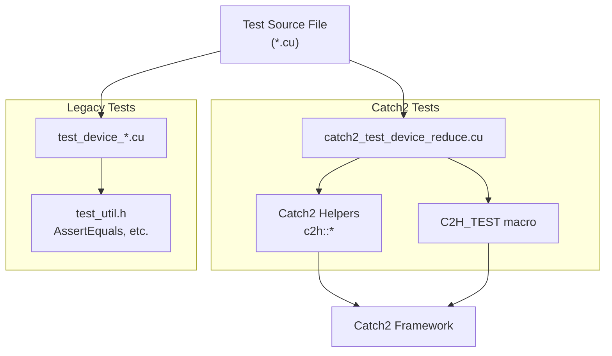
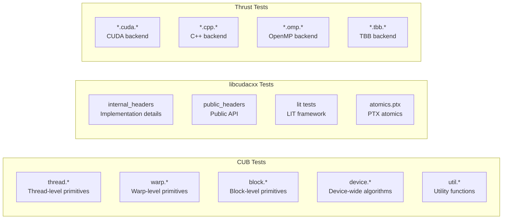
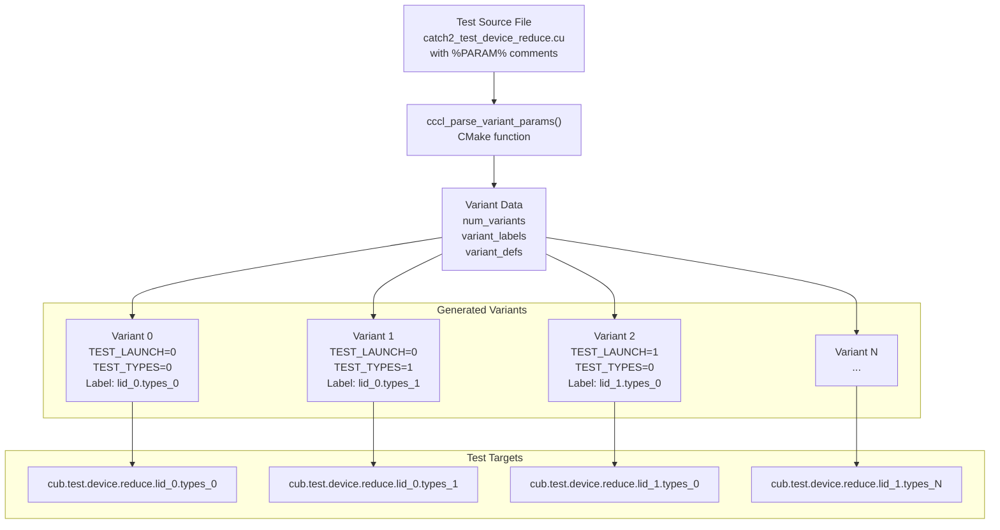
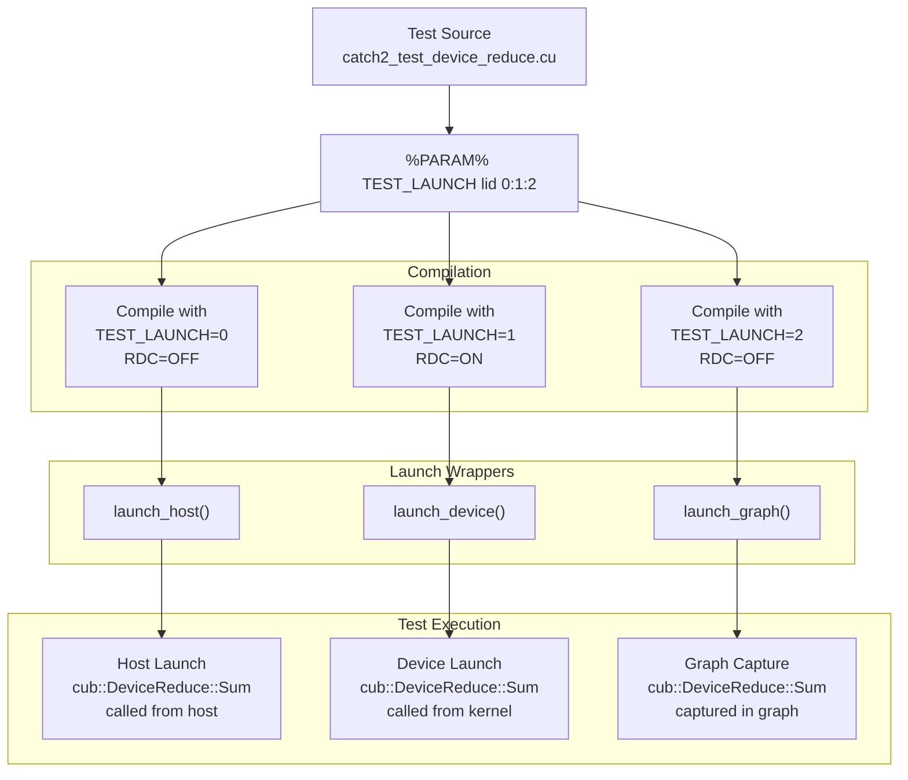
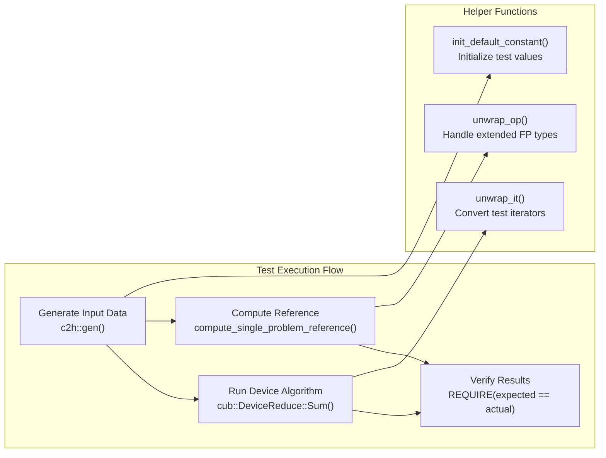
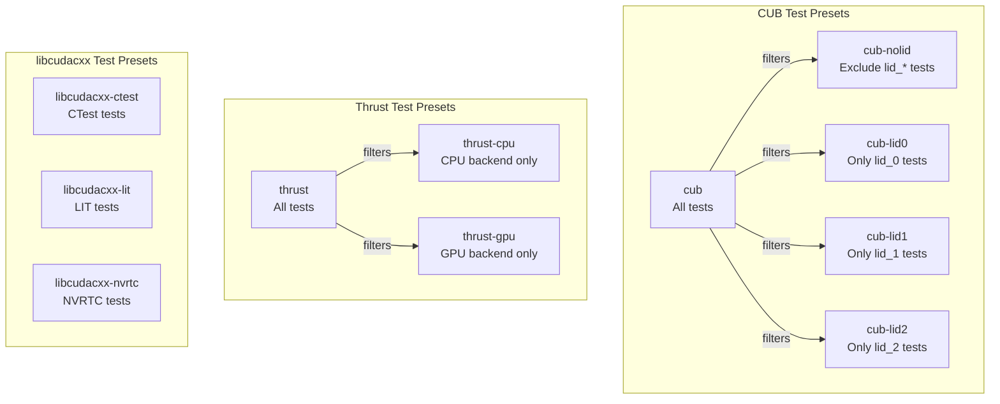
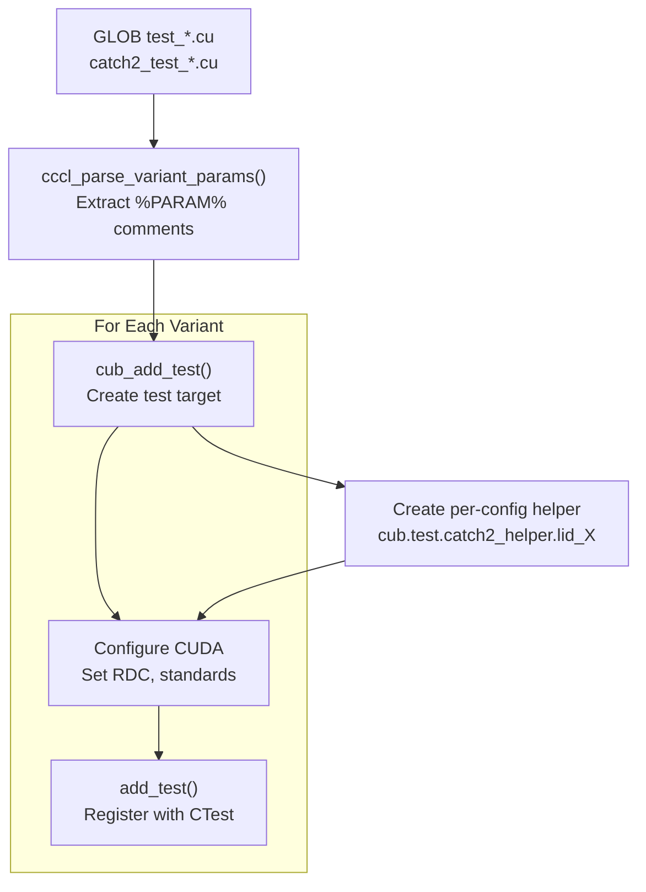
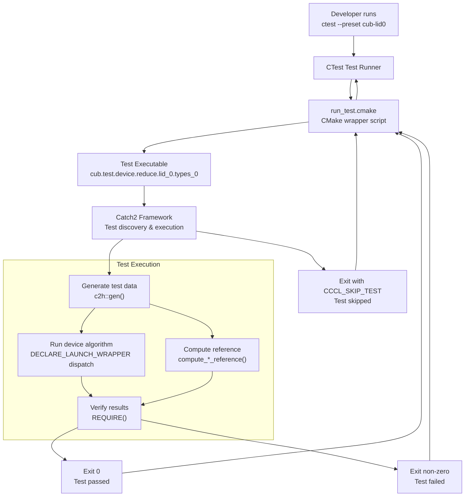

<!-- source: DeepWiki mcp.deepwiki.com · repo NVIDIA/cccl · page 3.3 Testing Infrastructure · fetched 2026-10-26 -->

# Testing Infrastructure

<details>
<summary>Relevant source files</summary>

The following files were used as context for generating this wiki page:

- [.devcontainer/make_devcontainers.sh](.devcontainer/make_devcontainers.sh)
- [.github/problem-matchers/problem-matcher.json](.github/problem-matchers/problem-matcher.json)
- [CMakeLists.txt](CMakeLists.txt)
- [CMakePresets.json](CMakePresets.json)
- [c2h/include/c2h/bfloat16.cuh](c2h/include/c2h/bfloat16.cuh)
- [c2h/include/c2h/catch2_test_helper.h](c2h/include/c2h/catch2_test_helper.h)
- [c2h/include/c2h/half.cuh](c2h/include/c2h/half.cuh)
- [c2h/include/c2h/test_util_vec.h](c2h/include/c2h/test_util_vec.h)
- [ci/build_common.sh](ci/build_common.sh)
- [ci/build_cub.sh](ci/build_cub.sh)
- [ci/build_libcudacxx.sh](ci/build_libcudacxx.sh)
- [ci/build_thrust.sh](ci/build_thrust.sh)
- [ci/matrix.yaml](ci/matrix.yaml)
- [ci/ninja_summary.py](ci/ninja_summary.py)
- [ci/nvrtc_libcudacxx.sh](ci/nvrtc_libcudacxx.sh)
- [ci/test_cub.sh](ci/test_cub.sh)
- [ci/test_libcudacxx.sh](ci/test_libcudacxx.sh)
- [ci/test_thrust.sh](ci/test_thrust.sh)
- [ci/upload_cub_test_artifacts.sh](ci/upload_cub_test_artifacts.sh)
- [ci/util/memmon.sh](ci/util/memmon.sh)
- [ci/windows/test_cub.ps1](ci/windows/test_cub.ps1)
- [cub/cub/agent/agent_segmented_scan.cuh](cub/cub/agent/agent_segmented_scan.cuh)
- [cub/cub/detail/choose_offset.cuh](cub/cub/detail/choose_offset.cuh)
- [cub/cub/device/device_segmented_scan.cuh](cub/cub/device/device_segmented_scan.cuh)
- [cub/cub/device/dispatch/dispatch_segmented_scan.cuh](cub/cub/device/dispatch/dispatch_segmented_scan.cuh)
- [cub/cub/device/dispatch/kernels/kernel_segmented_scan.cuh](cub/cub/device/dispatch/kernels/kernel_segmented_scan.cuh)
- [cub/cub/device/dispatch/tuning/tuning_segmented_scan.cuh](cub/cub/device/dispatch/tuning/tuning_segmented_scan.cuh)
- [cub/cub/util_math.cuh](cub/cub/util_math.cuh)
- [cub/cub/util_ptx.cuh](cub/cub/util_ptx.cuh)
- [cub/cub/util_type.cuh](cub/cub/util_type.cuh)
- [cub/test/CMakeLists.txt](cub/test/CMakeLists.txt)
- [cub/test/catch2_test_block_radix_sort.cuh](cub/test/catch2_test_block_radix_sort.cuh)
- [cub/test/catch2_test_device_reduce.cu](cub/test/catch2_test_device_reduce.cu)
- [cub/test/catch2_test_device_reduce.cuh](cub/test/catch2_test_device_reduce.cuh)
- [cub/test/catch2_test_device_reduce_by_key.cu](cub/test/catch2_test_device_reduce_by_key.cu)
- [cub/test/catch2_test_device_reduce_by_key_iterators.cu](cub/test/catch2_test_device_reduce_by_key_iterators.cu)
- [cub/test/catch2_test_device_reduce_fp_inf.cu](cub/test/catch2_test_device_reduce_fp_inf.cu)
- [cub/test/catch2_test_device_reduce_iterators.cu](cub/test/catch2_test_device_reduce_iterators.cu)
- [cub/test/catch2_test_device_scan.cu](cub/test/catch2_test_device_scan.cu)
- [cub/test/catch2_test_device_scan.cuh](cub/test/catch2_test_device_scan.cuh)
- [cub/test/catch2_test_device_scan_alignment.cu](cub/test/catch2_test_device_scan_alignment.cu)
- [cub/test/catch2_test_device_scan_by_key.cu](cub/test/catch2_test_device_scan_by_key.cu)
- [cub/test/catch2_test_device_scan_iterators.cu](cub/test/catch2_test_device_scan_iterators.cu)
- [cub/test/catch2_test_device_scan_large_offsets.cu](cub/test/catch2_test_device_scan_large_offsets.cu)
- [cub/test/catch2_test_device_segmented_reduce.cu](cub/test/catch2_test_device_segmented_reduce.cu)
- [cub/test/catch2_test_device_segmented_reduce_iterators.cu](cub/test/catch2_test_device_segmented_reduce_iterators.cu)
- [cub/test/catch2_test_device_segmented_reduce_iterators_64bit.cu](cub/test/catch2_test_device_segmented_reduce_iterators_64bit.cu)
- [cub/test/catch2_test_device_segmented_scan.cu](cub/test/catch2_test_device_segmented_scan.cu)
- [cub/test/catch2_test_device_segmented_scan_api.cu](cub/test/catch2_test_device_segmented_scan_api.cu)
- [cub/test/catch2_test_device_segmented_scan_noncommutative.cu](cub/test/catch2_test_device_segmented_scan_noncommutative.cu)
- [cub/test/catch2_test_iterator.cu](cub/test/catch2_test_iterator.cu)
- [cub/test/catch2_test_util_choose_offset.cu](cub/test/catch2_test_util_choose_offset.cu)
- [cub/test/catch2_test_util_math.cu](cub/test/catch2_test_util_math.cu)
- [cub/test/catch2_test_util_type.cu](cub/test/catch2_test_util_type.cu)
- [cub/test/test_util.h](cub/test/test_util.h)
- [thrust/testing/unittest/system.h](thrust/testing/unittest/system.h)

</details>


This document describes CCCL's comprehensive testing infrastructure, which validates the correctness of library components across a vast configuration space. The testing system uses Catch2 as its primary framework and implements a parametric testing model to generate thousands of test combinations from concise source files.

For information about the CI/CD system that executes these tests across different configurations, see [CI/CD Infrastructure](#4). For build system configuration, see [CMake Build Configuration](#3.1).

---

## Test Framework

CCCL uses **Catch2** as its primary test framework. Tests are written in `.cu` files that combine CUDA kernel testing with host-side verification.

### Framework Components

The testing infrastructure is built on several key components:

| Component | Location | Purpose |
|-----------|----------|---------|
| Catch2 | External dependency | Test framework and test runner |
| c2h library | `c2h/include/c2h/` | CCCL-specific Catch2 helpers and utilities |
| Test utilities | `cub/test/test_util.h`, `cub/test/catch2_test_*.cuh` | Reference implementations, data generation, assertions |
| CMake test registration | `cub/test/CMakeLists.txt`, `libcudacxx/test/CMakeLists.txt` | Automatic test discovery and configuration |

**Sources**: [c2h/include/c2h/catch2_test_helper.h:1-100](), [cub/test/test_util.h:1-100]()

### Test File Types

CCCL distinguishes between two types of test files:

1. **Catch2 tests**: Files prefixed with `catch2_test_*` using the modern Catch2 framework
2. **Legacy tests**: Files prefixed with `test_*` using older assertion macros



**Sources**: [cub/test/CMakeLists.txt:29-56](), [cub/test/catch2_test_device_reduce.cu:1-30]()

---

## Test Organization and Naming

### Naming Convention

Test executables follow a hierarchical naming pattern:

```
<project>.test.<category>.<name>[.variant_suffix]
```

Examples:
- `cub.test.device.reduce.lid_0`
- `libcudacxx.test.atomics.ptx`
- `thrust.test.cuda.copy`

**Sources**: [cub/test/CMakeLists.txt:106-112](), [cub/test/CMakeLists.txt:277-287]()

### Test Categories

Tests are organized by scope and functionality:



**Sources**: [cub/test/CMakeLists.txt:283-287]()

---

## Test Parametrization System

CCCL implements a powerful parametric testing system that generates multiple test variants from a single source file using special `%PARAM%` comments.

### Parameter Declaration

Test parameters are declared using special comments at the top of test files:

```cuda
// %PARAM% TEST_LAUNCH lid 0:1:2
// %PARAM% TEST_TYPES types 0:1:2:3
```

This syntax defines:
- **Parameter name**: `TEST_LAUNCH`, `TEST_TYPES`
- **Label base**: `lid`, `types`
- **Values**: Lists or ranges that become preprocessor definitions

**Sources**: [cub/test/catch2_test_device_reduce.cu:29-30]()

### Variant Generation Flow



**Sources**: [cub/test/CMakeLists.txt:295-301](), [cub/test/CMakeLists.txt:334-381]()

### Type List Selection

Test files use preprocessor conditionals to select different type lists based on parameter values:

```cpp
#if TEST_TYPES == 0
using full_type_list = c2h::type_list<type_pair<std::uint8_t>, type_pair<std::int8_t, std::int32_t>>;
#elif TEST_TYPES == 1
using full_type_list = c2h::type_list<type_pair<std::int32_t>, type_pair<std::int64_t>>;
// ...
#endif
```

This pattern allows a single test file to be compiled multiple times with different type combinations, distributing compilation load and enabling fine-grained testing.

**Sources**: [cub/test/catch2_test_device_reduce.cu:39-68]()

---

## Launch Variants

CUB tests support three **launch strategies** to validate algorithms in different execution contexts:

### Launch Identifiers

| Label | Value | Strategy | RDC Required | Description |
|-------|-------|----------|--------------|-------------|
| `lid_0` | 0 | Host Launch | No | Algorithm launched from host code |
| `lid_1` | 1 | Device Launch | Yes | Algorithm launched from device code (CDP) |
| `lid_2` | 2 | Graph Capture | No | Algorithm captured in CUDA graph |

**Sources**: [cub/test/CMakeLists.txt:338-346]()

### Launch Variant System Diagram



**Sources**: [cub/test/CMakeLists.txt:71-80](), [cub/test/CMakeLists.txt:347-368]()

### Launch Helper Macros

Test files use the `DECLARE_LAUNCH_WRAPPER` macro to create launch wrappers for each strategy:

```cpp
DECLARE_LAUNCH_WRAPPER(cub::DeviceReduce::Sum, device_sum);
```

This macro generates three overloaded `device_sum()` functions that dispatch to the appropriate launch strategy based on the `TEST_LAUNCH` parameter.

**Sources**: [cub/test/catch2_test_device_reduce.cu:17-22]()

### RDC (Relocatable Device Code) Handling

Device launch (`lid_1`) requires RDC to be enabled because it involves device-side kernel launches (CUDA Dynamic Parallelism). The CMake configuration automatically enables RDC for these variants:

```cmake
_cub_launcher_requires_rdc(cdp_val "${launcher_id}")
# ...
cub_configure_cuda_target(${test_target} RDC ${cdp_val})
```

**Sources**: [cub/test/CMakeLists.txt:360-380]()

---

## Test Utilities and Helpers

### c2h Library

The **c2h** (Catch2 helpers) library provides CCCL-specific testing utilities:

| Component | Purpose |
|-----------|---------|
| `c2h::device_vector<T>` | Device memory container with RAII semantics |
| `c2h::host_vector<T>` | Host memory container |
| `c2h::gen()` | Random data generation with seeding |
| `C2H_TEST()` | Macro for template test cases |
| `c2h::type_list<...>` | Type list metaprogramming |
| `C2H_SEED()` | Deterministic random seed generation |

**Sources**: [c2h/include/c2h/catch2_test_helper.h:70-96](), [c2h/include/c2h/catch2_test_helper.h:184-265]()

### Reference Computation Functions

Test utilities provide reference implementations for verification:



**Sources**: [cub/test/catch2_test_device_reduce.cuh:238-284](), [cub/test/catch2_test_device_reduce.cuh:142-198]()

### Extended Type Support

The testing infrastructure includes special handling for extended floating-point types (`__half`, `__nv_bfloat16`):

- **Type wrapping**: `half_t`, `bfloat16_t` wrapper types for compatibility
- **Unwrapping functions**: `unwrap_it()`, `unwrap_op()` to convert between wrapped and native types
- **Special operators**: `ExtendedFloatSum` for associative arithmetic

**Sources**: [cub/test/catch2_test_device_reduce.cuh:115-140](), [cub/test/catch2_test_device_reduce.cuh:148-180]()

### Data Generation

Tests support multiple data generation modes:

```cpp
enum class gen_data_t : int {
  GEN_TYPE_RANDOM,  // Uniform random data
  GEN_TYPE_CONST    // Constant value
};
```

Random data generation uses deterministic seeding:

```cpp
c2h::device_vector<T> data(num_items);
c2h::gen(C2H_SEED(2), data);  // Seed based on test context
```

**Sources**: [cub/test/catch2_test_device_reduce.cu:73-78](), [cub/test/catch2_test_device_reduce.cu:100-109]()

---

## Running Tests

### Test Execution Scripts

Each project has dedicated test scripts:

| Script | Purpose | Options |
|--------|---------|---------|
| `ci/test_cub.sh` | Run CUB tests | `-no-lid`, `-lid0`, `-lid1`, `-lid2`, `-limited`, `-compute-sanitizer-*` |
| `ci/test_thrust.sh` | Run Thrust tests | `-cpu-only`, `-gpu-only` |
| `ci/test_libcudacxx.sh` | Run libcudacxx tests | Standard build options |

**Sources**: [ci/test_cub.sh:1-141](), [ci/test_thrust.sh:1-64](), [ci/test_libcudacxx.sh:1-22]()

### CUB Launch Variant Selection

The CUB test script allows selective execution of launch variants:

```bash
# Run only host-launch tests
./ci/test_cub.sh -lid0

# Run only device-launch (CDP) tests  
./ci/test_cub.sh -lid1

# Run only graph-capture tests
./ci/test_cub.sh -lid2

# Run all non-launch-variant tests
./ci/test_cub.sh -no-lid
```

**Sources**: [ci/test_cub.sh:28-85](), [ci/test_cub.sh:117-127]()

### CMake Presets for Testing

CMake presets provide predefined test configurations:



**Sources**: [CMakePresets.json:569-643](), [CMakePresets.json:645-698](), [CMakePresets.json:495-552]()

### Test Filtering

CMake test presets use regex filters to select tests:

```json
{
  "name": "cub-lid0",
  "inherits": "cub",
  "filter": {
    "include": {
      "name": "^cub.*\\.lid_0.*$"
    }
  }
}
```

**Sources**: [CMakePresets.json:588-595]()

### Limited Environment Testing

The `-limited` flag configures tests for resource-constrained environments:

```bash
export C2H_SEED_COUNT_OVERRIDE=1              # Reduce test iterations
export C2H_DEVICE_MEMORY_LIMIT=$((8 * 1024 * 1024 * 1024))  # 8 GiB limit
export C2H_DEBUG_CHECKED_ALLOC_FAILURES=1     # Debug allocation failures
```

**Sources**: [ci/test_cub.sh:87-99]()

### Compute Sanitizer Integration

Tests can be run with NVIDIA Compute Sanitizer for memory and race condition checking:

```bash
# Run with memcheck
./ci/test_cub.sh -compute-sanitizer-memcheck

# Run with racecheck
./ci/test_cub.sh -compute-sanitizer-racecheck
```

When enabled, the test mode is set via environment variable:

```bash
export CCCL_TEST_MODE=compute-sanitizer-memcheck
```

**Sources**: [ci/test_cub.sh:57-75](), [ci/test_cub.sh:129-134]()

---

## CMake Test Integration

### Test Registration

Tests are automatically discovered and registered by CMake functions:



**Sources**: [cub/test/CMakeLists.txt:29-56](), [cub/test/CMakeLists.txt:277-383]()

### Test Target Creation

The `cub_add_test()` function creates test executables:

```cmake
function(cub_add_test target_name_var test_name variant_suffix test_src launcher_id)
  # Determine test target name
  set(test_target cub.test.${test_name}${variant_suffix})
  
  # Check if Catch2 test
  _cub_is_catch2_test(is_catch2_test "${test_src}")
  
  if (is_catch2_test)
    # Create executable with Catch2 helpers
    cccl_add_executable(${test_target} SOURCES "${test_src}")
    target_link_libraries(${test_target} PRIVATE 
      cub.compiler_interface
      ${config_c2h_target}
      cccl.c2h.main
      Catch2::Catch2)
  else()
    # Legacy test
    cccl_add_executable(${test_target} SOURCES "${test_src}")
    target_link_libraries(${test_target} PRIVATE 
      cub.compiler_interface 
      cccl.c2h)
  endif()
  
  # Register with CTest
  add_test(NAME ${test_target} COMMAND ...)
endfunction()
```

**Sources**: [cub/test/CMakeLists.txt:95-254]()

### Per-Configuration Helpers

Catch2 tests link against configuration-specific helper libraries that share compile flags:

```cmake
set(config_c2h_target cub.test.catch2_helper.lid_${launcher_id})
if (NOT TARGET ${config_c2h_target})
  add_library(${config_c2h_target} INTERFACE)
  cub_configure_cuda_target(${config_c2h_target} RDC ${cdp_val})
  target_link_libraries(${config_c2h_target} INTERFACE 
    cub.compiler_interface
    cccl.c2h
    CUDA::nvrtc
    CUDA::cuda_driver)
endif()
```

This design ensures consistent compilation flags across test variants while minimizing rebuild times.

**Sources**: [cub/test/CMakeLists.txt:113-133]()

### Test Execution Wrapper

Tests are executed through a CMake wrapper script that handles special exit codes:

```cmake
add_test(NAME ${test_target}
  COMMAND "${CMAKE_COMMAND}"
    "-DCCCL_SOURCE_DIR=${CCCL_SOURCE_DIR}"
    "-DTEST=$<TARGET_FILE:${test_target}>"
    "-DTYPE=Catch2"
    -P "${CUB_SOURCE_DIR}/test/run_test.cmake")

set_tests_properties(${test_target}
  PROPERTIES SKIP_REGULAR_EXPRESSION "CCCL_SKIP_TEST")
```

The wrapper interprets "CCCL_SKIP_TEST" output as a test skip rather than failure, allowing tests to conditionally skip based on hardware capabilities.

**Sources**: [cub/test/CMakeLists.txt:150-164]()

---

## Test Execution Flow



**Sources**: [cub/test/CMakeLists.txt:150-164](), [ci/build_common.sh:379-408]()

---

