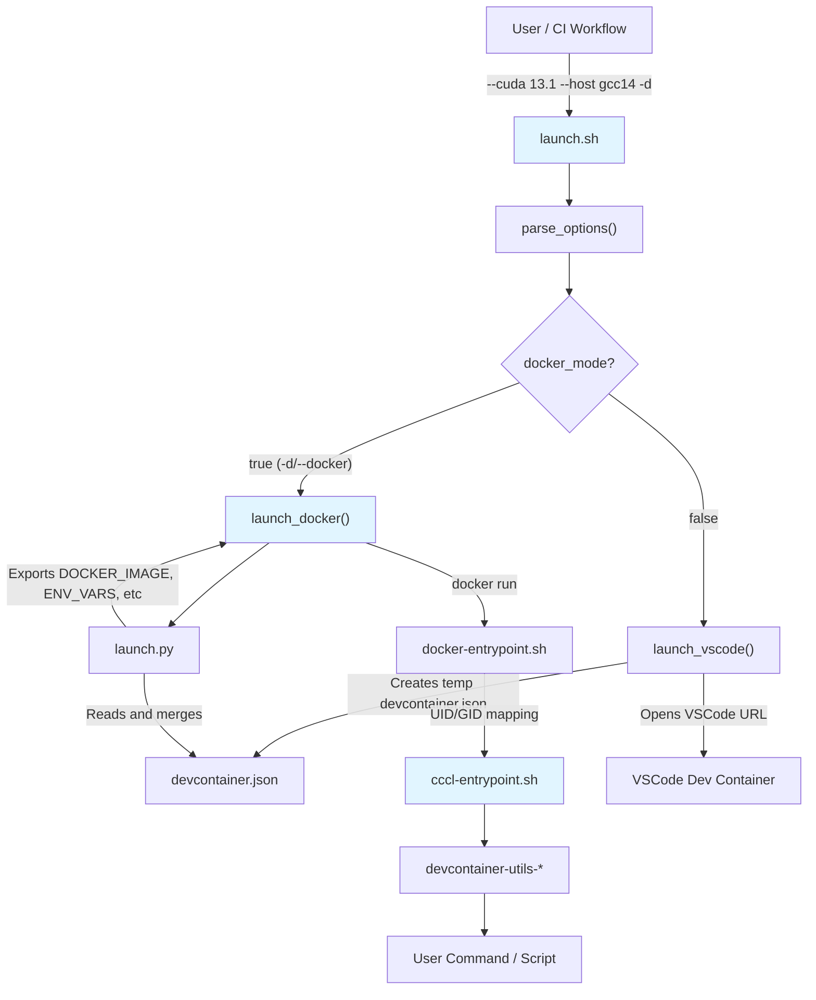
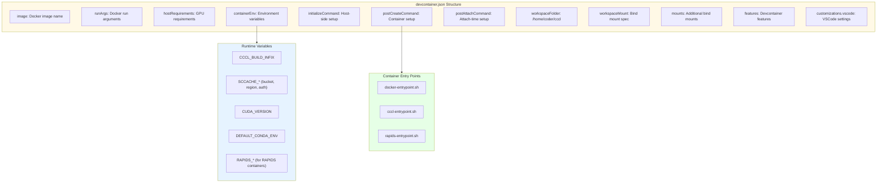
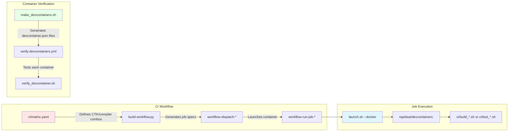
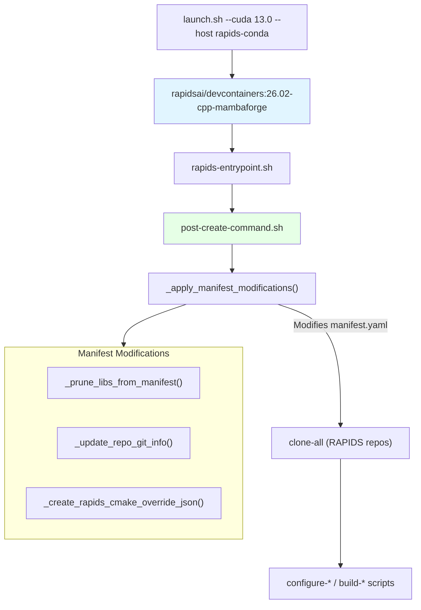

<!-- source: DeepWiki mcp.deepwiki.com · repo NVIDIA/cccl · page 3.4 Development Containers · fetched 2026-10-26 -->

# Development Containers

<details>
<summary>Relevant source files</summary>

The following files were used as context for generating this wiki page:

- [.devcontainer/cccl-entrypoint.sh](.devcontainer/cccl-entrypoint.sh)
- [.devcontainer/docker-entrypoint.sh](.devcontainer/docker-entrypoint.sh)
- [.devcontainer/launch.sh](.devcontainer/launch.sh)
- [.github/actions/docs-build/action.yml](.github/actions/docs-build/action.yml)
- [.github/actions/workflow-build/action.yml](.github/actions/workflow-build/action.yml)
- [.github/actions/workflow-build/build-workflow.py](.github/actions/workflow-build/build-workflow.py)
- [.github/actions/workflow-build/prepare-workflow-dispatch.py](.github/actions/workflow-build/prepare-workflow-dispatch.py)
- [.github/actions/workflow-results/action.yml](.github/actions/workflow-results/action.yml)
- [.github/actions/workflow-results/final-summary.py](.github/actions/workflow-results/final-summary.py)
- [.github/actions/workflow-results/parse-job-times.py](.github/actions/workflow-results/parse-job-times.py)
- [.github/actions/workflow-results/prepare-execution-summary.py](.github/actions/workflow-results/prepare-execution-summary.py)
- [.github/actions/workflow-results/verify-job-success.py](.github/actions/workflow-results/verify-job-success.py)
- [.github/copilot-instructions.md](.github/copilot-instructions.md)
- [.github/workflows/build-docs.yml](.github/workflows/build-docs.yml)
- [.github/workflows/build-matx.yml](.github/workflows/build-matx.yml)
- [.github/workflows/build-pytorch.yml](.github/workflows/build-pytorch.yml)
- [.github/workflows/build-rapids.yml](.github/workflows/build-rapids.yml)
- [.github/workflows/ci-workflow-nightly.yml](.github/workflows/ci-workflow-nightly.yml)
- [.github/workflows/ci-workflow-pull-request.yml](.github/workflows/ci-workflow-pull-request.yml)
- [.github/workflows/ci-workflow-weekly.yml](.github/workflows/ci-workflow-weekly.yml)
- [.github/workflows/git-bisect.yml](.github/workflows/git-bisect.yml)
- [.github/workflows/pr-preview-cleanup.yml](.github/workflows/pr-preview-cleanup.yml)
- [.github/workflows/verify-devcontainers.yml](.github/workflows/verify-devcontainers.yml)
- [AGENTS.md](AGENTS.md)
- [ci-overview.md](ci-overview.md)
- [ci/compute-sanitizer-suppressions.xml](ci/compute-sanitizer-suppressions.xml)
- [ci/matx/build_matx.sh](ci/matx/build_matx.sh)
- [ci/pytorch/build_pytorch.sh](ci/pytorch/build_pytorch.sh)
- [ci/rapids/cuda13.0-conda/devcontainer.json](ci/rapids/cuda13.0-conda/devcontainer.json)
- [ci/rapids/post-create-command.sh](ci/rapids/post-create-command.sh)
- [ci/rapids/rapids-entrypoint.sh](ci/rapids/rapids-entrypoint.sh)
- [ci/run_cpu_bisect.sh](ci/run_cpu_bisect.sh)
- [ci/run_cpu_target.sh](ci/run_cpu_target.sh)
- [ci/run_gpu_bisect.sh](ci/run_gpu_bisect.sh)
- [ci/run_gpu_target.sh](ci/run_gpu_target.sh)
- [ci/util/build_and_test_targets.sh](ci/util/build_and_test_targets.sh)
- [ci/util/git_bisect.sh](ci/util/git_bisect.sh)
- [docs/gen_docs.bash](docs/gen_docs.bash)
- [docs/index.rst](docs/index.rst)
- [libcudacxx/test/libcudacxx/std/utilities/memory/temporary.buffer/overaligned.pass.cpp](libcudacxx/test/libcudacxx/std/utilities/memory/temporary.buffer/overaligned.pass.cpp)
- [libcudacxx/test/libcudacxx/std/utilities/memory/temporary.buffer/temporary_buffer.pass.cpp](libcudacxx/test/libcudacxx/std/utilities/memory/temporary.buffer/temporary_buffer.pass.cpp)

</details>


Development containers provide reproducible, pre-configured environments for CCCL development and testing. These containers ensure consistency between local development and continuous integration (CI) environments, supporting multiple CUDA Toolkit versions, host compilers, C++ standards, and GPU architectures.

For information about the CI/CD infrastructure that uses these containers, see [CI/CD Infrastructure](#4).

## Overview

CCCL's development containers serve two primary purposes:
1. **Local Development**: VSCode or Docker-based environments for developers
2. **CI Execution**: Identical environments used by GitHub Actions workflows

The devcontainer system is built around the [.devcontainer/launch.sh:1-264]() script, which provides a unified interface for launching containers with specific CUDA and compiler configurations. All containers are based on images from the `rapidsai/devcontainers` registry and include development tools, compilers, and CUDA toolkits.

**Sources:** [.devcontainer/launch.sh:1-264](), [ci-overview.md:6-10]()

## Container Launch Architecture



**Diagram: Development Container Launch Flow**

The launch process begins with [.devcontainer/launch.sh:236-263](), which accepts parameters for CUDA version (`--cuda`), host compiler (`--host`), and execution mode (`--docker` for direct Docker, otherwise VSCode). The [parse_options():40-107]() function processes these arguments to determine the container path.

For Docker mode, [launch.py]() reads the [devcontainer.json]() at the selected path and extracts configuration including `image`, `runArgs`, `containerEnv`, `mounts`, and `initializeCommand`. The [launch_docker():110-200]() function then constructs and executes the `docker run` command with proper environment variables and volume mounts.

The container startup sequence involves two entry points:
1. [.devcontainer/docker-entrypoint.sh:1-58]() handles UID/GID mapping between host and container users
2. [.devcontainer/cccl-entrypoint.sh:1-49]() initializes devcontainer utilities, Git configuration, and CA certificates

**Sources:** [.devcontainer/launch.sh:1-264](), [.devcontainer/docker-entrypoint.sh:1-58](), [.devcontainer/cccl-entrypoint.sh:1-49]()

## Container Types and Organization

CCCL maintains three categories of development containers:

### Standard CCCL Containers

Generated combinations of CUDA Toolkit versions and host compilers, organized as:
```
.devcontainer/
├── cuda<VERSION>-<COMPILER>/
│   └── devcontainer.json
└── cuda<VERSION>ext-<COMPILER>/  # With extended CUDA libraries
    └── devcontainer.json
```

Each [devcontainer.json]() specifies:
- **image**: Docker image from `rapidsai/devcontainers:<VERSION>-cpp-<COMPILER>-cuda<CTK>` or `rapidsai/devcontainers:<VERSION>-cuda<CTK>ext-<COMPILER>`
- **runArgs**: Docker runtime arguments including container name, ulimits
- **containerEnv**: Environment variables like `CCCL_BUILD_INFIX`, `SCCACHE_*` settings
- **mounts**: Workspace folder and cache directory bindings
- **features**: Optional devcontainer features to install

**Sources:** [.github/workflows/verify-devcontainers.yml:38-39](), [ci-overview.md:77-81]()

### RAPIDS Testing Containers

Special containers for RAPIDS library integration testing, located in `ci/rapids/`:

```
ci/rapids/
└── cuda<VERSION>-conda/
    └── devcontainer.json
```

These containers use `rapidsai/devcontainers:<VERSION>-cpp-mambaforge` images and include:
- Conda environment management via `DEFAULT_CONDA_ENV=rapids`
- RAPIDS-specific environment variables (`RAPIDS_LIBS`, `RAPIDS_*_GIT_REPO`)
- Repository cloning and build script generation via [ci/rapids/post-create-command.sh:1-146]()
- Volume mounts for RAPIDS library checkouts in `ci/rapids/.repos/`

The [post-create-command.sh]() script performs:
1. Installation of `rapids-build-utils` feature if not present
2. Modification of `manifest.yaml` based on environment variables
3. Cloning of RAPIDS repositories specified in `RAPIDS_LIBS`

**Sources:** [ci/rapids/cuda13.0-conda/devcontainer.json:1-119](), [ci/rapids/post-create-command.sh:1-146]()

### Default Top-Level Container

The `.devcontainer/devcontainer.json` provides a default configuration used when no specific CUDA/compiler is selected. This simplifies the VSCode "Reopen in Container" workflow.

**Sources:** [.devcontainer/launch.sh:241-244]()

## Container Configuration Schema



**Diagram: Development Container Configuration Structure**

### Key Configuration Elements

**Image Selection**: Determined by CUDA version, host compiler, and extended library flag:
- Standard: `rapidsai/devcontainers:<DC_VERSION>-cpp-<COMPILER>-cuda<CTK>`
- Extended: `rapidsai/devcontainers:<DC_VERSION>-cpp-<COMPILER>-cuda<CTK>ext`
- RAPIDS: `rapidsai/devcontainers:<DC_VERSION>-cpp-mambaforge`

**Environment Variables**:
- `CCCL_BUILD_INFIX`: Unique identifier for build directory isolation
- `SCCACHE_BUCKET`, `SCCACHE_REGION`: Shared compilation cache configuration
- `SCCACHE_IDLE_TIMEOUT`: Cache server timeout (typically 0 for persistent cache)
- `HISTFILE`: Bash history persistence location
- `CUDAARCHS`: Default GPU architectures to compile for

**Mount Points**: All containers mount:
- Workspace: `${localWorkspaceFolder} → /home/coder/cccl`
- AWS config: `${localWorkspaceFolder}/.aws → /home/coder/.aws`
- Cache: `${localWorkspaceFolder}/.cache → /home/coder/.cache`
- Additional project-specific mounts (e.g., RAPIDS library directories)

**Sources:** [ci/rapids/cuda13.0-conda/devcontainer.json:1-119](), [.devcontainer/launch.py]()

## CI Integration

Development containers are central to CCCL's CI/CD strategy, ensuring local development and CI use identical environments.



**Diagram: Development Container CI Integration**

### Matrix-Driven Container Selection

The [ci/matrix.yaml]() file defines test configurations specifying `ctk` (CUDA Toolkit) and `cxx` (host compiler). The [build-workflow.py]() script in [.github/actions/workflow-build/build-workflow.py:1-1300]() translates these into container specifications:

- [generate_dispatch_job_image():487-502]() constructs the image name based on job requirements
- [generate_dispatch_job_host_compiler():481-485]() determines the compiler tag
- [generate_dispatch_job_ctk_version():476-479]() selects the CUDA version

Job execution through [workflow-run-job-linux]() or [workflow-run-job-windows]() actions invokes [launch.sh]() with computed parameters.

### Container Verification Workflow

The [.github/workflows/verify-devcontainers.yml:1-156]() workflow ensures devcontainer configurations are valid and up-to-date:

1. **Generation Check** ([lines 37-49]()): Runs [make_devcontainers.sh]() and verifies no uncommitted changes
2. **Change Detection** ([lines 50-86]()): Inspects changes to `.devcontainer/`, `ci/matrix.yaml`, or `build-workflow.py` to conditionally skip verification
3. **Container Testing** ([lines 96-156]()): Launches each container via `@devcontainers/cli` and executes [verify_devcontainer.sh]()

The verification workflow only runs when:
- Devcontainer files are modified
- Matrix configuration changes
- Workflow build logic changes

**Sources:** [.github/workflows/verify-devcontainers.yml:1-156](), [.github/actions/workflow-build/build-workflow.py:476-502](), [ci-overview.md:6-10]()

## Third-Party Testing Containers

CCCL validates compatibility with downstream projects using specialized containers:

### RAPIDS Containers

The [.github/workflows/build-rapids.yml:1-207]() workflow uses RAPIDS-specific containers to build multiple RAPIDS libraries:



**Diagram: RAPIDS Container Workflow**

Key environment variables:
- `RAPIDS_LIBS`: Space-separated list of libraries to build (e.g., `"rmm kvikio cudf"`)
- `RAPIDS_<lib>_GIT_REPO`: JSON override for repository URL and branch
- `CCCL_TAG`: Override for CCCL commit/tag
- `CCCL_VERSION`: Override for rapids-cmake version

The [_apply_manifest_modifications():12-25]() function in [ci/rapids/post-create-command.sh:1-146]():
1. Filters libraries via [_prune_libs_from_manifest():27-40]()
2. Updates git info via [_update_repo_git_info():43-52]()
3. Creates override JSON via [_create_rapids_cmake_override_json():54-116]() to use local CCCL

### MatX and PyTorch Containers

Similar workflows for [MatX](.github/workflows/build-matx.yml:1-125) and [PyTorch](.github/workflows/build-pytorch.yml:1-114) use standard CCCL containers with extended CUDA libraries (`--cuda-ext` flag):

- **MatX** ([ci/matx/build_matx.sh:1-106]()): Clones MatX, patches `versions.json` to use local CCCL, builds with `-DMATX_BUILD_TESTS=ON`
- **PyTorch** ([ci/pytorch/build_pytorch.sh:1-127]()): Clones PyTorch, replaces CUDA installation's CCCL headers, builds CUDA targets

Both workflows mount AWS credentials for `sccache` and run with CUDA 13.1 + GCC 14.

**Sources:** [.github/workflows/build-rapids.yml:114-188](), [ci/rapids/post-create-command.sh:1-146](), [ci/matx/build_matx.sh:1-106](), [ci/pytorch/build_pytorch.sh:1-127]()

## Local Development Usage

### Launching a Container

**With specific configuration:**
```bash
.devcontainer/launch.sh -d --cuda 13.1 --host gcc14
```

**With VSCode (no arguments needed):**
```bash
.devcontainer/launch.sh --cuda 12.2 --host gcc12
```

**With extended CUDA libraries:**
```bash
.devcontainer/launch.sh -d --cuda 13.1 --host gcc14 --cuda-ext
```

**With GPU access:**
```bash
.devcontainer/launch.sh -d --cuda 13.1 --host gcc14 --gpus all
```

**With additional environment variables:**
```bash
.devcontainer/launch.sh -d --cuda 13.1 --host gcc14 \
  -e MYVAR=value -e ANOTHER=setting
```

**Execute command in container:**
```bash
.devcontainer/launch.sh -d --cuda 13.1 --host gcc14 -- ./ci/build_cub.sh
```

**Sources:** [.devcontainer/launch.sh:8-22]()

### Container Features

All containers include:
- **sccache**: Distributed compilation cache shared with CI (requires AWS authentication)
- **Git integration**: Automatic credential handling and SSH key forwarding
- **Build tools**: CMake, Ninja, compilers matching the container specification
- **CUDA Toolkit**: Version specified by `--cuda` flag
- **Persistent history**: Bash history stored in `.cache/._bash_history`

The [cccl-entrypoint.sh:1-49]() initialization:
1. Configures `SCCACHE_DIST_URL` for distributed caching
2. Runs `devcontainer-utils-post-create-command`
3. Initializes Git configuration via `devcontainer-utils-init-git`
4. Updates CA certificates

**Sources:** [.devcontainer/cccl-entrypoint.sh:1-49](), [ci-overview.md:65-67]()

## Reproducibility and Debugging

### Reproducing CI Failures

When a CI job fails, the workflow logs include exact reproduction instructions:

```bash
# Example from failure log
.devcontainer/launch.sh -d -c 13.0 -H gcc14 -- ./ci/build_cub.sh gcc 20 "75;80;90"
```

The command specifies:
- `-d`: Docker mode (no VSCode)
- `-c 13.0`: CUDA 13.0 toolkit
- `-H gcc14`: GCC 14 host compiler
- `-- ./ci/build_cub.sh ...`: Build script with arguments

This ensures the local environment exactly matches CI, including:
- Same container image version (via `devcontainer_version` in `ci/matrix.yaml`)
- Same CUDA and compiler versions
- Same build and test scripts
- Same environment variable configuration

**Sources:** [ci-overview.md:74-98](), [.github/workflows/build-rapids.yml:127-143]()

### Container Environment Variables

Key variables set in CI and available locally:

| Variable | Purpose | Example Value |
|----------|---------|---------------|
| `CCCL_BUILD_INFIX` | Build directory isolation | `build/${CCCL_BUILD_INFIX}/cub-cpp20` |
| `SCCACHE_BUCKET` | Compilation cache S3 bucket | `rapids-sccache-devs` |
| `SCCACHE_REGION` | AWS region for cache | `us-east-2` |
| `SCCACHE_IDLE_TIMEOUT` | Cache server timeout | `0` (persistent) |
| `GITHUB_ACTIONS` | Indicates CI environment | `true` (in CI only) |
| `CI` | Generic CI indicator | `true` (in CI only) |

**Sources:** [ci/rapids/cuda13.0-conda/devcontainer.json:12-47]()

## Advanced Configuration

### Custom Container Modifications

To modify a devcontainer configuration:

1. **Never edit generated files directly** - they will be overwritten
2. Edit the generation script [.devcontainer/make_devcontainers.sh]()
3. Regenerate all configurations: `.devcontainer/make_devcontainers.sh --verbose --clean`
4. Verify changes: `.github/workflows/verify-devcontainers.yml` will validate on PR

### Adding New Compiler/CUDA Combinations

New combinations are defined in [ci/matrix.yaml]():
1. Add host compiler version to `host_compilers.<id>.versions`
2. Add CUDA version to `ctk_versions` if needed
3. Run [make_devcontainers.sh]() to generate configurations
4. Commit the generated `.devcontainer/` files

The [build-workflow.py]() script uses these definitions to determine valid container image names via [canonicalize_host_compiler_name():164-203]() and [canonicalize_ctk_version():123-137]().

**Sources:** [.github/workflows/verify-devcontainers.yml:38-49](), [.github/actions/workflow-build/build-workflow.py:123-137](), [.github/actions/workflow-build/build-workflow.py:164-203]()

---

