<!-- source: DeepWiki mcp.deepwiki.com · repo NVIDIA/cccl · page 4 CI/CD Infrastructure · fetched 2026-10-26 -->

# CI/CD Infrastructure

<details>
<summary>Relevant source files</summary>

The following files were used as context for generating this wiki page:

- [.devcontainer/cccl-entrypoint.sh](.devcontainer/cccl-entrypoint.sh)
- [.devcontainer/docker-entrypoint.sh](.devcontainer/docker-entrypoint.sh)
- [.devcontainer/launch.sh](.devcontainer/launch.sh)
- [.devcontainer/make_devcontainers.sh](.devcontainer/make_devcontainers.sh)
- [.github/actions/docs-build/action.yml](.github/actions/docs-build/action.yml)
- [.github/actions/workflow-build/action.yml](.github/actions/workflow-build/action.yml)
- [.github/actions/workflow-build/build-workflow.py](.github/actions/workflow-build/build-workflow.py)
- [.github/actions/workflow-build/prepare-workflow-dispatch.py](.github/actions/workflow-build/prepare-workflow-dispatch.py)
- [.github/actions/workflow-results/action.yml](.github/actions/workflow-results/action.yml)
- [.github/actions/workflow-results/final-summary.py](.github/actions/workflow-results/final-summary.py)
- [.github/actions/workflow-results/parse-job-times.py](.github/actions/workflow-results/parse-job-times.py)
- [.github/actions/workflow-results/prepare-execution-summary.py](.github/actions/workflow-results/prepare-execution-summary.py)
- [.github/actions/workflow-results/verify-job-success.py](.github/actions/workflow-results/verify-job-success.py)
- [.github/copilot-instructions.md](.github/copilot-instructions.md)
- [.github/problem-matchers/problem-matcher.json](.github/problem-matchers/problem-matcher.json)
- [.github/workflows/build-docs.yml](.github/workflows/build-docs.yml)
- [.github/workflows/build-matx.yml](.github/workflows/build-matx.yml)
- [.github/workflows/build-pytorch.yml](.github/workflows/build-pytorch.yml)
- [.github/workflows/build-rapids.yml](.github/workflows/build-rapids.yml)
- [.github/workflows/ci-workflow-nightly.yml](.github/workflows/ci-workflow-nightly.yml)
- [.github/workflows/ci-workflow-pull-request.yml](.github/workflows/ci-workflow-pull-request.yml)
- [.github/workflows/ci-workflow-weekly.yml](.github/workflows/ci-workflow-weekly.yml)
- [.github/workflows/git-bisect.yml](.github/workflows/git-bisect.yml)
- [.github/workflows/pr-preview-cleanup.yml](.github/workflows/pr-preview-cleanup.yml)
- [.github/workflows/verify-devcontainers.yml](.github/workflows/verify-devcontainers.yml)
- [AGENTS.md](AGENTS.md)
- [CMakeLists.txt](CMakeLists.txt)
- [CMakePresets.json](CMakePresets.json)
- [ci-overview.md](ci-overview.md)
- [ci/build_common.sh](ci/build_common.sh)
- [ci/build_cub.sh](ci/build_cub.sh)
- [ci/build_libcudacxx.sh](ci/build_libcudacxx.sh)
- [ci/build_thrust.sh](ci/build_thrust.sh)
- [ci/compute-sanitizer-suppressions.xml](ci/compute-sanitizer-suppressions.xml)
- [ci/matrix.yaml](ci/matrix.yaml)
- [ci/matx/build_matx.sh](ci/matx/build_matx.sh)
- [ci/ninja_summary.py](ci/ninja_summary.py)
- [ci/nvrtc_libcudacxx.sh](ci/nvrtc_libcudacxx.sh)
- [ci/pytorch/build_pytorch.sh](ci/pytorch/build_pytorch.sh)
- [ci/rapids/cuda13.0-conda/devcontainer.json](ci/rapids/cuda13.0-conda/devcontainer.json)
- [ci/rapids/post-create-command.sh](ci/rapids/post-create-command.sh)
- [ci/rapids/rapids-entrypoint.sh](ci/rapids/rapids-entrypoint.sh)
- [ci/run_cpu_bisect.sh](ci/run_cpu_bisect.sh)
- [ci/run_cpu_target.sh](ci/run_cpu_target.sh)
- [ci/run_gpu_bisect.sh](ci/run_gpu_bisect.sh)
- [ci/run_gpu_target.sh](ci/run_gpu_target.sh)
- [ci/test_cub.sh](ci/test_cub.sh)
- [ci/test_libcudacxx.sh](ci/test_libcudacxx.sh)
- [ci/test_thrust.sh](ci/test_thrust.sh)
- [ci/upload_cub_test_artifacts.sh](ci/upload_cub_test_artifacts.sh)
- [ci/util/build_and_test_targets.sh](ci/util/build_and_test_targets.sh)
- [ci/util/git_bisect.sh](ci/util/git_bisect.sh)
- [ci/windows/test_cub.ps1](ci/windows/test_cub.ps1)
- [docs/gen_docs.bash](docs/gen_docs.bash)
- [docs/index.rst](docs/index.rst)
- [libcudacxx/test/libcudacxx/std/utilities/memory/temporary.buffer/overaligned.pass.cpp](libcudacxx/test/libcudacxx/std/utilities/memory/temporary.buffer/overaligned.pass.cpp)
- [libcudacxx/test/libcudacxx/std/utilities/memory/temporary.buffer/temporary_buffer.pass.cpp](libcudacxx/test/libcudacxx/std/utilities/memory/temporary.buffer/temporary_buffer.pass.cpp)

</details>


This page provides a comprehensive overview of CCCL's Continuous Integration and Continuous Deployment (CI/CD) system. It explains how the repository ensures code quality across hundreds of compiler/CUDA/standard/architecture combinations through automated matrix testing, workflow generation, and third-party canary builds.

**Scope**: This page covers the overall CI/CD architecture and how its components work together. For detailed information on specific subsystems, see:
- [Architecture Overview](#4.1) - Dispatch groups, producer-consumer jobs, and artifact management
- [Matrix Configuration](#4.2) - Structure of `ci/matrix.yaml` and job types
- [Workflow Generation and Execution](#4.3) - How workflows are dynamically generated
- [Change Detection and Third-Party Testing](#4.4) - Selective testing and canary builds

For information on the build system itself, see [Build System and Development](#3).

## System Overview

CCCL's CI/CD infrastructure is designed to handle the complexity of testing a header-only CUDA C++ library across a vast configuration space. The system dynamically generates GitHub Actions workflows from a declarative matrix specification, optimizes testing based on code changes, and validates compatibility with downstream projects.

### Key Design Principles

1. **Declarative Configuration**: All test combinations are defined in a single YAML file
2. **Dynamic Generation**: Workflows are generated at runtime based on the matrix and detected changes
3. **Producer-Consumer Architecture**: Build artifacts are cached and reused across test jobs
4. **Change Detection**: Only affected projects are tested when possible
5. **Reproducibility**: Every CI job can be reproduced locally using development containers

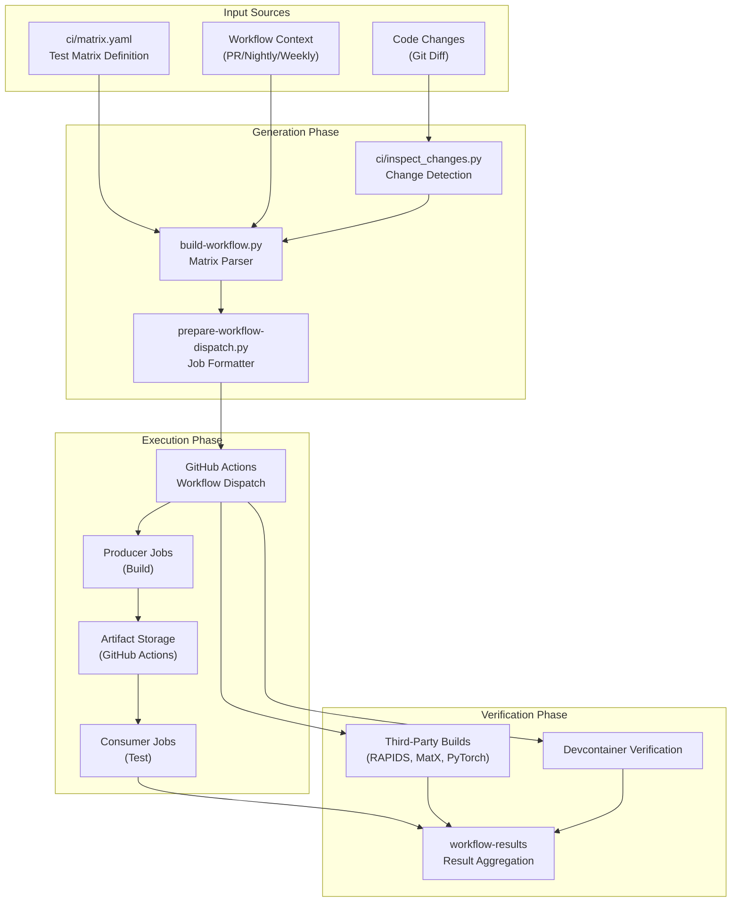

**Sources**: [ci/matrix.yaml](), [ci/inspect_changes.py](), [.github/actions/workflow-build/build-workflow.py](), [.github/workflows/ci-workflow-pull-request.yml]()

## Matrix Testing System

The core of CCCL's CI is the matrix testing system, which generates hundreds of test configurations from a declarative specification.

### Matrix Dimensions

The matrix is defined across four primary dimensions:

| Dimension | Description | Example Values |
|-----------|-------------|----------------|
| **CUDA Toolkit (CTK)** | CUDA version to test against | `12.0`, `12.X`, `13.0`, `13.X`, `clang-cuda`, `nvhpc` |
| **Host Compiler (CXX)** | C++ compiler and version | `gcc7-14`, `clang14-20`, `msvc2019/2022`, `nvhpc` |
| **C++ Standard (STD)** | C++ language standard | `17`, `20`, `all`, `min`, `max`, `minmax` |
| **GPU Architecture (SM)** | Target GPU compute capability | `70`, `75`, `80`, `90`, `100`, `120`, `gpu`, `all-cccl` |

Additional dimensions include:
- **CPU Architecture**: `amd64`, `arm64`
- **GPU Model**: `rtx2080`, `rtx4090`, `rtxa6000`, `h100`, `l4`, `rtxpro6000`
- **Project**: `libcudacxx`, `cub`, `thrust`, `cudax`, `cccl_c_parallel`, `python`, etc.
- **Job Type**: `build`, `test`, `nvrtc`, `verify_codegen`, `compute_sanitizer`, etc.

### Workflow Contexts

The matrix supports different workflow contexts with varying levels of coverage:

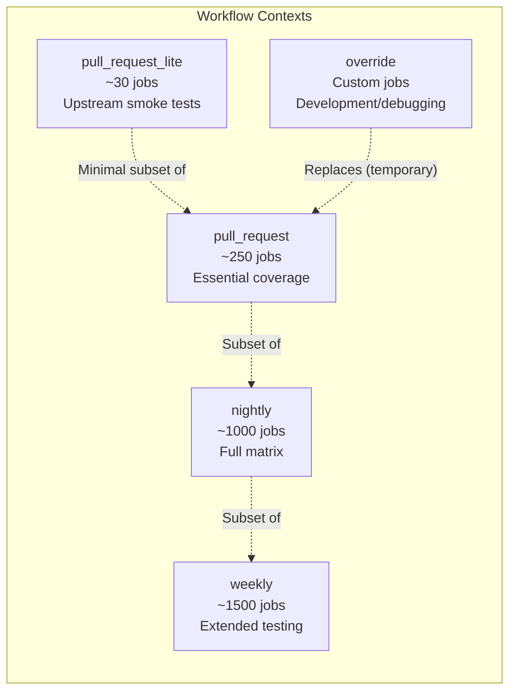

**Sources**: [ci/matrix.yaml:1-349](), [ci/matrix.yaml:25-89](), [ci/matrix.yaml:91-124](), [ci/matrix.yaml:126-206](), [ci/matrix.yaml:208-293]()

### Matrix Job Definition

Each entry in `ci/matrix.yaml` defines a set of jobs to create. Here's the structure:

```yaml
# Example from ci/matrix.yaml
workflows:
  pull_request:
    # Build-only jobs: test latest compilers across all standards
    - jobs: ['build']
      std: 'all'
      cxx: ['gcc', 'clang', 'msvc']
    
    # Test jobs: specific projects, standards, GPU
    - jobs: ['test']
      project: 'libcudacxx'
      std: 'max'
      cxx: ['gcc', 'clang', 'msvc']
      gpu: 'rtx2080'
    
    # CUB has specialized test jobs for launch strategies
    - jobs: ['test_nolid', 'test_lid0']
      project: 'cub'
      std: 'max'
      cxx: ['gcc', 'clang', 'msvc']
      gpu: 'rtxa6000'
```

The matrix parser expands these specifications into individual jobs by:
1. Resolving defaults (e.g., `cxx: 'gcc'` → `gcc14` based on latest version)
2. Expanding special values (e.g., `std: 'all'` → `[17, 20]` for most projects)
3. Applying project-specific job mappings (e.g., `test` → `['test_cpu', 'test_gpu']` for Thrust)
4. Generating unique job identifiers

**Sources**: [ci/matrix.yaml:25-89](), [.github/actions/workflow-build/build-workflow.py:122-203](), [ci/matrix.yaml:490-552]()

## Workflow Generation Pipeline

The workflow generation pipeline transforms the declarative matrix into executable GitHub Actions workflows through a multi-stage process.

### Generation Flow

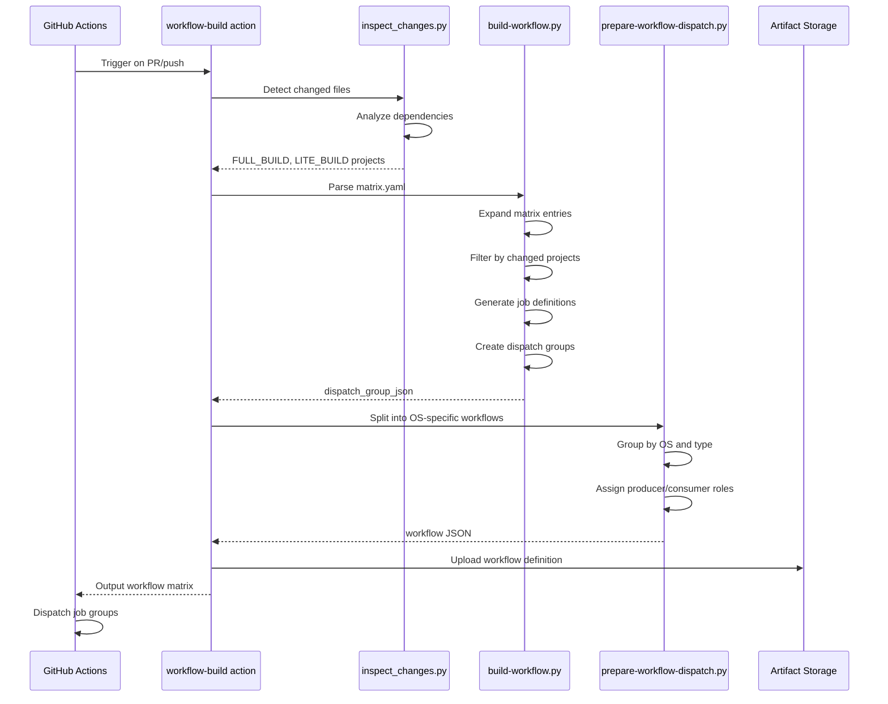

**Sources**: [.github/actions/workflow-build/action.yml](), [.github/actions/workflow-build/build-workflow.py](), [ci/inspect_changes.py]()

### Job Types and Dependencies

Jobs are categorized into two types based on their dependencies:

**Two-Stage Jobs** (Producer-Consumer):
- **Producer** (`build`): Compiles test executables, uploads artifacts
- **Consumer** (`test`, `nvrtc`, etc.): Downloads artifacts, runs tests

**Standalone Jobs**:
- No artifact dependencies (e.g., `install`, `verify_codegen`)
- Can run independently

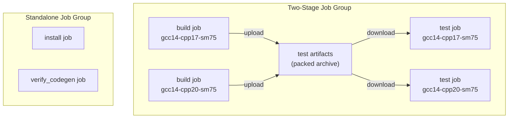

The producer-consumer pattern reduces build times by:
- Building once, testing multiple configurations
- Parallelizing builds and tests
- Reducing redundant compilation

**Sources**: [.github/actions/workflow-build/build-workflow.py:24-53](), [ci/matrix.yaml:424-474]()

## Job Execution Architecture

Once workflows are generated, they are executed through a layered dispatch system.

### Dispatch Group Organization

Jobs are organized into hierarchical groups for GitHub Actions:

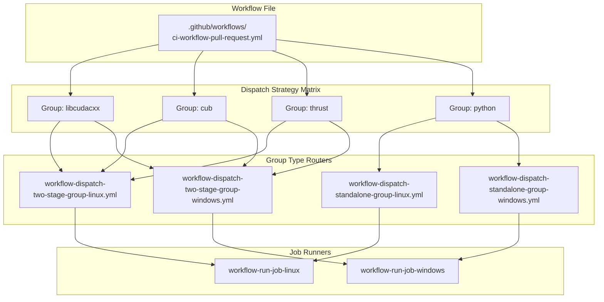

**Sources**: [.github/workflows/ci-workflow-pull-request.yml:122-196](), [.github/workflows/workflow-dispatch-two-stage-group-linux.yml]()

### Job Execution Environment

Each job runs inside a development container with a specific configuration:

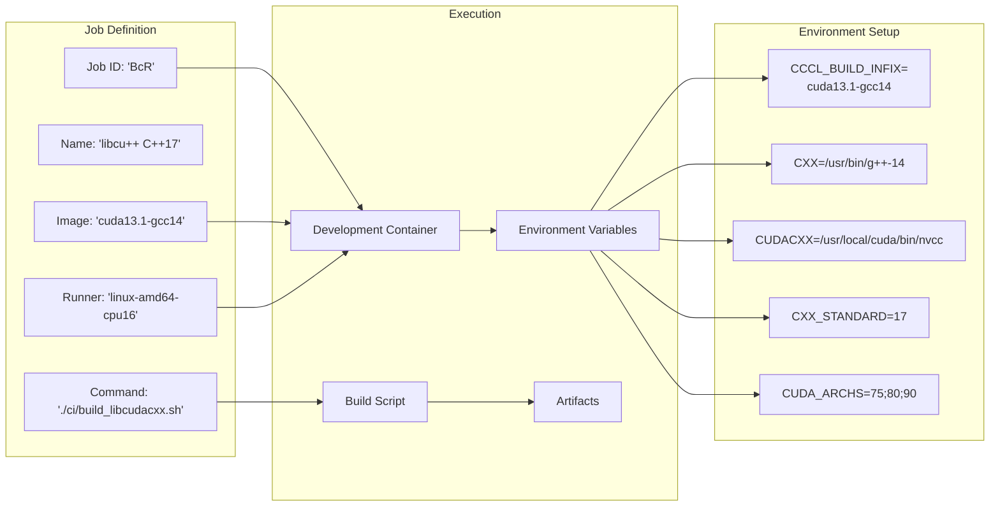

The environment is established through:
1. **Devcontainer selection**: Based on `image` field in job definition
2. **Environment variables**: Set by workflow and devcontainer configuration
3. **Build script invocation**: Projects use standard `ci/build_<project>.sh` scripts

**Sources**: [ci/build_common.sh:1-177](), [.devcontainer/launch.sh](), [.devcontainer/cccl-entrypoint.sh]()

### Build and Test Scripts

CCCL provides standardized build and test scripts for each project:

| Script | Purpose | Key Options |
|--------|---------|-------------|
| `ci/build_common.sh` | Common functions and environment setup | `-cxx`, `-std`, `-arch`, `-cuda`, `-cmake-options` |
| `ci/build_libcudacxx.sh` | Build libcudacxx tests | Inherits from `build_common.sh` |
| `ci/build_cub.sh` | Build CUB tests and benchmarks | Same, plus `-disable-benchmarks` |
| `ci/build_thrust.sh` | Build Thrust tests | Same |
| `ci/test_libcudacxx.sh` | Run libcudacxx tests (CTest + lit) | Same |
| `ci/test_cub.sh` | Run CUB tests | `-no-lid`, `-lid0`, `-lid1`, `-lid2`, `-limited`, `-compute-sanitizer-*` |
| `ci/test_thrust.sh` | Run Thrust tests | `-cpu-only`, `-gpu-only` |

These scripts:
- Parse command-line arguments consistently
- Set up CMake presets and build directories
- Configure environment variables
- Build and test the project
- Upload artifacts in CI environments

**Sources**: [ci/build_common.sh:1-423](), [ci/build_libcudacxx.sh](), [ci/build_cub.sh](), [ci/build_thrust.sh](), [ci/test_cub.sh](), [ci/test_thrust.sh]()

## Change Detection and Optimization

To avoid unnecessary work, the CI system detects which projects are affected by changes and adjusts the workflow accordingly.

### Dependency Graph

The change detection system maintains a dependency graph of CCCL projects:

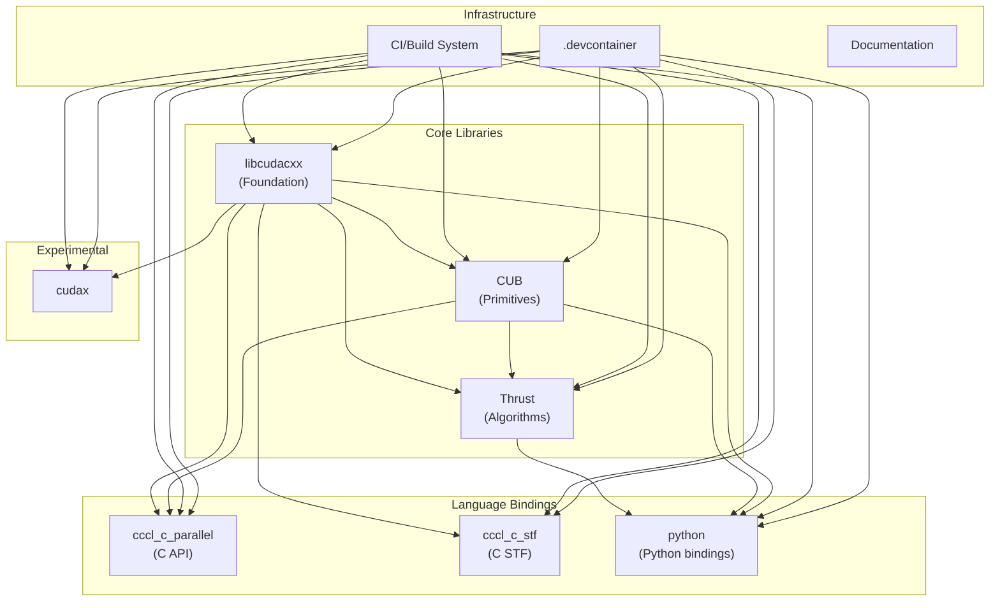

When a project is marked "dirty" (modified), all dependent projects are also marked dirty and tested.

**Sources**: [ci/inspect_changes.py]()

### Change Detection Workflow

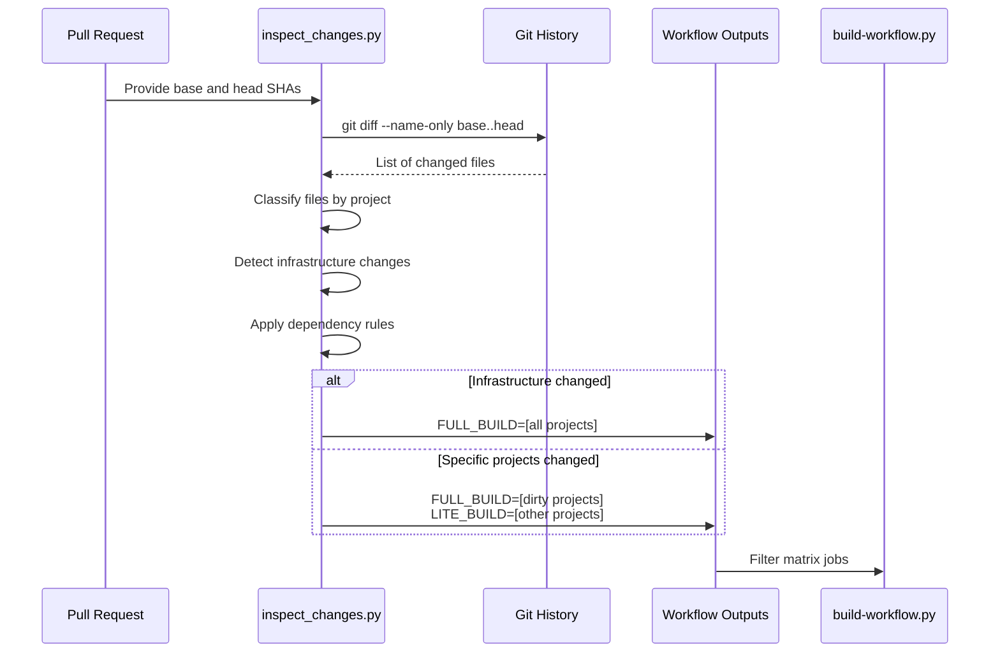

The detection logic categorizes changes as:
- **FULL_BUILD**: Projects that changed or depend on changed projects (full testing)
- **LITE_BUILD**: Projects not directly affected (smoke testing only)
- **Infrastructure changes**: Changes to CI, devcontainers, or build system trigger full builds for all projects

**Sources**: [ci/inspect_changes.py](), [.github/actions/workflow-build/action.yml:68-87]()

### Selective Testing Modes

The matrix supports multiple testing modes:

| Mode | Matrix Used | Purpose | Job Count (approx) |
|------|-------------|---------|-------------------|
| `pull_request` | Full matrix with change detection | Standard PR validation | ~250 jobs |
| `pull_request_lite` | Reduced matrix | Smoke test when upstream changes | ~30 jobs |
| `override` | Custom matrix | Development/debugging | Variable |
| `nightly` | Full matrix, all projects | Comprehensive daily validation | ~1000 jobs |
| `weekly` | Extended matrix with special tests | Exhaustive weekly validation | ~1500 jobs |

**Sources**: [ci/matrix.yaml:1-24](), [ci/matrix.yaml:25-89](), [ci/matrix.yaml:91-124](), [ci/matrix.yaml:126-206](), [ci/matrix.yaml:208-293]()

## Third-Party Canary Builds

CCCL validates compatibility with downstream projects through "canary builds" - building major CCCL consumers against the current branch.

### Supported Third-Party Projects

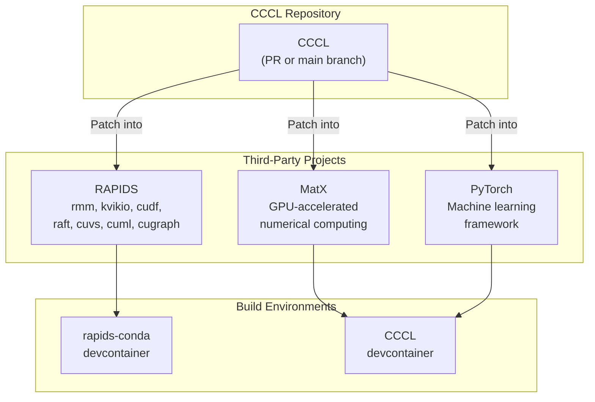

**Sources**: [.github/workflows/build-rapids.yml](), [.github/workflows/build-matx.yml](), [.github/workflows/build-pytorch.yml]()

### RAPIDS Build Process

RAPIDS is CCCL's most complex downstream consumer, comprising multiple libraries with interdependencies:

```yaml
# Example from .github/workflows/build-rapids.yml
strategy:
  matrix:
    include:
      - { cuda: '13.0', libs: 'rmm kvikio cudf cudf_kafka' }
      - { cuda: '13.0', libs: 'rmm ucxx raft cuvs cuml' }
      - { cuda: '13.0', libs: 'rmm ucxx raft cugraph' }
```

The build process:
1. Launches a `rapids-conda` devcontainer
2. Patches CCCL version using `rapids-cmake` override mechanism
3. Configures and builds each library in sequence with `-DBUILD_TESTS=OFF`, then with `-DBUILD_TESTS=ON`
4. Uses `sccache` distributed compilation for speed

**Sources**: [.github/workflows/build-rapids.yml:57-188](), [ci/rapids/post-create-command.sh](), [ci/rapids/cuda13.0-conda/devcontainer.json]()

### MatX and PyTorch Builds

MatX and PyTorch use simpler build processes:

**MatX**:
- Clones MatX repository
- Patches CCCL as a submodule
- Builds with CMake
- Runs MatX test suite

**PyTorch**:
- Clones PyTorch repository  
- Patches CCCL headers
- Builds PyTorch C++ components
- Runs PyTorch CUDA tests

**Sources**: [ci/matx/build_matx.sh](), [ci/pytorch/build_pytorch.sh]()

### Canary Build Triggers

Third-party builds are triggered:
- **Automatically**: On nightly and weekly workflows
- **Optionally**: On PRs (can be skipped with `[skip-rapids]`, `[skip-matx]`, `[skip-pytorch]`, or `[skip-third-party-testing]`)
- **Manually**: Via `workflow_dispatch` for testing specific CCCL versions

**Sources**: [.github/workflows/ci-workflow-pull-request.yml:262-305](), [.github/workflows/ci-workflow-nightly.yml:142-176]()

## Development Container Integration

CCCL's CI uses the same development containers as local development, ensuring consistency and reproducibility.

### Devcontainer Generation

Development containers are automatically generated from the matrix:

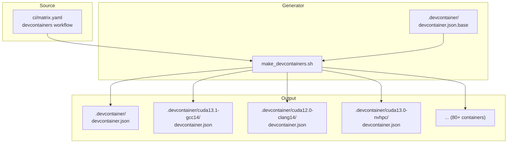

The generator:
1. Parses `ci/matrix.yaml` to extract unique (CUDA, compiler) combinations
2. Creates a directory for each combination
3. Generates a `devcontainer.json` with appropriate image and environment variables
4. Updates the base devcontainer with the default (newest GCC + newest CUDA)

**Sources**: [.devcontainer/make_devcontainers.sh](), [ci/matrix.yaml:303-316]()

### Container Images

Devcontainer images are hosted on Docker Hub and built by the rapidsai/devcontainers project:

| Image Pattern | Example | Contains |
|---------------|---------|----------|
| `rapidsai/devcontainers:{version}-cpp-{compiler}{version}-cuda{ctk}` | `rapidsai/devcontainers:26.02-cpp-gcc14-cuda13.1` | GCC 14, CUDA 13.1 |
| `rapidsai/devcontainers:{version}-cpp-{compiler}{version}-cuda{ctk}ext` | `rapidsai/devcontainers:26.02-cpp-gcc14-cuda13.1ext` | GCC 14, CUDA 13.1 + extended libraries |
| `rapidsai/devcontainers:{version}-cpp-nvhpc{version}` | `rapidsai/devcontainers:26.02-cpp-nvhpc25.9` | NVHPC 25.9 (includes CUDA) |

Each image includes:
- CUDA Toolkit
- Host compiler (GCC, Clang, or MSVC)
- CMake, Ninja, Git, and other build tools
- sccache for distributed compilation
- Python and development utilities

**Sources**: [.devcontainer/make_devcontainers.sh:22-88](), [ci/matrix.yaml:330]()

### Devcontainer Verification

CI validates that all generated devcontainers are correct and functional:

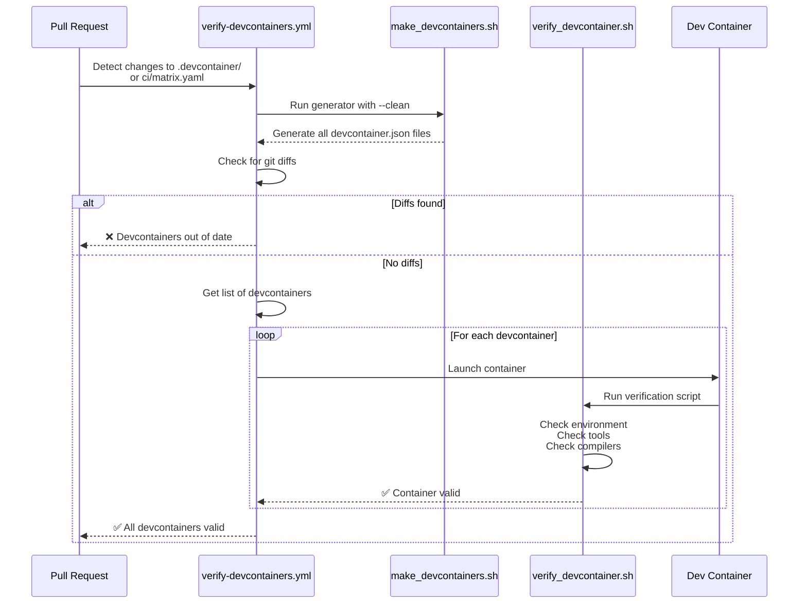

The verification workflow:
1. Runs the generator and checks for uncommitted changes
2. Launches each devcontainer
3. Runs `.devcontainer/verify_devcontainer.sh` to validate the environment
4. Ensures tools, compilers, and paths are correctly configured

**Sources**: [.github/workflows/verify-devcontainers.yml](), [.devcontainer/make_devcontainers.sh]()

## Workflow Results and Reporting

After job execution, the CI system aggregates results and provides comprehensive reporting.

### Result Aggregation

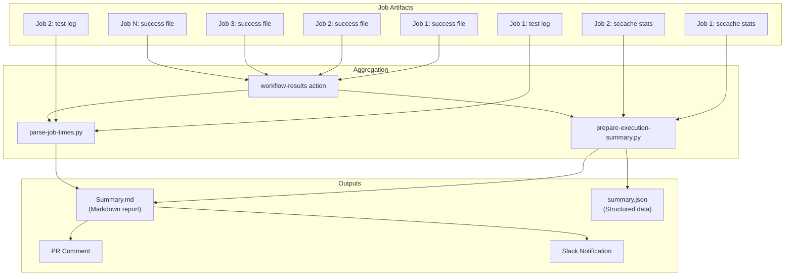

The result aggregation process:
1. Downloads all job artifacts
2. Checks for `success` files to determine job outcomes
3. Parses `sccache` statistics for cache hit rates
4. Analyzes test logs for timing information
5. Generates markdown summaries
6. Posts comments to PRs
7. Sends Slack notifications (if configured)

**Sources**: [.github/actions/workflow-results/action.yml](), [.github/actions/workflow-results/prepare-execution-summary.py](), [.github/actions/workflow-results/parse-job-times.py]()

### Success Criteria

A CI run is considered successful if:
- All generated jobs pass (no failures, skipped jobs OK)
- No override matrix is active (for PRs)
- `.branch_notes` directory is unchanged (for PRs)
- Devcontainer files are up-to-date (if relevant changes detected)
- Documentation builds successfully (if enabled)

**Sources**: [.github/workflows/ci-workflow-pull-request.yml:373-421]()

## Special CI Controls

Developers can control CI behavior through commit message tags and matrix overrides.

### Commit Message Tags

Tags in the **last commit message** control which jobs run:

| Tag | Effect | Blocks Merge |
|-----|--------|--------------|
| `[skip-matrix]` | Skip all matrix jobs (libcudacxx, CUB, Thrust, etc.) | Yes |
| `[skip-vdc]` | Skip devcontainer verification | Yes |
| `[skip-docs]` | Skip documentation build | Yes |
| `[skip-third-party-testing]` or `[skip-tpt]` | Skip all third-party builds | Yes |
| `[skip-rapids]` | Skip RAPIDS canary build | Yes |
| `[skip-matx]` | Skip MatX canary build | Yes |
| `[skip-pytorch]` | Skip PyTorch canary build | Yes |

All skip tags prevent PR merge until removed and a full CI run completes successfully.

**Sources**: [.github/workflows/ci-workflow-pull-request.yml:52-66](), [ci-overview.md:29-42]()

### Override Matrix

For development and debugging, an `override` workflow can temporarily replace the `pull_request` workflow:

```yaml
# ci/matrix.yaml
workflows:
  override:
    # Test only a specific configuration
    - jobs: ['test']
      project: 'cub'
      ctk: '13.X'
      cxx: 'gcc'
      std: 'max'
      gpu: 'rtxa6000'
      sm: 'gpu'
  
  pull_request:
    # ... normal matrix (ignored when override is non-empty)
```

When an override is active:
- **Only** the override jobs are executed
- A warning is displayed on the PR
- **PR cannot be merged** until override is removed
- Useful for testing fixes to CI failures or validating specific configurations

**Sources**: [ci-overview.md:43-63](), [ci/matrix.yaml:1-24]()

## Artifact Management

The CI system uses artifacts to pass build outputs between producer and consumer jobs.

### Artifact Types

CCCL uses two artifact formats:

**Packed Artifacts** (for large build outputs):
- Tar + bzip2 compression (using `pbzip2` if available)
- Wrapped in GitHub Actions zip
- Used for test executables passed from build to test jobs
- Staged incrementally using `stage.sh` and `unstage.sh`
- Uploaded with `upload_packed.sh`, downloaded with `download_packed.sh`

**Standard Artifacts** (for smaller outputs):
- Raw files in GitHub Actions zip
- Used for Python wheels, logs, reports
- Uploaded with `upload.sh`, downloaded with `download.sh`

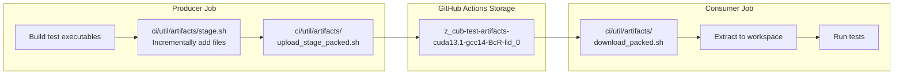

**Sources**: [ci-overview.md:136-162](), [ci/upload_cub_test_artifacts.sh]()

### Artifact Naming Convention

Artifact names follow a strict pattern for lookup:

```
z_<project>-test-artifacts-<DEVCONTAINER_NAME>-<PRODUCER_ID>-<TAG>
```

Components:
- `z_` prefix: Forces alphabetical sorting to end (GitHub Actions limitation)
- `<project>`: Project name (e.g., `cub`, `thrust`, `libcudacxx`)
- `<DEVCONTAINER_NAME>`: Environment identifier (e.g., `cuda13.1-gcc14`)
- `<PRODUCER_ID>`: Unique ID of the producer job
- `<TAG>`: Additional classifier (e.g., `lid_0`, `test_cpu`)

The consumer jobs query the workflow definition to determine their producer's ID and construct the artifact name.

**Sources**: [ci/upload_cub_test_artifacts.sh](), [ci/test_cub.sh:106-114]()

## Performance Optimizations

CCCL's CI employs several strategies to minimize build times and resource usage.

### Distributed Compilation with sccache

All builds use `sccache` with distributed compilation:

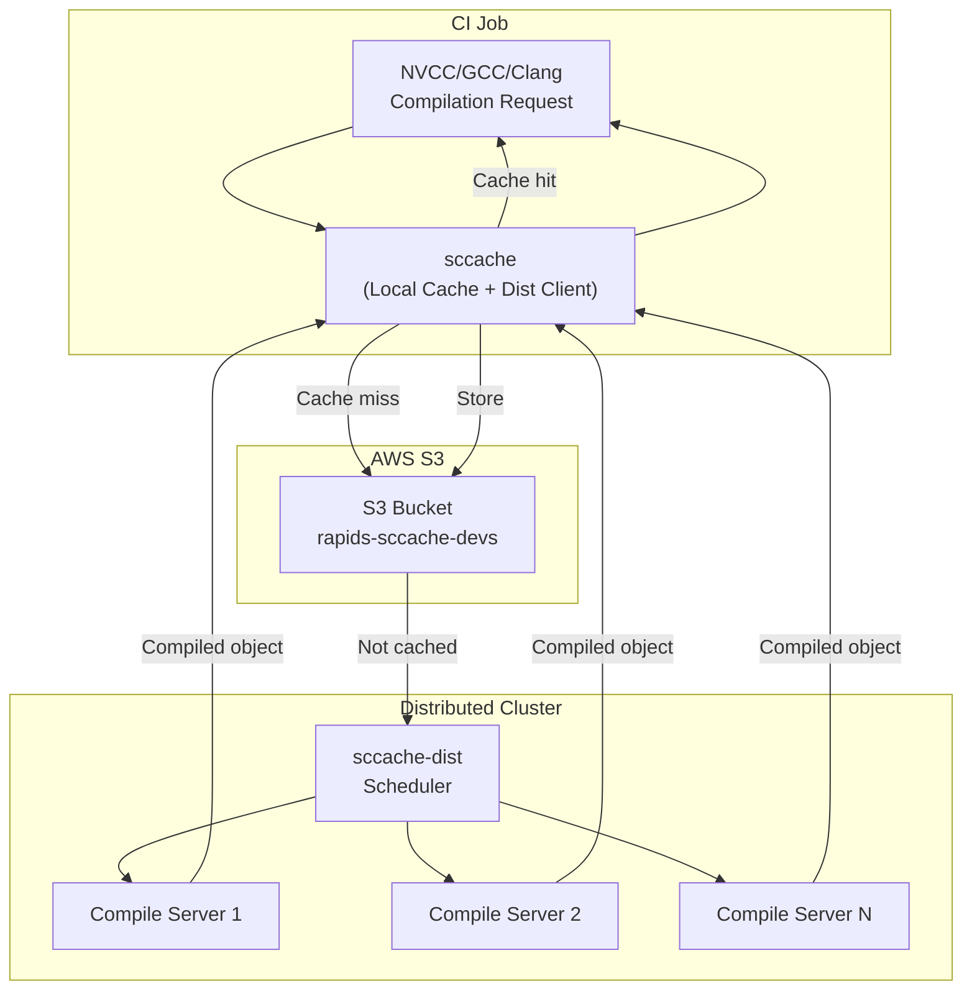

Benefits:
- **Cross-job caching**: Jobs share compilation artifacts via S3
- **Cross-run caching**: Subsequent CI runs reuse previous compilations
- **Distributed compilation**: Heavy compilation distributed across many servers
- **Local development**: Developers can share the same cache

Configuration:
- `SCCACHE_BUCKET=rapids-sccache-devs`
- `SCCACHE_REGION=us-east-2`
- `SCCACHE_DIST_URL` set by devcontainer environment

**Sources**: [ci/build_common.sh:336-374](), [.devcontainer/cccl-entrypoint.sh:7-10]()

### Parallel Builds

Build parallelism is controlled by:
- `CMAKE_BUILD_PARALLEL_LEVEL`: Number of parallel build jobs (defaults to `nproc - 1`)
- `CTEST_PARALLEL_LEVEL`: Number of parallel test jobs (set to 1 to avoid GPU contention)

Tests are run serially by default because:
- GPU memory is limited
- Parallel GPU tests can cause out-of-memory errors
- Test timing measurements are more accurate

**Sources**: [ci/build_common.sh:140-173]()

### Memory Monitoring

On CI runners, memory usage is tracked during builds:

```bash
# From ci/build_common.sh
util/memmon.sh --start \
    --log-threshold 2 \
    --print-threshold 5 \
    --log-file "$memmon_log" \
    --poll 5
```

This helps identify:
- Memory-intensive build steps
- Potential out-of-memory conditions
- Optimization opportunities

**Sources**: [ci/build_common.sh:338-356]()

### Architecture Selection

Different architecture selection strategies balance coverage and build time:

| Value | Generates | Use Case |
|-------|-----------|----------|
| `70`, `75`, etc. | PTX + SASS for specified SM | Specific architecture testing |
| `70-real`, `75-real` | SASS only (no PTX) | Faster builds, real GPU tests |
| `70-virtual` | PTX only (no SASS) | Compilation tests |
| `native` | Architecture of local GPU | Local development |
| `gpu` | Architecture of CI runner's GPU | CI tests |
| `all-major-cccl` | All major CCCL-supported SMs | Default for PR builds |
| `all-cccl` | All CCCL-supported SMs | Weekly comprehensive tests |

**Sources**: [ci/matrix.yaml:597-606](), [CMakeLists.txt:38-40]()

---

This CI/CD infrastructure enables CCCL to maintain high quality across hundreds of configurations while keeping build times reasonable through aggressive caching, distributed compilation, and intelligent change detection. For implementation details of specific subsystems, see pages [4.1](#4.1), [4.2](#4.2), [4.3](#4.3), and [4.4](#4.4).

---

