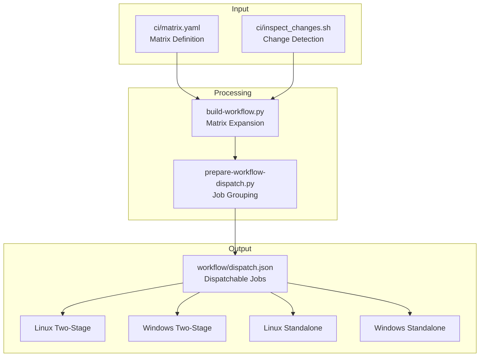
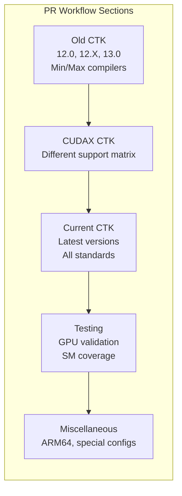
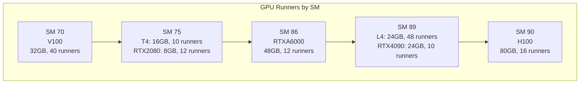
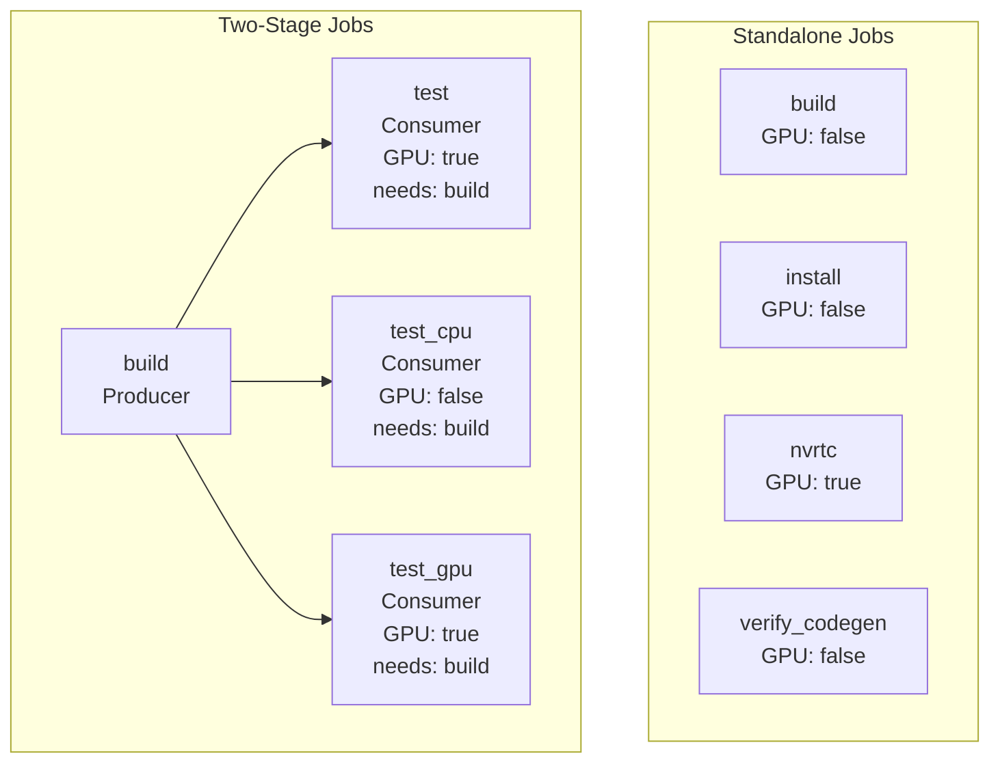
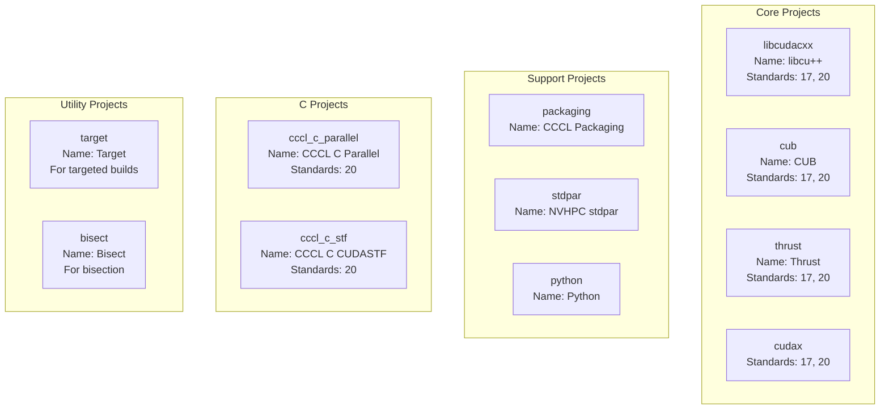
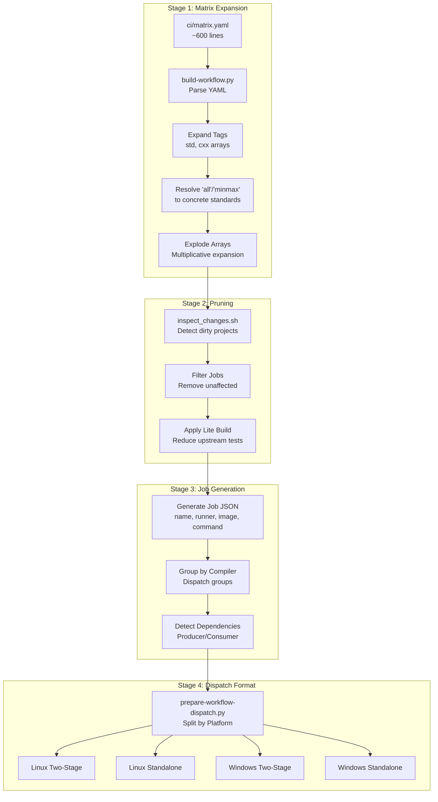

<!-- source: DeepWiki mcp.deepwiki.com · repo NVIDIA/cccl · page 4.2 Matrix Configuration · fetched 2026-10-26 -->

# Matrix Configuration

<details>
<summary>Relevant source files</summary>

The following files were used as context for generating this wiki page:

- [.devcontainer/make_devcontainers.sh](.devcontainer/make_devcontainers.sh)
- [.github/problem-matchers/problem-matcher.json](.github/problem-matchers/problem-matcher.json)
- [CMakeLists.txt](CMakeLists.txt)
- [CMakePresets.json](CMakePresets.json)
- [ci/build_common.sh](ci/build_common.sh)
- [ci/build_cub.sh](ci/build_cub.sh)
- [ci/build_libcudacxx.sh](ci/build_libcudacxx.sh)
- [ci/build_thrust.sh](ci/build_thrust.sh)
- [ci/matrix.yaml](ci/matrix.yaml)
- [ci/ninja_summary.py](ci/ninja_summary.py)
- [ci/nvrtc_libcudacxx.sh](ci/nvrtc_libcudacxx.sh)
- [ci/test_cub.sh](ci/test_cub.sh)
- [ci/test_libcudacxx.sh](ci/test_libcudacxx.sh)
- [ci/test_thrust.sh](ci/test_thrust.sh)
- [ci/upload_cub_test_artifacts.sh](ci/upload_cub_test_artifacts.sh)
- [ci/windows/test_cub.ps1](ci/windows/test_cub.ps1)

</details>


## Purpose and Scope

This document describes the structure and usage of the CI matrix configuration file [ci/matrix.yaml](). This file defines the comprehensive test matrix for CCCL's continuous integration system, specifying all combinations of projects, compilers, CUDA Toolkit versions, GPU architectures, and job types to be tested. 

For information about how the matrix is processed and dispatched to GitHub Actions, see [Workflow Generation and Execution](#4.3). For details on how jobs are pruned based on code changes, see [Change Detection and Optimization](#4.4). For the overall CI architecture, see [Architecture Overview](#4.1).

**Sources**: [ci/matrix.yaml:1-584]()

---

## File Location and Role

The matrix configuration is located at [ci/matrix.yaml]() and serves as the single source of truth for CI job definitions across all workflow types. This YAML file is read by [.github/actions/workflow-build/build-workflow.py]() during the workflow generation phase and expanded into hundreds of individual CI jobs.



**Sources**: [ci/matrix.yaml:1-10](), [.github/actions/workflow-build/build-workflow.py:1-100](), [.github/actions/workflow-build/action.yml:79-97]()

---

## Workflow Definitions

The top-level `workflows` key defines distinct test matrices for different CI contexts. Each workflow is a list of matrix job specifications that will be expanded into individual jobs.

### Workflow Types

| Workflow Name | Purpose | Typical Job Count | Trigger |
|--------------|---------|-------------------|---------|
| `override` | Manual matrix override for PRs | Variable (0-50) | Developer-defined |
| `pull_request` | Standard PR validation | ~250 jobs | PR push |
| `pull_request_lite` | Reduced smoke testing | ~50 jobs | Upstream changes |
| `nightly` | Comprehensive testing | ~500+ jobs | Daily schedule |
| `weekly` | Extended testing | ~500+ jobs | Weekly schedule |
| `python-wheels` | Python package testing | ~20 jobs | Python releases |
| `devcontainers` | Container generation metadata | N/A (no actual jobs) | Used by tooling |

### Override Workflow

The `override` workflow provides a mechanism to temporarily replace the standard `pull_request` matrix with a smaller, targeted subset of jobs. When non-empty, it completely replaces the PR workflow.

```yaml
override:
  - { jobs: ['test'], project: 'cub', std: 17, ctk: '12.X', cxx: ['gcc', 'clang'] }
```

**Important constraints**:
- PR merges are blocked while an override is active
- Must be reset to empty (not removed) before merging
- Used primarily for high-impact infrastructure changes

**Sources**: [ci/matrix.yaml:1-23](), [.github/actions/workflow-build/build-workflow.py:118-120](), [.github/actions/workflow-results/action.yml:189-194]()

### Pull Request Workflow Structure

The `pull_request` workflow is organized into logical sections:



**Sources**: [ci/matrix.yaml:25-82]()

---

## Configuration Components

### CUDA Toolkit Versions

The `ctk_versions` map defines available CUDA Toolkit versions with their supported C++ standards and aliases.

| CTK Version | Supported Standards | Aliases | Status |
|-------------|-------------------|---------|--------|
| `12.0` | `[17, 20]` | None | Legacy |
| `12.9` | `[17, 20]` | `12.X`, `nvhpc`, `nvhpc-prev`, `pybuild`, `clang-cuda` | Current stable |
| `13.0` | `[17, 20]` | `13.X` | Latest |

Version aliases allow flexible matrix definitions:
- `12.X` and `13.X` track the latest minor releases
- `nvhpc` and `nvhpc-prev` align with NVHPC compiler releases
- `pybuild` specifies the CTK for Python wheel builds

**Sources**: [ci/matrix.yaml:322-325](), [.github/actions/workflow-build/build-workflow.py:122-142]()

### Host Compilers

The `host_compilers` map defines host compiler families with their versions, container tags, and supported standards.

```yaml
host_compilers:
  gcc:
    name: 'GCC'
    container_tag: 'gcc'
    exe: 'g++'
    versions:
      7:  { stds: [17] }
      14: { stds: [17, 20] }
  clang:
    name: 'Clang'
    container_tag: 'llvm'
    exe: 'clang++'
    versions:
      14: { stds: [17, 20] }
      20: { stds: [17, 20], alias: 'cuda' }
```

**Compiler families supported**:
- **gcc**: Versions 7-14, container tag `gcc`
- **clang**: Versions 14-20, container tag `llvm`
- **msvc**: Versions 14.29 (2019), 14.39, 14.44 (2022), container tag `cl`
- **nvhpc**: Versions 25.5-25.7, container tag `nvhpc`

**Version resolution**: When a version is omitted (e.g., `cxx: 'gcc'`), the latest available version is used.

**Sources**: [ci/matrix.yaml:335-377](), [.github/actions/workflow-build/build-workflow.py:163-202]()

### Device Compilers

The `device_compilers` map defines CUDA compilers for device code compilation.

| Compiler ID | Name | Executable | Version Source |
|------------|------|------------|----------------|
| `nvcc` | nvcc | `nvcc` | Derived from `ctk` |
| `clang` | ClangCUDA | `clang++` | Derived from `cxx` |

Device compiler version and supported standards are automatically derived from either the CTK version (for `nvcc`) or the host compiler version (for `clang`).

**Sources**: [ci/matrix.yaml:327-333](), [.github/actions/workflow-build/build-workflow.py:238-258]()

### GPU Runners

The `gpus` map defines available GPU runner configurations with their compute capabilities.



Each GPU entry includes:
- **id**: GPU model name (e.g., `rtx4090`, `h100`)
- **sm**: Compute capability (e.g., `70`, `89`, `90`)
- **testing** (optional): Whether runner is in testing pool

**Sources**: [ci/matrix.yaml:525-532](), [.github/actions/workflow-build/build-workflow.py:262-274]()

---

## Matrix Job Structure

Matrix jobs are the fundamental unit of the CI configuration. Each entry in a workflow list defines one or more jobs through tag expansion.

### Basic Matrix Job Format

A matrix job is a YAML object with tag keys and their values:

```yaml
- {jobs: ['build'], std: 'all', ctk: '12.X', cxx: ['gcc', 'clang'], project: 'cub'}
```

This single entry expands into multiple actual jobs based on:
- All supported standards for CUB (17, 20)
- All listed compilers (gcc, clang)
- All listed job types (build)

### Tag System

Tags define the parameters of a matrix job. The `tags` map specifies available tags with their properties:

| Tag | Required | Default | Description |
|-----|----------|---------|-------------|
| `jobs` | Yes | N/A | Array of job types to execute |
| `project` | No | `['libcudacxx', 'cub', 'thrust']` | Projects to build/test |
| `ctk` | No | `13.X` | CUDA Toolkit version |
| `cxx` | No | `gcc` | Host compiler |
| `cudacxx` | No | `nvcc` | Device compiler |
| `cpu` | No | `amd64` | CPU architecture |
| `gpu` | No | `rtx2080` | GPU model for tests |
| `std` | No | N/A | C++ standard (or `all`/`minmax`) |
| `sm` | No | N/A | Target GPU architectures |
| `cmake_options` | No | N/A | Additional CMake flags |
| `py_version` | No | N/A | Python version |
| `args` | No | `""` | Additional script arguments |

**Sources**: [ci/matrix.yaml:534-584](), [.github/actions/workflow-build/build-workflow.py:330-348]()

### Tag Value Expansion

Several tags support special values for convenient expansion:

**Standard (`std`) values**:
- `all`: All standards supported by project/compiler/CTK intersection
- `minmax`: Minimum and maximum supported standards
- `min`: Minimum supported standard only
- `max`: Maximum supported standard only
- Specific value: `17`, `20`

**Example**:
```yaml
# This entry:
- {jobs: ['build'], project: 'cub', std: 'all', cxx: 'gcc14'}

# Expands to jobs with std=17 and std=20
```

**Compiler (`cxx`) values**:
- `gcc`, `clang`, `msvc`, `nvhpc`: Uses latest version
- `gcc12`, `clang19`, etc.: Uses specific version
- Array: `['gcc', 'clang']` creates jobs for each

**Sources**: [ci/matrix.yaml:561-565](), [.github/actions/workflow-build/build-workflow.py:379-397]()

### Array Tag Explosion

Tags that accept arrays cause multiplicative expansion:

```yaml
- {jobs: ['build', 'test'], cxx: ['gcc', 'clang', 'msvc'], std: [17, 20]}
```

This creates: 2 jobs × 3 compilers × 2 standards = **12 jobs**

**Sources**: [.github/actions/workflow-build/build-workflow.py:646-675]()

---

## Job Type Definitions

The `jobs` map defines job types with their properties and execution requirements.

### Job Properties

Each job type has the following configurable properties:

| Property | Type | Description |
|----------|------|-------------|
| `name` | string | Human-readable job name (defaults to capitalized job id) |
| `gpu` | boolean | Whether job requires GPU runner (default: false) |
| `cuda_ext` | boolean | Whether job needs extended CUDA libraries (default: false) |
| `needs` | string | Job dependency (e.g., `build` needs to run before `test`) |
| `invoke.prefix` | string | Script name prefix (default: job id) |
| `invoke.args` | string | Additional script arguments |
| `force_producer_ctk` | string | Override CTK version for producer jobs in two-stage pattern |

### Common Job Types



### CUB-Specific Job Types

CUB uses specialized job types to test different launch strategies:

| Job Type | Name | Description | Args |
|----------|------|-------------|------|
| `test_nolid` | TestGPU | Tests without launch ID | `-no-lid` |
| `test_lid0` | HostLaunch | Host-launched tests | `-lid0` |
| `test_lid1` | DeviceLaunch | Device-launched tests | `-lid1` |
| `test_lid2` | GraphCapture | CUDA graph captured tests | `-lid2` |

These are mapped through the project's `job_map`:

```yaml
projects:
  cub:
    job_map:
      test: ['test_nolid', 'test_lid0', 'test_lid1', 'test_lid2']
```

**Sources**: [ci/matrix.yaml:400-450](), [ci/matrix.yaml:476-489](), [.github/actions/workflow-build/build-workflow.py:296-327]()

### Script Invocation

Jobs are invoked as scripts following this pattern:

**Linux**: `./ci/{invoke.prefix}_{project.id}.sh {invoke.args} [options]`  
**Windows**: `./ci/windows/{invoke.prefix}_{project.id}.ps1 {invoke.args} [options]`

Options added based on matrix job tags:
- `-std "{std}"` if std tag present
- `-arch "{sm}"` if sm tag present
- `-cuda "{cudacxx.exe}"` if device compiler is not nvcc
- `-cmake-options "{cmake_options}"` if cmake_options tag present
- `-py-version "{py_version}"` if py_version tag present
- Additional args from the `args` tag

**Sources**: [.github/actions/workflow-build/build-workflow.py:504-541]()

---

## Project Definitions

The `projects` map defines CCCL's testable components with their standards support and job mappings.

### Project Structure



### Job Mapping

Projects can override the default job mapping to split or rename jobs:

**Default behavior**:
```yaml
jobs: ['test']  # Creates one 'test' job
```

**Thrust custom mapping**:
```yaml
thrust:
  job_map:
    test: ['test_cpu', 'test_gpu']  # Splits 'test' into CPU and GPU variants
```

**Packaging custom mapping**:
```yaml
packaging:
  job_map:
    build: []  # Disables build job
    test: ['test_nobuild']  # Renames test job
```

**Sources**: [ci/matrix.yaml:466-523](), [.github/actions/workflow-build/build-workflow.py:277-293]()

---

## Exclusion Rules

The `exclude` section defines global rules that remove specific job combinations from all workflows.

### Current Exclusions

```yaml
exclude:
  # GPU runners not available on Windows
  - {jobs: ['test', 'test_gpu', 'test_nolid', 'test_lid0', 'test_lid1', 'test_lid2'], 
     cxx: ['msvc2019', 'msvc14.39', 'msvc2022']}
  
  # cudax doesn't support C++17 on MSVC
  - {project: 'cudax', std: 17, cxx: ['msvc2019', 'msvc14.39', 'msvc2022']}
```

Exclusion matching is performed after full matrix expansion. Any generated job matching all tags in an exclusion rule is removed from the final workflow.

**Sources**: [ci/matrix.yaml:295-300](), [.github/actions/workflow-build/build-workflow.py:736-756]()

---

## Matrix Processing Pipeline

The matrix configuration undergoes several processing stages before becoming executable CI jobs.



### Stage 1: Matrix Expansion

The `build-workflow.py` script reads the YAML and expands each matrix job entry:

1. **Tag normalization**: Convert string tags to canonical forms (e.g., `gcc` → `gcc14`)
2. **Standard resolution**: Expand `all`, `minmax`, `min`, `max` to concrete values
3. **Array explosion**: Create separate jobs for each combination of array values
4. **Default application**: Fill in default values for omitted tags

A single matrix entry like:
```yaml
- {jobs: ['build'], project: 'cub', std: 'all', cxx: ['gcc', 'clang']}
```

Becomes multiple job specifications:
- `{jobs: ['build'], project: 'cub', std: 17, cxx: 'gcc14', ctk: '13.X', ...}`
- `{jobs: ['build'], project: 'cub', std: 20, cxx: 'gcc14', ctk: '13.X', ...}`
- `{jobs: ['build'], project: 'cub', std: 17, cxx: 'clang20', ctk: '13.X', ...}`
- `{jobs: ['build'], project: 'cub', std: 20, cxx: 'clang20', ctk: '13.X', ...}`

**Sources**: [.github/actions/workflow-build/build-workflow.py:379-397](), [.github/actions/workflow-build/build-workflow.py:646-675]()

### Stage 2: Pruning

For pull request workflows, the matrix is pruned based on changed files:

1. **Change detection**: `inspect_changes.sh` determines which projects are dirty
2. **Full build projects**: Projects with direct changes get full testing
3. **Lite build projects**: Projects depending on dirty projects get reduced testing
4. **Job filtering**: Jobs for clean projects are removed from the matrix

This optimization reduces PR CI from ~500 jobs to ~250 jobs on average.

**Sources**: [ci/inspect_changes.sh:260-308](), [.github/actions/workflow-build/action.yml:68-97]()

### Stage 3: Job Generation

Each expanded matrix job is converted into a job JSON object:

```json
{
  "id": "Ab",
  "name": "[CTK12.X GCC14 C++20] Build(amd64)",
  "runner": "linux-amd64-cpu16",
  "image": "rapidsai/devcontainers:25.12-cpp-gcc14-cuda12.9",
  "command": "\"./ci/build_cub.sh\" -std \"20\"",
  "cuda": "12.9",
  "host": "gcc14",
  "origin": { /* metadata for result tracking */ }
}
```

Jobs are grouped by compiler into "dispatch groups" for efficient parallel execution.

**Sources**: [.github/actions/workflow-build/build-workflow.py:586-595](), [.github/actions/workflow-build/build-workflow.py:678-684]()

### Stage 4: Dispatch Format

The `prepare-workflow-dispatch.py` script splits the workflow by platform and execution model:

- **Linux Two-Stage**: Build jobs upload artifacts, test jobs download and test
- **Windows Two-Stage**: Same pattern for Windows runners
- **Linux Standalone**: Jobs that build and test in one step
- **Windows Standalone**: Same for Windows

This structure optimizes GitHub Actions execution by:
- Allowing build/test separation for better resource utilization
- Grouping jobs by platform to minimize workflow complexity
- Enabling parallel execution within groups

**Sources**: [.github/actions/workflow-build/prepare-workflow-dispatch.py:25-80]()

---

## Practical Examples

### Example 1: Basic Build Matrix Entry

```yaml
- {jobs: ['build'], std: 'all', ctk: '13.X', cxx: 'gcc'}
```

**Expands to**:
- Project: `libcudacxx`, `cub`, `thrust` (default)
- Standards: `17`, `20` (all for CTK 13.X)
- Compiler: `gcc14` (latest)
- Job types: `build`

**Result**: 3 projects × 2 standards = **6 jobs**

### Example 2: GPU Testing Matrix Entry

```yaml
- {jobs: ['test'], project: 'cub', std: 'max', cxx: ['gcc', 'clang'], gpu: 'h100'}
```

**Expands to**:
- Project: `cub`
- Standards: `20` (max)
- Compilers: `gcc14`, `clang20`
- Job types: `test_nolid`, `test_lid0`, `test_lid1`, `test_lid2` (via job_map)
- GPU: `h100`

**Result**: 2 compilers × 4 job types = **8 jobs**

### Example 3: Python Testing Matrix Entry

```yaml
- {jobs: ['test'], project: 'python', ctk: '13.X', py_version: '3.13', gpu: 'l4', cxx: 'gcc13'}
```

**Expands to**:
- Project: `python`
- Job types: `test_py_headers`, `test_py_coop`, `test_py_par`, `test_py_examples` (via job_map)
- Python: `3.13`
- Compiler: `gcc13` (required for consistency)
- GPU: `l4`

**Result**: 4 job types = **4 jobs**

### Example 4: Multi-Architecture Testing

```yaml
- {jobs: ['nvrtc'], project: 'libcudacxx', std: 'all', gpu: 'rtx2080', sm: 'gpu'}
```

**Key points**:
- `sm: 'gpu'` targets only the GPU model's native architecture
- `nvrtc` jobs test runtime compilation
- No producer/consumer split (standalone job)

**Sources**: [ci/matrix.yaml:25-82](), [ci/matrix.yaml:476-523]()

---

## Related Configuration

The matrix configuration works in conjunction with several other system components:

- **CMake Presets** ([CMakePresets.json]()): Define build configurations that matrix jobs use
- **Build Scripts** ([ci/build_*.sh]()): Scripts invoked by matrix jobs
- **Devcontainers** ([.devcontainer/]()): Docker images specified in generated jobs
- **Change Detection** ([ci/inspect_changes.sh]()): Determines which projects need testing
- **Workflow Templates** ([.github/workflows/]()): GitHub Actions workflows that consume the matrix

**Sources**: [ci/matrix.yaml:1-584](), [.github/actions/workflow-build/build-workflow.py:1-100](), [.github/actions/workflow-build/action.yml:1-50]()

---

