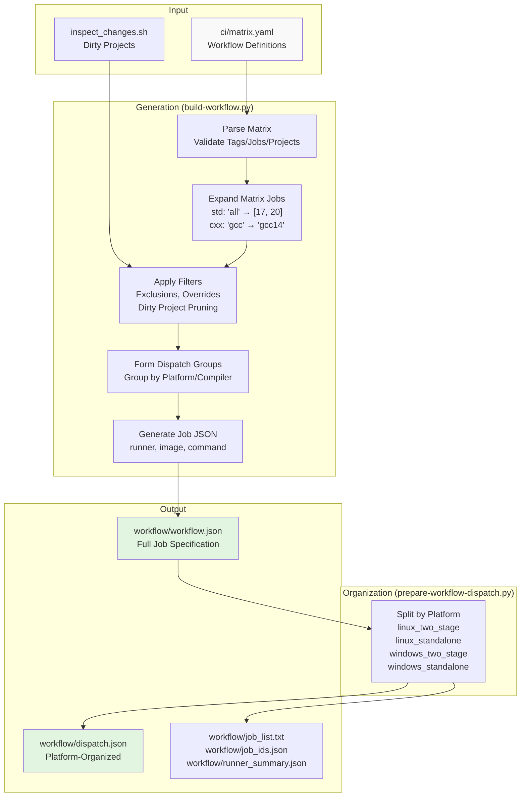
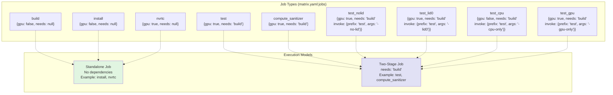
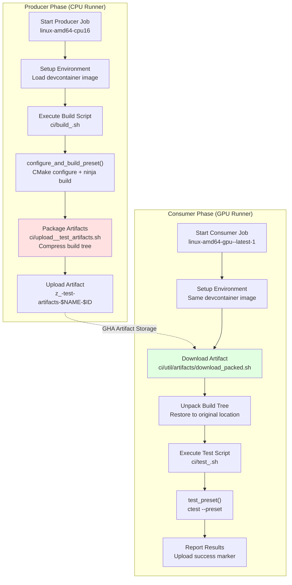
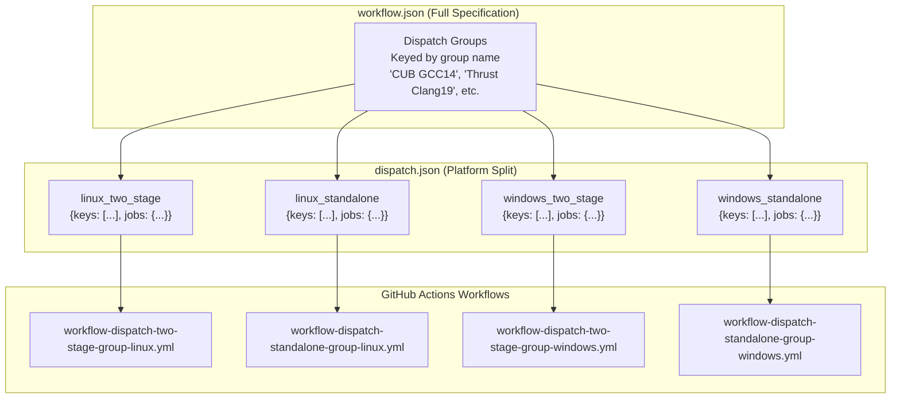
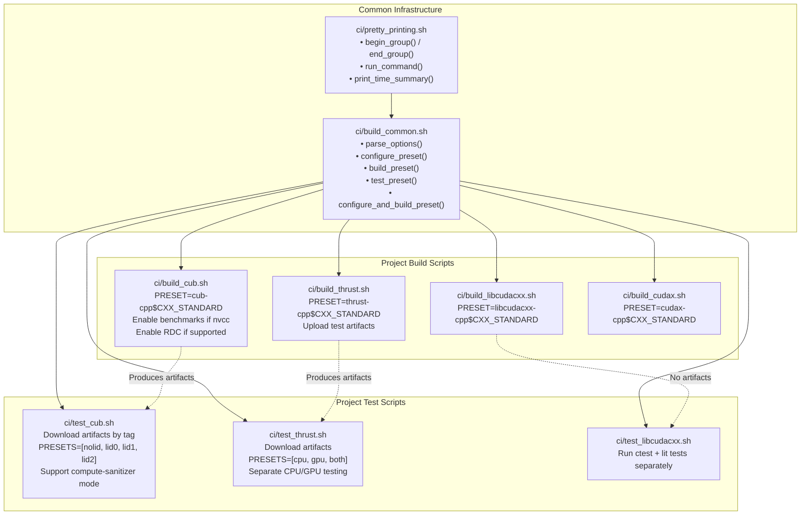
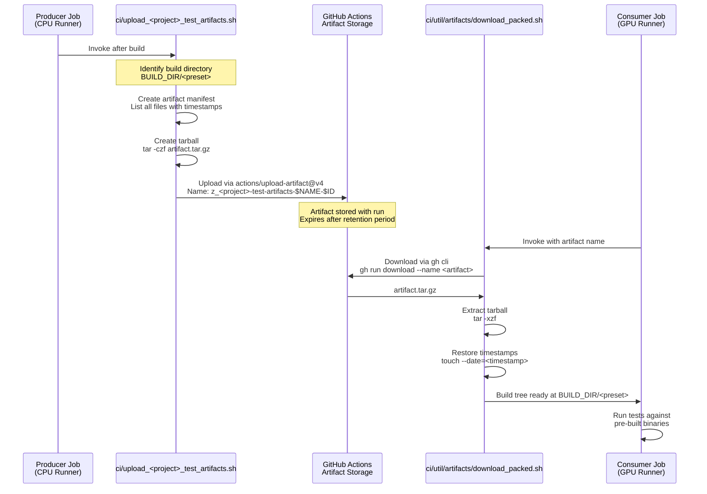
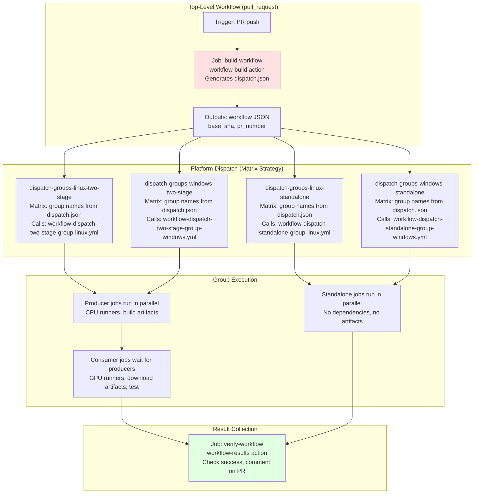

<!-- source: DeepWiki mcp.deepwiki.com · repo NVIDIA/cccl · page 4.3 Workflow Generation and Execution · fetched 2026-10-26 -->

# Workflow Generation and Execution

<details>
<summary>Relevant source files</summary>

The following files were used as context for generating this wiki page:

- [.devcontainer/cccl-entrypoint.sh](.devcontainer/cccl-entrypoint.sh)
- [.devcontainer/docker-entrypoint.sh](.devcontainer/docker-entrypoint.sh)
- [.devcontainer/launch.sh](.devcontainer/launch.sh)
- [.github/actions/docs-build/action.yml](.github/actions/docs-build/action.yml)
- [.github/actions/workflow-build/action.yml](.github/actions/workflow-build/action.yml)
- [.github/actions/workflow-build/build-workflow.py](.github/actions/workflow-build/build-workflow.py)
- [.github/actions/workflow-build/prepare-workflow-dispatch.py](.github/actions/workflow-build/prepare-workflow-dispatch.py)
- [.github/actions/workflow-results/action.yml](.github/actions/workflow-results/action.yml)
- [.github/actions/workflow-results/final-summary.py](.github/actions/workflow-results/final-summary.py)
- [.github/actions/workflow-results/parse-job-times.py](.github/actions/workflow-results/parse-job-times.py)
- [.github/actions/workflow-results/prepare-execution-summary.py](.github/actions/workflow-results/prepare-execution-summary.py)
- [.github/actions/workflow-results/verify-job-success.py](.github/actions/workflow-results/verify-job-success.py)
- [.github/copilot-instructions.md](.github/copilot-instructions.md)
- [.github/workflows/build-docs.yml](.github/workflows/build-docs.yml)
- [.github/workflows/build-matx.yml](.github/workflows/build-matx.yml)
- [.github/workflows/build-pytorch.yml](.github/workflows/build-pytorch.yml)
- [.github/workflows/build-rapids.yml](.github/workflows/build-rapids.yml)
- [.github/workflows/ci-workflow-nightly.yml](.github/workflows/ci-workflow-nightly.yml)
- [.github/workflows/ci-workflow-pull-request.yml](.github/workflows/ci-workflow-pull-request.yml)
- [.github/workflows/ci-workflow-weekly.yml](.github/workflows/ci-workflow-weekly.yml)
- [.github/workflows/git-bisect.yml](.github/workflows/git-bisect.yml)
- [.github/workflows/pr-preview-cleanup.yml](.github/workflows/pr-preview-cleanup.yml)
- [.github/workflows/verify-devcontainers.yml](.github/workflows/verify-devcontainers.yml)
- [AGENTS.md](AGENTS.md)
- [ci-overview.md](ci-overview.md)
- [ci/compute-sanitizer-suppressions.xml](ci/compute-sanitizer-suppressions.xml)
- [ci/matx/build_matx.sh](ci/matx/build_matx.sh)
- [ci/pytorch/build_pytorch.sh](ci/pytorch/build_pytorch.sh)
- [ci/rapids/cuda13.0-conda/devcontainer.json](ci/rapids/cuda13.0-conda/devcontainer.json)
- [ci/rapids/post-create-command.sh](ci/rapids/post-create-command.sh)
- [ci/rapids/rapids-entrypoint.sh](ci/rapids/rapids-entrypoint.sh)
- [ci/run_cpu_bisect.sh](ci/run_cpu_bisect.sh)
- [ci/run_cpu_target.sh](ci/run_cpu_target.sh)
- [ci/run_gpu_bisect.sh](ci/run_gpu_bisect.sh)
- [ci/run_gpu_target.sh](ci/run_gpu_target.sh)
- [ci/util/build_and_test_targets.sh](ci/util/build_and_test_targets.sh)
- [ci/util/git_bisect.sh](ci/util/git_bisect.sh)
- [docs/gen_docs.bash](docs/gen_docs.bash)
- [docs/index.rst](docs/index.rst)
- [libcudacxx/test/libcudacxx/std/utilities/memory/temporary.buffer/overaligned.pass.cpp](libcudacxx/test/libcudacxx/std/utilities/memory/temporary.buffer/overaligned.pass.cpp)
- [libcudacxx/test/libcudacxx/std/utilities/memory/temporary.buffer/temporary_buffer.pass.cpp](libcudacxx/test/libcudacxx/std/utilities/memory/temporary.buffer/temporary_buffer.pass.cpp)

</details>


## Purpose and Scope

This document describes how CCCL's CI/CD system converts the declarative matrix configuration into executable GitHub Actions workflows. It covers the workflow generation pipeline (`build-workflow.py`), job dispatch mechanisms, the two-stage producer/consumer execution model, and artifact management strategies that enable efficient separation of build and test phases.

For information about the matrix configuration format and job definitions, see [Matrix Configuration](#4.2). For details about how jobs are pruned based on code changes, see [Change Detection and Optimization](#4.4). For the overall CI/CD architecture, see [Architecture Overview](#4.1).

---

## Workflow Generation Pipeline

The workflow generation process transforms the declarative `ci/matrix.yaml` configuration into concrete job specifications that GitHub Actions can execute. This transformation occurs in the `workflow-build` action, orchestrated by `.github/actions/workflow-build/action.yml`.

### Matrix to Workflow Transformation



**Sources:** [.github/actions/workflow-build/action.yml:79-98](), [.github/actions/workflow-build/build-workflow.py:1-1600](), [.github/actions/workflow-build/prepare-workflow-dispatch.py:1-100]()

### Matrix Job Expansion

The `build-workflow.py` script performs several transformations on matrix entries:

| Transformation | Example Input | Example Output |
|----------------|---------------|----------------|
| **Standard Expansion** | `std: 'all'` | `std: [17, 20]` (based on CTK/compiler support) |
| **Compiler Canonicalization** | `cxx: 'gcc'` | `cxx: 'gcc14'` (latest version) |
| **CTK Alias Resolution** | `ctk: '13.X'` | `ctk: '13.0'` (actual version) |
| **SM Explosion** | `sm: ['70;80', '90']` | Two separate jobs |
| **Project List Expansion** | `project: ['cub', 'thrust']` | Two separate jobs per project |

The script maintains several internal representations:

- **Matrix Job**: Raw entry from `matrix.yaml` with tags like `jobs`, `ctk`, `cxx`, `std`, `project`
- **Canonicalized Job**: Matrix job with aliases resolved and defaults applied
- **Job JSON**: Complete specification with `id`, `name`, `runner`, `image`, `command`
- **Dispatch Group**: Collection of related jobs grouped by compiler/platform

**Sources:** [.github/actions/workflow-build/build-workflow.py:398-460](), [ci/matrix.yaml:313-584]()

---

## Job Types and Execution Models

CCCL's CI system supports two execution models: standalone jobs (build and test in one job) and two-stage jobs (separate producer and consumer).

### Job Type Hierarchy



**Sources:** [ci/matrix.yaml:400-455]()

### Two-Stage Producer/Consumer Model

The two-stage model separates build (producer) and test (consumer) phases to optimize resource usage. Producers run on CPU runners and package build artifacts; consumers run on GPU runners (if needed) and download artifacts before testing.



**Sources:** [ci/build_thrust.sh:1-21](), [ci/test_thrust.sh:1-64](), [ci/build_common.sh:260-394]()

### Job JSON Structure

Each job, whether standalone or part of a two-stage pair, is represented as a JSON object with standardized fields:

```json
{
  "id": "ABC",
  "name": "[CTK13.0 GCC14 C++20] Test(amd64, RTX4090): sm{90}",
  "runner": "linux-amd64-gpu-rtx4090-latest-1",
  "image": "rapidsai/devcontainers:25.12-cpp-gcc14-cuda13.0",
  "command": "\"./ci/test_thrust.sh\" -std \"20\" -arch \"90\"",
  "origin": {
    "workflow_location": "ci/matrix.yaml:45 (pull_request)",
    "original_matrix_job": {
      "jobs": ["test"],
      "project": "thrust",
      "std": "max",
      "cxx": "gcc",
      "gpu": "rtx4090"
    }
  }
}
```

The `generate_dispatch_job_*` functions in `build-workflow.py` construct these fields:

- **id**: Generated by `generate_guids()` (base64-encoded incrementing integer)
- **name**: `generate_dispatch_job_name()` - human-readable description
- **runner**: `generate_dispatch_job_runner()` - determines platform/GPU/CPU
- **image**: `generate_dispatch_job_image()` - devcontainer image name
- **command**: `generate_dispatch_job_command()` - script invocation with arguments

**Sources:** [.github/actions/workflow-build/build-workflow.py:425-541]()

---

## Platform-Specific Dispatch

After job generation, `prepare-workflow-dispatch.py` organizes jobs by platform and execution model for efficient GitHub Actions dispatch.

### Dispatch Organization



**Sources:** [.github/actions/workflow-build/prepare-workflow-dispatch.py:22-100](), [.github/workflows/ci-workflow-pull-request.yml:85-159]()

### Runner Selection Logic

The `generate_dispatch_job_runner()` function selects appropriate runners based on job requirements:

| Job GPU Requirement | Platform | CPU | GPU | Runner Pattern |
|---------------------|----------|-----|-----|----------------|
| `gpu: false` | Linux | amd64 | N/A | `linux-amd64-cpu16` |
| `gpu: false` | Windows | amd64 | N/A | `windows-amd64-cpu16` |
| `gpu: true` | Linux | amd64 | rtx4090 | `linux-amd64-gpu-rtx4090-latest-1` |
| `gpu: true` | Linux | amd64 | h100 | `linux-amd64-gpu-h100-latest-1` |
| `gpu: true` (testing) | Linux | amd64 | v100 | `linux-amd64-gpu-v100-latest-1-testing` |

GPU information comes from the `gpus` section in `matrix.yaml`, which maps GPU names to SM architectures and testing pool flags.

**Sources:** [.github/actions/workflow-build/build-workflow.py:462-473](), [ci/matrix.yaml:525-533]()

---

## Build and Test Scripts

Each project has standardized build and test scripts that follow common patterns defined in `ci/build_common.sh`.

### Script Hierarchy



**Sources:** [ci/build_common.sh:1-395](), [ci/build_cub.sh:1-44](), [ci/build_thrust.sh:1-21](), [ci/test_cub.sh:1-141](), [ci/test_thrust.sh:1-64]()

### Common Build Functions

The `build_common.sh` script provides core functionality used by all project scripts:

| Function | Purpose | Key Operations |
|----------|---------|----------------|
| `configure_preset()` | Run CMake configure | Parse preset, run `cmake --preset`, handle retries on CI |
| `build_preset()` | Build with Ninja | Track memory usage, run `cmake --build`, collect sccache stats |
| `test_preset()` | Run CTest | Execute `ctest --preset`, generate timing summaries |
| `configure_and_build_preset()` | Combined configure+build | Chain configure and build operations |
| `print_environment_details()` | Log environment info | Dump compiler versions, GPU info, system resources |
| `symlink_latest_preset()` | Create convenience symlinks | Link `build/latest` and `build/preset-latest` |

All scripts use the following environment variables set by `build_common.sh`:

- `BUILD_DIR`: Build tree location (`build/${CCCL_BUILD_INFIX}`)
- `CXX_STANDARD`: C++ standard (17 or 20)
- `HOST_COMPILER`: Full path to host compiler
- `CUDA_COMPILER`: Full path to CUDA compiler (nvcc or clang++)
- `CMAKE_BUILD_PARALLEL_LEVEL`: Number of parallel jobs
- `CTEST_PARALLEL_LEVEL`: CTest parallelism (typically 1)

**Sources:** [ci/build_common.sh:140-394]()

### CMake Preset Integration

All build and test scripts use CMake presets defined in `CMakePresets.json`. Preset names follow the pattern `<project>-cpp<std>`, with additional variants for specific test categories:

| Project | Build Presets | Test Presets |
|---------|---------------|--------------|
| **CUB** | `cub-cpp17`, `cub-cpp20` | `cub-nolid-cpp17`, `cub-lid0-cpp17`, `cub-lid1-cpp17`, `cub-lid2-cpp17` |
| **Thrust** | `thrust-cpp17`, `thrust-cpp20` | `thrust-cpu-cpp17`, `thrust-gpu-cpp17`, `thrust-cpp17` |
| **libcudacxx** | `libcudacxx-cpp17`, `libcudacxx-cpp20` | `libcudacxx-ctest-cpp17`, `libcudacxx-lit-cpp17` |
| **cudax** | `cudax-cpp17`, `cudax-cpp20` | `cudax-cpp17`, `cudax-cpp20` |

Test presets include filters to select specific test subsets, implemented using CTest's `filter` field. For example, `cub-lid0-cpp17` filters for tests matching `^cub.*\.lid_0.*$`.

**Sources:** [CMakePresets.json:8-751](), [ci/build_cub.sh:29-36](), [ci/test_cub.sh:117-138]()

---

## Artifact Management

The two-stage execution model relies on artifact packaging and transfer to share build outputs between producer and consumer jobs.

### Artifact Lifecycle



**Sources:** [ci/build_thrust.sh:16-18](), [ci/test_thrust.sh:39-46]()

### Artifact Naming Convention

Artifacts use a standardized naming pattern to enable unique identification and proper consumer retrieval:

```
z_<project>-test-artifacts-<devcontainer_name>-<producer_id>[-<tag>]
```

Components:
- **Prefix `z_`**: Ensures artifacts sort last in GitHub's artifact list
- **Project**: `cub`, `thrust`, `libcudacxx`, `cudax`, etc.
- **Devcontainer name**: `${DEVCONTAINER_NAME}` env var (e.g., `cuda13.0-gcc14`)
- **Producer ID**: Unique job ID from workflow generation
- **Tag** (optional): Distinguishes multiple artifacts from same producer (e.g., `no_lid`, `lid_0`, `test_cpu`, `test_gpu`)

Examples:
- `z_thrust-test-artifacts-cuda13.0-gcc14-ABC-test_gpu`
- `z_cub-test-artifacts-cuda12.0-clang16-DEF-lid_0`

The `util/workflow/get_producer_id.sh` script extracts the producer ID from the current job's origin information.

**Sources:** [ci/test_cub.sh:109-115](), [ci/test_thrust.sh:42-45]()

### Selective Artifact Download

Some projects create multiple artifacts with different tags to support specialized test workflows. CUB, for example, creates separate artifacts for different launch ID (LID) categories:

| Tag | Test Category | Example Tests |
|-----|---------------|---------------|
| `no_lid` | Warp/block tests, old device tests, examples | Tests without `lid_X` in name |
| `lid_0` | Host-launched algorithms | `cub.cpp20.test.device.reduce.lid_0` |
| `lid_1` | Device-launched algorithms | `cub.cpp20.test.device.scan.lid_1` |
| `lid_2` | Graph-captured algorithms | `cub.cpp20.test.device.sort.lid_2` |

The test script selects which artifacts to download based on command-line flags:

- `ci/test_cub.sh -lid0`: Downloads only `*-lid_0` artifact
- `ci/test_cub.sh -no-lid`: Downloads only `*-no_lid` artifact
- `ci/test_cub.sh -limited`: Downloads all four artifacts (for constrained environments)

**Sources:** [ci/test_cub.sh:5-115](), [ci/matrix.yaml:414-423]()

---

## Workflow Orchestration

The generated workflows integrate into GitHub Actions through a multi-level dispatch system that handles different platforms and execution models.

### GitHub Actions Integration Flow



**Sources:** [.github/workflows/ci-workflow-pull-request.yml:33-191](), [.github/actions/workflow-results/action.yml:28-230]()

### Conditional Workflow Execution

The top-level workflow includes several conditional jobs based on commit message flags:

| Flag | Job Affected | Effect |
|------|--------------|--------|
| `[skip-matrix]` | All matrix jobs | Skip all build/test jobs, only run docs/devcontainer checks |
| `[skip-vdc]` | `verify-devcontainers` | Skip devcontainer verification |
| `[skip-docs]` | `docs-build` | Skip documentation preview generation |
| `[skip-rapids]` | `build-rapids` | Skip RAPIDS integration test (enabled by default) |
| `[skip-matx]` | `build-matx` | Skip MatX integration test (enabled by default) |
| `[skip-pytorch]` | `build-pytorch` | Skip PyTorch integration test (enabled by default) |
| `[skip-tpt]` or `[skip-third-party-testing]` | All third-party builds | Skip RAPIDS, MatX, and PyTorch integration tests |

These flags are evaluated in the `export-flags` step and exposed as workflow outputs that control `if` conditions on subsequent jobs. Third-party integration tests are enabled by default and must be explicitly skipped if not needed.

**Sources:** [.github/workflows/ci-workflow-pull-request.yml:52-65](), [ci-overview.md:33-41]()

### Result Verification and Reporting

After all dispatch groups complete, the `verify-workflow` job aggregates results:

1. **Download Artifacts**: Collect `workflow/` and `jobs/*/success` artifacts
2. **Parse Job Times**: Extract timing information from GitHub API using `parse-job-times.py`
3. **Check Success**: Verify each job has a `success` marker using `verify-job-success.py`
4. **Generate Summaries**: Create execution summary with `prepare-execution-summary.py` and `final-summary.py`
5. **Comment on PR**: Post results to pull request using `workflow-results` action

The success markers are simple files (`jobs/{job_id}/success`) uploaded by each job upon completion. Their presence indicates successful execution; absence indicates failure.

**Sources:** [.github/actions/workflow-results/action.yml:104-199](), [.github/actions/workflow-results/parse-job-times.py:1-152](), [.github/actions/workflow-results/verify-job-success.py:1-30]()

---

