<!-- source: DeepWiki mcp.deepwiki.com · repo NVIDIA/cccl · page 5 Architecture and Internals · fetched 2026-10-26 -->

# Architecture and Internals

Relevant source files

The following files were used as context for generating this wiki page:

- [c/parallel/src/for.cu](c/parallel/src/for.cu)
- [c/parallel/src/merge_sort.cu](c/parallel/src/merge_sort.cu)
- [c/parallel/src/radix_sort.cu](c/parallel/src/radix_sort.cu)
- [c/parallel/src/reduce.cu](c/parallel/src/reduce.cu)
- [c/parallel/src/scan.cu](c/parallel/src/scan.cu)
- [c/parallel/src/segmented_reduce.cu](c/parallel/src/segmented_reduce.cu)
- [c/parallel/src/segmented_sort.cu](c/parallel/src/segmented_sort.cu)
- [c/parallel/src/three_way_partition.cu](c/parallel/src/three_way_partition.cu)
- [c/parallel/src/transform.cu](c/parallel/src/transform.cu)
- [c/parallel/src/unique_by_key.cu](c/parallel/src/unique_by_key.cu)
- [cub/benchmarks/bench/radix_sort/keys.cu](cub/benchmarks/bench/radix_sort/keys.cu)
- [cub/benchmarks/bench/radix_sort/pairs.cu](cub/benchmarks/bench/radix_sort/pairs.cu)
- [cub/benchmarks/bench/radix_sort/policy_selector.h](cub/benchmarks/bench/radix_sort/policy_selector.h)
- [cub/cub/detail/arch_dispatch.cuh](cub/cub/detail/arch_dispatch.cuh)
- [cub/cub/detail/launcher/cuda_driver.cuh](cub/cub/detail/launcher/cuda_driver.cuh)
- [cub/cub/detail/launcher/cuda_runtime.cuh](cub/cub/detail/launcher/cuda_runtime.cuh)
- [cub/cub/device/device_radix_sort.cuh](cub/cub/device/device_radix_sort.cuh)
- [cub/cub/device/device_segmented_reduce.cuh](cub/cub/device/device_segmented_reduce.cuh)
- [cub/cub/device/dispatch/dispatch_common.cuh](cub/cub/device/dispatch/dispatch_common.cuh)
- [cub/cub/device/dispatch/dispatch_fixed_size_segmented_reduce.cuh](cub/cub/device/dispatch/dispatch_fixed_size_segmented_reduce.cuh)
- [cub/cub/device/dispatch/dispatch_merge_sort.cuh](cub/cub/device/dispatch/dispatch_merge_sort.cuh)
- [cub/cub/device/dispatch/dispatch_radix_sort.cuh](cub/cub/device/dispatch/dispatch_radix_sort.cuh)
- [cub/cub/device/dispatch/dispatch_reduce.cuh](cub/cub/device/dispatch/dispatch_reduce.cuh)
- [cub/cub/device/dispatch/dispatch_segmented_radix_sort.cuh](cub/cub/device/dispatch/dispatch_segmented_radix_sort.cuh)
- [cub/cub/device/dispatch/dispatch_segmented_reduce.cuh](cub/cub/device/dispatch/dispatch_segmented_reduce.cuh)
- [cub/cub/device/dispatch/dispatch_segmented_sort.cuh](cub/cub/device/dispatch/dispatch_segmented_sort.cuh)
- [cub/cub/device/dispatch/kernels/kernel_radix_sort.cuh](cub/cub/device/dispatch/kernels/kernel_radix_sort.cuh)
- [cub/cub/device/dispatch/kernels/kernel_segmented_radix_sort.cuh](cub/cub/device/dispatch/kernels/kernel_segmented_radix_sort.cuh)
- [cub/cub/device/dispatch/kernels/kernel_segmented_reduce.cuh](cub/cub/device/dispatch/kernels/kernel_segmented_reduce.cuh)
- [cub/cub/device/dispatch/tuning/common.cuh](cub/cub/device/dispatch/tuning/common.cuh)
- [cub/cub/device/dispatch/tuning/tuning_radix_sort.cuh](cub/cub/device/dispatch/tuning/tuning_radix_sort.cuh)
- [cub/cub/util_device.cuh](cub/cub/util_device.cuh)
- [cub/test/catch2_test_arch_dispatch.cu](cub/test/catch2_test_arch_dispatch.cu)
- [cub/test/catch2_test_device_radix_sort_custom_policy_hub.cu](cub/test/catch2_test_device_radix_sort_custom_policy_hub.cu)
- [docs/libcudacxx/extended_api/type_traits/is_floating_point.rst](docs/libcudacxx/extended_api/type_traits/is_floating_point.rst)
- [lib/cmake/thrust/FindTBB.cmake](lib/cmake/thrust/FindTBB.cmake)
- [libcudacxx/include/cuda/__type_traits/is_floating_point.h](libcudacxx/include/cuda/__type_traits/is_floating_point.h)
- [libcudacxx/include/cuda/std/__atomic/functions/cuda_ptx_generated_helper.h](libcudacxx/include/cuda/std/__atomic/functions/cuda_ptx_generated_helper.h)
- [libcudacxx/include/cuda/std/__cccl/compiler.h](libcudacxx/include/cuda/std/__cccl/compiler.h)
- [libcudacxx/include/cuda/std/__cccl/cuda_toolkit.h](libcudacxx/include/cuda/std/__cccl/cuda_toolkit.h)
- [libcudacxx/include/cuda/std/__cccl/diagnostic.h](libcudacxx/include/cuda/std/__cccl/diagnostic.h)
- [libcudacxx/include/cuda/std/__cccl/dialect.h](libcudacxx/include/cuda/std/__cccl/dialect.h)
- [libcudacxx/include/cuda/std/__cccl/extended_data_types.h](libcudacxx/include/cuda/std/__cccl/extended_data_types.h)
- [libcudacxx/include/cuda/std/__cccl/system_header.h](libcudacxx/include/cuda/std/__cccl/system_header.h)
- [libcudacxx/include/cuda/std/__functional/bind_front.h](libcudacxx/include/cuda/std/__functional/bind_front.h)
- [libcudacxx/include/cuda/std/__functional/not_fn.h](libcudacxx/include/cuda/std/__functional/not_fn.h)
- [libcudacxx/include/cuda/std/__internal/atomic.h](libcudacxx/include/cuda/std/__internal/atomic.h)
- [libcudacxx/include/cuda/std/__internal/features.h](libcudacxx/include/cuda/std/__internal/features.h)
- [libcudacxx/include/cuda/std/__type_traits/is_extended_floating_point.h](libcudacxx/include/cuda/std/__type_traits/is_extended_floating_point.h)
- [libcudacxx/include/cuda/std/__type_traits/type_list.h](libcudacxx/include/cuda/std/__type_traits/type_list.h)
- [libcudacxx/include/cuda/std/__utility/declval.h](libcudacxx/include/cuda/std/__utility/declval.h)
- [libcudacxx/test/libcudacxx/cuda/iterators/transform_input_output_iterator/types.h](libcudacxx/test/libcudacxx/cuda/iterators/transform_input_output_iterator/types.h)
- [libcudacxx/test/libcudacxx/cuda/iterators/transform_output_iterator/types.h](libcudacxx/test/libcudacxx/cuda/iterators/transform_output_iterator/types.h)
- [libcudacxx/test/libcudacxx/cuda/test_platform.pass.cpp](libcudacxx/test/libcudacxx/cuda/test_platform.pass.cpp)
- [libcudacxx/test/libcudacxx/cuda/type_list.pass.cpp](libcudacxx/test/libcudacxx/cuda/type_list.pass.cpp)
- [libcudacxx/test/libcudacxx/libcxx/utilities/meta/meta.unary/meta.unary.cat/is_floating_point.pass.cpp](libcudacxx/test/libcudacxx/libcxx/utilities/meta/meta.unary/meta.unary.cat/is_floating_point.pass.cpp)
- [libcudacxx/test/libcudacxx/std/utilities/memory/ptr.align/align.pass.cpp](libcudacxx/test/libcudacxx/std/utilities/memory/ptr.align/align.pass.cpp)
- [libcudacxx/test/libcudacxx/std/utilities/meta/meta.unary/meta.unary.cat/is_floating_point.pass.cpp](libcudacxx/test/libcudacxx/std/utilities/meta/meta.unary/meta.unary.cat/is_floating_point.pass.cpp)
- [libcudacxx/test/support/test_macros.h](libcudacxx/test/support/test_macros.h)

This document provides a deep dive into the internal architecture, configuration systems, and dispatch mechanisms that power CCCL (CUDA Core Compute Libraries). It covers the cross-compiler compatibility layer, PTX-version based policy selection, and the systematic approach to algorithm implementation that enables CCCL to deliver optimal performance across different CUDA architectures.

For information about the individual core libraries (Thrust, CUB, libcudacxx, CUDAX), see [Core Libraries](#2). For practical usage and development workflows, see [Development Guide](#4).

## Configuration System

CCCL's configuration system provides a unified abstraction layer that enables the libraries to work seamlessly across different compilers (NVCC, Clang, GCC, MSVC, NVHPC), CUDA toolkit versions, and C++ standard versions. This system forms the foundation upon which all other CCCL components build.

### Master Configuration Flow

The configuration system follows a hierarchical structure where each layer builds upon the previous one:

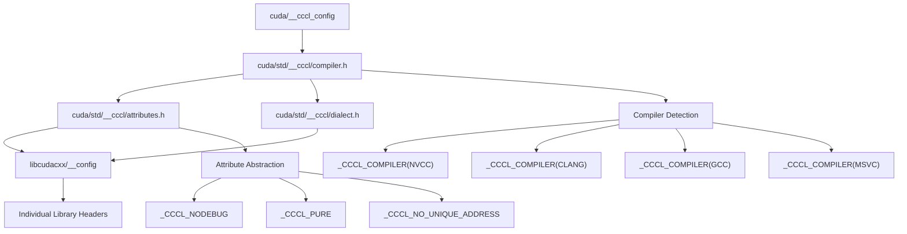

**Sources:** [libcudacxx/include/cuda/__cccl_config:1-62](), [libcudacxx/include/cuda/std/__cccl/compiler.h:1-207](), [libcudacxx/include/cuda/std/__cccl/attributes.h:1-207]()

### Compiler Detection and Version Management

The configuration system uses a sophisticated version comparison mechanism to detect compilers and their capabilities:

| Compiler | Detection Macro | Version Format |
|----------|----------------|----------------|
| NVCC | `_CCCL_CUDA_COMPILER(NVCC)` | `(__CUDACC_VER_MAJOR__, __CUDACC_VER_MINOR__)` |
| Clang | `_CCCL_COMPILER(CLANG)` | `(__clang_major__, __clang_minor__)` |
| GCC | `_CCCL_COMPILER(GCC)` | `(__GNUC__, __GNUC_MINOR__)` |
| MSVC | `_CCCL_COMPILER(MSVC)` | `(_MSC_VER / 100, _MSC_VER % 100)` |
| NVHPC | `_CCCL_COMPILER(NVHPC)` | `(__NVCOMPILER_MAJOR__, __NVCOMPILER_MINOR__)` |

The system provides a unified interface for version comparisons using `_CCCL_VERSION_COMPARE` macros, enabling conditional compilation based on specific compiler versions and capabilities.

**Sources:** [libcudacxx/include/cuda/std/__cccl/compiler.h:54-160]()

### Cross-Compiler Attribute Abstraction

CCCL abstracts compiler-specific attributes through a set of unified macros that adapt to each compiler's syntax:

**Diagram: Attribute Abstraction Layer**

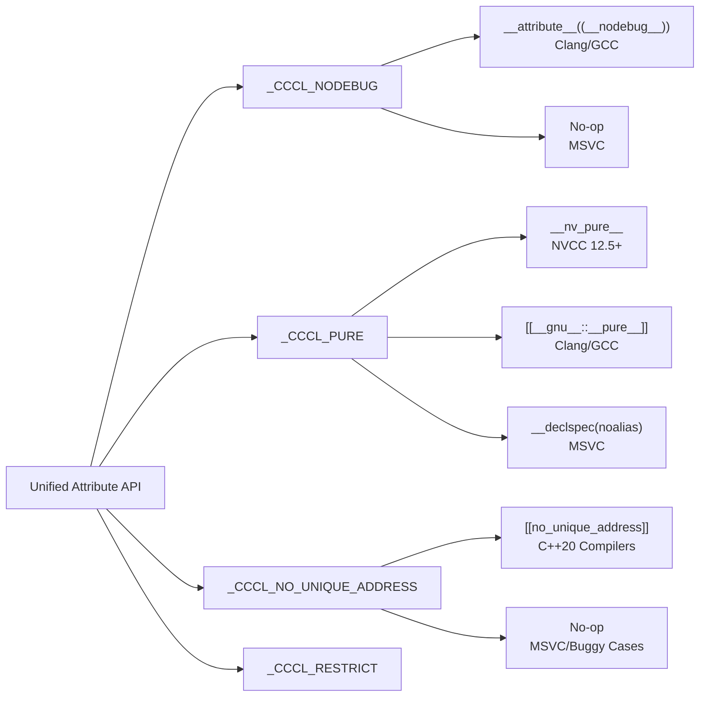

**Sources:** [libcudacxx/include/cuda/std/__cccl/attributes.h:55-180]()

### Builtin Function Abstraction

CCCL provides portable access to compiler intrinsics through the `_CCCL_BUILTIN_*` macro family. These macros handle variations in builtin availability across compilers using three detection mechanisms:

**Diagram: Builtin Detection Strategy**

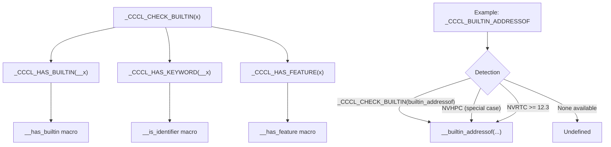

**Common Builtin Abstractions:**

| Macro | Purpose | Fallback Strategy |
|-------|---------|-------------------|
| `_CCCL_BUILTIN_ADDRESSOF` | Obtain object address | Undefined if unavailable |
| `_CCCL_BUILTIN_ASSUME` | Optimizer hints | Multi-tier: builtin → C++23 attribute → no-op |
| `_CCCL_BUILTIN_BIT_CAST` | Type punning | MSVC 19.25+, Clang/GCC via `__has_builtin` |
| `_CCCL_BUILTIN_POPCOUNT` | Population count | Platform intrinsics, undefined for NVCC |
| `_CCCL_BUILTIN_IS_CONSTANT_EVALUATED` | Constant evaluation | GCC 9+, MSVC 19.24+, Clang via feature detection |

The system includes workarounds for known compiler bugs and limitations. For example, `_CCCL_BUILTIN_POPCOUNTG` and `_CCCL_BUILTIN_CLZG` are explicitly undefined for NVCC even when the underlying compiler supports them, due to NVCC's inability to handle these builtins correctly.

**Sources:** [libcudacxx/include/cuda/std/__cccl/builtin.h:29-67](), [libcudacxx/include/cuda/std/__cccl/builtin.h:93-160](), [libcudacxx/include/cuda/std/__cccl/builtin.h:252-254]()

### Diagnostic Control System

CCCL provides fine-grained control over compiler diagnostics through per-compiler warning suppression macros:

**Diagram: Diagnostic Control Architecture**

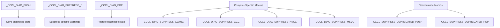

These macros enable CCCL to suppress specific warnings in code sections that would otherwise trigger false positives or unavoidable warnings due to template instantiation or cross-compiler compatibility requirements.

**Sources:** [libcudacxx/include/cuda/std/__cccl/attributes.h:1-207](), [cub/cub/device/dispatch/dispatch_reduce.cuh:533-537]()

## Dispatch System

CUB's dispatch system is a sophisticated runtime algorithm selection mechanism that chooses optimal implementations based on PTX version, problem size, and hardware characteristics. This system enables CCCL to deliver peak performance across different GPU architectures without requiring users to manually select algorithms.

### PTX Version Detection and Caching

The dispatch system relies on accurate PTX version detection to select appropriate algorithms:

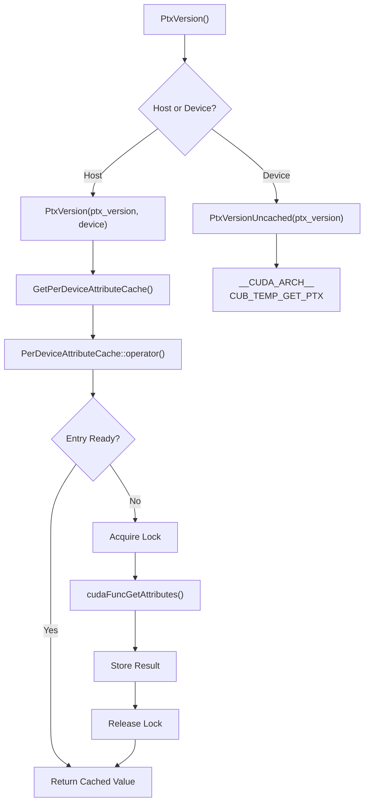

The caching system uses atomic operations to ensure thread-safe initialization across multiple threads, with separate cache instances for PTX version and SM version information.

**Sources:** [cub/cub/util_device.cuh:271-374](), [cub/cub/util_device.cuh:156-265]()

### ChainedPolicy Dispatch Mechanism

The `ChainedPolicy` template provides runtime dispatch by chaining together policies for different PTX versions:

**Diagram: ChainedPolicy Selection Flow**

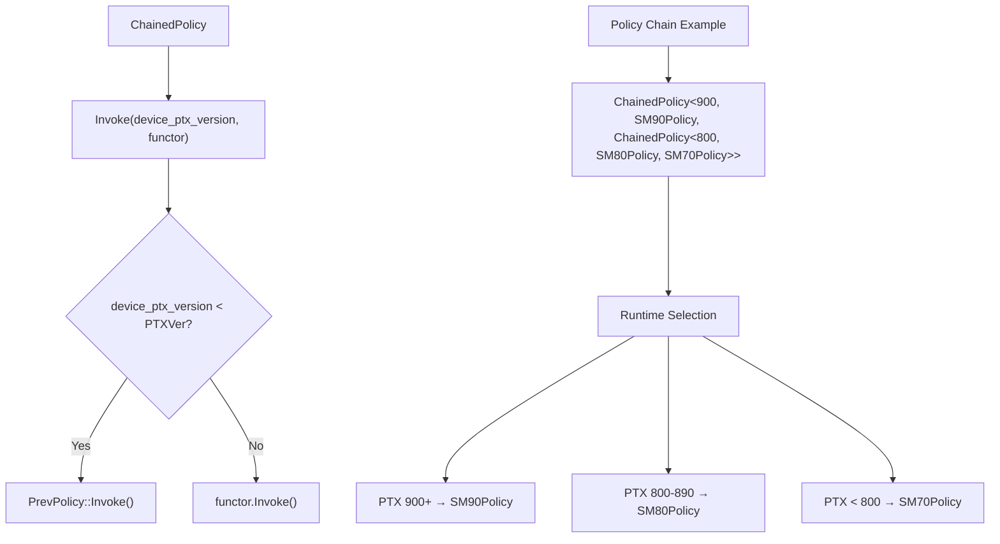

This design allows compile-time specification of multiple algorithm variants while deferring the selection to runtime based on actual hardware capabilities.

**Sources:** [cub/cub/util_device.cuh:726-773]()

### Policy Hub and Tuning Infrastructure

The `policy_hub` templates centralize algorithm tuning parameters and provide the `MaxPolicy` type that drives ChainedPolicy selection:

**Diagram: Policy Hub Architecture**

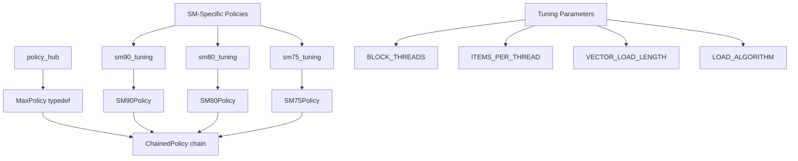

**Policy Selection Example (DeviceReduce):**

The policy hub uses template specialization to select optimal configurations based on type characteristics:

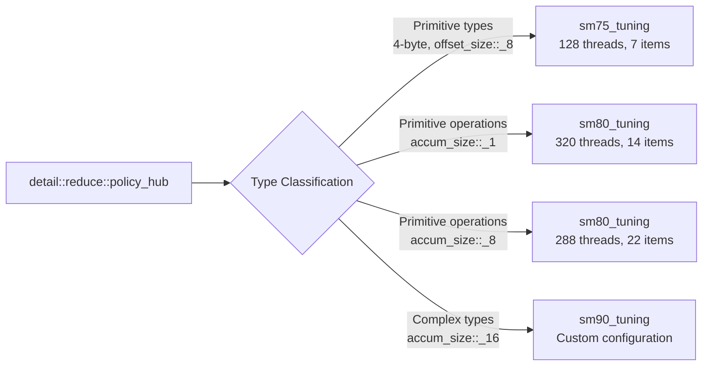

**Sources:** [cub/cub/device/dispatch/tuning/tuning_scan.cuh:166-183](), [cub/cub/device/dispatch/tuning/tuning_reduce.cuh:1-400](), [cub/cub/device/dispatch/dispatch_reduce.cuh:146-147]()

### Device-Wide Algorithm Dispatch Pattern

All CUB device-wide algorithms follow a consistent dispatch pattern implemented through `Dispatch*` classes:

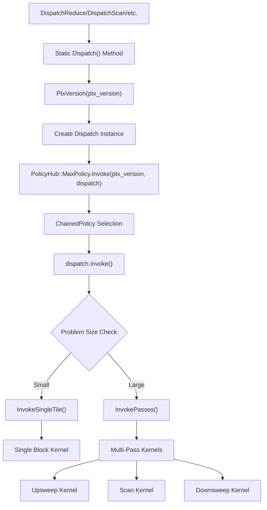

**Sources:** [cub/cub/device/dispatch/dispatch_reduce.cuh:491-547](), [cub/cub/device/dispatch/dispatch_scan.cuh:266-395]()

## Algorithm Implementations

CCCL's algorithm implementations follow a systematic three-layer architecture that separates concerns between device-wide coordination, block-level processing, and kernel instantiation management.

### Three-Layer Algorithm Architecture

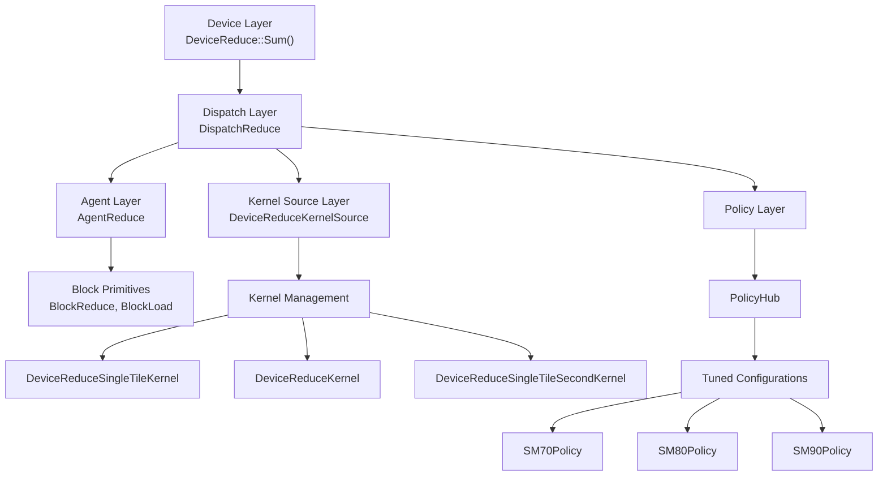

**Sources:** [cub/cub/device/dispatch/dispatch_reduce.cuh:83-114](), [cub/cub/agent/agent_reduce.cuh:1-600]()

### Agent-Based Block Processing

The Agent layer implements block-level algorithms using a consistent pattern across all CUB primitives:

| Agent Class | Purpose | Key Components |
|-------------|---------|----------------|
| `AgentReduce` | Block-level reduction | `BlockReduce`, `BlockLoad`, reduction operators |
| `AgentScan` | Block-level prefix scan | `BlockScan`, `ScanTileState`, prefix propagation |
| `AgentSelectIf` | Block-level selection | `BlockScan`, `BlockExchange`, predicate evaluation |
| `AgentHistogram` | Block-level histogram | `BlockHistogram`, shared memory privatization |

**Diagram: Agent Execution Pattern**

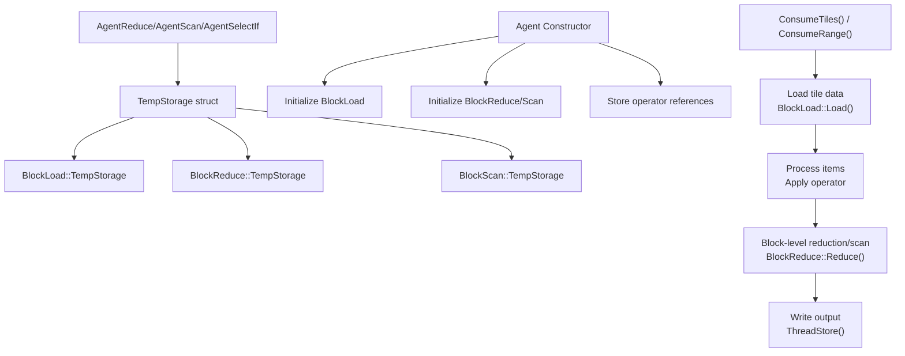

Each agent encapsulates the shared memory requirements, thread collaboration patterns, and data movement strategies specific to its algorithm while providing a uniform interface to the dispatch layer.

**Tile State Management for Scan Operations:**

Multi-block scan operations require coordination between blocks using `ScanTileState`:

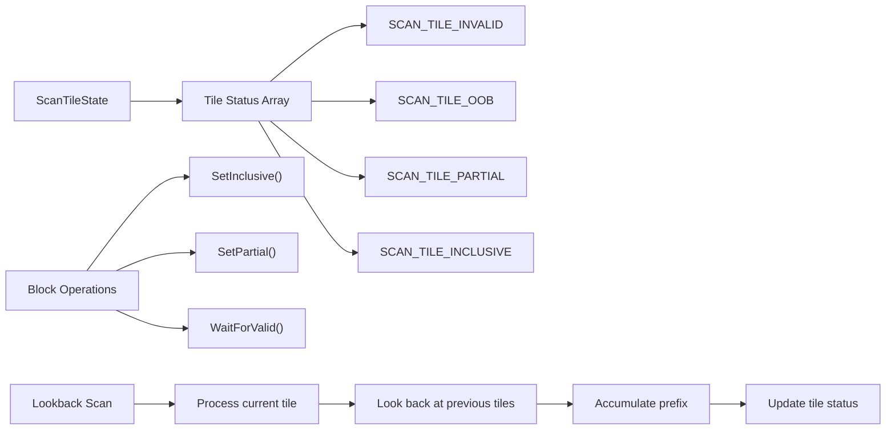

The tile state mechanism enables efficient parallel prefix computation by allowing blocks to determine when predecessor blocks have completed their work, avoiding global synchronization barriers.

**Sources:** [cub/cub/agent/agent_reduce.cuh:116-156](), [cub/cub/agent/agent_select_if.cuh:99-123](), [cub/cub/agent/single_pass_scan_operators.cuh:1-100]()

### Kernel Source Management Pattern

The `KernelSource` pattern separates kernel instantiation from dispatch logic, enabling better template instantiation control and kernel reuse:

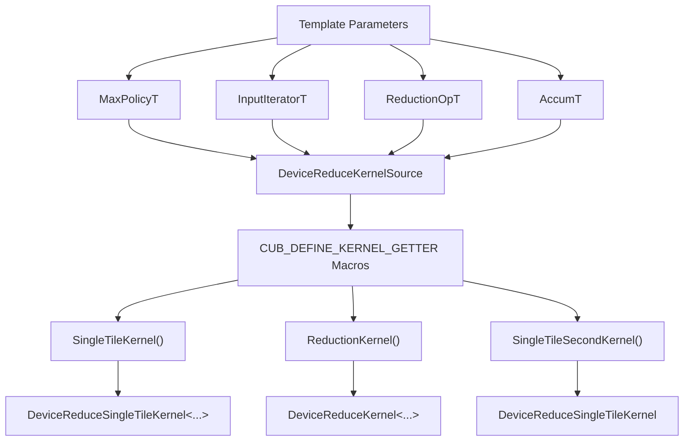

This pattern allows the dispatch system to obtain properly instantiated kernel function pointers while maintaining type safety and enabling efficient template specialization.

**Sources:** [cub/cub/device/dispatch/dispatch_reduce.cuh:83-114](), [cub/cub/device/dispatch/dispatch_histogram.cuh:78-105]()

### Memory and Temporary Storage Management

CCCL implements a sophisticated temporary storage management system that minimizes memory allocations and enables precise memory requirement calculation:

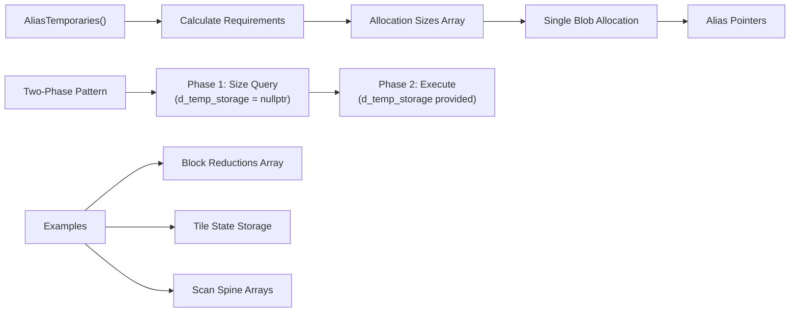

This approach allows algorithms to specify their exact memory requirements while enabling efficient memory reuse patterns and supporting the common CUDA idiom of querying storage requirements before allocation.

**Sources:** [cub/cub/device/dispatch/dispatch_reduce.cuh:347-370](), [cub/cub/device/dispatch/dispatch_scan.cuh:292-308]()

---

