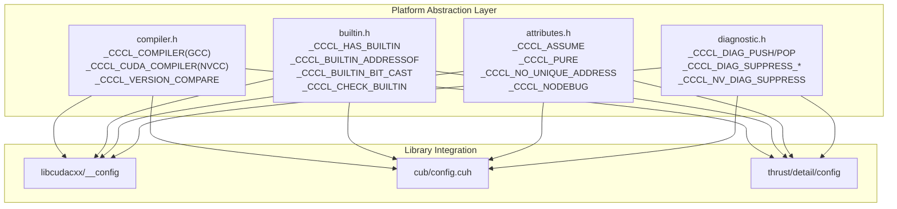
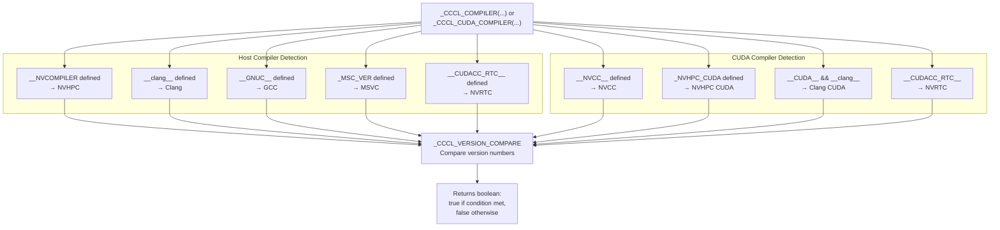
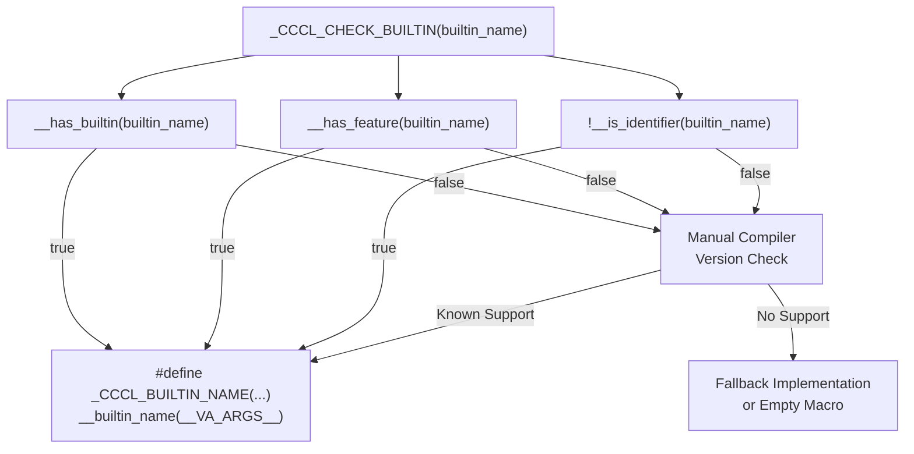
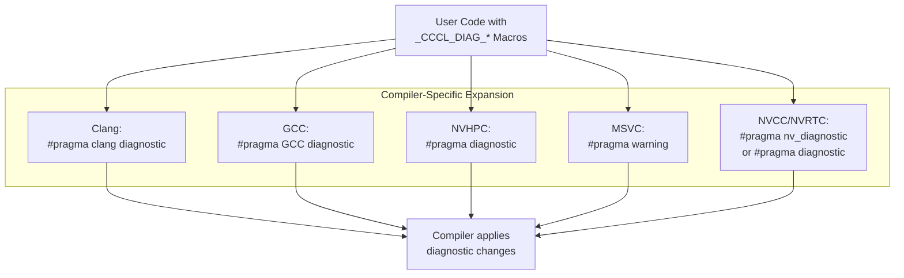

<!-- source: DeepWiki mcp.deepwiki.com · repo NVIDIA/cccl · page 5.1 Platform Abstraction Layer · fetched 2026-10-26 -->

# Platform Abstraction Layer

<details>
<summary>Relevant source files</summary>

The following files were used as context for generating this wiki page:

- [docs/libcudacxx/extended_api/type_traits/is_floating_point.rst](docs/libcudacxx/extended_api/type_traits/is_floating_point.rst)
- [lib/cmake/thrust/FindTBB.cmake](lib/cmake/thrust/FindTBB.cmake)
- [libcudacxx/include/cuda/__type_traits/is_floating_point.h](libcudacxx/include/cuda/__type_traits/is_floating_point.h)
- [libcudacxx/include/cuda/std/__atomic/functions/cuda_ptx_generated_helper.h](libcudacxx/include/cuda/std/__atomic/functions/cuda_ptx_generated_helper.h)
- [libcudacxx/include/cuda/std/__cccl/compiler.h](libcudacxx/include/cuda/std/__cccl/compiler.h)
- [libcudacxx/include/cuda/std/__cccl/cuda_toolkit.h](libcudacxx/include/cuda/std/__cccl/cuda_toolkit.h)
- [libcudacxx/include/cuda/std/__cccl/diagnostic.h](libcudacxx/include/cuda/std/__cccl/diagnostic.h)
- [libcudacxx/include/cuda/std/__cccl/dialect.h](libcudacxx/include/cuda/std/__cccl/dialect.h)
- [libcudacxx/include/cuda/std/__cccl/extended_data_types.h](libcudacxx/include/cuda/std/__cccl/extended_data_types.h)
- [libcudacxx/include/cuda/std/__cccl/system_header.h](libcudacxx/include/cuda/std/__cccl/system_header.h)
- [libcudacxx/include/cuda/std/__functional/bind_front.h](libcudacxx/include/cuda/std/__functional/bind_front.h)
- [libcudacxx/include/cuda/std/__functional/not_fn.h](libcudacxx/include/cuda/std/__functional/not_fn.h)
- [libcudacxx/include/cuda/std/__internal/atomic.h](libcudacxx/include/cuda/std/__internal/atomic.h)
- [libcudacxx/include/cuda/std/__internal/features.h](libcudacxx/include/cuda/std/__internal/features.h)
- [libcudacxx/include/cuda/std/__type_traits/is_extended_floating_point.h](libcudacxx/include/cuda/std/__type_traits/is_extended_floating_point.h)
- [libcudacxx/include/cuda/std/__type_traits/type_list.h](libcudacxx/include/cuda/std/__type_traits/type_list.h)
- [libcudacxx/include/cuda/std/__utility/declval.h](libcudacxx/include/cuda/std/__utility/declval.h)
- [libcudacxx/test/libcudacxx/cuda/iterators/transform_input_output_iterator/types.h](libcudacxx/test/libcudacxx/cuda/iterators/transform_input_output_iterator/types.h)
- [libcudacxx/test/libcudacxx/cuda/iterators/transform_output_iterator/types.h](libcudacxx/test/libcudacxx/cuda/iterators/transform_output_iterator/types.h)
- [libcudacxx/test/libcudacxx/cuda/test_platform.pass.cpp](libcudacxx/test/libcudacxx/cuda/test_platform.pass.cpp)
- [libcudacxx/test/libcudacxx/cuda/type_list.pass.cpp](libcudacxx/test/libcudacxx/cuda/type_list.pass.cpp)
- [libcudacxx/test/libcudacxx/libcxx/utilities/meta/meta.unary/meta.unary.cat/is_floating_point.pass.cpp](libcudacxx/test/libcudacxx/libcxx/utilities/meta/meta.unary/meta.unary.cat/is_floating_point.pass.cpp)
- [libcudacxx/test/libcudacxx/std/utilities/memory/ptr.align/align.pass.cpp](libcudacxx/test/libcudacxx/std/utilities/memory/ptr.align/align.pass.cpp)
- [libcudacxx/test/libcudacxx/std/utilities/meta/meta.unary/meta.unary.cat/is_floating_point.pass.cpp](libcudacxx/test/libcudacxx/std/utilities/meta/meta.unary/meta.unary.cat/is_floating_point.pass.cpp)
- [libcudacxx/test/support/test_macros.h](libcudacxx/test/support/test_macros.h)

</details>


The Platform Abstraction Layer in CCCL provides the foundation for cross-compiler portability by abstracting compiler-specific features, builtin functions, attributes, and diagnostic controls. This layer enables CCCL libraries (Thrust, CUB, and libcudacxx) to provide consistent APIs and behavior across multiple compilers (GCC, Clang, MSVC, NVHPC, NVRTC) and CUDA compilation modes.

## Purpose and Scope

The Platform Abstraction Layer consists of four main components:

1. **Compiler Detection**: Identifies host and CUDA compilers with version comparison capabilities
2. **Builtin Abstractions**: Provides portable access to compiler intrinsic functions
3. **Attribute Portability**: Offers uniform function and type attributes across compilers
4. **Diagnostic Control**: Manages compiler warnings and diagnostic messages consistently

This layer is implemented primarily through the following header files:
- [libcudacxx/include/cuda/std/__cccl/compiler.h]() - Compiler detection macros
- [libcudacxx/include/cuda/std/__cccl/builtin.h]() - Builtin function abstractions
- [libcudacxx/include/cuda/std/__cccl/attributes.h]() - Attribute abstractions
- [libcudacxx/include/cuda/std/__cccl/diagnostic.h]() - Diagnostic control macros

For information about higher-level library features built on this layer, see the [Core Libraries](#2) page.

## Architecture Overview

The Platform Abstraction Layer is organized as a set of independent header files that provide specific abstraction capabilities. The main entry point [cuda/__cccl_config]() includes all platform abstraction components:

**Platform Abstraction Layer Components**



The abstraction layer follows a multi-tier fallback strategy: when a compiler provides a builtin or attribute, the macro expands to the compiler-specific syntax; otherwise, it provides a portable fallback or expands to nothing if no fallback is possible.

Sources: [libcudacxx/include/cuda/__cccl_config:14-36](), [libcudacxx/include/cuda/std/__cccl/compiler.h:1-218](), [libcudacxx/include/cuda/std/__cccl/builtin.h:1-677](), [libcudacxx/include/cuda/std/__cccl/attributes.h:1-207](), [libcudacxx/include/cuda/std/__cccl/diagnostic.h:1-132]()

## Compiler Detection System

The compiler detection system identifies the host and CUDA compilers, providing version comparison capabilities. The system uses a generic version comparison mechanism defined in [libcudacxx/include/cuda/std/__cccl/compiler.h:16-52]().

**Compiler Detection Flow**



### Host Compiler Detection

The system detects the host compiler by checking for compiler-specific predefined macros. Each compiler sets a macro with its version:

| Compiler | Detection Macro | Version Macro Format |
|----------|----------------|----------------------|
| NVHPC | `__NVCOMPILER` | `(__NVCOMPILER_MAJOR__, __NVCOMPILER_MINOR__)` |
| Clang | `__clang__` | `(__clang_major__, __clang_minor__)` |
| GCC | `__GNUC__` | `(__GNUC__, __GNUC_MINOR__)` |
| MSVC | `_MSC_VER` | `(_MSC_VER / 100, _MSC_VER % 100)` |
| NVRTC | `__CUDACC_RTC__` | `(__CUDACC_VER_MAJOR__, __CUDACC_VER_MINOR__)` |

The `_CCCL_COMPILER` macro provides a unified interface for compiler detection with optional version comparison:

```cpp
// Check if using GCC 7 or newer
#if _CCCL_COMPILER(GCC, >=, 7)
    // Code for GCC 7+
#endif

// Check if using MSVC 2019 or newer (version 19.20+)
#if _CCCL_COMPILER(MSVC, >=, 19, 20)
    // Code for MSVC 2019+
#endif

// Check if using any version of Clang
#if _CCCL_COMPILER(CLANG)
    // Clang-specific code
#endif
```

Sources: [libcudacxx/include/cuda/std/__cccl/compiler.h:54-100]()

### CUDA Compiler Detection

CUDA compilation can occur through multiple compilers. The system distinguishes between them:

| CUDA Compiler | Detection Macro | Version Source |
|---------------|----------------|----------------|
| NVCC | `__NVCC__` | `__CUDACC_VER_MAJOR__`, `__CUDACC_VER_MINOR__` |
| NVHPC | `_NVHPC_CUDA` | Same as host NVHPC version |
| Clang | `__CUDA__` && `__clang__` | `CUDA_VERSION` from `cuda.h` |
| NVRTC | `__CUDACC_RTC__` | `__CUDACC_VER_MAJOR__`, `__CUDACC_VER_MINOR__` |

The `_CCCL_CUDA_COMPILER` macro provides CUDA compiler detection:

```cpp
// Check if compiling with NVCC version 12.3 or later
#if _CCCL_CUDA_COMPILER(NVCC, >=, 12, 3)
    // Use NVCC 12.3+ features
#endif

// Check if using Clang CUDA
#if _CCCL_CUDA_COMPILER(CLANG)
    // Clang CUDA specific code
#endif

// Check if any CUDA compiler is available
#if _CCCL_HAS_CUDA_COMPILER()
    // CUDA compilation is available
#endif
```

Additional macros for CUDA toolkit version detection:

```cpp
// Check CUDA toolkit version during CUDA compilation
#if _CCCL_CUDACC_AT_LEAST(12, 0)
    // Use features available in CUDA 12.0+
#endif

#if _CCCL_CUDACC_BELOW(11, 8)
    // Workaround for older CUDA versions
#endif
```

Sources: [libcudacxx/include/cuda/std/__cccl/compiler.h:102-174]()

### Compilation Context Detection

Beyond compiler identification, the system detects the current compilation context:

| Macro | Description |
|-------|-------------|
| `_CCCL_CUDA_COMPILATION()` | True when compiling a `.cu` file or using CUDA mode |
| `_CCCL_HOST_COMPILATION()` | True when compiling host code (no `__CUDA_ARCH__` defined) |
| `_CCCL_DEVICE_COMPILATION()` | True when compiling device code (`__CUDA_ARCH__` defined) |

Note: NVHPC compiles host and device code simultaneously, so both `_CCCL_HOST_COMPILATION()` and `_CCCL_DEVICE_COMPILATION()` return true for NVHPC.

Sources: [libcudacxx/include/cuda/std/__cccl/compiler.h:132-150]()

## Builtin Abstractions

Builtin abstractions provide portable access to compiler intrinsic functions. The system uses a three-tier detection strategy implemented in [libcudacxx/include/cuda/std/__cccl/builtin.h:45-67]():

1. `_CCCL_HAS_BUILTIN(__x)` - Direct `__has_builtin` support (modern compilers)
2. `_CCCL_HAS_FEATURE(__x)` - Feature-based detection (Clang)
3. `_CCCL_HAS_KEYWORD(__x)` - Keyword-based detection (uses `__is_identifier`)

These are combined into `_CCCL_CHECK_BUILTIN(__x)` which tries all three methods to maximize compatibility with older compilers that lack `__has_builtin` support.

**Builtin Detection and Fallback Strategy**



### Common Builtin Abstractions

The following table shows frequently-used builtin abstractions and their fallback strategies:

| Macro | Purpose | Fallback Strategy |
|-------|---------|------------------|
| `_CCCL_BUILTIN_ADDRESSOF(x)` | Get address without overloaded `operator&` | GCC 7+, MSVC, NVHPC, NVRTC 12.3+ |
| `_CCCL_BUILTIN_ASSUME(x)` | Compiler optimization hint | Multi-tier: `__builtin_assume`, GCC 13 `__attribute__`, MSVC `__assume`, or empty |
| `_CCCL_BUILTIN_BIT_CAST(T, x)` | Reinterpret bits without UB | MSVC 19.25+, or requires C++20 `std::bit_cast` |
| `_CCCL_BUILTIN_IS_CONSTANT_EVALUATED()` | Detect constexpr evaluation | GCC 9+, MSVC 19.24+, or empty |
| `_CCCL_BUILTIN_POPCOUNT(x)` | Count set bits | GCC, Clang, NVHPC, or manual implementation |
| `_CCCL_BUILTIN_EXPECT(x, y)` | Branch prediction hint | GCC, Clang, MSVC, NVHPC, or expands to `(x)` |

Example usage:

```cpp
// Use __builtin_addressof when available
template <typename T>
T* get_address(T& obj) {
#ifdef _CCCL_BUILTIN_ADDRESSOF
    return _CCCL_BUILTIN_ADDRESSOF(obj);
#else
    return &obj;  // Fallback
#endif
}

// Branch prediction hint
if (_CCCL_BUILTIN_EXPECT(ptr != nullptr, 1)) {
    // Likely path
}
```

Sources: [libcudacxx/include/cuda/std/__cccl/builtin.h:93-107](), [libcudacxx/include/cuda/std/__cccl/builtin.h:114-116](), [libcudacxx/include/cuda/std/__cccl/builtin.h:252-254]()

### Type Trait Builtins

Many type traits can use compiler builtins for faster compilation:

| Macro | Type Trait | Availability |
|-------|-----------|--------------|
| `_CCCL_BUILTIN_IS_CONSTRUCTIBLE(T, Args...)` | `std::is_constructible` | GCC 8+, MSVC, NVRTC |
| `_CCCL_BUILTIN_IS_ASSIGNABLE(T, U)` | `std::is_assignable` | GCC 9+, MSVC |
| `_CCCL_BUILTIN_IS_TRIVIALLY_COPYABLE(T)` | `std::is_trivially_copyable` | All major compilers |
| `_CCCL_BUILTIN_IS_ARRAY(T)` | `std::is_array` | Modern compilers (with version checks) |
| `_CCCL_BUILTIN_REMOVE_REFERENCE_T(T)` | `std::remove_reference_t` | Clang CUDA, with workarounds |

Example from libcudacxx:

```cpp
// From libcudacxx/include/cuda/std/__type_traits/is_trivially_copyable.h
template <class _Tp>
struct is_trivially_copyable 
    : bool_constant<_CCCL_BUILTIN_IS_TRIVIALLY_COPYABLE(_Tp)> {};
```

Some builtins have known issues and are explicitly disabled. For example, NVCC has trouble with several builtins, so they are undefined for that compiler ([libcudacxx/include/cuda/std/__cccl/builtin.h:421-423]()).

Sources: [libcudacxx/include/cuda/std/__cccl/builtin.h:404-406](), [libcudacxx/include/cuda/std/__cccl/builtin.h:570-578](), [libcudacxx/include/cuda/std/__type_traits/is_trivially_copyable.h:27-36]()

### Bit Manipulation Builtins

The system provides portable access to bit manipulation intrinsics:

| Operation | Macro | Notes |
|-----------|-------|-------|
| Population count | `_CCCL_BUILTIN_POPCOUNT(x)` | 32-bit count |
| Population count | `_CCCL_BUILTIN_POPCOUNTLL(x)` | 64-bit count |
| Count leading zeros | `_CCCL_BUILTIN_CLZ(x)` | 32-bit |
| Count leading zeros | `_CCCL_BUILTIN_CLZLL(x)` | 64-bit |
| Count trailing zeros | `_CCCL_BUILTIN_CTZ(x)` | 32-bit |
| Count trailing zeros | `_CCCL_BUILTIN_CTZLL(x)` | 64-bit |
| Byte swap | `_CCCL_BUILTIN_BSWAP16(x)` | 16-bit |
| Byte swap | `_CCCL_BUILTIN_BSWAP32(x)` | 32-bit |
| Byte swap | `_CCCL_BUILTIN_BSWAP64(x)` | 64-bit |

Note: NVCC does not support the generic `_CCCL_BUILTIN_POPCOUNTG`, `_CCCL_BUILTIN_CLZG`, `_CCCL_BUITLIN_CTZG` variants, or `_CCCL_BUILTIN_BSWAP*` functions, so they are undefined for that compiler ([libcudacxx/include/cuda/std/__cccl/builtin.h:129-183]()).

Sources: [libcudacxx/include/cuda/std/__cccl/builtin.h:118-183]()


## Attribute Portability

Attribute abstractions provide uniform function and type annotations across compilers. The system implements multi-tier fallback logic, similar to builtin abstractions.

### Function Attributes

**Optimization Hint Attributes**

| Macro | Purpose | Implementation |
|-------|---------|----------------|
| `_CCCL_ASSUME(expr)` | Optimization hint (expression is true) | C++23 `[[assume]]`, NVCC device `__builtin_assume`, or empty |
| `_CCCL_PURE` | Function has no side effects, depends only on arguments | NVCC 12.5+ `__nv_pure__`, GNU `[[gnu::pure]]`, MSVC `__declspec(noalias)`, or empty |
| `_CCCL_CONST` | Function has no side effects, always returns same value | GNU `[[gnu::const]]`, falls back to `_CCCL_PURE` |
| `_CCCL_NODEBUG` | Debugger should not step into function | `__attribute__((__nodebug__))` or empty |
| `_CCCL_INTRINSIC` | Mark function as intrinsic (single-statement cast) | MSVC `[[msvc::intrinsic]]` or empty |

The `_CCCL_ASSUME` macro has special handling for NVCC device compilation to work around issues with `[[assume]]` ([libcudacxx/include/cuda/std/__cccl/attributes.h:77-85]()):

```cpp
#if _CCCL_CUDA_COMPILER(NVCC) && _CCCL_DEVICE_COMPILATION()
#  define _CCCL_ASSUME(...) __builtin_assume(__VA_ARGS__)
#elif _CCCL_HAS_CPP_ATTRIBUTE(assume)
#  define _CCCL_ASSUME(...) [[assume(__VA_ARGS__)]]
#else
#  define _CCCL_ASSUME(...) _CCCL_BUILTIN_ASSUME(__VA_ARGS__)
#endif
```

Example usage:

```cpp
_CCCL_PURE int square(int x) {
    return x * x;  // No side effects
}

_CCCL_CONST int get_constant() {
    return 42;  // Always returns same value
}

void process(int* ptr) {
    _CCCL_ASSUME(ptr != nullptr);
    // Compiler can optimize knowing ptr is not null
}
```

Sources: [libcudacxx/include/cuda/std/__cccl/attributes.h:77-123](), [libcudacxx/test/libcudacxx/libcxx/macros/pure_const_attribute.pass.cpp:14-22]()

**Debug and Diagnostic Attributes**

| Macro | Purpose | Compiler Support |
|-------|---------|------------------|
| `_CCCL_DIAGNOSE_IF(cond, msg, type)` | Emit diagnostic if condition is true | Clang `__attribute__((__diagnose_if__))` |
| `_CCCL_NO_SANITIZE(str)` | Disable sanitizer for function | `__attribute__((__no_sanitize__))` |
| `_CCCL_NO_CFI` | Disable control-flow integrity checks | Expands to `_CCCL_NO_SANITIZE("cfi")`, except GCC |

Sources: [libcudacxx/include/cuda/std/__cccl/attributes.h:95-139]()

### Type and Member Attributes

**Layout Control Attributes**

| Macro | Purpose | Implementation Notes |
|-------|---------|---------------------|
| `_CCCL_NO_UNIQUE_ADDRESS` | Allow empty base optimization for members | C++20 `[[no_unique_address]]`, disabled for MSVC due to bugs, disabled for Clang C++17 with NVCC due to cudafe++ issues |
| `_CCCL_DECLSPEC_EMPTY_BASES` | MSVC hint for empty base optimization | MSVC `__declspec(empty_bases)` |

The `_CCCL_NO_UNIQUE_ADDRESS` attribute has special handling for known compiler bugs:

```cpp
#if _CCCL_COMPILER(MSVC) || _CCCL_HAS_CPP_ATTRIBUTE(no_unique_address) < 201803L
  // MSVC implementation has runtime corruption issues
#  define _CCCL_HAS_ATTRIBUTE_NO_UNIQUE_ADDRESS() 0
#  define _CCCL_NO_UNIQUE_ADDRESS
#elif _CCCL_HAS_CPP_ATTRIBUTE(no_unique_address)
#  define _CCCL_HAS_ATTRIBUTE_NO_UNIQUE_ADDRESS() 1
#  define _CCCL_NO_UNIQUE_ADDRESS [[no_unique_address]]
#else
#  define _CCCL_HAS_ATTRIBUTE_NO_UNIQUE_ADDRESS() 0
#  define _CCCL_NO_UNIQUE_ADDRESS
#endif
```

Additional workaround for Clang C++17 with NVCC ([libcudacxx/include/cuda/std/__cccl/attributes.h:174-180]()):

```cpp
// Passing objects with nested [[no_unique_address]] to kernels
// leads to data corruption with cudafe++ in C++17 mode
#if _CCCL_HAS_ATTRIBUTE_NO_UNIQUE_ADDRESS() && _CCCL_COMPILER(CLANG) 
    && _CCCL_STD_VER < 2020 && _CCCL_CUDA_COMPILER(NVCC)
#  undef _CCCL_HAS_ATTRIBUTE_NO_UNIQUE_ADDRESS
#  undef _CCCL_NO_UNIQUE_ADDRESS
#  define _CCCL_HAS_ATTRIBUTE_NO_UNIQUE_ADDRESS() 0
#  define _CCCL_NO_UNIQUE_ADDRESS
#endif
```

Sources: [libcudacxx/include/cuda/std/__cccl/attributes.h:157-180]()

**Other Type Attributes**

| Macro | Purpose |
|-------|---------|
| `_CCCL_PREFERRED_NAME(x)` | Provide preferred type name in diagnostics |
| `_CCCL_REQUIRE_CONSTANT_INITIALIZATION` | Require constant initialization |
| `_CCCL_RESTRICT` | Portable restrict keyword (MSVC `__restrict`, others `__restrict__`) |

Sources: [libcudacxx/include/cuda/std/__cccl/attributes.h:184-202]()

### Attribute Detection

The attribute system provides macros to check for attribute support:

| Macro | Purpose |
|-------|---------|
| `_CCCL_HAS_ATTRIBUTE(x)` | Check for C attribute (via `__has_attribute`) |
| `_CCCL_HAS_CPP_ATTRIBUTE(x)` | Check for C++ attribute (via `__has_cpp_attribute`) |
| `_CCCL_HAS_DECLSPEC_ATTRIBUTE(x)` | Check for declspec attribute (via `__has_declspec_attribute`) |

These are used internally to implement the multi-tier fallback strategy.

Sources: [libcudacxx/include/cuda/std/__cccl/attributes.h:30-46]()

## Diagnostic Control

The diagnostic control system provides compiler-agnostic macros for managing warnings and diagnostics. Each compiler has its own syntax for diagnostic pragmas, which the system abstracts.

**Diagnostic Control Architecture**



### Host Compiler Diagnostics

The system provides per-compiler diagnostic macros:

| Macro | Clang | GCC | NVHPC | MSVC |
|-------|-------|-----|-------|------|
| `_CCCL_DIAG_PUSH` | `#pragma clang diagnostic push` | `#pragma GCC diagnostic push` | `#pragma diagnostic push` | `#pragma warning(push)` |
| `_CCCL_DIAG_POP` | `#pragma clang diagnostic pop` | `#pragma GCC diagnostic pop` | `#pragma diagnostic pop` | `#pragma warning(pop)` |
| `_CCCL_DIAG_SUPPRESS_CLANG(w)` | `#pragma clang diagnostic ignored w` | No-op | No-op | No-op |
| `_CCCL_DIAG_SUPPRESS_GCC(w)` | No-op | `#pragma GCC diagnostic ignored w` | No-op | No-op |
| `_CCCL_DIAG_SUPPRESS_NVHPC(w)` | No-op | No-op | `#pragma diag_suppress w` | No-op |
| `_CCCL_DIAG_SUPPRESS_MSVC(w)` | No-op | No-op | No-op | `#pragma warning(disable : w)` |

Each suppress macro only expands for its specific compiler, allowing multiple suppressions for the same code:

```cpp
_CCCL_DIAG_PUSH
_CCCL_DIAG_SUPPRESS_CLANG("-Wdeprecated-declarations")
_CCCL_DIAG_SUPPRESS_GCC("-Wdeprecated-declarations")
_CCCL_DIAG_SUPPRESS_MSVC(4996)
// Code that triggers deprecation warnings
_CCCL_DIAG_POP
```

Sources: [libcudacxx/include/cuda/std/__cccl/diagnostic.h:26-61]()

### CUDA Compiler Diagnostics

NVCC and NVRTC have their own diagnostic pragma syntax:

| Macro | Description |
|-------|-------------|
| `_CCCL_NV_DIAG_PUSH()` | Push diagnostic state for NVCC/NVRTC |
| `_CCCL_NV_DIAG_POP()` | Pop diagnostic state for NVCC/NVRTC |
| `_CCCL_DIAG_SUPPRESS_NVCC(warning)` | Suppress specific NVCC warning number |
| `_CCCL_BEGIN_NV_DIAG_SUPPRESS(...)` | Convenience macro to push and suppress multiple warnings |
| `_CCCL_END_NV_DIAG_SUPPRESS()` | Convenience macro to pop diagnostic state |

NVCC has two diagnostic pragma variants:
- Modern NVCC (with `__NVCC_DIAG_PRAGMA_SUPPORT__`): Uses `#pragma nv_diagnostic`
- Older NVCC: Uses `#pragma diagnostic`

Example usage:

```cpp
_CCCL_BEGIN_NV_DIAG_SUPPRESS(1444, 20199)
// Code that triggers NVCC warnings 1444 and 20199
_CCCL_END_NV_DIAG_SUPPRESS()
```

Sources: [libcudacxx/include/cuda/std/__cccl/diagnostic.h:64-86]()

### Convenience Macros

The system provides high-level macros for common diagnostic patterns:

**Deprecation Warning Suppression**

Each compiler has its own deprecation warning identifiers. The `_CCCL_SUPPRESS_DEPRECATED_PUSH` and `_CCCL_SUPPRESS_DEPRECATED_POP` macros handle all of them:

| Compiler | Warnings Suppressed |
|----------|-------------------|
| Clang | `-Wdeprecated`, `-Wdeprecated-declarations`, NVCC warnings 1444, 20199 |
| GCC | `-Wdeprecated`, `-Wdeprecated-declarations`, NVCC warnings 1444, 20199 |
| NVHPC | `deprecated_entity`, `deprecated_entity_with_custom_message`, NVCC warnings 1444, 20199 |
| MSVC | Warning 4996, NVCC warning 1444 |
| NVRTC | NVCC warnings 1444, 20199 |

Example usage:

```cpp
_CCCL_SUPPRESS_DEPRECATED_PUSH
// Call deprecated functions
auto result = deprecated_function();
_CCCL_SUPPRESS_DEPRECATED_POP
```

Sources: [libcudacxx/include/cuda/std/__cccl/diagnostic.h:88-122]()

### System Header Configuration

CCCL headers are marked as system headers to suppress warnings in library code. This is implemented through the system header detection macros:

| Macro | Compiler | Effect |
|-------|----------|--------|
| `_CCCL_IMPLICIT_SYSTEM_HEADER_GCC` | GCC, NVHPC | Enables `#pragma GCC system_header` |
| `_CCCL_IMPLICIT_SYSTEM_HEADER_CLANG` | Clang | Enables `#pragma clang system_header` |
| `_CCCL_IMPLICIT_SYSTEM_HEADER_MSVC` | MSVC | Enables `#pragma system_header` |

These macros are defined when `_CCCL_NO_SYSTEM_HEADER` is not set and certain conditions are met. Each CCCL header includes this pattern:

```cpp
#if defined(_CCCL_IMPLICIT_SYSTEM_HEADER_GCC)
#  pragma GCC system_header
#elif defined(_CCCL_IMPLICIT_SYSTEM_HEADER_CLANG)
#  pragma clang system_header
#elif defined(_CCCL_IMPLICIT_SYSTEM_HEADER_MSVC)
#  pragma system_header
#endif // no system header
```

This prevents user code warnings from being attributed to CCCL headers and improves compilation performance.

Sources: [libcudacxx/include/cuda/std/__cccl/system_header.h:17-36](), [libcudacxx/include/cuda/std/detail/libcxx/include/__config:16-22]()


## Practical Examples

### Example 1: Using Builtin Abstractions for Bit Counting

The following example shows how builtin abstractions enable portable bit counting:

```cpp
// From a hypothetical CCCL algorithm
template <typename T>
int count_set_bits(T value) {
#ifdef _CCCL_BUILTIN_POPCOUNT
    if constexpr (sizeof(T) <= sizeof(unsigned int)) {
        return _CCCL_BUILTIN_POPCOUNT(static_cast<unsigned int>(value));
    } else {
        return _CCCL_BUILTIN_POPCOUNTLL(static_cast<unsigned long long>(value));
    }
#else
    // Fallback implementation
    int count = 0;
    while (value) {
        count += value & 1;
        value >>= 1;
    }
    return count;
#endif
}
```

This code automatically uses the fastest available intrinsic on each compiler.

### Example 2: Multi-Compiler Attribute Usage

The following example shows how attribute abstractions enable optimization hints across compilers:

```cpp
// Pure function - no side effects
_CCCL_PURE 
inline int compute_hash(const char* str, int length) {
    int hash = 0;
    for (int i = 0; i < length; ++i) {
        hash = hash * 31 + str[i];
    }
    return hash;
}

// Function that benefits from optimization hints
inline void process_array(int* arr, int size) {
    _CCCL_ASSUME(size > 0);
    _CCCL_ASSUME(arr != nullptr);
    
    for (int i = 0; i < size; ++i) {
        arr[i] = compute_hash("key", 3);
    }
}
```

The `_CCCL_PURE` attribute allows the compiler to optimize `compute_hash` calls, while `_CCCL_ASSUME` hints enable additional optimizations.

### Example 3: Compiler-Specific Workarounds

The following pattern shows how to work around compiler-specific issues:

```cpp
#if _CCCL_COMPILER(MSVC, <, 19, 30)
    // Workaround for MSVC 2019 bug
    template <typename T>
    auto get_value() -> decltype(T::value) {
        return T::value;
    }
#else
    // Standard implementation
    template <typename T>
    auto get_value() {
        return T::value;
    }
#endif

#if _CCCL_CUDACC_BELOW(12, 0)
    // Workaround for older NVCC versions
    #define MY_CONSTEXPR
#else
    #define MY_CONSTEXPR constexpr
#endif
```

### Example 4: Diagnostic Control for Library Code

The following example shows how to suppress warnings for code that intentionally triggers them:

```cpp
// Suppress warnings about deprecated features we must support
_CCCL_SUPPRESS_DEPRECATED_PUSH

// Use deprecated feature
auto result = cuda_malloc_managed(size);

_CCCL_SUPPRESS_DEPRECATED_POP

// Or suppress specific warnings
_CCCL_DIAG_PUSH
_CCCL_DIAG_SUPPRESS_CLANG("-Wunused-parameter")
_CCCL_DIAG_SUPPRESS_GCC("-Wunused-parameter")
_CCCL_DIAG_SUPPRESS_MSVC(4100)

void callback(int unused_param) {
    // Implementation doesn't use parameter
}

_CCCL_DIAG_POP
```

Sources: [libcudacxx/include/cuda/std/__cccl/builtin.h:118-122](), [libcudacxx/include/cuda/std/__cccl/attributes.h:77-123](), [libcudacxx/include/cuda/std/__cccl/compiler.h:54-100](), [libcudacxx/include/cuda/std/__cccl/diagnostic.h:88-122]()


## Benefits and Conclusion

The Configuration System provides several key benefits for CCCL users and developers:

1. **Unified Portability Layer**: Abstracts away platform and compiler differences
2. **Feature-Based Adaptation**: Automatically adapts to available features
3. **Cross-Compiler Compatibility**: Works with a wide range of host and CUDA compilers
4. **C++ Standard Version Management**: Handles different C++ standard versions
5. **Diagnostic Control**: Provides unified warning suppression and control
6. **Execution Space Management**: Simplifies host/device code separation

By providing these benefits, the Configuration System enables the CCCL libraries to deliver consistent behavior across diverse environments, making CUDA development more accessible and productive.

Sources: [libcudacxx/include/cuda/__cccl_config](), [docs/cccl/development/macro.rst]()

---

