<!-- source: DeepWiki mcp.deepwiki.com · repo NVIDIA/cccl · page 5.2 Dispatch and Policy System · fetched 2026-10-26 -->

# Dispatch and Policy System

<details>
<summary>Relevant source files</summary>

The following files were used as context for generating this wiki page:

- [c/parallel/include/cccl/c/transform.h](c/parallel/include/cccl/c/transform.h)
- [c/parallel/src/for.cu](c/parallel/src/for.cu)
- [c/parallel/src/merge_sort.cu](c/parallel/src/merge_sort.cu)
- [c/parallel/src/radix_sort.cu](c/parallel/src/radix_sort.cu)
- [c/parallel/src/reduce.cu](c/parallel/src/reduce.cu)
- [c/parallel/src/scan.cu](c/parallel/src/scan.cu)
- [c/parallel/src/segmented_reduce.cu](c/parallel/src/segmented_reduce.cu)
- [c/parallel/src/segmented_sort.cu](c/parallel/src/segmented_sort.cu)
- [c/parallel/src/three_way_partition.cu](c/parallel/src/three_way_partition.cu)
- [c/parallel/src/transform.cu](c/parallel/src/transform.cu)
- [c/parallel/src/unique_by_key.cu](c/parallel/src/unique_by_key.cu)
- [cub/benchmarks/bench/radix_sort/keys.cu](cub/benchmarks/bench/radix_sort/keys.cu)
- [cub/benchmarks/bench/radix_sort/pairs.cu](cub/benchmarks/bench/radix_sort/pairs.cu)
- [cub/benchmarks/bench/radix_sort/policy_selector.h](cub/benchmarks/bench/radix_sort/policy_selector.h)
- [cub/benchmarks/bench/transform/babelstream.cu](cub/benchmarks/bench/transform/babelstream.cu)
- [cub/benchmarks/bench/transform/common.h](cub/benchmarks/bench/transform/common.h)
- [cub/benchmarks/bench/transform/complex_cmp.cu](cub/benchmarks/bench/transform/complex_cmp.cu)
- [cub/benchmarks/bench/transform/fib.cu](cub/benchmarks/bench/transform/fib.cu)
- [cub/benchmarks/bench/transform/fill.cu](cub/benchmarks/bench/transform/fill.cu)
- [cub/benchmarks/bench/transform/grayscale.cu](cub/benchmarks/bench/transform/grayscale.cu)
- [cub/benchmarks/bench/transform/heavy.cu](cub/benchmarks/bench/transform/heavy.cu)
- [cub/cub/detail/arch_dispatch.cuh](cub/cub/detail/arch_dispatch.cuh)
- [cub/cub/detail/launcher/cuda_driver.cuh](cub/cub/detail/launcher/cuda_driver.cuh)
- [cub/cub/detail/launcher/cuda_runtime.cuh](cub/cub/detail/launcher/cuda_runtime.cuh)
- [cub/cub/device/device_radix_sort.cuh](cub/cub/device/device_radix_sort.cuh)
- [cub/cub/device/device_segmented_reduce.cuh](cub/cub/device/device_segmented_reduce.cuh)
- [cub/cub/device/dispatch/dispatch_common.cuh](cub/cub/device/dispatch/dispatch_common.cuh)
- [cub/cub/device/dispatch/dispatch_fixed_size_segmented_reduce.cuh](cub/cub/device/dispatch/dispatch_fixed_size_segmented_reduce.cuh)
- [cub/cub/device/dispatch/dispatch_merge_sort.cuh](cub/cub/device/dispatch/dispatch_merge_sort.cuh)
- [cub/cub/device/dispatch/dispatch_radix_sort.cuh](cub/cub/device/dispatch/dispatch_radix_sort.cuh)
- [cub/cub/device/dispatch/dispatch_reduce.cuh](cub/cub/device/dispatch/dispatch_reduce.cuh)
- [cub/cub/device/dispatch/dispatch_segmented_radix_sort.cuh](cub/cub/device/dispatch/dispatch_segmented_radix_sort.cuh)
- [cub/cub/device/dispatch/dispatch_segmented_reduce.cuh](cub/cub/device/dispatch/dispatch_segmented_reduce.cuh)
- [cub/cub/device/dispatch/dispatch_segmented_sort.cuh](cub/cub/device/dispatch/dispatch_segmented_sort.cuh)
- [cub/cub/device/dispatch/dispatch_transform.cuh](cub/cub/device/dispatch/dispatch_transform.cuh)
- [cub/cub/device/dispatch/kernels/kernel_radix_sort.cuh](cub/cub/device/dispatch/kernels/kernel_radix_sort.cuh)
- [cub/cub/device/dispatch/kernels/kernel_segmented_radix_sort.cuh](cub/cub/device/dispatch/kernels/kernel_segmented_radix_sort.cuh)
- [cub/cub/device/dispatch/kernels/kernel_segmented_reduce.cuh](cub/cub/device/dispatch/kernels/kernel_segmented_reduce.cuh)
- [cub/cub/device/dispatch/kernels/kernel_transform.cuh](cub/cub/device/dispatch/kernels/kernel_transform.cuh)
- [cub/cub/device/dispatch/tuning/common.cuh](cub/cub/device/dispatch/tuning/common.cuh)
- [cub/cub/device/dispatch/tuning/tuning_radix_sort.cuh](cub/cub/device/dispatch/tuning/tuning_radix_sort.cuh)
- [cub/cub/device/dispatch/tuning/tuning_transform.cuh](cub/cub/device/dispatch/tuning/tuning_transform.cuh)
- [cub/cub/util_device.cuh](cub/cub/util_device.cuh)
- [cub/test/catch2_test_arch_dispatch.cu](cub/test/catch2_test_arch_dispatch.cu)
- [cub/test/catch2_test_device_radix_sort_custom_policy_hub.cu](cub/test/catch2_test_device_radix_sort_custom_policy_hub.cu)
- [cub/test/catch2_test_device_transform.cu](cub/test/catch2_test_device_transform.cu)

</details>


The Dispatch and Policy System is CUB's architecture for runtime kernel selection and launch orchestration. It combines PTX-version-based policy selection with a dispatch layer that orchestrates kernel launches, ensuring optimal performance across GPU compute capabilities.

The system has two primary components:
- **Policy System**: Compile-time tuning parameter selection based on SM architecture
- **Dispatch Layer**: Runtime kernel variant selection and launch orchestration

## Overview

The Dispatch and Policy System bridges high-level algorithm APIs with architecture-specific kernel implementations. CUB uses two approaches:

1. **New Policy Selector System**: Runtime `policy_selector` objects return architecture-specific policy structs based on `cuda::arch_id`. This is the current direction for new algorithms and provides more flexibility.
2. **Legacy ChainedPolicy System**: Compile-time policy chains with runtime PTX-based selection. Still used in many existing algorithms for backward compatibility.

Both systems achieve the same goal: selecting optimal tuning parameters at runtime based on GPU architecture.

### Complete Dispatch and Policy Flow

**Diagram: End-to-End Dispatch Flow with Code Entities**

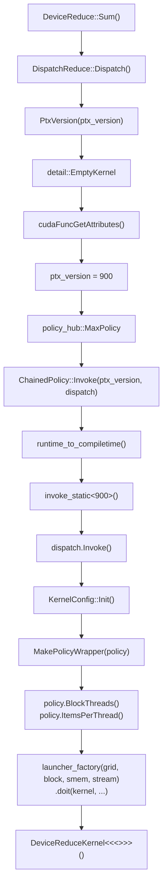

Sources: [cub/cub/util_device.cuh:295-400](), [cub/cub/util_device.cuh:726-795](), [cub/cub/device/dispatch/dispatch_reduce.cuh:491-546]()

## Core Components

### Device Capability Detection

The system begins with runtime detection of device capabilities using the `PtxVersion()` and `SmVersion()` functions:

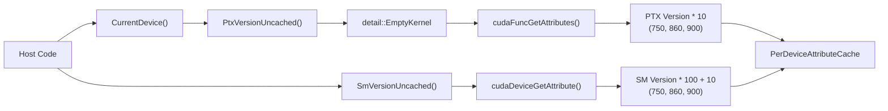

Sources: [cub/cub/util_device.cuh:271-374](), [cub/cub/util_device.cuh:379-428](), [cub/cub/util_device.cuh:156-265]()

### ChainedPolicy Mechanism  

The `ChainedPolicy` template provides compile-time policy chaining with runtime selection:

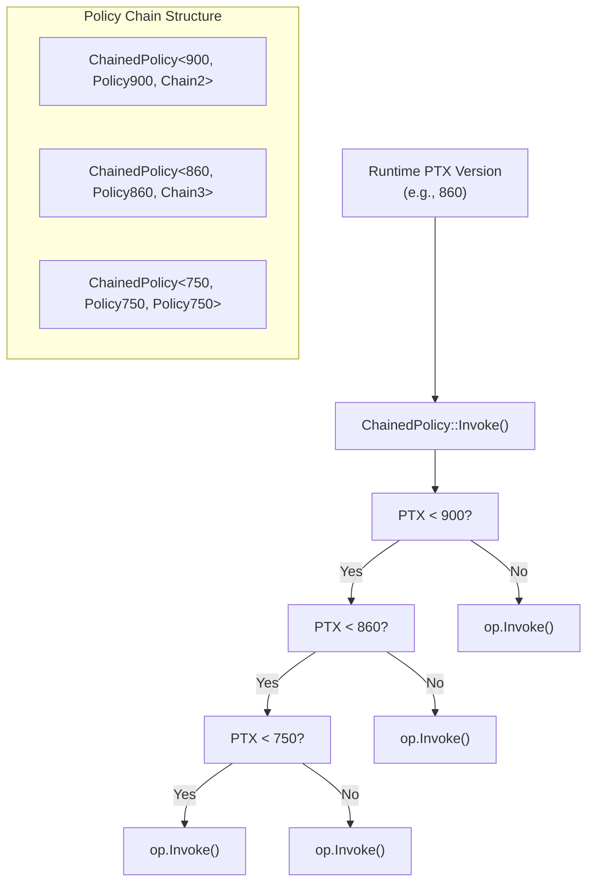

Sources: [cub/cub/util_device.cuh:687-746](), [cub/cub/util_device.cuh:749-772]()

## Policy Selector System (New Tuning API)

The new tuning API uses stateless `policy_selector` objects that return architecture-specific policy structs based on runtime architecture detection. This approach is more flexible and easier to test than the legacy ChainedPolicy system.

### Policy Selector Architecture

**Diagram: policy_selector Invocation Flow**

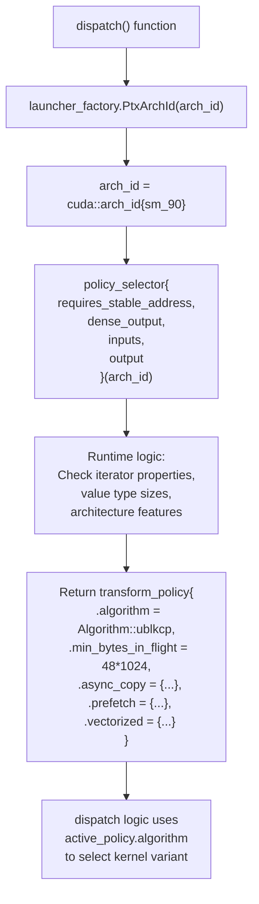

Sources: [cub/cub/device/dispatch/tuning/tuning_transform.cuh:325-459](), [cub/cub/device/dispatch/dispatch_transform.cuh:547-592]()

### Policy Selector Structure

The `policy_selector` template encapsulates runtime decision logic for architecture-specific tuning:

| Component | Type | Purpose |
|-----------|------|---------|
| `operator()(cuda::arch_id)` | Member function | Returns policy struct for given architecture |
| `requires_stable_address` | `bool` member | Whether output iterator requires stable addresses |
| `dense_output` | `bool` member | Whether output is written densely (no predicate) |
| `inputs` | `cuda::std::array<iterator_info, N>` | Input iterator characteristics |
| `output` | `iterator_info` | Output iterator characteristics |

**Example: Transform Policy Selector**

```cpp
// Stateless version for passing to kernels
template <bool RequiresStableAddress, bool DenseOutput, 
          typename IteratorTupleIn, typename IteratorOut>
struct policy_selector_from_types {
  constexpr auto operator()(cuda::arch_id arch) const -> transform_policy {
    constexpr auto policies = policy_selector<sizeof...(IteratorsIn)>{
      RequiresStableAddress,
      DenseOutput,
      {make_iterator_info<IteratorsIn>()...},
      make_iterator_info<IteratorOut>()
    };
    return policies(arch);
  }
};
```

Sources: [cub/cub/device/dispatch/tuning/tuning_transform.cuh:466-494](), [cub/cub/device/dispatch/tuning/tuning_transform.cuh:325-459]()

### Policy Struct Types

Policy selectors return strongly-typed policy structs containing all tuning parameters:

| Policy Struct | Algorithm | Key Fields | Example Values |
|---------------|-----------|------------|----------------|
| `transform_policy` | Transform | `algorithm`, `min_bytes_in_flight`, `async_copy`, `prefetch`, `vectorized` | `Algorithm::ublkcp`, `48*1024`, `{block_threads=256}` |
| `reduce_policy` | Reduce | `reduce`, `single_tile`, `reduce_nondet` | `{block_threads=256, items_per_thread=8}` |
| `scan_policy` | Scan | `scan_tiles`, `init_kernel` | `{block_threads=128, items_per_thread=15}` |
| `radix_sort_policy` | Radix Sort | `onesweep`, `histogram`, `downsweep`, `upsweep` | `{block_threads=256, radix_bits=8}` |

Sources: [cub/cub/device/dispatch/tuning/tuning_transform.cuh:182-209](), [cub/cub/device/dispatch/tuning/tuning_reduce.cuh](), [cub/cub/device/dispatch/tuning/tuning_radix_sort.cuh:182-362]()

### Architecture-Specific Policy Selection

The policy selector implements runtime logic to choose optimal algorithms based on architecture capabilities:

**Diagram: Transform Policy Selection Logic**

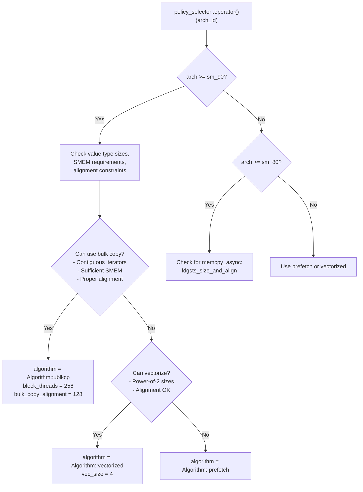

Sources: [cub/cub/device/dispatch/tuning/tuning_transform.cuh:352-409](), [cub/cub/device/dispatch/tuning/tuning_transform.cuh:410-448]()

## Legacy ChainedPolicy System

The legacy system uses compile-time `ChainedPolicy` templates with `PolicyHub` aggregators. This approach is still used in many existing algorithms but is being replaced by the policy selector system.

### Policy Hub Structure (Legacy)

**Diagram: policy_hub Template Instantiation (Legacy)**

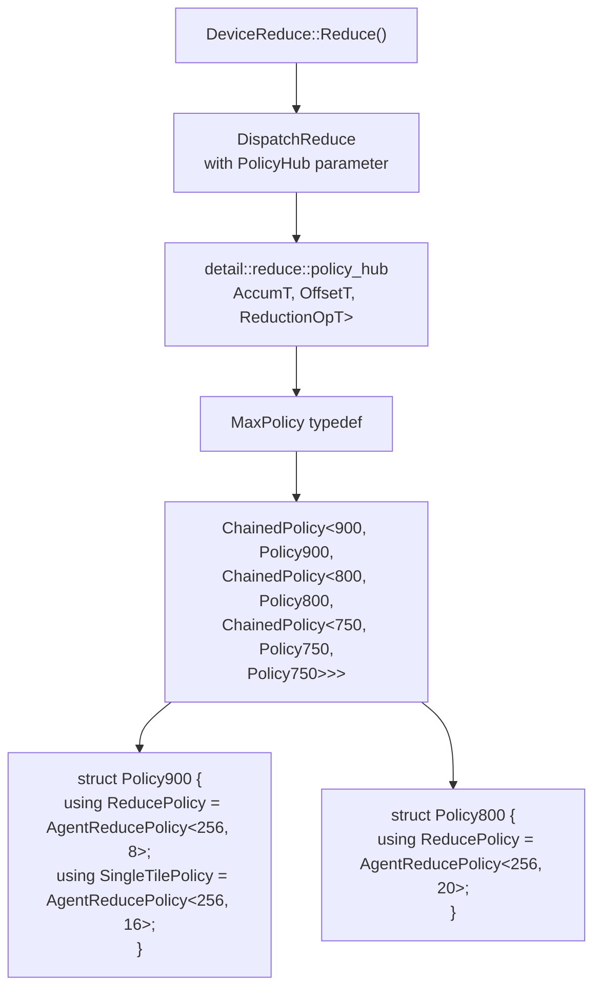

Sources: [cub/cub/device/dispatch/dispatch_reduce.cuh:174-184](), [cub/cub/util_device.cuh:726-795]()

### Policy Wrapper Pattern (Legacy)

The legacy system uses policy wrappers to provide uniform access to tuning parameters:

**Diagram: Policy Wrapper Mechanism**

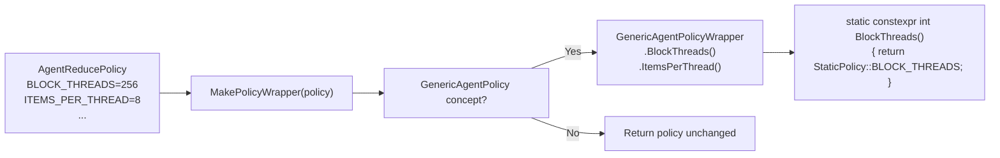

Sources: [cub/cub/util_device.cuh:617-703](), [cub/cub/device/dispatch/dispatch_reduce.cuh:439-454]()

### Tuning Policy Types

Policy structs and agent policies encode architecture-specific tuning parameters:

| Policy Type | System | Key Parameters | Example Values |
|-------------|--------|----------------|----------------|
| `transform_policy` | New | `algorithm`, `min_bytes_in_flight`, `prefetch`, `vectorized`, `async_copy` | [cub/cub/device/dispatch/tuning/tuning_transform.cuh:182-209]() |
| `reduce_policy` | New | `reduce`, `single_tile`, `reduce_nondet` | [cub/cub/device/dispatch/tuning/tuning_reduce.cuh]() |
| `AgentReducePolicy` | Legacy | `BLOCK_THREADS`, `ITEMS_PER_THREAD`, `VECTOR_LOAD_LENGTH` | [cub/cub/agent/agent_reduce.cuh]() |
| `prefetch_policy` | New | `block_threads`, `min_items_per_thread`, `max_items_per_thread` | [cub/cub/device/dispatch/tuning/tuning_transform.cuh:87-114]() |
| `async_copy_policy` | New | `block_threads`, `min_items_per_thread`, `bulk_copy_alignment` | [cub/cub/device/dispatch/tuning/tuning_transform.cuh:153-180]() |

Sources: [cub/cub/device/dispatch/tuning/tuning_transform.cuh:87-209](), [cub/cub/device/dispatch/tuning/tuning_reduce.cuh]()

## Dispatch Layer Architecture

The dispatch layer integrates policy selection with kernel launch orchestration. Modern dispatchers use the policy selector system, while legacy dispatchers use ChainedPolicy.

### New-Style Dispatch (Policy Selector Based)

**Diagram: dispatch() Function Flow with Policy Selector**

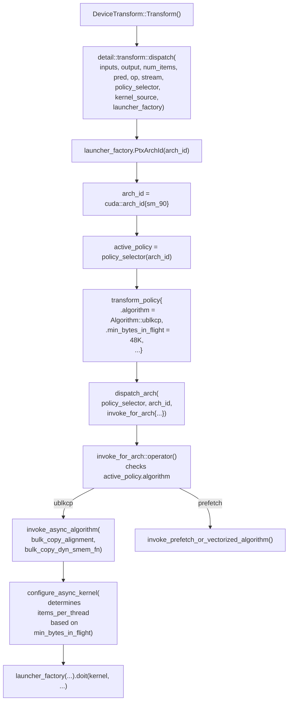

Sources: [cub/cub/device/dispatch/dispatch_transform.cuh:547-592](), [cub/cub/device/dispatch/dispatch_transform.cuh:432-525](), [cub/cub/detail/arch_dispatch.cuh]()

### Legacy-Style Dispatch (ChainedPolicy Based)

**Diagram: DispatchReduce with ChainedPolicy**

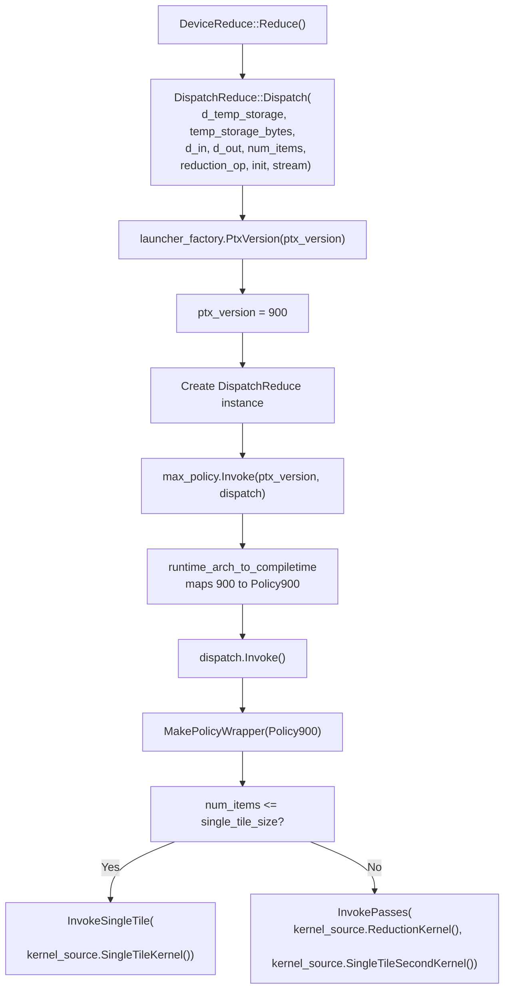

Sources: [cub/cub/device/dispatch/dispatch_reduce.cuh:491-535](), [cub/cub/device/dispatch/dispatch_reduce.cuh:439-454](), [cub/cub/util_device.cuh:791-810]()

## Kernel Source Abstraction

The Kernel Source pattern provides type-safe access to kernel function pointers through the `CUB_DEFINE_KERNEL_GETTER` macro:

**Diagram: Kernel Source Structure**

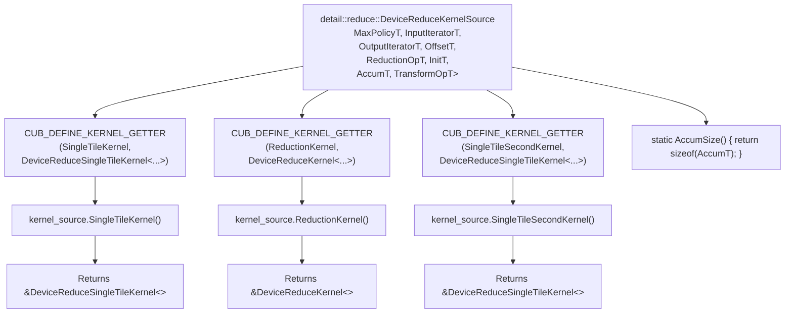

**CUB_DEFINE_KERNEL_GETTER Macro Expansion:**

The macro generates a type-safe method that returns a kernel function pointer:

```cpp
// Usage in DeviceReduceKernelSource:
CUB_DEFINE_KERNEL_GETTER(
  SingleTileKernel,
  DeviceReduceSingleTileKernel<MaxPolicyT, InputIteratorT, ...>)

// Expands to a method that returns the kernel function pointer
```

Sources: [cub/cub/device/dispatch/dispatch_reduce.cuh:74-113](), [cub/cub/device/dispatch/dispatch_transform.cuh:61-134]()

## ChainedPolicy: Runtime-to-Compile-Time Bridge (Legacy)

`ChainedPolicy` is a recursive template structure used in the legacy system to bridge runtime PTX version detection to compile-time policy selection. This section documents the mechanism for understanding existing code.

### ChainedPolicy Template Structure

**Diagram: ChainedPolicy Instantiation and Selection**

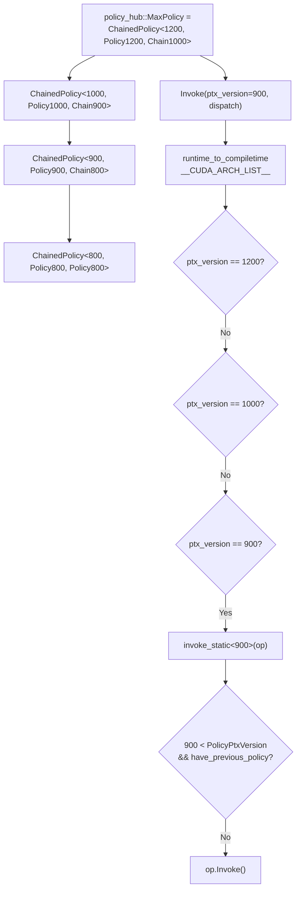

**ChainedPolicy Template Parameters:**

```cpp
template <int PolicyPtxVersion, typename PolicyT, typename PrevPolicyT>
struct ChainedPolicy
{
  using ActivePolicy = /* Policy selection based on CUB_PTX_ARCH */;
  
  static cudaError_t Invoke(int device_ptx_version, FunctorT& op);
};
```

Sources: [cub/cub/util_device.cuh:726-795](), [cub/cub/util_device.cuh:746-780]()

### Runtime-to-Compile-Time Dispatch

The `ChainedPolicy::Invoke()` method uses `__CUDA_ARCH_LIST__` (or `NV_TARGET_SM_INTEGER_LIST__` for NVHPC) to map runtime PTX versions to compile-time instantiations:

**Diagram: runtime_to_compiletime Implementation**

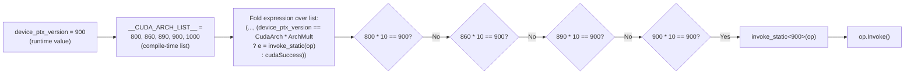

Sources: [cub/cub/util_device.cuh:769-780](), [cub/cub/util_device.cuh:782-793]()

## Runtime Algorithm Selection

Dispatch implementations use policy-driven logic to select kernel variants at runtime based on the policy's algorithm field and problem characteristics.

### Transform Algorithm Selection (New System)

**Diagram: DeviceTransform Kernel Variant Selection with Policy Selector**

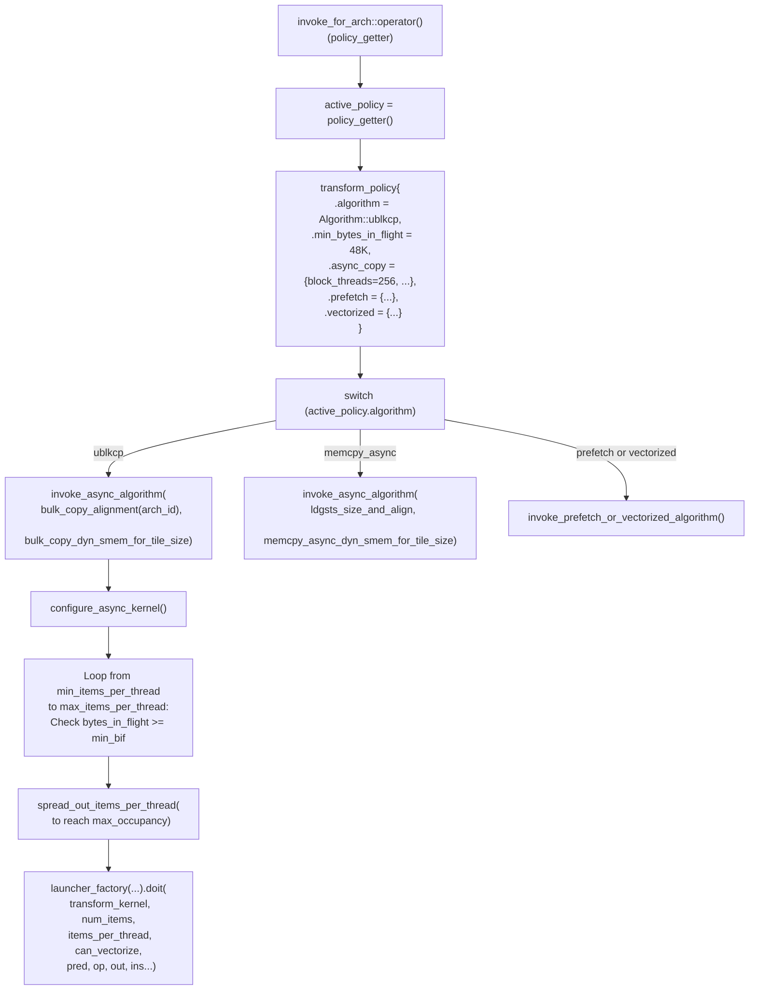

Sources: [cub/cub/device/dispatch/dispatch_transform.cuh:459-525](), [cub/cub/device/dispatch/dispatch_transform.cuh:192-278](), [cub/cub/device/dispatch/dispatch_transform.cuh:289-422]()

### Reduce Two-Pass Selection (Legacy System)

**Diagram: DispatchReduce Kernel Path Selection with ChainedPolicy**

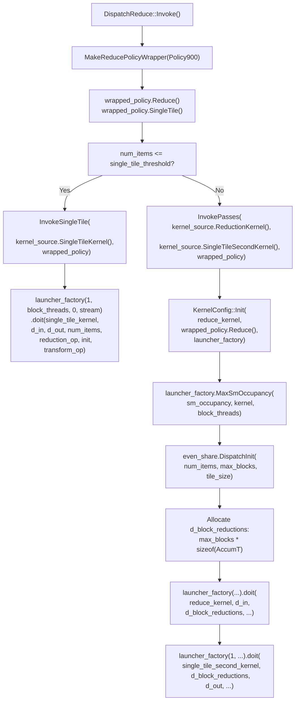

Sources: [cub/cub/device/dispatch/dispatch_reduce.cuh:439-454](), [cub/cub/device/dispatch/dispatch_reduce.cuh:274-306](), [cub/cub/device/dispatch/dispatch_reduce.cuh:330-432]()

## Launcher Factory Abstraction

The `KernelLauncherFactory` template parameter allows customization of kernel launch behavior for testing and instrumentation:

**Diagram: Launcher Factory Interface**

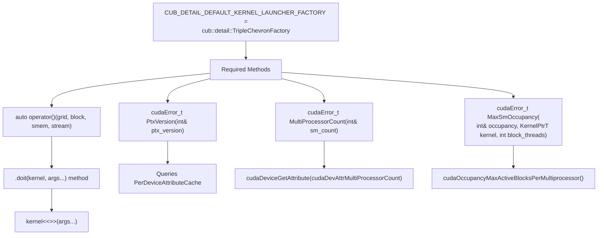

**Default TripleChevronFactory Implementation:**

The default factory wraps standard CUDA runtime API calls:

```cpp
struct TripleChevronFactory {
  cudaError_t PtxVersion(int& ptx_version) {
    return ::cub::PtxVersion(ptx_version);
  }
  
  cudaError_t MultiProcessorCount(int& sm_count) {
    return cudaDeviceGetAttribute(&sm_count, cudaDevAttrMultiProcessorCount, CurrentDevice());
  }
  
  cudaError_t MaxSmOccupancy(int& occupancy, KernelPtrT kernel, int block_threads) {
    return cudaOccupancyMaxActiveBlocksPerMultiprocessor(&occupancy, kernel, block_threads, 0);
  }
  
  auto operator()(int grid, int block, int smem, cudaStream_t stream) {
    return [=](auto kernel, auto... args) {
      return THRUST_NS_QUALIFIER::cuda_cub::launcher::triple_chevron(
        grid, block, smem, stream).doit(kernel, args...);
    };
  }
};
```

Sources: [cub/cub/util_device.cuh:688](), [cub/cub/detail/launcher/cuda_runtime.cuh]()

## Kernel Configuration and Launch

The dispatch system computes kernel launch parameters from policy specifications:

### KernelConfig Calculation (Legacy)

`KernelConfig` is used in legacy dispatchers to compute launch parameters from wrapped policies:

**Diagram: KernelConfig::Init Flow**

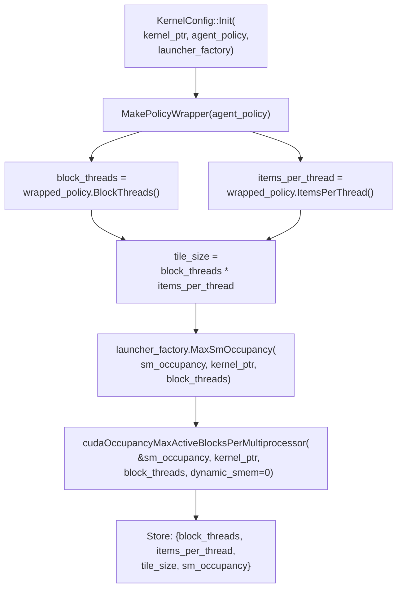

**KernelConfig Members:**

| Field | Type | Description |
|-------|------|-------------|
| `block_threads` | `int` | Number of threads per block |
| `items_per_thread` | `int` | Number of items processed per thread |
| `tile_size` | `int` | Total items per tile (`block_threads * items_per_thread`) |
| `sm_occupancy` | `int` | Maximum active blocks per SM |

Sources: [cub/cub/util_device.cuh:728-761](), [cub/cub/device/dispatch/dispatch_reduce.cuh:342-346]()

### Grid Dimension Calculation Patterns

Different algorithms use different strategies to compute grid dimensions:

| Algorithm | Grid Calculation | Rationale |
|-----------|-----------------|-----------|
| **Reduce** | `grid_size = even_share.grid_size`<br/>`max_blocks = device_occupancy * subscription_factor` | Balance work evenly across blocks with oversubscription | 
| **Transform** | `grid_dim = ceil_div(num_items, tile_size)` | One block per tile, saturate device |
| **Histogram** | `blocks_per_row = min(sweep_occupancy, tiles_per_row)`<br/>`blocks_per_col = min(sweep_occupancy / blocks_per_row, num_rows)` | 2D grid for 2D input image processing |
| **Scan** | `grid_size = (num_tiles > max_blocks) ? max_blocks : num_tiles` | Limit total blocks for lookback coordination |

Sources: [cub/cub/device/dispatch/dispatch_reduce.cuh:340-343](), [cub/cub/device/dispatch/dispatch_transform.cuh:314](), [cub/cub/device/dispatch/dispatch_histogram.cuh:179-192]()

## Key Implementation Patterns

### Template Specialization for Dispatch

The dispatch system uses several template patterns to achieve optimal performance:

- **Policy Wrapper Pattern**: `MakePolicyWrapper()` functions adapt policies for different agent requirements
- **Kernel Source Pattern**: `CUB_DEFINE_KERNEL_GETTER` macro generates type-safe kernel accessor methods  
- **Chained Dispatch**: Recursive template instantiation for compile-time policy selection
- **SFINAE-based Selection**: Template constraints for algorithm variant selection

### Error Handling and Validation

The dispatch system includes comprehensive error checking:

- CUDA error propagation through `CubDebug()` wrapper
- Temporary storage size calculation and validation
- Device compatibility verification
- Stream synchronization for debugging builds

Sources: [cub/cub/util_device.cuh:430-449](), [cub/cub/device/dispatch/dispatch_reduce.cuh:506-546](), [cub/cub/util_policy_wrapper_t.cuh]()

---

