<!-- source: DeepWiki mcp.deepwiki.com · repo NVIDIA/cccl · page 5.3 Agent-Based Execution Model · fetched 2026-10-26 -->

# Agent-Based Execution Model

<details>
<summary>Relevant source files</summary>

The following files were used as context for generating this wiki page:

- [cub/cub/agent/agent_radix_sort_downsweep.cuh](cub/cub/agent/agent_radix_sort_downsweep.cuh)
- [cub/cub/agent/agent_radix_sort_histogram.cuh](cub/cub/agent/agent_radix_sort_histogram.cuh)
- [cub/cub/agent/agent_radix_sort_onesweep.cuh](cub/cub/agent/agent_radix_sort_onesweep.cuh)
- [cub/cub/agent/agent_radix_sort_upsweep.cuh](cub/cub/agent/agent_radix_sort_upsweep.cuh)
- [cub/cub/agent/agent_reduce.cuh](cub/cub/agent/agent_reduce.cuh)
- [cub/cub/agent/agent_reduce_by_key.cuh](cub/cub/agent/agent_reduce_by_key.cuh)
- [cub/cub/agent/agent_rle.cuh](cub/cub/agent/agent_rle.cuh)
- [cub/cub/agent/agent_scan.cuh](cub/cub/agent/agent_scan.cuh)
- [cub/cub/agent/agent_scan_by_key.cuh](cub/cub/agent/agent_scan_by_key.cuh)
- [cub/cub/agent/agent_segmented_radix_sort.cuh](cub/cub/agent/agent_segmented_radix_sort.cuh)
- [cub/cub/agent/agent_select_if.cuh](cub/cub/agent/agent_select_if.cuh)
- [cub/cub/agent/agent_three_way_partition.cuh](cub/cub/agent/agent_three_way_partition.cuh)
- [cub/cub/agent/agent_unique_by_key.cuh](cub/cub/agent/agent_unique_by_key.cuh)
- [cub/cub/agent/single_pass_scan_operators.cuh](cub/cub/agent/single_pass_scan_operators.cuh)
- [cub/cub/device/device_adjacent_difference.cuh](cub/cub/device/device_adjacent_difference.cuh)
- [cub/cub/device/device_histogram.cuh](cub/cub/device/device_histogram.cuh)
- [cub/cub/device/device_partition.cuh](cub/cub/device/device_partition.cuh)
- [cub/cub/device/device_segmented_radix_sort.cuh](cub/cub/device/device_segmented_radix_sort.cuh)
- [cub/cub/device/device_segmented_sort.cuh](cub/cub/device/device_segmented_sort.cuh)
- [cub/cub/device/device_select.cuh](cub/cub/device/device_select.cuh)
- [cub/cub/device/dispatch/dispatch_adjacent_difference.cuh](cub/cub/device/dispatch/dispatch_adjacent_difference.cuh)
- [cub/cub/device/dispatch/dispatch_histogram.cuh](cub/cub/device/dispatch/dispatch_histogram.cuh)
- [cub/cub/device/dispatch/dispatch_reduce_by_key.cuh](cub/cub/device/dispatch/dispatch_reduce_by_key.cuh)
- [cub/cub/device/dispatch/dispatch_rle.cuh](cub/cub/device/dispatch/dispatch_rle.cuh)
- [cub/cub/device/dispatch/dispatch_scan.cuh](cub/cub/device/dispatch/dispatch_scan.cuh)
- [cub/cub/device/dispatch/dispatch_scan_by_key.cuh](cub/cub/device/dispatch/dispatch_scan_by_key.cuh)
- [cub/cub/device/dispatch/dispatch_select_if.cuh](cub/cub/device/dispatch/dispatch_select_if.cuh)
- [cub/cub/device/dispatch/dispatch_three_way_partition.cuh](cub/cub/device/dispatch/dispatch_three_way_partition.cuh)
- [cub/cub/device/dispatch/dispatch_unique_by_key.cuh](cub/cub/device/dispatch/dispatch_unique_by_key.cuh)
- [cub/cub/device/dispatch/kernels/kernel_scan.cuh](cub/cub/device/dispatch/kernels/kernel_scan.cuh)
- [cub/cub/device/dispatch/tuning/tuning_adjacent_difference.cuh](cub/cub/device/dispatch/tuning/tuning_adjacent_difference.cuh)
- [cub/cub/device/dispatch/tuning/tuning_batch_memcpy.cuh](cub/cub/device/dispatch/tuning/tuning_batch_memcpy.cuh)
- [cub/cub/device/dispatch/tuning/tuning_for.cuh](cub/cub/device/dispatch/tuning/tuning_for.cuh)
- [cub/cub/device/dispatch/tuning/tuning_merge_sort.cuh](cub/cub/device/dispatch/tuning/tuning_merge_sort.cuh)
- [cub/cub/device/dispatch/tuning/tuning_run_length_encode.cuh](cub/cub/device/dispatch/tuning/tuning_run_length_encode.cuh)
- [cub/cub/device/dispatch/tuning/tuning_scan.cuh](cub/cub/device/dispatch/tuning/tuning_scan.cuh)
- [cub/cub/device/dispatch/tuning/tuning_scan_by_key.cuh](cub/cub/device/dispatch/tuning/tuning_scan_by_key.cuh)
- [cub/cub/device/dispatch/tuning/tuning_segmented_sort.cuh](cub/cub/device/dispatch/tuning/tuning_segmented_sort.cuh)
- [cub/cub/device/dispatch/tuning/tuning_select_if.cuh](cub/cub/device/dispatch/tuning/tuning_select_if.cuh)
- [cub/cub/device/dispatch/tuning/tuning_three_way_partition.cuh](cub/cub/device/dispatch/tuning/tuning_three_way_partition.cuh)
- [cub/cub/device/dispatch/tuning/tuning_unique_by_key.cuh](cub/cub/device/dispatch/tuning/tuning_unique_by_key.cuh)
- [thrust/testing/cuda/unique.cu](thrust/testing/cuda/unique.cu)

</details>


## Purpose and Scope

This document describes CUB's agent-based execution model, which provides stateful abstractions of CUDA thread blocks for implementing device-wide parallel algorithms. Agents encapsulate thread-block-level parallel logic and serve as the execution layer between the dispatch system and block-level primitives.

For information about the dispatch and policy system that configures and launches agents, see [Dispatch and Policy System](#5.2). For details on block-level primitives used within agents, see [Block-Level Primitives](#2.2.2). For performance tuning parameters, see [Performance Tuning and Optimization](#5.4).

**Sources:** [cub/cub/agent/agent_select_if.cuh:1-213](), [cub/cub/agent/agent_scan.cuh:1-154](), [cub/cub/agent/agent_reduce.cuh:1-136]()

## Agent Architecture Overview

Agents implement a three-layer architecture where each agent class represents a stateful CUDA thread block participating in a device-wide algorithm. The agent layer sits between the high-level dispatch mechanism and low-level block primitives.

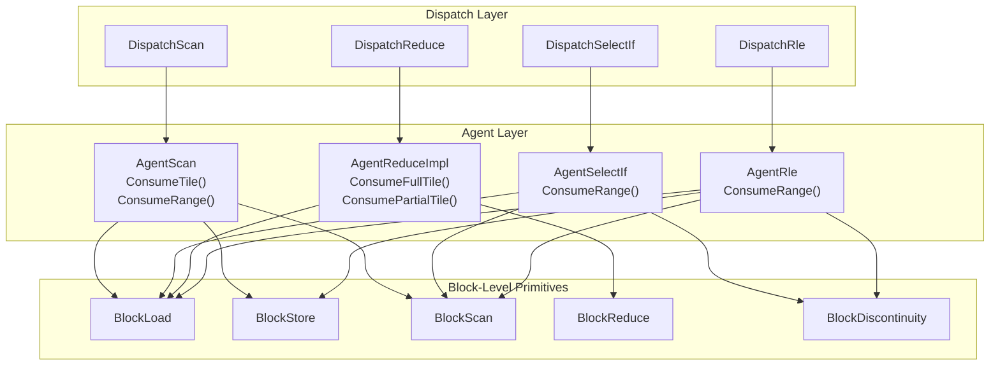

**Sources:** [cub/cub/device/dispatch/dispatch_scan.cuh:1-448](), [cub/cub/device/dispatch/dispatch_select_if.cuh:1-800](), [cub/cub/agent/agent_scan.cuh:119-229](), [cub/cub/agent/agent_select_if.cuh:203-394]()

## Agent Class Structure

All agent classes follow a consistent structural pattern consisting of policy types, shared memory management, and tile consumption methods.

### Common Agent Components

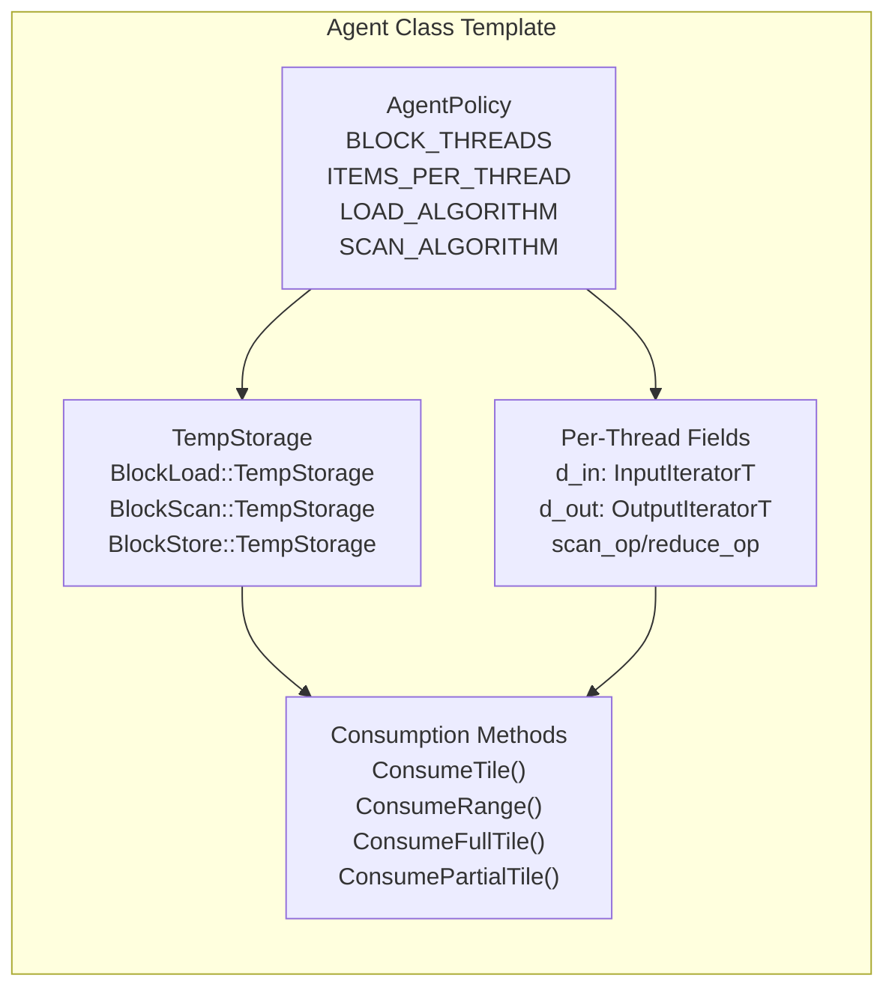

| Component | Purpose | Examples |
|-----------|---------|----------|
| **Policy Type** | Compile-time configuration parameters | `AgentScanPolicy`, `AgentSelectIfPolicy`, `AgentReducePolicy` |
| **TempStorage** | Unioned shared memory for block primitives | Load/Store/Scan temporary storage |
| **Wrapped Iterators** | Cache-modified input access | `CacheModifiedInputIterator` with `LOAD_MODIFIER` |
| **Tile State** | Multi-block coordination mechanism | `ScanTileState`, `ReduceByKeyScanTileState` |
| **Consumption Methods** | Core tile processing logic | `ConsumeRange()`, `ConsumeTile()` |

**Sources:** [cub/cub/agent/agent_scan.cuh:145-229](), [cub/cub/agent/agent_select_if.cuh:203-394](), [cub/cub/agent/agent_reduce.cuh:184-274]()

## Policy Types and Configuration

Agent policies encapsulate tuning parameters that control block-level execution characteristics. These policies are selected by the dispatch layer based on device architecture and problem characteristics.

### Policy Type Examples

| Policy Type | Key Parameters | File Reference |
|-------------|----------------|----------------|
| `AgentScanPolicy` | `BLOCK_THREADS`, `ITEMS_PER_THREAD`, `LOAD_ALGORITHM`, `STORE_ALGORITHM`, `SCAN_ALGORITHM` | [agent_scan.cuh:72-92]() |
| `AgentSelectIfPolicy` | `BLOCK_THREADS`, `ITEMS_PER_THREAD`, `LOAD_ALGORITHM`, `LOAD_MODIFIER`, `SCAN_ALGORITHM` | [agent_select_if.cuh:69-96]() |
| `AgentReducePolicy` | `BLOCK_THREADS`, `ITEMS_PER_THREAD`, `VECTOR_LOAD_LENGTH`, `BLOCK_ALGORITHM`, `LOAD_MODIFIER` | [agent_reduce.cuh:52-69]() |
| `AgentRlePolicy` | `BLOCK_THREADS`, `ITEMS_PER_THREAD`, `LOAD_ALGORITHM`, `SCAN_ALGORITHM`, `STORE_WARP_TIME_SLICING` | [agent_rle.cuh:71-104]() |

Each policy inherits from `MemBoundScaling` which adjusts `ITEMS_PER_THREAD` based on data type size to optimize memory throughput.

**Sources:** [cub/cub/agent/agent_scan.cuh:44-92](), [cub/cub/agent/agent_select_if.cuh:47-96](), [cub/cub/agent/agent_reduce.cuh:43-69](), [cub/cub/agent/agent_rle.cuh:44-104]()

## Tile Processing Model

Agents process input data in tiles, where each tile contains `BLOCK_THREADS * ITEMS_PER_THREAD` items. The agent handles both full tiles (all threads have valid items) and partial tiles (last tile may be incomplete).

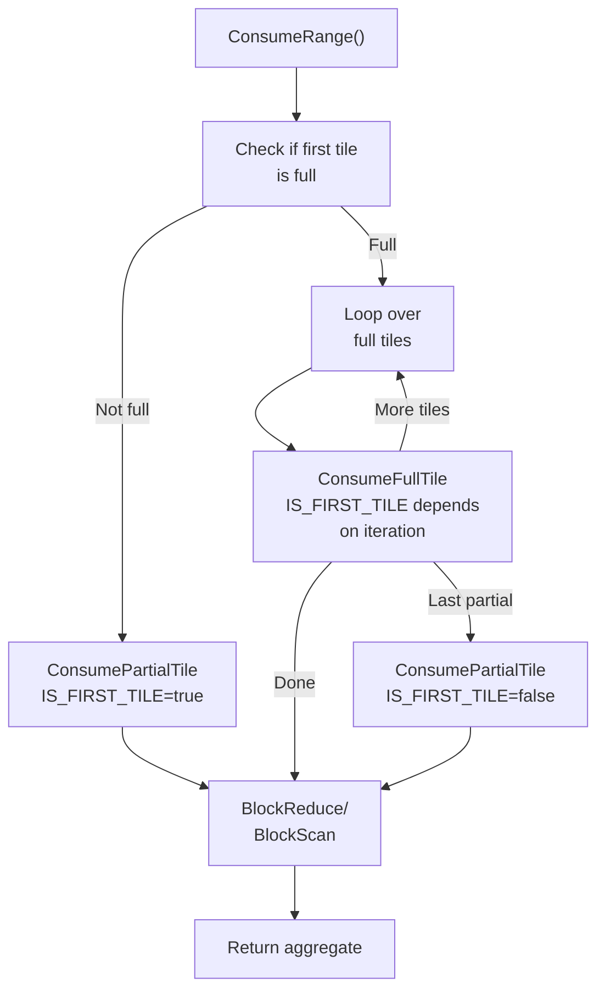

### Full Tile Consumption

Full tiles are processed with all threads having valid data. This enables vectorized loads and optimized memory access patterns:

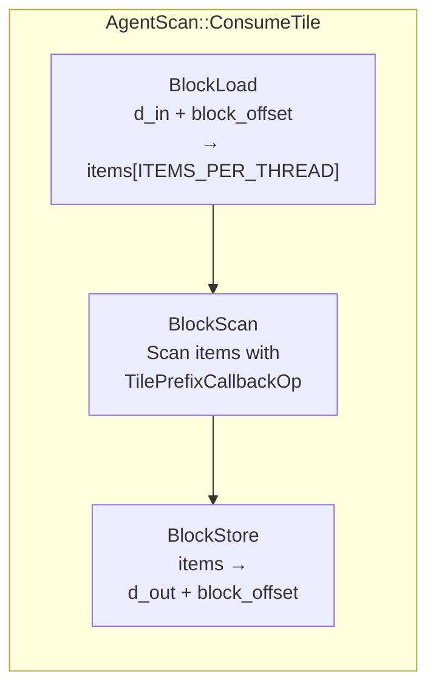

**Sources:** [cub/cub/agent/agent_scan.cuh:288-358](), [cub/cub/agent/agent_reduce.cuh:286-328](), [cub/cub/agent/agent_select_if.cuh:699-799]()

### Partial Tile Consumption

Partial tiles require guarded loads and special handling to avoid out-of-bounds access:

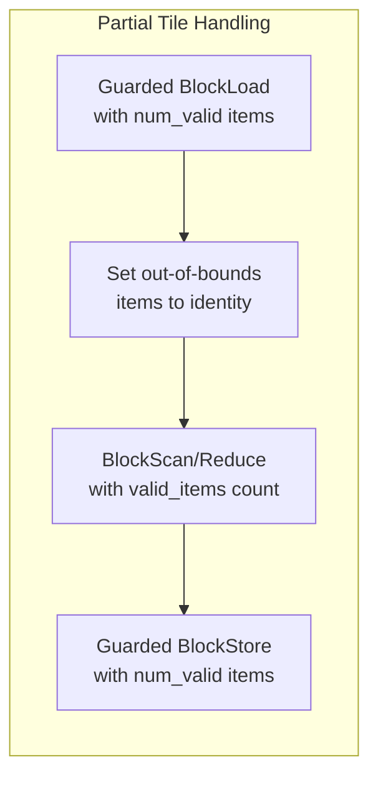

**Sources:** [cub/cub/agent/agent_scan.cuh:360-406](), [cub/cub/agent/agent_reduce.cuh:336-357](), [cub/cub/agent/agent_select_if.cuh:633-698]()

## Shared Memory Management

Agents use unioned `TempStorage` to minimize shared memory footprint by reusing memory across different phases of computation.

### TempStorage Structure Example (AgentScan)

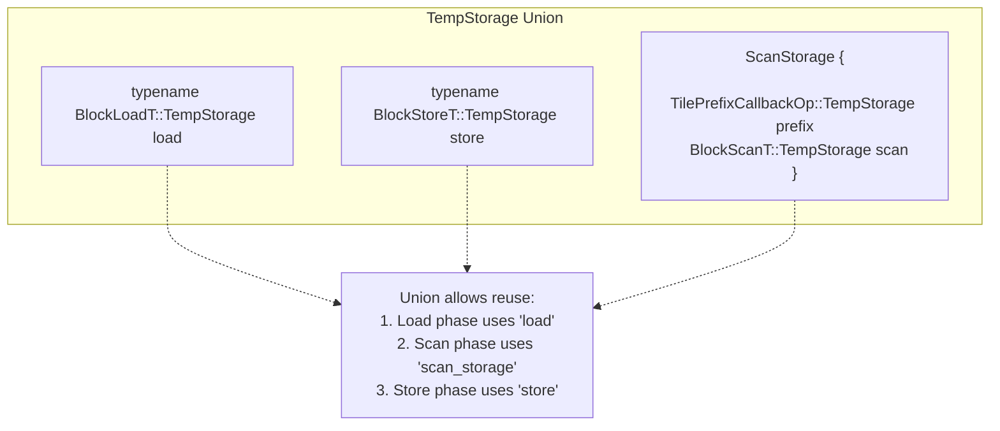

The union pattern enables overlapping of memory requirements across algorithm phases while maintaining a minimal shared memory footprint.

**Sources:** [cub/cub/agent/agent_scan.cuh:209-229](), [cub/cub/agent/agent_select_if.cuh:304-330](), [cub/cub/agent/agent_rle.cuh:277-317]()

## Multi-Block Coordination with Tile State

For algorithms requiring prefix propagation across blocks (scans, stream compaction), agents interact with a `TileState` interface that implements decoupled look-back for multi-block coordination.

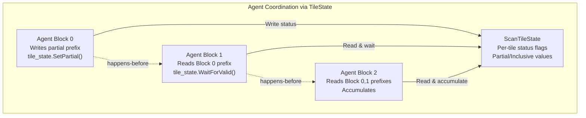

### TilePrefixCallbackOp Pattern

Agents use callback operators during block scans to obtain tile prefixes from preceding tiles:

**Components:**
- `TilePrefixCallbackOp` - Queries tile state for predecessor aggregates
- `BlockScan` with prefix callback - Combines local scan with global prefix
- Delay constructor - Controls timing of look-back to optimize occupancy

**Sources:** [cub/cub/agent/agent_scan.cuh:195-229](), [cub/cub/agent/single_pass_scan_operators.cuh:1-500](), [cub/cub/device/dispatch/dispatch_scan.cuh:244-358]()

## Concrete Agent Examples

### AgentScan: Prefix Scan Implementation

`AgentScan` implements device-wide prefix scan operations by processing tiles of input data and coordinating partial results across thread blocks.

**Key Characteristics:**
- Template parameters: `AgentScanPolicyT`, `InputIteratorT`, `OutputIteratorT`, `ScanOpT`, `InitValueT`, `OffsetT`, `AccumT`
- Supports both inclusive and exclusive scans
- Uses `TilePrefixCallbackOp` for multi-block coordination
- Handles in-place operations (when `d_in == d_out`)

**Processing Flow:**
1. `ConsumeTile()` - Process a single tile with block scan
2. `ConsumeRange()` - Process multiple tiles in sequence
3. Callback obtains prefix from `ScanTileState`
4. `BlockScan` combines local scan with global prefix
5. Results written to output

**Sources:** [cub/cub/agent/agent_scan.cuh:145-406](), [cub/cub/device/dispatch/dispatch_scan.cuh:244-358]()

### AgentSelectIf: Stream Compaction

`AgentSelectIf` implements stream compaction by selecting items based on predicates or flags, compacting selected items to contiguous output.

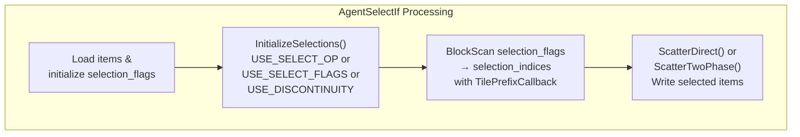

**Selection Methods:**
- `USE_SELECT_OP` - Apply functor to items: [agent_select_if.cuh:402-421]()
- `USE_SELECT_FLAGS` - Read separate flag array: [agent_select_if.cuh:468-490]()
- `USE_DISCONTINUITY` - Keep unique items using equality operator: [agent_select_if.cuh:492-527]()
- `USE_STENCIL_WITH_OP` - Apply functor to stencil array: [agent_select_if.cuh:427-463]()

**Scatter Strategies:**
- **Direct scatter** - Each thread writes items in-place during scan
- **Two-phase scatter** - Use exchange buffer for non-coalesced writes

**Sources:** [cub/cub/agent/agent_select_if.cuh:203-799](), [cub/cub/device/dispatch/dispatch_select_if.cuh:292-356]()

### AgentReduce: Parallel Reduction

`AgentReduceImpl` performs thread-block-level reduction, accumulating values within a tile using block-wide reduction primitives.

**Key Features:**
- Vectorized loads when possible (via `VECTOR_LOAD_LENGTH`)
- Alignment checking for vectorization: [agent_reduce.cuh:244-254]()
- Separate handling for full and partial tiles
- No multi-block coordination needed (reductions are associative)

**Processing Pattern:**
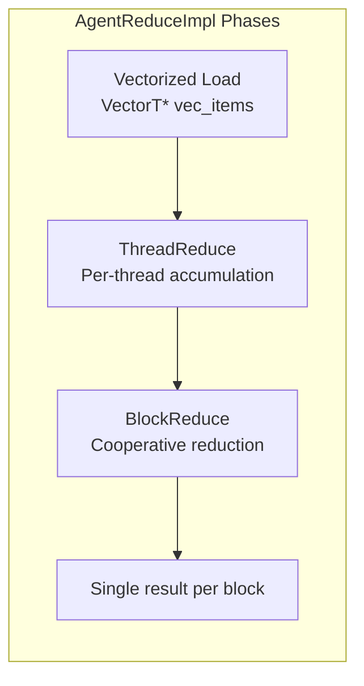

**Sources:** [cub/cub/agent/agent_reduce.cuh:184-429](), [cub/cub/device/dispatch/dispatch_reduce.cuh:1-500]()

### AgentRle: Run-Length Encoding

`AgentRle` identifies runs of consecutive equal items and outputs run offsets and lengths.

**Algorithm Phases:**
1. **Load and flag** - Load items, identify run heads using `BlockDiscontinuity`
2. **Scan flags** - Compute run indices via prefix scan
3. **Scatter runs** - Write run information to output arrays

**Multi-Block Coordination:**
- Uses `ScanTileState` for prefix propagation
- Handles split runs across tile boundaries
- Final block writes total run count

**Sources:** [cub/cub/agent/agent_rle.cuh:112-650](), [cub/cub/device/dispatch/dispatch_rle.cuh:161-198]()

### AgentReduceByKey: Segmented Reduction

`AgentReduceByKey` performs reduction operations within segments defined by consecutive equal keys.

**Key Characteristics:**
- Combines aspects of scan (for segment boundaries) and reduction (for values)
- Uses `ReduceByKeyScanTileState` for multi-block coordination
- Handles segment boundaries crossing tile boundaries
- Requires predecessor key from previous tile

**Processing:**
1. Detect segment heads via key comparison
2. Scan segment flags to compute segment indices
3. Reduce values within each segment
4. Output unique keys and aggregated values

**Sources:** [cub/cub/agent/agent_reduce_by_key.cuh:1-800](), [cub/cub/device/dispatch/dispatch_reduce_by_key.cuh:107-200]()

## Agent Instantiation and Invocation

Agents are instantiated within device kernels launched by dispatch classes. The typical invocation pattern involves:

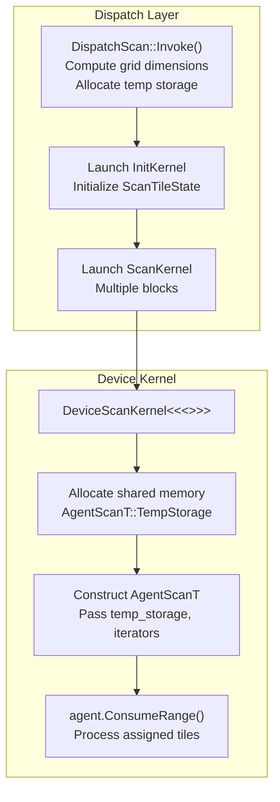

### Kernel Entry Point Example

Device kernels follow this pattern:
1. Declare shared memory for `AgentT::TempStorage`
2. Construct agent instance with temporary storage
3. Call agent's consumption method with tile state
4. Agent processes its assigned range of tiles

**Sources:** [cub/cub/device/dispatch/dispatch_scan.cuh:244-358](), [cub/cub/device/dispatch/kernels/kernel_scan.cuh:1-150](), [cub/cub/device/dispatch/dispatch_select_if.cuh:292-356]()

## Cache Modifier Wrapping

Agents wrap input iterators with cache-modified iterators to optimize memory access patterns based on policy settings.

### Iterator Wrapping Pattern

| Policy Load Modifier | Cache Behavior | Use Case |
|---------------------|----------------|----------|
| `LOAD_DEFAULT` | Default L1/L2 caching | General purpose |
| `LOAD_CA` | Cache at all levels | Reused data |
| `LOAD_CG` | Cache at global level (L2) | Streaming data |
| `LOAD_CS` | Cache streaming | Sequential access |
| `LOAD_LDG` | Read-only texture cache | Broadcast reads |

**Implementation Pattern:**
```
using WrappedInputIteratorT = 
  ::cuda::std::_If<
    ::cuda::std::is_pointer_v<InputIteratorT>,
    CacheModifiedInputIterator<AgentPolicy::LOAD_MODIFIER, InputT, OffsetT>,
    InputIteratorT
  >;
```

This conditional wrapping applies cache modifiers only to raw pointers, leaving fancy iterators unchanged.

**Sources:** [cub/cub/agent/agent_scan.cuh:166-172](), [cub/cub/agent/agent_select_if.cuh:268-282](), [cub/cub/agent/agent_reduce.cuh:196-202]()

## Vectorization and Alignment

Agents attempt vectorized loads when policy permits and alignment allows:

### Vectorization Conditions

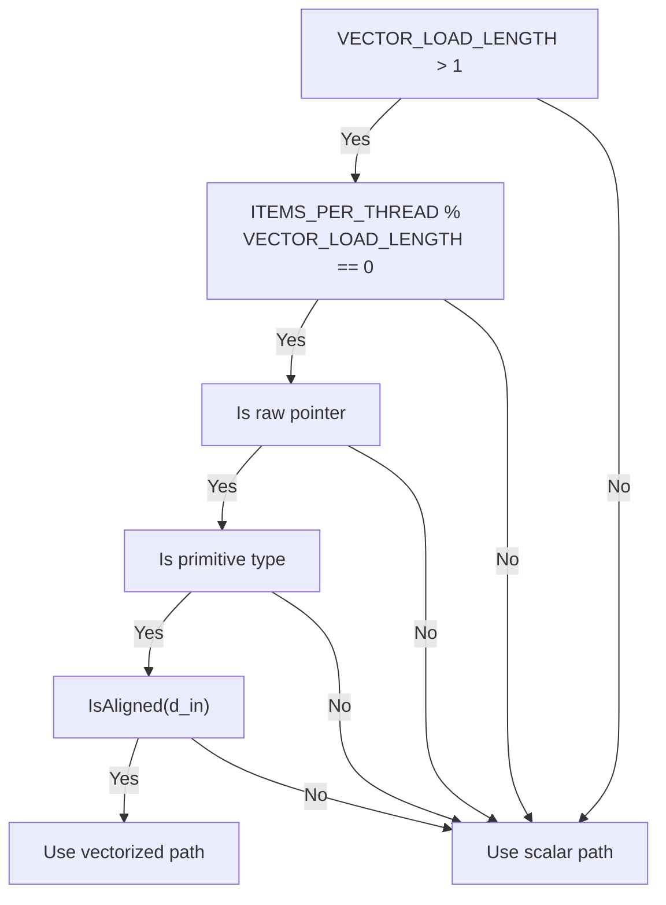

**Vectorization Example from AgentReduce:**
- Defines `VectorT = CubVector<InputT, VECTOR_LOAD_LENGTH>::Type`
- Checks alignment at runtime: [agent_reduce.cuh:244-254]()
- Casts pointer to `VectorT*` for vectorized access: [agent_reduce.cuh:292-306]()
- Falls back to scalar loads if not aligned

**Sources:** [cub/cub/agent/agent_reduce.cuh:193-328](), [cub/cub/util_type.cuh:1-200]()

## Virtual Shared Memory (VSMem) Support

Some agents support virtual shared memory to exceed physical shared memory limits by using global memory with cooperative groups.

### VSMem Helper Pattern

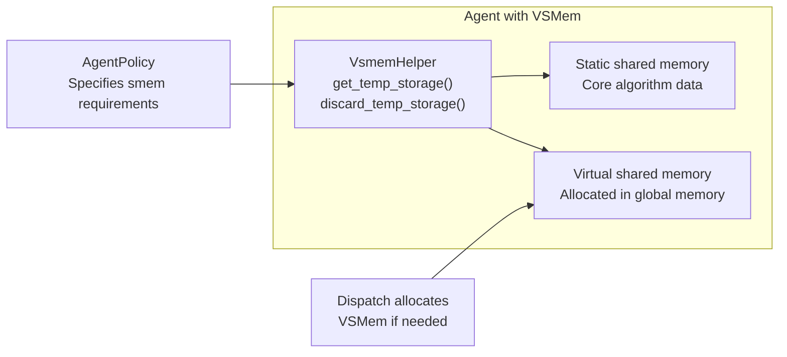

Agents with VSMem support:
- `AgentSelectIf` - [agent_select_if.cuh:326-355]()
- `AgentUniqueByKey` - [agent_unique_by_key.cuh:1-800]()

**Sources:** [cub/cub/agent/agent_select_if.cuh:326-355](), [cub/cub/util_vsmem.cuh:1-500](), [cub/cub/device/dispatch/dispatch_select_if.cuh:542-586]()

## Streaming Context for Partitioned Execution

Some agents support processing data in partitions when the problem size exceeds the offset type range. A streaming context maintains state across partitions.

### Streaming Context Components

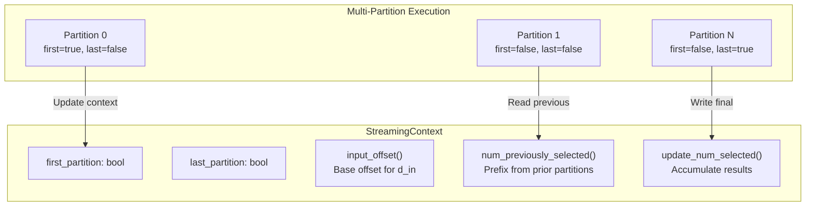

**Usage in Agents:**
- `AgentSelectIf` - Uses context to offset input/output pointers: [agent_select_if.cuh:384-393]()
- `AgentRle` - Tracks run counts across partitions: [agent_rle.cuh:112-250]()
- `AgentReduceByKey` - Maintains aggregate across boundaries: [agent_reduce_by_key.cuh:1-800]()

**Sources:** [cub/cub/device/dispatch/dispatch_select_if.cuh:50-169](), [cub/cub/device/dispatch/dispatch_rle.cuh:47-104](), [cub/cub/device/dispatch/dispatch_reduce_by_key.cuh:40-104]()

## Agent Design Patterns Summary

| Pattern | Purpose | Example Agents |
|---------|---------|----------------|
| **Tile State Coordination** | Multi-block prefix propagation | AgentScan, AgentSelectIf, AgentRle, AgentReduceByKey |
| **Callback Operators** | Obtain tile prefixes during scan | AgentScan (TilePrefixCallbackOp), AgentScanByKey |
| **Two-Phase Processing** | Separate computation and scattering | AgentSelectIf (TWO_PHASE_SCATTER), AgentRle |
| **Vectorized Loads** | Coalesced memory access | AgentReduce, AgentScan |
| **Cache Modifier Wrapping** | Optimize cache behavior | All agents via policy LOAD_MODIFIER |
| **Unioned TempStorage** | Minimize shared memory | All agents |
| **Streaming Context** | Handle large problem sizes | AgentSelectIf, AgentRle, AgentReduceByKey |
| **Guarded Access** | Handle partial tiles | All agents (IS_LAST_TILE handling) |

**Sources:** [cub/cub/agent/agent_scan.cuh:145-406](), [cub/cub/agent/agent_select_if.cuh:203-799](), [cub/cub/agent/agent_reduce.cuh:184-429](), [cub/cub/agent/agent_rle.cuh:112-650]()

## Integration with Dispatch Layer

The dispatch layer is responsible for:
1. **Policy Selection** - Choose appropriate policy based on PTX version and data types
2. **Temporary Storage** - Allocate and manage ScanTileState and working buffers
3. **Grid Configuration** - Compute block and grid dimensions
4. **Kernel Launch** - Invoke initialization and sweep kernels with agents

### Dispatch to Agent Flow

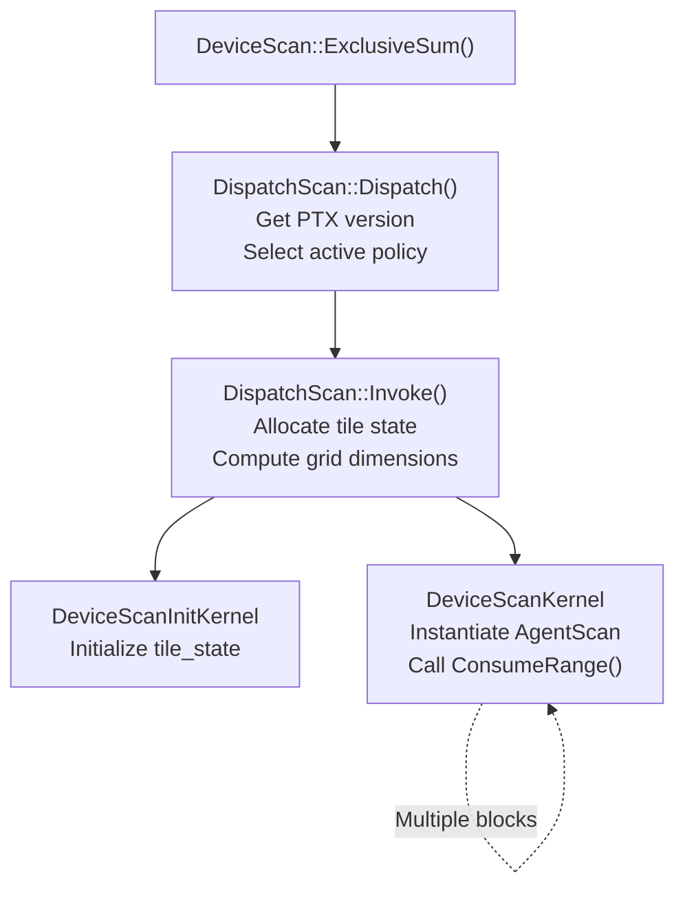

**Key Dispatch Responsibilities:**
- **Temporary storage sizing** - Agents report shared memory needs via TempStorage
- **Tile state initialization** - Initialize status arrays for multi-block coordination
- **Grid sizing** - Balance occupancy vs. parallelism based on problem size
- **Stream synchronization** - Manage CUDA stream dependencies

**Sources:** [cub/cub/device/dispatch/dispatch_scan.cuh:138-445](), [cub/cub/device/dispatch/dispatch_select_if.cuh:407-800](), [cub/cub/device/dispatch/dispatch_reduce.cuh:1-500]()

---

