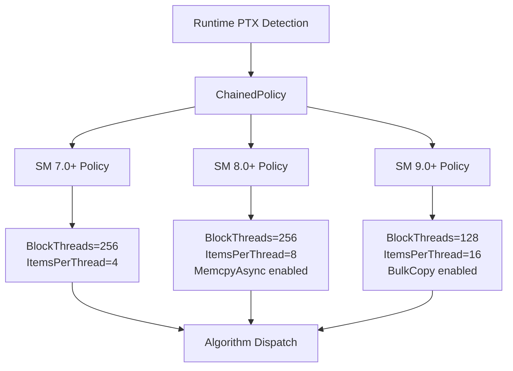
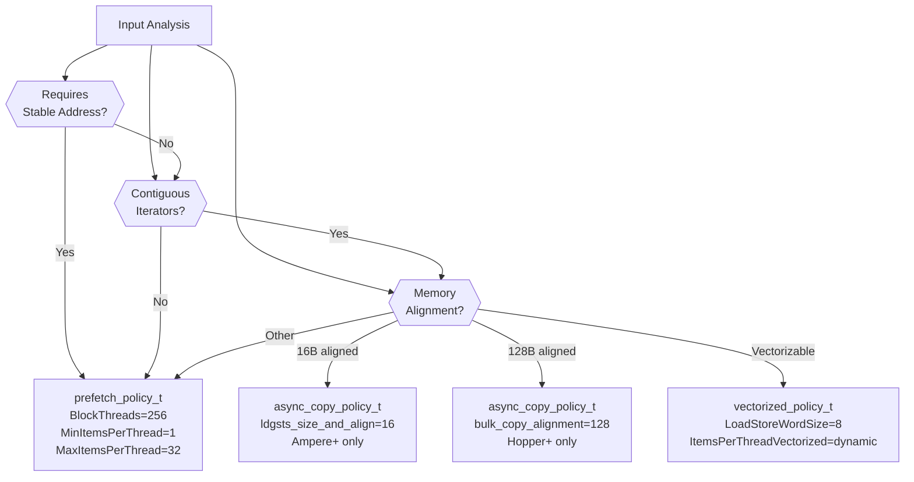
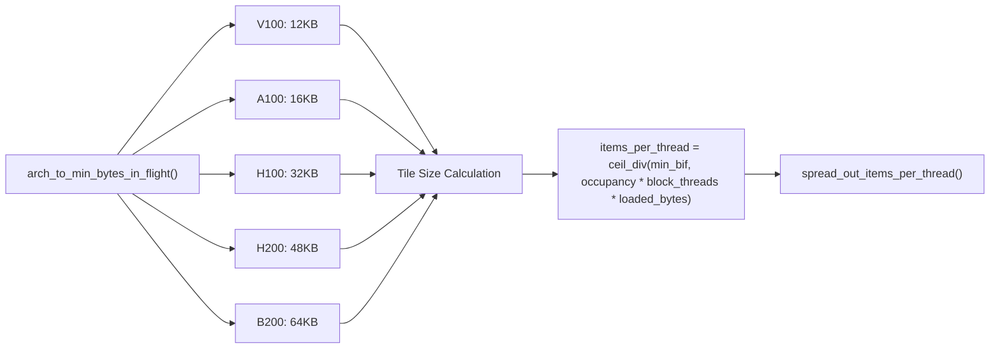
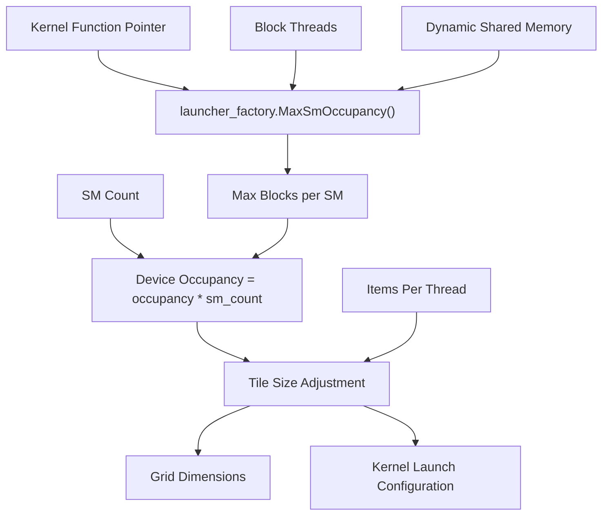
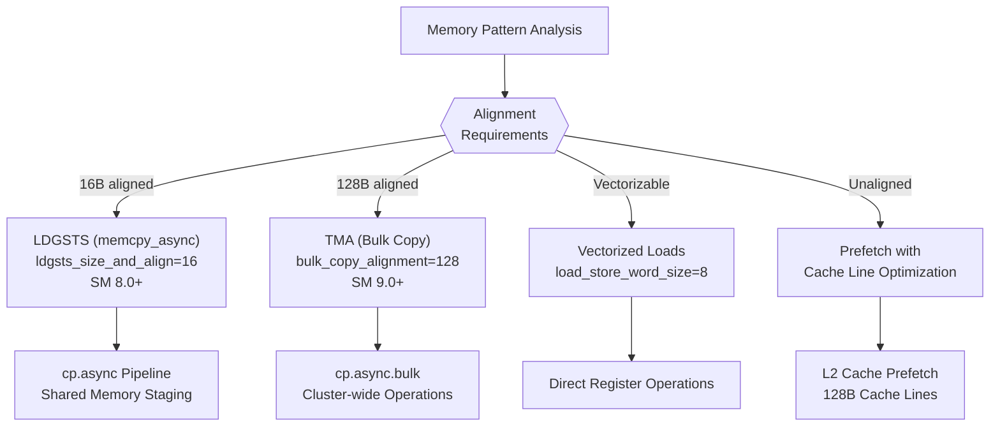
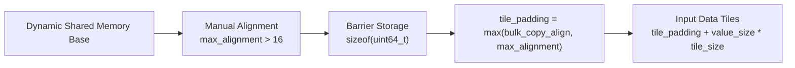

<!-- source: DeepWiki mcp.deepwiki.com · repo NVIDIA/cccl · page 5.4 Performance Tuning and Optimization · fetched 2026-10-26 -->

# Performance Tuning

<details>
<summary>Relevant source files</summary>

The following files were used as context for generating this wiki page:

- [c/parallel/include/cccl/c/transform.h](c/parallel/include/cccl/c/transform.h)
- [cub/benchmarks/bench/reduce/base.cuh](cub/benchmarks/bench/reduce/base.cuh)
- [cub/benchmarks/bench/reduce/deterministic.cu](cub/benchmarks/bench/reduce/deterministic.cu)
- [cub/benchmarks/bench/reduce/nondeterministic.cu](cub/benchmarks/bench/reduce/nondeterministic.cu)
- [cub/benchmarks/bench/transform/babelstream.cu](cub/benchmarks/bench/transform/babelstream.cu)
- [cub/benchmarks/bench/transform/common.h](cub/benchmarks/bench/transform/common.h)
- [cub/benchmarks/bench/transform/complex_cmp.cu](cub/benchmarks/bench/transform/complex_cmp.cu)
- [cub/benchmarks/bench/transform/fib.cu](cub/benchmarks/bench/transform/fib.cu)
- [cub/benchmarks/bench/transform/fill.cu](cub/benchmarks/bench/transform/fill.cu)
- [cub/benchmarks/bench/transform/grayscale.cu](cub/benchmarks/bench/transform/grayscale.cu)
- [cub/benchmarks/bench/transform/heavy.cu](cub/benchmarks/bench/transform/heavy.cu)
- [cub/benchmarks/bench/transform_reduce/sum.cu](cub/benchmarks/bench/transform_reduce/sum.cu)
- [cub/cub/detail/rfa.cuh](cub/cub/detail/rfa.cuh)
- [cub/cub/device/device_reduce.cuh](cub/cub/device/device_reduce.cuh)
- [cub/cub/device/dispatch/dispatch_reduce_deterministic.cuh](cub/cub/device/dispatch/dispatch_reduce_deterministic.cuh)
- [cub/cub/device/dispatch/dispatch_reduce_nondeterministic.cuh](cub/cub/device/dispatch/dispatch_reduce_nondeterministic.cuh)
- [cub/cub/device/dispatch/dispatch_streaming_reduce.cuh](cub/cub/device/dispatch/dispatch_streaming_reduce.cuh)
- [cub/cub/device/dispatch/dispatch_transform.cuh](cub/cub/device/dispatch/dispatch_transform.cuh)
- [cub/cub/device/dispatch/kernels/kernel_reduce.cuh](cub/cub/device/dispatch/kernels/kernel_reduce.cuh)
- [cub/cub/device/dispatch/kernels/kernel_transform.cuh](cub/cub/device/dispatch/kernels/kernel_transform.cuh)
- [cub/cub/device/dispatch/tuning/tuning_reduce.cuh](cub/cub/device/dispatch/tuning/tuning_reduce.cuh)
- [cub/cub/device/dispatch/tuning/tuning_transform.cuh](cub/cub/device/dispatch/tuning/tuning_transform.cuh)
- [cub/cub/grid/grid_even_share.cuh](cub/cub/grid/grid_even_share.cuh)
- [cub/test/catch2_test_device_reduce_deterministic.cu](cub/test/catch2_test_device_reduce_deterministic.cu)
- [cub/test/catch2_test_device_reduce_env.cu](cub/test/catch2_test_device_reduce_env.cu)
- [cub/test/catch2_test_device_reduce_env_api.cu](cub/test/catch2_test_device_reduce_env_api.cu)
- [cub/test/catch2_test_device_reduce_nondeterministic.cu](cub/test/catch2_test_device_reduce_nondeterministic.cu)
- [cub/test/catch2_test_device_segmented_reduce_large_offsets.cu](cub/test/catch2_test_device_segmented_reduce_large_offsets.cu)
- [cub/test/catch2_test_device_transform.cu](cub/test/catch2_test_device_transform.cu)
- [cub/test/catch2_test_grid_even_share.cu](cub/test/catch2_test_grid_even_share.cu)
- [cub/test/catch2_test_launch_helper.h](cub/test/catch2_test_launch_helper.h)
- [cub/test/test_device_reduce_env_fail.cu](cub/test/test_device_reduce_env_fail.cu)
- [cub/test/test_device_reduce_unsupported_env_fail.cu](cub/test/test_device_reduce_unsupported_env_fail.cu)
- [thrust/thrust/type_traits/unwrap_contiguous_iterator.h](thrust/thrust/type_traits/unwrap_contiguous_iterator.h)

</details>


This document covers advanced performance optimization techniques and tuning mechanisms within CCCL (CUDA Core Compute Libraries). It focuses on the architecture-specific policy dispatch system, algorithm selection strategies, and runtime optimization techniques used to achieve optimal performance across different GPU architectures and data patterns.

For information about basic algorithm usage and API documentation, see other sections of the library documentation. For streaming task framework performance considerations, see [Streaming Task Framework (STF)](#5.1).

## Policy-Based Architecture Tuning

CCCL employs a sophisticated policy-based tuning system that automatically selects optimal algorithm configurations based on GPU architecture, data characteristics, and problem size.

### ChainedPolicy System

The core tuning mechanism uses `ChainedPolicy` to dispatch to architecture-specific optimizations:



Sources: [cub/cub/util_device.cuh:687-751](), [cub/cub/device/dispatch/tuning/tuning_transform.cuh:320-400]()

### Architecture-Specific Optimizations

The policy system adapts to different GPU generations:

| Architecture | Key Optimizations | Tuning Focus |
|-------------|-------------------|--------------|
| SM 7.0+ (Volta) | Prefetch algorithms, 12KB bytes-in-flight | Memory latency hiding |
| SM 8.0+ (Ampere) | `memcpy_async`, 16KB bytes-in-flight | Async memory operations |
| SM 9.0+ (Hopper) | Bulk copy (TMA), 48KB bytes-in-flight | Hardware accelerated transfers |
| SM 10.0+ (Blackwell) | Enhanced bulk copy, 64KB bytes-in-flight | Maximum bandwidth utilization |

Sources: [cub/cub/device/dispatch/tuning/tuning_transform.cuh:268-283]()

## Algorithm Selection and Dispatch

CCCL algorithms employ multiple implementation variants optimized for different data patterns and hardware capabilities.

### Transform Algorithm Variants

The transform operation demonstrates the multi-algorithm approach:



Sources: [cub/cub/device/dispatch/tuning/tuning_transform.cuh:83-91](), [cub/cub/device/dispatch/dispatch_transform.cuh:485-514]()

### Bytes-in-Flight Optimization

The system dynamically calculates optimal memory traffic based on architecture capabilities:



Sources: [cub/cub/device/dispatch/tuning/tuning_transform.cuh:268-283](), [cub/cub/device/dispatch/dispatch_transform.cuh:194-210]()

## Occupancy and Block Configuration

### Dynamic Occupancy Calculation

CCCL employs runtime occupancy analysis to optimize kernel launch parameters:



Sources: [cub/cub/util_device.cuh:517-523](), [cub/cub/device/dispatch/dispatch_transform.cuh:242-272]()

### Policy Configuration Examples

Key tuning policies across algorithms:

| Algorithm | Policy Type | Key Parameters |
|-----------|-------------|----------------|
| Transform | `prefetch_policy_t` | `BlockThreads=256`, `ItemsPerThreadNoInput=2` |
| Transform | `vectorized_policy_t` | `LoadStoreWordSize=8`, `ItemsPerThreadVectorized=dynamic` |
| Reduce | `AgentReducePolicy` | `BlockThreads=256`, `ItemsPerThread=16` |
| Scan | `AgentScanPolicy` | `BlockThreads=512`, `ItemsPerThread=15` |
| Histogram | `AgentHistogramPolicy` | `BlockThreads=256`, `PixelsPerThread=16` |

Sources: [cub/cub/device/dispatch/tuning/tuning_transform.cuh:94-144](), [cub/cub/device/dispatch/tuning/tuning_reduce.cuh](), [cub/cub/device/dispatch/tuning/tuning_histogram.cuh]()

## Memory Access Optimization

### Aligned Memory Operations

CCCL provides specialized kernels for different memory access patterns:



Sources: [cub/cub/device/dispatch/kernels/transform.cuh:375-453](), [cub/cub/device/dispatch/kernels/transform.cuh:603-669]()

### Shared Memory Management

Advanced shared memory allocation strategies:



Sources: [cub/cub/device/dispatch/kernels/transform.cuh:691-733]()

## Performance Monitoring and Tuning

### Runtime Configuration Caching

The system caches expensive configuration computations:

```cpp
// From dispatch_transform.cuh
static auto cached_config = determine_element_counts();
return cached_config;
```

### Debug and Profiling Support

Performance debugging capabilities:

| Debug Feature | Environment Variable | Function |
|---------------|---------------------|----------|
| Kernel Launch Logging | `CUB_DEBUG_LOG` | `_CubLog()` calls |
| Stream Synchronization | `CUB_DEBUG_SYNC` | `DebugSyncStream()` |
| PTX JSON Export | `CUB_ENABLE_POLICY_PTX_JSON` | Policy serialization |

Sources: [cub/cub/util_device.cuh:442-449](), [cub/cub/device/dispatch/tuning/tuning_transform.cuh:196-204]()

## Algorithm-Specific Tuning

### Transform Operation Tuning

Transform provides the most sophisticated tuning system:

- **Prefetch Algorithm**: Optimizes for memory latency with configurable prefetch distance
- **Vectorized Algorithm**: Handles power-of-2 sized types with vector load/store operations  
- **Async Copy**: Uses hardware-accelerated memory copy on Ampere+
- **Bulk Copy**: Leverages TMA on Hopper+ for maximum bandwidth

Sources: [cub/cub/device/dispatch/kernels/transform.cuh:100-156](), [cub/cub/device/dispatch/kernels/transform.cuh:205-312]()

### Reduce Operation Tuning

Reduce operations use different strategies based on problem size:

- **Single Tile**: Direct reduction for small problems fitting in one block
- **Two-Pass**: Hierarchical reduction for larger datasets with intermediate storage

Sources: [cub/cub/device/dispatch/dispatch_reduce.cuh:247-291](), [cub/cub/device/dispatch/dispatch_reduce.cuh:315-433]()

This tuning system enables CCCL to achieve near-optimal performance across diverse hardware configurations and data patterns while maintaining a simple high-level API for users.

---

