<!-- source: DeepWiki mcp.deepwiki.com · repo NVIDIA/cccl · page 5.5 JIT Compilation and Code Generation · fetched 2026-10-26 -->

# JIT Compilation and Code Generation

<details>
<summary>Relevant source files</summary>

The following files were used as context for generating this wiki page:

- [c/parallel/src/for.cu](c/parallel/src/for.cu)
- [c/parallel/src/merge_sort.cu](c/parallel/src/merge_sort.cu)
- [c/parallel/src/radix_sort.cu](c/parallel/src/radix_sort.cu)
- [c/parallel/src/reduce.cu](c/parallel/src/reduce.cu)
- [c/parallel/src/scan.cu](c/parallel/src/scan.cu)
- [c/parallel/src/segmented_reduce.cu](c/parallel/src/segmented_reduce.cu)
- [c/parallel/src/segmented_sort.cu](c/parallel/src/segmented_sort.cu)
- [c/parallel/src/three_way_partition.cu](c/parallel/src/three_way_partition.cu)
- [c/parallel/src/transform.cu](c/parallel/src/transform.cu)
- [c/parallel/src/unique_by_key.cu](c/parallel/src/unique_by_key.cu)
- [cub/benchmarks/bench/radix_sort/keys.cu](cub/benchmarks/bench/radix_sort/keys.cu)
- [cub/benchmarks/bench/radix_sort/pairs.cu](cub/benchmarks/bench/radix_sort/pairs.cu)
- [cub/benchmarks/bench/radix_sort/policy_selector.h](cub/benchmarks/bench/radix_sort/policy_selector.h)
- [cub/cub/detail/arch_dispatch.cuh](cub/cub/detail/arch_dispatch.cuh)
- [cub/cub/detail/launcher/cuda_driver.cuh](cub/cub/detail/launcher/cuda_driver.cuh)
- [cub/cub/detail/launcher/cuda_runtime.cuh](cub/cub/detail/launcher/cuda_runtime.cuh)
- [cub/cub/device/device_radix_sort.cuh](cub/cub/device/device_radix_sort.cuh)
- [cub/cub/device/device_segmented_reduce.cuh](cub/cub/device/device_segmented_reduce.cuh)
- [cub/cub/device/dispatch/dispatch_common.cuh](cub/cub/device/dispatch/dispatch_common.cuh)
- [cub/cub/device/dispatch/dispatch_fixed_size_segmented_reduce.cuh](cub/cub/device/dispatch/dispatch_fixed_size_segmented_reduce.cuh)
- [cub/cub/device/dispatch/dispatch_merge_sort.cuh](cub/cub/device/dispatch/dispatch_merge_sort.cuh)
- [cub/cub/device/dispatch/dispatch_radix_sort.cuh](cub/cub/device/dispatch/dispatch_radix_sort.cuh)
- [cub/cub/device/dispatch/dispatch_reduce.cuh](cub/cub/device/dispatch/dispatch_reduce.cuh)
- [cub/cub/device/dispatch/dispatch_segmented_radix_sort.cuh](cub/cub/device/dispatch/dispatch_segmented_radix_sort.cuh)
- [cub/cub/device/dispatch/dispatch_segmented_reduce.cuh](cub/cub/device/dispatch/dispatch_segmented_reduce.cuh)
- [cub/cub/device/dispatch/dispatch_segmented_sort.cuh](cub/cub/device/dispatch/dispatch_segmented_sort.cuh)
- [cub/cub/device/dispatch/kernels/kernel_radix_sort.cuh](cub/cub/device/dispatch/kernels/kernel_radix_sort.cuh)
- [cub/cub/device/dispatch/kernels/kernel_segmented_radix_sort.cuh](cub/cub/device/dispatch/kernels/kernel_segmented_radix_sort.cuh)
- [cub/cub/device/dispatch/kernels/kernel_segmented_reduce.cuh](cub/cub/device/dispatch/kernels/kernel_segmented_reduce.cuh)
- [cub/cub/device/dispatch/tuning/common.cuh](cub/cub/device/dispatch/tuning/common.cuh)
- [cub/cub/device/dispatch/tuning/tuning_radix_sort.cuh](cub/cub/device/dispatch/tuning/tuning_radix_sort.cuh)
- [cub/cub/util_device.cuh](cub/cub/util_device.cuh)
- [cub/test/catch2_test_arch_dispatch.cu](cub/test/catch2_test_arch_dispatch.cu)
- [cub/test/catch2_test_device_radix_sort_custom_policy_hub.cu](cub/test/catch2_test_device_radix_sort_custom_policy_hub.cu)

</details>


This page documents the Just-In-Time (JIT) compilation system in CCCL, which enables dynamic kernel specialization and runtime code generation for the C Parallel API. This system allows CUB algorithms to be compiled at runtime with user-provided iterators and operations that cannot be known at compile time.

For information about the dispatch mechanisms that choose between pre-compiled and JIT-compiled code paths, see [Dispatch and Policy System](#5.2). For details on the policy selection that occurs before JIT compilation, see [Performance Tuning and Optimization](#5.4).

## Overview

The JIT compilation system in CCCL serves as a bridge between the C Parallel API and CUB's template-heavy C++ algorithms. It consists of four major components:

1. **NVRTC Compilation**: Runtime compilation of CUDA C++ source code to PTX or CUBIN
2. **LTO-IR Linking**: Combining separately compiled modules using Link-Time Optimization Intermediate Representation
3. **Code Generation**: Dynamic generation of CUDA C++ source code that instantiates CUB templates with runtime-determined types
4. **Driver API Execution**: Launching JIT-compiled kernels through CUDA Driver API

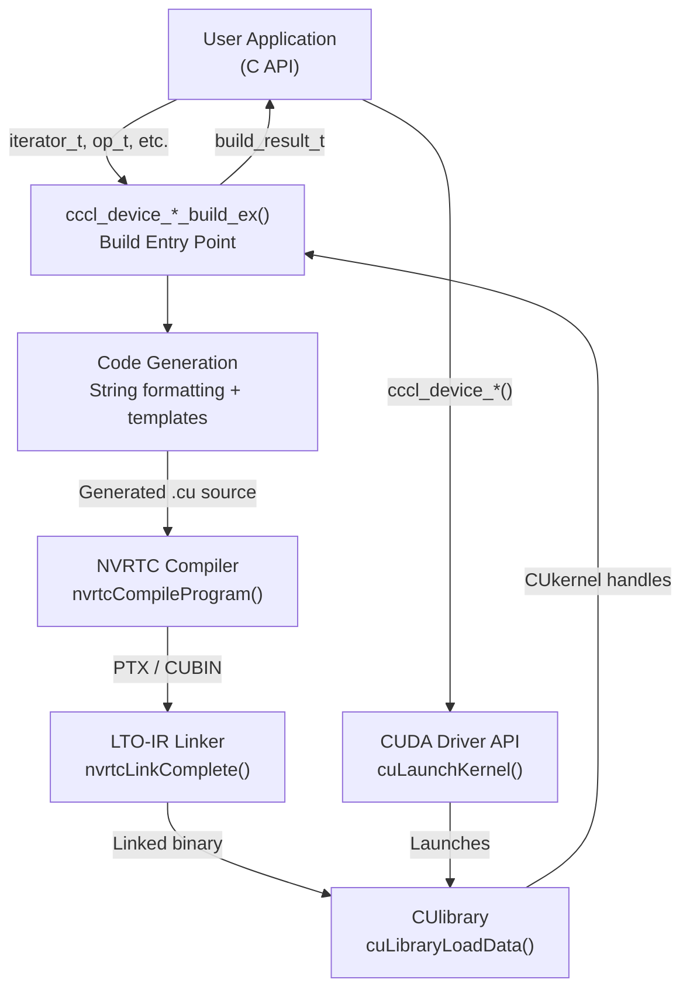

**Diagram: JIT Compilation Flow in CCCL**

The system enables type-erased interfaces (C API) to invoke type-specific template instantiations (CUB) by generating, compiling, and linking code at runtime.

**Sources**: [c/parallel/src/reduce.cu:1-557](), [c/parallel/src/transform.cu:1-556]()

## Build and Execution Phases

JIT compilation in CCCL is split into two distinct phases:

### Build Phase

The build phase (`cccl_device_*_build_ex` functions) generates and compiles all necessary kernels, producing a build result structure that contains kernel handles:

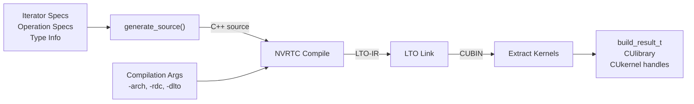

**Diagram: Build Phase Pipeline**

**Sources**: [c/parallel/src/reduce.cu:175-385](), [c/parallel/src/transform.cu:214-351]()

### Execution Phase

The execution phase (`cccl_device_*` functions) uses the pre-compiled kernels with runtime data:

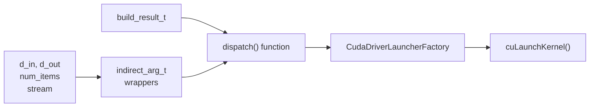

**Diagram: Execution Phase Pipeline**

**Sources**: [c/parallel/src/reduce.cu:393-446](), [cub/cub/detail/launcher/cuda_driver.cuh:27-112]()

## Code Generation System

Code generation in CCCL dynamically constructs CUDA C++ source code that instantiates CUB templates with user-specified types and operations. The system uses string formatting to generate specializations.

### Generated Source Structure

Each generated source file follows this pattern:

| Component | Purpose | Example |
|-----------|---------|---------|
| Headers | Include CUB dispatch headers | `#include <cub/device/dispatch/tuning/tuning_reduce.cuh>` |
| Storage Types | Define aligned storage for value types | `struct __align__(8) storage_t { char data[4]; };` |
| Iterator Specializations | Define custom iterator types | `struct input_iterator_t : iterator_base<...>` |
| Operation Specializations | Define user operations | `struct op_wrapper { auto operator()(...) }` |
| Policy Selector | Type alias for policy selection | `using device_reduce_policy = policy_selector<...>` |
| Static Assertions | Verify policy consistency | `static_assert(policy(...) == expected_policy)` |

**Sources**: [c/parallel/src/reduce.cu:263-286](), [c/parallel/src/transform.cu:253-278]()

### Template Specialization Generation

The code generation system produces template specializations for three categories of runtime-determined types:

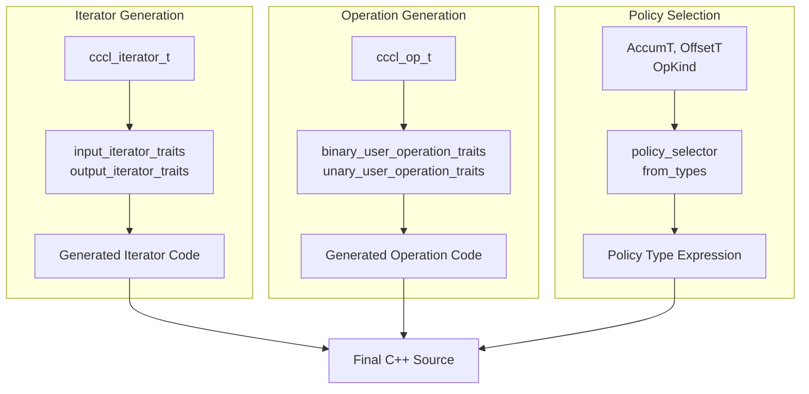

**Diagram: Template Specialization Generation**

The system generates three types of specializations that work together to instantiate CUB templates.

**Sources**: [c/parallel/src/reduce.cu:213-220](), [c/parallel/src/segmented_reduce.cu:132-152]()

### Kernel Name Construction

Each kernel instantiation requires a fully-qualified template name that can be lowered by the NVRTC compiler:

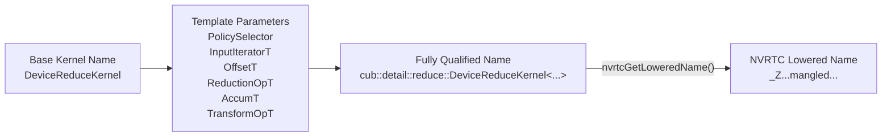

**Diagram: Kernel Name Construction Process**

The system constructs multiple kernel names for different stages of the algorithm (e.g., single-tile kernel, reduction kernel, second-pass kernel).

**Sources**: [c/parallel/src/reduce.cu:52-109](), [c/parallel/src/radix_sort.cu:33-123]()

## NVRTC Compilation Pipeline

The NVRTC compilation pipeline transforms generated source code into executable kernels through several stages:

### Compilation Command Construction

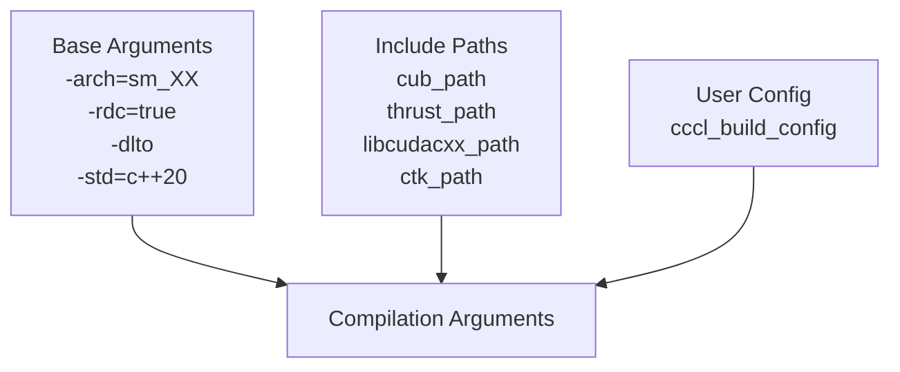

**Diagram: Compilation Argument Construction**

**Sources**: [c/parallel/src/reduce.cu:315-328](), [c/parallel/src/transform.cu:289-309]()

### NVRTC Compilation Stages

The compilation process follows this sequence:

| Stage | Function | Input | Output |
|-------|----------|-------|--------|
| Program Creation | `nvrtcCreateProgram()` | Source string, name | `nvrtcProgram` handle |
| Compilation | `nvrtcCompileProgram()` | Program, args | PTX/LTO-IR |
| Name Lowering | `nvrtcGetLoweredName()` | Template name | Mangled name |
| Binary Extraction | `nvrtcGetLTO()` / `nvrtcGetPTX()` | Program | Binary data |

**Sources**: [c/parallel/src/reduce.cu:341-355]()

### Link-Time Optimization (LTO) Process

LTO-IR linking combines separately compiled modules:

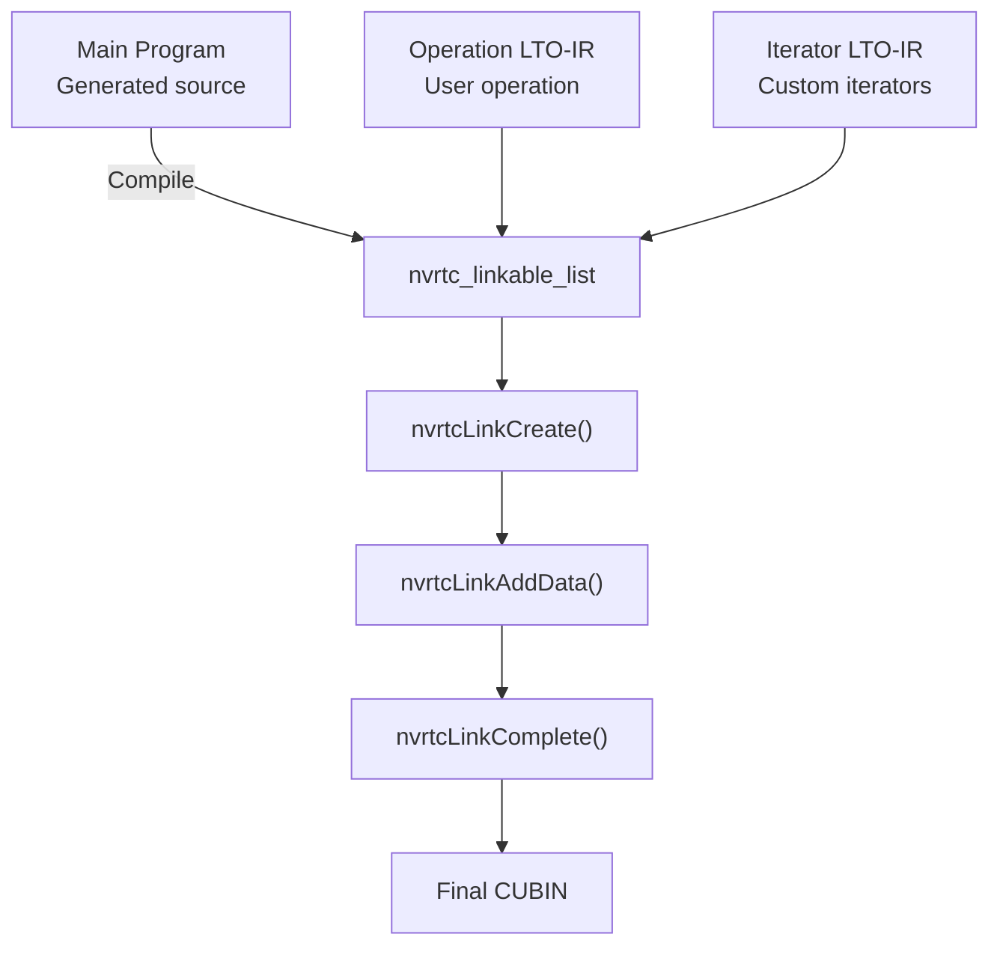

**Diagram: LTO-IR Linking Pipeline**

The linking stage is critical when user operations or iterators are provided as separate compilation units.

**Sources**: [c/parallel/src/reduce.cu:334-355]()

## Kernel Source Management

The kernel source management system provides a uniform interface for accessing JIT-compiled kernels:

### DeviceReduceKernelSource Structure

The `DeviceReduceKernelSource` structure encapsulates all kernel entry points for the reduce algorithm:

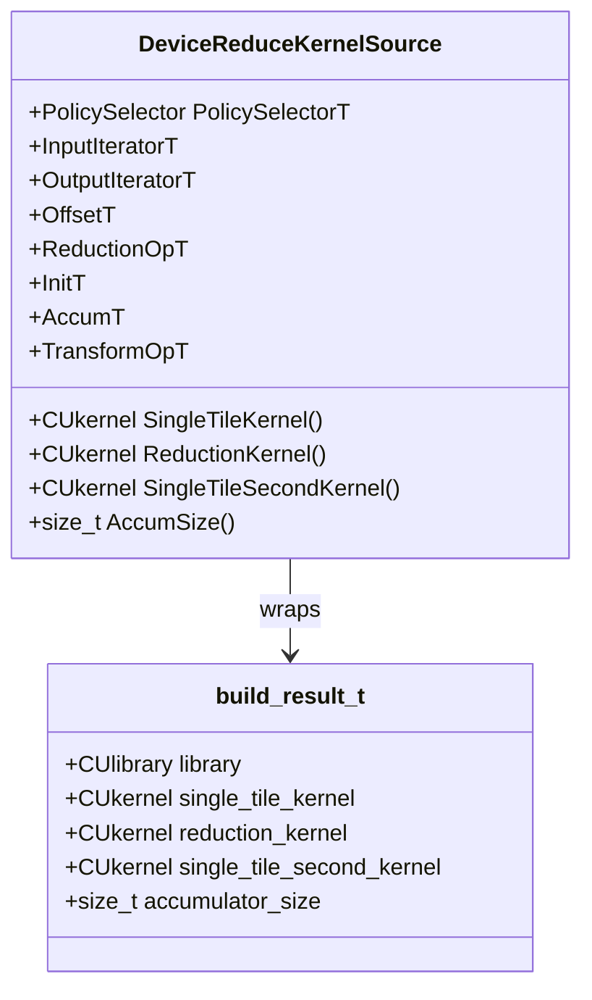

**Diagram: Kernel Source Structure for Reduce**

This pattern is replicated for each algorithm (transform, sort, scan, etc.), with algorithm-specific kernel sets.

**Sources**: [c/parallel/src/reduce.cu:141-169](), [c/parallel/src/radix_sort.cu:125-184]()

### Kernel Source Templates by Algorithm

Different algorithms require different kernel sources:

| Algorithm | Kernel Source Type | Kernel Count | Key Kernels |
|-----------|-------------------|--------------|-------------|
| Reduce | `DeviceReduceKernelSource` | 3 | `SingleTileKernel`, `ReductionKernel`, `SingleTileSecondKernel` |
| Transform | `transform_kernel_source` | 1 | `TransformKernel` |
| RadixSort | `radix_sort_kernel_source` | 9 | `SingleTileKernel`, `UpsweepKernel`, `DownsweepKernel`, `OnesweepKernel` |
| MergeSort | `merge_sort_kernel_source` | 3 | `BlockSortKernel`, `PartitionKernel`, `MergeKernel` |
| Scan | `scan_kernel_source` | 2 | `InitKernel`, `ScanKernel` |

**Sources**: [c/parallel/src/reduce.cu:141-169](), [c/parallel/src/transform.cu:129-197](), [c/parallel/src/radix_sort.cu:125-184](), [c/parallel/src/merge_sort.cu:173-287](), [c/parallel/src/scan.cu:265-351]()

## Indirect Arguments

The indirect argument system enables passing runtime-determined values and types to JIT-compiled kernels:

### indirect_arg_t Wrapper

The `indirect_arg_t` wrapper provides a type-erased interface for kernel arguments:

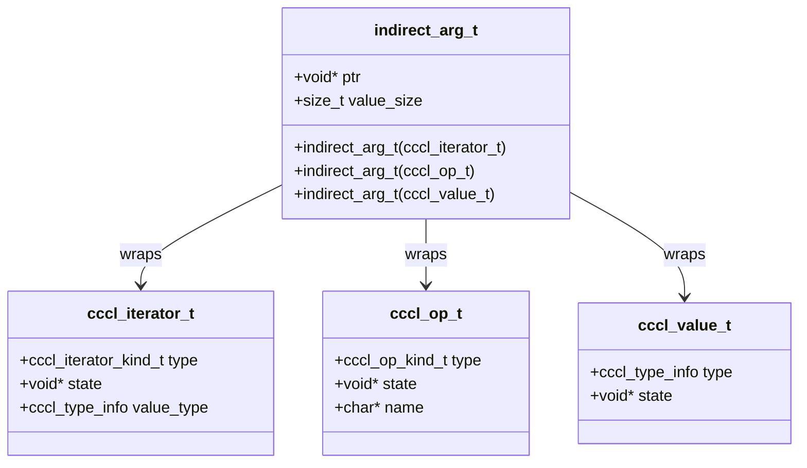

**Diagram: Indirect Argument Type Hierarchy**

The `indirect_arg_t` wrapper allows CUB dispatch functions to accept runtime-determined types.

**Sources**: [c/parallel/src/reduce.cu:415-422]()

### Indirect Iterator Support

Indirect iterators enable custom iteration logic defined at runtime:

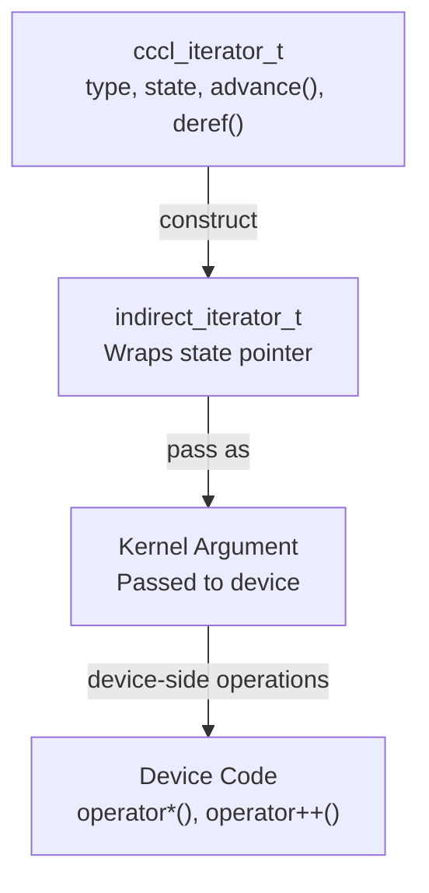

**Diagram: Indirect Iterator Flow**

Indirect iterators are passed by value to kernels but perform operations through function pointers stored in device memory.

**Sources**: [c/parallel/src/reduce.cu:415-422](), [c/parallel/src/transform.cu:369-378]()

## CUDA Driver API Integration

JIT-compiled kernels are launched through the CUDA Driver API rather than the Runtime API:

### CudaDriverLauncherFactory

The launcher factory provides a consistent interface for kernel launch:

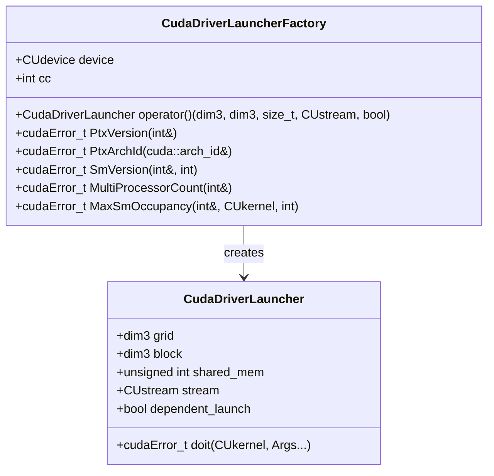

**Diagram: Driver API Launcher Classes**

**Sources**: [cub/cub/detail/launcher/cuda_driver.cuh:27-112]()

### Kernel Launch Process

The launch process converts high-level dispatch calls to low-level driver operations:

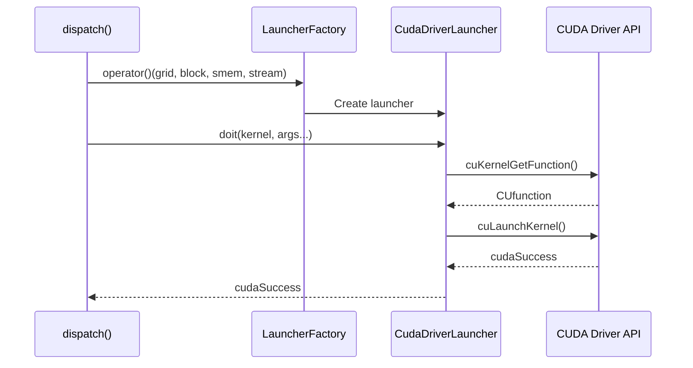

**Diagram: Kernel Launch Sequence**

**Sources**: [cub/cub/detail/launcher/cuda_driver.cuh:36-74](), [c/parallel/src/reduce.cu:415-427]()

### Device Property Queries

The launcher factory provides methods to query device properties needed for policy selection:

| Query Method | Purpose | Return Type |
|--------------|---------|-------------|
| `PtxVersion()` | Get PTX version for current device | `int` (major*100 + minor*10) |
| `PtxArchId()` | Get architecture ID for dispatch | `cuda::arch_id` |
| `SmVersion()` | Get SM version (compute capability) | `int` (major*100 + minor*10) |
| `MultiProcessorCount()` | Get number of SMs | `int` |
| `MaxSmOccupancy()` | Get max active blocks per SM | `int` |

These queries enable runtime policy selection before kernel launch.

**Sources**: [cub/cub/detail/launcher/cuda_driver.cuh:83-112]()

## Policy Integration

JIT-compiled kernels use runtime-determined tuning policies:

### Runtime Policy Selection

The policy selection system determines optimal kernel parameters at runtime:

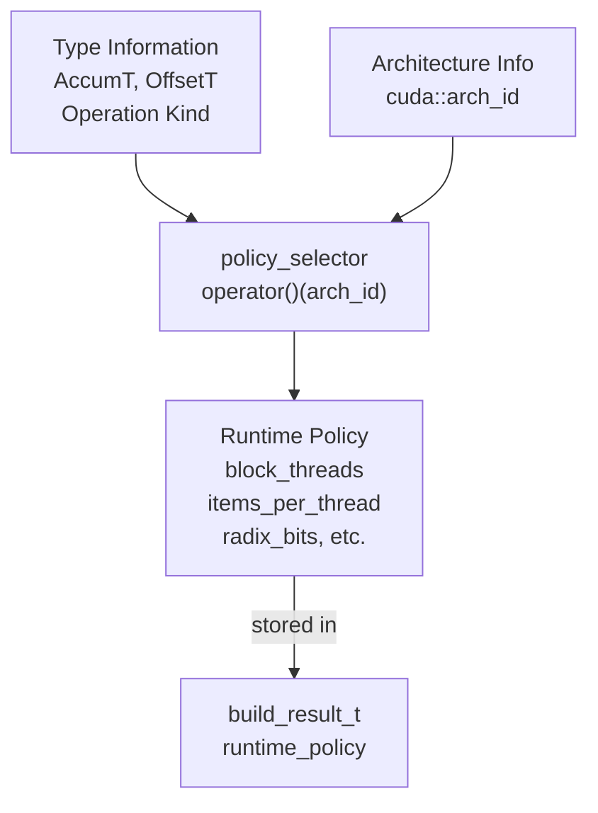

**Diagram: Runtime Policy Selection**

The selected policy is stored in the build result and used during execution.

**Sources**: [c/parallel/src/reduce.cu:223-254](), [c/parallel/src/radix_sort.cu:229-254]()

### Policy Verification

The generated code includes static assertions to verify policy consistency between host and device:

```
static_assert(
  device_reduce_policy()(::cuda::arch_id{CUB_PTX_ARCH / 10}) == expected_policy,
  "Host generated and JIT compiled policy mismatch"
);
```

This assertion ensures that the policy computed on the host matches the policy that would be selected in device code, preventing subtle bugs from policy mismatches.

**Sources**: [c/parallel/src/reduce.cu:277](), [c/parallel/src/transform.cu:268]()

## LTO-IR Linkable Management

The LTO-IR linkable system manages separately compiled modules:

### nvrtc_linkable_list

The linkable list aggregates LTO-IR modules for linking:

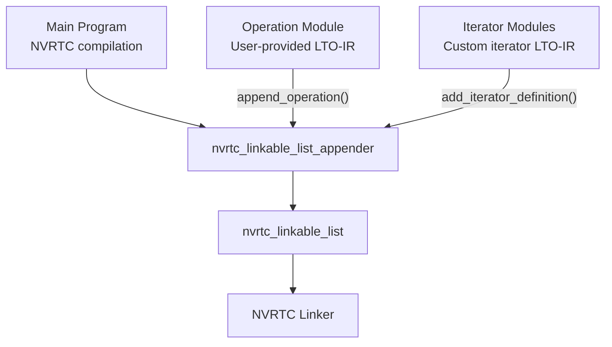

**Diagram: LTO-IR Linkable List Construction**

**Sources**: [c/parallel/src/reduce.cu:334-355](), [c/parallel/src/transform.cu:312-327]()

### Linkable Appender Operations

The appender provides typed methods for adding different module types:

| Method | Purpose | Input Type |
|--------|---------|-----------|
| `append_operation()` | Add user operation LTO-IR | `cccl_op_t` |
| `add_iterator_definition()` | Add custom iterator LTO-IR | `cccl_iterator_t` |
| `add_link_list()` | Add existing linkable list | `nvrtc_linkable_list` |

These methods ensure that all necessary code modules are available during linking.

**Sources**: [c/parallel/src/reduce.cu:337-339]()

## Memory Management

JIT compilation requires careful memory management for the generated artifacts:

### Build Result Lifecycle

The build result structure owns several dynamically allocated resources:

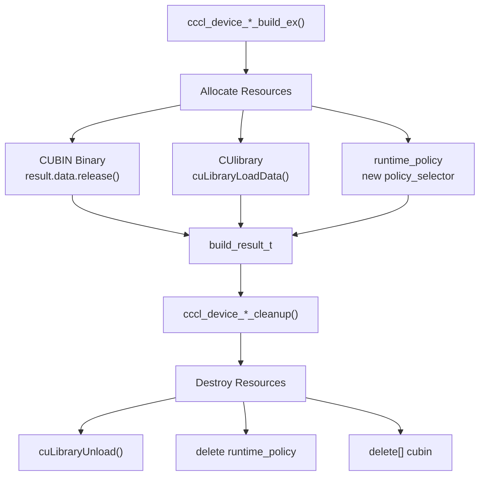

**Diagram: Build Result Resource Lifecycle**

**Sources**: [c/parallel/src/reduce.cu:367-374](), [c/parallel/src/reduce.cu:503-525]()

### Resource Cleanup

The cleanup function must be called to release all resources:

```
CUresult cccl_device_reduce_cleanup(cccl_device_reduce_build_result_t* build_ptr)
{
  std::unique_ptr<char[]> cubin(static_cast<char*>(build_ptr->cubin));
  std::unique_ptr<policy_selector> policy(
    static_cast<policy_selector*>(build_ptr->runtime_policy));
  check(cuLibraryUnload(build_ptr->library));
  return CUDA_SUCCESS;
}
```

This pattern is repeated for all algorithms with JIT support.

**Sources**: [c/parallel/src/reduce.cu:503-525](), [c/parallel/src/transform.cu:496-521]()

## Determinism Support

Some algorithms support multiple determinism levels through different code paths:

### Deterministic vs Non-Deterministic Reduce

The reduce algorithm provides separate functions for different determinism guarantees:

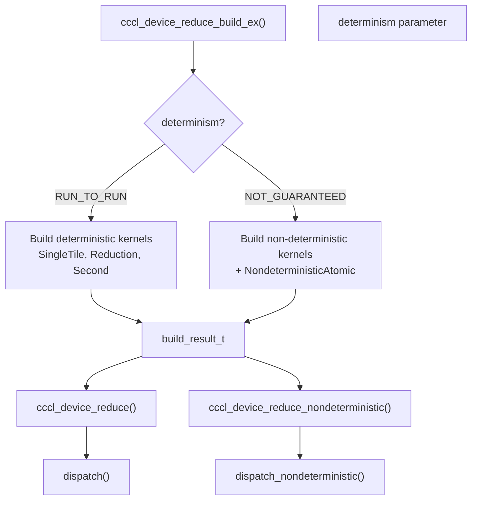

**Diagram: Determinism Level Handling in Reduce**

The non-deterministic path uses atomic operations for better performance at the cost of reproducibility.

**Sources**: [c/parallel/src/reduce.cu:191-207](), [c/parallel/src/reduce.cu:393-501]()

## Error Handling

The JIT compilation system uses consistent error handling patterns:

### Exception-to-Error Code Translation

All build functions wrap their implementation in try-catch blocks:

```
CUresult cccl_device_*_build_ex(...)
try
{
  // Implementation
  return CUDA_SUCCESS;
}
catch (const std::exception& exc)
{
  fflush(stderr);
  printf("\nEXCEPTION in cccl_device_*_build(): %s\n", exc.what());
  fflush(stdout);
  return CUDA_ERROR_UNKNOWN;
}
```

This pattern ensures that C++ exceptions are converted to CUDA error codes at the API boundary.

**Sources**: [c/parallel/src/reduce.cu:377-384](), [c/parallel/src/transform.cu:345-351]()

### Validation Checks

Build functions perform validation before compilation:

| Check | Purpose | Error |
|-------|---------|-------|
| Determinism support | Verify determinism level is supported | `CUDA_ERROR_INVALID_VALUE` |
| Operation compatibility | Ensure operation works with determinism | `CUDA_ERROR_INVALID_VALUE` |
| Iterator compatibility | Check iterator type is supported | `CUDA_ERROR_INVALID_VALUE` |
| Architecture validity | Verify compute capability is supported | Compilation failure |

**Sources**: [c/parallel/src/reduce.cu:191-206]()

---

**Page Sources**: [c/parallel/src/reduce.cu:1-557](), [c/parallel/src/transform.cu:1-556](), [c/parallel/src/radix_sort.cu:1-459](), [c/parallel/src/merge_sort.cu:1-535](), [c/parallel/src/segmented_reduce.cu:1-343](), [c/parallel/src/scan.cu:1-529](), [cub/cub/detail/launcher/cuda_driver.cuh:1-157](), [cub/cub/util_device.cuh:1-872]()

---

