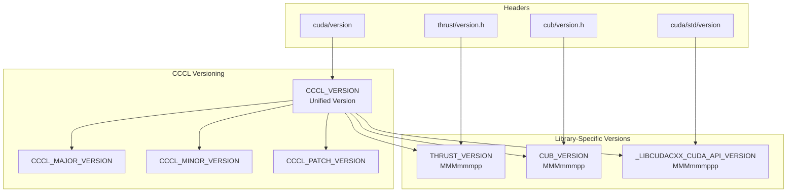
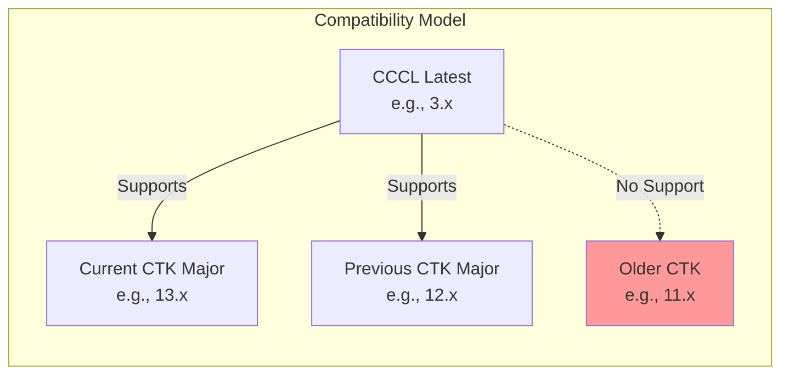
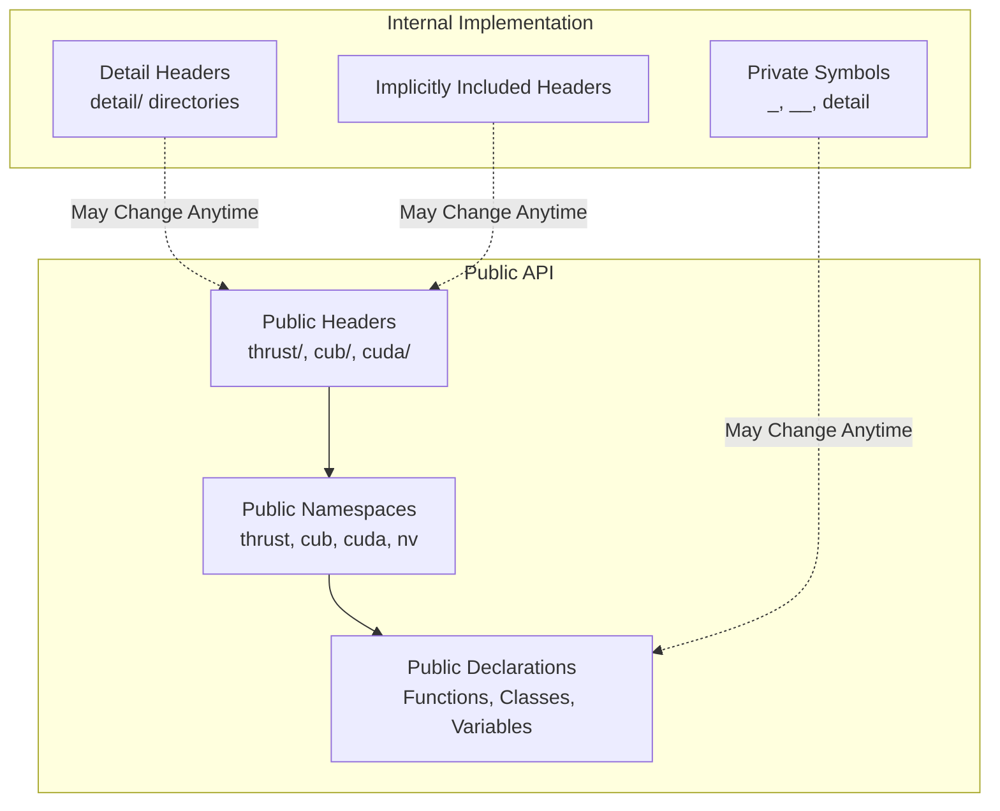
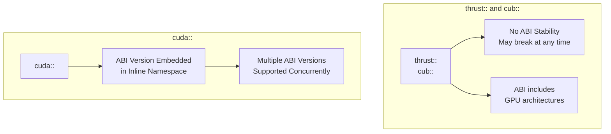
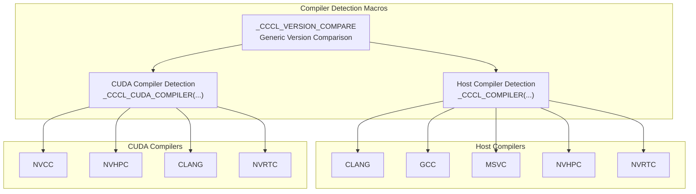
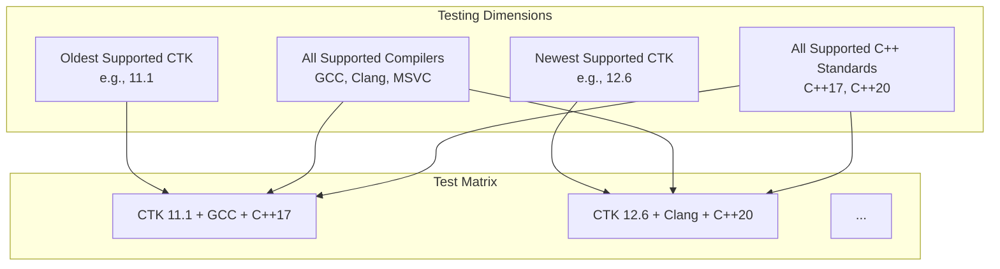

<!-- source: DeepWiki mcp.deepwiki.com · repo NVIDIA/cccl · page 6 Reference and Compatibility · fetched 2026-10-26 -->

# Reference and Compatibility

<details>
<summary>Relevant source files</summary>

The following files were used as context for generating this wiki page:

- [CONTRIBUTING.md](CONTRIBUTING.md)
- [README.md](README.md)

</details>


This page documents CCCL's versioning scheme, API/ABI stability guarantees, platform support requirements, and compatibility guidelines. Understanding these policies is essential for safely upgrading CCCL versions and ensuring your code remains compatible across different environments.

For information about performance tuning and optimization strategies, see [5.4](#5.4). For details about the build system and testing infrastructure, see [3](#3).

## Versioning Scheme

CCCL uses [semantic versioning](https://semver.org/) with a unified version number shared across all components (Thrust, CUB, libcudacxx, and cudax).



**Sources:** [README.md:315-383]()

### Version Query Macros

The following table shows how to query version information for each CCCL component:

| Component | Header | Major Version | Minor Version | Patch Version | Concatenated Version |
|-----------|--------|---------------|---------------|---------------|---------------------|
| **CCCL** | `<cuda/version>` | `CCCL_MAJOR_VERSION` | `CCCL_MINOR_VERSION` | `CCCL_PATCH_VERSION` | `CCCL_VERSION` (MMMmmmppp) |
| **libcudacxx** | `<cuda/std/version>` | `_LIBCUDACXX_CUDA_API_VERSION_MAJOR` | `_LIBCUDACXX_CUDA_API_VERSION_MINOR` | `_LIBCUDACXX_CUDA_API_VERSION_PATCH` | `_LIBCUDACXX_CUDA_API_VERSION` (MMMmmmppp) |
| **Thrust** | `<thrust/version.h>` | `THRUST_MAJOR_VERSION` | `THRUST_MINOR_VERSION` | `THRUST_SUBMINOR_VERSION` | `THRUST_VERSION` (MMMmmmpp) |
| **CUB** | `<cub/version.h>` | `CUB_MAJOR_VERSION` | `CUB_MINOR_VERSION` | `CUB_SUBMINOR_VERSION` | `CUB_VERSION` (MMMmmmpp) |

**Note:** Thrust and CUB use a `MMMmmmpp` encoding (8 digits) while CCCL and libcudacxx use `MMMmmmppp` (9 digits).

**Sources:** [README.md:372-382]()

### Version Lifecycle

- **Supported Versions:** Only the most recently released version is supported. Features and bug fixes are not backported to previous releases.
- **Major Version Bumps:** API breaking changes only occur with major version increments, which coincide with new major CUDA Toolkit releases.
- **Minor Version Bumps:** New features and non-breaking changes. Some new features may not support all CTK versions.
- **Patch Version Bumps:** Bug fixes and minor improvements with no API changes.

**Sources:** [README.md:315-370]()

## CUDA Toolkit Compatibility

CCCL maintains backward compatibility with the CUDA Toolkit (CTK) following a sliding window policy.



**Sources:** [README.md:227-262]()

### Compatibility Rules

| CCCL Version | Supports CTK Versions | Notes |
|--------------|----------------------|-------|
| 2.x | 11.1-11.8, 12.x | Only latest patch releases |
| 3.x | 12.x, 13.x | Only latest patch releases |

**Key Principles:**

1. **Backward Compatible:** CCCL version X supports the current and previous CTK major version series.
2. **Not Forward Compatible:** Older CCCL versions do not work with newer CTK versions.
3. **Latest Patches Only:** Only the latest patch release of each CTK minor version is guaranteed to work.
4. **Major Version Drops:** When a new major CTK is released, support for the oldest major version is dropped.

**Sources:** [README.md:229-262]()

### Upgrade Scenarios

| CTK Version | Included CCCL | Desired CCCL | Supported? | Notes |
|:-----------:|:-------------:|:------------:|:----------:|:------|
| CTK `X.Y` | CCCL `MAJOR.MINOR` | CCCL `MAJOR.MINOR+n` | ✅ | Some new features might not work |
| CTK `X.Y` | CCCL `MAJOR.MINOR` | CCCL `MAJOR+1.MINOR` | ✅ | Possible breaks; some features unavailable |
| CTK `X.Y` | CCCL `MAJOR.MINOR` | CCCL `MAJOR+2.MINOR` | ❌ | CCCL supports only two CTK major versions |
| CTK `X.Y` | CCCL `MAJOR.MINOR` | CCCL `MAJOR.MINOR-n` | ❌ | CCCL isn't forward compatible |
| CTK `X.Y` | CCCL `MAJOR.MINOR` | CCCL `MAJOR-n.MINOR` | ❌ | CCCL isn't forward compatible |

**Sources:** [README.md:253-261]()

### CTK Version Mapping

| CCCL Version | CTK Version |
|--------------|-------------|
| 3.1 | 13.1 |
| 3.0 | 13.0 |
| 2.8 | 12.9 |
| 2.7 | 12.8 |
| 2.5 | 12.6 |
| 2.4 | 12.5 |
| 2.3 | 12.4 |

Prior to CCCL 2.3 (CTK 12.4), Thrust, CUB, and libcudacxx were versioned independently.

**Sources:** [README.md:448-470]()

## API and ABI Stability

### API Stability

CCCL's public API includes all functionality intentionally exposed for user code:

**Includes:**
- Header file locations and names for direct inclusion
- Public namespaces (`thrust::`, `cub::`, `cuda::`, `nv::`)
- Function, class, and variable declarations/definitions
- Semantics and behavior of public entities

**Excludes:**
- Symbols prefixed with `_` or `__`
- Symbols containing `detail` (namespace or macro)
- Headers in `detail/` directories
- Implicitly included headers

**Sources:** [README.md:340-363]()



**Sources:** [README.md:340-363]()

### API Breaking Changes

- **Require Major Version Bump:** API breaking changes require incrementing CCCL's major version number.
- **Coincide with CTK Major Releases:** Major version bumps only occur with new major CUDA Toolkit releases.
- **Minimize Disruption:** Breaking changes are made only when they offer better performance, easier-to-understand APIs, or more consistent APIs.

**Sources:** [README.md:356-361]()

### ABI Stability by Namespace



**Sources:** [README.md:384-404]()

#### `thrust::` and `cub::` Namespaces

- **No ABI Stability Guarantee:** ABI may break at any time without warning.
- **Architecture-Dependent ABI:** The ABI includes the CUDA architectures used for compilation.
- **Compilation Mode Matters:** A symbol may have different ABI if compiled as CUDA (`-x cu`) vs C++ (`-x cpp`), or with different architecture flags.

**Sources:** [README.md:400-403]()

#### `cuda::` Namespace

- **ABI Version Tracking:** Symbols embed an ABI version number that increments on ABI breaks.
- **Concurrent Support:** Multiple ABI versions may be supported simultaneously.
- **Opt-In Reversion:** Users can revert to a prior ABI version when needed.

For details on libcudacxx ABI versioning, see the [libcudacxx versioning documentation](https://nvidia.github.io/cccl/libcudacxx/releases/versioning.html).

**Sources:** [README.md:404]()

### When ABI Matters

Users need to consider ABI compatibility when:

1. **Building Binary Artifacts:** Creating shared libraries (`.so`, `.dll`) whose public API includes CCCL types.
2. **Linking Multiple Libraries:** Different libraries compiled with different CCCL versions that share CCCL types in their interfaces.

**Example scenario:**
```
// libA.so compiled with CCCL version X
void foo(cuda::std::optional<int>);

// libB.so compiled with CCCL version Y calling foo
```

If an ABI break occurred between versions X and Y, this can fail. Unlike API breaks, ABI breaks usually only require recompiling everything to use the same ABI version.

**Sources:** [README.md:406-417]()

## Platform and Compiler Support

### Compiler Detection System

CCCL provides comprehensive compiler detection macros for both host and CUDA compilers.



**Sources:** [libcudacxx/include/cuda/std/__cccl/compiler.h:54-130]()

#### Version Comparison Macros

The `_CCCL_COMPILER` and `_CCCL_CUDA_COMPILER` macros support version checking:

```cpp
// Check if compiler is present
_CCCL_COMPILER(GCC)              // true if GCC

// Check specific version
_CCCL_COMPILER(GCC, >=, 7)       // GCC >= 7.x
_CCCL_COMPILER(MSVC, <, 19, 24)  // MSVC < 19.24

// CUDA compiler checks
_CCCL_CUDA_COMPILER(NVCC, >=, 12, 3)  // NVCC >= 12.3
```

**Sources:** [libcudacxx/include/cuda/std/__cccl/compiler.h:16-52](), [docs/cccl/development/macro.rst:11-60]()

### Supported Host Compilers

| Compiler | Minimum Version | Notes |
|----------|----------------|-------|
| **GCC** | 7.0 | Required minimum on Linux |
| **Clang** | 7.0 | Minimum supported |
| **MSVC** | 19.20 (VS 2019) | Earlier versions generate error |
| **NVHPC** | (varies) | Detected via `__NVCOMPILER` |
| **Intel ICC** | Not supported | Generates deprecation warning |

**Deprecation Handling:**
- Define `CCCL_IGNORE_DEPRECATED_COMPILER` to suppress compiler deprecation warnings.
- Define `CCCL_IGNORE_DEPRECATED_CPP_DIALECT` to suppress C++ dialect warnings.

**Sources:** [README.md:271-284](), [cub/cub/util_cpp_dialect.cuh:61-81](), [thrust/thrust/detail/config/cpp_dialect.h:43-66]()

### Supported CUDA Compilers

| Compiler | Macro | Detection |
|----------|-------|-----------|
| **NVCC** | `_CCCL_CUDA_COMPILER(NVCC)` | `__NVCC__` |
| **NVHPC (nvc++)** | `_CCCL_CUDA_COMPILER(NVHPC)` | `_NVHPC_CUDA` |
| **Clang CUDA** | `_CCCL_CUDA_COMPILER(CLANG)` | `__CUDA__ && __clang__` |
| **NVRTC** | `_CCCL_CUDA_COMPILER(NVRTC)` | `__CUDACC_RTC__` |

**Compilation Context Macros:**

| Macro | Description |
|-------|-------------|
| `_CCCL_HAS_CUDA_COMPILER()` | CUDA compiler is available |
| `_CCCL_CUDA_COMPILATION()` | Compiling CUDA source file |
| `_CCCL_HOST_COMPILATION()` | Compiling host code |
| `_CCCL_DEVICE_COMPILATION()` | Compiling device code |

**CUDA Toolkit Version Checks:**
```cpp
_CCCL_CUDACC_BELOW(12, 7)      // CTK version < 12.7
_CCCL_CUDACC_AT_LEAST(12, 7)   // CTK version >= 12.7
```

**Sources:** [libcudacxx/include/cuda/std/__cccl/compiler.h:102-169](), [docs/cccl/development/macro.rst:62-77]()

### Supported Operating Systems

CCCL supports all operating systems supported by the CUDA Toolkit:

- **Linux:** [CUDA Linux System Requirements](https://docs.nvidia.com/cuda/cuda-installation-guide-linux/index.html#system-requirements)
- **Windows:** [CUDA Windows System Requirements](https://docs.nvidia.com/cuda/cuda-installation-guide-microsoft-windows/index.html#system-requirements)

**OS Detection Macros:**

| Macro | Platform |
|-------|----------|
| `_CCCL_OS(WINDOWS)` | Windows (including NVRTC LLP64) |
| `_CCCL_OS(LINUX)` | Linux (including NVRTC LP64) |
| `_CCCL_OS(ANDROID)` | Android |
| `_CCCL_OS(QNX)` | QNX |

**Sources:** [README.md:265-269](), [docs/cccl/development/macro.rst:105-117]()

### Supported GPU Architectures

CCCL supports all GPU architectures supported by the **current** major CUDA Toolkit release.

**Important:** While CCCL may compile with two CTK major versions, only architectures from the current CTK are supported.

**Example:**
- CCCL 3.0 supports compiling with CTK 12.x and 13.x
- CTK 13.x supports `>=sm_75`
- CTK 12.x supports `>=sm_50`
- **CCCL 3.0 only supports `sm_75+` even when compiled with CTK 12.x**

See the [CUDA GPU Compatibility Guide](https://developer.nvidia.com/cuda-gpus) for architecture details.

**Sources:** [README.md:287-297]()

### Supported C++ Dialects

| Standard | Support |
|----------|---------|
| **C++17** | Required minimum |
| **C++20** | Supported |

**Dialect Detection:**
```cpp
#if _CCCL_STD_VER >= 2017
  // C++17 or later
#endif

#if _CCCL_STD_VER >= 2020
  // C++20 or later
#endif
```

**Enforcement:** Projects using C++ standards below C++17 will encounter compilation errors unless `CCCL_IGNORE_DEPRECATED_CPP_DIALECT` is defined.

**Sources:** [README.md:299-301](), [cub/cub/util_cpp_dialect.cuh:86-91](), [thrust/thrust/detail/config/cpp_dialect.h:71-76](), [libcudacxx/include/cuda/std/__internal/cpp_dialect.h:38-42]()

## Compatibility Guidelines

To minimize upgrade disruptions, users should follow these guidelines:

### Do Not Modify CCCL Namespaces

❌ **Avoid:**
- Adding declarations to `thrust::`, `cub::`, `cuda::`, or `nv::` namespaces
- Specializing templates from these namespaces (unless explicitly documented as allowed, e.g., `cuda::std::iterator_traits`)

**Rationale:** Prevents conflicts if CCCL adds symbols with the same name.

### Do Not Take Addresses of CCCL APIs

❌ **Avoid:**
```cpp
auto* ptr = &thrust::sort;  // Don't do this
```

**Rationale:** Prevents CCCL from adding overloads of these APIs.

### Do Not Forward Declare CCCL APIs

❌ **Avoid:**
```cpp
namespace cuda::std {
  template <typename T> class optional;  // Don't do this
}
```

**Rationale:** Prevents CCCL from adding overloads or changing template parameters.

### Avoid Internal Implementation Details

❌ **Avoid:**
- Symbols prefixed with `_`, `__`
- Symbols containing `detail` anywhere in the name
- Headers in `detail/` directories

**Rationale:** Internal details may change at any time without warning.

### Include What You Use

✅ **Recommended:**
```cpp
#include <thrust/device_vector.h>  // Directly include used headers
#include <cub/block/block_reduce.cuh>
#include <cuda/std/atomic>
```

❌ **Avoid:**
```cpp
#include <thrust/some_header.h>  // Relying on implicit includes
// Using cuda::std::atomic without including <cuda/std/atomic>
```

**Rationale:** Internal includes may change at any time.

**Sources:** [README.md:420-436]()

## Deprecation Policy

CCCL provides advance notice before making breaking changes:

1. **Notification Methods:**
   - Programmatic warnings (can be disabled)
   - Documentation updates
   - Release notes

2. **Deprecation Period:**
   - Typically at least 2 minor version releases
   - Depends on impact of the change

3. **Platform/Compiler Deprecation:**
   - Warnings before dropping support for platforms or compilers
   - Users can define `CCCL_IGNORE_DEPRECATED_COMPILER` or `CCCL_IGNORE_DEPRECATED_CPP_DIALECT` to suppress warnings

**Sources:** [README.md:439-445]()

## Testing Strategy

CCCL's testing ensures compatibility across supported configurations:



- **CTK Versions:** Tests run against oldest and newest supported CTK versions
- **Compilers:** All supported host compilers are tested
- **C++ Standards:** All supported C++ dialects are tested

The definitive test matrix is defined in [`ci/matrix.yaml`](). For more details, see the [CI Overview](https://github.com/NVIDIA/cccl/blob/main/ci-overview.md).

**Sources:** [README.md:303-313]()

---

