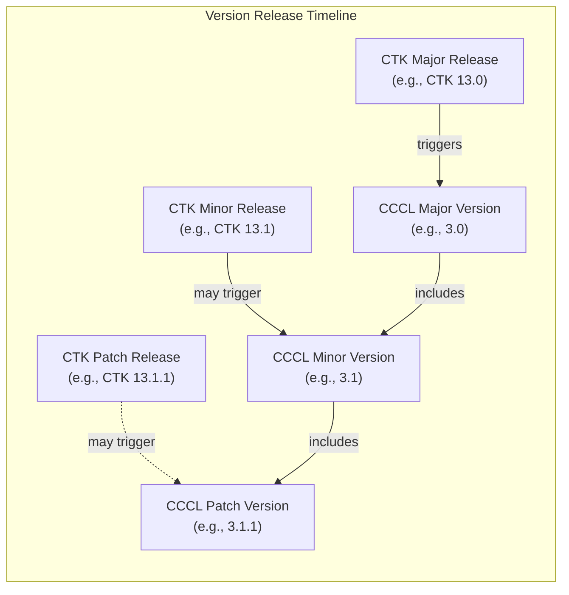
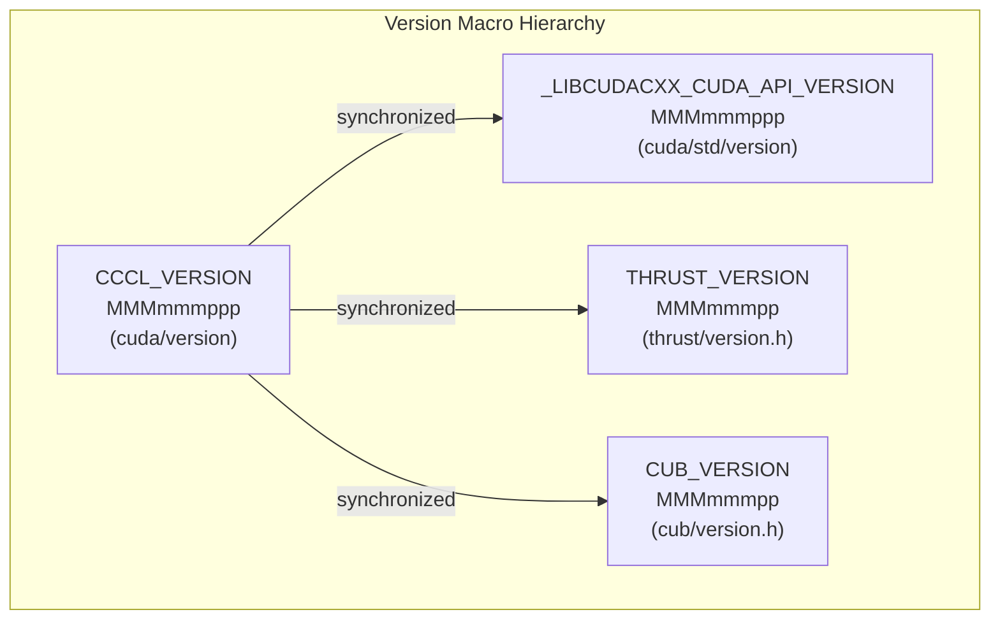
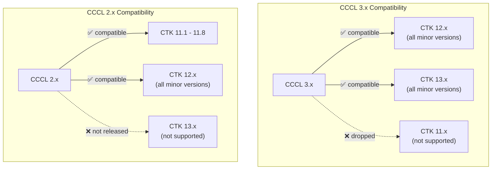
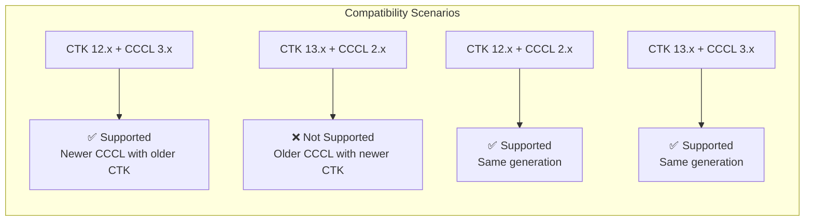
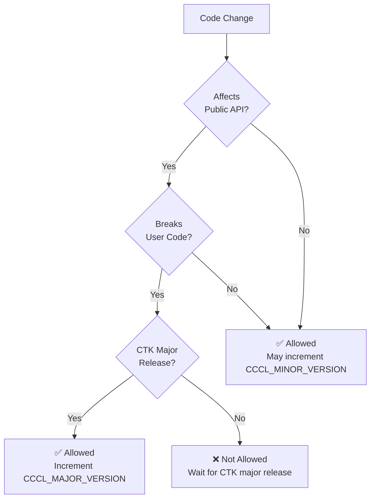
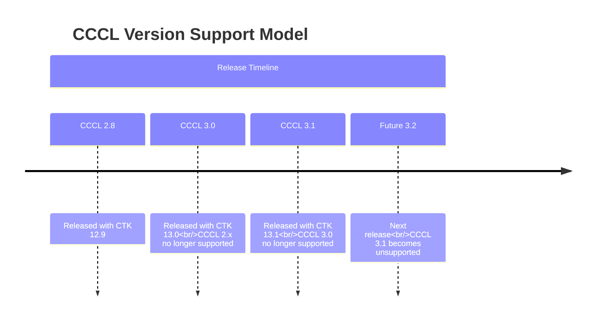
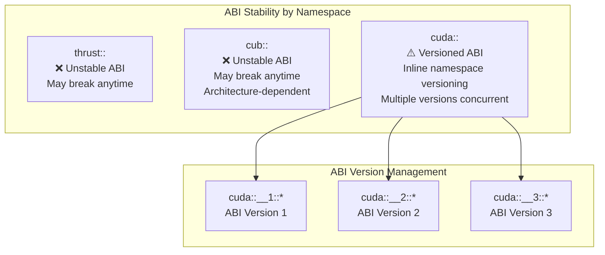

<!-- source: DeepWiki mcp.deepwiki.com · repo NVIDIA/cccl · page 6.1 Versioning Policy · fetched 2026-10-26 -->

# Versioning Policy

<details>
<summary>Relevant source files</summary>

The following files were used as context for generating this wiki page:

- [CONTRIBUTING.md](CONTRIBUTING.md)
- [README.md](README.md)

</details>


This document explains CCCL's versioning strategy, including semantic version numbering, compatibility guarantees with CUDA Toolkit versions, API/ABI stability rules, and version detection mechanisms. For information about API and ABI stability guarantees, see [API and ABI Stability](#6.2). For platform and compiler compatibility requirements, see [Platform and Compiler Support](#6.3).

## Overview

CCCL uses semantic versioning with unified version numbers across all components (Thrust, CUB, and libcudacxx). The versioning policy prioritizes backward compatibility while explicitly rejecting forward compatibility with CUDA Toolkit releases. Major version increments align with CUDA Toolkit major releases and are the only times API-breaking changes are permitted.

**Key Principles:**
- Unified `MAJOR.MINOR.PATCH` semantic versioning across all CCCL components
- Only the most recent release is supported; no backporting to prior versions
- Backward compatible with current and previous CTK major version series
- Never forward compatible (older CCCL cannot work with newer CTK)
- API breaking changes only coincide with CTK major version releases
- Multiple concurrent ABI versions supported for `cuda::` namespace symbols

Sources: [README.md:319-442]()

## Semantic Versioning Strategy

CCCL follows [semantic versioning](https://semver.org/) with version numbers in the format `MAJOR.MINOR.PATCH`:

- **MAJOR**: Incremented for API-breaking changes, aligned with CUDA Toolkit major releases
- **MINOR**: Incremented for new features that maintain backward compatibility
- **PATCH**: Incremented for backward-compatible bug fixes

### Version Release Cadence



**Diagram: CCCL Version Release Alignment with CUDA Toolkit**

The CCCL major version increments only when a new major version of the CUDA Toolkit is released. Minor and patch versions may be released independently to provide new features and bug fixes between CTK releases. Users are encouraged to "live at head" by using the latest CCCL version with their current CTK installation.

Sources: [README.md:234-263](), [README.md:319-333]()

## Version Macros and Detection

### CCCL Version Macros

CCCL provides unified version detection macros defined in `<cuda/version>`:

| Macro | Description | Format |
|-------|-------------|--------|
| `CCCL_MAJOR_VERSION` | Major version number | Integer (e.g., `3`) |
| `CCCL_MINOR_VERSION` | Minor version number | Integer (e.g., `1`) |
| `CCCL_PATCH_VERSION` | Patch version number | Integer (e.g., `0`) |
| `CCCL_VERSION` | Combined version | `MMMmmmppp` (e.g., `3001000`) |

### Legacy Component Version Macros

For backward compatibility, individual component version macros remain available and are synchronized with `CCCL_VERSION`:



**Diagram: Version Macro Synchronization Across CCCL Components**

### Version Detection Example

```cpp
#include <cuda/version>

// Check minimum CCCL version
#if CCCL_VERSION < 3001000  // 3.1.0
  #error "This code requires CCCL 3.1.0 or later"
#endif

// Check component versions (synchronized with CCCL_VERSION)
#include <thrust/version.h>
#include <cub/version.h>
#include <cuda/std/version>

static_assert(THRUST_MAJOR_VERSION == CCCL_MAJOR_VERSION);
static_assert(CUB_MAJOR_VERSION == CCCL_MAJOR_VERSION);
static_assert(_LIBCUDACXX_CUDA_API_VERSION_MAJOR == CCCL_MAJOR_VERSION);
```

**Complete Version Macro Reference:**

| Component | Header | Major | Minor | Patch | Combined |
|-----------|--------|-------|-------|-------|----------|
| CCCL | `<cuda/version>` | `CCCL_MAJOR_VERSION` | `CCCL_MINOR_VERSION` | `CCCL_PATCH_VERSION` | `CCCL_VERSION` |
| libcudacxx | `<cuda/std/version>` | `_LIBCUDACXX_CUDA_API_VERSION_MAJOR` | `_LIBCUDACXX_CUDA_API_VERSION_MINOR` | `_LIBCUDACXX_CUDA_API_VERSION_PATCH` | `_LIBCUDACXX_CUDA_API_VERSION` |
| Thrust | `<thrust/version.h>` | `THRUST_MAJOR_VERSION` | `THRUST_MINOR_VERSION` | `THRUST_SUBMINOR_VERSION` | `THRUST_VERSION` |
| CUB | `<cub/version.h>` | `CUB_MAJOR_VERSION` | `CUB_MINOR_VERSION` | `CUB_SUBMINOR_VERSION` | `CUB_VERSION` |

Note: Thrust and CUB use `MMMmmmpp` format (7 digits) while CCCL and libcudacxx use `MMMmmmppp` format (9 digits).

Sources: [README.md:376-387]()

## CUDA Toolkit Compatibility

### Backward Compatibility

CCCL maintains backward compatibility with the current and previous major CTK version series. When a new major CTK version is released, support for the oldest major version is dropped.



**Diagram: CCCL Backward Compatibility Matrix**

**Compatibility Rules:**

| CCCL Version | Supports CUDA Toolkit Version |
|--------------|-------------------------------|
| 2.x | 11.1 - 11.8, 12.x (only latest patch releases) |
| 3.x | 12.x, 13.x (only latest patch releases) |

Only the latest patch release of each CTK minor version is officially supported. In exceptional cases, the minimum supported minor version within a major version series may be newer than the oldest release.

Sources: [README.md:227-263]()

### Forward Compatibility (Not Supported)

**CCCL is never forward compatible with the CUDA Toolkit.** Using an older CCCL version with a newer CTK is not supported and may fail to compile or produce incorrect results.



**Diagram: CCCL-CTK Compatibility Decision Tree**

### Upgrade Compatibility Matrix

| CTK Version | Included CCCL | Desired CCCL | Supported? | Notes |
|:-----------:|:-------------:|:------------:|:----------:|:------|
| CTK `X.Y` | CCCL `MAJOR.MINOR` | CCCL `MAJOR.MINOR+n` | ✅ | Some new features might not work |
| CTK `X.Y` | CCCL `MAJOR.MINOR` | CCCL `MAJOR+1.MINOR` | ✅ | Possible breaks; some features unavailable |
| CTK `X.Y` | CCCL `MAJOR.MINOR` | CCCL `MAJOR+2.MINOR` | ❌ | CCCL supports only two CTK major versions |
| CTK `X.Y` | CCCL `MAJOR.MINOR` | CCCL `MAJOR.MINOR-n` | ❌ | CCCL isn't forward compatible |
| CTK `X.Y` | CCCL `MAJOR.MINOR` | CCCL `MAJOR-n.MINOR` | ❌ | CCCL isn't forward compatible |

Sources: [README.md:249-262]()

## API Versioning and Breaking Changes

### What Constitutes a Breaking Change

A Breaking Change is a modification to explicitly supported functionality that requires user code changes to upgrade to the newer version. However, not all source-breaking changes are considered Breaking Changes to the public API.

**CCCL's Public API includes:**
- Header file locations and names intended for direct inclusion
- Public namespaces: `thrust::`, `cub::`, `cuda::`, `nv::`
- Declarations and definitions in public headers
- Function, class, and variable semantics

**CCCL's Public API excludes:**
- Any symbol prefixed with `_` or `__`
- Any symbol containing `detail` (namespace, directory, or macro)
- Header files in `detail/` directories
- Implicitly included headers

### Breaking Change Policy



**Diagram: Breaking Change Decision Flow**

API-breaking changes require incrementing CCCL's major version and only occur with new major CUDA Toolkit releases. This aligns with [CUDA Minor Version Compatibility](https://docs.nvidia.com/deploy/cuda-compatibility/#minor-version-compatibility) principles.

Sources: [README.md:335-368]()

### Version Support Policy

**Only the most recently released version is supported.** Features and bug fixes are not backported to previously released versions or branches.



**Diagram: Version Support Timeline**

Sources: [README.md:373-375]()

## ABI Versioning

### Namespace-Specific ABI Guarantees

CCCL's ABI (Application Binary Interface) stability varies by namespace:



**Diagram: CCCL ABI Stability Model**

### thrust:: and cub:: ABI Instability

**Warning:** The `thrust::` and `cub::` namespaces provide no ABI stability guarantees. Symbols may change between any releases.

Additionally, `thrust::` and `cub::` ABI depends on:
- Compiled GPU architectures (`-arch` flags)
- Compilation mode (CUDA vs. C++ source files)

Two binaries using `thrust::` or `cub::` symbols are only ABI-compatible if compiled with:
- The same CCCL version
- The same GPU architectures
- The same compilation mode (`-x cu` vs `-x cpp`)

Sources: [README.md:402-408]()

### cuda:: ABI Versioning

Symbols in the `cuda::` namespace use inline namespace versioning to support multiple concurrent ABI versions:

```cpp
// libcudacxx/include/cuda/std/version

// ABI version embedded in inline namespace
namespace cuda {
  inline namespace __1 {  // ABI version 1
    template <typename T>
    class optional { /* ... */ };
  }
}

// Full qualified name: cuda::__1::optional<T>
// User code: cuda::optional<T> (resolves to current version)
```

When an ABI-breaking change occurs in the `cuda::` namespace:
1. The inline namespace version is incremented (e.g., `__1` → `__2`)
2. Multiple ABI versions may coexist in the same program
3. Users can explicitly target a specific ABI version if needed
4. The current ABI version is always the default

For detailed information about `cuda::` ABI versioning, see [libcudacxx/docs/releases/versioning.md]().

Sources: [README.md:408-409]()

### Who Should Care About ABI?

ABI compatibility matters when:
- Building shared libraries (`.so`, `.dll`) that expose CCCL types
- Linking multiple binaries compiled with different CCCL versions
- Distributing binary artifacts that use CCCL in their API

Example ABI conflict scenario:

```cpp
// libA.so compiled with CCCL 3.0
void foo(cuda::std::optional<int>);  // cuda::__1::optional

// libB.so compiled with CCCL 3.1 (ABI break)
foo(cuda::std::optional<int>{42});   // cuda::__2::optional
// Linker error or undefined behavior!
```

**Solution:** Recompile all components with the same CCCL version and ABI.

Sources: [README.md:410-423]()

## Version History and Mapping

### CCCL to CTK Version Mapping

| CCCL Version | CTK Version | Release Date |
|--------------|-------------|--------------|
| 3.1 | 13.1 | Current |
| 3.0 | 13.0 | - |
| 2.8 | 12.9 | - |
| 2.7 | 12.8 | - |
| 2.5 | 12.6 | - |
| 2.4 | 12.5 | - |
| 2.3 | 12.4 | - |

### Pre-Unification Versions

Before the CCCL repository unification, Thrust, CUB, and libcudacxx were independently versioned:

| Thrust/CUB/libcudacxx Version | CTK Version |
|-------------------------------|-------------|
| 2.2 | 12.3 |
| 2.1 | 12.2 |
| 2.0/2.0/1.9 | 12.1 |
| 2.0/2.0/1.9 | 12.0 |

Starting with CCCL 2.2.0 (first unified release from [nvidia/cccl](https://github.com/nvidia/cccl)), all three libraries share a synchronized version number.

Sources: [README.md:452-474]()

### Version Detection Test

You can verify your CCCL version at runtime:

```cpp
#include <cuda/version>
#include <thrust/version.h>
#include <cub/version.h>
#include <cuda/std/version>
#include <iostream>

int main() {
  std::cout << "CCCL version: " 
            << CCCL_MAJOR_VERSION << "."
            << CCCL_MINOR_VERSION << "."
            << CCCL_PATCH_VERSION << "\n";
  
  std::cout << "CCCL_VERSION: " << CCCL_VERSION << "\n";
  std::cout << "THRUST_VERSION: " << THRUST_VERSION << "\n";
  std::cout << "CUB_VERSION: " << CUB_VERSION << "\n";
  std::cout << "_LIBCUDACXX_CUDA_API_VERSION: " 
            << _LIBCUDACXX_CUDA_API_VERSION << "\n";
  
  return 0;
}
```

A live example is available at: https://cuda.godbolt.org/z/K818M4Y9f

Sources: [README.md:464-474]()

## Compatibility Guidelines

To minimize upgrade disruptions, users should follow these guidelines:

### Do Not:
1. **Add declarations to CCCL namespaces**
   - Do not add declarations to `thrust::`, `cub::`, `cuda::`, or `nv::` namespaces
   - Exception: Explicitly documented specialization points (e.g., `cuda::std::iterator_traits`)

2. **Take addresses of CCCL APIs**
   - Do not take the address of functions in CCCL namespaces
   - This prevents adding overloads

3. **Forward declare CCCL APIs**
   - Do not forward declare any CCCL symbols
   - Always `#include` the appropriate header

4. **Use internal symbols**
   - Do not reference symbols prefixed with `_`, `__`, or containing `detail`
   - These may change without warning

5. **Rely on implicit includes**
   - Do not depend on headers implicitly included by CCCL headers
   - Internal includes may change

### Do:
1. **Include what you use**
   - Directly `#include` the header for each symbol you use
   - Example: Use `<cuda/std/optional>` for `cuda::std::optional`

2. **Use public APIs only**
   - Restrict usage to documented public APIs
   - Avoid anything in `detail::` namespaces or directories

3. **Check version macros**
   - Use `CCCL_VERSION` to conditionally compile for different versions
   - Test minimum required versions with `#if` directives

4. **Recompile for ABI changes**
   - When upgrading CCCL, recompile all binaries that use CCCL types
   - Especially important for shared libraries

Sources: [README.md:424-442]()

## Summary

CCCL's versioning policy balances stability with continuous improvement:

| Aspect | Policy |
|--------|--------|
| **Versioning Scheme** | Semantic versioning: `MAJOR.MINOR.PATCH` |
| **API Breaking Changes** | Only with CTK major releases (MAJOR bump) |
| **Backward Compatibility** | Two CTK major versions |
| **Forward Compatibility** | Never supported |
| **ABI Stability** | `thrust::/cub::` unstable; `cuda::` versioned |
| **Support Model** | Only latest release supported |
| **Version Detection** | `CCCL_VERSION` macro in `<cuda/version>` |

Users are encouraged to:
- Use the latest CCCL version with their CTK installation
- Follow compatibility guidelines to minimize upgrade friction
- Recompile all binaries when upgrading CCCL
- Check `CCCL_VERSION` macros for conditional compilation

Sources: [README.md:319-442]()

---

