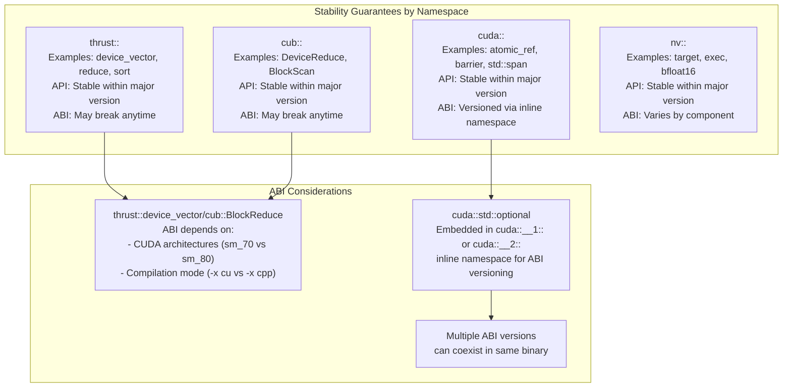
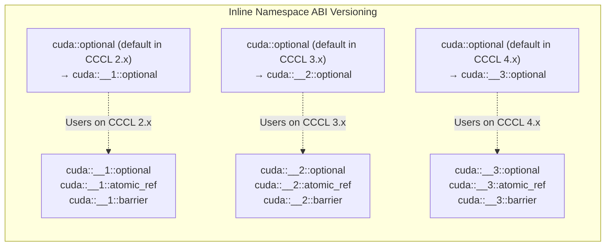
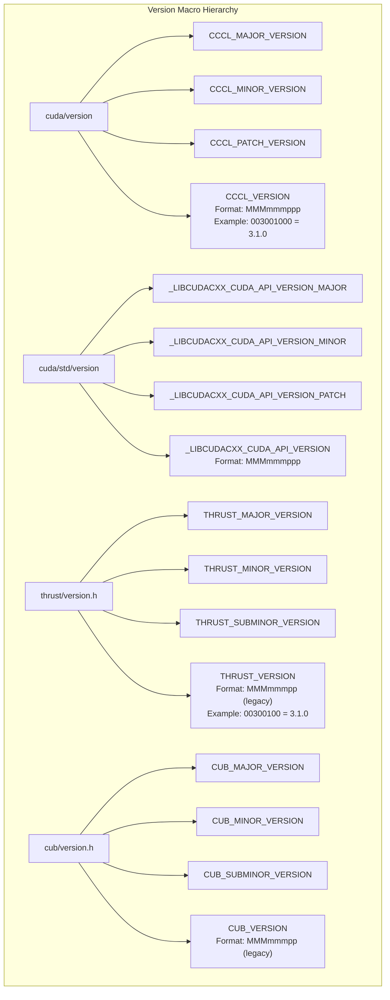
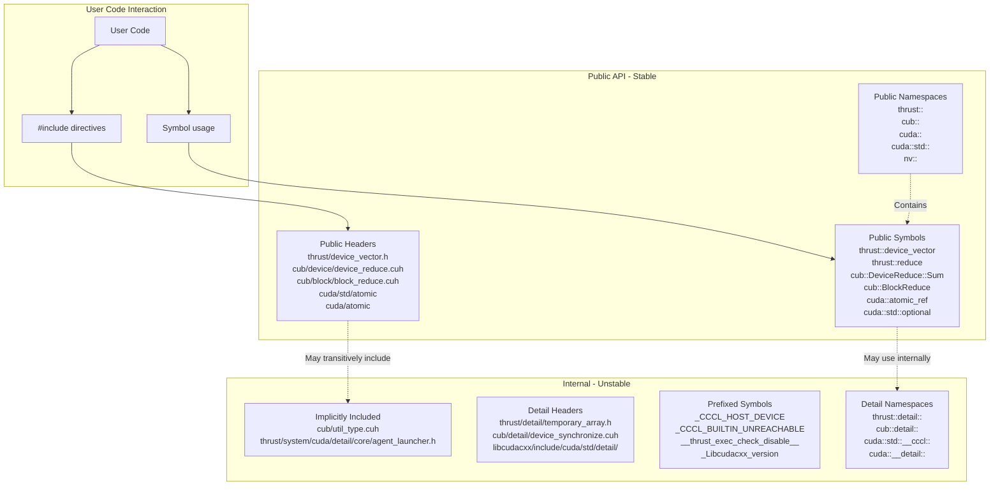
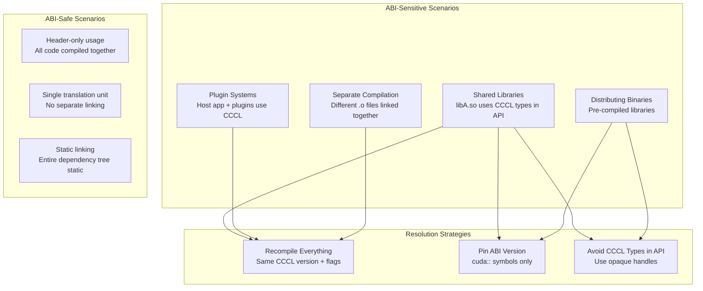
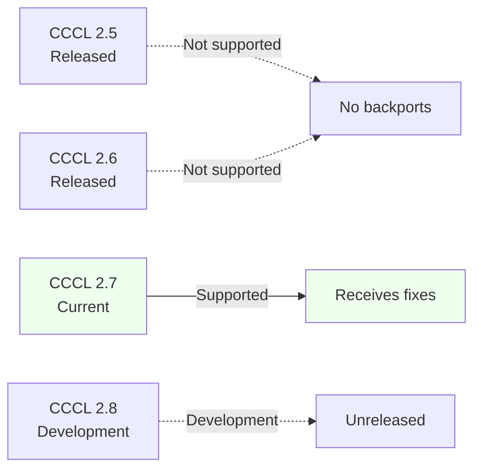
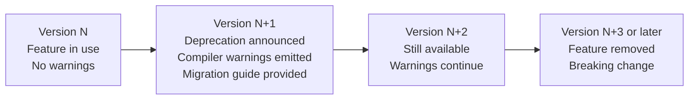

<!-- source: DeepWiki mcp.deepwiki.com · repo NVIDIA/cccl · page 6.2 API and ABI Stability · fetched 2026-10-26 -->

# API and ABI Stability

<details>
<summary>Relevant source files</summary>

The following files were used as context for generating this wiki page:

- [CONTRIBUTING.md](CONTRIBUTING.md)
- [README.md](README.md)

</details>


This page documents CCCL's guarantees around Application Programming Interface (API) and Application Binary Interface (ABI) stability. It explains what constitutes the public API, versioning policies, breaking change definitions, and namespace-specific ABI guarantees.

For information about CCCL's semantic versioning scheme and compatibility with CUDA Toolkit versions, see [Versioning Policy](#6.1). For supported platforms and compiler versions, see [Platform and Compiler Support](#6.3).

## Scope and Definitions

### Application Programming Interface (API)

CCCL's public API encompasses the entirety of functionality _intentionally_ exposed to provide the library's utility. This includes:

- Header file locations and names intended for direct inclusion (e.g., `thrust/device_vector.h`, `cub/block/block_reduce.cuh`, `cuda/std/atomic`)
- Namespaces intended for direct use (`thrust::`, `cub::`, `cuda::`, `nv::`)
- Declarations and definitions of functions, classes, and variables (e.g., `thrust::reduce`, `cub::DeviceReduce`, `cuda::atomic_ref`)
- Semantics and behavior of exposed symbols

**Sources:** [README.md:340-349]()

### What is NOT Part of the Public API

The following are explicitly excluded from the public API and may change at any time without warning:

| Category | Examples | Rationale |
|----------|----------|-----------|
| Prefixed symbols | `_CCCL_HOST_DEVICE`, `__cub_aligned_storage`, `_Thrust_less` | Internal implementation macros |
| Detail namespaces | `thrust::detail::`, `cub::detail::`, `cuda::std::__cccl::` | Internal utilities |
| Detail headers | `cub/detail/device_util.cuh`, `thrust/system/detail/generic/` | Implementation details |
| Detail in names | `__cccl_builtin_is_constant_evaluated`, `detail::temporary_array` | Internal helpers |
| Implicitly included headers | Headers transitively included by public headers | May change organization |

**Sources:** [README.md:350-359]()

### Application Binary Interface (ABI)

The ABI defines:
- Mangled names of functions and types
- Size and alignment of objects and types  
- Semantics of bytes in binary representations
- Inter-translation-unit component interactions

An **ABI Breaking Change** modifies any of these properties for a public API symbol.

**Sources:** [README.md:384-394]()

## Namespace-Specific Guarantees

CCCL provides different stability guarantees depending on which namespace a symbol resides in.



**Sources:** [README.md:398-408]()

### thrust:: and cub:: Namespaces

**API Stability:**
- Breaking changes only occur with CCCL major version increments
- Major version changes only coincide with new CUDA Toolkit major versions

**ABI Stability:**
- **No ABI guarantees** - may break at any time without warning
- ABI includes CUDA architectures used for compilation
- Same source compiled with different architectures produces different ABIs
- CUDA source (`-x cu`) vs C++ source (`-x cpp`) produces different ABIs

**Who Should Care:**
Users building binary artifacts (shared libraries, `.o` files) whose API includes `thrust::` or `cub::` types must recompile all components together with the same CCCL version and architecture flags.

**Sources:** [README.md:400-403]()

### cuda:: Namespace

**API Stability:**
- Breaking changes only occur with CCCL major version increments

**ABI Stability:**
- May break at any time
- **But:** ABI version number is incremented and embedded in an inline namespace (e.g., `cuda::__1::`, `cuda::__2::`)
- Multiple ABI versions supported concurrently
- Users can revert to prior ABI versions via `_LIBCUDACXX_ABI_VERSION` macro
- Details documented in [libcudacxx/docs/releases/versioning.md]()



**Example Scenario:**

Consider `libA.so` built with CCCL version 2.5 exposing:
```cpp
void foo(cuda::std::optional<int>);
```

If `libB.so` is compiled with CCCL version 3.0 and calls `foo()`, this can fail if the ABI changed between versions. However, because the ABI version is in the inline namespace:
- CCCL 2.5 uses `cuda::__1::optional`
- CCCL 3.0 uses `cuda::__2::optional`
- The mangled names differ (`foo(cuda::__1::std::optional<int>)` vs `foo(cuda::__2::std::optional<int>)`)
- This causes a link error rather than silent corruption
- User can define `_LIBCUDACXX_ABI_VERSION=1` when compiling `libB.so` to maintain compatibility

**Sources:** [README.md:404-408](), [README.md:410-421]()

## API Breaking Changes

### Definition

A **Breaking Change** is a modification to explicitly supported functionality between released versions requiring user code changes to upgrade.

Not all source-breaking changes constitute API Breaking Changes. The goal is balancing stability with evolution.

**Sources:** [README.md:331-337]()

### Breaking Change Policy

API breaking changes:
1. Only occur with CCCL major version increments
2. Only coincide with new CUDA Toolkit major versions (following [CUDA Minor Version Compatibility](https://docs.nvidia.com/deploy/cuda-compatibility/#minor-version-compatibility))
3. Require documented migration paths
4. Are preceded by deprecation warnings when feasible

**Sources:** [README.md:358-362]()

## Version Macros

CCCL provides version macros for querying the library version at compile time. All components share unified version numbers starting with CCCL 2.2.0.



### Macro Reference

| Library | Header | Major | Minor | Patch/Subminor | Concatenated |
|---------|--------|-------|-------|----------------|--------------|
| CCCL | `cuda/version` | `CCCL_MAJOR_VERSION` | `CCCL_MINOR_VERSION` | `CCCL_PATCH_VERSION` | `CCCL_VERSION` |
| libcudacxx | `cuda/std/version` | `_LIBCUDACXX_CUDA_API_VERSION_MAJOR` | `_LIBCUDACXX_CUDA_API_VERSION_MINOR` | `_LIBCUDACXX_CUDA_API_VERSION_PATCH` | `_LIBCUDACXX_CUDA_API_VERSION` |
| Thrust | `thrust/version.h` | `THRUST_MAJOR_VERSION` | `THRUST_MINOR_VERSION` | `THRUST_SUBMINOR_VERSION` | `THRUST_VERSION` |
| CUB | `cub/version.h` | `CUB_MAJOR_VERSION` | `CUB_MINOR_VERSION` | `CUB_SUBMINOR_VERSION` | `CUB_VERSION` |

### Usage Examples

```cpp
// Recommended: Use CCCL macros for version checking
#include <cuda/version>

#if CCCL_VERSION >= 003001000  // Check for CCCL 3.1.0 or later
  // Use new feature
#endif

// Check specific component if needed
#if CCCL_MAJOR_VERSION == 3 && CCCL_MINOR_VERSION >= 1
  // Code for CCCL 3.1+
#endif
```

```cpp
// Legacy: Component-specific macros (still supported)
#include <thrust/version.h>

#if THRUST_VERSION >= 00300100  // Thrust 3.1.0 in 8-digit format
  // Thrust-specific feature
#endif
```

**Notes:**
- CCCL and libcudacxx use `MMMmmmppp` format (9 digits): version 3.1.0 = `003001000`
- Thrust and CUB use `MMMmmmpp` format (8 digits, legacy): version 3.1.0 = `00300100`
- All version macros remain synchronized across libraries since CCCL 2.2.0
- **Prefer `CCCL_*` macros for new code** - they are the canonical source
- Macros are defined in: [libcudacxx/include/cuda/version](), [thrust/thrust/version.h](), [cub/cub/version.cuh]()

**Sources:** [README.md:372-386]()

## Compatibility Guidelines

Users should follow these guidelines to avoid depending on non-public API elements:

### Do Not Extend CCCL Namespaces

```cpp
// ❌ FORBIDDEN
namespace thrust {
  template<typename T>
  struct my_custom_allocator { /* ... */ };
}

// ❌ FORBIDDEN
namespace cub {
  struct MyCustomPolicy { /* ... */ };
}

// ✅ ALLOWED
namespace my_app {
  template<typename T>
  struct custom_allocator { /* ... */ };
}
```

**Rationale:** Adding declarations causes conflicts if CCCL adds a symbol with the same name.

**Exceptions:** Certain templates explicitly document that specialization is allowed:
- `cuda::std::iterator_traits` - documented in [libcudacxx/include/cuda/std/__iterator/iterator_traits.h]()
- `cuda::std::hash` - documented in [libcudacxx/include/cuda/std/__functional/hash.h]()
- `cuda::std::formatter` (C++20) - documented in [libcudacxx/include/cuda/std/__format/formatter.h]()

**Sources:** [README.md:426-431]()

### Do Not Take Addresses of CCCL Functions

```cpp
// ❌ FORBIDDEN
auto ptr = &thrust::reduce;

// ✅ ALLOWED - use lambda wrapper
auto wrapper = [](auto&&... args) {
  return thrust::reduce(std::forward<decltype(args)>(args)...);
};
```

**Rationale:** Taking function addresses prevents adding overloads.

**Sources:** [README.md:428-429]()

### Do Not Forward Declare CCCL Symbols

```cpp
// ❌ FORBIDDEN
namespace cuda::std {
  template<typename T> class optional;
}

// ✅ ALLOWED - include the header
#include <cuda/std/optional>
```

**Rationale:** Forward declarations break if signatures change or templates gain additional parameters.

**Sources:** [README.md:430-431]()

### Do Not Reference Internal Symbols

```cpp
// ❌ FORBIDDEN - detail namespace
using cub::detail::BlockReduceAlgorithm;

// ❌ FORBIDDEN - underscore prefix in macros
#define MY_MACRO _CCCL_UNREACHABLE()

// ❌ FORBIDDEN - underscore prefix in functions
auto x = __cccl_builtin_is_constant_evaluated();

// ❌ FORBIDDEN - detail in name
using thrust::system::cuda::detail::launch_kernel;

// ❌ FORBIDDEN - detail header
#include <cub/detail/device_synchronize.cuh>

// ✅ ALLOWED - public API only
using cub::BlockReduce;
#include <cub/block/block_reduce.cuh>
```

**Rationale:** Internal symbols may change, move, or be removed at any time without warning. They are implementation details not covered by stability guarantees.

**Sources:** [README.md:432-437]()

### Include What You Use

```cpp
// ❌ FRAGILE - relies on transitive includes
#include <thrust/device_vector.h>
// Assumes thrust::reduce is available

// ✅ ROBUST - explicit includes
#include <thrust/device_vector.h>
#include <thrust/reduce.h>
```

**Rationale:** Internal include organization may change without notice.

**Sources:** [README.md:434-435]()

## Public API Boundary Diagram



**Sources:** [README.md:342-359]()

## When to Care About ABI

### Scenarios Requiring ABI Awareness



### Example: Shared Library API

**Problematic Scenario - thrust::/cub:: Types in API:**
```cpp
// libA.so - compiled with CCCL 2.5, -arch=sm_70
#include <thrust/device_vector.h>
void process(thrust::device_vector<int>& data);

// libB.so - compiled with CCCL 2.6, -arch=sm_70
#include <thrust/device_vector.h>
thrust::device_vector<int> values = get_data();
process(values); // ❌ May fail: thrust::device_vector ABI not guaranteed stable
```

**Safe Alternative 1 - Recompile Everything:**
```cpp
// Recompile both libA.so and libB.so with:
// - Same CCCL version (e.g., both use 2.6)
// - Same CUDA architectures (e.g., both use -arch=sm_70)
// - Same compilation mode (both -x cu or both -x cpp)
```

**Safe Alternative 2 - Avoid CCCL Types in API:**
```cpp
// libA.so - Public API uses raw pointers
void process(int* data, size_t size);

// libB.so - CCCL types used internally only
#include <thrust/device_vector.h>
thrust::device_vector<int> values = get_data();
process(thrust::raw_pointer_cast(values.data()), values.size()); // ✅ Safe
```

**Safe Alternative 3 - Use cuda:: Types with ABI Versioning:**
```cpp
// libA.so - compiled with CCCL 2.5
#include <cuda/std/optional>
cuda::std::optional<int> get_value(); // Uses cuda::__1::optional internally

// libB.so - compiled with CCCL 3.0, but pins ABI version
#define _LIBCUDACXX_ABI_VERSION 1
#include <cuda/std/optional>
auto val = get_value(); // ✅ Safe: both use cuda::__1::optional
```

**Sources:** [README.md:398-421]()

## Version Support Policy

### Current Support

Only the most recently released CCCL version is supported. Features and bug fixes are not backported to previous releases.



### Upgrade Recommendation

Users are strongly encouraged to "live at head" - always use the latest CCCL version for:
- Latest bug fixes
- Performance improvements
- New features
- Security updates

**Sources:** [README.md:369-371]()

## Deprecation Process

### Deprecation Timeline



### Policy Details

- **Minimum deprecation period:** 2 minor releases before removal
- **High-impact changes:** May have longer deprecation periods (3-4 minor releases)
- **Notifications provided via:**
  - Programmatic compiler warnings using `[[deprecated]]` or `_CCCL_DEPRECATED`
  - Release notes and changelog
  - Migration guides in documentation
  - GitHub discussions for major changes

### Disabling Deprecation Warnings

Deprecation warnings can be disabled if needed:

```cpp
// Compiler-specific methods to disable warnings
#if defined(__GNUC__)
  #pragma GCC diagnostic push
  #pragma GCC diagnostic ignored "-Wdeprecated-declarations"
#elif defined(_MSC_VER)
  #pragma warning(push)
  #pragma warning(disable: 4996)
#endif

  auto result = deprecated_function(); // Warning suppressed

#if defined(__GNUC__)
  #pragma GCC diagnostic pop
#elif defined(_MSC_VER)
  #pragma warning(pop)
#endif
```

### Example Deprecation

```cpp
// CCCL 2.5 - Feature announced as deprecated
namespace thrust {
  // Will be removed in CCCL 2.8+
  // Use cuda::std::optional instead
  template<typename T>
  class [[deprecated("Use cuda::std::optional. Will be removed in 2.8+")]] optional;
}

// CCCL 2.6, 2.7 - Feature still available with warnings
// ... thrust::optional continues to work but emits warnings

// CCCL 2.8+ - Feature removed
// thrust::optional no longer exists
// Users must migrate to cuda::std::optional
```

**Sources:** [README.md:439-449]()

## Related Documentation

- For semantic versioning details and CUDA Toolkit compatibility, see [Versioning Policy](#6.1)
- For supported compilers, platforms, and architectures, see [Platform and Compiler Support](#6.3)
- For libcudacxx-specific ABI versioning details, see [libcudacxx/docs/releases/versioning.md]()

**Sources:** [README.md:263](), [README.md:404]()

---

