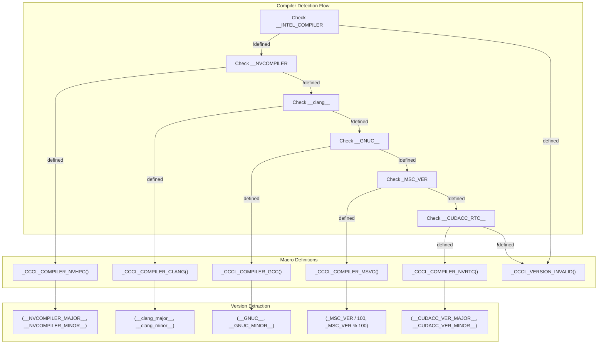
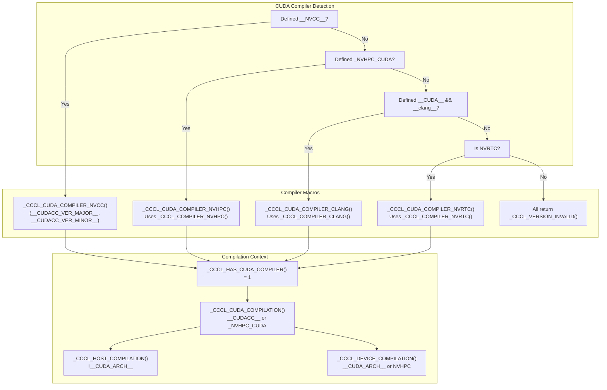
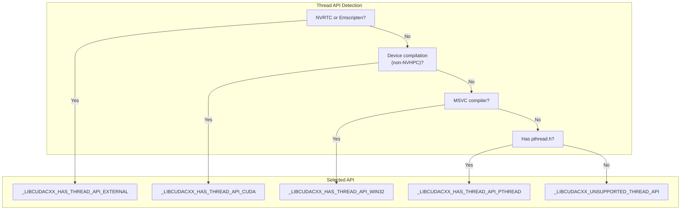
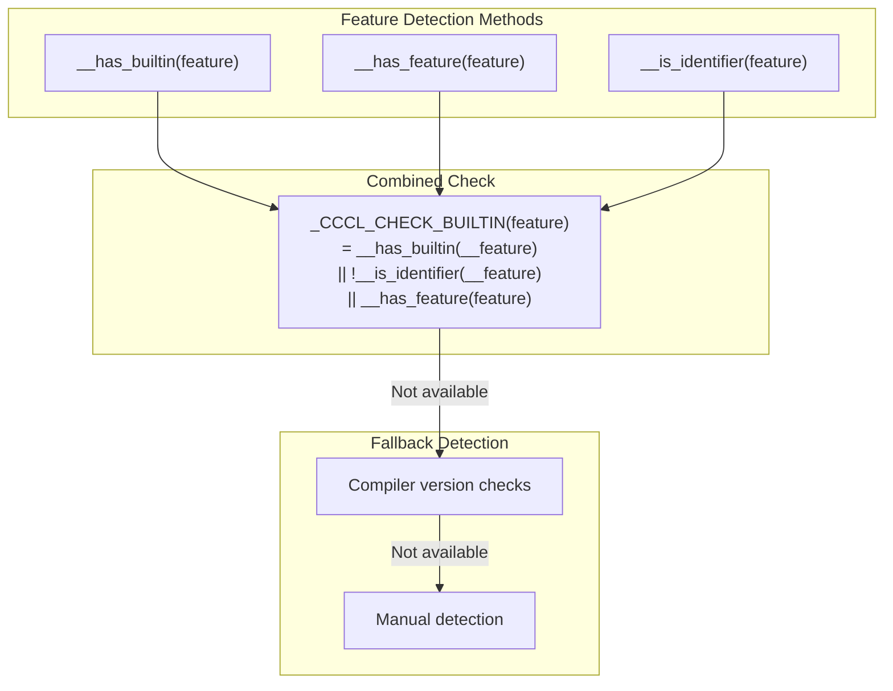
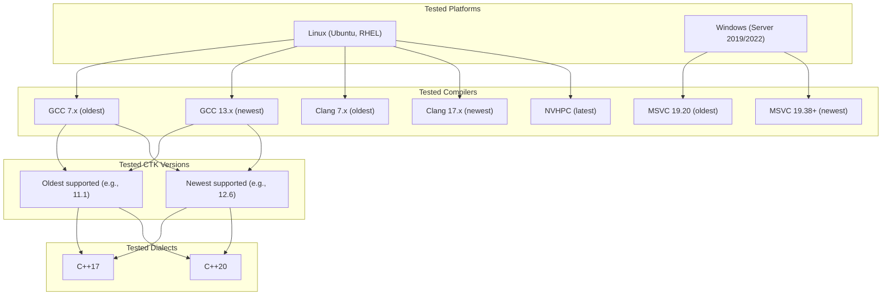

<!-- source: DeepWiki mcp.deepwiki.com · repo NVIDIA/cccl · page 6.3 Platform and Compiler Support · fetched 2026-10-26 -->

# Platform and Compiler Support

<details>
<summary>Relevant source files</summary>

The following files were used as context for generating this wiki page:

- [CONTRIBUTING.md](CONTRIBUTING.md)
- [README.md](README.md)
- [docs/libcudacxx/extended_api/type_traits/is_floating_point.rst](docs/libcudacxx/extended_api/type_traits/is_floating_point.rst)
- [lib/cmake/thrust/FindTBB.cmake](lib/cmake/thrust/FindTBB.cmake)
- [libcudacxx/include/cuda/__type_traits/is_floating_point.h](libcudacxx/include/cuda/__type_traits/is_floating_point.h)
- [libcudacxx/include/cuda/std/__atomic/functions/cuda_ptx_generated_helper.h](libcudacxx/include/cuda/std/__atomic/functions/cuda_ptx_generated_helper.h)
- [libcudacxx/include/cuda/std/__cccl/compiler.h](libcudacxx/include/cuda/std/__cccl/compiler.h)
- [libcudacxx/include/cuda/std/__cccl/cuda_toolkit.h](libcudacxx/include/cuda/std/__cccl/cuda_toolkit.h)
- [libcudacxx/include/cuda/std/__cccl/diagnostic.h](libcudacxx/include/cuda/std/__cccl/diagnostic.h)
- [libcudacxx/include/cuda/std/__cccl/dialect.h](libcudacxx/include/cuda/std/__cccl/dialect.h)
- [libcudacxx/include/cuda/std/__cccl/extended_data_types.h](libcudacxx/include/cuda/std/__cccl/extended_data_types.h)
- [libcudacxx/include/cuda/std/__cccl/system_header.h](libcudacxx/include/cuda/std/__cccl/system_header.h)
- [libcudacxx/include/cuda/std/__functional/bind_front.h](libcudacxx/include/cuda/std/__functional/bind_front.h)
- [libcudacxx/include/cuda/std/__functional/not_fn.h](libcudacxx/include/cuda/std/__functional/not_fn.h)
- [libcudacxx/include/cuda/std/__internal/atomic.h](libcudacxx/include/cuda/std/__internal/atomic.h)
- [libcudacxx/include/cuda/std/__internal/features.h](libcudacxx/include/cuda/std/__internal/features.h)
- [libcudacxx/include/cuda/std/__type_traits/is_extended_floating_point.h](libcudacxx/include/cuda/std/__type_traits/is_extended_floating_point.h)
- [libcudacxx/include/cuda/std/__type_traits/type_list.h](libcudacxx/include/cuda/std/__type_traits/type_list.h)
- [libcudacxx/include/cuda/std/__utility/declval.h](libcudacxx/include/cuda/std/__utility/declval.h)
- [libcudacxx/test/libcudacxx/cuda/iterators/transform_input_output_iterator/types.h](libcudacxx/test/libcudacxx/cuda/iterators/transform_input_output_iterator/types.h)
- [libcudacxx/test/libcudacxx/cuda/iterators/transform_output_iterator/types.h](libcudacxx/test/libcudacxx/cuda/iterators/transform_output_iterator/types.h)
- [libcudacxx/test/libcudacxx/cuda/test_platform.pass.cpp](libcudacxx/test/libcudacxx/cuda/test_platform.pass.cpp)
- [libcudacxx/test/libcudacxx/cuda/type_list.pass.cpp](libcudacxx/test/libcudacxx/cuda/type_list.pass.cpp)
- [libcudacxx/test/libcudacxx/libcxx/utilities/meta/meta.unary/meta.unary.cat/is_floating_point.pass.cpp](libcudacxx/test/libcudacxx/libcxx/utilities/meta/meta.unary/meta.unary.cat/is_floating_point.pass.cpp)
- [libcudacxx/test/libcudacxx/std/utilities/memory/ptr.align/align.pass.cpp](libcudacxx/test/libcudacxx/std/utilities/memory/ptr.align/align.pass.cpp)
- [libcudacxx/test/libcudacxx/std/utilities/meta/meta.unary/meta.unary.cat/is_floating_point.pass.cpp](libcudacxx/test/libcudacxx/std/utilities/meta/meta.unary/meta.unary.cat/is_floating_point.pass.cpp)
- [libcudacxx/test/support/test_macros.h](libcudacxx/test/support/test_macros.h)

</details>


## Purpose and Scope

This document provides detailed information about the platforms, compilers, GPU architectures, and C++ language versions supported by CCCL. It includes minimum version requirements, testing coverage, and the mechanisms used to detect and adapt to different compilation environments.

For information about CUDA Toolkit compatibility and versioning, see [Versioning Policy](#6.1). For ABI/API stability guarantees, see [API and ABI Stability](#6.2).

---

## Overview

CCCL aims to support all platforms and compilers supported by the current CUDA Toolkit. However, the library maintains explicit minimum requirements for host compilers and C++ dialects to ensure code quality and maintainability. All supported configurations are validated through continuous integration testing.

**Sources**: [README.md:220-313]()

---

## Host Compilers

### Supported Compilers and Minimum Versions

CCCL supports the following host compilers with the specified minimum versions:

| Compiler | Minimum Version | Detection Macro | Notes |
|----------|----------------|-----------------|-------|
| **GCC** | 7.0 | `_CCCL_COMPILER(GCC)` | Required on Linux |
| **Clang** | 7.0 | `_CCCL_COMPILER(CLANG)` | Includes AppleClang |
| **MSVC** | 19.20 (VS 2019 16.0) | `_CCCL_COMPILER(MSVC)` | Minimum supported; older versions hard error |
| **NVHPC** | Any | `_CCCL_COMPILER(NVHPC)` | NVIDIA HPC SDK compiler |
| **NVRTC** | Any | `_CCCL_COMPILER(NVRTC)` | Runtime compilation |

Compilers below the minimum versions will trigger deprecation warnings unless `CCCL_IGNORE_DEPRECATED_COMPILER` is defined. MSVC versions below 19.20 will trigger a hard error unless `CCCL_IGNORE_DEPRECATED_COMPILER` is defined.

**Sources**: [README.md:271-283](), [cub/cub/util_cpp_dialect.cuh:72-80](), [thrust/thrust/detail/config/cpp_dialect.h:57-65]()

### Compiler Detection System

#### Host Compiler Detection Diagram



The compiler detection system uses a cascading check of predefined macros to identify the host compiler. Each compiler is assigned a version tuple `(major, minor)` or `_CCCL_VERSION_INVALID()` if not detected.

**Sources**: [libcudacxx/include/cuda/std/__cccl/compiler.h:66-100]()

### Version Comparison System

CCCL provides a generic version comparison macro `_CCCL_COMPILER(COMPILER, OP, MAJOR, [MINOR])` that supports various comparison operations:

```cpp
// Check if compiler is present (non-zero version)
_CCCL_COMPILER(GCC)

// Compare major version only
_CCCL_COMPILER(GCC, >=, 9)

// Compare major and minor version
_CCCL_COMPILER(MSVC, <, 19, 24)
_CCCL_COMPILER(CLANG, ==, 15, 0)
```

The version comparison uses `_CCCL_COMPILER_MAKE_VERSION(MAJOR, MINOR)` which computes `(MAJOR * 100 + MINOR)` for numeric comparison.

**Sources**: [libcudacxx/include/cuda/std/__cccl/compiler.h:16-55]()

---

## CUDA Compilers

### Supported CUDA Compilers

CCCL supports the following CUDA compiler implementations:

| CUDA Compiler | Detection Macro | Version Macro | Notes |
|---------------|-----------------|---------------|-------|
| **NVCC** | `_CCCL_CUDA_COMPILER(NVCC)` | `__NVCC__`, `__CUDACC__` | Primary CUDA compiler from NVIDIA |
| **NVHPC (nvc++)** | `_CCCL_CUDA_COMPILER(NVHPC)` | `_NVHPC_CUDA` | Compiles host and device simultaneously |
| **Clang (CUDA mode)** | `_CCCL_CUDA_COMPILER(CLANG)` | `__CUDA__` with `__clang__` | Clang with CUDA support |
| **NVRTC** | `_CCCL_CUDA_COMPILER(NVRTC)` | `__CUDACC_RTC__` | Runtime compilation |

**Important**: CCCL requires CUDA Toolkit 12.0 or later. Versions below 12 will trigger a hard error unless `CCCL_IGNORE_DEPRECATED_CUDA_BELOW_12` is defined.

**Sources**: [libcudacxx/include/cuda/std/__cccl/compiler.h:112-124](), [libcudacxx/include/cuda/std/__cccl/compiler.h:171-173]()

### CUDA Compilation Context Detection

CCCL distinguishes between different compilation contexts:

| Macro | Condition | Description |
|-------|-----------|-------------|
| `_CCCL_HAS_CUDA_COMPILER()` | Any CUDA compiler detected | CUDA compiler available (may be compiling C++ file) |
| `_CCCL_CUDA_COMPILATION()` | `__CUDACC__` or NVHPC | Compiling a `.cu` file |
| `_CCCL_HOST_COMPILATION()` | `!__CUDA_ARCH__` | Host code pass (includes C++ compilation) |
| `_CCCL_DEVICE_COMPILATION()` | `__CUDA_ARCH__` or NVHPC | Device code pass |

**Note**: When using NVHPC (`nvc++`), both `_CCCL_HOST_COMPILATION()` and `_CCCL_DEVICE_COMPILATION()` return true because NVHPC compiles host and device code in a single pass.

**Sources**: [libcudacxx/include/cuda/std/__cccl/compiler.h:126-150]()

#### CUDA Compiler Detection Diagram



**Sources**: [libcudacxx/include/cuda/std/__cccl/compiler.h:106-150]()

### CUDA Toolkit Version Checking

CCCL provides macros to check the CUDA Toolkit version when compiling `.cu` files:

```cpp
// Version tuple for active CUDA compilation
_CCCL_CUDACC()  // Returns (major, minor) or _CCCL_VERSION_INVALID()

// Convenience comparison macros
_CCCL_CUDACC_BELOW(12, 7)     // CTK version < 12.7
_CCCL_CUDACC_AT_LEAST(12, 7)  // CTK version >= 12.7
_CCCL_CUDACC_EQUAL(12, 7)     // CTK version == 12.7
```

For NVCC and NVHPC, the version is extracted from `__CUDACC_VER_MAJOR__` and `__CUDACC_VER_MINOR__`. For Clang-CUDA, the version is derived from the `CUDA_VERSION` macro as `(CUDA_VERSION / 1000, (CUDA_VERSION % 1000) / 10)`.

**Sources**: [libcudacxx/include/cuda/std/__cccl/compiler.h:152-169]()

---

## Operating Systems

Unless otherwise specified, CCCL supports all operating systems supported by the CUDA Toolkit:

| Operating System | Documentation |
|-----------------|---------------|
| **Linux** | [Linux System Requirements](https://docs.nvidia.com/cuda/cuda-installation-guide-linux/index.html#system-requirements) |
| **Windows** | [Windows System Requirements](https://docs.nvidia.com/cuda/cuda-installation-guide-microsoft-windows/index.html#system-requirements) |

CCCL provides macros to detect the target operating system:

| Macro | Platform | Notes |
|-------|----------|-------|
| `_CCCL_OS(WINDOWS)` | Windows | Includes NVRTC LLP64 model |
| `_CCCL_OS(LINUX)` | Linux | Includes NVRTC LP64 model |
| `_CCCL_OS(ANDROID)` | Android | |
| `_CCCL_OS(QNX)` | QNX | |
| `_CCCL_OS(APPLE)` | macOS/iOS | |

**Sources**: [README.md:265-269]()

### Thread API Selection

CCCL automatically selects an appropriate threading API based on the platform and compiler:



**Sources**: [libcudacxx/include/cuda/std/detail/libcxx/include/__config:74-103]()

---

## GPU Architectures

CCCL supports all GPU architectures supported by the **current major CUDA Toolkit version**. While CCCL maintains backward compatibility with two CTK major versions for compilation, only architectures supported by the latest CTK are guaranteed to work.

### Architecture Support Policy

**Example**: CCCL 3.0 supports compiling with CTK 12.x and 13.x:
- CUDA Toolkit 13.x supports `sm_75` and newer
- CUDA Toolkit 12.x supports `sm_50` and newer

Even when compiling CCCL 3.0 with CTK 12.x, only architectures supported by CTK 13.x (`sm_75`+) are guaranteed to work.

**Note**: Some features may be specific to certain architectures. For architecture-specific feature detection, use the `NV_PROVIDES_SM_XX` and `NV_IS_EXACTLY_SM_XX` target macros.

**Sources**: [README.md:287-297]()

---

## C++ Language Dialects

### Minimum C++ Standard

CCCL requires **C++17 or later**. Attempting to compile with C++14 or earlier will result in a compilation error unless `CCCL_IGNORE_DEPRECATED_CPP_DIALECT` is defined.

| C++ Standard | Support Status | Macro |
|--------------|----------------|-------|
| **C++17** | Minimum required | `_CCCL_STD_VER >= 2017` |
| **C++20** | Fully supported | `_CCCL_STD_VER >= 2020` |
| **C++23** | Partially supported | `_CCCL_STD_VER >= 2023` |

The `_CCCL_STD_VER` macro expands to the year corresponding to the C++ standard (e.g., 2017 for C++17).

**Sources**: [README.md:299-301](), [cub/cub/util_cpp_dialect.cuh:87-91](), [thrust/thrust/detail/config/cpp_dialect.h:71-76](), [libcudacxx/include/cuda/std/__internal/cpp_dialect.h:38-42]()

### Dialect-Specific Features

CCCL provides macros to conditionally enable features based on the C++ standard:

```cpp
// Constexpr support for C++20 and later
_CCCL_CONSTEXPR_CXX20

// Constexpr support for C++23 and later
_CCCL_CONSTEXPR_CXX23
```

**Sources**: [.clang-format:28-29]()

---

## Compiler Feature Detection

CCCL includes a comprehensive system for detecting and abstracting compiler features to provide portable implementations across different compilers and versions.

### Builtin Detection Mechanism

The builtin detection system uses three primary mechanisms:



**Sources**: [libcudacxx/include/cuda/std/__cccl/builtin.h:29-67]()

### Example: Builtin Addressof Detection

The `__builtin_addressof` detection demonstrates the multi-tiered approach:

```cpp
#if _CCCL_CHECK_BUILTIN(builtin_addressof) || \
    _CCCL_COMPILER(GCC, >=, 7) || \
    _CCCL_COMPILER(MSVC) || \
    _CCCL_COMPILER(NVHPC) || \
    _CCCL_COMPILER(NVRTC, >=, 12, 3)
#  define _CCCL_BUILTIN_ADDRESSOF(...) __builtin_addressof(__VA_ARGS__)
#endif
```

This uses:
1. `_CCCL_CHECK_BUILTIN` for automatic detection
2. Explicit version checks for compilers with known support
3. Falls back to undefined if not supported

**Sources**: [libcudacxx/include/cuda/std/__cccl/builtin.h:93-97]()

### Attribute Detection

CCCL provides macros to detect compiler attributes:

```cpp
// Detect C++ attributes
_CCCL_HAS_CPP_ATTRIBUTE(no_unique_address)

// Detect GNU-style attributes
_CCCL_HAS_ATTRIBUTE(__nodebug__)

// Detect declspec attributes
_CCCL_HAS_DECLSPEC_ATTRIBUTE(empty_bases)
```

**Sources**: [libcudacxx/include/cuda/std/__cccl/attributes.h:30-46]()

### Compiler-Specific Workarounds

CCCL maintains a database of compiler-specific issues and workarounds:

| Builtin/Feature | Workaround | Reason |
|-----------------|-----------|---------|
| `__builtin_popcountg` | Disabled for NVCC | NVCC cannot handle this builtin |
| `__builtin_clzg`, `__builtin_ctzg` | Disabled for NVCC | Same issue as popcountg |
| `__builtin_bswap*` | Disabled for NVCC | NVCC cannot handle bswap builtins |
| `__builtin_memcmp` | Disabled for NVCC/Clang-CUDA | Causes issues in CUDA compilation |
| `[[no_unique_address]]` | Disabled for MSVC | Causes silent runtime corruption |
| `[[no_unique_address]]` | Disabled for Clang+NVCC+C++17 | nvbug 5265027: cudafe++ doesn't honor it |

**Sources**: [libcudacxx/include/cuda/std/__cccl/builtin.h:129-183](), [libcudacxx/include/cuda/std/__cccl/attributes.h:159-180]()

---

## Testing Coverage

CCCL's testing strategy balances comprehensive coverage with reasonable CI times by testing critical configurations.

### Testing Matrix Strategy

**CUDA Toolkit Versions**: Tests are run against both the oldest and newest supported CTK versions. For example, if CCCL 2.x supports CTK 11.1-12.x, tests run against:
- CTK 11.1 (oldest supported)
- CTK 12.6 (newest at time of release)

**Host Compilers**: All supported host compilers are tested with each CTK version.

**C++ Dialects**: Both C++17 and C++20 are tested for each compiler configuration.

**GPU Architectures**: A representative subset of architectures is tested (e.g., `sm_60`, `sm_70`, `sm_80`, `sm_90`).

The definitive testing matrix is specified in `ci/matrix.yaml`. For a detailed overview of the CI pipeline, see the [CI Overview](https://github.com/NVIDIA/cccl/blob/main/ci-overview.md).

**Sources**: [README.md:303-313]()

### CI Platform Coverage



**Sources**: [README.md:303-313]()

---

## Diagnostic Control

CCCL provides a portable diagnostic control system to suppress compiler warnings across different compilers.

### Per-Compiler Diagnostic Macros

```cpp
// Generic push/pop
_CCCL_DIAG_PUSH
_CCCL_DIAG_POP

// Compiler-specific suppression
_CCCL_DIAG_SUPPRESS_CLANG("-Wdeprecated")
_CCCL_DIAG_SUPPRESS_GCC("-Wunused-variable")
_CCCL_DIAG_SUPPRESS_MSVC(4996)
_CCCL_DIAG_SUPPRESS_NVHPC(deprecated_entity)

// NVCC/NVRTC diagnostics
_CCCL_DIAG_SUPPRESS_NVCC(1444)
_CCCL_BEGIN_NV_DIAG_SUPPRESS(1444, 20199)
_CCCL_END_NV_DIAG_SUPPRESS()
```

### Convenience Macros

```cpp
// Suppress deprecation warnings across all compilers
_CCCL_SUPPRESS_DEPRECATED_PUSH
// ... code using deprecated features ...
_CCCL_SUPPRESS_DEPRECATED_POP
```

**Sources**: [libcudacxx/include/cuda/std/__cccl/diagnostic.h:25-122]()

---

## Summary Table: Supported Configurations

| Component | Minimum Requirement | Current Support |
|-----------|---------------------|-----------------|
| **C++ Standard** | C++17 | C++17, C++20, partial C++23 |
| **GCC** | 7.0 | 7.0+ |
| **Clang** | 7.0 | 7.0+ |
| **MSVC** | 19.20 (VS 2019) | 19.20+ |
| **NVHPC** | Any | All versions |
| **NVRTC** | Any | All versions |
| **CUDA Toolkit** | 12.0 | 12.x, 13.x (latest two major versions) |
| **GPU Architecture** | sm_75+ (current CTK) | All architectures supported by current major CTK |
| **Operating Systems** | Per CUDA Toolkit | Linux, Windows (per CTK documentation) |

**Sources**: [README.md:220-313](), [libcudacxx/include/cuda/std/__cccl/compiler.h](), [cub/cub/util_cpp_dialect.cuh:72-91]()