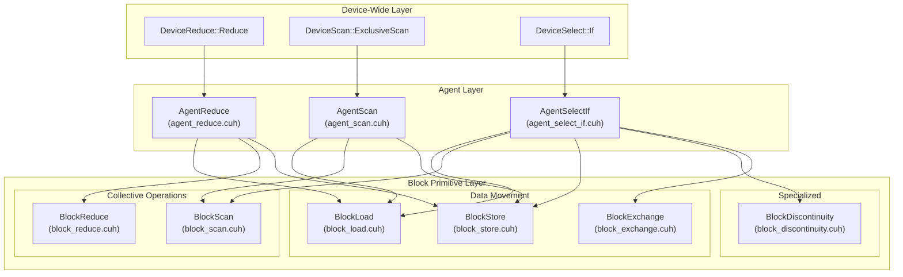
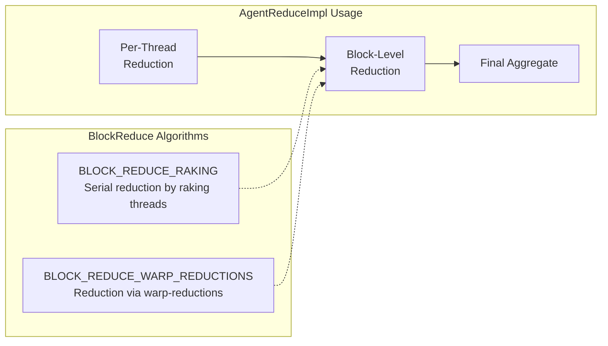
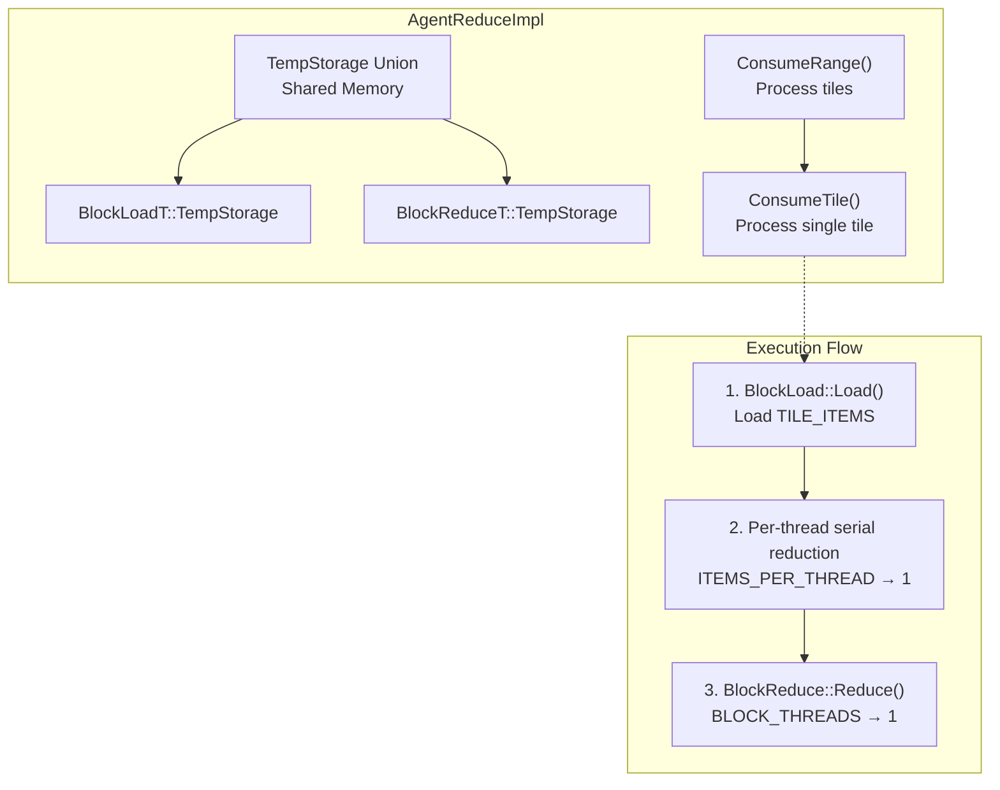
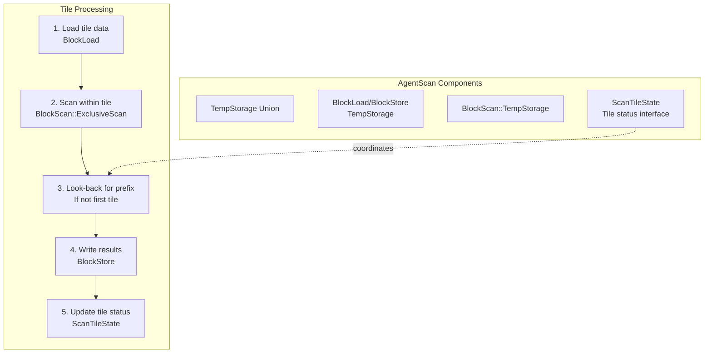
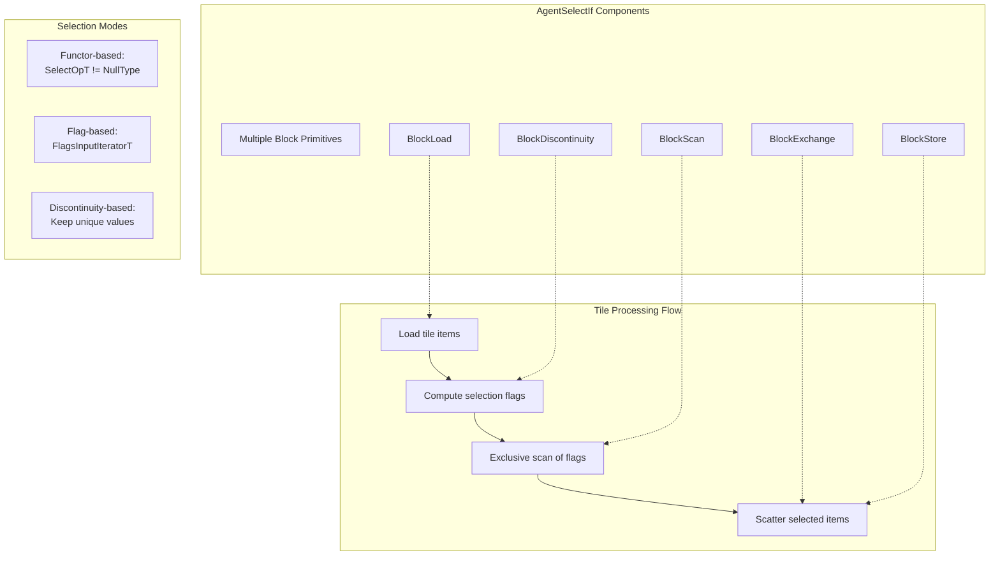
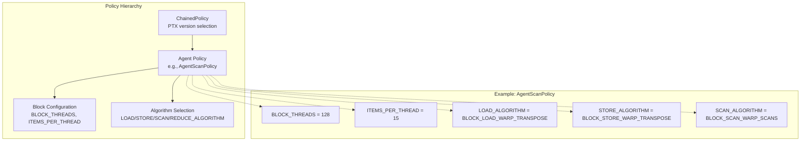

<!-- source: DeepWiki mcp.deepwiki.com · repo NVIDIA/cccl · extra page Block-Level Primitives · fetched 2026-10-26 -->

# Block-Level Primitives

<details>
<summary>Relevant source files</summary>

The following files were used as context for generating this wiki page:

- [c2h/include/c2h/bfloat16.cuh](c2h/include/c2h/bfloat16.cuh)
- [c2h/include/c2h/catch2_test_helper.h](c2h/include/c2h/catch2_test_helper.h)
- [c2h/include/c2h/half.cuh](c2h/include/c2h/half.cuh)
- [c2h/include/c2h/test_util_vec.h](c2h/include/c2h/test_util_vec.h)
- [ci/util/memmon.sh](ci/util/memmon.sh)
- [cub/cub/agent/agent_radix_sort_downsweep.cuh](cub/cub/agent/agent_radix_sort_downsweep.cuh)
- [cub/cub/agent/agent_radix_sort_histogram.cuh](cub/cub/agent/agent_radix_sort_histogram.cuh)
- [cub/cub/agent/agent_radix_sort_onesweep.cuh](cub/cub/agent/agent_radix_sort_onesweep.cuh)
- [cub/cub/agent/agent_radix_sort_upsweep.cuh](cub/cub/agent/agent_radix_sort_upsweep.cuh)
- [cub/cub/agent/agent_reduce.cuh](cub/cub/agent/agent_reduce.cuh)
- [cub/cub/agent/agent_reduce_by_key.cuh](cub/cub/agent/agent_reduce_by_key.cuh)
- [cub/cub/agent/agent_rle.cuh](cub/cub/agent/agent_rle.cuh)
- [cub/cub/agent/agent_scan.cuh](cub/cub/agent/agent_scan.cuh)
- [cub/cub/agent/agent_scan_by_key.cuh](cub/cub/agent/agent_scan_by_key.cuh)
- [cub/cub/agent/agent_segmented_radix_sort.cuh](cub/cub/agent/agent_segmented_radix_sort.cuh)
- [cub/cub/agent/agent_segmented_scan.cuh](cub/cub/agent/agent_segmented_scan.cuh)
- [cub/cub/agent/agent_select_if.cuh](cub/cub/agent/agent_select_if.cuh)
- [cub/cub/agent/agent_three_way_partition.cuh](cub/cub/agent/agent_three_way_partition.cuh)
- [cub/cub/agent/agent_unique_by_key.cuh](cub/cub/agent/agent_unique_by_key.cuh)
- [cub/cub/agent/single_pass_scan_operators.cuh](cub/cub/agent/single_pass_scan_operators.cuh)
- [cub/cub/detail/choose_offset.cuh](cub/cub/detail/choose_offset.cuh)
- [cub/cub/device/device_adjacent_difference.cuh](cub/cub/device/device_adjacent_difference.cuh)
- [cub/cub/device/device_histogram.cuh](cub/cub/device/device_histogram.cuh)
- [cub/cub/device/device_partition.cuh](cub/cub/device/device_partition.cuh)
- [cub/cub/device/device_segmented_radix_sort.cuh](cub/cub/device/device_segmented_radix_sort.cuh)
- [cub/cub/device/device_segmented_scan.cuh](cub/cub/device/device_segmented_scan.cuh)
- [cub/cub/device/device_segmented_sort.cuh](cub/cub/device/device_segmented_sort.cuh)
- [cub/cub/device/device_select.cuh](cub/cub/device/device_select.cuh)
- [cub/cub/device/dispatch/dispatch_adjacent_difference.cuh](cub/cub/device/dispatch/dispatch_adjacent_difference.cuh)
- [cub/cub/device/dispatch/dispatch_histogram.cuh](cub/cub/device/dispatch/dispatch_histogram.cuh)
- [cub/cub/device/dispatch/dispatch_reduce_by_key.cuh](cub/cub/device/dispatch/dispatch_reduce_by_key.cuh)
- [cub/cub/device/dispatch/dispatch_rle.cuh](cub/cub/device/dispatch/dispatch_rle.cuh)
- [cub/cub/device/dispatch/dispatch_scan.cuh](cub/cub/device/dispatch/dispatch_scan.cuh)
- [cub/cub/device/dispatch/dispatch_scan_by_key.cuh](cub/cub/device/dispatch/dispatch_scan_by_key.cuh)
- [cub/cub/device/dispatch/dispatch_segmented_scan.cuh](cub/cub/device/dispatch/dispatch_segmented_scan.cuh)
- [cub/cub/device/dispatch/dispatch_select_if.cuh](cub/cub/device/dispatch/dispatch_select_if.cuh)
- [cub/cub/device/dispatch/dispatch_three_way_partition.cuh](cub/cub/device/dispatch/dispatch_three_way_partition.cuh)
- [cub/cub/device/dispatch/dispatch_unique_by_key.cuh](cub/cub/device/dispatch/dispatch_unique_by_key.cuh)
- [cub/cub/device/dispatch/kernels/kernel_scan.cuh](cub/cub/device/dispatch/kernels/kernel_scan.cuh)
- [cub/cub/device/dispatch/kernels/kernel_segmented_scan.cuh](cub/cub/device/dispatch/kernels/kernel_segmented_scan.cuh)
- [cub/cub/device/dispatch/tuning/tuning_adjacent_difference.cuh](cub/cub/device/dispatch/tuning/tuning_adjacent_difference.cuh)
- [cub/cub/device/dispatch/tuning/tuning_batch_memcpy.cuh](cub/cub/device/dispatch/tuning/tuning_batch_memcpy.cuh)
- [cub/cub/device/dispatch/tuning/tuning_for.cuh](cub/cub/device/dispatch/tuning/tuning_for.cuh)
- [cub/cub/device/dispatch/tuning/tuning_merge_sort.cuh](cub/cub/device/dispatch/tuning/tuning_merge_sort.cuh)
- [cub/cub/device/dispatch/tuning/tuning_run_length_encode.cuh](cub/cub/device/dispatch/tuning/tuning_run_length_encode.cuh)
- [cub/cub/device/dispatch/tuning/tuning_scan.cuh](cub/cub/device/dispatch/tuning/tuning_scan.cuh)
- [cub/cub/device/dispatch/tuning/tuning_scan_by_key.cuh](cub/cub/device/dispatch/tuning/tuning_scan_by_key.cuh)
- [cub/cub/device/dispatch/tuning/tuning_segmented_scan.cuh](cub/cub/device/dispatch/tuning/tuning_segmented_scan.cuh)
- [cub/cub/device/dispatch/tuning/tuning_segmented_sort.cuh](cub/cub/device/dispatch/tuning/tuning_segmented_sort.cuh)
- [cub/cub/device/dispatch/tuning/tuning_select_if.cuh](cub/cub/device/dispatch/tuning/tuning_select_if.cuh)
- [cub/cub/device/dispatch/tuning/tuning_three_way_partition.cuh](cub/cub/device/dispatch/tuning/tuning_three_way_partition.cuh)
- [cub/cub/device/dispatch/tuning/tuning_unique_by_key.cuh](cub/cub/device/dispatch/tuning/tuning_unique_by_key.cuh)
- [cub/cub/util_math.cuh](cub/cub/util_math.cuh)
- [cub/cub/util_ptx.cuh](cub/cub/util_ptx.cuh)
- [cub/cub/util_type.cuh](cub/cub/util_type.cuh)
- [cub/test/CMakeLists.txt](cub/test/CMakeLists.txt)
- [cub/test/catch2_test_block_radix_sort.cuh](cub/test/catch2_test_block_radix_sort.cuh)
- [cub/test/catch2_test_device_reduce.cu](cub/test/catch2_test_device_reduce.cu)
- [cub/test/catch2_test_device_reduce.cuh](cub/test/catch2_test_device_reduce.cuh)
- [cub/test/catch2_test_device_reduce_by_key.cu](cub/test/catch2_test_device_reduce_by_key.cu)
- [cub/test/catch2_test_device_reduce_by_key_iterators.cu](cub/test/catch2_test_device_reduce_by_key_iterators.cu)
- [cub/test/catch2_test_device_reduce_fp_inf.cu](cub/test/catch2_test_device_reduce_fp_inf.cu)
- [cub/test/catch2_test_device_reduce_iterators.cu](cub/test/catch2_test_device_reduce_iterators.cu)
- [cub/test/catch2_test_device_scan.cu](cub/test/catch2_test_device_scan.cu)
- [cub/test/catch2_test_device_scan.cuh](cub/test/catch2_test_device_scan.cuh)
- [cub/test/catch2_test_device_scan_alignment.cu](cub/test/catch2_test_device_scan_alignment.cu)
- [cub/test/catch2_test_device_scan_by_key.cu](cub/test/catch2_test_device_scan_by_key.cu)
- [cub/test/catch2_test_device_scan_iterators.cu](cub/test/catch2_test_device_scan_iterators.cu)
- [cub/test/catch2_test_device_scan_large_offsets.cu](cub/test/catch2_test_device_scan_large_offsets.cu)
- [cub/test/catch2_test_device_segmented_reduce.cu](cub/test/catch2_test_device_segmented_reduce.cu)
- [cub/test/catch2_test_device_segmented_reduce_iterators.cu](cub/test/catch2_test_device_segmented_reduce_iterators.cu)
- [cub/test/catch2_test_device_segmented_reduce_iterators_64bit.cu](cub/test/catch2_test_device_segmented_reduce_iterators_64bit.cu)
- [cub/test/catch2_test_device_segmented_scan.cu](cub/test/catch2_test_device_segmented_scan.cu)
- [cub/test/catch2_test_device_segmented_scan_api.cu](cub/test/catch2_test_device_segmented_scan_api.cu)
- [cub/test/catch2_test_device_segmented_scan_noncommutative.cu](cub/test/catch2_test_device_segmented_scan_noncommutative.cu)
- [cub/test/catch2_test_iterator.cu](cub/test/catch2_test_iterator.cu)
- [cub/test/catch2_test_util_choose_offset.cu](cub/test/catch2_test_util_choose_offset.cu)
- [cub/test/catch2_test_util_math.cu](cub/test/catch2_test_util_math.cu)
- [cub/test/catch2_test_util_type.cu](cub/test/catch2_test_util_type.cu)
- [cub/test/test_util.h](cub/test/test_util.h)
- [thrust/testing/cuda/unique.cu](thrust/testing/cuda/unique.cu)
- [thrust/testing/unittest/system.h](thrust/testing/unittest/system.h)

</details>


## Purpose and Scope

Block-level primitives in CUB are cooperative CUDA thread block operations that enable efficient parallel computation within a single thread block. These primitives provide building blocks for implementing custom CUDA kernels and are internally used by CUB's device-wide algorithms through the Agent abstraction layer.

**Scope**: This document covers CUB's block-level primitives that operate within a single thread block using shared memory for thread cooperation. For device-wide operations that coordinate multiple thread blocks across an entire GPU, see [Device-Wide Operations](#2.2.1). For the Agent layer that composes these primitives into reusable thread block logic, see [Agent-Based Execution Model](#5.3).

The block-level primitives fall into three categories:
- **Data Movement**: `BlockLoad`, `BlockStore`, `BlockExchange` for efficient memory access patterns
- **Collective Reductions**: `BlockReduce` for parallel reduction within a block
- **Collective Scans**: `BlockScan` for parallel prefix sum operations
- **Specialized Operations**: `BlockDiscontinuity` for detecting value changes, and others

Sources: [cub/cub/agent/agent_reduce.cuh:1-430](), [cub/cub/agent/agent_scan.cuh:1-400](), [cub/cub/agent/agent_select_if.cuh:1-100]()

## Architecture Overview



**CUB Block Primitive Architecture**: Block-level primitives provide cooperative operations within a thread block. Agents compose these primitives to implement device-wide algorithm logic, which is then dispatched by Device-level APIs.

Sources: [cub/cub/agent/agent_reduce.cuh:175-215](), [cub/cub/agent/agent_scan.cuh:119-180](), [cub/cub/agent/agent_select_if.cuh:203-261]()

## Block-Level Data Movement

### BlockLoad

`BlockLoad` provides collective data loading algorithms that efficiently transfer data from global or shared memory into thread-local storage across all threads in a block. Different algorithms optimize for different access patterns and hardware capabilities.

**Template Parameters:**
- `InputT`: The data type to load
- `BLOCK_THREADS`: Number of threads in the block
- `ITEMS_PER_THREAD`: Items to load per thread
- `ALGORITHM`: Loading algorithm (enum `BlockLoadAlgorithm`)
- `WARP_TIME_SLICING`: Optional warp time-slicing for large data types

**Algorithm Options** (`BlockLoadAlgorithm` enum):
- `BLOCK_LOAD_DIRECT`: Direct loads (no shared memory)
- `BLOCK_LOAD_STRIPED`: Striped arrangement across threads
- `BLOCK_LOAD_VECTORIZE`: Vectorized loads for aligned data
- `BLOCK_LOAD_TRANSPOSE`: Warp-striped with transpose via shared memory
- `BLOCK_LOAD_WARP_TRANSPOSE`: Optimized warp-level transpose
- `BLOCK_LOAD_WARP_TRANSPOSE_TIMESLICED`: For types larger than 128 bytes

**Usage Example** (from AgentReduce):
```cpp
// Wrapped input iterator with cache modifier
using WrappedInputIteratorT = 
    CacheModifiedInputIterator<AgentReducePolicy::LOAD_MODIFIER, InputT, OffsetT>;

// BlockLoad type using policy-specified algorithm
using BlockLoadT = BlockLoad<
    InputT,
    BLOCK_THREADS,
    ITEMS_PER_THREAD,
    AgentReducePolicy::LOAD_ALGORITHM>;

// Load data cooperatively
BlockLoadT(temp_storage.load).Load(d_in + block_offset, items);
```

Sources: [cub/cub/agent/agent_reduce.cuh:194-215](), [cub/cub/device/dispatch/tuning/tuning_scan.cuh:133-135](), [cub/cub/device/dispatch/tuning/tuning_select_if.cuh:82-83]()

### BlockStore

`BlockStore` provides collective data storing algorithms that efficiently transfer data from thread-local storage to global or shared memory across all threads in a block.

**Algorithm Options** (`BlockStoreAlgorithm` enum):
- `BLOCK_STORE_DIRECT`: Direct stores (no shared memory)
- `BLOCK_STORE_STRIPED`: Striped arrangement across threads
- `BLOCK_STORE_VECTORIZE`: Vectorized stores for aligned data
- `BLOCK_STORE_TRANSPOSE`: Warp-striped with transpose via shared memory
- `BLOCK_STORE_WARP_TRANSPOSE`: Optimized warp-level transpose
- `BLOCK_STORE_WARP_TRANSPOSE_TIMESLICED`: For types larger than 128 bytes

**Shared Memory Usage**: Transpose algorithms require `BLOCK_THREADS * ITEMS_PER_THREAD * sizeof(T)` bytes of shared memory for the temporary storage union.

Sources: [cub/cub/agent/agent_scan.cuh:155-180](), [cub/cub/device/dispatch/tuning/tuning_scan.cuh:134-135]()

### BlockExchange

`BlockExchange` rearranges data partitioned across threads within a block, supporting various transformation patterns including blocked-to-striped and striped-to-blocked conversions.

**Usage in AgentSelectIf** (two-phase scatter pattern):
When `ITEMS_PER_THREAD > 1`, selected items are scattered in two phases:
1. Compute scatter offsets via exclusive scan
2. Use `BlockExchange` to rearrange items before writing to output

Sources: [cub/cub/agent/agent_select_if.cuh:256-260](), [cub/cub/agent/agent_select_if.cuh:24]()

## Block-Level Collective Operations

### BlockReduce

`BlockReduce` performs parallel reduction (sum, max, min, custom operators) across all threads in a block, producing a single aggregate value.



**BlockReduce in AgentReduceImpl**

**Algorithm Options** (`BlockReduceAlgorithm` enum):
- `BLOCK_REDUCE_RAKING`: Uses raking threads for serial reduction (lower shared memory)
- `BLOCK_REDUCE_WARP_REDUCTIONS`: Leverages warp-level reductions (faster)

**Template Configuration:**
```cpp
// From agent_reduce.cuh
using BlockReduceT = BlockReduce<
    AccumT,
    BLOCK_THREADS,
    AgentReducePolicy::BLOCK_ALGORITHM>;
```

**Two-Level Reduction Pattern:**
1. **Per-Thread Reduction**: Each thread reduces its `ITEMS_PER_THREAD` items using the reduction operator
2. **Block-Level Reduction**: `BlockReduceT::Reduce()` aggregates per-thread results across all threads

Sources: [cub/cub/agent/agent_reduce.cuh:186-270](), [cub/cub/device/dispatch/tuning/tuning_scan.cuh:90]()

### BlockScan

`BlockScan` computes parallel prefix sums (inclusive or exclusive scan) across threads in a block, essential for stream compaction and many parallel algorithms.

**Algorithm Options** (`BlockScanAlgorithm` enum):
- `BLOCK_SCAN_RAKING`: Raking threads perform scan (lower shared memory)
- `BLOCK_SCAN_WARP_SCANS`: Warp-level scans (faster, more shared memory)

**Scan Variants:**
- **Exclusive Scan**: Output[i] = sum of all inputs before position i
- **Inclusive Scan**: Output[i] = sum of all inputs up to and including position i

**Usage in AgentScan** (from DeviceScan):
```cpp
// BlockScan type for computing prefix sums
using BlockScanT = BlockScan<
    AccumT,
    BLOCK_THREADS,
    AgentScanPolicy::SCAN_ALGORITHM>;

// Exclusive scan with running prefix from previous tiles
BlockScanT(temp_storage.scan)
    .ExclusiveScan(items, items, scan_op, block_aggregate);
```

**Tile State Coordination**: For multi-block scans, `BlockScan` works with `ScanTileState` to coordinate prefix values across tiles using the decoupled look-back pattern.

Sources: [cub/cub/agent/agent_scan.cuh:145-180](), [cub/cub/device/dispatch/dispatch_scan.cuh:253-257](), [cub/cub/device/dispatch/tuning/tuning_scan.cuh:453-459]()

### BlockDiscontinuity

`BlockDiscontinuity` flags discontinuities (differences) between adjacent items, used in unique/select operations and run-length encoding.

**Usage in AgentSelectIf** (for unique operations):
```cpp
// From agent_select_if.cuh - detecting unique elements
using BlockDiscontinuityT = BlockDiscontinuity<InputT, BLOCK_THREADS>;

// Flag heads (first occurrence of each value)
BlockDiscontinuityT(temp_storage.discontinuity)
    .FlagHeads(selection_flags, items, inequality_op, num_remaining);
```

The `guarded_inequality_op` wrapper ensures out-of-bounds items are flagged correctly to avoid incorrect selection counts.

Sources: [cub/cub/agent/agent_select_if.cuh:104-137](), [cub/cub/agent/agent_select_if.cuh:23]()

## Composition in Agent Implementations

Agents compose block-level primitives into reusable, stateful thread block abstractions that implement device-wide algorithm logic. Each agent manages shared memory allocation and orchestrates multiple block primitives.

### AgentReduce Structure



**AgentReduceImpl Execution Pattern**: Each tile is processed by loading data cooperatively, performing per-thread reduction, then aggregating across the block.

**Shared Memory Management:**
The `TempStorage` union overlays storage for `BlockLoadT` and `BlockReduceT`, as they are used sequentially:
```cpp
union TempStorage {
    typename BlockLoadT::TempStorage load;
    typename BlockReduceT::TempStorage reduce;
};
```

Sources: [cub/cub/agent/agent_reduce.cuh:184-340]()

### AgentScan Structure



**AgentScan Tile Processing**: Implements single-pass scan with decoupled look-back for inter-tile prefix coordination.

**Key Differences from AgentReduce:**
- Uses `BlockScan` instead of `BlockReduce`
- Maintains running prefix across tiles via `ScanTileState`
- Supports both inclusive and exclusive scan variants
- Implements look-back mechanism for multi-block coordination

Sources: [cub/cub/agent/agent_scan.cuh:121-400](), [cub/cub/device/dispatch/dispatch_scan.cuh:244-358]()

### AgentSelectIf Structure



**AgentSelectIf Selection Pipeline**: Combines multiple block primitives to filter items based on predicates, flags, or uniqueness.

**Two-Phase Scatter** (when `ITEMS_PER_THREAD > 1`):
1. Compute per-thread scatter offsets via exclusive scan
2. Use `BlockExchange` to compact selected items
3. Cooperatively store compacted output

**Three Selection Variants:**
- **Functor Selection**: Apply `SelectOpT` predicate to each item
- **Flagged Selection**: Read boolean flags from `FlagsInputIteratorT`  
- **Unique Selection**: Use `BlockDiscontinuity` to detect value changes

Sources: [cub/cub/agent/agent_select_if.cuh:203-850](), [cub/cub/device/dispatch/dispatch_select_if.cuh:292-350]()

## Tuning Policies and Configuration

Block-level primitives are configured via policy classes that specify algorithm choices and tuning parameters. These policies cascade from device-level dispatch down to agents and block primitives.

### Policy Structure



**Block Primitive Configuration Cascade**: Policies flow from device dispatch through agents to block primitives, enabling architecture-specific tuning.

### AgentScanPolicy Example

From [cub/cub/agent/agent_scan.cuh:72-92]():
```cpp
template <int NominalBlockThreads4B,
          int NominalItemsPerThread4B,
          typename ComputeT,
          BlockLoadAlgorithm LoadAlgorithm,
          CacheLoadModifier LoadModifier,
          BlockStoreAlgorithm StoreAlgorithm,
          BlockScanAlgorithm ScanAlgorithm,
          typename ScalingType = detail::MemBoundScaling<...>,
          typename DelayConstructorT = detail::default_delay_constructor_t<ComputeT>>
struct AgentScanPolicy : ScalingType
{
    static constexpr BlockLoadAlgorithm LOAD_ALGORITHM = LoadAlgorithm;
    static constexpr CacheLoadModifier LOAD_MODIFIER = LoadModifier;
    static constexpr BlockStoreAlgorithm STORE_ALGORITHM = StoreAlgorithm;
    static constexpr BlockScanAlgorithm SCAN_ALGORITHM = ScanAlgorithm;
};
```

### Architecture-Specific Tuning

CUB provides tuned configurations for different GPU architectures via specializations:

**SM80 Tuning for Scan** (from [cub/cub/device/dispatch/tuning/tuning_scan.cuh:144-151]()):
```cpp
template <type_t T>
struct sm80_tuning<T, primitive_op::yes, primitive_accum::yes, accum_size::_1>
{
    static constexpr int threads = 320;
    static constexpr int items = 14;
    using delay_constructor = fixed_delay_constructor_t<368, 725>;
    static constexpr BlockLoadAlgorithm load_algorithm = BLOCK_LOAD_WARP_TRANSPOSE;
    static constexpr BlockStoreAlgorithm store_algorithm = BLOCK_STORE_WARP_TRANSPOSE;
};
```

**SM90 Tuning for Scan** (from [cub/cub/device/dispatch/tuning/tuning_scan.cuh:241-244]()):
```cpp
template <class T> 
struct sm90_tuning<T, primitive_op::yes, primitive_accum::yes, accum_size::_1> 
    : sm90_tuning_vals<T, 192, 22, 168, 1140> {};
```

These tunings optimize for:
- Register pressure (threads × items per thread)
- Shared memory usage (algorithm choice)
- Memory bandwidth (load/store patterns)
- Occupancy (delay constructor parameters)

Sources: [cub/cub/device/dispatch/tuning/tuning_scan.cuh:140-256](), [cub/cub/device/dispatch/tuning/tuning_select_if.cuh:77-163]()

## Shared Memory Requirements

Block primitives use shared memory for thread cooperation. The total shared memory required is the maximum of overlapping primitive storage unions:

| Primitive | Shared Memory Formula | Notes |
|-----------|----------------------|-------|
| `BlockLoad` (Direct) | 0 bytes | No shared memory |
| `BlockLoad` (Transpose) | `BLOCK_THREADS × ITEMS_PER_THREAD × sizeof(T)` | Transpose buffer |
| `BlockStore` (Direct) | 0 bytes | No shared memory |
| `BlockStore` (Transpose) | `BLOCK_THREADS × ITEMS_PER_THREAD × sizeof(T)` | Transpose buffer |
| `BlockReduce` (Raking) | `~BLOCK_THREADS × sizeof(T)` | Raking storage |
| `BlockReduce` (Warp) | `warpSize × warps × sizeof(T)` | Per-warp partials |
| `BlockScan` (Raking) | `~BLOCK_THREADS × sizeof(T)` | Raking storage |
| `BlockScan` (Warp) | `warpSize × warps × sizeof(T)` | Per-warp partials |
| `BlockDiscontinuity` | `BLOCK_THREADS × sizeof(T)` | Head flags storage |
| `BlockExchange` | `BLOCK_THREADS × ITEMS_PER_THREAD × sizeof(T)` | Exchange buffer |

**TempStorage Union Pattern**: Agents overlay storage for sequentially-used primitives:
```cpp
union TempStorage {
    typename BlockLoadT::TempStorage load;
    typename BlockScanT::TempStorage scan;
    typename BlockStoreT::TempStorage store;
};
```

**Large Value Types**: Time-sliced algorithms (e.g., `BLOCK_LOAD_WARP_TRANSPOSE_TIMESLICED`) process data in smaller chunks to fit in shared memory when `sizeof(T) > 128`.

Sources: [cub/cub/agent/agent_scan.cuh:155-180](), [cub/cub/device/dispatch/tuning/tuning_scan.cuh:233-238](), [cub/cub/device/dispatch/tuning/tuning_scan.cuh:443-447]()

## Using Block Primitives in Custom Kernels

Block-level primitives can be used directly in custom CUDA kernels for fine-grained control:

**Basic Pattern:**
1. Define tuning policy or use defaults
2. Instantiate block primitive types
3. Allocate shared memory for `TempStorage`
4. Call primitive methods cooperatively across all threads

**Example Kernel Structure:**
```cpp
// Custom kernel using BlockReduce
template <typename T, typename ReductionOp>
__global__ void CustomReduceKernel(const T* input, T* output, int n, ReductionOp op)
{
    // Tuning parameters
    constexpr int BLOCK_THREADS = 256;
    constexpr int ITEMS_PER_THREAD = 4;
    
    // Block primitive types
    using BlockLoadT = BlockLoad<T, BLOCK_THREADS, ITEMS_PER_THREAD, 
                                  BLOCK_LOAD_WARP_TRANSPOSE>;
    using BlockReduceT = BlockReduce<T, BLOCK_THREADS, 
                                      BLOCK_REDUCE_WARP_REDUCTIONS>;
    
    // Allocate shared memory
    __shared__ union {
        typename BlockLoadT::TempStorage load;
        typename BlockReduceT::TempStorage reduce;
    } temp_storage;
    
    // Thread-local storage
    T items[ITEMS_PER_THREAD];
    
    // Cooperatively load data
    int block_offset = blockIdx.x * BLOCK_THREADS * ITEMS_PER_THREAD;
    BlockLoadT(temp_storage.load).Load(input + block_offset, items);
    __syncthreads();
    
    // Per-thread reduction
    T thread_partial = items[0];
    #pragma unroll
    for (int i = 1; i < ITEMS_PER_THREAD; ++i)
        thread_partial = op(thread_partial, items[i]);
    
    // Block-level reduction
    T block_aggregate = BlockReduceT(temp_storage.reduce).Reduce(thread_partial, op);
    
    // Thread 0 writes result
    if (threadIdx.x == 0)
        output[blockIdx.x] = block_aggregate;
}
```

**Key Considerations:**
- All threads in the block must participate in collective operations
- `__syncthreads()` required between reuse of shared memory storage
- Union-based `TempStorage` saves shared memory for sequentially-used primitives
- Tuning parameters should be chosen based on data type and operation characteristics

Sources: [cub/cub/agent/agent_reduce.cuh:184-340](), [cub/cub/agent/agent_scan.cuh:145-320]()

---

