<!-- source: DeepWiki mcp.deepwiki.com · repo NVIDIA/cccl · extra page C Parallel API and JIT Compilation · fetched 2026-10-26 -->

# C Parallel API and JIT Compilation

Relevant source files

The following files were used as context for generating this wiki page:

- [c/parallel/src/for.cu](c/parallel/src/for.cu)
- [c/parallel/src/merge_sort.cu](c/parallel/src/merge_sort.cu)
- [c/parallel/src/radix_sort.cu](c/parallel/src/radix_sort.cu)
- [c/parallel/src/reduce.cu](c/parallel/src/reduce.cu)
- [c/parallel/src/scan.cu](c/parallel/src/scan.cu)
- [c/parallel/src/segmented_reduce.cu](c/parallel/src/segmented_reduce.cu)
- [c/parallel/src/segmented_sort.cu](c/parallel/src/segmented_sort.cu)
- [c/parallel/src/three_way_partition.cu](c/parallel/src/three_way_partition.cu)
- [c/parallel/src/transform.cu](c/parallel/src/transform.cu)
- [c/parallel/src/unique_by_key.cu](c/parallel/src/unique_by_key.cu)
- [cub/benchmarks/bench/radix_sort/keys.cu](cub/benchmarks/bench/radix_sort/keys.cu)
- [cub/benchmarks/bench/radix_sort/pairs.cu](cub/benchmarks/bench/radix_sort/pairs.cu)
- [cub/benchmarks/bench/radix_sort/policy_selector.h](cub/benchmarks/bench/radix_sort/policy_selector.h)
- [cub/cub/detail/arch_dispatch.cuh](cub/cub/detail/arch_dispatch.cuh)
- [cub/cub/detail/launcher/cuda_driver.cuh](cub/cub/detail/launcher/cuda_driver.cuh)
- [cub/cub/detail/launcher/cuda_runtime.cuh](cub/cub/detail/launcher/cuda_runtime.cuh)
- [cub/cub/device/device_radix_sort.cuh](cub/cub/device/device_radix_sort.cuh)
- [cub/cub/device/device_segmented_reduce.cuh](cub/cub/device/device_segmented_reduce.cuh)
- [cub/cub/device/dispatch/dispatch_common.cuh](cub/cub/device/dispatch/dispatch_common.cuh)
- [cub/cub/device/dispatch/dispatch_fixed_size_segmented_reduce.cuh](cub/cub/device/dispatch/dispatch_fixed_size_segmented_reduce.cuh)
- [cub/cub/device/dispatch/dispatch_merge_sort.cuh](cub/cub/device/dispatch/dispatch_merge_sort.cuh)
- [cub/cub/device/dispatch/dispatch_radix_sort.cuh](cub/cub/device/dispatch/dispatch_radix_sort.cuh)
- [cub/cub/device/dispatch/dispatch_reduce.cuh](cub/cub/device/dispatch/dispatch_reduce.cuh)
- [cub/cub/device/dispatch/dispatch_segmented_radix_sort.cuh](cub/cub/device/dispatch/dispatch_segmented_radix_sort.cuh)
- [cub/cub/device/dispatch/dispatch_segmented_reduce.cuh](cub/cub/device/dispatch/dispatch_segmented_reduce.cuh)
- [cub/cub/device/dispatch/dispatch_segmented_sort.cuh](cub/cub/device/dispatch/dispatch_segmented_sort.cuh)
- [cub/cub/device/dispatch/kernels/kernel_radix_sort.cuh](cub/cub/device/dispatch/kernels/kernel_radix_sort.cuh)
- [cub/cub/device/dispatch/kernels/kernel_segmented_radix_sort.cuh](cub/cub/device/dispatch/kernels/kernel_segmented_radix_sort.cuh)
- [cub/cub/device/dispatch/kernels/kernel_segmented_reduce.cuh](cub/cub/device/dispatch/kernels/kernel_segmented_reduce.cuh)
- [cub/cub/device/dispatch/tuning/common.cuh](cub/cub/device/dispatch/tuning/common.cuh)
- [cub/cub/device/dispatch/tuning/tuning_radix_sort.cuh](cub/cub/device/dispatch/tuning/tuning_radix_sort.cuh)
- [cub/cub/util_device.cuh](cub/cub/util_device.cuh)
- [cub/test/catch2_test_arch_dispatch.cu](cub/test/catch2_test_arch_dispatch.cu)
- [cub/test/catch2_test_device_radix_sort_custom_policy_hub.cu](cub/test/catch2_test_device_radix_sort_custom_policy_hub.cu)

## Purpose and Scope

This page documents the **C Parallel API** (also known as CCCL.C), a language-agnostic C interface to CUB's device-wide primitives that leverages **JIT (Just-In-Time) compilation** via NVRTC (NVIDIA Runtime Compiler) to generate specialized kernels at runtime. This system enables non-C++ languages (such as Python, Rust, or Julia) to access CUB's high-performance parallel algorithms without requiring compile-time template instantiation.

The C API wraps CUB primitives like reduce, scan, sort, and transform, compiling them dynamically based on user-specified iterator types, operations, and data types. This differs from the standard C++ template-based CUB API documented in [CUB](#2.2), which requires compile-time type information.

For information about CUB's internal dispatch mechanisms and policy systems, see [Dispatch and Policy System](#5.2). For details on NVRTC usage patterns, see [JIT Compilation and Code Generation](#5.5).

## Architecture Overview

The C Parallel API follows a two-phase architecture: a **build phase** that JIT-compiles specialized kernels, and an **execution phase** that launches those kernels using the CUDA Driver API.

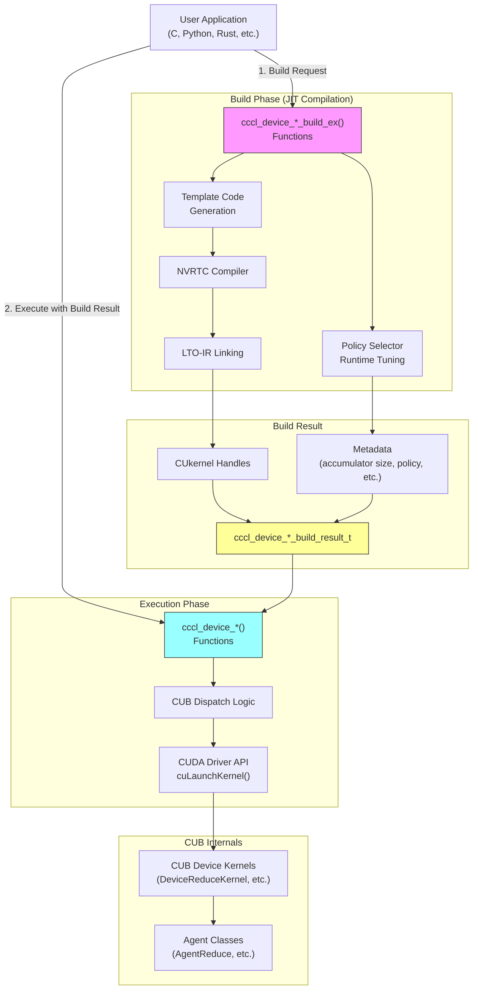

**Sources:** [c/parallel/src/reduce.cu:175-385](), [c/parallel/src/transform.cu:214-351]()

## Build Phase: JIT Compilation Pipeline

The build phase transforms user-specified types and operations into compiled CUDA kernels. This occurs in several stages:

### Code Generation

Each algorithm generates specialized C++ template code based on input parameters:

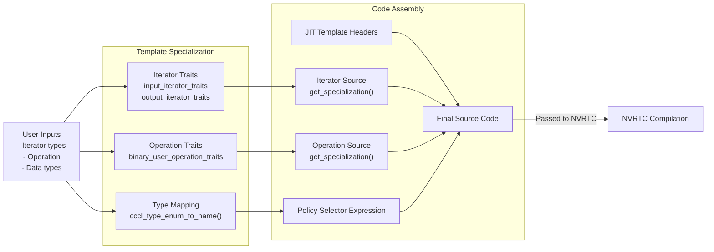

**Example from Device Reduce:**

The `cccl_device_reduce_build_ex` function generates code that includes:

| Component | Generated Code Element | Purpose |
|-----------|----------------------|---------|
| Storage Types | `struct __align__(n) storage_t { char data[size]; }` | Stores user-defined types |
| Iterators | Specializations of `input_iterator_traits`, `output_iterator_traits` | Type-erased iterator wrappers |
| Operations | Specializations of `binary_user_operation_traits` | Type-erased operation wrappers |
| Policy | `cub::detail::reduce::policy_selector_from_types<AccumT, OffsetT, OpT>` | Runtime tuning policy selection |

**Sources:** [c/parallel/src/reduce.cu:175-293](), [c/parallel/src/transform.cu:214-284]()

### NVRTC Compilation and LTO-IR Linking

The generated code is compiled using NVRTC with link-time optimization:

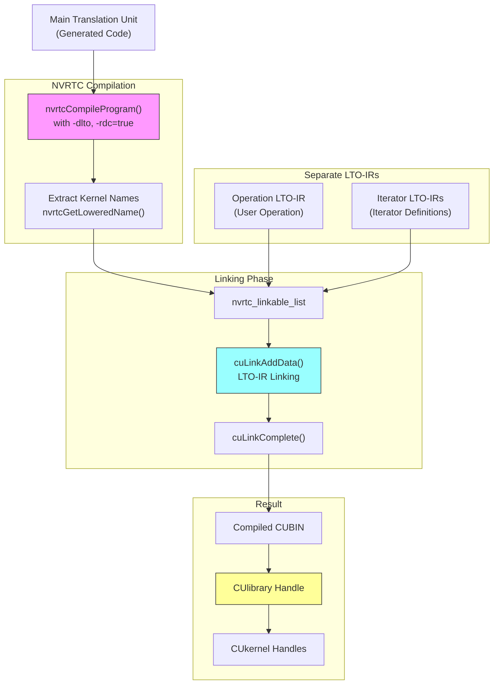

The linking architecture uses `nvrtc_linkable_list_appender` to collect all LTO-IR modules:

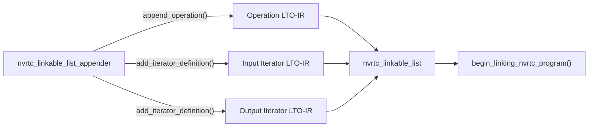

**Sources:** [c/parallel/src/reduce.cu:330-375](), [c/parallel/src/radix_sort.cu:249-356]()

### Policy Selection and Runtime Tuning

Each algorithm selects optimal tuning parameters at build time based on data types and architecture:

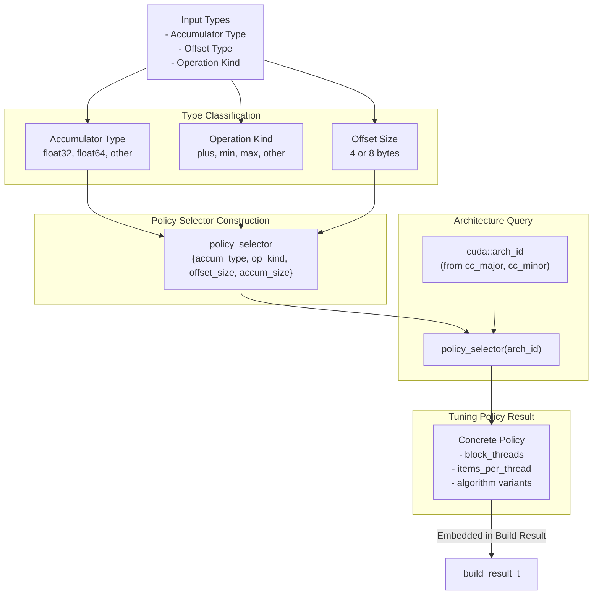

For example, in Device Reduce, the policy selector considers:

| Input | Classification | Impact on Policy |
|-------|----------------|------------------|
| `CCCL_FLOAT32` | `type_t::float32` | Enables optimized float summation paths |
| `CCCL_FLOAT64` | `type_t::float64` | Adjusts register usage for double precision |
| `CCCL_PLUS` | `op_kind_t::plus` | May enable non-deterministic atomic optimizations |
| `CCCL_MINIMUM/MAXIMUM` | `op_kind_t::min/max` | Selects min/max-specific kernels |

**Sources:** [c/parallel/src/reduce.cu:223-254](), [c/parallel/src/segmented_reduce.cu:158-190]()

## Execution Phase: Kernel Dispatch

The execution phase uses the build result to launch specialized kernels via the CUDA Driver API:

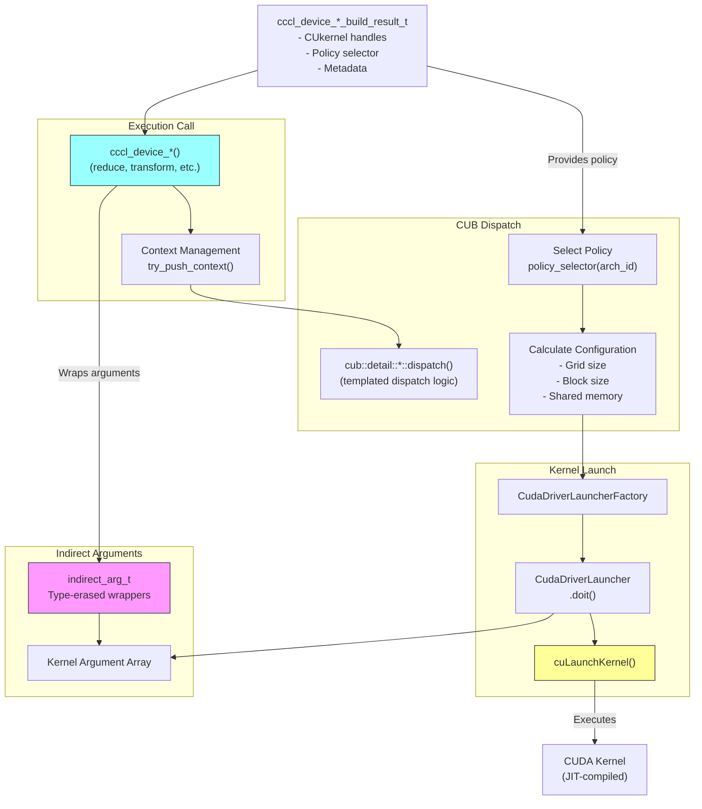

**Sources:** [c/parallel/src/reduce.cu:393-446](), [cub/cub/detail/launcher/cuda_driver.cuh:28-75]()

### Indirect Arguments and Type Erasure

The C API uses `indirect_arg_t` to pass type-erased arguments to kernels:

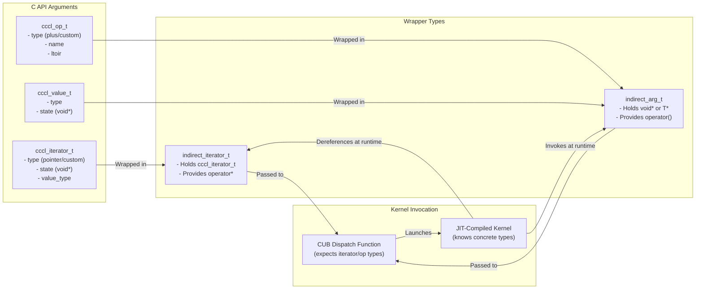

**Key mechanisms:**

| Wrapper Type | Purpose | Implementation |
|--------------|---------|----------------|
| `indirect_arg_t<T>` | Generic argument passing | Stores `void*` state, provides `operator()` to dereference as `T&` |
| `indirect_iterator_t` | Iterator abstraction | Wraps `cccl_iterator_t`, provides iterator interface via `operator*` |
| `op_wrapper` | Operation abstraction | JIT-compiled struct that implements binary/unary operation |

**Sources:** [c/parallel/src/reduce.cu:415-427](), [c/parallel/src/transform.cu:369-378]()

## Example: Device Reduce Build and Execution

### Build Phase Code Flow

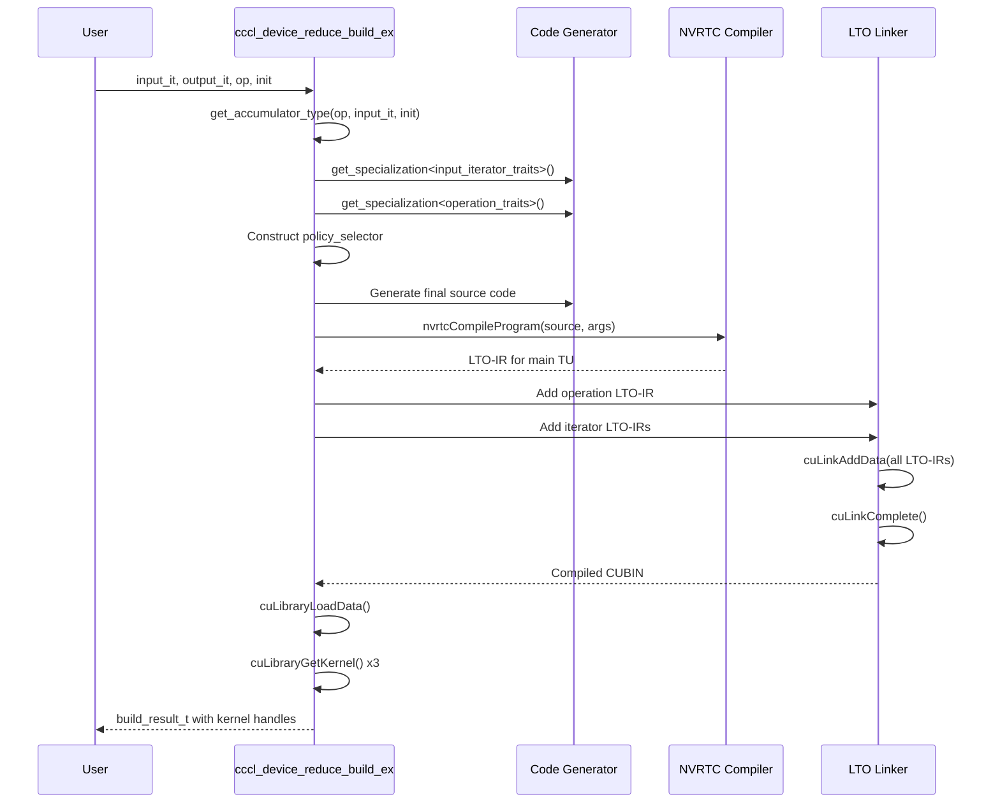

The generated kernel names follow this pattern:

| Kernel | Name Template | Purpose |
|--------|---------------|---------|
| Single Tile | `DeviceReduceSingleTileKernel<PolicySelector, InputIt, OutputIt, OffsetT, OpT, InitT, AccumT>` | Small problem sizes (one block) |
| Reduction | `DeviceReduceKernel<PolicySelector, InputIt, OffsetT, OpT, AccumT, TransformT>` | First pass of two-pass reduction |
| Second Tile | `DeviceReduceSingleTileKernel<PolicySelector, AccumT*, OutputIt, int, OpT, InitT, AccumT>` | Second pass reduction of block results |

**Sources:** [c/parallel/src/reduce.cu:52-139](), [c/parallel/src/reduce.cu:175-385]()

### Execution Phase Code Flow

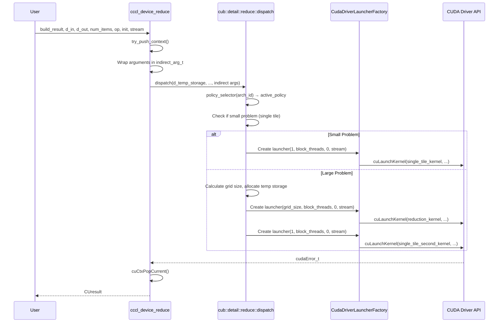

**Sources:** [c/parallel/src/reduce.cu:393-446](), [cub/cub/device/dispatch/dispatch_reduce.cuh:763-844]()

## Supported Algorithms

The C Parallel API provides JIT-compiled wrappers for the following CUB algorithms:

| Algorithm | Build Function | Execution Function | Key Features |
|-----------|----------------|-------------------|--------------|
| **Reduce** | `cccl_device_reduce_build_ex` | `cccl_device_reduce` | Deterministic and non-deterministic variants |
| **Transform** | `cccl_device_unary_transform_build_ex` `cccl_device_binary_transform_build_ex` | `cccl_device_unary_transform` `cccl_device_binary_transform` | Unary and binary operations, vectorization |
| **Scan** | `cccl_device_scan_build_ex` | `cccl_device_scan` | Inclusive/exclusive, with/without init |
| **Radix Sort** | `cccl_device_radix_sort_build_ex` | `cccl_device_radix_sort` | Keys-only and pairs, ascending/descending, custom decomposers |
| **Merge Sort** | `cccl_device_merge_sort_build_ex` | `cccl_device_merge_sort` | Keys-only and pairs, custom comparators |
| **Segmented Reduce** | `cccl_device_segmented_reduce_build_ex` | `cccl_device_segmented_reduce` | Fixed and variable segment sizes |
| **Segmented Sort** | `cccl_device_segmented_sort_build_ex` | `cccl_device_segmented_sort` | Keys-only and pairs, per-segment sorting |
| **Unique by Key** | `cccl_device_unique_by_key_build_ex` | `cccl_device_unique_by_key` | Key-value pair deduplication |
| **Three-Way Partition** | `cccl_device_three_way_partition_build_ex` | `cccl_device_three_way_partition` | Tri-state partitioning |
| **For** | `cccl_device_for_build_ex` | `cccl_device_for` | Parallel loop execution |

**Build Result Structures:**

All algorithms follow a similar build result pattern:

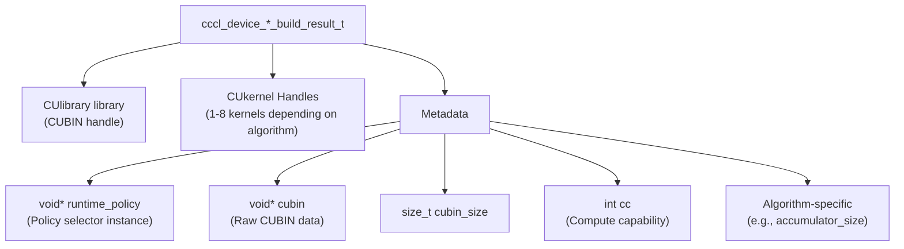

**Sources:** [c/parallel/src/reduce.cu:1-557](), [c/parallel/src/transform.cu:1-530](), [c/parallel/src/radix_sort.cu:1-457]()

## Iterator and Operation Abstraction

The C API uses a trait-based system to generate code for user-defined iterators and operations:

### Iterator Traits

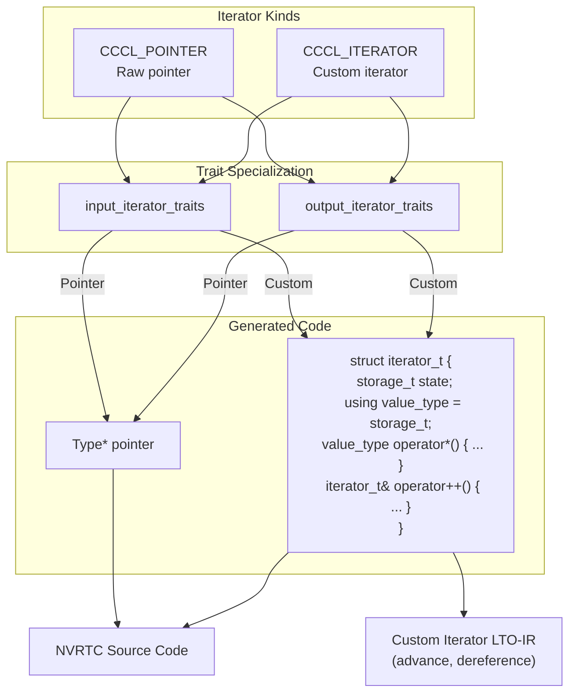

**Iterator State Management:**

| Iterator Component | Storage | Usage |
|-------------------|---------|-------|
| `cccl_iterator_t.type` | Enum (POINTER/ITERATOR) | Determines code generation path |
| `cccl_iterator_t.state` | `void*` | Points to actual iterator state |
| `cccl_iterator_t.value_type` | `cccl_type_info` | Describes element type and size |
| `cccl_iterator_t.advance_function` | LTO-IR | Implements `operator++` |
| `cccl_iterator_t.dereference_function` | LTO-IR | Implements `operator*` |

**Sources:** [c/parallel/src/reduce.cu:213-217](), [c/parallel/src/transform.cu:235-237]()

### Operation Traits

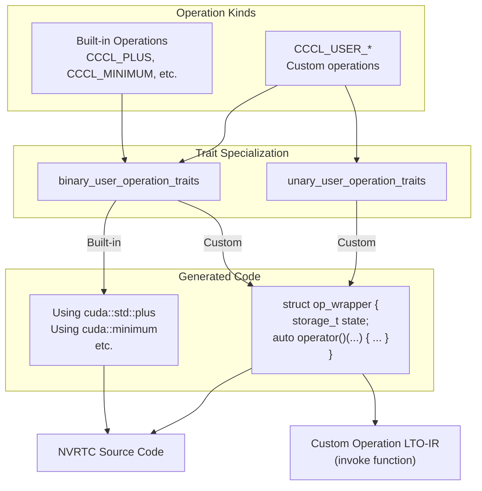

**Operation Specialization:**

For binary operations like reduce:

| Operation Type | Generated Name | Implementation |
|---------------|----------------|----------------|
| `CCCL_PLUS` | `::cuda::std::plus<>` | Standard library functor |
| `CCCL_MINIMUM` | `::cuda::minimum<>` | Standard library functor |
| `CCCL_MAXIMUM` | `::cuda::maximum<>` | Standard library functor |
| `CCCL_USER_BINARY_OP` | `op_wrapper` | Custom struct with `operator()(T, T)` linked from LTO-IR |

**Sources:** [c/parallel/src/reduce.cu:218-220](), [c/parallel/src/segmented_reduce.cu:151-152]()

## Policy Selection and Performance Tuning

The C API embeds the same tuning system used by CUB's C++ interface, enabling architecture-specific optimizations:

### Policy Selector Architecture

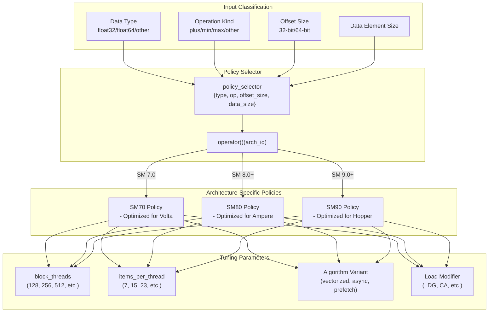

**Policy Selection Example (Reduce):**

The policy selector for reduce considers:

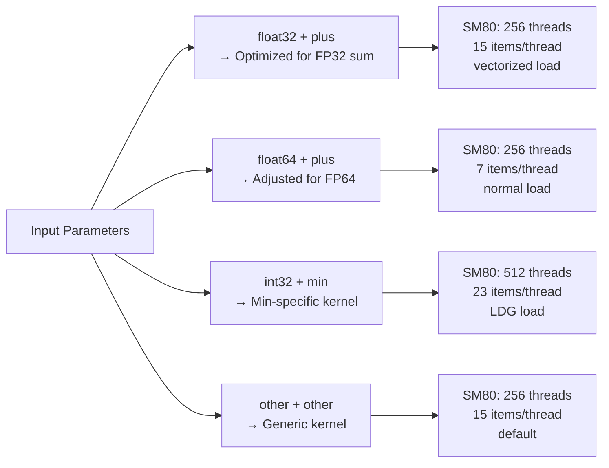

**Runtime Policy Storage:**

The build result stores the policy selector instance:

| Field | Type | Purpose |
|-------|------|---------|
| `build_result_t.runtime_policy` | `void*` | Pointer to `policy_selector` instance |
| Policy in dispatch | Type-safe cast | `*static_cast<policy_selector*>(build.runtime_policy)` |
| Policy evaluation | `operator()(arch_id)` | Returns concrete tuning parameters |

**Sources:** [c/parallel/src/reduce.cu:223-254](), [c/parallel/src/transform.cu:239-245](), [c/parallel/src/radix_sort.cu:229-235]()

## Build Configuration and Compiler Flags

The C API accepts optional build configuration to customize compilation:

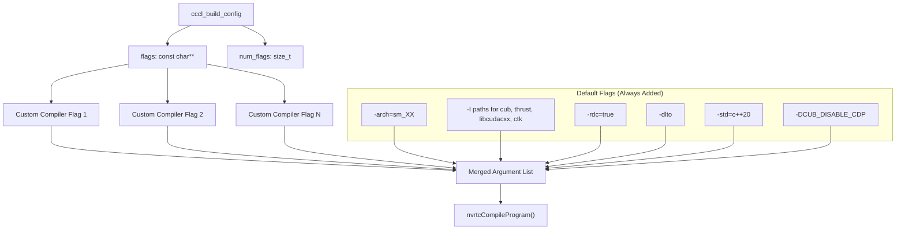

**Standard Compilation Arguments:**

| Argument | Value | Purpose |
|----------|-------|---------|
| `-arch` | `sm_{cc_major}{cc_minor}` | Target GPU architecture |
| `-I` | CUB/Thrust/libcudacxx paths | Include directories |
| `-rdc=true` | Enabled | Relocatable device code for linking |
| `-dlto` | Enabled | Device link-time optimization |
| `-std=c++20` | C++20 | Required language standard |
| `-DCUB_DISABLE_CDP` | Defined | Disable CUDA Dynamic Parallelism |
| `-default-device` | Transform only | Default lambdas to `__device__` |

**Sources:** [c/parallel/src/reduce.cu:313-329](), [c/parallel/src/transform.cu:289-309]()

## Memory Management and Cleanup

### Build Result Lifecycle

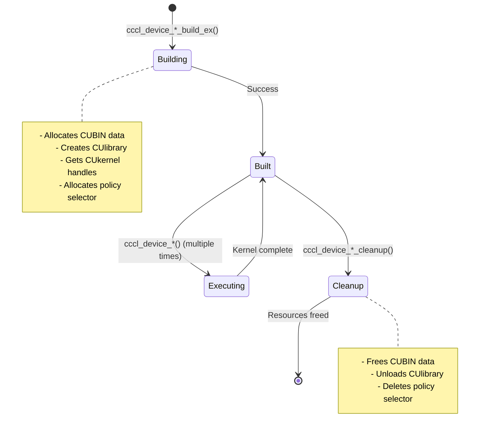

**Cleanup Operations:**

Each algorithm provides a cleanup function that frees allocated resources:

| Resource | Storage Location | Cleanup Method |
|----------|------------------|----------------|
| CUBIN data | `build_result.cubin` | `delete[]` or `unique_ptr` |
| CUlibrary | `build_result.library` | `cuLibraryUnload()` |
| Policy selector | `build_result.runtime_policy` | `delete` or `free()` |
| Algorithm cache | `build_result.cache` (transform) | `delete` |

**Sources:** [c/parallel/src/reduce.cu:503-525](), [c/parallel/src/transform.cu:477-490]()

---

