<!-- source: DeepWiki mcp.deepwiki.com · repo NVIDIA/cccl · extra page Compiler and Platform Abstraction · fetched 2026-10-26 -->

# Compiler and Platform Abstraction

<details>
<summary>Relevant source files</summary>

The following files were used as context for generating this wiki page:

- [docs/libcudacxx/extended_api/type_traits/is_floating_point.rst](docs/libcudacxx/extended_api/type_traits/is_floating_point.rst)
- [lib/cmake/thrust/FindTBB.cmake](lib/cmake/thrust/FindTBB.cmake)
- [libcudacxx/include/cuda/__type_traits/is_floating_point.h](libcudacxx/include/cuda/__type_traits/is_floating_point.h)
- [libcudacxx/include/cuda/std/__atomic/functions/cuda_ptx_generated_helper.h](libcudacxx/include/cuda/std/__atomic/functions/cuda_ptx_generated_helper.h)
- [libcudacxx/include/cuda/std/__cccl/builtin.h](libcudacxx/include/cuda/std/__cccl/builtin.h)
- [libcudacxx/include/cuda/std/__cccl/compiler.h](libcudacxx/include/cuda/std/__cccl/compiler.h)
- [libcudacxx/include/cuda/std/__cccl/cuda_toolkit.h](libcudacxx/include/cuda/std/__cccl/cuda_toolkit.h)
- [libcudacxx/include/cuda/std/__cccl/diagnostic.h](libcudacxx/include/cuda/std/__cccl/diagnostic.h)
- [libcudacxx/include/cuda/std/__cccl/dialect.h](libcudacxx/include/cuda/std/__cccl/dialect.h)
- [libcudacxx/include/cuda/std/__cccl/extended_data_types.h](libcudacxx/include/cuda/std/__cccl/extended_data_types.h)
- [libcudacxx/include/cuda/std/__cccl/system_header.h](libcudacxx/include/cuda/std/__cccl/system_header.h)
- [libcudacxx/include/cuda/std/__cmath/min_max.h](libcudacxx/include/cuda/std/__cmath/min_max.h)
- [libcudacxx/include/cuda/std/__cmath/nan.h](libcudacxx/include/cuda/std/__cmath/nan.h)
- [libcudacxx/include/cuda/std/__complex/complex.h](libcudacxx/include/cuda/std/__complex/complex.h)
- [libcudacxx/include/cuda/std/__complex/logarithms.h](libcudacxx/include/cuda/std/__complex/logarithms.h)
- [libcudacxx/include/cuda/std/__complex/nvbf16.h](libcudacxx/include/cuda/std/__complex/nvbf16.h)
- [libcudacxx/include/cuda/std/__complex/nvfp16.h](libcudacxx/include/cuda/std/__complex/nvfp16.h)
- [libcudacxx/include/cuda/std/__complex/vector_support.h](libcudacxx/include/cuda/std/__complex/vector_support.h)
- [libcudacxx/include/cuda/std/__cstdlib/abs.h](libcudacxx/include/cuda/std/__cstdlib/abs.h)
- [libcudacxx/include/cuda/std/__cstdlib/div.h](libcudacxx/include/cuda/std/__cstdlib/div.h)
- [libcudacxx/include/cuda/std/__functional/bind_front.h](libcudacxx/include/cuda/std/__functional/bind_front.h)
- [libcudacxx/include/cuda/std/__functional/not_fn.h](libcudacxx/include/cuda/std/__functional/not_fn.h)
- [libcudacxx/include/cuda/std/__internal/atomic.h](libcudacxx/include/cuda/std/__internal/atomic.h)
- [libcudacxx/include/cuda/std/__internal/features.h](libcudacxx/include/cuda/std/__internal/features.h)
- [libcudacxx/include/cuda/std/__type_traits/is_extended_floating_point.h](libcudacxx/include/cuda/std/__type_traits/is_extended_floating_point.h)
- [libcudacxx/include/cuda/std/__type_traits/is_trivially_copyable.h](libcudacxx/include/cuda/std/__type_traits/is_trivially_copyable.h)
- [libcudacxx/include/cuda/std/__type_traits/promote.h](libcudacxx/include/cuda/std/__type_traits/promote.h)
- [libcudacxx/include/cuda/std/__type_traits/type_list.h](libcudacxx/include/cuda/std/__type_traits/type_list.h)
- [libcudacxx/include/cuda/std/__utility/declval.h](libcudacxx/include/cuda/std/__utility/declval.h)
- [libcudacxx/include/cuda/std/cmath](libcudacxx/include/cuda/std/cmath)
- [libcudacxx/test/libcudacxx/cuda/iterators/transform_input_output_iterator/types.h](libcudacxx/test/libcudacxx/cuda/iterators/transform_input_output_iterator/types.h)
- [libcudacxx/test/libcudacxx/cuda/iterators/transform_output_iterator/types.h](libcudacxx/test/libcudacxx/cuda/iterators/transform_output_iterator/types.h)
- [libcudacxx/test/libcudacxx/cuda/test_platform.pass.cpp](libcudacxx/test/libcudacxx/cuda/test_platform.pass.cpp)
- [libcudacxx/test/libcudacxx/cuda/type_list.pass.cpp](libcudacxx/test/libcudacxx/cuda/type_list.pass.cpp)
- [libcudacxx/test/libcudacxx/libcxx/utilities/meta/meta.unary/meta.unary.cat/is_floating_point.pass.cpp](libcudacxx/test/libcudacxx/libcxx/utilities/meta/meta.unary/meta.unary.cat/is_floating_point.pass.cpp)
- [libcudacxx/test/libcudacxx/std/language.support/cstdlib/abs.pass.cpp](libcudacxx/test/libcudacxx/std/language.support/cstdlib/abs.pass.cpp)
- [libcudacxx/test/libcudacxx/std/language.support/cstdlib/div.pass.cpp](libcudacxx/test/libcudacxx/std/language.support/cstdlib/div.pass.cpp)
- [libcudacxx/test/libcudacxx/std/numerics/c.math/comparison.h](libcudacxx/test/libcudacxx/std/numerics/c.math/comparison.h)
- [libcudacxx/test/libcudacxx/std/numerics/c.math/error_functions.pass.cpp](libcudacxx/test/libcudacxx/std/numerics/c.math/error_functions.pass.cpp)
- [libcudacxx/test/libcudacxx/std/numerics/c.math/fp_abs.pass.cpp](libcudacxx/test/libcudacxx/std/numerics/c.math/fp_abs.pass.cpp)
- [libcudacxx/test/libcudacxx/std/numerics/c.math/fp_min_max.pass.cpp](libcudacxx/test/libcudacxx/std/numerics/c.math/fp_min_max.pass.cpp)
- [libcudacxx/test/libcudacxx/std/numerics/c.math/fp_traits.pass.cpp](libcudacxx/test/libcudacxx/std/numerics/c.math/fp_traits.pass.cpp)
- [libcudacxx/test/libcudacxx/std/utilities/memory/ptr.align/align.pass.cpp](libcudacxx/test/libcudacxx/std/utilities/memory/ptr.align/align.pass.cpp)
- [libcudacxx/test/libcudacxx/std/utilities/meta/meta.unary/meta.unary.cat/is_floating_point.pass.cpp](libcudacxx/test/libcudacxx/std/utilities/meta/meta.unary/meta.unary.cat/is_floating_point.pass.cpp)
- [libcudacxx/test/support/test_macros.h](libcudacxx/test/support/test_macros.h)

</details>


## Purpose and Scope

The `__cccl/` abstraction layer provides a unified interface for compiler detection, feature detection, and platform-specific workarounds across the diverse ecosystem of CUDA and C++ compilers. This system enables libcudacxx to function as a portable standard library by abstracting away compiler differences through systematic macro-based detection and conditional compilation.

This page covers the compiler and dialect detection mechanisms, builtin wrapping, and diagnostic control. For higher-level type system abstractions, see [Standard Library Components](#2.3.1). For hardware-specific abstractions, see [Hardware Abstractions](#2.3.2).

## Architecture Overview

The compiler abstraction system consists of four primary layers:

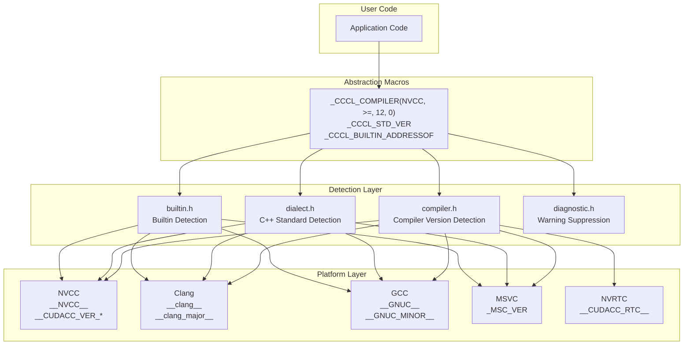

**Sources:** [libcudacxx/include/cuda/std/__cccl/compiler.h:1-219](), [libcudacxx/include/cuda/std/__cccl/dialect.h:1-197](), [libcudacxx/include/cuda/std/__cccl/builtin.h:1-494]()

## Compiler Detection System

### Version Comparison Infrastructure

The `_CCCL_VERSION_COMPARE` macro system provides a flexible framework for compiler version queries. The implementation uses preprocessor metaprogramming to support multiple comparison signatures:

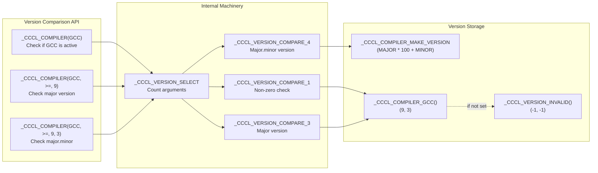

**Sources:** [libcudacxx/include/cuda/std/__cccl/compiler.h:16-52]()

### Host Compiler Detection

The system detects the host compiler through predefined macros and provides normalized version information:

| Compiler | Detection Macro | Version Macro | Version Format |
|----------|----------------|---------------|----------------|
| NVHPC | `__NVCOMPILER` | `_CCCL_COMPILER_NVHPC()` | `(__NVCOMPILER_MAJOR__, __NVCOMPILER_MINOR__)` |
| Clang | `__clang__` | `_CCCL_COMPILER_CLANG()` | `(__clang_major__, __clang_minor__)` |
| GCC | `__GNUC__` | `_CCCL_COMPILER_GCC()` | `(__GNUC__, __GNUC_MINOR__)` |
| MSVC | `_MSC_VER` | `_CCCL_COMPILER_MSVC()` | `(_MSC_VER / 100, _MSC_VER % 100)` |
| NVRTC | `__CUDACC_RTC__` | `_CCCL_COMPILER_NVRTC()` | `(__CUDACC_VER_MAJOR__, __CUDACC_VER_MINOR__)` |

**Sources:** [libcudacxx/include/cuda/std/__cccl/compiler.h:54-106]()

MSVC versions are further categorized into release generations:

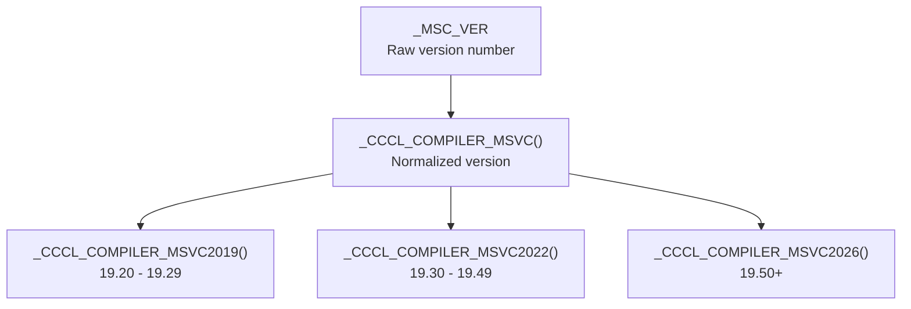

**Sources:** [libcudacxx/include/cuda/std/__cccl/compiler.h:81-102]()

### CUDA Compiler Detection

The system distinguishes between CUDA compilation contexts and identifies the CUDA compiler:

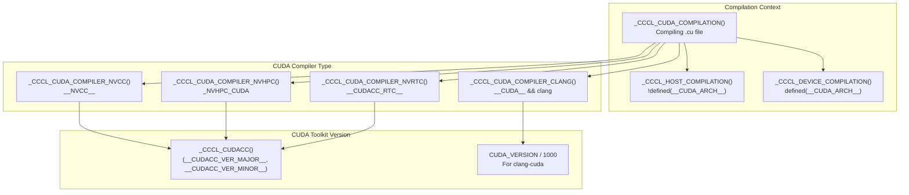

**Sources:** [libcudacxx/include/cuda/std/__cccl/compiler.h:108-172]()

## C++ Dialect Detection

### Standard Version Detection

The `_CCCL_STD_VER` macro normalizes C++ standard detection across compilers that use different mechanisms:

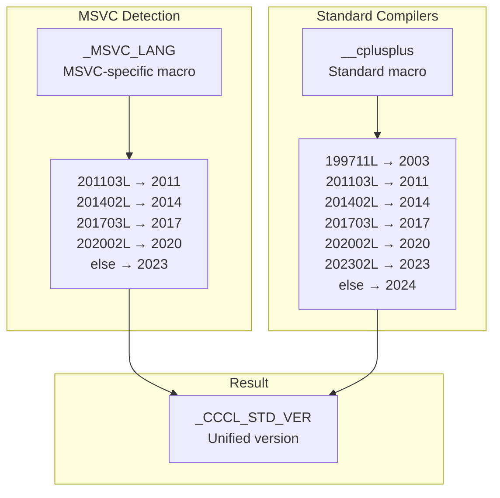

**Sources:** [libcudacxx/include/cuda/std/__cccl/dialect.h:28-59]()

### Conditional Language Features

Based on `_CCCL_STD_VER`, the system defines macros for conditionally enabling C++ features:

| Macro | Condition | Usage |
|-------|-----------|-------|
| `_CCCL_CONSTEXPR_CXX20` | `_CCCL_STD_VER >= 2020` | C++20 constexpr extensions |
| `_CCCL_CONSTEXPR_CXX23` | `_CCCL_STD_VER >= 2023` | C++23 constexpr extensions |
| `_CCCL_HAS_CONCEPTS()` | `_CCCL_STD_VER > 2017 && __cpp_concepts >= 201907L` | Concepts support |
| `_CCCL_NO_THREE_WAY_COMPARISON` | `_CCCL_STD_VER <= 2017` | Spaceship operator |
| `_CCCL_HAS_PACK_INDEXING()` | `defined(__cpp_pack_indexing)` | C++26 pack indexing |

**Sources:** [libcudacxx/include/cuda/std/__cccl/dialect.h:61-99]()

### Runtime Constant Evaluation Detection

The system provides a unified interface for detecting constant evaluation context:

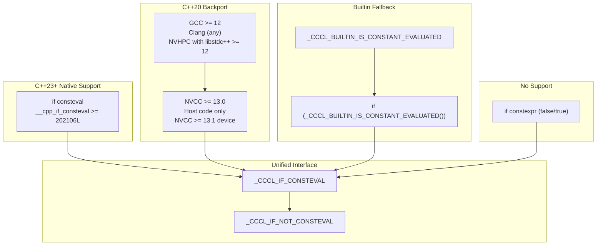

**Sources:** [libcudacxx/include/cuda/std/__cccl/dialect.h:136-178]()

## Builtin Detection and Wrapping

### Detection Strategy

The builtin detection system handles compilers with varying levels of `__has_builtin` support through a multi-layered strategy:

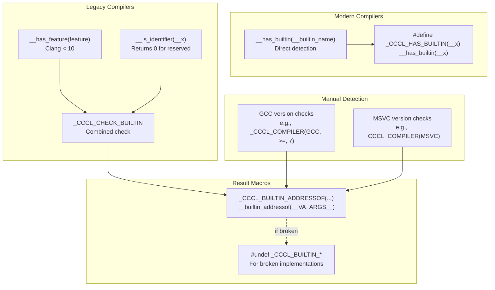

**Sources:** [libcudacxx/include/cuda/std/__cccl/builtin.h:29-67]()

### Builtin Categories

The system wraps compiler builtins in several categories:

**Type Traits Builtins:**

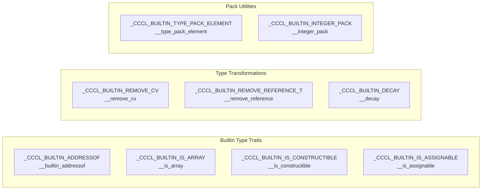

**Sources:** [libcudacxx/include/cuda/std/__cccl/builtin.h:70-475]()

**Math and Utility Builtins:**

| Builtin Macro | Compiler Support | Workarounds |
|---------------|------------------|-------------|
| `_CCCL_BUILTIN_ASSUME` | Clang, NVHPC, GCC ≥ 13 | MSVC uses `__assume` |
| `_CCCL_BUILTIN_EXPECT` | Most compilers | Manual fallback possible |
| `_CCCL_BUILTIN_CONSTANT_P` | GCC, Clang | Not available on MSVC |
| `_CCCL_BUILTIN_MEMCMP` | GCC, MSVC ≥ 19.28 | Disabled for NVCC/Clang CUDA |
| `_CCCL_BUILTIN_HUGE_VALF` | Most compilers | Special handling for float128 |

**Sources:** [libcudacxx/include/cuda/std/__cccl/builtin.h:99-134]()

### Compiler-Specific Workarounds

The system includes explicit workarounds for known compiler bugs:

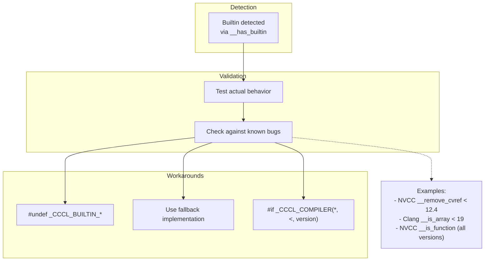

**Example workarounds:**
- [libcudacxx/include/cuda/std/__cccl/builtin.h:442-444]() - NVRTC `__remove_cvref` disabled below 12.4
- [libcudacxx/include/cuda/std/__cccl/builtin.h:275-278]() - Clang `__is_array` disabled below version 19
- [libcudacxx/include/cuda/std/__cccl/builtin.h:304-307]() - NVCC `__is_function` always disabled

**Sources:** [libcudacxx/include/cuda/std/__cccl/builtin.h:70-494]()

## Diagnostic Control

### Warning Suppression System

The diagnostic system provides unified macros for suppressing warnings across different compilers:

```mermaid
graph TB
    subgraph "Public Interface"
        DiagPush["_CCCL_DIAG_PUSH<br/>Push diagnostic state"]
        DiagPop["_CCCL_DIAG_POP<br/>Pop diagnostic state"]
        SuppressClang["_CCCL_DIAG_SUPPRESS_CLANG(warning)"]
        SuppressGCC["_CCCL_DIAG_SUPPRESS_GCC(warning)"]
        SuppressNVHPC["_CCCL_DIAG_SUPPRESS_NVHPC(warning)"]
        SuppressMSVC["_CCCL_DIAG_SUPPRESS_MSVC(warning)"]
    end
    
    subgraph "Clang Implementation"
        ClangPush["#pragma clang diagnostic push"]
        ClangPop["#pragma clang diagnostic pop"]
        ClangSuppress["#pragma clang diagnostic ignored warning"]
    end
    
    subgraph "GCC Implementation"
        GCCPush["#pragma GCC diagnostic push"]
        GCCPop["#pragma GCC diagnostic pop"]
        GCCSuppress["#pragma GCC diagnostic ignored warning"]
    end
    
    subgraph "MSVC Implementation"
        MSVCPush["#pragma warning(push)"]
        MSVCPop["#pragma warning(pop)"]
        MSVCSuppress["#pragma warning(disable : warning)"]
    end
    
    DiagPush --> ClangPush
    DiagPush --> GCCPush
    DiagPush --> MSVCPush
    
    DiagPop --> ClangPop
    DiagPop --> GCCPop
    DiagPop --> MSVCPop
    
    SuppressClang --> ClangSuppress
    SuppressGCC --> GCCSuppress
    SuppressMSVC --> MSVCSuppress
```

**Sources:** [libcudacxx/include/cuda/std/__cccl/diagnostic.h:26-61]()

### NVCC-Specific Diagnostics

CUDA compilers require separate diagnostic control:

| Macro | NVCC ≥ 11.3 | NVCC < 11.3 | Purpose |
|-------|-------------|-------------|---------|
| `_CCCL_NV_DIAG_PUSH()` | `#pragma nv_diagnostic push` | `#pragma diagnostic push` | Save state |
| `_CCCL_NV_DIAG_POP()` | `#pragma nv_diagnostic pop` | `#pragma diagnostic pop` | Restore state |
| `_CCCL_DIAG_SUPPRESS_NVCC(n)` | `#pragma nv_diag_suppress n` | `#pragma diag_suppress n` | Suppress warning |
| `_CCCL_BEGIN_NV_DIAG_SUPPRESS(...)` | Push + suppress all | Push + suppress all | Convenience macro |
| `_CCCL_END_NV_DIAG_SUPPRESS()` | Pop | Pop | Convenience macro |

**Sources:** [libcudacxx/include/cuda/std/__cccl/diagnostic.h:64-86]()

### Convenience Macros

Common warning suppression patterns are wrapped in high-level macros:

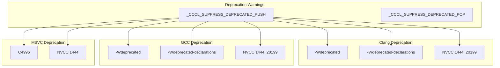

**Sources:** [libcudacxx/include/cuda/std/__cccl/diagnostic.h:88-122]()

## Extended Data Type Detection

### Floating Point Type Detection

The system detects availability of NVIDIA extended floating-point types:

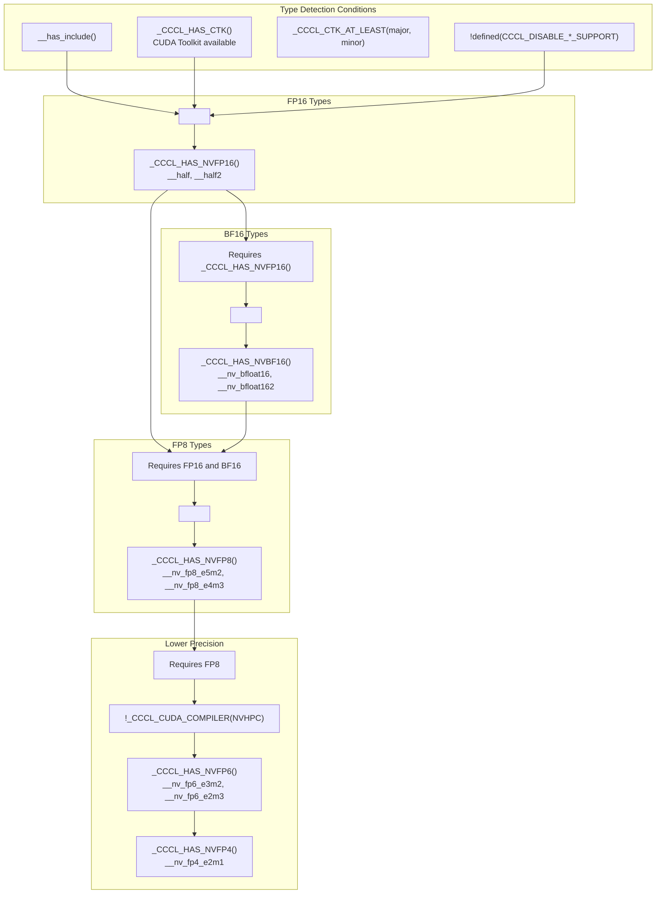

**Sources:** [libcudacxx/include/cuda/std/__cccl/extended_data_types.h:32-98]()

### Integer and Float128 Detection

Additional extended types are detected based on platform and compiler support:

| Type Macro | Requirements | Additional Notes |
|------------|--------------|------------------|
| `_CCCL_HAS_INT128()` | Linux && (`__SIZEOF_INT128__` \|\| NVRTC) | Disabled on non-Linux |
| `_CCCL_HAS_FLOAT128()` | Linux && !ARM64 && int128 support | Host: most compilers; Device: SM_100+ only |
| | | NVCC/NVRTC ≥ 12.8 required for device |
| | | GCC requires extended literals or disable |

**Sources:** [libcudacxx/include/cuda/std/__cccl/extended_data_types.h:40-137]()

The float128 device support requires specific conditions:

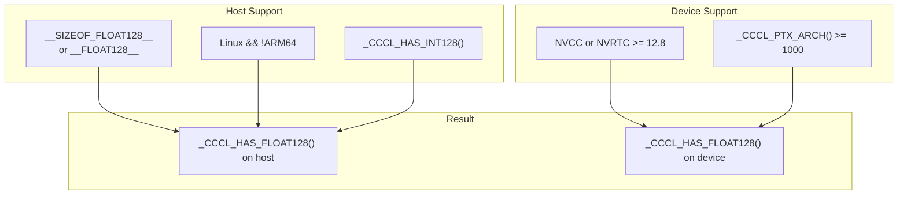

**Sources:** [libcudacxx/include/cuda/std/__cccl/extended_data_types.h:107-137]()

## Usage Patterns

### Conditional Compilation Example

The abstraction macros enable portable conditional compilation:

```cpp
// From libcudacxx/include/cuda/std/__cccl/dialect.h

#if _CCCL_STD_VER >= 2020
#  define _CCCL_CONSTEXPR_CXX20 constexpr
#else
#  define _CCCL_CONSTEXPR_CXX20
#endif

// From libcudacxx/include/cuda/std/__utility/declval.h

#if !_CCCL_CUDA_COMPILER(NVCC, <, 12, 4) && !_CCCL_COMPILER(MSVC, <, 19, 39)
template <class _Tp, class = void>
extern __declfn_t<void> declval;  // Fast implementation
#else
template <class _Tp>
_CCCL_API inline _Tp&& __declval(int);  // Fallback
#endif
```

**Sources:** [libcudacxx/include/cuda/std/__cccl/dialect.h:65-69](), [libcudacxx/include/cuda/std/__utility/declval.h:48-69]()

### Builtin Detection Pattern

```cpp
// From libcudacxx/include/cuda/std/__cccl/builtin.h

#if _CCCL_CHECK_BUILTIN(builtin_addressof) || _CCCL_COMPILER(GCC, >=, 7) \
  || _CCCL_COMPILER(MSVC) || _CCCL_COMPILER(NVHPC) || _CCCL_COMPILER(NVRTC, >=, 12, 3)
#  define _CCCL_BUILTIN_ADDRESSOF(...) __builtin_addressof(__VA_ARGS__)
#endif

// Usage in type_traits
#ifdef _CCCL_BUILTIN_ADDRESSOF
  return _CCCL_BUILTIN_ADDRESSOF(__x);
#else
  return fallback_implementation(__x);
#endif
```

**Sources:** [libcudacxx/include/cuda/std/__cccl/builtin.h:93-97]()

### Diagnostic Suppression Pattern

```cpp
// From libcudacxx/include/cuda/std/__functional/not_fn.h

_CCCL_SUPPRESS_DEPRECATED_PUSH
template <class _Fn>
class _CCCL_TYPE_VISIBILITY_DEFAULT __not_fn_t
{
  // Implementation using potentially deprecated features
};
_CCCL_SUPPRESS_DEPRECATED_POP
```

**Sources:** [libcudacxx/include/cuda/std/__functional/not_fn.h:1-100]()

## Integration with Type System

The compiler abstraction layer directly enables advanced type trait optimizations:

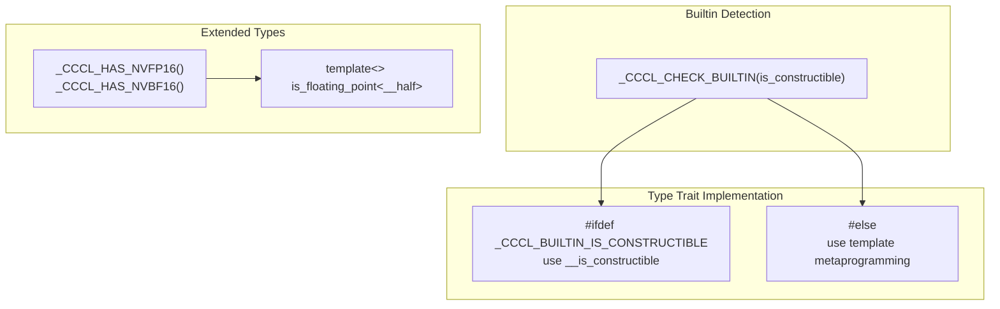

**Sources:** [libcudacxx/include/cuda/std/__type_traits/is_constructible.h](), [libcudacxx/include/cuda/std/__type_traits/is_extended_floating_point.h:1-79]()

---

