<!-- source: DeepWiki mcp.deepwiki.com · repo NVIDIA/cccl · extra page Device-Wide Operations · fetched 2026-10-26 -->

# Device-Wide Operations

<details>
<summary>Relevant source files</summary>

The following files were used as context for generating this wiki page:

- [c/parallel/include/cccl/c/transform.h](c/parallel/include/cccl/c/transform.h)
- [c/parallel/src/for.cu](c/parallel/src/for.cu)
- [c/parallel/src/merge_sort.cu](c/parallel/src/merge_sort.cu)
- [c/parallel/src/radix_sort.cu](c/parallel/src/radix_sort.cu)
- [c/parallel/src/reduce.cu](c/parallel/src/reduce.cu)
- [c/parallel/src/scan.cu](c/parallel/src/scan.cu)
- [c/parallel/src/segmented_reduce.cu](c/parallel/src/segmented_reduce.cu)
- [c/parallel/src/segmented_sort.cu](c/parallel/src/segmented_sort.cu)
- [c/parallel/src/three_way_partition.cu](c/parallel/src/three_way_partition.cu)
- [c/parallel/src/transform.cu](c/parallel/src/transform.cu)
- [c/parallel/src/unique_by_key.cu](c/parallel/src/unique_by_key.cu)
- [cub/benchmarks/bench/radix_sort/keys.cu](cub/benchmarks/bench/radix_sort/keys.cu)
- [cub/benchmarks/bench/radix_sort/pairs.cu](cub/benchmarks/bench/radix_sort/pairs.cu)
- [cub/benchmarks/bench/radix_sort/policy_selector.h](cub/benchmarks/bench/radix_sort/policy_selector.h)
- [cub/benchmarks/bench/reduce/base.cuh](cub/benchmarks/bench/reduce/base.cuh)
- [cub/benchmarks/bench/reduce/deterministic.cu](cub/benchmarks/bench/reduce/deterministic.cu)
- [cub/benchmarks/bench/reduce/nondeterministic.cu](cub/benchmarks/bench/reduce/nondeterministic.cu)
- [cub/benchmarks/bench/transform/babelstream.cu](cub/benchmarks/bench/transform/babelstream.cu)
- [cub/benchmarks/bench/transform/common.h](cub/benchmarks/bench/transform/common.h)
- [cub/benchmarks/bench/transform/complex_cmp.cu](cub/benchmarks/bench/transform/complex_cmp.cu)
- [cub/benchmarks/bench/transform/fib.cu](cub/benchmarks/bench/transform/fib.cu)
- [cub/benchmarks/bench/transform/fill.cu](cub/benchmarks/bench/transform/fill.cu)
- [cub/benchmarks/bench/transform/grayscale.cu](cub/benchmarks/bench/transform/grayscale.cu)
- [cub/benchmarks/bench/transform/heavy.cu](cub/benchmarks/bench/transform/heavy.cu)
- [cub/benchmarks/bench/transform_reduce/sum.cu](cub/benchmarks/bench/transform_reduce/sum.cu)
- [cub/cub/agent/agent_radix_sort_downsweep.cuh](cub/cub/agent/agent_radix_sort_downsweep.cuh)
- [cub/cub/agent/agent_radix_sort_histogram.cuh](cub/cub/agent/agent_radix_sort_histogram.cuh)
- [cub/cub/agent/agent_radix_sort_onesweep.cuh](cub/cub/agent/agent_radix_sort_onesweep.cuh)
- [cub/cub/agent/agent_radix_sort_upsweep.cuh](cub/cub/agent/agent_radix_sort_upsweep.cuh)
- [cub/cub/agent/agent_reduce.cuh](cub/cub/agent/agent_reduce.cuh)
- [cub/cub/agent/agent_reduce_by_key.cuh](cub/cub/agent/agent_reduce_by_key.cuh)
- [cub/cub/agent/agent_rle.cuh](cub/cub/agent/agent_rle.cuh)
- [cub/cub/agent/agent_scan.cuh](cub/cub/agent/agent_scan.cuh)
- [cub/cub/agent/agent_scan_by_key.cuh](cub/cub/agent/agent_scan_by_key.cuh)
- [cub/cub/agent/agent_segmented_radix_sort.cuh](cub/cub/agent/agent_segmented_radix_sort.cuh)
- [cub/cub/agent/agent_select_if.cuh](cub/cub/agent/agent_select_if.cuh)
- [cub/cub/agent/agent_three_way_partition.cuh](cub/cub/agent/agent_three_way_partition.cuh)
- [cub/cub/agent/agent_unique_by_key.cuh](cub/cub/agent/agent_unique_by_key.cuh)
- [cub/cub/agent/single_pass_scan_operators.cuh](cub/cub/agent/single_pass_scan_operators.cuh)
- [cub/cub/detail/arch_dispatch.cuh](cub/cub/detail/arch_dispatch.cuh)
- [cub/cub/detail/launcher/cuda_driver.cuh](cub/cub/detail/launcher/cuda_driver.cuh)
- [cub/cub/detail/launcher/cuda_runtime.cuh](cub/cub/detail/launcher/cuda_runtime.cuh)
- [cub/cub/detail/rfa.cuh](cub/cub/detail/rfa.cuh)
- [cub/cub/device/device_adjacent_difference.cuh](cub/cub/device/device_adjacent_difference.cuh)
- [cub/cub/device/device_histogram.cuh](cub/cub/device/device_histogram.cuh)
- [cub/cub/device/device_partition.cuh](cub/cub/device/device_partition.cuh)
- [cub/cub/device/device_radix_sort.cuh](cub/cub/device/device_radix_sort.cuh)
- [cub/cub/device/device_reduce.cuh](cub/cub/device/device_reduce.cuh)
- [cub/cub/device/device_segmented_radix_sort.cuh](cub/cub/device/device_segmented_radix_sort.cuh)
- [cub/cub/device/device_segmented_reduce.cuh](cub/cub/device/device_segmented_reduce.cuh)
- [cub/cub/device/device_segmented_sort.cuh](cub/cub/device/device_segmented_sort.cuh)
- [cub/cub/device/device_select.cuh](cub/cub/device/device_select.cuh)
- [cub/cub/device/dispatch/dispatch_adjacent_difference.cuh](cub/cub/device/dispatch/dispatch_adjacent_difference.cuh)
- [cub/cub/device/dispatch/dispatch_common.cuh](cub/cub/device/dispatch/dispatch_common.cuh)
- [cub/cub/device/dispatch/dispatch_fixed_size_segmented_reduce.cuh](cub/cub/device/dispatch/dispatch_fixed_size_segmented_reduce.cuh)
- [cub/cub/device/dispatch/dispatch_histogram.cuh](cub/cub/device/dispatch/dispatch_histogram.cuh)
- [cub/cub/device/dispatch/dispatch_merge_sort.cuh](cub/cub/device/dispatch/dispatch_merge_sort.cuh)
- [cub/cub/device/dispatch/dispatch_radix_sort.cuh](cub/cub/device/dispatch/dispatch_radix_sort.cuh)
- [cub/cub/device/dispatch/dispatch_reduce.cuh](cub/cub/device/dispatch/dispatch_reduce.cuh)
- [cub/cub/device/dispatch/dispatch_reduce_by_key.cuh](cub/cub/device/dispatch/dispatch_reduce_by_key.cuh)
- [cub/cub/device/dispatch/dispatch_reduce_deterministic.cuh](cub/cub/device/dispatch/dispatch_reduce_deterministic.cuh)
- [cub/cub/device/dispatch/dispatch_reduce_nondeterministic.cuh](cub/cub/device/dispatch/dispatch_reduce_nondeterministic.cuh)
- [cub/cub/device/dispatch/dispatch_rle.cuh](cub/cub/device/dispatch/dispatch_rle.cuh)
- [cub/cub/device/dispatch/dispatch_scan.cuh](cub/cub/device/dispatch/dispatch_scan.cuh)
- [cub/cub/device/dispatch/dispatch_scan_by_key.cuh](cub/cub/device/dispatch/dispatch_scan_by_key.cuh)
- [cub/cub/device/dispatch/dispatch_segmented_radix_sort.cuh](cub/cub/device/dispatch/dispatch_segmented_radix_sort.cuh)
- [cub/cub/device/dispatch/dispatch_segmented_reduce.cuh](cub/cub/device/dispatch/dispatch_segmented_reduce.cuh)
- [cub/cub/device/dispatch/dispatch_segmented_sort.cuh](cub/cub/device/dispatch/dispatch_segmented_sort.cuh)
- [cub/cub/device/dispatch/dispatch_select_if.cuh](cub/cub/device/dispatch/dispatch_select_if.cuh)
- [cub/cub/device/dispatch/dispatch_streaming_reduce.cuh](cub/cub/device/dispatch/dispatch_streaming_reduce.cuh)
- [cub/cub/device/dispatch/dispatch_three_way_partition.cuh](cub/cub/device/dispatch/dispatch_three_way_partition.cuh)
- [cub/cub/device/dispatch/dispatch_transform.cuh](cub/cub/device/dispatch/dispatch_transform.cuh)
- [cub/cub/device/dispatch/dispatch_unique_by_key.cuh](cub/cub/device/dispatch/dispatch_unique_by_key.cuh)
- [cub/cub/device/dispatch/kernels/kernel_radix_sort.cuh](cub/cub/device/dispatch/kernels/kernel_radix_sort.cuh)
- [cub/cub/device/dispatch/kernels/kernel_reduce.cuh](cub/cub/device/dispatch/kernels/kernel_reduce.cuh)
- [cub/cub/device/dispatch/kernels/kernel_scan.cuh](cub/cub/device/dispatch/kernels/kernel_scan.cuh)
- [cub/cub/device/dispatch/kernels/kernel_segmented_radix_sort.cuh](cub/cub/device/dispatch/kernels/kernel_segmented_radix_sort.cuh)
- [cub/cub/device/dispatch/kernels/kernel_segmented_reduce.cuh](cub/cub/device/dispatch/kernels/kernel_segmented_reduce.cuh)
- [cub/cub/device/dispatch/kernels/kernel_transform.cuh](cub/cub/device/dispatch/kernels/kernel_transform.cuh)
- [cub/cub/device/dispatch/tuning/common.cuh](cub/cub/device/dispatch/tuning/common.cuh)
- [cub/cub/device/dispatch/tuning/tuning_adjacent_difference.cuh](cub/cub/device/dispatch/tuning/tuning_adjacent_difference.cuh)
- [cub/cub/device/dispatch/tuning/tuning_batch_memcpy.cuh](cub/cub/device/dispatch/tuning/tuning_batch_memcpy.cuh)
- [cub/cub/device/dispatch/tuning/tuning_for.cuh](cub/cub/device/dispatch/tuning/tuning_for.cuh)
- [cub/cub/device/dispatch/tuning/tuning_merge_sort.cuh](cub/cub/device/dispatch/tuning/tuning_merge_sort.cuh)
- [cub/cub/device/dispatch/tuning/tuning_radix_sort.cuh](cub/cub/device/dispatch/tuning/tuning_radix_sort.cuh)
- [cub/cub/device/dispatch/tuning/tuning_reduce.cuh](cub/cub/device/dispatch/tuning/tuning_reduce.cuh)
- [cub/cub/device/dispatch/tuning/tuning_run_length_encode.cuh](cub/cub/device/dispatch/tuning/tuning_run_length_encode.cuh)
- [cub/cub/device/dispatch/tuning/tuning_scan.cuh](cub/cub/device/dispatch/tuning/tuning_scan.cuh)
- [cub/cub/device/dispatch/tuning/tuning_scan_by_key.cuh](cub/cub/device/dispatch/tuning/tuning_scan_by_key.cuh)
- [cub/cub/device/dispatch/tuning/tuning_segmented_sort.cuh](cub/cub/device/dispatch/tuning/tuning_segmented_sort.cuh)
- [cub/cub/device/dispatch/tuning/tuning_select_if.cuh](cub/cub/device/dispatch/tuning/tuning_select_if.cuh)
- [cub/cub/device/dispatch/tuning/tuning_three_way_partition.cuh](cub/cub/device/dispatch/tuning/tuning_three_way_partition.cuh)
- [cub/cub/device/dispatch/tuning/tuning_transform.cuh](cub/cub/device/dispatch/tuning/tuning_transform.cuh)
- [cub/cub/device/dispatch/tuning/tuning_unique_by_key.cuh](cub/cub/device/dispatch/tuning/tuning_unique_by_key.cuh)
- [cub/cub/grid/grid_even_share.cuh](cub/cub/grid/grid_even_share.cuh)
- [cub/cub/util_device.cuh](cub/cub/util_device.cuh)
- [cub/test/catch2_test_arch_dispatch.cu](cub/test/catch2_test_arch_dispatch.cu)
- [cub/test/catch2_test_device_radix_sort_custom_policy_hub.cu](cub/test/catch2_test_device_radix_sort_custom_policy_hub.cu)
- [cub/test/catch2_test_device_reduce_deterministic.cu](cub/test/catch2_test_device_reduce_deterministic.cu)
- [cub/test/catch2_test_device_reduce_env.cu](cub/test/catch2_test_device_reduce_env.cu)
- [cub/test/catch2_test_device_reduce_env_api.cu](cub/test/catch2_test_device_reduce_env_api.cu)
- [cub/test/catch2_test_device_reduce_nondeterministic.cu](cub/test/catch2_test_device_reduce_nondeterministic.cu)
- [cub/test/catch2_test_device_segmented_reduce_large_offsets.cu](cub/test/catch2_test_device_segmented_reduce_large_offsets.cu)
- [cub/test/catch2_test_device_transform.cu](cub/test/catch2_test_device_transform.cu)
- [cub/test/catch2_test_grid_even_share.cu](cub/test/catch2_test_grid_even_share.cu)
- [cub/test/catch2_test_launch_helper.h](cub/test/catch2_test_launch_helper.h)
- [cub/test/test_device_reduce_env_fail.cu](cub/test/test_device_reduce_env_fail.cu)
- [cub/test/test_device_reduce_unsupported_env_fail.cu](cub/test/test_device_reduce_unsupported_env_fail.cu)
- [thrust/testing/cuda/unique.cu](thrust/testing/cuda/unique.cu)
- [thrust/thrust/type_traits/unwrap_contiguous_iterator.h](thrust/thrust/type_traits/unwrap_contiguous_iterator.h)

</details>


## Purpose and Scope

Device-Wide Operations are CUB's high-level algorithms that operate on entire sequences of data residing in device-accessible memory. These operations provide optimized implementations of common parallel primitives such as reductions, scans, selections, sorts, and transformations. This document covers the architecture, dispatch mechanisms, and implementation patterns shared across all device-wide operations.

For low-level building blocks to construct custom kernels, see [Block-Level Primitives](#2.2.2). For policy selection and tuning mechanisms, see [Dispatch and Policy System](#5.2).

**Sources:** [cub/cub/device/dispatch/dispatch_reduce.cuh:1-546](), [cub/cub/device/dispatch/dispatch_transform.cuh:1-569](), [cub/cub/device/dispatch/dispatch_scan.cuh:1-400]()

## Available Operations

CUB provides the following categories of device-wide operations:

| Operation Category | Primary API | Key Dispatch Classes | Description |
|-------------------|------------|---------------------|-------------|
| **Reduce** | `cub::DeviceReduce` | `DispatchReduce`, `detail::reduce::dispatch` | Compute aggregates (sum, min, max, custom operators) across sequences |
| **Transform** | `cub::DeviceTransform` | `detail::transform::dispatch` | Apply element-wise operations with vectorized/async memory access |
| **Scan** | `cub::DeviceScan` | `DispatchScan` | Compute prefix sums (inclusive/exclusive) with inter-block coordination |
| **Select** | `cub::DeviceSelect` | `DispatchSelectIf`, `DispatchUniqueByKey` | Filter elements based on predicates or uniqueness |
| **Histogram** | `cub::DeviceHistogram` | `DispatchHistogram`, `detail::histogram::dispatch_histogram` | Compute frequency distributions with privatized binning |
| **Sort** | `cub::DeviceRadixSort`, `cub::DeviceMergeSort` | `DispatchRadixSort`, `detail::merge_sort::dispatch_t` | Sort keys and key-value pairs using radix or merge algorithms |
| **Segmented Reduce** | `cub::DeviceSegmentedReduce` | `detail::segmented_reduce::dispatch`, `DispatchFixedSizeSegmentedReduce` | Reduce multiple independent segments in parallel |

**Sources:** [cub/cub/device/device_reduce.cuh:122-508](), [cub/cub/device/dispatch/dispatch_reduce.cuh:47-847](), [cub/cub/device/dispatch/dispatch_transform.cuh:58-594](), [cub/cub/device/dispatch/dispatch_scan.cuh:86-400](), [cub/cub/device/dispatch/dispatch_select_if.cuh:47-850](), [cub/cub/device/dispatch/dispatch_histogram.cuh:54-404](), [cub/cub/device/dispatch/dispatch_radix_sort.cuh:52-850](), [cub/cub/device/device_segmented_reduce.cuh:79-944]()

## Architectural Overview

### Dispatch Layer Pattern

All device-wide operations follow a common four-layer architectural pattern:

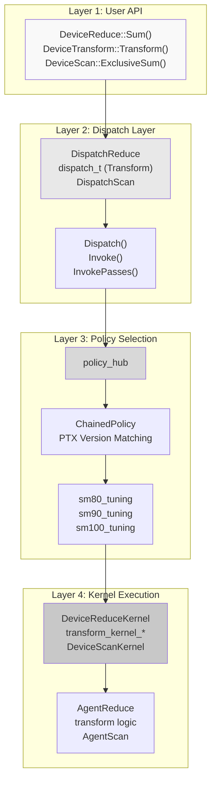

**Dispatch Layer Pattern Overview**

The dispatch layer orchestrates the entire execution flow from user API to kernel launch.

**Sources:** [cub/cub/device/dispatch/dispatch_reduce.cuh:139-158](), [cub/cub/device/dispatch/dispatch_transform.cuh:158-191](), [cub/cub/util_device.cuh:726-795]()

### Common Dispatch Components

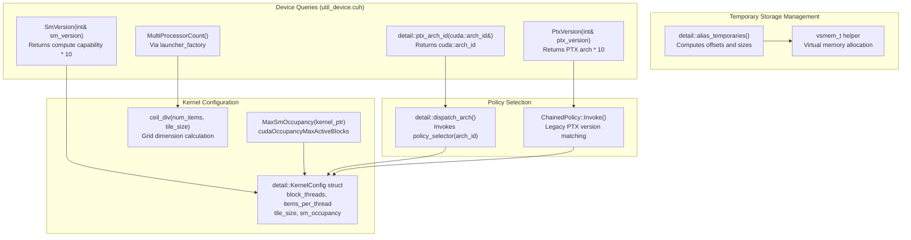

**Common Components Shared by All Dispatch Layers**

Every dispatch implementation uses these utilities for device queries, memory allocation, configuration, and policy selection.

**Sources:** [cub/cub/util_device.cuh:276-461](), [cub/cub/util_device.cuh:592-598](), [cub/cub/util_device.cuh:728-761](), [cub/cub/util_temporary_storage.cuh:1-200](), [cub/cub/device/dispatch/dispatch_common.cuh:1-100](), [cub/cub/device/dispatch/dispatch_reduce.cuh:334-353]()

## Device Reduce Architecture

### Reduce Dispatch Flow

The `DispatchReduce` class manages two execution strategies: single-tile for small problems and two-pass for large problems.

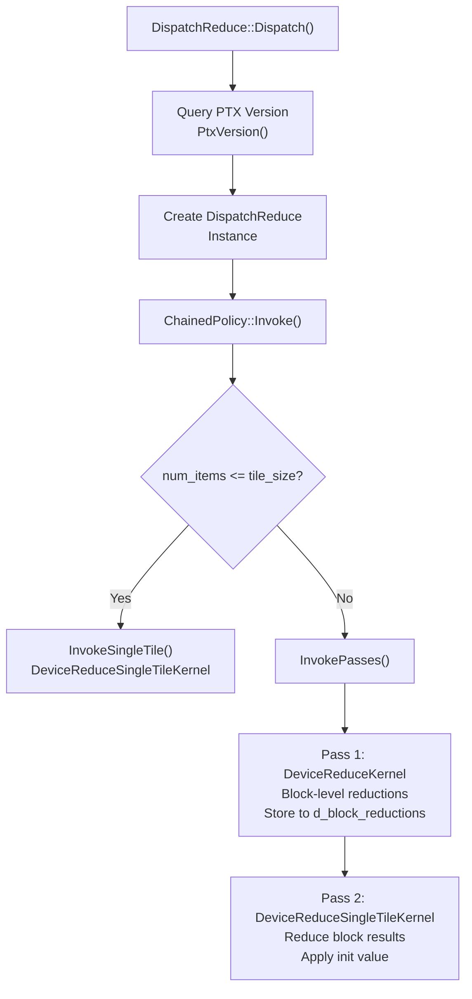

**DeviceReduce Execution Path**

The dispatch layer chooses between single-tile and two-pass strategies based on problem size.

**Sources:** [cub/cub/device/dispatch/dispatch_reduce.cuh:439-454](), [cub/cub/device/dispatch/dispatch_reduce.cuh:246-290](), [cub/cub/device/dispatch/dispatch_reduce.cuh:314-432]()

### Reduce Kernel Source Structure

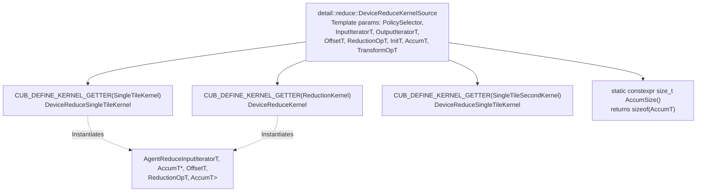

**detail::reduce::DeviceReduceKernelSource Structure**

The kernel source abstraction uses `CUB_DEFINE_KERNEL_GETTER` macros to provide typed access to kernel function pointers. Each getter returns a `CUkernel` (for C API) or function pointer.

**Sources:** [cub/cub/device/dispatch/dispatch_reduce.cuh:57-90](), [cub/cub/device/dispatch/kernels/kernel_reduce.cuh:149-272](), [cub/cub/agent/agent_reduce.cuh:116-468](), [c/parallel/src/reduce.cu:141-169]()

### Two-Pass Reduction Strategy

The two-pass approach enables efficient reduction of arbitrarily large datasets:

| Component | Purpose | Storage Location |
|-----------|---------|------------------|
| **Pass 1 Kernel** | Each block reduces its tile to a single value | Temporary device memory array |
| **Block Reductions Array** | Holds one reduced value per block | `d_block_reductions` (size: `max_blocks * sizeof(AccumT)`) |
| **Pass 2 Kernel** | Single block reduces all block results | Final output `d_out` |
| **Initial Value** | Applied only in Pass 2 | Incorporated during final reduction |

**Sources:** [cub/cub/device/dispatch/dispatch_reduce.cuh:314-432](), [cub/cub/device/dispatch/kernels/reduce.cuh:111-272]()

## Device Transform Architecture

### Transform Algorithm Selection

The `detail::transform::dispatch()` implementation employs multiple specialized kernel variants selected at runtime:

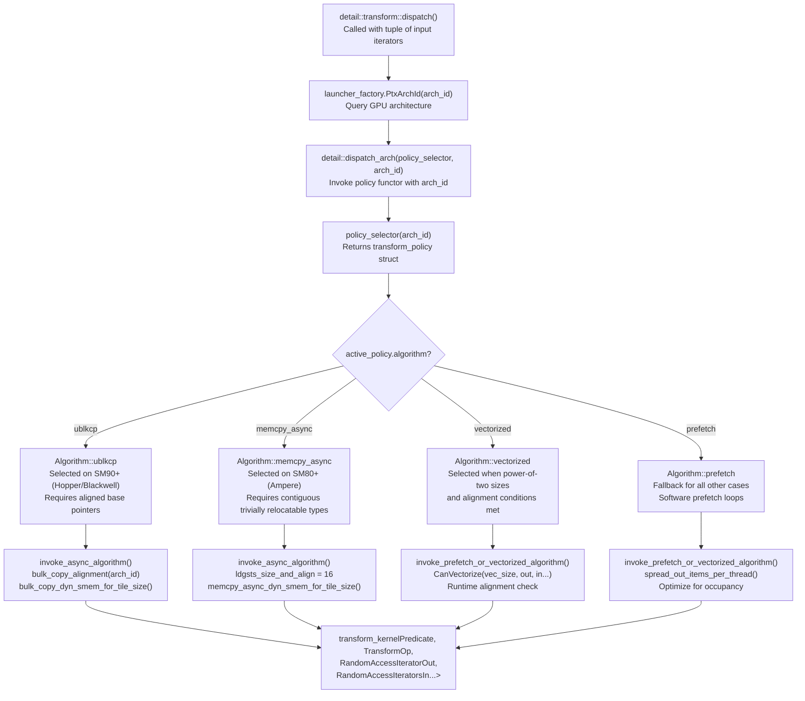

**detail::transform::dispatch() Algorithm Selection**

A single parameterized `transform_kernel` is used with different algorithm paths selected via runtime `if constexpr` branches based on the `active_policy.algorithm` enum.

**Sources:** [cub/cub/device/dispatch/dispatch_transform.cuh:547-593](), [cub/cub/device/dispatch/dispatch_transform.cuh:459-525](), [cub/cub/device/dispatch/tuning/tuning_transform.cuh:58-66](), [cub/cub/device/dispatch/tuning/tuning_transform.cuh:325-458](), [cub/cub/device/dispatch/kernels/kernel_transform.cuh:205-900]()

### Transform Algorithm Code Paths

The single `transform_kernel` template contains four algorithm code paths selected at runtime via `if constexpr`:

| Algorithm Path | Hardware Requirement | Memory Access Pattern | Key Implementation Details |
|---------------|---------------------|----------------------|---------------------------|
| **Algorithm::ublkcp** | SM90+ (Hopper/Blackwell) | `cp.async.bulk.global.shared::cta.bulk_group` | Alignment: 128B (Hopper) or 16B (Blackwell)<br/>Uses `cuda::device::barrier_arrive_tx()`<br/>Shared memory staging with padding |
| **Algorithm::memcpy_async** | SM80+ (Ampere) | `cp.async.cg.shared.global [addr]` | Alignment: 16B (`ldgsts_size_and_align`)<br/>Uses `cuda::pipeline` for async copies<br/>Shared memory with head/tail scalar copies |
| **Algorithm::vectorized** | Any architecture | Vectorized loads via `cub::ThreadLoad<LOAD_DEFAULT, VecT>` | Power-of-two type sizes required<br/>Runtime alignment check via `CanVectorize()`<br/>Direct register-to-register computation |
| **Algorithm::prefetch** | Any architecture | Scalar loads with manual prefetch | No alignment requirements<br/>Handles fancy iterators and arbitrary types<br/>Prefetch next tile while computing current |

**Sources:** [cub/cub/device/dispatch/kernels/kernel_transform.cuh:205-900](), [cub/cub/device/dispatch/tuning/tuning_transform.cuh:58-86](), [cub/cub/device/dispatch/dispatch_transform.cuh:290-322](), [cub/cub/device/dispatch/dispatch_transform.cuh:472-509]()

### Transform Configuration Flow

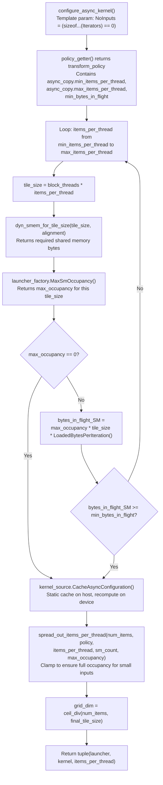

**configure_async_kernel() Runtime Configuration**

The async copy algorithms (ublkcp and memcpy_async) iterate to find the optimal `items_per_thread` that saturates memory bandwidth while fitting in shared memory and registers.

**Sources:** [cub/cub/device/dispatch/dispatch_transform.cuh:192-278](), [cub/cub/device/dispatch/dispatch_transform.cuh:174-184](), [cub/cub/device/dispatch/tuning/tuning_transform.cuh:222-270]()

### Transform Memory Alignment Handling

The async copy kernels (`ublkcp` and `ldgsts`) require careful alignment management:

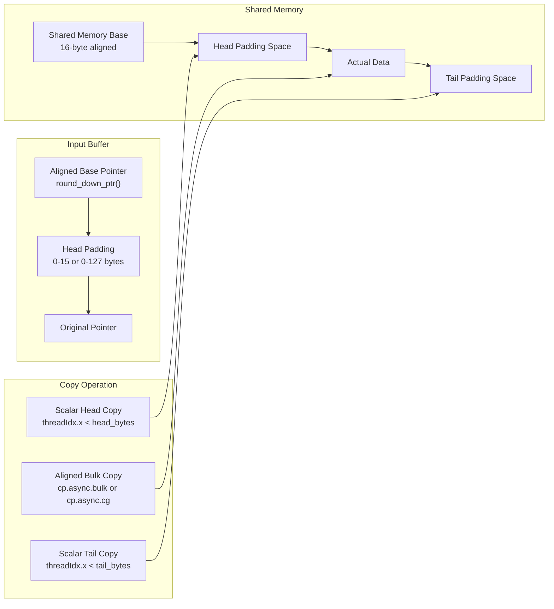

**Transform Alignment Strategy**

Head and tail padding enable aligned bulk copies while preserving correctness.

**Sources:** [cub/cub/device/dispatch/kernels/transform.cuh:333-393](), [cub/cub/device/dispatch/kernels/transform.cuh:623-688](), [cub/cub/device/dispatch/kernels/transform.cuh:61-66]()

## Device Scan Architecture

### Scan Tile State Coordination

Scans require inter-block coordination through a tile state mechanism:

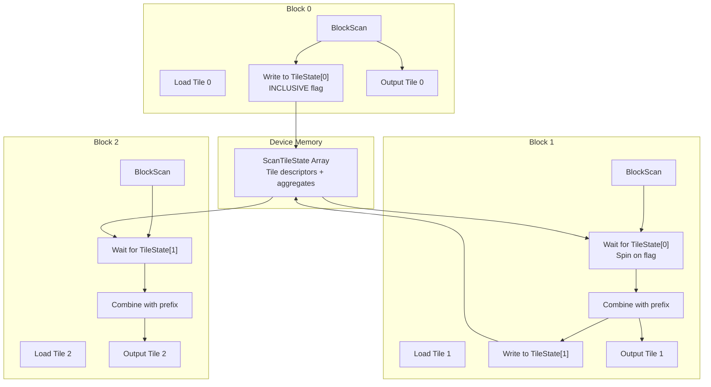

**Scan Lookback Pattern**

Blocks use the lookback pattern to incorporate prefix aggregates from earlier tiles.

**Sources:** [cub/cub/agent/agent_scan.cuh:200-450](), [cub/cub/agent/single_pass_scan_operators.cuh:1-300](), [cub/cub/device/dispatch/dispatch_scan.cuh:200-350]()

### Scan Kernel Invocation

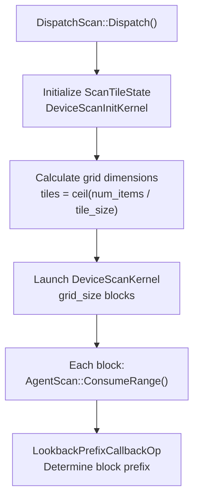

**Scan Dispatch Flow**

The scan dispatch initializes tile state before launching the main scan kernel.

**Sources:** [cub/cub/device/dispatch/dispatch_scan.cuh:200-350](), [cub/cub/device/dispatch/kernels/scan.cuh:50-200](), [cub/cub/agent/agent_scan.cuh:200-600]()

## Device Select Architecture

### Select Dispatch Strategy

The `DispatchSelectIf` implementation handles conditional element selection with optional compaction:

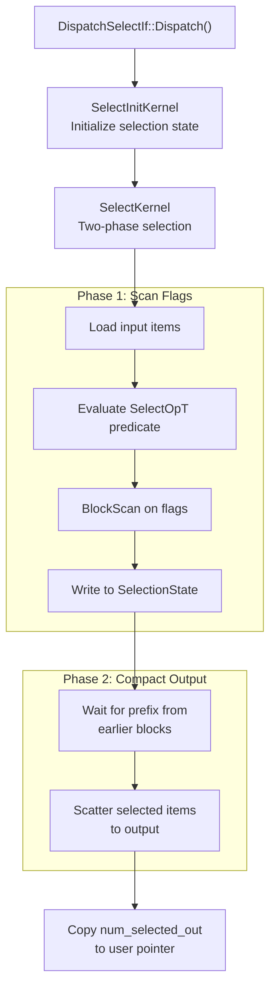

**DeviceSelect Execution Path**

Select operations scan predicate flags and compact output in a two-phase process.

**Sources:** [cub/cub/device/dispatch/dispatch_select_if.cuh:300-600](), [cub/cub/agent/agent_select_if.cuh:100-500]()

### Select Agent Structure

The `AgentSelectIf` template coordinates block-level selection:

| Template Parameter | Purpose |
|-------------------|---------|
| `SelectIfPolicyT` | Tuning parameters (threads, items, load/store algorithms) |
| `InputIteratorT` | Source data iterator |
| `FlagsInputIteratorT` | Optional pre-computed flags |
| `SelectedOutputIteratorT` | Output for selected items |
| `SelectOpT` | Predicate functor |
| `OffsetT` | Index type |
| `KeepRejects` | Whether to also output rejected items |

**Sources:** [cub/cub/agent/agent_select_if.cuh:100-200](), [cub/cub/device/dispatch/dispatch_select_if.cuh:70-150]()

## Policy Selection and Tuning System

### New Tuning API (CCCL 3.0+)

Starting with CCCL 3.0, device-wide operations use a new policy selection architecture based on `policy_selector` functors:

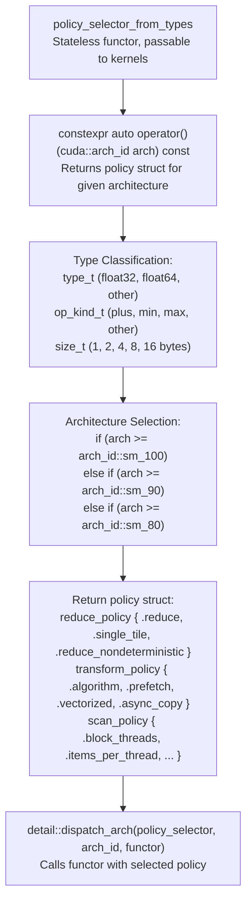

**policy_selector Functor Architecture**

The new API uses compile-time type classification and runtime architecture queries to select tuning parameters. Policy selectors are stateless and can be passed to device code.

**Sources:** [cub/cub/device/dispatch/tuning/tuning_reduce.cuh:125-505](), [cub/cub/device/dispatch/tuning/tuning_transform.cuh:325-459](), [cub/cub/device/dispatch/tuning/tuning_scan.cuh:117-850](), [cub/cub/detail/arch_dispatch.cuh:1-200]()

### Legacy ChainedPolicy Runtime Selection (Deprecated)

The legacy `ChainedPolicy` mechanism (pre-CCCL 3.0) enables runtime selection of compile-time policies:

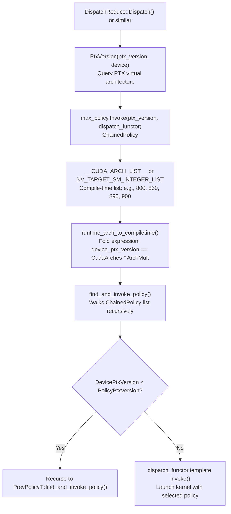

**ChainedPolicy<PolicyPtxVersion, PolicyT, PrevPolicyT> Runtime Dispatch (Legacy)**

PTX version detected at runtime selects from compile-time instantiated policies. This mechanism is deprecated in favor of the new `policy_selector` API but still used internally by some dispatchers.

**Sources:** [cub/cub/util_device.cuh:774-850](), [cub/cub/device/dispatch/dispatch_reduce.cuh:490-534](), [cub/cub/device/dispatch/tuning/tuning_reduce.cuh:94-140]()

### Tuning Policy Parameters

Common tuning parameters across device-wide operations:

| Parameter | Purpose | Typical Range |
|-----------|---------|---------------|
| `BLOCK_THREADS` | Threads per block | 128-512 |
| `ITEMS_PER_THREAD` | Items processed per thread | 4-24 |
| `VECTOR_LOAD_LENGTH` | Vector load size | 1, 2, 4 |
| `BLOCK_ALGORITHM` | Block-level algorithm choice | `BLOCK_REDUCE_RAKING`, `BLOCK_REDUCE_WARP_REDUCTIONS` |
| `LOAD_MODIFIER` | Cache hint for loads | `LOAD_DEFAULT`, `LOAD_CS`, `LOAD_LDG` |
| `LOAD_ALGORITHM` | Block load strategy | `BLOCK_LOAD_DIRECT`, `BLOCK_LOAD_WARP_TRANSPOSE` |
| `STORE_ALGORITHM` | Block store strategy | `BLOCK_STORE_DIRECT`, `BLOCK_STORE_WARP_TRANSPOSE` |

**Sources:** [cub/cub/agent/agent_reduce.cuh:66-93](), [cub/cub/device/dispatch/tuning/tuning_scan.cuh:93-114](), [cub/cub/device/dispatch/tuning/tuning_transform.cuh:93-153]()

## Temporary Storage Management

### Storage Aliasing Pattern

Device-wide operations use a unified temporary storage pattern:

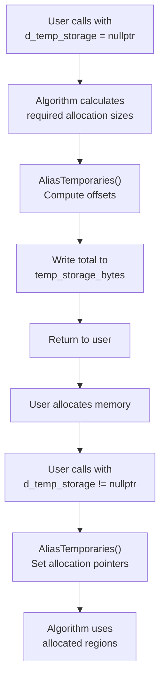

**Two-Phase Temporary Storage Pattern**

All device-wide operations follow this pattern for memory management.

**Sources:** [cub/cub/device/dispatch/dispatch_reduce.cuh:346-358](), [cub/cub/device/dispatch/dispatch_scan.cuh:250-300](), [cub/cub/util_temporary_storage.cuh:1-200]()

### Example: Reduce Storage Allocation

For a two-pass reduction with `max_blocks = 1024` and `AccumT = int`:

```
allocations[0] = block_reductions    // 1024 * sizeof(int) = 4096 bytes
Total temp_storage_bytes = 4096
```

For a scan with 10,000 items and `tile_size = 2048`:

```
allocations[0] = tile_state          // 5 tiles * sizeof(ScanTileDescriptor<AccumT>)
Total temp_storage_bytes = 5 * sizeof(ScanTileDescriptor<int>)
```

**Sources:** [cub/cub/device/dispatch/dispatch_reduce.cuh:345-358](), [cub/cub/device/dispatch/dispatch_scan.cuh:250-300]()

## Kernel Launch Configuration

### Grid Dimension Calculation

Device-wide operations compute grid dimensions based on occupancy targets:

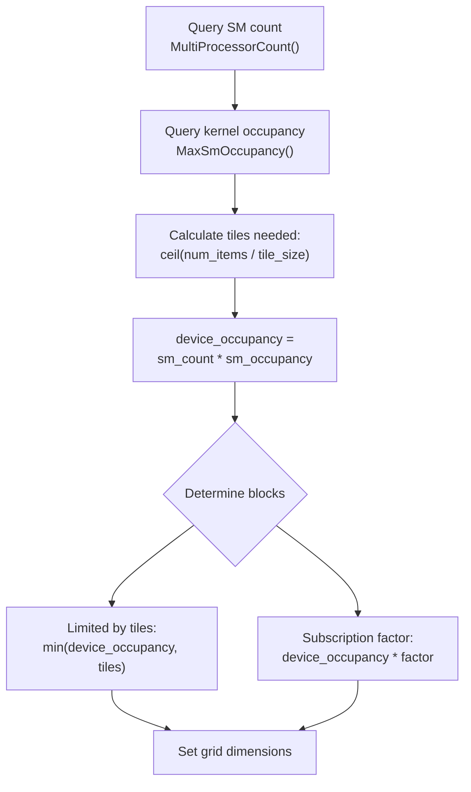

**Grid Dimension Strategy**

Operations balance between available SMs and required tiles.

**Sources:** [cub/cub/device/dispatch/dispatch_reduce.cuh:322-343](), [cub/cub/device/dispatch/dispatch_histogram.cuh:150-192]()

### Kernel Configuration Structure

The `KernelConfig` structure encapsulates launch parameters:

| Field | Description | Initialized By |
|-------|-------------|----------------|
| `block_threads` | Threads per block | Policy `BlockThreads()` |
| `items_per_thread` | Items per thread | Policy `ItemsPerThread()` |
| `tile_size` | Items per tile | `block_threads * items_per_thread` |
| `sm_occupancy` | Blocks per SM | `MaxSmOccupancy()` query |

**Sources:** [cub/cub/util_device.cuh:694-713]()

## Agent-Based Execution Model

### Agent Abstraction

Agents provide block-level abstractions that encapsulate shared memory management and tile processing logic:

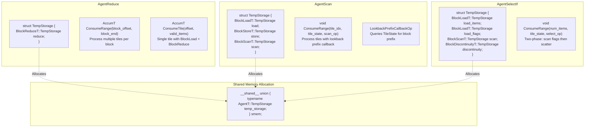

**Agent Template Structure**

Agents are templated on policy types and iterator types, providing a `TempStorage` nested struct for shared memory and methods for tile processing.

**Sources:** [cub/cub/agent/agent_reduce.cuh:116-468](), [cub/cub/agent/agent_scan.cuh:142-958](), [cub/cub/agent/agent_select_if.cuh:156-1134]()

### Agent-Kernel Relationship

Device-wide kernels instantiate and invoke agents per thread block:

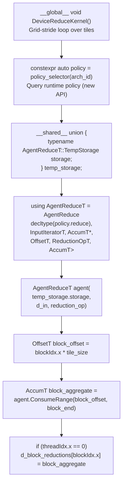

**Kernel-Agent Instantiation Pattern**

Kernels query the policy selector, instantiate the agent type with the selected policy, allocate shared memory, construct the agent instance, and invoke `ConsumeRange()`.

**Sources:** [cub/cub/device/dispatch/kernels/kernel_reduce.cuh:149-272](), [cub/cub/agent/agent_reduce.cuh:204-468](), [cub/cub/device/dispatch/dispatch_reduce.cuh:62-75]()

## Performance Optimization Strategies

### Memory Access Optimization

Device-wide operations optimize memory access through multiple techniques:

| Technique | Implementation | Benefit |
|-----------|---------------|---------|
| **Vectorized Loads** | `VECTOR_LOAD_LENGTH` in policy | Coalesced access, reduced instructions |
| **Warp-Transpose** | `BLOCK_LOAD_WARP_TRANSPOSE` | Improved coalescing for strided access |
| **Cache Hints** | `LOAD_LDG`, `LOAD_CS` modifiers | Better cache utilization |
| **Async Copy** | `cp.async.cg`, `cp.async.bulk` | Overlap compute and memory transfer |
| **Prefetch** | Software prefetch loops | Hide memory latency |

**Sources:** [cub/cub/device/dispatch/tuning/tuning_transform.cuh:219-330](), [cub/cub/device/dispatch/kernels/transform.cuh:69-95](), [cub/cub/block/block_load.cuh:1-500]()

### Occupancy and Tile Size Tuning

The relationship between tile size and occupancy affects performance:

```
tile_size = block_threads * items_per_thread
tiles_needed = ceil(num_items / tile_size)

Goal: Maximize (occupancy * tile_size) while fitting in resources
```

Larger tiles reduce kernel launch overhead but may decrease occupancy due to register or shared memory pressure.

**Sources:** [cub/cub/device/dispatch/tuning/tuning_reduce.cuh:1-300](), [cub/cub/device/dispatch/tuning/tuning_scan.cuh:1-600]()

### Algorithm-Specific Optimizations

**Reduce:** Two-pass strategy minimizes synchronization overhead for large inputs.

**Transform:** Multiple kernel variants maximize memory bandwidth for different data layouts.

**Scan:** Lookback pattern enables single-pass execution without global synchronization.

**Select:** Two-phase scan-then-scatter minimizes divergence and atomic operations.

**Sources:** [cub/cub/device/dispatch/dispatch_reduce.cuh:314-432](), [cub/cub/device/dispatch/dispatch_transform.cuh:497-526](), [cub/cub/agent/agent_scan.cuh:300-600](), [cub/cub/agent/agent_select_if.cuh:400-800]()

---

