<!-- source: DeepWiki mcp.deepwiki.com · repo NVIDIA/cccl · extra page Hardware Abstractions · fetched 2026-10-26 -->

# Hardware Abstractions

<details>
<summary>Relevant source files</summary>

The following files were used as context for generating this wiki page:

- [docs/cccl/development/macro.rst](docs/cccl/development/macro.rst)
- [docs/libcudacxx/extended_api/exceptions.rst](docs/libcudacxx/extended_api/exceptions.rst)
- [docs/libcudacxx/extended_api/memory.rst](docs/libcudacxx/extended_api/memory.rst)
- [docs/libcudacxx/extended_api/memory/is_pointer_accessible.rst](docs/libcudacxx/extended_api/memory/is_pointer_accessible.rst)
- [docs/libcudacxx/extended_api/memory/ranges_overlap.rst](docs/libcudacxx/extended_api/memory/ranges_overlap.rst)
- [docs/libcudacxx/extended_api/tma/make_tma_descriptor.rst](docs/libcudacxx/extended_api/tma/make_tma_descriptor.rst)
- [docs/libcudacxx/ptx/instructions/bmsk.rst](docs/libcudacxx/ptx/instructions/bmsk.rst)
- [docs/libcudacxx/ptx/instructions/prmt.rst](docs/libcudacxx/ptx/instructions/prmt.rst)
- [docs/libcudacxx/ptx/instructions/shl.rst](docs/libcudacxx/ptx/instructions/shl.rst)
- [docs/libcudacxx/ptx/instructions/shr.rst](docs/libcudacxx/ptx/instructions/shr.rst)
- [libcudacxx/codegen/add_ptx_instruction.py](libcudacxx/codegen/add_ptx_instruction.py)
- [libcudacxx/codegen/cccl_paths.py](libcudacxx/codegen/cccl_paths.py)
- [libcudacxx/codegen/generate_prologue_epilogue.py](libcudacxx/codegen/generate_prologue_epilogue.py)
- [libcudacxx/include/cuda/__driver/driver_api.h](libcudacxx/include/cuda/__driver/driver_api.h)
- [libcudacxx/include/cuda/__memory/is_pointer_accessible.h](libcudacxx/include/cuda/__memory/is_pointer_accessible.h)
- [libcudacxx/include/cuda/__memory/ranges_overlap.h](libcudacxx/include/cuda/__memory/ranges_overlap.h)
- [libcudacxx/include/cuda/__ptx/instructions/bmsk.h](libcudacxx/include/cuda/__ptx/instructions/bmsk.h)
- [libcudacxx/include/cuda/__runtime/api_wrapper.h](libcudacxx/include/cuda/__runtime/api_wrapper.h)
- [libcudacxx/include/cuda/__tma/make_tma_descriptor.h](libcudacxx/include/cuda/__tma/make_tma_descriptor.h)
- [libcudacxx/include/cuda/memory](libcudacxx/include/cuda/memory)
- [libcudacxx/include/cuda/std/__cccl/attributes.h](libcudacxx/include/cuda/std/__cccl/attributes.h)
- [libcudacxx/include/cuda/std/__cccl/epilogue.h](libcudacxx/include/cuda/std/__cccl/epilogue.h)
- [libcudacxx/include/cuda/std/__cccl/exceptions.h](libcudacxx/include/cuda/std/__cccl/exceptions.h)
- [libcudacxx/include/cuda/std/__cccl/prologue.h](libcudacxx/include/cuda/std/__cccl/prologue.h)
- [libcudacxx/include/cuda/std/__exception/cuda_error.h](libcudacxx/include/cuda/std/__exception/cuda_error.h)
- [libcudacxx/include/cuda/std/__exception/exception_macros.h](libcudacxx/include/cuda/std/__exception/exception_macros.h)
- [libcudacxx/include/cuda/std/__exception/msg_storage.h](libcudacxx/include/cuda/std/__exception/msg_storage.h)
- [libcudacxx/include/cuda/std/__memory/align.h](libcudacxx/include/cuda/std/__memory/align.h)
- [libcudacxx/test/libcudacxx/cuda/ccclrt/algorithm/common.cuh](libcudacxx/test/libcudacxx/cuda/ccclrt/algorithm/common.cuh)
- [libcudacxx/test/libcudacxx/cuda/memory/is_pointer_accessible.pass.cpp](libcudacxx/test/libcudacxx/cuda/memory/is_pointer_accessible.pass.cpp)
- [libcudacxx/test/libcudacxx/cuda/memory/ranges_overlap.pass.cpp](libcudacxx/test/libcudacxx/cuda/memory/ranges_overlap.pass.cpp)
- [libcudacxx/test/libcudacxx/cuda/tma/make_tma_descriptor.pass.cpp](libcudacxx/test/libcudacxx/cuda/tma/make_tma_descriptor.pass.cpp)
- [libcudacxx/test/libcudacxx/libcxx/exceptions/try_catch.pass.cpp](libcudacxx/test/libcudacxx/libcxx/exceptions/try_catch.pass.cpp)
- [libcudacxx/test/libcudacxx/libcxx/exceptions/try_catch_no_exceptions_device.runfail.cpp](libcudacxx/test/libcudacxx/libcxx/exceptions/try_catch_no_exceptions_device.runfail.cpp)
- [libcudacxx/test/libcudacxx/libcxx/exceptions/try_catch_no_exceptions_host.runfail.cpp](libcudacxx/test/libcudacxx/libcxx/exceptions/try_catch_no_exceptions_host.runfail.cpp)
- [libcudacxx/test/libcudacxx/libcxx/macros/lifetime_bound.compile.fail.cpp](libcudacxx/test/libcudacxx/libcxx/macros/lifetime_bound.compile.fail.cpp)
- [libcudacxx/test/libcudacxx/libcxx/macros/lifetime_bound.compile.pass.cpp](libcudacxx/test/libcudacxx/libcxx/macros/lifetime_bound.compile.pass.cpp)

</details>


This page documents libcudacxx's CUDA-specific hardware abstractions that enable efficient use of GPU features across different compilers, architectures, and platforms. These abstractions provide portable access to atomic operations, synchronization primitives, memory operations, and PTX-level instructions.

For standard C++ library components available in libcudacxx, see [Standard Library Components](#2.3.1). For information about CUB's low-level device primitives, see [CUB](#2.2). For compiler detection and platform abstraction implementation details, see [Platform Abstraction Layer](#5.1).

## Overview

libcudacxx provides hardware abstractions through three layers:

1. **User-Facing APIs**: High-level types like `cuda::atomic_ref`, `cuda::barrier`, memory fences
2. **Platform Abstraction**: Compiler-agnostic macros that detect and adapt to different toolchains
3. **Hardware Intrinsics**: Direct access to PTX instructions and architecture-specific features

These abstractions enable code to work across NVCC, Clang-CUDA, NVHPC, and host-only compilers while maintaining performance.

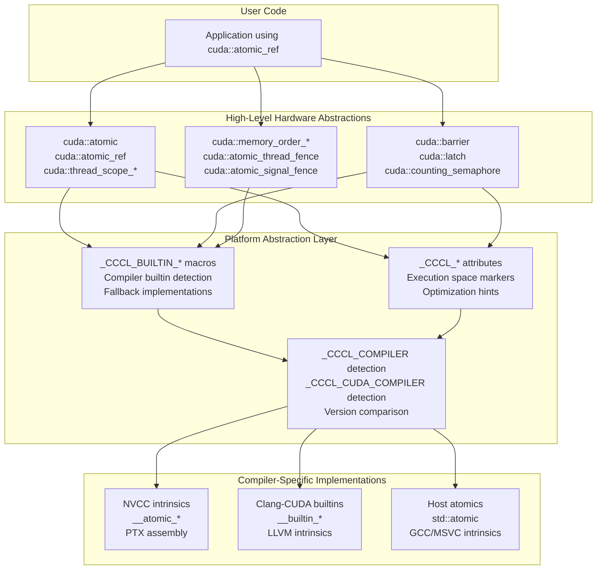

Sources: [README.md:1-106](), [libcudacxx/include/cuda/__cccl_config:1-37]()

## Atomic Operations

libcudacxx provides `cuda::atomic` and `cuda::atomic_ref` as hardware-abstracted atomic types that work in both host and device code. These types use the `_LIBCUDACXX_HAS_CUDA_ATOMIC_IMPL` configuration to dispatch to appropriate implementations.

### Core Atomic Types

| Type | Description | Header |
|------|-------------|--------|
| `cuda::atomic<T>` | Atomic object with storage | `<cuda/atomic>` |
| `cuda::atomic_ref<T, Scope>` | Reference to existing storage | `<cuda/atomic>` |
| `cuda::thread_scope_system` | System-wide atomics | `<cuda/std/atomic>` |
| `cuda::thread_scope_device` | Device-wide atomics | `<cuda/std/atomic>` |
| `cuda::thread_scope_block` | Block-wide atomics | `<cuda/std/atomic>` |
| `cuda::thread_scope_thread` | Thread-local (no sync) | `<cuda/std/atomic>` |

### Memory Orders

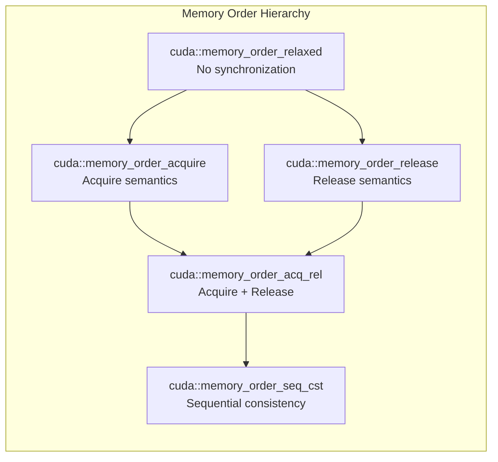

### Implementation Dispatch

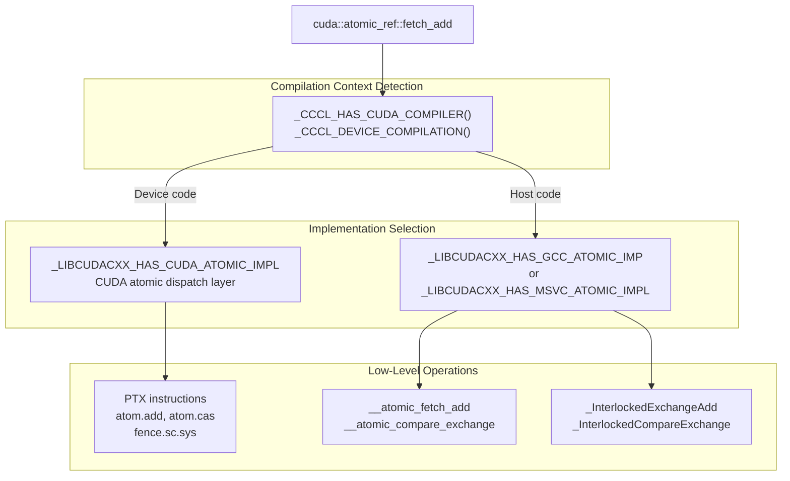

Sources: [libcudacxx/include/cuda/std/detail/libcxx/include/__config:58-144](), [README.md:46-106]()

## Compiler Builtin Abstractions

The `_CCCL_BUILTIN_*` macro family provides portable access to compiler intrinsics. These are implemented in [libcudacxx/include/cuda/std/__cccl/builtin.h:1-677]() and form the foundation for hardware abstractions.

### Builtin Detection Strategy

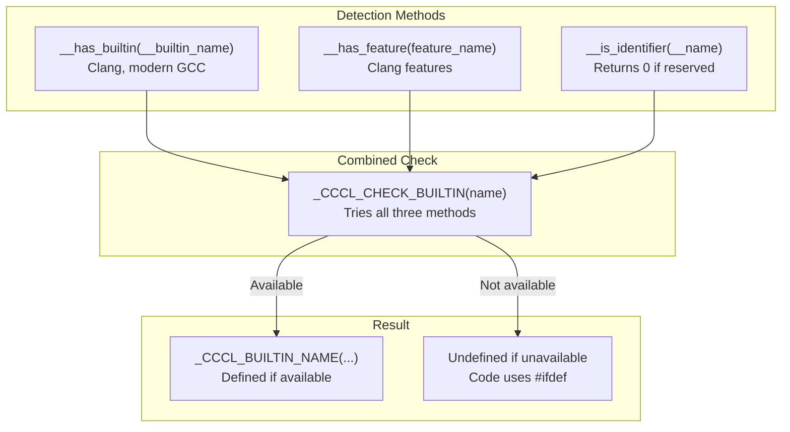

### Key Builtin Categories

**Type Operations**:
- `_CCCL_BUILTIN_ADDRESSOF`: Portable `__builtin_addressof` [libcudacxx/include/cuda/std/__cccl/builtin.h:93-97]()
- `_CCCL_BUILTIN_BIT_CAST`: Type punning via `__builtin_bit_cast` [libcudacxx/include/cuda/std/__cccl/builtin.h:113-116]()
- `_CCCL_BUILTIN_IS_CONSTANT_EVALUATED`: Constexpr context detection [libcudacxx/include/cuda/std/__cccl/builtin.h:252-254]()

**Bit Manipulation**:
- `_CCCL_BUILTIN_POPCOUNT`/`_CCCL_BUILTIN_POPCOUNTLL`: Population count [libcudacxx/include/cuda/std/__cccl/builtin.h:118-122]()
- `_CCCL_BUILTIN_CLZ`/`_CCCL_BUILTIN_CLZLL`: Count leading zeros [libcudacxx/include/cuda/std/__cccl/builtin.h:133-136]()
- `_CCCL_BUILTIN_CTZ`/`_CCCL_BUILTIN_CTZLL`: Count trailing zeros [libcudacxx/include/cuda/std/__cccl/builtin.h:147-150]()
- `_CCCL_BUILTIN_BSWAP16`/`32`/`64`: Byte swap [libcudacxx/include/cuda/std/__cccl/builtin.h:161-171]()

**Optimization Hints**:
- `_CCCL_BUILTIN_ASSUME`: Optimization assumptions [libcudacxx/include/cuda/std/__cccl/builtin.h:99-107]()
- `_CCCL_BUILTIN_EXPECT`: Branch prediction [libcudacxx/include/cuda/std/__cccl/builtin.h:211-213]()
- `_CCCL_BUILTIN_PREFETCH`: Memory prefetch [libcudacxx/include/cuda/std/__cccl/builtin.h:354-358]()

**Compiler Workarounds**:

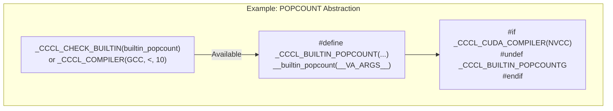

The NVCC workaround demonstrates how [libcudacxx/include/cuda/std/__cccl/builtin.h:128-131]() disables `_CCCL_BUILTIN_POPCOUNTG` for NVCC because that compiler cannot handle the generic version.

Sources: [libcudacxx/include/cuda/std/__cccl/builtin.h:1-677]()

## Attribute Abstractions

The `_CCCL_*` attribute macros provide portable function and type annotations that work across compilers. These enable optimization hints, debug control, and semantic guarantees.

### Attribute Categories

| Category | Macro | Purpose |
|----------|-------|---------|
| **Optimization** | `_CCCL_PURE` | Function has no side effects [libcudacxx/include/cuda/std/__cccl/attributes.h:114-123]() |
| | `_CCCL_CONST` | Function is purely mathematical [libcudacxx/include/cuda/std/__cccl/attributes.h:88-93]() |
| | `_CCCL_ASSUME(expr)` | Optimization assumption [libcudacxx/include/cuda/std/__cccl/attributes.h:77-85]() |
| **Debug Control** | `_CCCL_NODEBUG` | Suppress debug info [libcudacxx/include/cuda/std/__cccl/attributes.h:55-59]() |
| | `_CCCL_ARTIFICIAL` | Don't step into in debugger [libcudacxx/include/cuda/std/__cccl/attributes.h:64-68]() |
| **Safety** | `_CCCL_NO_SANITIZE(type)` | Disable sanitizer [libcudacxx/include/cuda/std/__cccl/attributes.h:135-139]() |
| | `_CCCL_NO_CFI` | Disable CFI checks [libcudacxx/include/cuda/std/__cccl/attributes.h:126-131]() |
| **ABI** | `_CCCL_NO_UNIQUE_ADDRESS` | Enable empty base optimization [libcudacxx/include/cuda/std/__cccl/attributes.h:158-180]() |

### Multi-Tier Fallback Example: _CCCL_ASSUME

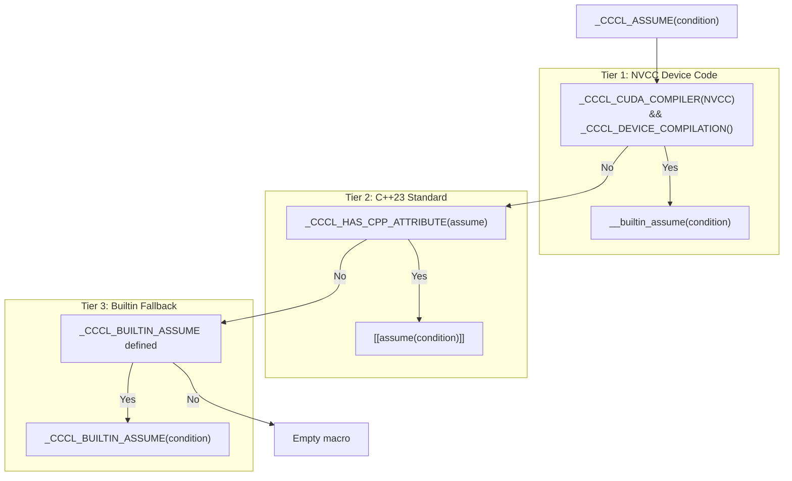

This shows the implementation at [libcudacxx/include/cuda/std/__cccl/attributes.h:77-85]() which tries three approaches before falling back to a no-op.

### Attribute Detection Methods

| Method | Macro | Compilers |
|--------|-------|-----------|
| `__has_attribute` | `_CCCL_HAS_ATTRIBUTE(__x)` | Clang, GCC 5+ |
| `__has_cpp_attribute` | `_CCCL_HAS_CPP_ATTRIBUTE(__x)` | All modern |
| `__has_declspec_attribute` | `_CCCL_HAS_DECLSPEC_ATTRIBUTE(__x)` | MSVC, Clang |

Source: [libcudacxx/include/cuda/std/__cccl/attributes.h:30-46]()

### Known Issues and Workarounds

**MSVC `[[no_unique_address]]` Issue**:
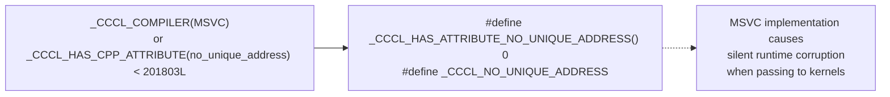

**Clang C++17 NVCC Issue**:
The attribute is also disabled when using Clang as host compiler with NVCC in C++17 mode to avoid data corruption from nested `[[no_unique_address]]` objects passed to kernels (nvbug 5265027).

Sources: [libcudacxx/include/cuda/std/__cccl/attributes.h:158-180]()

## Compiler and Platform Detection

libcudacxx's hardware abstractions depend on accurate compiler and platform detection. This system is implemented in [libcudacxx/include/cuda/std/__cccl/compiler.h:1-218]().

### Compiler Detection Architecture

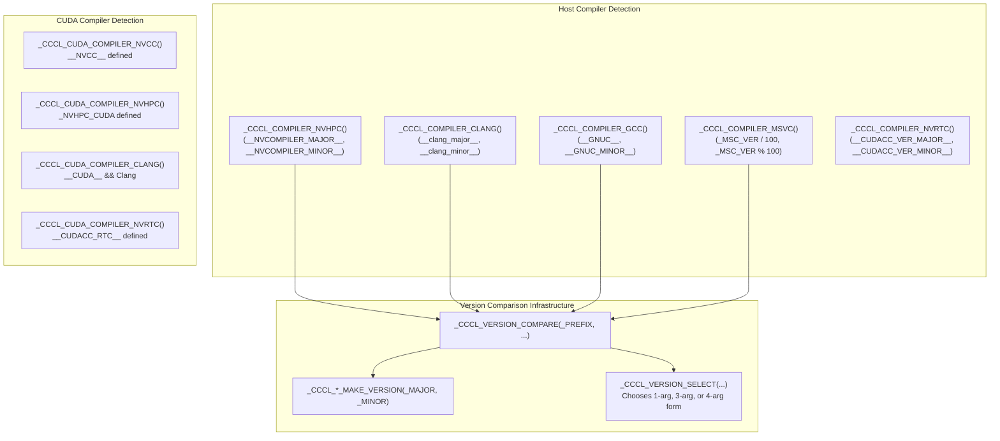

### Compilation Context Macros

| Macro | Meaning | True When |
|-------|---------|-----------|
| `_CCCL_HAS_CUDA_COMPILER()` | CUDA compiler available | Any CUDA compiler detected |
| `_CCCL_CUDA_COMPILATION()` | Compiling CUDA code | `__CUDACC__` or NVHPC CUDA |
| `_CCCL_HOST_COMPILATION()` | Compiling host code | `!__CUDA_ARCH__` (or always for NVHPC) |
| `_CCCL_DEVICE_COMPILATION()` | Compiling device code | `__CUDA_ARCH__` defined |
| `_CCCL_CUDACC_BELOW(12, 7)` | CUDA version check | During CUDA compilation only |
| `_CCCL_CUDACC_AT_LEAST(12, 7)` | CUDA version check | During CUDA compilation only |

**Special Case: NVHPC**:
When compiling with `nvc++`, both `_CCCL_HOST_COMPILATION()` and `_CCCL_DEVICE_COMPILATION()` return true because NVHPC compiles host and device code simultaneously, unlike NVCC's two-pass model.

Sources: [libcudacxx/include/cuda/std/__cccl/compiler.h:56-174]()

### Usage Example

```cpp
#if _CCCL_COMPILER(MSVC, >=, 19, 29)
#  define USE_MSVC_INTRINSIC
#elif _CCCL_CUDA_COMPILER(NVCC) && _CCCL_DEVICE_COMPILATION()
#  define USE_PTX_ASSEMBLY
#elif _CCCL_HAS_CUDA_COMPILER()
#  define USE_CUDA_BUILTIN
#endif
```

This pattern appears throughout libcudacxx to select appropriate implementations.

## Diagnostic Control

Hardware abstractions must suppress warnings across different compilers. The diagnostic system is implemented in [libcudacxx/include/cuda/std/__cccl/diagnostic.h:1-132]().

### Per-Compiler Warning Suppression

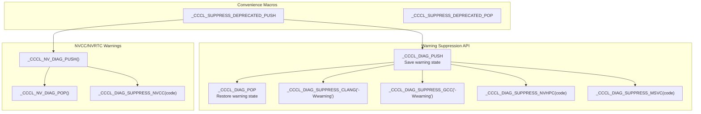

### Compiler-Specific Implementation

| Compiler | Push | Pop | Suppress |
|----------|------|-----|----------|
| Clang | `#pragma clang diagnostic push` | `#pragma clang diagnostic pop` | `#pragma clang diagnostic ignored "-Wname"` |
| GCC | `#pragma GCC diagnostic push` | `#pragma GCC diagnostic pop` | `#pragma GCC diagnostic ignored "-Wname"` |
| NVHPC | `#pragma diagnostic push` | `#pragma diagnostic pop` | `#pragma diag_suppress code` |
| MSVC | `#pragma warning(push)` | `#pragma warning(pop)` | `#pragma warning(disable: code)` |
| NVCC | `#pragma nv_diagnostic push` | `#pragma nv_diagnostic pop` | `#pragma nv_diag_suppress code` |

Source: [libcudacxx/include/cuda/std/__cccl/diagnostic.h:26-86]()

### Common Warning Pattern

```cpp
_CCCL_SUPPRESS_DEPRECATED_PUSH
// Code using deprecated features
cuda::atomic<int> old_atomic;
_CCCL_SUPPRESS_DEPRECATED_POP
```

This expands to push/suppress/pop for all active compilers at [libcudacxx/include/cuda/std/__cccl/diagnostic.h:88-122]().

## Configuration and Integration

All hardware abstractions are integrated through the main configuration header.

### Integration Hierarchy

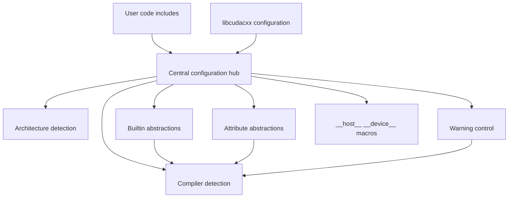

Sources: [libcudacxx/include/cuda/__cccl_config:1-37](), [libcudacxx/include/cuda/std/detail/libcxx/include/__config:1-208]()

### Atomic Implementation Selection

The atomic implementation is configured at [libcudacxx/include/cuda/std/detail/libcxx/include/__config:109-144]():

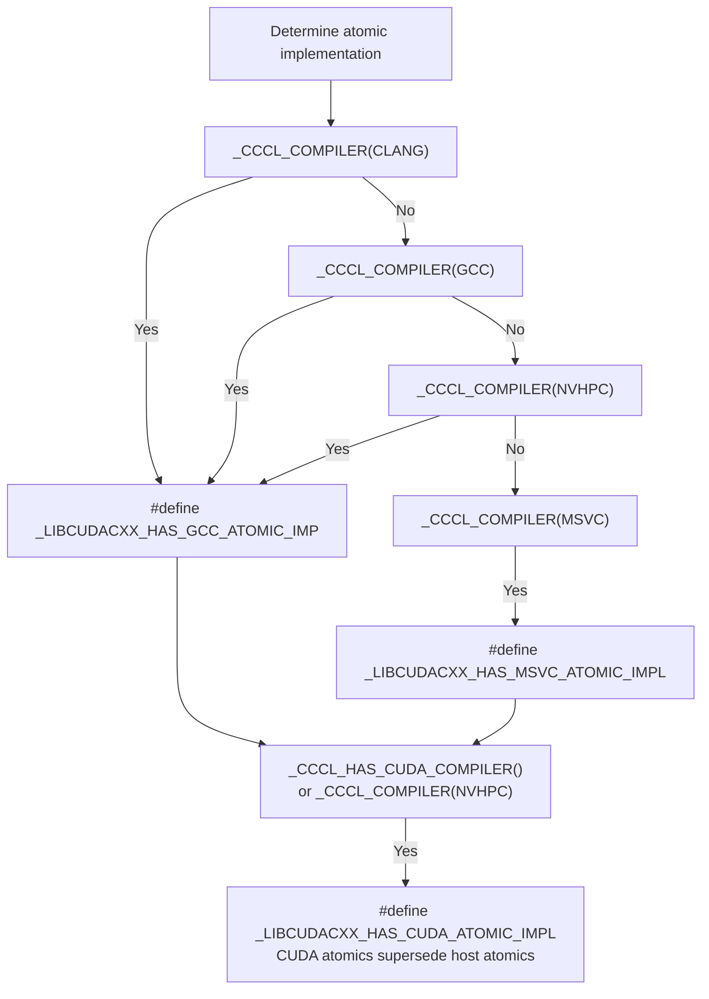

**Key Insight**: `_LIBCUDACXX_HAS_CUDA_ATOMIC_IMPL` supersedes host atomic implementations to insert the host/device dispatch layer, enabling the same atomic types to work in both host and device code.

Sources: [libcudacxx/include/cuda/std/detail/libcxx/include/__config:109-144]()

## Hardware Feature Macros

libcudacxx provides macros to detect hardware feature availability, primarily for extended data types.

### Extended Data Type Support

| Feature Macro | Description | Underlying Check |
|---------------|-------------|------------------|
| `_CCCL_HAS_INT128()` | 128-bit integers | `__int128` and `__uint128_t` |
| `_CCCL_HAS_NVFP8()` | 8-bit float types | `__nv_fp8_e5m2`, `__nv_fp8_e4m3`, `__nv_fp8_e8m0` |
| `_CCCL_HAS_NVFP16()` | 16-bit float types | `__half`, `__half2` |
| `_CCCL_HAS_NVBF16()` | 16-bit bfloat types | `__nv_bfloat16`, `__nv_bfloat162` |
| `_CCCL_HAS_FLOAT128()` | 128-bit float | `__float128` |

These can be disabled via:
- `CCCL_DISABLE_INT128_SUPPORT`
- `CCCL_DISABLE_NVFP8_SUPPORT`
- `CCCL_DISABLE_NVFP16_SUPPORT`
- `CCCL_DISABLE_NVBF16_SUPPORT`
- `CCCL_DISABLE_FLOAT128_SUPPORT`

### Type Trait Builtins

Many type traits use compiler builtins for efficiency. Examples from [libcudacxx/include/cuda/std/__cccl/builtin.h:387-586]():

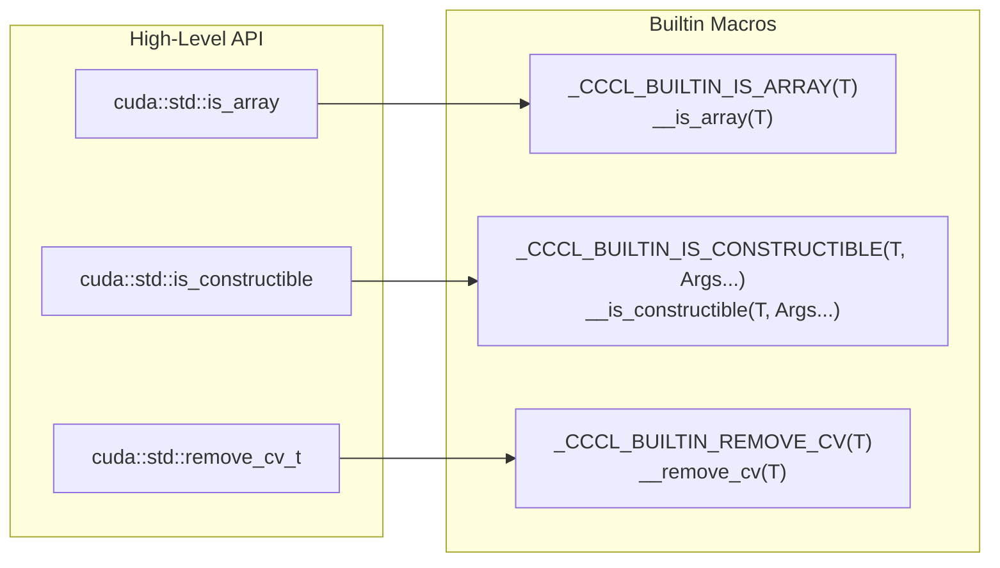

**Workarounds**: Some builtins are disabled for specific compilers:
- `_CCCL_BUILTIN_IS_ARRAY`: Disabled for Clang < 19 due to incorrect results for `T[0]` [libcudacxx/include/cuda/std/__cccl/builtin.h:391-394]()
- `_CCCL_BUILTIN_IS_FUNDAMENTAL`: Disabled for Clang < 10 [libcudacxx/include/cuda/std/__cccl/builtin.h:429-432]()
- `_CCCL_BUILTIN_REMOVE_CVREF`: Disabled for NVRTC < 12.4 [libcudacxx/include/cuda/std/__cccl/builtin.h:558-560]()

Sources: [libcudacxx/include/cuda/std/__cccl/builtin.h:387-592]()

## Summary

libcudacxx's hardware abstractions provide a comprehensive platform abstraction layer that enables CUDA features to work portably across compilers and architectures:

1. **Compiler Detection**: `_CCCL_COMPILER` and `_CCCL_CUDA_COMPILER` macros identify toolchains
2. **Builtin Abstraction**: `_CCCL_BUILTIN_*` macros provide portable intrinsic access
3. **Attribute Abstraction**: `_CCCL_*` attributes enable optimization and debug control
4. **Diagnostic Control**: Per-compiler warning suppression maintains clean builds
5. **Implementation Dispatch**: Multi-tier selection of optimal implementations
6. **Hardware Features**: Atomic operations, synchronization, and memory operations

This infrastructure allows user-facing types like `cuda::atomic_ref` to work efficiently in both host and device code while maintaining a single, clean API surface.

Sources: [libcudacxx/include/cuda/__cccl_config:1-37](), [libcudacxx/include/cuda/std/__cccl/builtin.h:1-677](), [libcudacxx/include/cuda/std/__cccl/attributes.h:1-207](), [libcudacxx/include/cuda/std/__cccl/compiler.h:1-218](), [libcudacxx/include/cuda/std/__cccl/diagnostic.h:1-132](), [libcudacxx/include/cuda/std/detail/libcxx/include/__config:1-208]()

---

