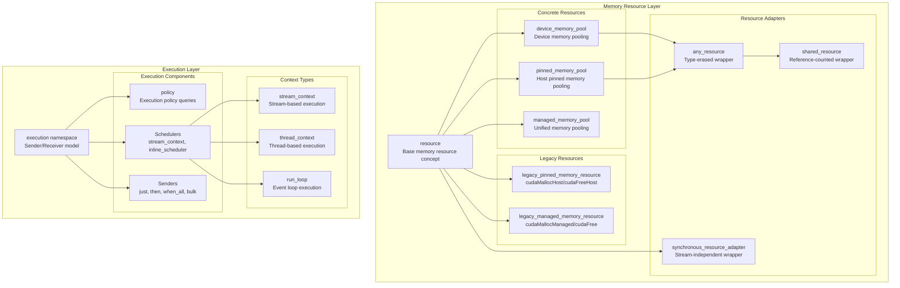
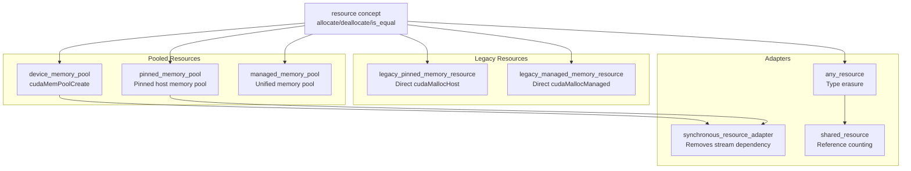
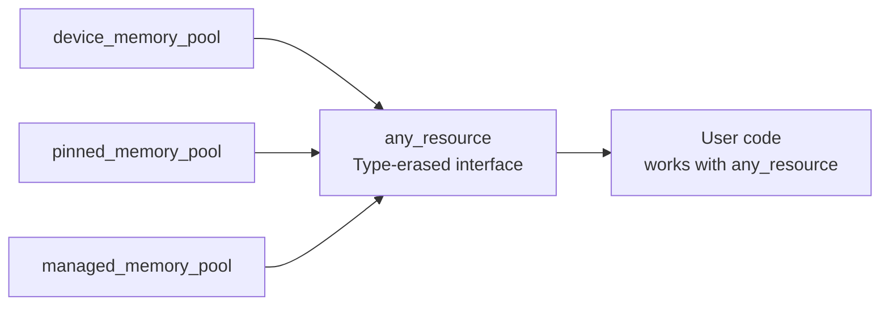
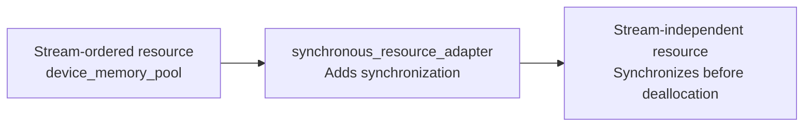
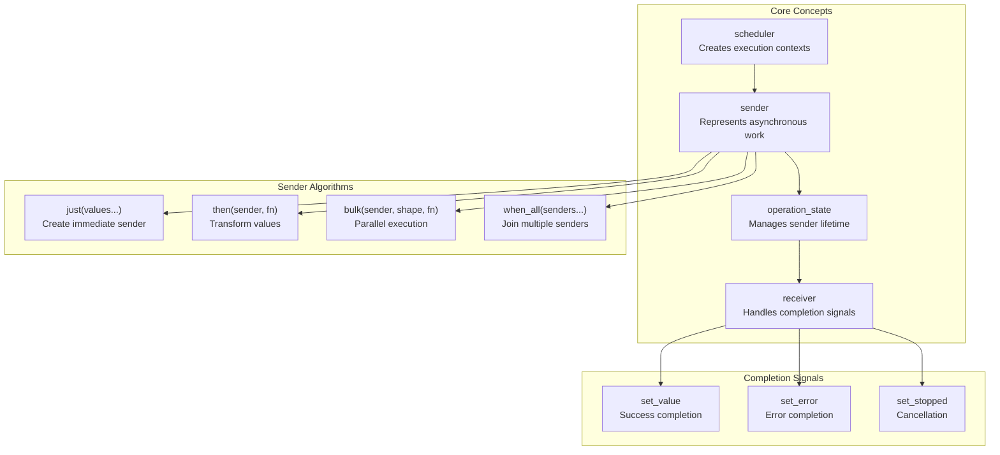
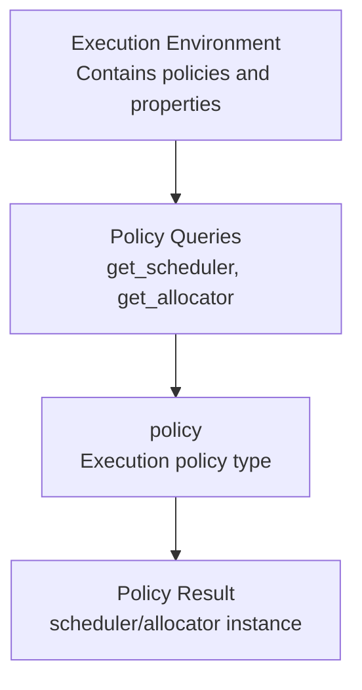
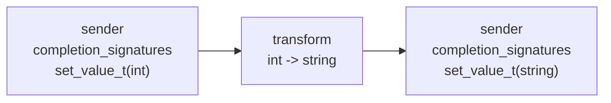
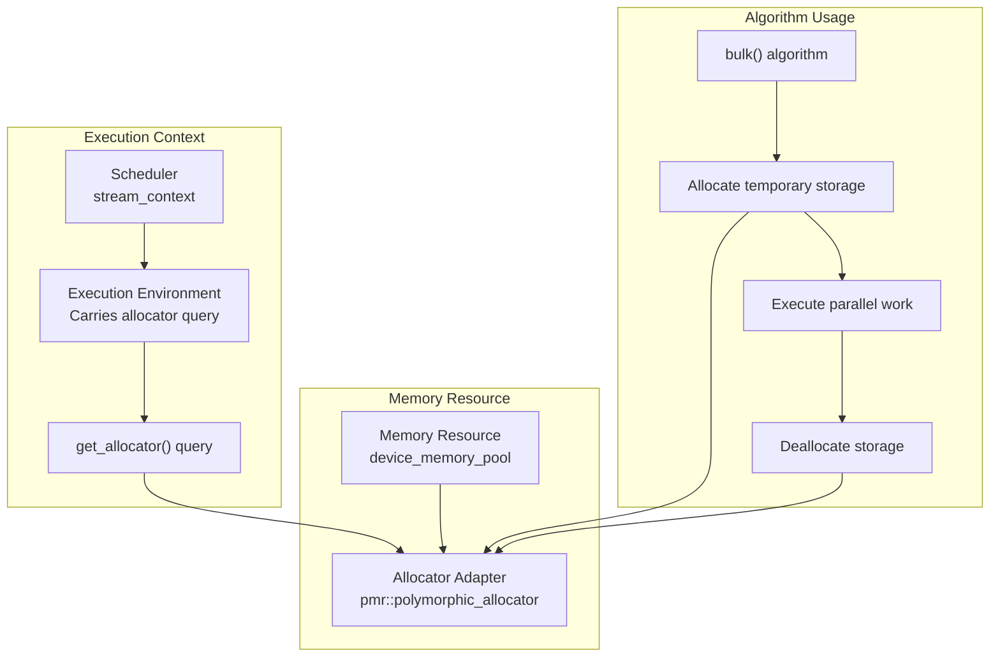

<!-- source: DeepWiki mcp.deepwiki.com · repo NVIDIA/cccl · extra page Memory Resources and Execution · fetched 2026-10-26 -->

# Memory Resources and Execution

<details>
<summary>Relevant source files</summary>

The following files were used as context for generating this wiki page:

- [cudax/include/cuda/experimental/execution.cuh](cudax/include/cuda/experimental/execution.cuh)
- [cudax/include/cuda/experimental/memory_resource.cuh](cudax/include/cuda/experimental/memory_resource.cuh)
- [cudax/test/CMakeLists.txt](cudax/test/CMakeLists.txt)

</details>


## Purpose and Scope

This document describes the CUDAX memory resource abstractions and execution policy components. It covers the memory resource types provided by CUDAX (device, pinned, and managed memory pools), the resource adapter patterns, and the execution policy framework that integrates with the sender/receiver execution model.

For information about the Sequential Task Framework and its memory management, see [Sequential Task Framework (STF)](#2.4.2). For details on the execution model and sender/receiver patterns, see the execution subsystem documentation.

## System Overview

The CUDAX memory resource and execution system provides abstractions for managing GPU memory and coordinating asynchronous execution. The core components are organized into two subsystems:

**CUDAX Memory Resources and Execution Architecture**



**Sources:** [cudax/include/cuda/experimental/memory_resource.cuh:1-26](), [cudax/include/cuda/experimental/execution.cuh:1-53]()

## Memory Resource Abstractions

CUDAX provides memory resource abstractions following the C++ `std::pmr::memory_resource` pattern, adapted for CUDA's memory model. These resources provide polymorphic memory allocation with different backing stores and properties.

### Memory Resource Concept

The base `resource` concept defines the interface that all memory resources must satisfy:

| Member Function | Description |
|-----------------|-------------|
| `allocate(size, alignment)` | Allocates memory with specified size and alignment |
| `deallocate(ptr, size, alignment)` | Deallocates previously allocated memory |
| `is_equal(other)` | Checks if two resources allocate from the same pool |

**Memory Resource Type Hierarchy**



**Sources:** [cudax/include/cuda/experimental/memory_resource.cuh:14-24]()

### Memory Pools

#### device_memory_pool

The `device_memory_pool` type provides pooled device memory allocation using CUDA memory pools:

| Feature | Description |
|---------|-------------|
| **Backend** | Uses `cudaMemPool_t` for efficient reuse |
| **Stream-ordered** | Allocations respect stream ordering |
| **Properties** | Supports device-accessible memory property |
| **IPC Support** | Can share memory across processes |

**Usage Pattern:**

```cpp
#include <cuda/experimental/memory_resource.cuh>

// Create pool for device 0
cuda::device_memory_pool pool{cuda::device_ref{0}};

// Allocate from pool
void* ptr = pool.allocate(1024, 16);

// Deallocate back to pool
pool.deallocate(ptr, 1024, 16);
```

**Sources:** [cudax/include/cuda/experimental/memory_resource.cuh:14]()

#### pinned_memory_pool

The `pinned_memory_pool` type provides pooled pinned (page-locked) host memory:

| Feature | Description |
|---------|-------------|
| **Backend** | Uses CUDA pinned memory allocation |
| **Accessibility** | Host-accessible, device-readable |
| **DMA Transfer** | Optimized for cudaMemcpy operations |
| **Portability** | Can be accessed by all CUDA devices |

Pinned memory enables faster host-to-device transfers and can be used for zero-copy access from the device.

**Sources:** [cudax/include/cuda/experimental/memory_resource.cuh:16]()

#### managed_memory_pool

The `managed_memory_pool` type provides pooled unified memory allocation:

| Feature | Description |
|---------|-------------|
| **Backend** | Uses CUDA managed memory |
| **Accessibility** | Accessible from both host and device |
| **Migration** | Automatic page migration between host and device |
| **Coherence** | Automatically synchronized across processors |

Managed memory simplifies memory management at the cost of potential migration overhead.

**Sources:** [cudax/include/cuda/experimental/memory_resource.cuh:15]()

### Legacy Memory Resources

For compatibility with existing code, CUDAX provides legacy resource wrappers:

#### legacy_pinned_memory_resource

Wraps direct `cudaMallocHost` and `cudaFreeHost` calls without pooling:

```cpp
cuda::legacy_pinned_memory_resource legacy_pinned;
void* ptr = legacy_pinned.allocate(1024);
legacy_pinned.deallocate(ptr, 1024);
```

**Sources:** [cudax/include/cuda/experimental/memory_resource.cuh:19]()

#### legacy_managed_memory_resource

Wraps direct `cudaMallocManaged` and `cudaFree` calls without pooling:

```cpp
cuda::legacy_managed_memory_resource legacy_managed;
void* ptr = legacy_managed.allocate(1024);
legacy_managed.deallocate(ptr, 1024);
```

**Sources:** [cudax/include/cuda/experimental/memory_resource.cuh:18]()

### Memory Resource Properties

The `properties` header defines memory resource properties that describe capabilities and constraints:

| Property | Description |
|----------|-------------|
| **device_accessible** | Memory can be accessed by device code |
| **host_accessible** | Memory can be accessed by host code |
| **stream_ordered** | Allocations respect stream ordering |
| **pool_backed** | Memory comes from a reusable pool |

These properties enable compile-time and runtime querying of memory resource capabilities.

**Sources:** [cudax/include/cuda/experimental/memory_resource.cuh:20]()

### Resource Adapters

#### any_resource

The `any_resource` type provides type erasure for memory resources:

**Type Erasure for Memory Resources**



This enables storing different resource types in containers and passing them through type-erased interfaces.

**Sources:** [cudax/include/cuda/experimental/memory_resource.cuh:17]()

#### shared_resource

The `shared_resource` type adds reference counting to memory resources:

| Feature | Description |
|---------|-------------|
| **Reference Counting** | Automatic lifetime management |
| **Copyable** | Can be copied, incrementing refcount |
| **Shared Ownership** | Multiple owners can hold the resource |
| **Thread-Safe** | Reference count updates are atomic |

**Usage Pattern:**

```cpp
// Create shared resource
cuda::shared_resource<cuda::device_memory_pool> shared_pool{
    cuda::device_ref{0}
};

// Copy shares ownership
auto shared_copy = shared_pool;

// Last owner destroys the pool
```

**Sources:** [cudax/include/cuda/experimental/memory_resource.cuh:22]()

#### synchronous_resource_adapter

The `synchronous_resource_adapter` removes stream-ordering requirements from stream-ordered resources:



This adapter automatically synchronizes before deallocating memory, making the resource safe to use without explicit stream management.

**Sources:** [cudax/include/cuda/experimental/memory_resource.cuh:23]()

## Execution Policy Framework

The execution policy framework provides abstractions for controlling how operations execute, integrating with the sender/receiver execution model defined in the C++ standard proposal P2300.

### Execution Concepts

CUDAX execution is built on several fundamental concepts:

**Execution Model Concepts**



**Sources:** [cudax/include/cuda/experimental/execution.cuh:15-50]()

### Execution Schedulers

Schedulers provide the entry point for creating asynchronous work:

#### stream_context

The `stream_context` type provides a scheduler that executes work on a CUDA stream:

| Member | Description |
|--------|-------------|
| `get_scheduler()` | Returns scheduler for the stream |
| `get_stream()` | Returns the underlying stream reference |
| `sync()` | Synchronizes the stream |

**Usage Pattern:**

```cpp
#include <cuda/experimental/execution.cuh>

cuda::stream_context ctx{cuda::device_ref{0}};
auto sched = ctx.get_scheduler();

// Create and execute work
auto work = cuda::execution::just(42)
    | cuda::execution::then([](int x) { return x * 2; });
    
cuda::execution::sync_wait(cuda::execution::on(sched, work));
```

**Sources:** [cudax/include/cuda/experimental/execution.cuh:38](), [cudax/test/CMakeLists.txt:53]()

#### inline_scheduler

The `inline_scheduler` executes work immediately on the calling thread:

```cpp
auto sched = cuda::execution::inline_scheduler{};
auto work = cuda::execution::just(1, 2, 3);
cuda::execution::sync_wait(cuda::execution::on(sched, work));
```

**Sources:** [cudax/include/cuda/experimental/execution.cuh:25]()

### Sender Algorithms

The execution framework provides composable algorithms for building asynchronous pipelines:

#### Core Algorithms

| Algorithm | Description |
|-----------|-------------|
| `just(values...)` | Creates a sender that immediately provides values |
| `then(sender, fn)` | Transforms sender values with a function |
| `let_value(sender, fn)` | Transforms values and chains to another sender |
| `bulk(sender, shape, fn)` | Executes function in parallel for each index |
| `when_all(senders...)` | Joins multiple senders, completing when all complete |

**Sender Algorithm Composition**


**Sources:** [cudax/include/cuda/experimental/execution.cuh:26-47](), [cudax/test/CMakeLists.txt:40-59]()

#### Stream Control Algorithms

| Algorithm | Description |
|-----------|-------------|
| `on(scheduler, sender)` | Executes sender on specified scheduler |
| `starts_on(scheduler, sender)` | Ensures sender starts on scheduler |
| `continues_on(scheduler, sender)` | Continues sender on different scheduler |

These algorithms control which execution context (stream) a sender executes on.

**Sources:** [cudax/include/cuda/experimental/execution.cuh:29-36]()

### Execution Policy Types

The `policy` component provides execution policy queries:

**Execution Policy Query Pattern**



Execution policies encapsulate strategy information that algorithms can query to optimize their execution.

**Sources:** [cudax/include/cuda/experimental/execution.cuh:30](), [cudax/test/CMakeLists.txt:41-42]()

### Completion Signatures

The execution model uses completion signatures to describe how senders can complete:

| Signature | Meaning |
|-----------|---------|
| `set_value_t(Types...)` | Normal completion with typed values |
| `set_error_t(Error)` | Error completion with error object |
| `set_stopped_t()` | Cancellation completion |

**Completion Signature Transformation**



The type system tracks how transformations affect completion signatures, enabling compile-time verification of sender chains.

**Sources:** [cudax/include/cuda/experimental/execution.cuh:18-24](), [cudax/test/CMakeLists.txt:45]()

### Execution Contexts

CUDAX provides several execution context types beyond `stream_context`:

#### thread_context

Executes work on CPU threads using a thread pool or similar mechanism.

**Sources:** [cudax/include/cuda/experimental/execution.cuh:42]()

#### run_loop

Provides an event loop for executing work, similar to libuv or ASIO event loops.

**Sources:** [cudax/include/cuda/experimental/execution.cuh:33]()

## Integration with Memory Resources

Memory resources integrate with the execution model through allocator queries:

**Memory Resource and Execution Integration**



Execution environments can carry memory resource information through allocator queries, allowing algorithms to allocate temporary storage using the appropriate memory type.

**Sources:** [cudax/include/cuda/experimental/execution.cuh:22-23](), [cudax/include/cuda/experimental/memory_resource.cuh:1-26]()

## Container Integration

CUDAX provides containers that use memory resources:

### uninitialized_buffer

The `uninitialized_buffer` container provides RAII management of uninitialized device memory:

| Feature | Description |
|---------|-------------|
| **Memory Resource** | Uses polymorphic memory resource for allocation |
| **Uninitialized** | Does not construct elements |
| **View Interface** | Provides spans for typed access |
| **Device Access** | Returns device-accessible pointers |

**Usage Pattern:**

```cpp
#include <cuda/experimental/memory_resource.cuh>

cuda::device_memory_pool pool{cuda::device_ref{0}};
cuda::uninitialized_buffer<int> buffer{100, pool};

// Get device pointer
int* device_ptr = buffer.data();

// Get span view
auto span = buffer.view();
```

**Sources:** [cudax/test/CMakeLists.txt:80-82]()

## Usage Patterns

### Basic Kernel Launch

```cpp
auto config = cudax::block_dims<256>() & cudax::grid_dims(1024);
cudax::launch(stream, config, []__device__(auto conf) {
    int idx = conf.dims.rank();
    // kernel logic
});
```

### Cooperative Launch with Shared Memory

```cpp
auto config = cudax::make_config(
    cudax::block_dims<128>() & cudax::grid_dims(4),
    cudax::cooperative_launch(),
    cudax::dynamic_shared_memory<int, 256>()
);

cudax::launch(stream, config, []__device__(auto conf) {
    auto smem = cudax::dynamic_smem_span(conf);
    cooperative_groups::this_grid().sync();
});
```

### Multi-Device Configuration

```cpp
for (auto device : cuda::devices) {
    cudax::stream s{device};
    auto config = cudax::block_dims<128>() & cudax::grid_dims(4);
    cudax::launch(s, config, kernel, device.get());
}
```

### Mixed Host and Device Work

```cpp
cudax::launch(stream, config, device_kernel, data);
cudax::host_launch(stream, [&]() {
    validate_results(data);
});
cudax::launch(stream, config, next_kernel, data);
```

**Sources:** [cudax/test/launch/launch_smoke.cu:158-327](), [cudax/test/stream/stream_smoke.cu:20-104]()

---

