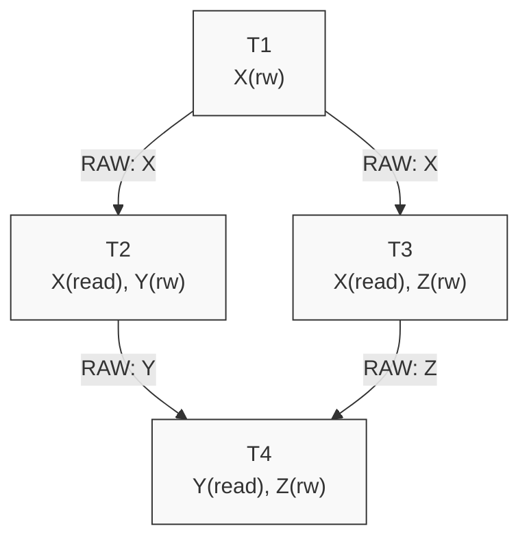
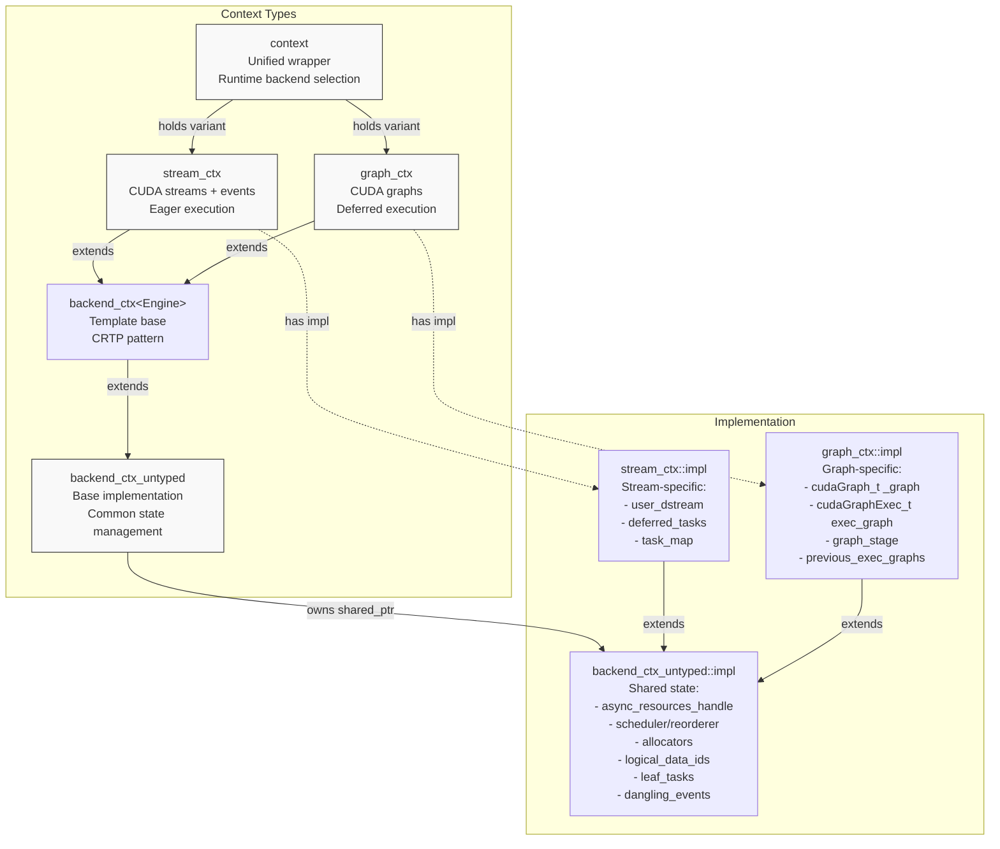
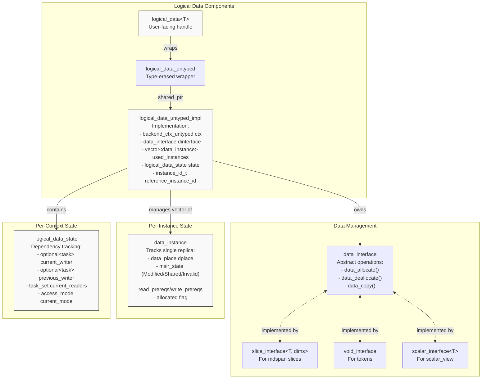
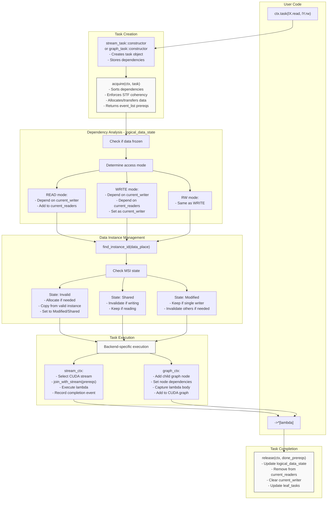
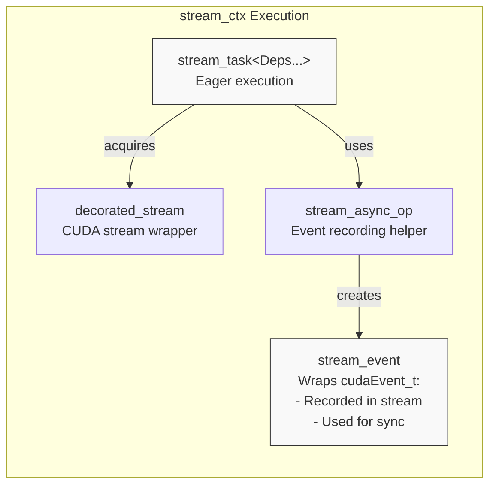
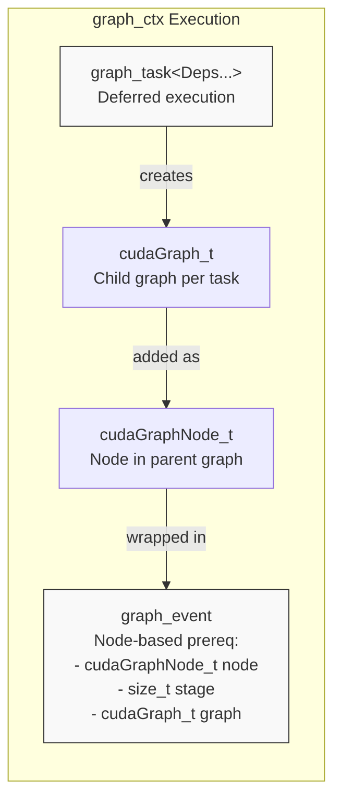
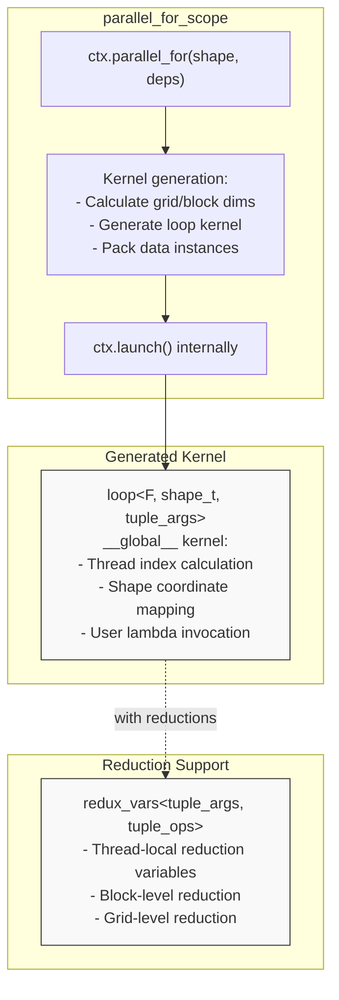
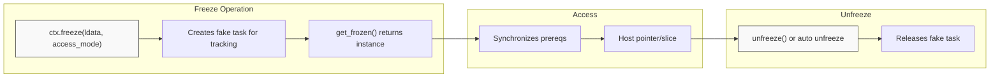
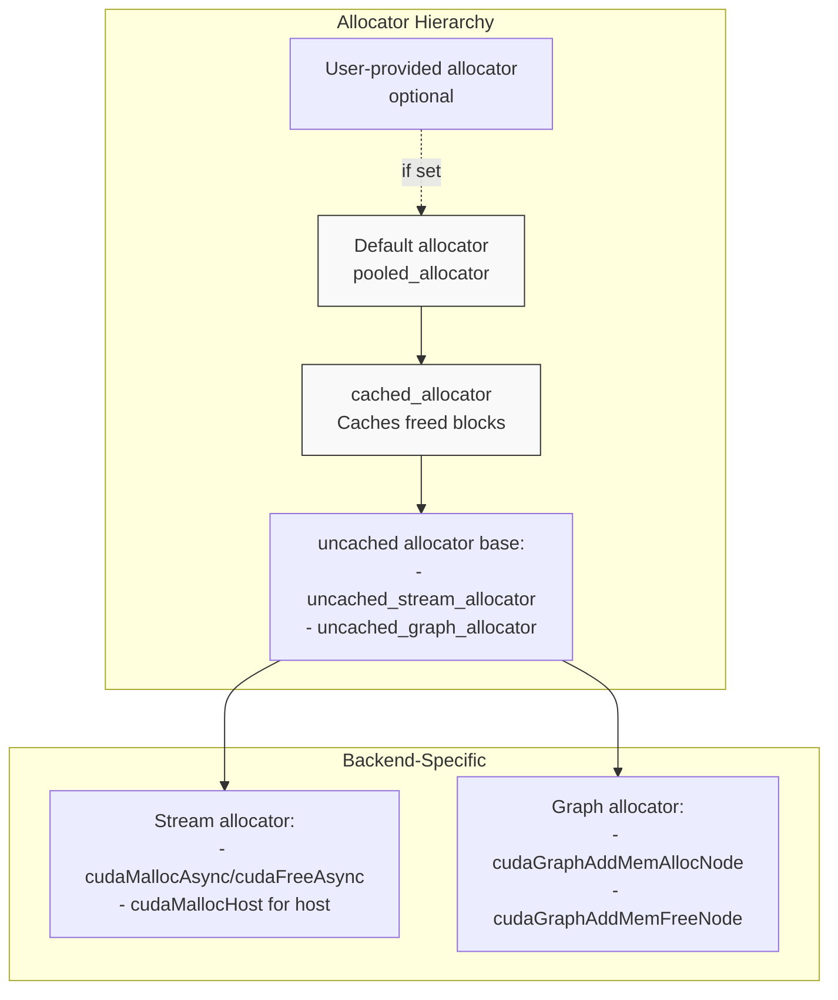
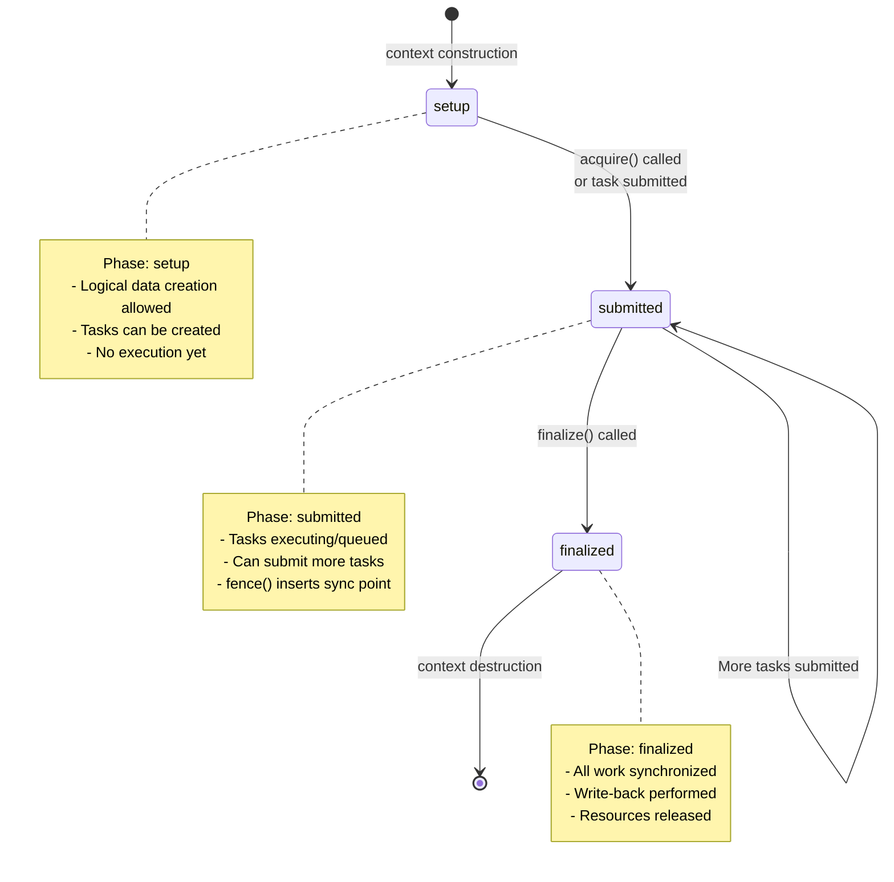

<!-- source: DeepWiki mcp.deepwiki.com · repo NVIDIA/cccl · extra page Sequential Task Framework (STF) · fetched 2026-10-26 -->

# Sequential Task Framework (STF)

Relevant source files

The following files were used as context for generating this wiki page:

- [cudax/examples/stf/void_data_interface.cu](cudax/examples/stf/void_data_interface.cu)
- [cudax/include/cuda/experimental/__stf/allocators/adapters.cuh](cudax/include/cuda/experimental/__stf/allocators/adapters.cuh)
- [cudax/include/cuda/experimental/__stf/allocators/block_allocator.cuh](cudax/include/cuda/experimental/__stf/allocators/block_allocator.cuh)
- [cudax/include/cuda/experimental/__stf/allocators/buddy_allocator.cuh](cudax/include/cuda/experimental/__stf/allocators/buddy_allocator.cuh)
- [cudax/include/cuda/experimental/__stf/allocators/cached_allocator.cuh](cudax/include/cuda/experimental/__stf/allocators/cached_allocator.cuh)
- [cudax/include/cuda/experimental/__stf/allocators/pooled_allocator.cuh](cudax/include/cuda/experimental/__stf/allocators/pooled_allocator.cuh)
- [cudax/include/cuda/experimental/__stf/graph/graph_ctx.cuh](cudax/include/cuda/experimental/__stf/graph/graph_ctx.cuh)
- [cudax/include/cuda/experimental/__stf/graph/graph_data_interface.cuh](cudax/include/cuda/experimental/__stf/graph/graph_data_interface.cuh)
- [cudax/include/cuda/experimental/__stf/graph/graph_task.cuh](cudax/include/cuda/experimental/__stf/graph/graph_task.cuh)
- [cudax/include/cuda/experimental/__stf/graph/internal/event_types.cuh](cudax/include/cuda/experimental/__stf/graph/internal/event_types.cuh)
- [cudax/include/cuda/experimental/__stf/internal/acquire_release.cuh](cudax/include/cuda/experimental/__stf/internal/acquire_release.cuh)
- [cudax/include/cuda/experimental/__stf/internal/async_prereq.cuh](cudax/include/cuda/experimental/__stf/internal/async_prereq.cuh)
- [cudax/include/cuda/experimental/__stf/internal/async_resources_handle.cuh](cudax/include/cuda/experimental/__stf/internal/async_resources_handle.cuh)
- [cudax/include/cuda/experimental/__stf/internal/backend_allocator_setup.cuh](cudax/include/cuda/experimental/__stf/internal/backend_allocator_setup.cuh)
- [cudax/include/cuda/experimental/__stf/internal/backend_ctx.cuh](cudax/include/cuda/experimental/__stf/internal/backend_ctx.cuh)
- [cudax/include/cuda/experimental/__stf/internal/context.cuh](cudax/include/cuda/experimental/__stf/internal/context.cuh)
- [cudax/include/cuda/experimental/__stf/internal/ctx_resource.cuh](cudax/include/cuda/experimental/__stf/internal/ctx_resource.cuh)
- [cudax/include/cuda/experimental/__stf/internal/cuda_kernel_scope.cuh](cudax/include/cuda/experimental/__stf/internal/cuda_kernel_scope.cuh)
- [cudax/include/cuda/experimental/__stf/internal/dot.cuh](cudax/include/cuda/experimental/__stf/internal/dot.cuh)
- [cudax/include/cuda/experimental/__stf/internal/executable_graph_cache.cuh](cudax/include/cuda/experimental/__stf/internal/executable_graph_cache.cuh)
- [cudax/include/cuda/experimental/__stf/internal/frozen_logical_data.cuh](cudax/include/cuda/experimental/__stf/internal/frozen_logical_data.cuh)
- [cudax/include/cuda/experimental/__stf/internal/host_launch_scope.cuh](cudax/include/cuda/experimental/__stf/internal/host_launch_scope.cuh)
- [cudax/include/cuda/experimental/__stf/internal/launch.cuh](cudax/include/cuda/experimental/__stf/internal/launch.cuh)
- [cudax/include/cuda/experimental/__stf/internal/logical_data.cuh](cudax/include/cuda/experimental/__stf/internal/logical_data.cuh)
- [cudax/include/cuda/experimental/__stf/internal/machine.cuh](cudax/include/cuda/experimental/__stf/internal/machine.cuh)
- [cudax/include/cuda/experimental/__stf/internal/parallel_for_scope.cuh](cudax/include/cuda/experimental/__stf/internal/parallel_for_scope.cuh)
- [cudax/include/cuda/experimental/__stf/internal/task.cuh](cudax/include/cuda/experimental/__stf/internal/task.cuh)
- [cudax/include/cuda/experimental/__stf/internal/task_dep.cuh](cudax/include/cuda/experimental/__stf/internal/task_dep.cuh)
- [cudax/include/cuda/experimental/__stf/internal/void_interface.cuh](cudax/include/cuda/experimental/__stf/internal/void_interface.cuh)
- [cudax/include/cuda/experimental/__stf/localization/composite_slice.cuh](cudax/include/cuda/experimental/__stf/localization/composite_slice.cuh)
- [cudax/include/cuda/experimental/__stf/places/data_place_extension.cuh](cudax/include/cuda/experimental/__stf/places/data_place_extension.cuh)
- [cudax/include/cuda/experimental/__stf/places/exec/cuda_stream.cuh](cudax/include/cuda/experimental/__stf/places/exec/cuda_stream.cuh)
- [cudax/include/cuda/experimental/__stf/places/exec/green_context.cuh](cudax/include/cuda/experimental/__stf/places/exec/green_context.cuh)
- [cudax/include/cuda/experimental/__stf/places/place_partition.cuh](cudax/include/cuda/experimental/__stf/places/place_partition.cuh)
- [cudax/include/cuda/experimental/__stf/places/places.cuh](cudax/include/cuda/experimental/__stf/places/places.cuh)
- [cudax/include/cuda/experimental/__stf/stream/internal/event_types.cuh](cudax/include/cuda/experimental/__stf/stream/internal/event_types.cuh)
- [cudax/include/cuda/experimental/__stf/stream/stream_ctx.cuh](cudax/include/cuda/experimental/__stf/stream/stream_ctx.cuh)
- [cudax/include/cuda/experimental/__stf/stream/stream_task.cuh](cudax/include/cuda/experimental/__stf/stream/stream_task.cuh)
- [cudax/include/cuda/experimental/__stf/utility/threads.cuh](cudax/include/cuda/experimental/__stf/utility/threads.cuh)
- [cudax/include/cuda/experimental/__stf/utility/unique_id.cuh](cudax/include/cuda/experimental/__stf/utility/unique_id.cuh)
- [cudax/include/cuda/experimental/stf.cuh](cudax/include/cuda/experimental/stf.cuh)
- [cudax/test/stf/CMakeLists.txt](cudax/test/stf/CMakeLists.txt)
- [cudax/test/stf/context/context_resource_test.cu](cudax/test/stf/context/context_resource_test.cu)
- [cudax/test/stf/context/simple_context_resource_test.cu](cudax/test/stf/context/simple_context_resource_test.cu)
- [cudax/test/stf/cpp/task_get_stream.cu](cudax/test/stf/cpp/task_get_stream.cu)
- [cudax/test/stf/cpp/test_pick_stream.cu](cudax/test/stf/cpp/test_pick_stream.cu)
- [cudax/test/stf/cpp/test_pick_stream_green_context.cu](cudax/test/stf/cpp/test_pick_stream_green_context.cu)
- [cudax/test/stf/dot/section_movable.cu](cudax/test/stf/dot/section_movable.cu)
- [cudax/test/stf/dot/sections_2.cu](cudax/test/stf/dot/sections_2.cu)
- [cudax/test/stf/examples/cuda_kernels_driver.cu](cudax/test/stf/examples/cuda_kernels_driver.cu)
- [cudax/test/stf/freeze/freeze_rw.cu](cudax/test/stf/freeze/freeze_rw.cu)
- [cudax/test/stf/graph/freeze_nested_graphs.cu](cudax/test/stf/graph/freeze_nested_graphs.cu)
- [cudax/test/stf/graph/freeze_nested_graphs_allocator.cu](cudax/test/stf/graph/freeze_nested_graphs_allocator.cu)
- [cudax/test/stf/graph/graph_multiple_launch_resources.cu](cudax/test/stf/graph/graph_multiple_launch_resources.cu)
- [cudax/test/stf/local_stf/threads_multiple_graphs.cu](cudax/test/stf/local_stf/threads_multiple_graphs.cu)
- [cudax/test/stf/parallel_for/parallel_for_host.cu](cudax/test/stf/parallel_for/parallel_for_host.cu)
- [cudax/test/stf/places/affinity_gc.cu](cudax/test/stf/places/affinity_gc.cu)
- [cudax/test/stf/places/data_place_alloc.cu](cudax/test/stf/places/data_place_alloc.cu)
- [docs/cudax/stf.rst](docs/cudax/stf.rst)

The Sequential Task Framework (STF) is an experimental task-based programming model that enables developers to write GPU applications as a sequence of tasks annotated with data dependencies. STF automatically extracts parallelism, manages data movement across CPU and GPU memory spaces, and orchestrates execution using either CUDA streams or CUDA graphs as the underlying synchronization mechanism.

For information about other CUDAX components (memory resources, execution policies), see [Memory Resources and Execution](#2.4.1).

---

## Programming Model

STF implements the Sequential Task Flow programming model, which allows developers to express complex parallel algorithms as a sequence of tasks with explicit data access annotations. The runtime analyzes these dependencies to:

- **Extract implicit parallelism**: Tasks without conflicting data accesses execute concurrently
- **Enforce coherency**: Read-after-write (RAW), write-after-read (WAR), and write-after-write (WAW) dependencies are automatically satisfied
- **Manage data movement**: Data is transparently transferred between CPU and GPU memory as needed
- **Optimize execution**: Work is scheduled across multiple GPUs when available

**Example Dependency Analysis**

Consider the task sequence: `T1[X(rw)], T2[X(read), Y(rw)], T3[X(read), Z(rw)], T4[Y(read), Z(rw)]`

Sources: [docs/cudax/stf.rst:28-83]()

---

## Core Architecture

### Backend Context Hierarchy

STF provides three context types that share a common interface but differ in their execution strategy:

**Key Classes:**

- **`backend_ctx_untyped`**: Base class containing common state (logical data tracking, allocators, scheduler, event lists)
- **`backend_ctx<Engine>`**: CRTP template providing context-specific APIs (logical_data creation, task submission)
- **`stream_ctx`**: Executes tasks eagerly using CUDA streams and events
- **`graph_ctx`**: Builds CUDA graphs incrementally and executes them in batches
- **`context`**: Type-erased wrapper (`std::variant<stream_ctx, graph_ctx>`) allowing runtime backend selection

Sources: [cudax/include/cuda/experimental/__stf/internal/backend_ctx.cuh:84-921](), [cudax/include/cuda/experimental/__stf/stream/stream_ctx.cuh:123-176](), [cudax/include/cuda/experimental/__stf/graph/graph_ctx.cuh:177-253](), [cudax/include/cuda/experimental/__stf/internal/context.cuh:75-361]()

---

### Logical Data System

Logical data abstracts physical data locations, allowing the same conceptual data to exist simultaneously in multiple memory spaces (host RAM, device 0, device 1, etc.). STF maintains coherency using a modified MSI (Modified-Shared-Invalid) protocol.

**Data Instance States (MSI Protocol):**

| State | Description | Allowed Operations |
|-------|-------------|-------------------|
| **Modified** | Unique valid copy, may differ from other instances | Read, Write |
| **Shared** | Valid copy, identical to other Shared instances | Read |
| **Invalid** | No valid data, must fetch from Modified/Shared instance | None (triggers copy) |

Sources: [cudax/include/cuda/experimental/__stf/internal/logical_data.cuh:155-655](), [cudax/include/cuda/experimental/__stf/internal/data_interface.cuh:1-500](), [cudax/include/cuda/experimental/__stf/internal/msir.cuh:1-100]()

---

## Task Execution Model

### Task Submission and Dependency Resolution

**Key Functions:**

- **`acquire()`**: [cudax/include/cuda/experimental/__stf/internal/acquire_release.cuh:34-280]() - Prepares task for execution by sorting dependencies, allocating instances, and enforcing coherency
- **`release()`**: [cudax/include/cuda/experimental/__stf/internal/acquire_release.cuh:282-450]() - Updates dependency tracking state after task completion
- **`enforce_coherency()`**: [cudax/include/cuda/experimental/__stf/internal/logical_data.cuh:640-900]() - Implements RAW/WAR/WAW dependency rules

Sources: [cudax/include/cuda/experimental/__stf/internal/acquire_release.cuh:1-500](), [cudax/include/cuda/experimental/__stf/internal/logical_data.cuh:102-146](), [cudax/include/cuda/experimental/__stf/internal/task.cuh:1-250]()

---

### Backend-Specific Task Types

**Stream Backend Tasks**

- **Execution**: Tasks execute immediately when submitted
- **Synchronization**: Uses `cudaEvent_t` recorded in streams
- **Stream management**: Pools streams via `async_resources_handle`
- **Prerequsite handling**: `join_with_stream()` waits on incoming events before task execution

**Graph Backend Tasks**

- **Execution**: Tasks build a CUDA graph incrementally, executed when `finalize()` or `submit()` is called
- **Synchronization**: Uses graph node dependencies
- **Graph stages**: Multiple graphs can be created via `change_stage()` for iterative algorithms
- **Graph caching**: Executable graphs are cached and updated when topology matches

Sources: [cudax/include/cuda/experimental/__stf/stream/stream_task.cuh:40-300](), [cudax/include/cuda/experimental/__stf/graph/graph_task.cuh:40-500](), [cudax/include/cuda/experimental/__stf/stream/internal/event_types.cuh:1-200](), [cudax/include/cuda/experimental/__stf/graph/internal/event_types.cuh:1-150]()

---

## Data and Execution Places

### Data Places

The `data_place` abstraction specifies where data instances reside:

| Place Type | Factory Method | Description |
|------------|----------------|-------------|
| Host | `data_place::host()` | Pinned CPU memory |
| Managed | `data_place::managed()` | CUDA managed memory |
| Device | `data_place::device(int)` | GPU device memory |
| Current Device | `data_place::current_device()` | Active GPU device |
| Auto | `data_place::device_auto()` | Scheduler selects device |
| Affine | `data_place::affine()` | Use exec_place's affine device |

**Composite Data Places**: For partitioned data across multiple devices, STF supports composite places that map data coordinates to execution locations.

### Execution Places

The `exec_place` abstraction specifies where tasks execute:

- **`exec_place::host()`**: CPU execution (host callbacks)
- **`exec_place::device(int)`**: Specific GPU device
- **`exec_place::current_device()`**: Active GPU
- **`exec_place_grid`**: Grid of devices for parallel_for partitioning
- **`exec_place_cuda_stream`**: User-provided CUDA stream
- **`exec_place_green_ctx`**: Green context (CUDA 12.4+)

Sources: [cudax/include/cuda/experimental/__stf/places/places.cuh:59-300](), [cudax/include/cuda/experimental/__stf/places/places.cuh:350-650]()

---

## Advanced Features

### Parallel For Construct

STF provides `ctx.parallel_for()` to automatically generate CUDA kernels for data-parallel operations:

**Features:**
- Automatic kernel generation from device lambdas
- Multi-dimensional index spaces (1D, 2D, 3D)
- Built-in reduction operations (`reducer::sum`, `reducer::max`, etc.)
- Partitioned execution across multiple devices

Sources: [cudax/include/cuda/experimental/__stf/internal/parallel_for_scope.cuh:42-500](), [cudax/include/cuda/experimental/__stf/internal/parallel_for_scope.cuh:86-191]()

### Frozen Logical Data

Frozen logical data allows direct host-side access to data managed by STF:

**Use Cases:**
- Reading results mid-computation for control flow
- Initializing data outside of tasks
- Interfacing with non-STF code

Sources: [cudax/include/cuda/experimental/__stf/internal/frozen_logical_data.cuh:1-300](), [cudax/include/cuda/experimental/__stf/internal/logical_data.cuh:256-283]()

### Allocator System

STF provides a layered allocator architecture:

**Allocator Interface:** `block_allocator_interface` provides:
- `allocate(ctx, data_place, size, prereqs)` → returns pointer
- `deallocate(ctx, data_place, prereqs, ptr, size)`
- `deinit(ctx)` → cleanup on context destruction

Sources: [cudax/include/cuda/experimental/__stf/allocators/block_allocator.cuh:1-200](), [cudax/include/cuda/experimental/__stf/stream/stream_ctx.cuh:48-116](), [cudax/include/cuda/experimental/__stf/graph/graph_ctx.cuh:43-171]()

---

## Context Lifecycle and Synchronization

### Context Phases

### Synchronization Points

| Method | Description | Behavior |
|--------|-------------|----------|
| `fence()` | Insert synchronization barrier | Returns stream/null, waits for leaf tasks |
| `finalize()` | Complete all work | Waits for completion, performs write-back, releases resources |
| `submit()` (graph_ctx) | Launch accumulated graph | Instantiates and launches CUDA graph |
| `wait(ldata)` | Block for logical data value | Forces synchronization, returns host-accessible value |

**Event Lists and Dangling Events:**

- **`start_events`**: Events that all work in context depends on (for external synchronization)
- **`dangling_events`**: Events not reachable via leaf tasks (e.g., from logical data destructors)
- **`leaf_tasks`**: Tasks with no outgoing dependencies, used for fence operations

Sources: [cudax/include/cuda/experimental/__stf/internal/backend_ctx.cuh:95-617](), [cudax/include/cuda/experimental/__stf/stream/stream_ctx.cuh:215-232](), [cudax/include/cuda/experimental/__stf/graph/graph_ctx.cuh:301-362]()

---

## Implementation Details

### Task Scheduling and Reordering

STF includes optional task scheduling and reordering systems:

**Scheduler**: Selects execution device for tasks with `exec_place::device_auto()`:
- Tracks data footprint and task execution times
- Considers data locality and load balancing
- Controlled via `CUDASTF_SCHEDULE` environment variable

**Reorderer**: Reorders independent tasks for optimization:
- Respects dependency constraints
- Can improve data locality or balance load
- Controlled via `CUDASTF_TASK_ORDER` environment variable

Sources: [cudax/include/cuda/experimental/__stf/internal/scheduler.cuh:1-300](), [cudax/include/cuda/experimental/__stf/internal/reorderer.cuh:1-250]()

### DOT Visualization

STF can generate DOT graphs for debugging and visualization:

**Environment Variables:**
- `CUDASTF_DOT_FILE`: Output path for DOT file
- `CUDASTF_DOT_TIMING`: Enable timing measurements and color-coding
- `CUDASTF_DOT_COLOR_BY_DEVICE`: Color nodes by device
- `CUDASTF_DOT_IGNORE_PREREQS`: Hide prerequisite nodes
- `CUDASTF_DOT_REMOVE_DATA_DEPS`: Hide data dependency labels

**Graph Elements:**
- Task vertices (labeled with task symbol and dependencies)
- Prerequisite vertices (allocations, transfers)
- Fence vertices (synchronization barriers)
- Edges (plain dependencies, prereqs, fence edges)

Sources: [cudax/include/cuda/experimental/__stf/internal/dot.cuh:1-600]()

### Graph Caching

The graph context implements an executable graph cache to avoid re-instantiation:

**Cache Key**: `(node_count, edge_count)` pair
**Cache Strategy**:
1. Check if topology matches cached graph
2. Attempt `cudaGraphExecUpdate()` if match found
3. Instantiate new graph if update fails
4. LRU eviction when cache is full

**Statistics Tracking**: `executable_graph_cache_stat` tracks instantiation vs. update counts

Sources: [cudax/include/cuda/experimental/__stf/internal/executable_graph_cache.cuh:1-200](), [cudax/include/cuda/experimental/__stf/graph/graph_ctx.cuh:426-488]()

---

## Integration Points

### Async Resources Handle

`async_resources_handle` manages pooled resources shared across contexts:

- **Stream pools**: Reusable CUDA streams per device
- **Event pools**: Reusable CUDA events
- **Graph cache**: Executable graph cache
- **Affinity stack**: Current execution place preferences

Sources: [cudax/include/cuda/experimental/__stf/internal/async_resources_handle.cuh:1-500]()

### Data Interfaces

Custom data types can integrate with STF by implementing the `data_interface` protocol:

**Required Methods:**
- `data_allocate()`: Allocate instance at data_place
- `data_deallocate()`: Free instance
- `data_copy()`: Transfer between instances
- `data_footprint()`: Return memory size

**Example Implementations:**
- `slice_interface<T, dims>`: For `mdspan`/`slice<T>` arrays
- `void_interface`: For dependency tokens (no data)
- `scalar_interface<T>`: For `scalar_view<T>` single values

Sources: [cudax/include/cuda/experimental/__stf/internal/data_interface.cuh:1-300](), [cudax/include/cuda/experimental/__stf/stream/interfaces/slice.cuh:1-500](), [cudax/include/cuda/experimental/__stf/internal/void_interface.cuh:1-150]()

---

