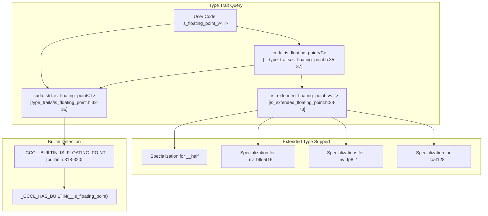
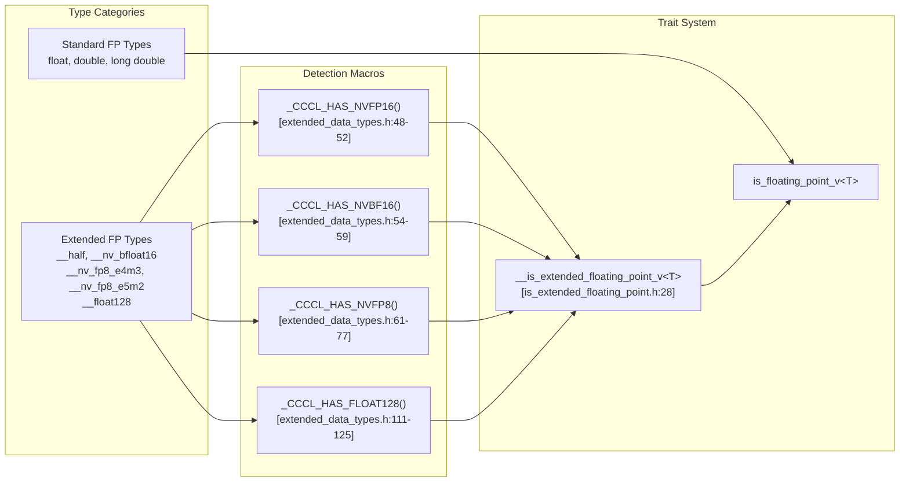
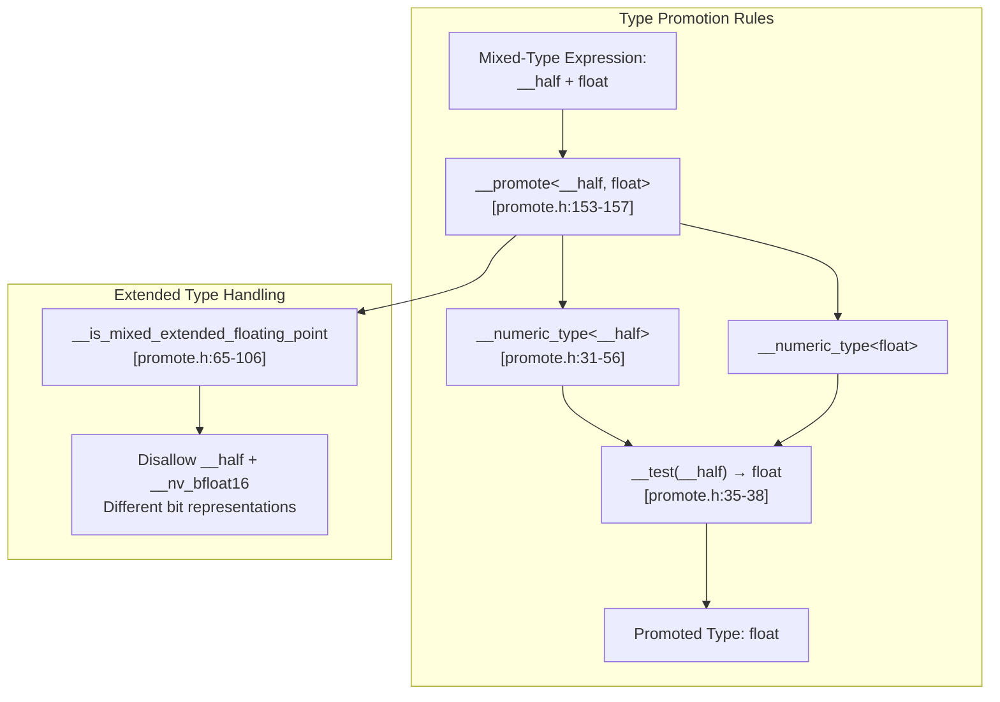
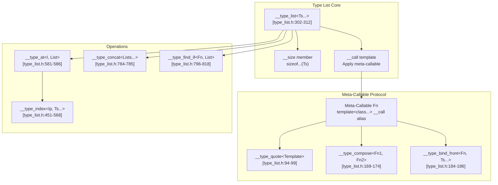
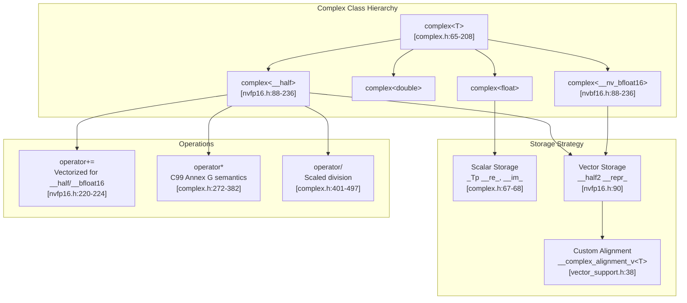
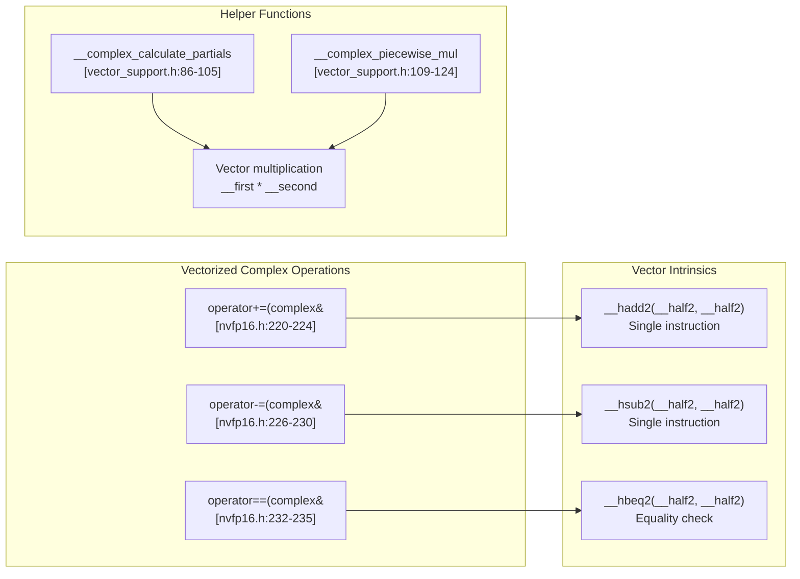
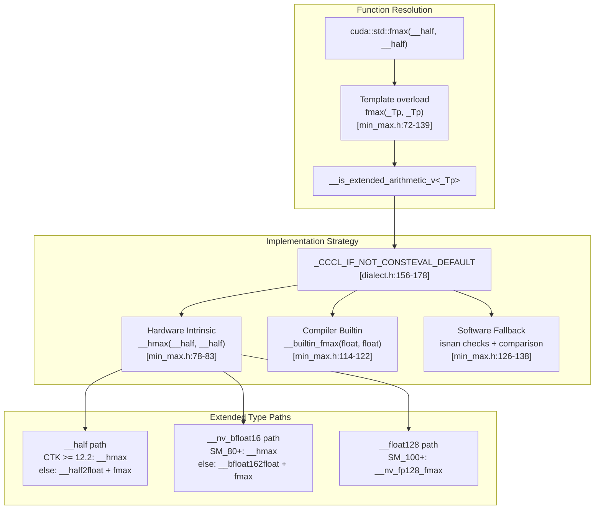
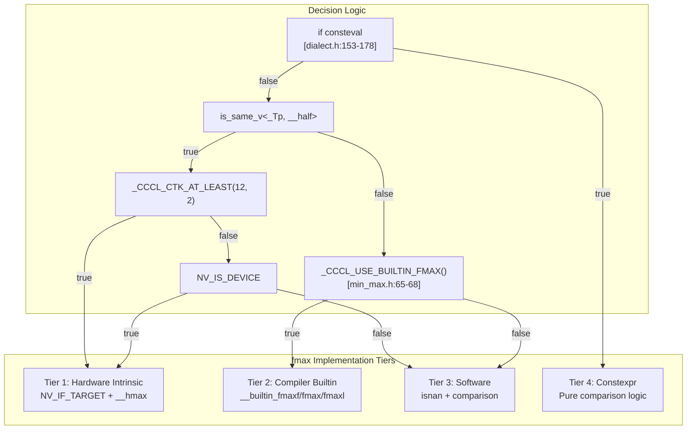

<!-- source: DeepWiki mcp.deepwiki.com · repo NVIDIA/cccl · extra page Standard Library Components · fetched 2026-10-26 -->

# Standard Library Components

<details>
<summary>Relevant source files</summary>

The following files were used as context for generating this wiki page:

- [docs/libcudacxx/extended_api/type_traits/is_floating_point.rst](docs/libcudacxx/extended_api/type_traits/is_floating_point.rst)
- [lib/cmake/thrust/FindTBB.cmake](lib/cmake/thrust/FindTBB.cmake)
- [libcudacxx/include/cuda/__type_traits/is_floating_point.h](libcudacxx/include/cuda/__type_traits/is_floating_point.h)
- [libcudacxx/include/cuda/std/__atomic/functions/cuda_ptx_generated_helper.h](libcudacxx/include/cuda/std/__atomic/functions/cuda_ptx_generated_helper.h)
- [libcudacxx/include/cuda/std/__cccl/builtin.h](libcudacxx/include/cuda/std/__cccl/builtin.h)
- [libcudacxx/include/cuda/std/__cccl/compiler.h](libcudacxx/include/cuda/std/__cccl/compiler.h)
- [libcudacxx/include/cuda/std/__cccl/cuda_toolkit.h](libcudacxx/include/cuda/std/__cccl/cuda_toolkit.h)
- [libcudacxx/include/cuda/std/__cccl/diagnostic.h](libcudacxx/include/cuda/std/__cccl/diagnostic.h)
- [libcudacxx/include/cuda/std/__cccl/dialect.h](libcudacxx/include/cuda/std/__cccl/dialect.h)
- [libcudacxx/include/cuda/std/__cccl/extended_data_types.h](libcudacxx/include/cuda/std/__cccl/extended_data_types.h)
- [libcudacxx/include/cuda/std/__cccl/system_header.h](libcudacxx/include/cuda/std/__cccl/system_header.h)
- [libcudacxx/include/cuda/std/__cmath/min_max.h](libcudacxx/include/cuda/std/__cmath/min_max.h)
- [libcudacxx/include/cuda/std/__cmath/nan.h](libcudacxx/include/cuda/std/__cmath/nan.h)
- [libcudacxx/include/cuda/std/__complex/complex.h](libcudacxx/include/cuda/std/__complex/complex.h)
- [libcudacxx/include/cuda/std/__complex/logarithms.h](libcudacxx/include/cuda/std/__complex/logarithms.h)
- [libcudacxx/include/cuda/std/__complex/nvbf16.h](libcudacxx/include/cuda/std/__complex/nvbf16.h)
- [libcudacxx/include/cuda/std/__complex/nvfp16.h](libcudacxx/include/cuda/std/__complex/nvfp16.h)
- [libcudacxx/include/cuda/std/__complex/vector_support.h](libcudacxx/include/cuda/std/__complex/vector_support.h)
- [libcudacxx/include/cuda/std/__cstdlib/abs.h](libcudacxx/include/cuda/std/__cstdlib/abs.h)
- [libcudacxx/include/cuda/std/__cstdlib/div.h](libcudacxx/include/cuda/std/__cstdlib/div.h)
- [libcudacxx/include/cuda/std/__functional/bind_front.h](libcudacxx/include/cuda/std/__functional/bind_front.h)
- [libcudacxx/include/cuda/std/__functional/not_fn.h](libcudacxx/include/cuda/std/__functional/not_fn.h)
- [libcudacxx/include/cuda/std/__internal/atomic.h](libcudacxx/include/cuda/std/__internal/atomic.h)
- [libcudacxx/include/cuda/std/__internal/features.h](libcudacxx/include/cuda/std/__internal/features.h)
- [libcudacxx/include/cuda/std/__type_traits/is_extended_floating_point.h](libcudacxx/include/cuda/std/__type_traits/is_extended_floating_point.h)
- [libcudacxx/include/cuda/std/__type_traits/is_trivially_copyable.h](libcudacxx/include/cuda/std/__type_traits/is_trivially_copyable.h)
- [libcudacxx/include/cuda/std/__type_traits/promote.h](libcudacxx/include/cuda/std/__type_traits/promote.h)
- [libcudacxx/include/cuda/std/__type_traits/type_list.h](libcudacxx/include/cuda/std/__type_traits/type_list.h)
- [libcudacxx/include/cuda/std/__utility/declval.h](libcudacxx/include/cuda/std/__utility/declval.h)
- [libcudacxx/include/cuda/std/cmath](libcudacxx/include/cuda/std/cmath)
- [libcudacxx/test/libcudacxx/cuda/iterators/transform_input_output_iterator/types.h](libcudacxx/test/libcudacxx/cuda/iterators/transform_input_output_iterator/types.h)
- [libcudacxx/test/libcudacxx/cuda/iterators/transform_output_iterator/types.h](libcudacxx/test/libcudacxx/cuda/iterators/transform_output_iterator/types.h)
- [libcudacxx/test/libcudacxx/cuda/test_platform.pass.cpp](libcudacxx/test/libcudacxx/cuda/test_platform.pass.cpp)
- [libcudacxx/test/libcudacxx/cuda/type_list.pass.cpp](libcudacxx/test/libcudacxx/cuda/type_list.pass.cpp)
- [libcudacxx/test/libcudacxx/libcxx/utilities/meta/meta.unary/meta.unary.cat/is_floating_point.pass.cpp](libcudacxx/test/libcudacxx/libcxx/utilities/meta/meta.unary/meta.unary.cat/is_floating_point.pass.cpp)
- [libcudacxx/test/libcudacxx/std/language.support/cstdlib/abs.pass.cpp](libcudacxx/test/libcudacxx/std/language.support/cstdlib/abs.pass.cpp)
- [libcudacxx/test/libcudacxx/std/language.support/cstdlib/div.pass.cpp](libcudacxx/test/libcudacxx/std/language.support/cstdlib/div.pass.cpp)
- [libcudacxx/test/libcudacxx/std/numerics/c.math/comparison.h](libcudacxx/test/libcudacxx/std/numerics/c.math/comparison.h)
- [libcudacxx/test/libcudacxx/std/numerics/c.math/error_functions.pass.cpp](libcudacxx/test/libcudacxx/std/numerics/c.math/error_functions.pass.cpp)
- [libcudacxx/test/libcudacxx/std/numerics/c.math/fp_abs.pass.cpp](libcudacxx/test/libcudacxx/std/numerics/c.math/fp_abs.pass.cpp)
- [libcudacxx/test/libcudacxx/std/numerics/c.math/fp_min_max.pass.cpp](libcudacxx/test/libcudacxx/std/numerics/c.math/fp_min_max.pass.cpp)
- [libcudacxx/test/libcudacxx/std/numerics/c.math/fp_traits.pass.cpp](libcudacxx/test/libcudacxx/std/numerics/c.math/fp_traits.pass.cpp)
- [libcudacxx/test/libcudacxx/std/utilities/memory/ptr.align/align.pass.cpp](libcudacxx/test/libcudacxx/std/utilities/memory/ptr.align/align.pass.cpp)
- [libcudacxx/test/libcudacxx/std/utilities/meta/meta.unary/meta.unary.cat/is_floating_point.pass.cpp](libcudacxx/test/libcudacxx/std/utilities/meta/meta.unary/meta.unary.cat/is_floating_point.pass.cpp)
- [libcudacxx/test/support/test_macros.h](libcudacxx/test/support/test_macros.h)

</details>


## Purpose and Scope

This page documents libcudacxx's implementation of C++ standard library components that work identically on both host and device. These components include type traits, complex numbers, mathematical functions, and atomic operations, all with first-class support for NVIDIA's extended floating-point types (`__half`, `__nv_bfloat16`, `__nv_fp8_*`, `__float128`). 

For compiler and platform abstraction mechanisms that enable these components, see [Compiler and Platform Abstraction](#2.3.3). For hardware-specific abstractions like CUDA Driver API wrappers, see [Hardware Abstractions](#2.3.2).

**Sources:** [libcudacxx/include/cuda/std/__cccl/builtin.h:1-494](), [libcudacxx/include/cuda/std/__cccl/extended_data_types.h:1-140]()

---

## Type Traits System

### Core Type Traits

libcudacxx provides standard C++ type traits like `is_floating_point`, `is_trivially_copyable`, `is_constructible`, etc., implemented using compiler builtins where available. The `_CCCL_BUILTIN_*` macro system in `builtin.h` abstracts compiler-specific builtin availability.



**Key traits include:**

| Trait | Builtin Macro | Files |
|-------|---------------|-------|
| `is_floating_point` | `_CCCL_BUILTIN_IS_FLOATING_POINT` | [builtin.h:318-320]() |
| `is_trivially_copyable` | `_CCCL_BUILTIN_IS_TRIVIALLY_COPYABLE` | [is_trivially_copyable.h:27-36]() |
| `is_constructible` | `_CCCL_BUILTIN_IS_CONSTRUCTIBLE` | [builtin.h:288-290]() |
| `is_assignable` | `_CCCL_BUILTIN_IS_ASSIGNABLE` | [builtin.h:280-282]() |

**Sources:** [libcudacxx/include/cuda/std/__cccl/builtin.h:44-494](), [libcudacxx/include/cuda/std/__type_traits/is_trivially_copyable.h:1-43](), [libcudacxx/include/cuda/__type_traits/is_floating_point.h:1-48](), [libcudacxx/include/cuda/std/__type_traits/is_extended_floating_point.h:1-80]()

### Extended Floating-Point Type Support

libcudacxx extends `is_floating_point` to recognize NVIDIA-specific floating-point types through the `__is_extended_floating_point_v` trait. This enables generic algorithms to work seamlessly with extended types.



**Extended type availability depends on:**

| Type | Required Header | Architecture | Macro |
|------|----------------|--------------|-------|
| `__half` | `cuda_fp16.h` | SM_53+ (device) | `_CCCL_HAS_NVFP16()` |
| `__nv_bfloat16` | `cuda_bf16.h` | SM_80+ (device) | `_CCCL_HAS_NVBF16()` |
| `__nv_fp8_e4m3`, `__nv_fp8_e5m2` | `cuda_fp8.h` | SM_89+ (device) | `_CCCL_HAS_NVFP8()` |
| `__float128` | Compiler support | SM_100+ (device) | `_CCCL_HAS_FLOAT128()` |

**Sources:** [libcudacxx/include/cuda/std/__cccl/extended_data_types.h:32-140](), [libcudacxx/include/cuda/std/__type_traits/is_extended_floating_point.h:25-80](), [libcudacxx/include/cuda/__type_traits/is_floating_point.h:32-46]()

### Type Promotion and Conversion

The `__promote` system implements C++ type promotion rules with extended type support. The `__numeric_type` trait determines the promoted type for mixed arithmetic operations.



**Promotion rules for extended types:**
- `__half` → `float`
- `__nv_bfloat16` → `float`
- `__half` + `__nv_bfloat16` → compilation error (mixed extended types disallowed)
- `__half` + `float` → `float`

**Sources:** [libcudacxx/include/cuda/std/__type_traits/promote.h:1-164]()

### Metaprogramming: Type Lists

The `__type_list` system provides compile-time type manipulation for metaprogramming, similar to `std::tuple` but operating purely at compile time.



**Key metaprogramming utilities:**

| Utility | Purpose | Implementation |
|---------|---------|----------------|
| `__type_list<Ts...>` | Type container | [type_list.h:302-312]() |
| `__type_at<I, List>` | Extract type at index | [type_list.h:581-586]() |
| `__type_index<I, Ts...>` | Index into parameter pack | Uses `__type_pack_element` or fallback [type_list.h:451-568]() |
| `__type_concat<Lists...>` | Concatenate type lists | [type_list.h:784-785]() |
| `__type_quote<Template>` | Turn template into meta-callable | [type_list.h:94-99]() |

**Sources:** [libcudacxx/include/cuda/std/__type_traits/type_list.h:1-1800](), [libcudacxx/test/libcudacxx/cuda/type_list.pass.cpp:1-1000]()

---

## Complex Numbers

### Standard Complex Implementation

libcudacxx provides `cuda::std::complex<T>` with dual-compatibility for host and device code. The implementation uses vectorized operations when available for extended floating-point types.



**Complex number features:**
- **Storage:** Scalar representation for standard types, vectorized (`__half2`, `__nv_bfloat162`) for extended types
- **Alignment:** Custom alignment via `__complex_alignment_v<T>` [vector_support.h:38]()
- **Conversions:** Non-narrowing conversions between compatible types
- **Operations:** Full arithmetic with C99 Annex G semantics for special values (NaN, infinity)

**Sources:** [libcudacxx/include/cuda/std/__complex/complex.h:1-800](), [libcudacxx/include/cuda/std/__complex/nvfp16.h:1-323](), [libcudacxx/include/cuda/std/__complex/nvbf16.h:1-324](), [libcudacxx/include/cuda/std/__complex/vector_support.h:1-131]()

### Extended Type Specializations

The `complex<__half>` and `complex<__nv_bfloat16>` specializations use vectorized storage and operations for optimal performance on NVIDIA GPUs.



**Vectorized operation examples:**

```cpp
// Addition uses __hadd2 for vectorized operations
complex<__half>& operator+=(complex& __lhs, const complex& __rhs) {
  __lhs.__repr_ = ::__hadd2(__lhs.__repr_, __rhs.__repr_);
  return __lhs;
}
```
[nvfp16.h:220-224]()

```cpp
// Multiplication helpers use vector types for efficiency
__abcd_results<_Tp> __complex_calculate_partials(_Tp __a, _Tp __b, _Tp __c, _Tp __d) {
  using _Vec = __type_to_vector_t<_Tp>;  // __half2 for __half
  _Vec __first{__a, __b};
  _Vec __second{__c, __d};
  _Vec __ac_bd = __first * __second;  // Vectorized multiply
  // ...
}
```
[vector_support.h:86-105]()

**Conversion rules:**
- `complex<__half>` → `complex<float>`: Uses `__half2float` [nvfp16.h:241-243]()
- `complex<__nv_bfloat16>` → `complex<float>`: Uses `__bfloat162float` [nvbf16.h:241-243]()
- Non-narrowing conversions are implicit, narrowing conversions require `explicit` [complex.h:84-96]()

**Sources:** [libcudacxx/include/cuda/std/__complex/nvfp16.h:88-236](), [libcudacxx/include/cuda/std/__complex/nvbf16.h:88-236](), [libcudacxx/include/cuda/std/__complex/vector_support.h:70-125]()

---

## Mathematical Functions

### Extended Type Support in cmath

libcudacxx extends standard `<cmath>` functions to work with NVIDIA extended floating-point types. The implementation strategy uses compiler builtins when available, with fallback implementations for constexpr and special cases.



**Math function categories:**

| Category | Functions | Extended Type Support |
|----------|-----------|---------------------|
| Min/Max | `fmin`, `fmax`, `fminf`, `fmaxf`, `fminl`, `fmaxl` | [min_max.h:42-286]() |
| Absolute Value | `fabs`, `fabsf`, `fabsl`, `abs` | Hardware intrinsics for `__half`, `__nv_bfloat16` |
| Trigonometry | `sin`, `cos`, `tan`, `asin`, `acos`, `atan` | Promotion to `float`/`double` |
| Exponential | `exp`, `log`, `pow`, `sqrt` | Hardware intrinsics + software fallback |
| Complex | `abs`, `arg`, `norm`, `conj`, `polar` | [logarithms.h:1-300]() |

**Sources:** [libcudacxx/include/cuda/std/__cmath/min_max.h:1-287](), [libcudacxx/include/cuda/std/__complex/logarithms.h:1-300]()

### Implementation Details: fmin/fmax

The `fmin` and `fmax` functions demonstrate libcudacxx's multi-tier implementation strategy:



**fmax for `__half` [min_max.h:74-139]():**

1. **Constexpr path:** Pure comparison without hardware operations
2. **CTK ≥ 12.2 path:** `::__hmax(__x, __y)` works on host and device
3. **Device + CTK < 12.2:** `::__hmax(__x, __y)` device intrinsic
4. **Host + CTK < 12.2:** `::cuda::std::fmax(::__half2float(__x), ::__half2float(__y))` with conversion

**Builtin detection [builtin.h:44-68]():**

```cpp
#if _CCCL_CHECK_BUILTIN(builtin_fmax) || _CCCL_COMPILER(GCC)
#  define _CCCL_USE_BUILTIN_FMAX() 1
#else
#  define _CCCL_USE_BUILTIN_FMAX() 0
#endif
```

**Sources:** [libcudacxx/include/cuda/std/__cmath/min_max.h:42-286](), [libcudacxx/include/cuda/std/__cccl/builtin.h:44-68](), [libcudacxx/include/cuda/std/__cccl/dialect.h:152-178]()

---

## Atomic Operations

libcudacxx provides `cuda::std::atomic<T>` and `cuda::atomic<T>` with support for extended floating-point types. Atomic operations use PTX instructions when available, with software fallbacks for unsupported types.

**Key atomic types:**
- `cuda::std::atomic<T>`: Standard C++ atomics, device and host
- `cuda::atomic<T>`: CUDA-specific atomics with memory scopes
- Memory scopes: `memory_scope_system`, `memory_scope_device`, `memory_scope_block`, `memory_scope_thread`

**Extended type support:**
- `atomic<__half>`: Available on SM_70+ [CTK 12.2+]
- `atomic<__nv_bfloat16>`: Available on SM_80+ [CTK 12.2+]
- Atomic operations: `load`, `store`, `exchange`, `compare_exchange`, arithmetic operations

For detailed atomic operation documentation, refer to the atomic operations section of the libcudacxx documentation.

**Sources:** [libcudacxx/include/cuda/std/__internal/atomic.h:1-100](), [libcudacxx/include/cuda/std/__atomic/functions/cuda_ptx_generated_helper.h:1-200]()

---

## Summary

libcudacxx's standard library components provide:

1. **Type Traits:** Compiler builtin-backed traits with extended FP type awareness
2. **Type Lists:** Compile-time metaprogramming infrastructure for generic algorithms
3. **Complex Numbers:** Vectorized implementations for extended types with C99 semantics
4. **Math Functions:** Multi-tier implementation strategy (hardware intrinsic → builtin → software → constexpr)
5. **Extended Types:** First-class support for `__half`, `__nv_bfloat16`, `__nv_fp8_*`, `__float128`
6. **Atomics:** PTX-backed atomic operations with memory scope control

The design philosophy prioritizes:
- **Zero-cost abstraction:** Use hardware intrinsics and compiler builtins when available
- **Constexpr support:** Fallback implementations that work at compile time
- **Cross-compiler compatibility:** Systematic detection and abstraction via `_CCCL_*` macros
- **Dual host/device compatibility:** Identical APIs that work on CPU and GPU

**Sources:** [libcudacxx/include/cuda/std/__cccl/builtin.h:1-494](), [libcudacxx/include/cuda/std/__cccl/extended_data_types.h:1-140](), [libcudacxx/include/cuda/std/__complex/complex.h:1-800](), [libcudacxx/include/cuda/std/__cmath/min_max.h:1-287](), [libcudacxx/include/cuda/std/__type_traits/type_list.h:1-1800]()

---

