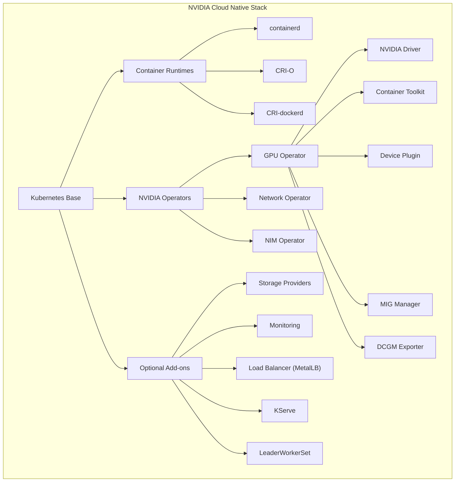
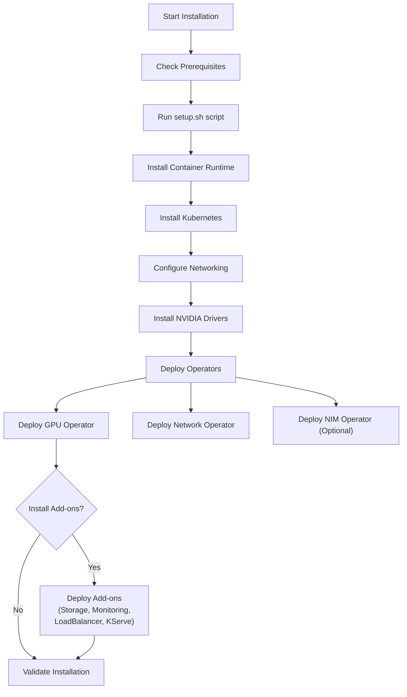
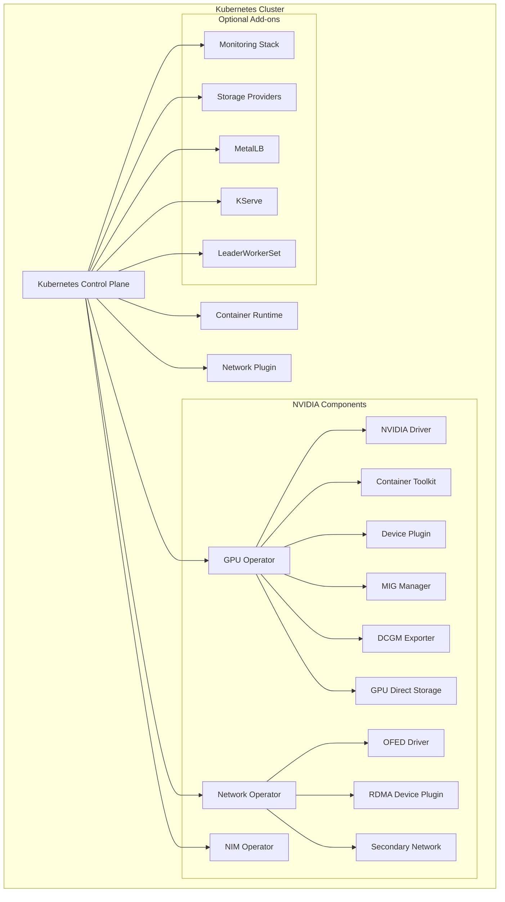

<!-- source: DeepWiki mcp.deepwiki.com · repo NVIDIA/cloud-native-stack · page 1 Overview · fetched 2026-10-26 -->

# Overview

Relevant source files

The following files were used as context for generating this wiki page:

- [README.md](README.md)
- [install-guides/readme.md](install-guides/readme.md)
- [playbooks/cns-installation.yaml](playbooks/cns-installation.yaml)
- [playbooks/prerequisites.yaml](playbooks/prerequisites.yaml)
- [playbooks/readme.md](playbooks/readme.md)
- [playbooks/setup.sh](playbooks/setup.sh)

NVIDIA Cloud Native Stack (CNS) is a software stack designed to run GPU-accelerated containerized workloads on Kubernetes. It provides a collection of tools, configuration files, and deployment guides for creating a production-ready Kubernetes environment integrated with NVIDIA GPU capabilities. This document introduces the purpose, architecture, and components of the NVIDIA Cloud Native Stack repository at https://github.com/NVIDIA/cloud-native-stack.

For detailed installation instructions, see [Installation](#2). For information about specific components, see [Components](#4).

Sources: [README.md:1-11]()

## Purpose and Scope

NVIDIA Cloud Native Stack serves two main objectives:

1. **Reference Architecture**: CNS provides a validated reference architecture listing components that have been tested together. This reference can be used as a specification for production deployments.

2. **Installation Tools**: CNS offers installation guides and Ansible playbooks for deploying Kubernetes environments with NVIDIA operators. These installation tools are primarily intended for test and proof-of-concept environments.

Note that while the Kubernetes layer deployed by CNS installation tools is basic (without high availability features), all NVIDIA components included in CNS are fully production-ready.

Sources: [README.md:12-18](), [playbooks/readme.md:3-13]()

## Architecture Overview

NVIDIA Cloud Native Stack is built on a foundation of Ubuntu/RHEL, Kubernetes, Helm, and NVIDIA operators (GPU and Network). The architecture consists of the following high-level components:

Sources: [README.md:59-73](), [playbooks/readme.md:80-82]()

## Installation Process Flow

The installation of NVIDIA Cloud Native Stack follows a systematic process, managed through Ansible playbooks:

Sources: [playbooks/setup.sh:1-12](), [playbooks/cns-installation.yaml:1-309](), [playbooks/readme.md:78-107]()

## Component Architecture

The deployed NVIDIA Cloud Native Stack integrates multiple components to enable GPU capabilities within Kubernetes:

Sources: [README.md:59-73](), [playbooks/readme.md:324-356](), [playbooks/readme.md:666-672]()

## Supported Platforms and Deployment Options

NVIDIA Cloud Native Stack supports multiple deployment platforms and installation methods:

| Deployment Type | Supported Platforms | Installation Method |
|-----------------|---------------------|---------------------|
| Bare Metal | NVIDIA Certified Systems (x86_64) | Manual Installation or Ansible Playbooks |
| Bare Metal | NVIDIA Qualified Systems (ARM64) | Manual Installation or Ansible Playbooks |
| Bare Metal | NVIDIA Jetson Systems | Manual Installation or Ansible Playbooks |
| Cloud Service Providers | AWS EKS | Terraform Deployment |
| Cloud Service Providers | Google GKE | Terraform Deployment |
| Cloud Service Providers | Azure AKS | Terraform Deployment |
| Confidential Computing | NVIDIA Certified Systems | Ansible Playbooks |

Sources: [playbooks/readme.md:28-39](), [playbooks/readme.md:703-776](), [playbooks/readme.md:777-800]()

## Versioning and Support Lifecycle

NVIDIA Cloud Native Stack follows a batch release system:

- When a new batch is released, the previous batch enters maintenance support
- All prior batches enter end-of-life (EOL)
- Only the current and previous batch receive updates
- Upgrades are only supported from the previous batch to the latest batch

Example of the current version matrix (as of the source documentation):

| CNS Version | Operating System | Kubernetes | Container Runtime | GPU Operator | Network Operator |
|-------------|------------------|------------|-------------------|--------------|------------------|
| 15.0 | Ubuntu 24.04 LTS | 1.32.2 | containerd 2.0.3 | 25.3.0 | 25.1.0 |
| 14.1 | Ubuntu 22.04 LTS | 1.31.6 | containerd 2.0.3 | 25.3.0 | 25.1.0 |
| 13.3 | Ubuntu 22.04 LTS | 1.30.10 | containerd 1.7.27 | 25.3.0 | 25.1.0 |

Sources: [README.md:20-35](), [README.md:38-54]()

## Summary

NVIDIA Cloud Native Stack provides a comprehensive solution for deploying and managing GPU-accelerated containerized workloads. It integrates Kubernetes with NVIDIA's GPU and networking technologies, alongside optional add-ons for monitoring, storage, and specialized workloads. The repository offers both reference architecture information for production deployments and installation tools for test environments.

Sources: [README.md:1-11](), [README.md:59-73]()

---

