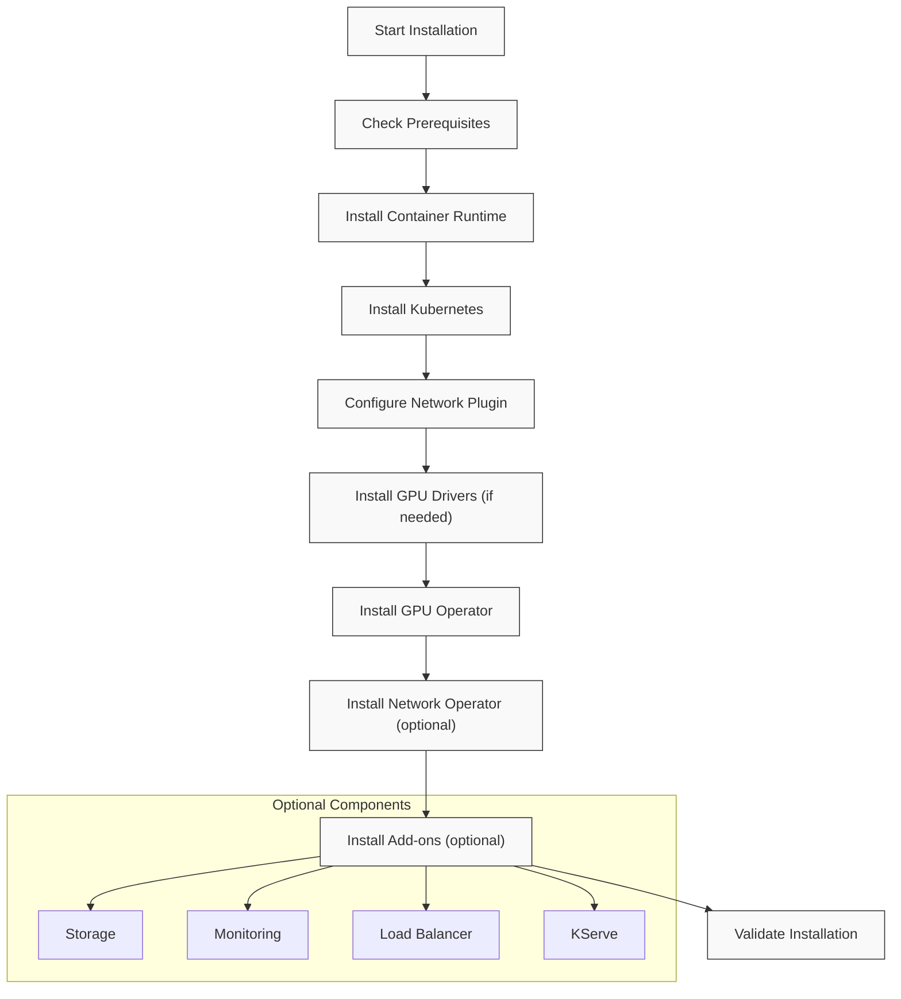
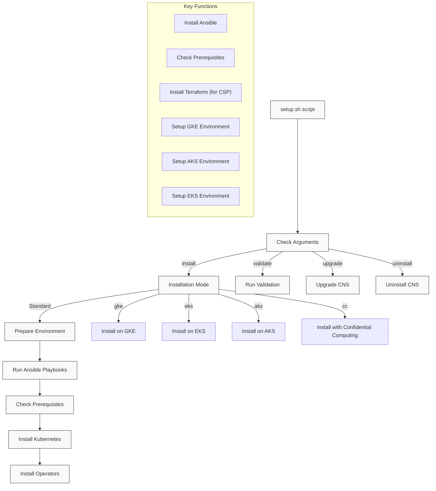
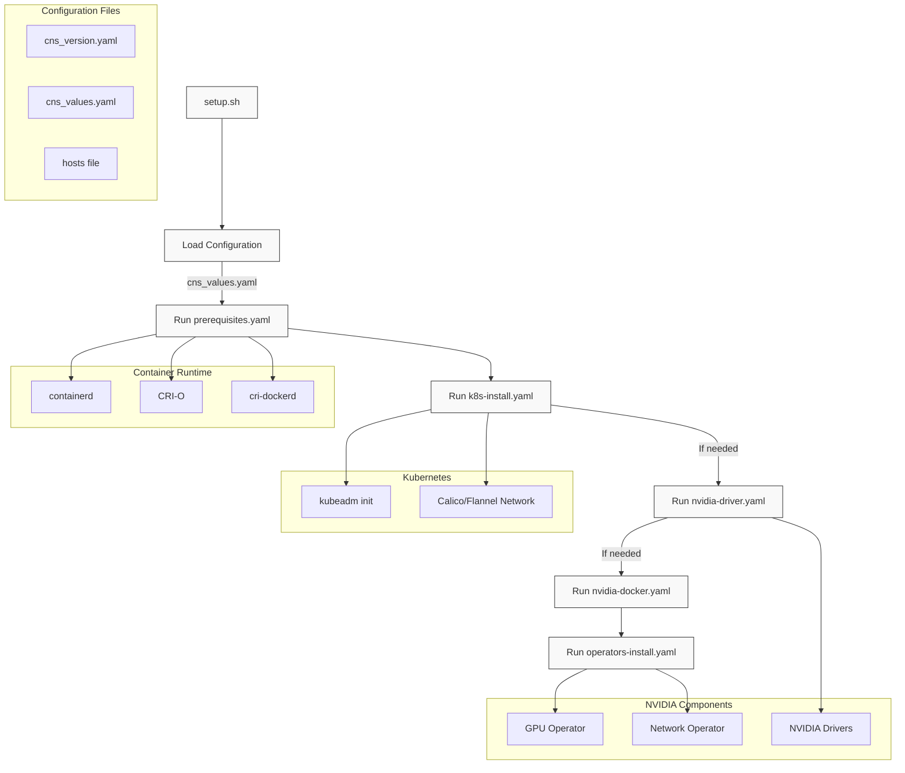
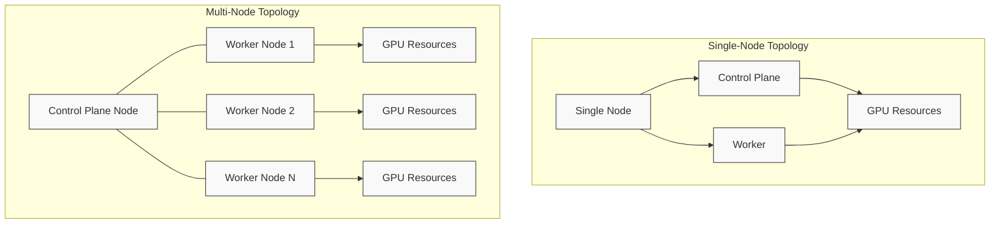

<!-- source: DeepWiki mcp.deepwiki.com · repo NVIDIA/cloud-native-stack · page 2.2 Installation Process · fetched 2026-10-26 -->

# Installation Process

<details>
<summary>Relevant source files</summary>

The following files were used as context for generating this wiki page:

- [README.md](README.md)
- [cns.json](cns.json)
- [install-guides/readme.md](install-guides/readme.md)
- [playbooks/cns-installation.yaml](playbooks/cns-installation.yaml)
- [playbooks/cns-upgrade.yaml](playbooks/cns-upgrade.yaml)
- [playbooks/cns_version.yaml](playbooks/cns_version.yaml)
- [playbooks/hosts](playbooks/hosts)
- [playbooks/k8s-install.yaml](playbooks/k8s-install.yaml)
- [playbooks/nvidia-docker.yaml](playbooks/nvidia-docker.yaml)
- [playbooks/nvidia-driver.yaml](playbooks/nvidia-driver.yaml)
- [playbooks/operators-install.yaml](playbooks/operators-install.yaml)
- [playbooks/operators-upgrade.yaml](playbooks/operators-upgrade.yaml)
- [playbooks/prerequisites.yaml](playbooks/prerequisites.yaml)
- [playbooks/readme.md](playbooks/readme.md)
- [playbooks/setup.sh](playbooks/setup.sh)

</details>


This page provides a step-by-step guide for installing the NVIDIA Cloud Native Stack (CNS) using the `setup.sh` script. The installation process configures a Kubernetes cluster with NVIDIA GPU and networking capabilities through a series of automated Ansible playbooks. For information about system requirements before installation, see [Prerequisites](#2.1).

## Installation Overview

The NVIDIA Cloud Native Stack installation process automates the deployment of a Kubernetes environment optimized for NVIDIA GPUs. The installation uses Ansible playbooks orchestrated by the `setup.sh` script, which manages the entire workflow from validating prerequisites to deploying GPU operators.



Sources: [playbooks/setup.sh:1-399](), [playbooks/cns-installation.yaml:1-267](), [playbooks/prerequisites.yaml:1-1018]()

## The setup.sh Script

The `setup.sh` script is the primary entry point for installing the NVIDIA Cloud Native Stack. It manages the installation process, checks prerequisites, and orchestrates the Ansible playbooks. The script supports multiple installation scenarios including bare metal installations and cloud provider deployments.



Sources: [playbooks/setup.sh:1-399]()

### Installation Command

The basic command to install NVIDIA Cloud Native Stack on a bare metal server is:

```bash
bash setup.sh install
```

The script accepts several options for different installation scenarios:

| Installation Option | Description |
|---------------------|-------------|
| `install` | Standard installation on bare metal |
| `install gke` | Installation on Google Kubernetes Engine |
| `install eks` | Installation on Amazon EKS |
| `install aks` | Installation on Azure AKS |
| `install cc` | Installation with Confidential Computing |
| `validate` | Validate an existing installation |
| `upgrade` | Upgrade an existing installation |
| `uninstall` | Uninstall the stack |

Sources: [playbooks/setup.sh:1-6](), [playbooks/setup.sh:265-345]()

## Installation Components and Workflow

The installation process configures multiple components in a specific sequence to ensure proper integration and functionality.



Sources: [playbooks/setup.sh:16-17](), [playbooks/cns-installation.yaml:1-267](), [playbooks/prerequisites.yaml:1-1018](), [playbooks/operators-install.yaml:1-483]()

### Component Installation Details

The installation process deploys the following main components:

1. **Container Runtime** - One of:
   - containerd (default)
   - CRI-O
   - cri-dockerd

2. **Kubernetes** - Configured using kubeadm with:
   - Network plugin (Calico for x86/ARM64, Flannel for Jetson)
   - Control plane configuration
   - kubelet configuration

3. **NVIDIA GPU Operator** - Manages:
   - NVIDIA drivers (if not pre-installed)
   - NVIDIA container toolkit
   - Device plugin
   - GPU feature discovery

4. **NVIDIA Network Operator** (optional) - Manages:
   - Mellanox OFED drivers
   - RDMA device plugin
   - Secondary network configurations

5. **Add-ons** (optional) - Based on configuration:
   - Storage (NFS, Local Path)
   - Monitoring (Prometheus, Grafana)
   - Load Balancer (MetalLB)
   - KServe

Sources: [playbooks/prerequisites.yaml:300-523](), [playbooks/k8s-install.yaml:200-213](), [playbooks/operators-install.yaml:238-507]()

## Installation Configuration

The installation is configured through several key files:

### Configuration Files

| File | Purpose |
|------|---------|
| `cns_version.yaml` | Specifies the CNS version to install |
| `cns_values_<version>.yaml` | Contains component versions and configuration for a specific CNS version |
| `hosts` | Ansible inventory file listing master and worker nodes with SSH details |

The `cns_values.yaml` file (generated from the version-specific template) controls which components are installed and their configuration.

Key configuration parameters include:

```yaml
# Container runtime selection (containerd, cri-o, cri-dockerd)
container_runtime: "containerd"

# Enable/disable components
enable_gpu_operator: yes
enable_network_operator: no
storage: no
monitoring: no
loadbalancer: no
kserve: no

# Driver configurations
gpu_driver_version: "570.124.06"
use_open_kernel_module: no
```

Sources: [playbooks/setup.sh:16-17](), [playbooks/readme.md:97-238]()

## Installation Process Steps

The installation process follows these detailed steps:

1. **Preparation and Prerequisites**
   - Clone the repository and navigate to the playbooks directory
   - Update the `hosts` file with node information
   - Run `setup.sh install` to begin installation
   - Prerequisites are checked (internet access, DNS, swap disabled, etc.)

2. **Container Runtime Installation**
   - Install the selected container runtime (containerd, CRI-O, or cri-dockerd)
   - Configure the runtime for GPU support
   - Set up container registry access

3. **Kubernetes Installation**
   - Install kubelet, kubeadm, and kubectl
   - Initialize the Kubernetes cluster with kubeadm
   - Deploy the network plugin (Calico or Flannel)
   - Configure control plane and worker nodes

4. **NVIDIA Driver and Docker Setup**
   - Install NVIDIA drivers (if not using GPU Operator to manage drivers)
   - Configure NVIDIA container toolkit
   - Set up GPU access for containers

5. **NVIDIA Operators Installation**
   - Deploy the GPU Operator to manage GPU components
   - Deploy the Network Operator (if enabled) to manage network components
   - Configure operator settings based on system hardware

6. **Add-ons Installation** (if enabled)
   - Set up storage providers
   - Deploy monitoring solutions (Prometheus/Grafana)
   - Configure load balancing (MetalLB)
   - Deploy KServe for inference serving

7. **Validation**
   - Verify the installation with validation tests
   - Check component status and functionality

Sources: [playbooks/cns-installation.yaml:1-267](), [playbooks/prerequisites.yaml:1-1018](), [playbooks/k8s-install.yaml:1-536](), [playbooks/operators-install.yaml:1-483]()

## Installation Methods

NVIDIA Cloud Native Stack supports multiple installation methods:

### Bare Metal Installation

The standard installation method for on-premises hardware:

```bash
git clone https://github.com/NVIDIA/cloud-native-stack.git
cd cloud-native-stack/playbooks
# Edit hosts file to add node information
nano hosts
# Run installation
bash setup.sh install
```

Sources: [README.md:104-107](), [playbooks/setup.sh:330-343]()

### Cloud Service Provider (CSP) Installation

For cloud-based deployments, specialized installation options are available:

```bash
# Google Kubernetes Engine (GKE)
bash setup.sh install gke

# Amazon Elastic Kubernetes Service (EKS)
bash setup.sh install eks

# Azure Kubernetes Service (AKS)
bash setup.sh install aks
```

These commands leverage Terraform templates to provision cloud resources and configure the NVIDIA Cloud Native Stack on the cloud platform.

Sources: [playbooks/setup.sh:267-324](), [README.md:67-68]()

### Specialized Deployments

For specialized use cases:

```bash
# Installation with Confidential Computing
bash setup.sh install cc

# Installation with MicroK8s
# Enable in cns_values.yaml: microk8s: yes
```

Sources: [playbooks/setup.sh:325-329](), [playbooks/readme.md:330-341]()

## Topology Options

The NVIDIA Cloud Native Stack supports several deployment topologies:

1. **Single-node** - Both control plane and worker on a single node
2. **Multi-node** - One control plane node with multiple worker nodes



Sources: [README.md:128-133]()

## Customizing the Installation

The installation can be customized by modifying the `cns_values_<version>.yaml` file before running `setup.sh`:

### Enabling Add-ons

```yaml
# Storage options
storage: yes

# Monitoring stack
monitoring: yes

# Load balancer
loadbalancer: yes
loadbalancer_ip: "10.110.10.2/32"  # System IP or IP range

# KServe for inference
kserve: yes
```

### Enabling GPU and Network Features

```yaml
# GPU Operator options
enable_gpu_operator: yes
use_open_kernel_module: no  # Use open kernel module driver
enable_mig: no  # Enable Multi-Instance GPU
enable_gds: no  # Enable GPU Direct Storage

# Network Operator options
enable_network_operator: yes
enable_rdma: yes  # Enable RDMA
deploy_ofed: yes  # Deploy OFED drivers
```

Sources: [playbooks/readme.md:97-238](), [playbooks/readme.md:362-379]()

## Troubleshooting

If the installation encounters issues, troubleshooting resources are available:

1. Check the installation logs in the playbooks directory
2. Verify that all prerequisites are met
3. Ensure network connectivity to required repositories
4. Check node status and component health

For detailed troubleshooting guidance, refer to the [Troubleshooting](#5.2) page.

Sources: [README.md:136-138]()

## Validation

After installation, you can validate the deployment using:

```bash
bash setup.sh validate
```

This will run a series of tests to verify that all components are functioning correctly. For detailed validation instructions, see the [Validation](#5.1) page.

Sources: [playbooks/setup.sh:384-394]()

---

