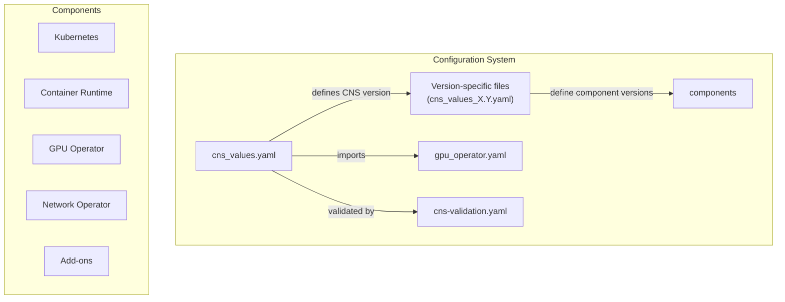
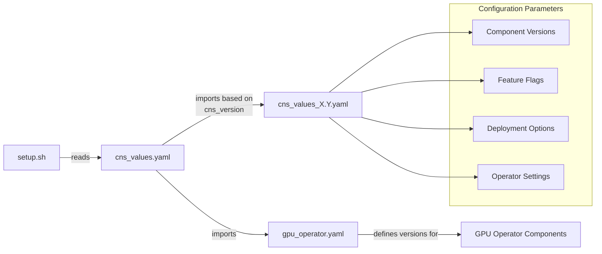
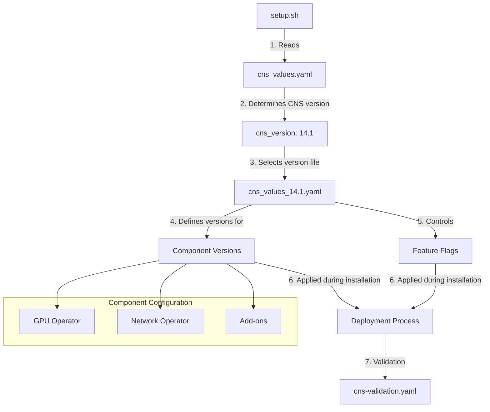
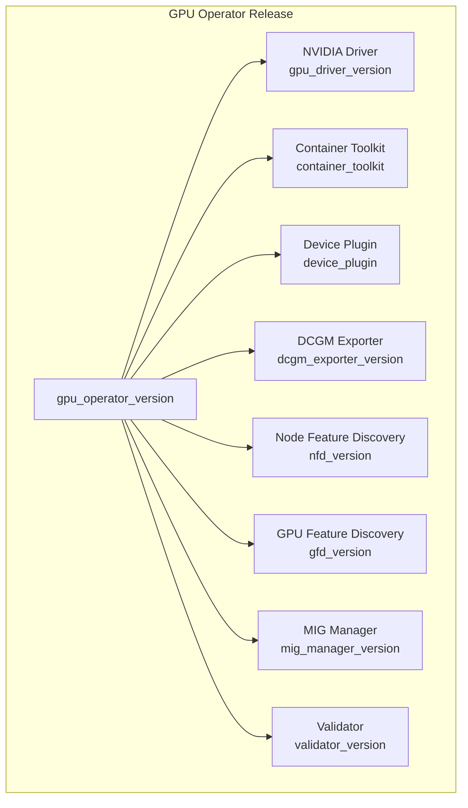
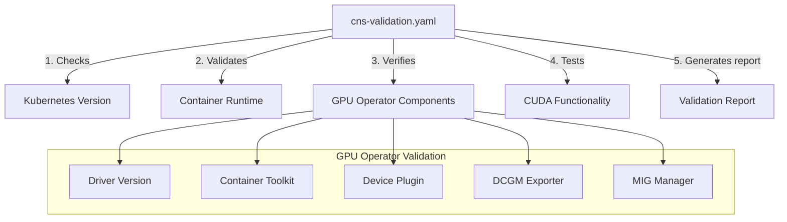

<!-- source: DeepWiki mcp.deepwiki.com · repo NVIDIA/cloud-native-stack · page 3 Configuration · fetched 2026-10-26 -->

# Configuration

<details>
<summary>Relevant source files</summary>

The following files were used as context for generating this wiki page:

- [playbooks/cns-validation.yaml](playbooks/cns-validation.yaml)
- [playbooks/cns_values.yaml](playbooks/cns_values.yaml)
- [playbooks/cns_values_13.0.yaml](playbooks/cns_values_13.0.yaml)
- [playbooks/cns_values_13.1.yaml](playbooks/cns_values_13.1.yaml)
- [playbooks/cns_values_13.2.yaml](playbooks/cns_values_13.2.yaml)
- [playbooks/cns_values_14.0.yaml](playbooks/cns_values_14.0.yaml)
- [playbooks/files/kube-prometheus-stack.values](playbooks/files/kube-prometheus-stack.values)
- [playbooks/files/network-operator-value.yaml](playbooks/files/network-operator-value.yaml)
- [playbooks/files/nic-cluster-policy.yaml](playbooks/files/nic-cluster-policy.yaml)
- [playbooks/gpu_operator.yaml](playbooks/gpu_operator.yaml)

</details>


The Configuration system is a core component of the NVIDIA Cloud Native Stack (CNS) that determines how the CNS environment is set up and deployed. This page provides a comprehensive overview of the configuration files, their parameters, and the relationships between different configuration components in the CNS.

For information about the installation process that utilizes these configuration files, see [Installation](#2).

## Overview of the Configuration System

The CNS configuration system consists of hierarchical YAML files that define component versions, feature flags, and deployment options. These configuration files determine which components are installed, their versions, and how they interact with each other within the Kubernetes environment.



Sources: [playbooks/cns_values.yaml](). [playbooks/cns-validation.yaml](), [playbooks/gpu_operator.yaml]()

## Configuration File Structure

The configuration system relies on several key files, with a hierarchical relationship that determines which settings are applied.

### Main Configuration File

The primary configuration file is `cns_values.yaml`, which defines the CNS version and all configuration parameters. This file is used by the installation playbooks to determine which components to deploy and with what settings.



Sources: [playbooks/cns_values.yaml](), [playbooks/cns_values_13.0.yaml](), [playbooks/cns_values_13.1.yaml](), [playbooks/cns_values_13.2.yaml](), [playbooks/cns_values_14.0.yaml]()

### Version-Specific Configuration Files

CNS maintains version-specific configuration files (e.g., `cns_values_13.0.yaml`, `cns_values_14.0.yaml`) that contain predefined component versions and settings for each CNS release. These files ensure compatibility between components in a given CNS version.

For example, CNS version 14.1 (defined in `cns_values.yaml`) would use settings from `cns_values_14.1.yaml`.

### GPU Operator Configuration

The `gpu_operator.yaml` file contains detailed version specifications for each GPU Operator release. It defines the compatible versions of components such as the NVIDIA driver, container toolkit, device plugin, and monitoring tools for each GPU Operator version.

```yaml
# Example from gpu_operator.yaml
release_25_3_0:
  gpu_operator_version: v25.3.0
  gpu_driver_version: 570.124.06
  driver_manager_version: 0.8.0
  container_toolkit: v1.17.5
  device_plugin: v0.17.1
  dcgm_exporter_version: 4.1.1-4.0.4
  # ... more component versions
```

Sources: [playbooks/gpu_operator.yaml:1-25]()

## Key Configuration Parameters

The configuration files contain numerous parameters that control various aspects of the CNS deployment. Here are the most important categories:

### CNS Version and Deployment Type

```yaml
cns_version: 14.1
microk8s: no
install_k8s: yes
```

These parameters define the CNS version and whether to deploy a MicroK8s cluster or use Kubeadm for Kubernetes installation.

### Container Runtime Configuration

```yaml
container_runtime: "containerd"
containerd_version: "2.0.3"
runc_version: "1.2.6"
cni_plugins_version: "1.6.2"
containerd_max_concurrent_downloads: "5"
nvidia_container_toolkit_version: "1.17.5"
```

These settings control which container runtime is used (containerd, cri-o, or cri-dockerd) and their versions.

### Kubernetes and Networking Components

```yaml
k8s_version: "1.31.6"
calico_version: "3.29.3"
flannel_version: "0.25.6"
helm_version: "3.17.2"
```

These parameters define the versions of Kubernetes and related networking components.

### GPU Operator Configuration

```yaml
enable_gpu_operator: yes
confidential_computing: no
gpu_driver_version: "570.124.06"
use_open_kernel_module: no
enable_mig: no
mig_profile: all-disabled
mig_strategy: single
enable_gds: no
enable_secure_boot: no
enable_vgpu: no
```

These parameters control the GPU Operator deployment and enable specific GPU-related features like Multi-Instance GPU (MIG), GPU Direct Storage (GDS), and vGPU support.

### Network Operator Configuration

```yaml
enable_network_operator: no
enable_rdma: no
deploy_ofed: no
```

These settings control the Network Operator deployment and related features like RDMA (Remote Direct Memory Access) and OFED (OpenFabrics Enterprise Distribution) driver deployment.

### Add-on Components

```yaml
storage: no
monitoring: no
kserve: no
loadbalancer: no
enable_nim_operator: yes
```

These parameters enable optional add-on components like storage provisioners, monitoring stack (Prometheus/Grafana), KServe, and MetalLB load balancer.

Sources: [playbooks/cns_values.yaml:1-110](), [playbooks/cns_values_14.0.yaml:1-110]()

## Configuration Parameters Table

Below is a table of the most important configuration parameters and their descriptions:

| Parameter | Description | Default Value |
|-----------|-------------|---------------|
| `cns_version` | CNS version to deploy | 14.1 |
| `container_runtime` | Container runtime to use (containerd, cri-o, cri-dockerd) | "containerd" |
| `k8s_version` | Kubernetes version | "1.31.6" |
| `enable_gpu_operator` | Whether to deploy the GPU Operator | yes |
| `gpu_driver_version` | NVIDIA GPU driver version | "570.124.06" |
| `enable_mig` | Enable Multi-Instance GPU support | no |
| `enable_gds` | Enable GPU Direct Storage | no |
| `enable_network_operator` | Deploy the Network Operator | no |
| `enable_rdma` | Enable RDMA support | no |
| `storage` | Deploy storage provisioners | no |
| `monitoring` | Deploy Prometheus/Grafana monitoring stack | no |
| `kserve` | Deploy KServe for ML model serving | no |
| `loadbalancer` | Deploy MetalLB load balancer | no |
| `cns_validation` | Run validation after deployment | no |

Sources: [playbooks/cns_values.yaml:1-110]()

## Configuration Workflow

The configuration workflow in CNS follows a defined process that determines which settings are applied during deployment.



Sources: [playbooks/cns_values.yaml](), [playbooks/cns-validation.yaml:1-20]()

## GPU Operator Component Configuration

The GPU Operator is a critical component of CNS, and its configuration is defined in detail in the `gpu_operator.yaml` file. Each release of the GPU Operator has specific component versions that are known to work together.



Sources: [playbooks/gpu_operator.yaml:1-26]()

## Validation System

CNS includes a validation system that verifies the configuration and deployed components match the expected versions and are functioning correctly. The `cns-validation.yaml` playbook performs these checks.



The validation system compares the installed component versions with the target versions defined in the configuration files and runs functional tests to ensure GPU capabilities are working correctly.

Sources: [playbooks/cns-validation.yaml:1-40](), [playbooks/cns-validation.yaml:242-334]()

## Network Operator Configuration

When the Network Operator is enabled, it can be configured through the `nic-cluster-policy.yaml` file, which defines settings for OFED drivers, RDMA device plugins, and secondary networks.

```yaml
# Example NIC Cluster Policy configuration
apiVersion: mellanox.com/v1alpha1
kind: NicClusterPolicy
metadata:
  name: nic-cluster-policy
spec:
  ofedDriver:
    image: doca-driver
    repository: nvcr.io/nvidia/mellanox
    version: 25.01-0.6.0.0-0
  rdmaSharedDevicePlugin:
    image: k8s-rdma-shared-dev-plugin
    repository: ghcr.io/mellanox
    version: v1.5.2
```

The Network Operator configuration can be enabled by setting `enable_network_operator: yes` in the main configuration file.

Sources: [playbooks/files/nic-cluster-policy.yaml:1-37](), [playbooks/files/network-operator-value.yaml]()

## Monitoring Configuration

When monitoring is enabled (`monitoring: yes`), CNS deploys the Prometheus and Grafana stack with configurations defined in `kube-prometheus-stack.values`. This includes GPU metrics collection through the DCGM exporter.

```yaml
# Example Prometheus configuration for GPU metrics
grafana:
  enabled: false
prometheus:
  service:
    type: NodePort
  prometheusSpec:
    serviceMonitorSelectorNilUsesHelmValues: false
  additionalScrapeConfigs:
  - job_name: gpu-metrics
    scrape_interval: 1s
    metrics_path: /metrics
    scheme: http
    kubernetes_sd_configs:
    - role: endpoints
      namespaces:
        names:
        - nvidia-gpu-operator
        - default
```

Sources: [playbooks/files/kube-prometheus-stack.values]()

## Best Practices for Configuration

When configuring the NVIDIA Cloud Native Stack, consider these best practices:

1. **Use version-specific configuration files** - The predefined version files provide tested, compatible component versions.

2. **Enable validation** - Set `cns_validation: yes` to automatically verify your configuration after deployment.

3. **Maintain version compatibility** - If customizing component versions, ensure compatibility between the GPU driver, container toolkit, device plugin, and other components.

4. **Configuration sequence** - Modify the main `cns_values.yaml` file rather than version-specific files to maintain upgrade paths.

5. **Operator configurations** - When enabling operators (GPU, Network), ensure the dependent features are also properly configured.

## Conclusion

The configuration system is the foundation of NVIDIA Cloud Native Stack deployments, determining which components are installed and how they interact. By understanding the configuration structure and parameters, you can customize CNS to suit your specific requirements while maintaining component compatibility.

For detailed information about specific components that can be configured, see [Components](#4). For information about validating your configuration, see [Validation and Troubleshooting](#5).

---

