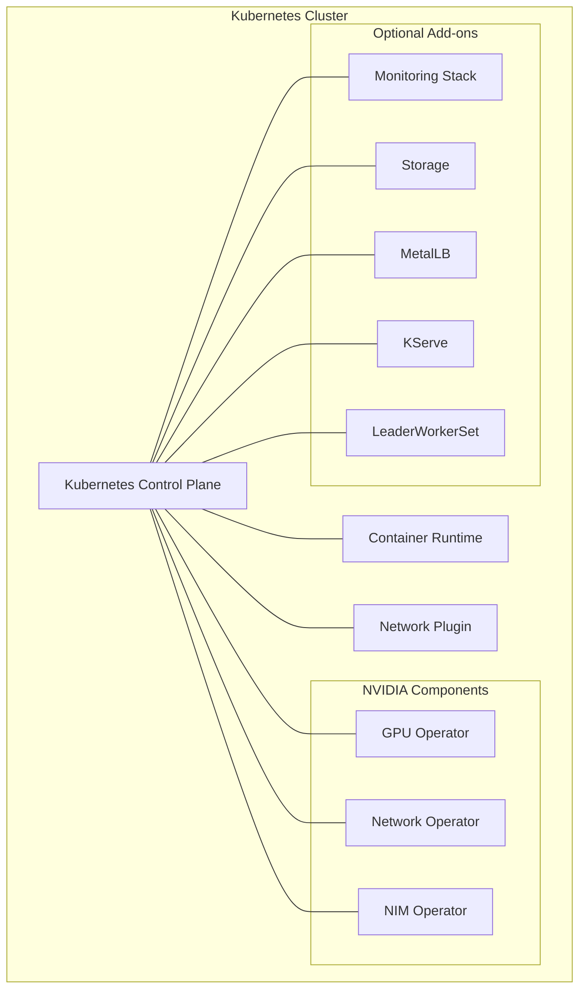
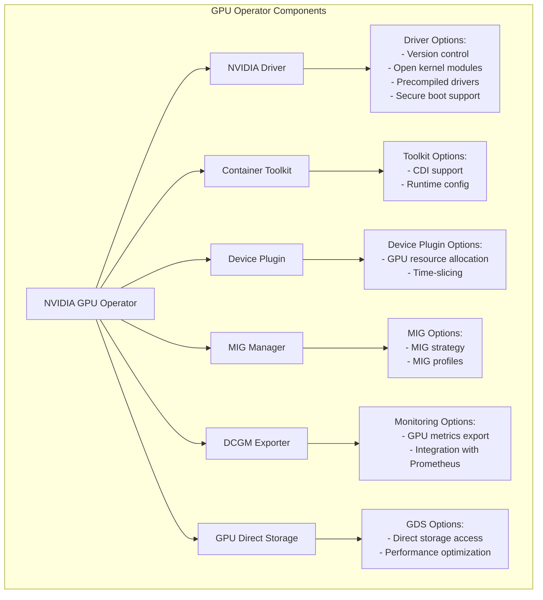
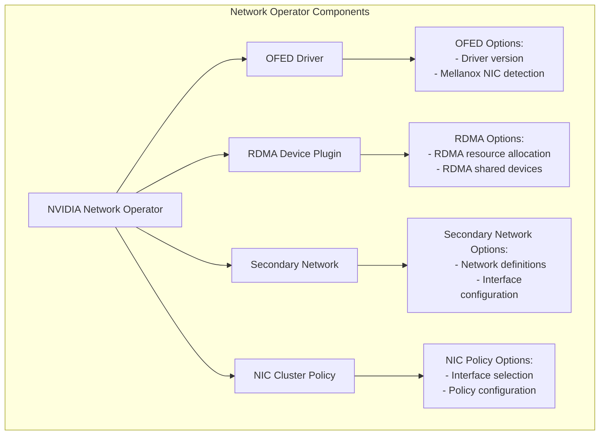
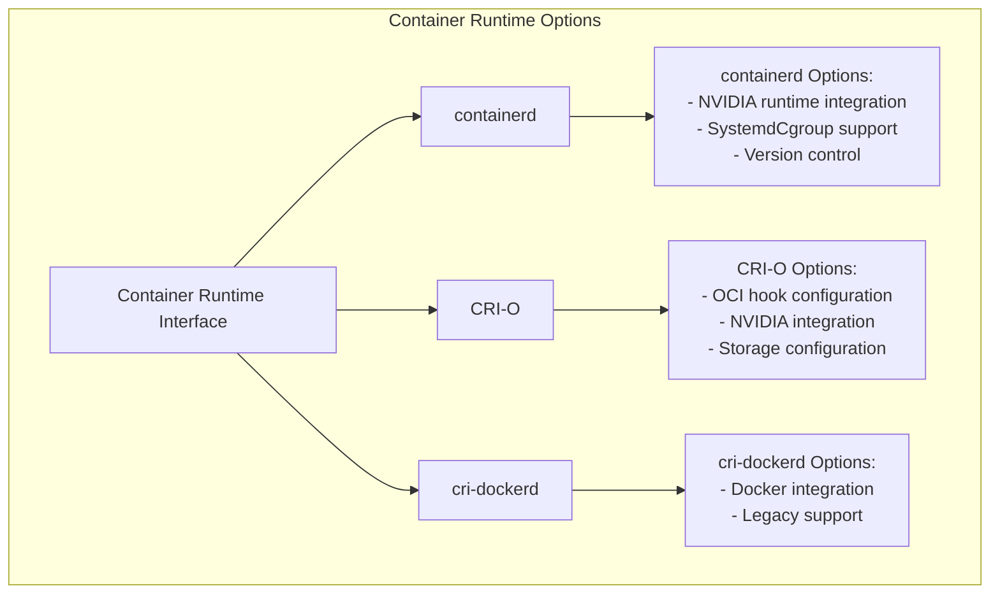
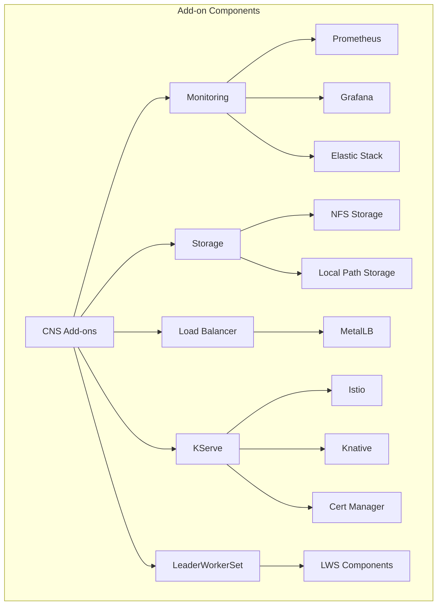
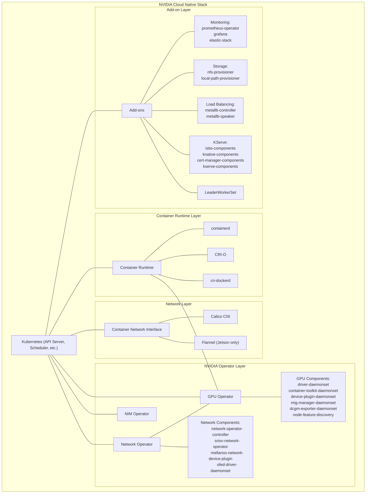

<!-- source: DeepWiki mcp.deepwiki.com · repo NVIDIA/cloud-native-stack · page 4 Components · fetched 2026-10-26 -->

# Components

Relevant source files

The following files were used as context for generating this wiki page:

- [README.md](README.md)
- [cns.json](cns.json)
- [playbooks/cns-installation.yaml](playbooks/cns-installation.yaml)
- [playbooks/cns-upgrade.yaml](playbooks/cns-upgrade.yaml)
- [playbooks/k8s-install.yaml](playbooks/k8s-install.yaml)
- [playbooks/nvidia-docker.yaml](playbooks/nvidia-docker.yaml)
- [playbooks/nvidia-driver.yaml](playbooks/nvidia-driver.yaml)
- [playbooks/operators-install.yaml](playbooks/operators-install.yaml)
- [playbooks/operators-upgrade.yaml](playbooks/operators-upgrade.yaml)
- [playbooks/prerequisites.yaml](playbooks/prerequisites.yaml)

This page provides a technical overview of the core components that make up the NVIDIA Cloud Native Stack (CNS). It covers the key software components, their roles, and how they work together to enable GPU acceleration for containerized workloads in Kubernetes environments.

For installation instructions, see [Installation](#2), and for configuration details, see [Configuration](#3).

## Key Components Overview

NVIDIA Cloud Native Stack is composed of several interdependent components that work together to provide GPU acceleration capabilities in Kubernetes environments. The following diagram shows the high-level architecture:

Sources: [README.md:59-72](). The diagram is an abstraction of the relationships between components based on multiple source files.

## Core Components

### Kubernetes

Kubernetes serves as the foundation of the Cloud Native Stack, providing container orchestration capabilities. The CNS supports specific versions of Kubernetes based on the CNS version:

| CNS Version | Kubernetes Version |
|-------------|-------------------|
| 15.0        | 1.32.2            |
| 14.1        | 1.31.6            |
| 13.3        | 1.30.10           |

Sources: [README.md:38-51](), [cns.json:1-50]()

### NVIDIA GPU Operator

The GPU Operator automates the management of NVIDIA GPUs in Kubernetes clusters. It manages the full lifecycle of GPU software components within the Kubernetes environment.

The GPU Operator handles:

- Installation and lifecycle management of NVIDIA GPU drivers
- Deployment of the NVIDIA Container Toolkit for enabling GPU access in containers
- Configuration of the NVIDIA Device Plugin for exposing GPU resources to Kubernetes
- Management of Multi-Instance GPU (MIG) configurations
- Collection of GPU telemetry via DCGM Exporter
- Support for GPU Direct Storage (GDS)

Installation configurations include support for various features like:
- Confidential computing
- RDMA networking
- Multi-Instance GPU (MIG) partitioning
- vGPU virtualization
- Open kernel modules

Sources: [playbooks/operators-install.yaml:246-506](), [README.md:62-63]()

### NVIDIA Network Operator

The Network Operator manages high-performance networking components for NVIDIA Mellanox NICs in Kubernetes environments.

The Network Operator provides:

- Automated deployment of OFED (OpenFabrics Enterprise Distribution) drivers for Mellanox NICs
- Configuration of RDMA device plugins for exposing RDMA resources to Kubernetes
- Management of secondary network interfaces
- Integration with the GPU Operator for GPU Direct RDMA capabilities

Sources: [playbooks/operators-install.yaml:119-236](), [README.md:63-64]()

### NVIDIA NIM Operator

The NVIDIA NIM (NVIDIA Infrastructure Manager) Operator is a newer addition to the CNS ecosystem. It enables automated deployment and management of NVIDIA artificial intelligence and machine learning services within Kubernetes.

Sources: [README.md:64]()

## Container Runtimes

NVIDIA Cloud Native Stack supports multiple container runtimes, allowing flexibility in deployment options.

### containerd

containerd is the default container runtime for most CNS deployments. The CNS setup configures containerd with:

- NVIDIA Container Runtime integration
- SystemdCgroup support for better resource control
- Proxy configuration for environments with restricted internet access
- Optimized download concurrency settings

Sources: [playbooks/prerequisites.yaml:324-523](), [README.md:45-47]()

### CRI-O

CRI-O provides a lightweight alternative to containerd. The CNS configures CRI-O with:

- OCI hook support for NVIDIA GPU access
- Proper storage configuration
- Integration with the NVIDIA Container Toolkit

Sources: [playbooks/prerequisites.yaml:579-917](), [README.md:45-47]()

### cri-dockerd

cri-dockerd provides a bridge between Docker and Kubernetes CRI, allowing Docker to be used as a container runtime in Kubernetes. This support is primarily for backward compatibility.

Sources: [playbooks/k8s-install.yaml:69-79](), [README.md:45-47]()

## Add-on Components

NVIDIA Cloud Native Stack includes several optional add-on components that extend the functionality of the base system.

### Monitoring

The monitoring stack in CNS consists of:
- Prometheus for metrics collection
- Prometheus Adapter for Kubernetes metrics API
- Grafana for visualization
- Elastic Stack for log management

These components provide comprehensive monitoring of both Kubernetes and NVIDIA GPU resources.

Sources: [README.md:68-81]()

### Storage

Storage options in CNS include:
- NFS for shared network storage
- Local Path Provisioner for node-local storage

These provide persistent storage capabilities for stateful applications.

Sources: [README.md:68-81]()

### Load Balancer

MetalLB provides network load balancing capabilities for on-premises Kubernetes environments, allowing services to be exposed with dedicated IP addresses.

Sources: [README.md:68-81]()

### KServe

KServe provides a Kubernetes-native serverless framework for serving ML models. The CNS integrates KServe with:
- Istio for service mesh capabilities
- Knative for serverless functionality
- CertManager for certificate management

Sources: [README.md:68-81]()

### LeaderWorkerSet (LWS)

LeaderWorkerSet is a framework for deploying applications with leader-worker patterns in Kubernetes, useful for distributed computing workloads.

Sources: [README.md:68-81]()

## Component Versioning

The NVIDIA Cloud Native Stack follows a versioning scheme where each CNS version includes specific versions of all components that have been tested together. The following table shows the component versions for the latest CNS release:

| Component | Version (CNS 15.0) |
|-----------|-------------------|
| Kubernetes | 1.32.2 |
| containerd | 2.0.3 |
| CRI-O | 1.32.1 |
| Calico CNI | 3.29.2 |
| NVIDIA GPU Operator | 25.3.0 |
| NVIDIA Network Operator | 25.1.0 |
| NVIDIA Data Center Driver | 570.124.06 |
| Helm | 3.17.2 |

Sources: [README.md:38-54](), [cns.json:3-20]()

## Component Integration

The following diagram illustrates how the various components integrate with each other in a complete CNS deployment:

Sources: The integration diagram is derived from multiple files including [README.md:59-72](), [playbooks/operators-install.yaml:246-506](), and [playbooks/cns-installation.yaml:1-309]().

## Deployment Topologies

NVIDIA Cloud Native Stack supports the following deployment topologies:

1. Single-node deployment with both control plane and worker functionalities
2. Multi-node deployment with one control plane node and any number of worker nodes

The CNS does not currently support multi-control-plane high availability deployments.

Sources: [README.md:127-133]()

## Platform Support

NVIDIA Cloud Native Stack supports:

- NVIDIA Certified Servers (x86 and Arm64 architectures)
- DGX Servers
- Jetson devices (with specific components)

Operating system support varies by CNS version, with the latest version supporting:
- Ubuntu 24.04 LTS (CNS 15.0)
- Ubuntu 22.04 LTS (CNS 14.1, 13.3)

Sources: [README.md:42-44](), [cns.json:8-9](), [cns.json:28-30](), [cns.json:47-49](), [cns.json:84-86]()

---

