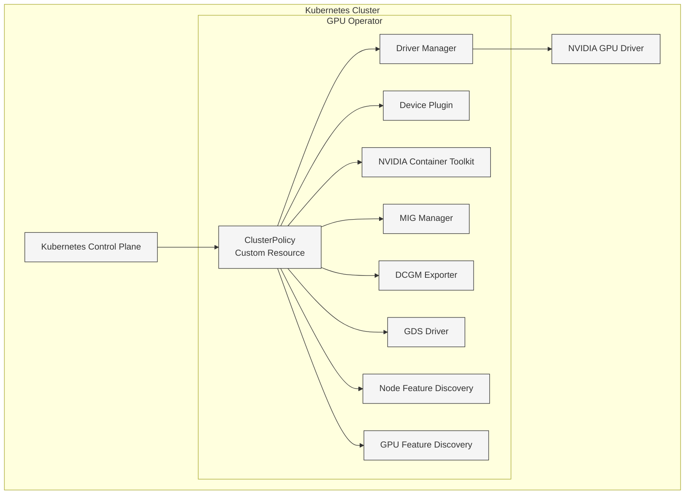
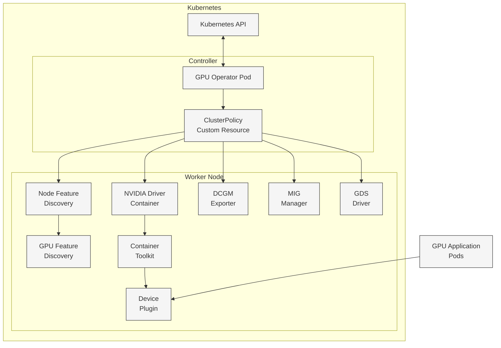
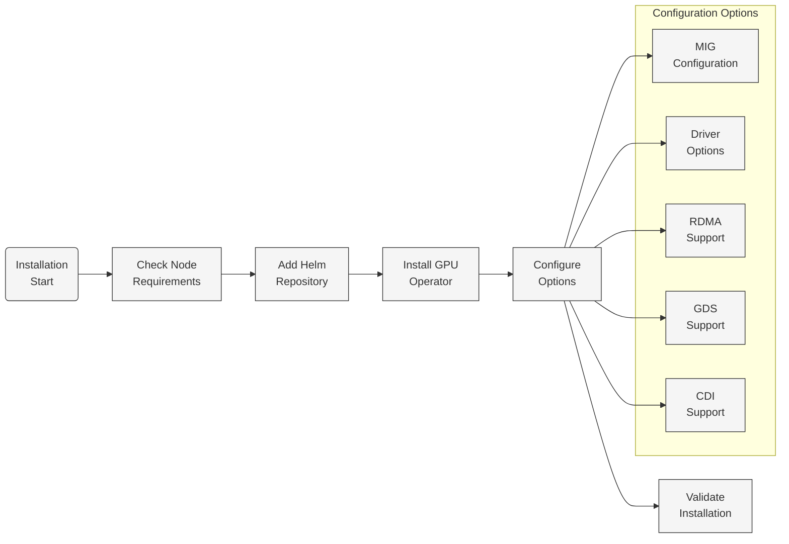
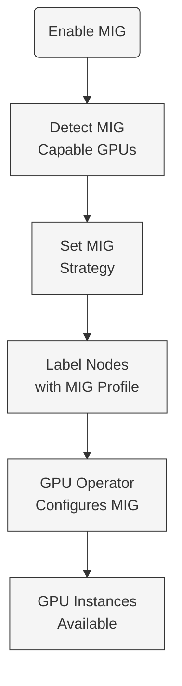
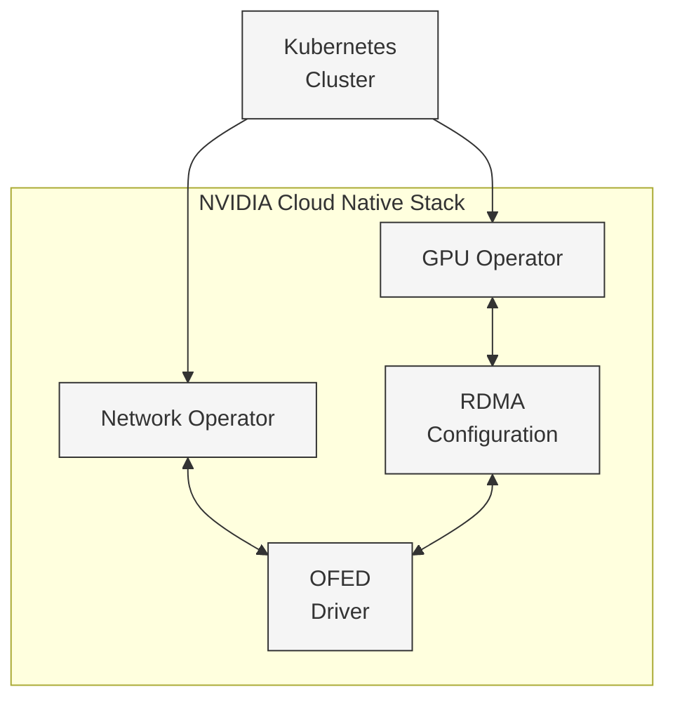

<!-- source: DeepWiki mcp.deepwiki.com · repo NVIDIA/cloud-native-stack · page 4.1 NVIDIA GPU Operator · fetched 2026-10-26 -->

# NVIDIA GPU Operator

<details>
<summary>Relevant source files</summary>

The following files were used as context for generating this wiki page:

- [README.md](README.md)
- [cns.json](cns.json)
- [playbooks/cns-installation.yaml](playbooks/cns-installation.yaml)
- [playbooks/cns-upgrade.yaml](playbooks/cns-upgrade.yaml)
- [playbooks/cns-validation.yaml](playbooks/cns-validation.yaml)
- [playbooks/cns_values.yaml](playbooks/cns_values.yaml)
- [playbooks/cns_values_13.2.yaml](playbooks/cns_values_13.2.yaml)
- [playbooks/cns_values_14.0.yaml](playbooks/cns_values_14.0.yaml)
- [playbooks/files/kube-prometheus-stack.values](playbooks/files/kube-prometheus-stack.values)
- [playbooks/gpu_operator.yaml](playbooks/gpu_operator.yaml)
- [playbooks/k8s-install.yaml](playbooks/k8s-install.yaml)
- [playbooks/nvidia-docker.yaml](playbooks/nvidia-docker.yaml)
- [playbooks/nvidia-driver.yaml](playbooks/nvidia-driver.yaml)
- [playbooks/operators-install.yaml](playbooks/operators-install.yaml)
- [playbooks/operators-upgrade.yaml](playbooks/operators-upgrade.yaml)
- [playbooks/prerequisites.yaml](playbooks/prerequisites.yaml)

</details>


The NVIDIA GPU Operator automates the management and provisioning of NVIDIA GPUs in Kubernetes environments. It serves as a critical component of the NVIDIA Cloud Native Stack (CNS), handling driver deployment, container runtime configuration, device plugin management, and monitoring capabilities required for GPU-accelerated workloads.

For information about general Cloud Native Stack architecture, see [Overview](#1). For details about the Network Operator, see [NVIDIA Network Operator](#4.2).

## 1. Overview

The NVIDIA GPU Operator simplifies GPU management in Kubernetes by packaging all necessary components to provision, share, and operate NVIDIA GPUs. Rather than manually configuring each node with drivers and container runtime extensions, the GPU Operator provides a Kubernetes-native way to automate the entire GPU software stack deployment.



Sources: [README.md:61-63](). [playbooks/operators-install.yaml:238-249]().

## 2. Components

The GPU Operator consists of several key components that work together to enable GPU capabilities in Kubernetes:

| Component | Purpose |
|-----------|---------|
| NVIDIA Driver | GPU device driver that enables CUDA capabilities |
| Container Toolkit | Configures container runtimes for GPU access |
| Device Plugin | Exposes GPUs to Kubernetes for pod scheduling |
| MIG Manager | Manages Multi-Instance GPU configurations |
| DCGM Exporter | Provides monitoring metrics for GPUs |
| GPU Feature Discovery | Labels nodes with GPU capabilities |
| Node Feature Discovery | Discovers hardware features on nodes |
| GDS Driver (optional) | Enables GPU Direct Storage for high-speed data transfers |

Sources: [playbooks/gpu_operator.yaml:1-209](), [README.md:61-64]().

### 2.1 Architecture and Workflow

The following diagram illustrates how these components interact within a Kubernetes cluster:



The GPU Operator follows a Kubernetes operator pattern:

1. It defines a custom resource called `ClusterPolicy`
2. The operator monitors this resource and deploys the required components
3. Components are deployed as pods in the cluster
4. Each component has a specific role in enabling GPU workloads

Sources: [playbooks/operators-install.yaml:279-408](), [playbooks/gpu_operator.yaml:1-20]().

## 3. Key Features

### 3.1 GPU Management Capabilities

The GPU Operator supports various GPU management configurations:

- **Standard GPU Management**: Basic GPU provisioning for container workloads
- **Multi-Instance GPU (MIG)**: Partitioning of NVIDIA Ampere and newer GPUs into multiple isolated instances
- **Virtual GPU (vGPU)**: Support for NVIDIA virtual GPU technology
- **GPU Direct RDMA**: Remote direct memory access for high-performance computing
- **GPU Direct Storage (GDS)**: Direct path between storage and GPU memory

### 3.2 Deployment Options

The operator supports multiple deployment scenarios:

- **Pre-installed drivers**: Using existing NVIDIA drivers on the node
- **Operator-managed drivers**: Deploying drivers through the operator
- **Open Kernel Modules**: Using the open-source NVIDIA kernel modules
- **Confidential Computing**: Support for confidential computing features
- **CDI Support**: Container Device Interface for standardized device access

Sources: [playbooks/cns_values.yaml:36-54](), [playbooks/operators-install.yaml:311-481]().

## 4. Installation and Configuration

The GPU Operator can be installed through Helm and configured with various options based on your requirements.



### 4.1 Basic Installation

The GPU Operator is typically installed using Helm:

```
helm install --namespace nvidia-gpu-operator \
  --create-namespace \
  nvidia/gpu-operator
```

For customized installations, you can provide additional parameters:

```
helm install --namespace nvidia-gpu-operator \
  --create-namespace \
  nvidia/gpu-operator \
  --set driver.version=VERSION \
  --set mig.strategy=STRATEGY \
  --set toolkit.enabled=ENABLED
```

Sources: [playbooks/operators-install.yaml:396-401](), [playbooks/operators-install.yaml:432-441]().

### 4.2 Configuration Parameters

Key configuration parameters include:

| Parameter | Description | Default |
|-----------|-------------|---------|
| `driver.version` | NVIDIA driver version | Based on CNS version |
| `driver.enabled` | Whether to deploy the driver | true |
| `driver.usePrecompiled` | Use precompiled driver | false |
| `driver.useOpenKernelModules` | Use open kernel modules | false |
| `toolkit.enabled` | Enable container toolkit | true |
| `mig.strategy` | MIG strategy (single, mixed) | none |
| `gds.enabled` | Enable GDS support | false |
| `driver.rdma.enabled` | Enable RDMA support | false |
| `cdi.enabled` | Enable CDI support | false |

Sources: [playbooks/cns_values.yaml:36-54](), [playbooks/operators-install.yaml:396-477]().

## 5. Versioning and Compatibility

### 5.1 Component Versions

The GPU Operator follows a versioning scheme that aligns with the Cloud Native Stack releases. Each release includes specific versions of the components:

| CNS Version | GPU Operator | Driver | Toolkit | Device Plugin | DCGM |
|-------------|--------------|--------|---------|--------------|------|
| 15.0 | 25.3.0 | 570.124.06 | 1.17.5 | 0.17.1 | 4.1.1-4.0.4 |
| 14.1 | 25.3.0 | 570.124.06 | 1.17.5 | 0.17.1 | 4.1.1-4.0.4 |
| 13.3 | 25.3.0 | 570.124.06 | 1.17.5 | 0.17.1 | 4.1.1-4.0.4 |
| 13.2 | 24.9.2 | 550.144.03 | 1.17.4 | 0.17.0 | 3.3.9-3.6.1 |

For a complete list of versions, see [Component Matrix](#3.2).

Sources: [README.md:38-54](), [playbooks/gpu_operator.yaml:1-209]().

### 5.2 Kubernetes Compatibility

The GPU Operator is tested with specific Kubernetes versions:

| CNS Version | Kubernetes Version |
|-------------|-------------------|
| 15.0 | 1.32.2 |
| 14.1 | 1.31.6 |
| 13.3 | 1.30.10 |
| 13.2 | 1.30.6 |

Sources: [README.md:38-54](), [cns.json:1-93]().

## 6. Operational Workflows

### 6.1 Validation and Monitoring

After deployment, you can validate the GPU Operator installation:

1. Check that all operator pods are running:
   ```
   kubectl get pods -n nvidia-gpu-operator
   ```

2. Verify GPU availability in the cluster:
   ```
   kubectl describe nodes | grep -A 6 Capacity | grep 'nvidia.com/gpu'
   ```

3. Test GPU functionality by running a sample workload:
   ```
   kubectl run nvidia-smi --restart=OnFailure --image=nvidia/cuda:12.6.0-base-ubuntu22.04 -- nvidia-smi
   ```

Sources: [playbooks/cns-validation.yaml:180-240]().

### 6.2 MIG Configuration

For Multi-Instance GPU (MIG) management:



MIG configurations are applied using node labels. The MIG Manager component observes these labels and configures GPU partitioning accordingly.

Sources: [playbooks/cns_values.yaml:36-43](), [playbooks/operators-install.yaml:433-449]().

### 6.3 Upgrading

The GPU Operator can be upgraded using Helm:

```
helm upgrade [RELEASE] nvidia/gpu-operator \
  --namespace nvidia-gpu-operator \
  --version [VERSION]
```

When upgrading, custom resources may need to be updated first:

```
kubectl delete crd clusterpolicies.nvidia.com
kubectl apply -f [NEW_CRD_YAML]
```

Sources: [playbooks/operators-upgrade.yaml:70-107](), [playbooks/cns-upgrade.yaml:87-199]().

## 7. Integration with Other Components

### 7.1 Network Operator Integration

The GPU Operator can be integrated with the NVIDIA Network Operator for high-performance networking capabilities:



When integrated, the operators provide:
- GPU acceleration for compute workloads
- High-performance networking with RDMA/RoCE capabilities
- GPU Direct RDMA for direct GPU-to-GPU communication across nodes

Sources: [playbooks/operators-install.yaml:452-457](), [README.md:63-64]().

### 7.2 Monitoring Integration

The GPU Operator deploys the DCGM Exporter, which can be integrated with Prometheus for GPU metrics:

```
helm install prometheus-stack prometheus-community/kube-prometheus-stack \
  -f kube-prometheus-stack.values
```

Sample configuration for capturing GPU metrics:

```yaml
additionalScrapeConfigs:
- job_name: gpu-metrics
  scrape_interval: 1s
  metrics_path: /metrics
  kubernetes_sd_configs:
  - role: endpoints
    namespaces:
      names:
      - nvidia-gpu-operator
```

Sources: [playbooks/files/kube-prometheus-stack.values:1-22]().

## 8. Troubleshooting

Common troubleshooting areas include:

1. **Driver installation issues**:
   - Check driver container logs
   - Verify kernel headers are installed
   - Confirm hardware compatibility

2. **Device plugin issues**:
   - Verify that GPUs are visible to Kubernetes
   - Check device plugin logs for connectivity issues

3. **Container runtime issues**:
   - Verify that the NVIDIA Container Toolkit is properly configured
   - Check runtime configuration for correct settings

4. **MIG configuration issues**:
   - Verify GPU supports MIG (Ampere or newer)
   - Check MIG manager logs for configuration errors

Sources: [playbooks/cns-validation.yaml:167-221](), [README.md:135-137]().

## 9. Summary

The NVIDIA GPU Operator simplifies the deployment and management of GPU resources in Kubernetes environments. By automating the lifecycle of all components required for GPU workloads, it enables organizations to focus on developing and deploying their AI and HPC applications rather than managing infrastructure complexities.

As a core component of the NVIDIA Cloud Native Stack, the GPU Operator works with other components like the Network Operator to provide a comprehensive platform for GPU-accelerated workloads.

Sources: [README.md:5-7](), [README.md:61-64]().

---

