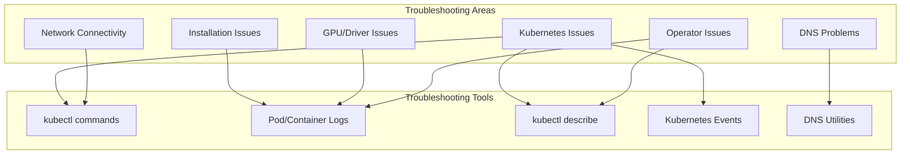
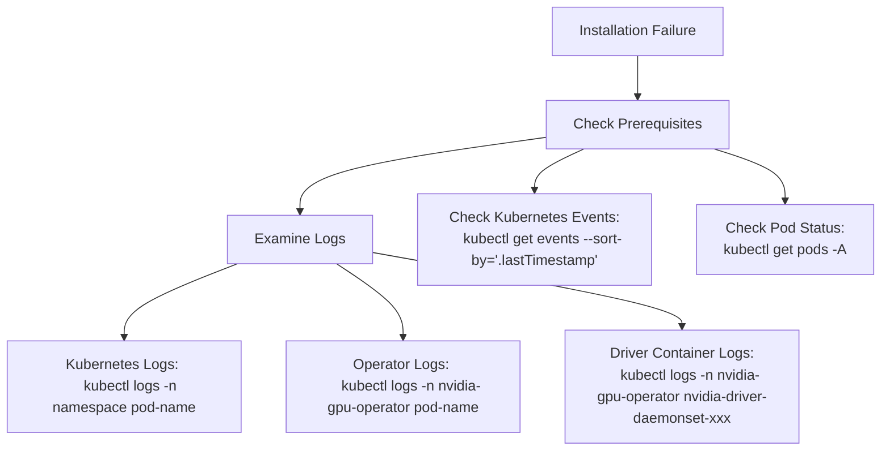
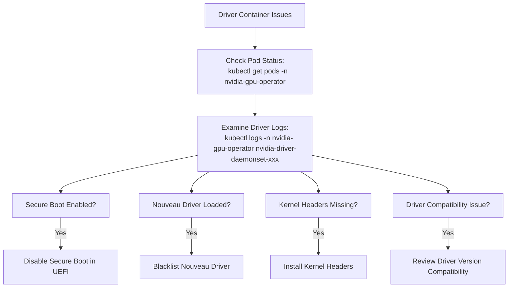
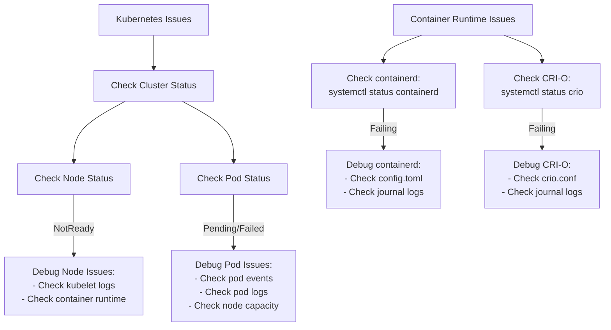

<!-- source: DeepWiki mcp.deepwiki.com · repo NVIDIA/cloud-native-stack · page 5.2 Troubleshooting · fetched 2026-10-26 -->

# Troubleshooting

<details>
<summary>Relevant source files</summary>

The following files were used as context for generating this wiki page:

- [README.md](README.md)
- [playbooks/cns-installation.yaml](playbooks/cns-installation.yaml)
- [playbooks/prerequisites.yaml](playbooks/prerequisites.yaml)
- [troubleshooting/README.md](troubleshooting/README.md)
- [troubleshooting/dns.md](troubleshooting/dns.md)
- [troubleshooting/driver-container-logs.png](troubleshooting/driver-container-logs.png)

</details>


This page provides guidance for diagnosing and resolving common issues encountered when deploying and operating the NVIDIA Cloud Native Stack (CNS). For information about validating your CNS installation, please refer to [Validation](#5.1).

## Overview of Troubleshooting CNS

Troubleshooting complex container orchestration platforms involves analyzing multiple system components working together. CNS troubleshooting requires understanding Kubernetes, container runtime, NVIDIA drivers, GPU Operator, Network Operator, and their interactions.



Sources: [README.md:135-137]()/[troubleshooting/README.md:1-6]()

## Prerequisites and Installation Issues

Many deployment issues stem from unmet prerequisites. Verify these requirements before troubleshooting further:

### Common Prerequisites Failures

| Prerequisite | Error Symptoms | Troubleshooting Approach |
|--------------|----------------|--------------------------|
| Direct internet access | Package installation failures | Verify connectivity to required repositories |
| Adequate bandwidth | Slow or timing out downloads | Run network speed test with provided speedtest-cli |
| DNS server functionality | Package resolution failures | Test DNS resolution using the method in "DNS Issues" section |
| Network interface configuration | Network connectivity issues | Verify single interface with static IP |
| UEFI secure boot | Driver loading failures | Confirm UEFI secure boot is disabled |
| Root file system capacity | Storage-related failures | Verify at least 40GB of available space |
| Hardware requirements | Cluster stability issues | Ensure minimum 2 CPU and 4GB Memory | 
| At least one NVIDIA GPU | GPU Operator failures | Verify GPU is properly connected |

Sources: [README.md:85-98]()/[playbooks/cns-installation.yaml:134-146]()/[playbooks/cns-installation.yaml:147-151]()/[playbooks/cns-installation.yaml:152-156]()/[playbooks/cns-installation.yaml:158-164]()

### Installation Process Troubleshooting

If you encounter failures during the installation process, follow these steps:

1. Review the output of the `setup.sh install` command for error messages
2. Check specific component installation logs
3. Verify prerequisites have been met
4. Examine Kubernetes events for component failures



Sources: [README.md:122-123]()/[playbooks/cns-installation.yaml:298-306]()

## DNS Issues

DNS resolution problems are a common source of failures in CNS deployments. The GPU Operator, for instance, requires access to external repositories, which depends on proper DNS resolution.

### Troubleshooting Driver Container DNS Issues

If you find errors like the driver container failing to access resources like `archive.ubuntu.com`, follow these steps:

1. Deploy a DNS diagnostics pod:
   ```bash
   kubectl apply -f https://k8s.io/examples/admin/dns/dnsutils.yaml
   ```

2. Test DNS resolution from within the cluster:
   ```bash
   kubectl exec -i -t dnsutils -- nslookup archive.ubuntu.com
   ```

3. Verify that you get proper name resolution output, with entries similar to:
   ```
   Server:         10.96.0.10
   Address:        10.96.0.10#53
   
   Non-authoritative answer:
   Name:   archive.ubuntu.com
   Address: 91.189.91.82
   ...
   ```

4. If DNS resolution fails or returns incorrect values, check your cluster's CoreDNS configuration:
   ```bash
   kubectl get configmap -n kube-system coredns -o yaml
   ```

5. Verify that your host system's DNS configuration is correct and that the cluster has network access to the DNS servers.

Sources: [troubleshooting/README.md:1-6]()/[troubleshooting/dns.md:1-62]()

## NVIDIA GPU Driver and Operator Issues

Issues with the NVIDIA GPU driver and operator are common sources of problems in CNS deployments.

### Driver Container Failures

If the GPU Operator's driver container fails to start or enters a crash loop, check for these common issues:

1. **Secure Boot Enabled**: The NVIDIA driver needs to load kernel modules, which may fail if secure boot is enabled.
   - Symptom: Driver container shows errors about module signing or loading
   - Solution: Disable secure boot in UEFI settings and reboot

2. **Nouveau Driver Conflict**: The open-source Nouveau driver conflicts with NVIDIA's proprietary driver.
   - Symptom: Driver container fails with module loading errors
   - Solution: CNS should automatically blacklist Nouveau, but verify by checking:
     ```bash
     lsmod | grep nouveau
     cat /etc/modprobe.d/blacklist-nouveau.conf
     ```

3. **Missing Kernel Headers**: The driver container builds against kernel headers.
   - Symptom: Container fails with compilation errors
   - Solution: Ensure correct kernel headers are installed:
     ```bash
     apt-get install linux-headers-$(uname -r)  # Ubuntu
     yum install kernel-devel kernel-headers    # RHEL
     ```

4. **Driver Mismatch**: The driver version may be incompatible with your GPU or OS.
   - Symptom: Driver loads but GPUs aren't recognized
   - Solution: Review compatibility in release notes and adjust GPU Operator configuration if needed



Sources: [playbooks/cns-installation.yaml:22-47]()/[troubleshooting/driver-container-logs.png]()

### GPU Operator Pod Issues

If the GPU Operator pods fail to start properly:

1. Check pod status for specific error messages:
   ```bash
   kubectl get pods -n nvidia-gpu-operator
   kubectl describe pod -n nvidia-gpu-operator pod-name
   ```

2. Verify that the driver container has started successfully before other components

3. Check if CPU and memory resources are sufficient for all operators and pods

4. Examine GPU Operator logs to identify specific issues:
   ```bash
   kubectl logs -n nvidia-gpu-operator -l app=gpu-operator
   ```

Sources: [playbooks/cns-installation.yaml:193-250]()/[playbooks/cns-installation.yaml:294-306]()

## Kubernetes and Container Runtime Issues

Problems with the Kubernetes cluster or container runtime can prevent proper CNS functionality.

### Kubernetes Cluster Health Check

Begin troubleshooting by verifying your Kubernetes cluster's health:

```bash
kubectl cluster-info
kubectl get nodes
kubectl get pods -A
```

If these commands show errors or unhealthy components, address Kubernetes issues before troubleshooting CNS-specific problems.

### Container Runtime Troubleshooting

CNS supports multiple container runtimes (containerd, CRI-O, CRI-dockerd). Issues with these can manifest in various ways:

1. **Containerd Issues**:
   - Check containerd status: `systemctl status containerd`
   - Verify configuration: `cat /etc/containerd/config.toml`
   - Check logs: `journalctl -u containerd`

2. **CRI-O Issues**:
   - Check CRI-O status: `systemctl status crio`
   - Verify configuration: `cat /etc/crio/crio.conf`
   - Check logs: `journalctl -u crio`

3. **Common Runtime Problems**:
   - Verify proper GPU access from containers
   - Check NVIDIA Container Toolkit integration



Sources: [playbooks/prerequisites.yaml:196-577]()/[README.md:60-67]()

## Network Configuration and Connectivity Issues

Network issues can often cause problems in CNS deployments. Here are key areas to check:

1. **Cluster Network Configuration**:
   - Verify Pod and Service CIDR configurations
   - Check CNI plugin operation (default is Calico)
   - Ensure no network conflicts with existing infrastructure

2. **Node Connectivity**:
   - Ensure nodes can communicate with each other
   - Check network interface configuration matches expectations

3. **External Access**:
   - Verify access to package repositories and image registries
   - Test DNS resolution from nodes and pods

4. **Proxy Configuration**:
   - If using a proxy, verify it's correctly configured in:
     - Container runtime configuration
     - Kubernetes environment variables
     - Node environment

Sources: [playbooks/prerequisites.yaml:525-577]()/[README.md:85-98]()

## Advanced Troubleshooting Techniques

For complex issues, these advanced techniques can help identify root causes:

### Node and System Level Debugging

1. **System Resource Issues**:
   - Check for resource exhaustion: `top`, `df -h`, `free -m`
   - Look for hardware errors in system logs: `dmesg`
   - Examine kernel errors: `journalctl -k`

2. **NVIDIA Driver and GPU Issues**:
   - Check driver status: `nvidia-smi`
   - Verify NVIDIA modules are loaded: `lsmod | grep nvidia`
   - Test device accessibility: `ls -la /dev/nvidia*`

3. **Container Environment**:
   - Use debugging pods to test environment:

     ```yaml
     # nvidia-debug.yaml
     apiVersion: v1
     kind: Pod
     metadata:
       name: nvidia-debug
     spec:
       containers:
       - name: nvidia-debug
         image: nvidia/cuda:11.8.0-base-ubuntu22.04
         command: ["sleep", "infinity"]
         resources:
           limits:
             nvidia.com/gpu: 1
       restartPolicy: Never
     ```

   - Deploy and test:
     ```bash
     kubectl apply -f nvidia-debug.yaml
     kubectl exec -it nvidia-debug -- nvidia-smi
     ```

### NVIDIA Component Status Check

Here's a quick command set to verify the key NVIDIA components status:

```bash
# Check GPU operator pods
kubectl get pods -n nvidia-gpu-operator

# Check driver status
kubectl logs -n nvidia-gpu-operator -l app=nvidia-driver-daemonset

# Verify device plugin is working
kubectl get nodes -o json | jq '.items[].status.allocatable | select(has("nvidia.com/gpu"))'

# If Network Operator is installed
kubectl get pods -n nvidia-network-operator
```

Sources: [README.md:60-72]()/[playbooks/cns-installation.yaml:294-306]()

## Common Errors and Solutions

Below is a reference table of common errors and their solutions:

| Component | Error Symptom | Possible Cause | Solution |
|-----------|---------------|----------------|----------|
| Installation | `Failed to download packages` | Network or DNS issues | Check internet connectivity and DNS resolution |
| Kubernetes | `Node NotReady` | Kubelet or container runtime issues | Check kubelet logs and container runtime status |
| GPU Operator | `nvidia-driver-daemonset failed` | Driver installation issues | Check driver container logs, verify kernel headers |
| GPU Operator | `nvidia-container-toolkit failed` | Integration issues | Verify container runtime configuration |
| Network Operator | `NetworkAttachmentDefinition failures` | CNI plugin issues | Check Network Operator logs and CNI configuration |
| Validation | `Failed to detect GPUs` | Driver or device plugin issues | Verify driver installation and device plugin functionality |
| Pods | `ImagePullBackOff` | Registry access issues | Check network/proxy settings and registry credentials |
| DNS | `Failed to resolve hostnames` | CoreDNS or network issues | Follow DNS troubleshooting section |

Sources: [troubleshooting/README.md:1-6]()/[troubleshooting/dns.md:1-62]()

## Cluster Recovery Procedures

When facing severe issues, these recovery procedures may help:

### Component Reinstallation

For specific components:

1. **GPU Operator**:
   ```bash
   helm uninstall -n nvidia-gpu-operator gpu-operator
   helm install -n nvidia-gpu-operator gpu-operator nvidia/gpu-operator
   ```

2. **Network Operator**:
   ```bash
   helm uninstall -n nvidia-network-operator network-operator
   helm install -n nvidia-network-operator network-operator nvidia/network-operator
   ```

### Full Cluster Recovery

For severe issues requiring a reset:

1. Backup important configuration
2. Reset the Kubernetes cluster:
   ```bash
   kubeadm reset
   ```
3. Remove CNS components:
   ```bash
   rm -rf /etc/kubernetes /var/lib/kubelet /var/lib/etcd
   ```
4. Restart the installation process

**Note**: Before performing a full reset, ensure you've exhausted troubleshooting options as this will remove your entire cluster configuration.

Sources: [README.md:122-125]()/[playbooks/cns-installation.yaml:294-306]()

## Getting Help

If you're unable to resolve issues using this guide:

1. Open an issue on the [NVIDIA Cloud Native Stack GitHub repository](https://github.com/NVIDIA/cloud-native-stack/issues)
2. Include detailed information about your environment and the steps you've already taken
3. Share relevant logs and error messages to expedite assistance

For additional help, consult:
- The [NVIDIA GPU Operator documentation](https://docs.nvidia.com/datacenter/cloud-native/gpu-operator/overview.html)
- The [NVIDIA Network Operator documentation](https://docs.nvidia.com/networking/display/COKAN10/Network+Operator)

Sources: [README.md:139-151]()

---

