# Page: Overview

# Overview

<details>
<summary>Relevant source files</summary>

The following files were used as context for generating this wiki page:

- [README.md](README.md)
- [install-guides/readme.md](install-guides/readme.md)
- [playbooks/cns-installation.yaml](playbooks/cns-installation.yaml)
- [playbooks/prerequisites.yaml](playbooks/prerequisites.yaml)
- [playbooks/readme.md](playbooks/readme.md)
- [playbooks/setup.sh](playbooks/setup.sh)

</details>


NVIDIA Cloud Native Stack (CNS) is a software stack designed to run GPU-accelerated containerized workloads on Kubernetes. It provides a collection of tools, configuration files, and deployment guides for creating a production-ready Kubernetes environment integrated with NVIDIA GPU capabilities. This document introduces the purpose, architecture, and components of the NVIDIA Cloud Native Stack repository at https://github.com/NVIDIA/cloud-native-stack.

For detailed installation instructions, see [Installation](#2). For information about specific components, see [Components](#4).

Sources: [README.md:1-11]()

## Purpose and Scope

NVIDIA Cloud Native Stack serves two main objectives:

1. **Reference Architecture**: CNS provides a validated reference architecture listing components that have been tested together. This reference can be used as a specification for production deployments.

2. **Installation Tools**: CNS offers installation guides and Ansible playbooks for deploying Kubernetes environments with NVIDIA operators. These installation tools are primarily intended for test and proof-of-concept environments.

Note that while the Kubernetes layer deployed by CNS installation tools is basic (without high availability features), all NVIDIA components included in CNS are fully production-ready.

Sources: [README.md:12-18](), [playbooks/readme.md:3-13]()

## Architecture Overview

NVIDIA Cloud Native Stack is built on a foundation of Ubuntu/RHEL, Kubernetes, Helm, and NVIDIA operators (GPU and Network). The architecture consists of the following high-level components:

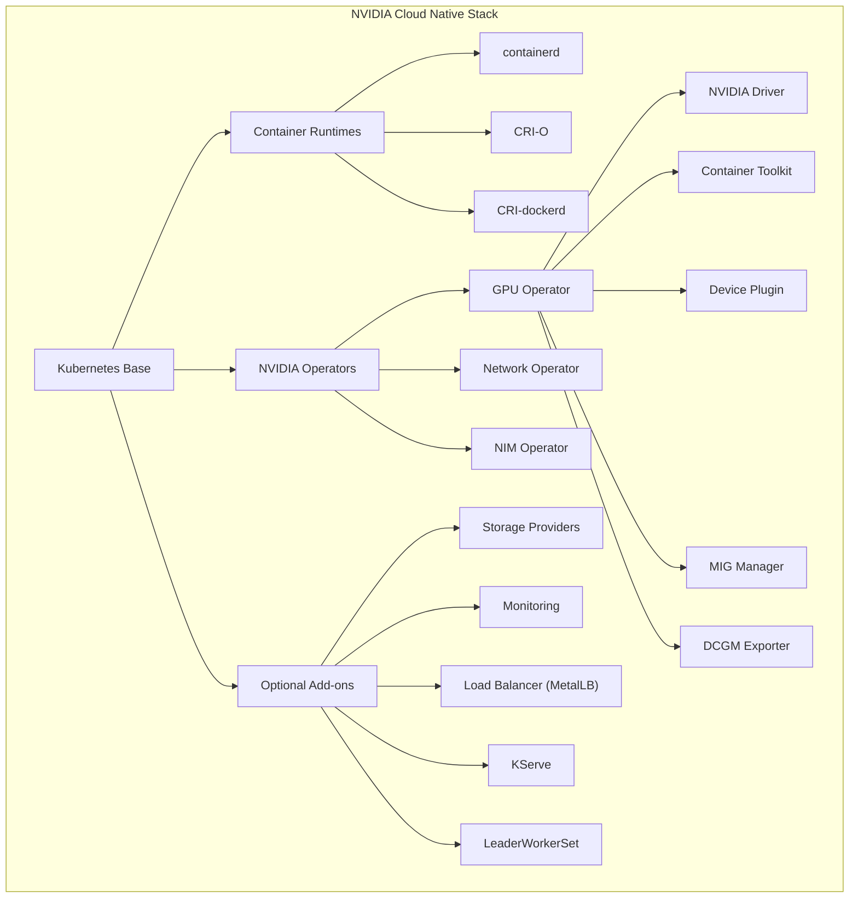

Sources: [README.md:59-73](), [playbooks/readme.md:80-82]()

## Installation Process Flow

The installation of NVIDIA Cloud Native Stack follows a systematic process, managed through Ansible playbooks:

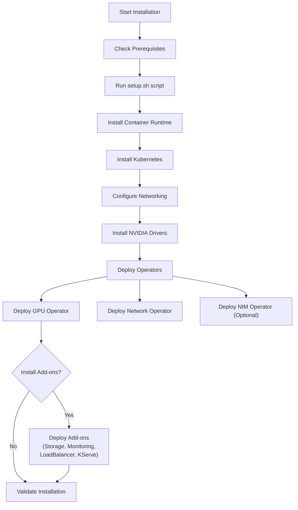

Sources: [playbooks/setup.sh:1-12](), [playbooks/cns-installation.yaml:1-309](), [playbooks/readme.md:78-107]()

## Component Architecture

The deployed NVIDIA Cloud Native Stack integrates multiple components to enable GPU capabilities within Kubernetes:

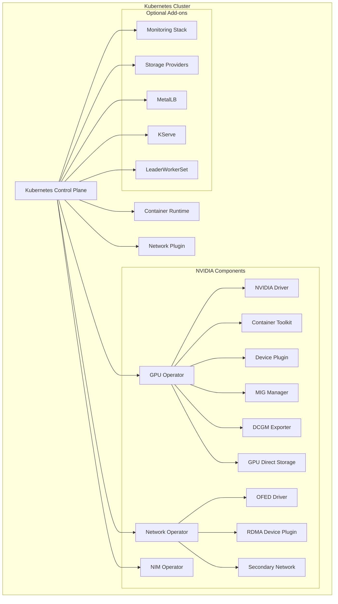

Sources: [README.md:59-73](), [playbooks/readme.md:324-356](), [playbooks/readme.md:666-672]()

## Supported Platforms and Deployment Options

NVIDIA Cloud Native Stack supports multiple deployment platforms and installation methods:

| Deployment Type | Supported Platforms | Installation Method |
|-----------------|---------------------|---------------------|
| Bare Metal | NVIDIA Certified Systems (x86_64) | Manual Installation or Ansible Playbooks |
| Bare Metal | NVIDIA Qualified Systems (ARM64) | Manual Installation or Ansible Playbooks |
| Bare Metal | NVIDIA Jetson Systems | Manual Installation or Ansible Playbooks |
| Cloud Service Providers | AWS EKS | Terraform Deployment |
| Cloud Service Providers | Google GKE | Terraform Deployment |
| Cloud Service Providers | Azure AKS | Terraform Deployment |
| Confidential Computing | NVIDIA Certified Systems | Ansible Playbooks |

Sources: [playbooks/readme.md:28-39](), [playbooks/readme.md:703-776](), [playbooks/readme.md:777-800]()

## Versioning and Support Lifecycle

NVIDIA Cloud Native Stack follows a batch release system:

- When a new batch is released, the previous batch enters maintenance support
- All prior batches enter end-of-life (EOL)
- Only the current and previous batch receive updates
- Upgrades are only supported from the previous batch to the latest batch

Example of the current version matrix (as of the source documentation):

| CNS Version | Operating System | Kubernetes | Container Runtime | GPU Operator | Network Operator |
|-------------|------------------|------------|-------------------|--------------|------------------|
| 15.0 | Ubuntu 24.04 LTS | 1.32.2 | containerd 2.0.3 | 25.3.0 | 25.1.0 |
| 14.1 | Ubuntu 22.04 LTS | 1.31.6 | containerd 2.0.3 | 25.3.0 | 25.1.0 |
| 13.3 | Ubuntu 22.04 LTS | 1.30.10 | containerd 1.7.27 | 25.3.0 | 25.1.0 |

Sources: [README.md:20-35](), [README.md:38-54]()

## Summary

NVIDIA Cloud Native Stack provides a comprehensive solution for deploying and managing GPU-accelerated containerized workloads. It integrates Kubernetes with NVIDIA's GPU and networking technologies, alongside optional add-ons for monitoring, storage, and specialized workloads. The repository offers both reference architecture information for production deployments and installation tools for test environments.

Sources: [README.md:1-11](), [README.md:59-73]()

---

# Page: Installation

# Installation

<details>
<summary>Relevant source files</summary>

The following files were used as context for generating this wiki page:

- [README.md](README.md)
- [install-guides/readme.md](install-guides/readme.md)
- [playbooks/cns-installation.yaml](playbooks/cns-installation.yaml)
- [playbooks/prerequisites.yaml](playbooks/prerequisites.yaml)
- [playbooks/readme.md](playbooks/readme.md)
- [playbooks/setup.sh](playbooks/setup.sh)

</details>


This page provides a comprehensive guide for installing the NVIDIA Cloud Native Stack (CNS), a collection of software designed to run cloud-native workloads on NVIDIA GPUs. The installation system is the primary entry point for deploying CNS in your environment, whether on bare metal or cloud service providers.

## Purpose and Scope

This documentation covers the installation process for NVIDIA Cloud Native Stack, including:
- Prerequisites and system requirements
- Installation methods (automated with Ansible playbooks and manual guides)
- Deployment options (bare metal, cloud service providers)
- Component installation (Kubernetes, container runtimes, NVIDIA operators)
- Validation and troubleshooting

For information about configuring CNS after installation, see [Configuration](#3). For details about the specific components of CNS, see [Components](#4).

## Prerequisites

Before installing NVIDIA Cloud Native Stack, ensure your system meets these requirements:

| Requirement | Specification |
|-------------|---------------|
| Internet connectivity | Direct access with adequate bandwidth |
| Operating system | Ubuntu 22.04/24.04 LTS or RHEL 8.7/8.10 |
| DNS | Functioning DNS server |
| Network | Single interface with static IP address |
| UEFI | Secure boot disabled |
| Storage | At least 40GB capacity in root filesystem |
| Hardware | Minimum 2 CPU cores and 4GB memory |
| GPU | At least one NVIDIA GPU |
| Access | Ability to access Google repositories (for Kubernetes) |

Sources: [README.md:85-98](), [playbooks/readme.md:16-26]()

### Supported Systems

NVIDIA Cloud Native Stack supports:
- NVIDIA-Certified Systems with Mellanox CX NICs (for x86-64 servers)
- NVIDIA Qualified Systems (for ARM64 servers)
- NVIDIA Jetson Systems

**Note**: For ARM systems, the NVIDIA Network Operator is not currently supported.

Sources: [playbooks/readme.md:28-39]()

## Installation Architecture

### Installation Process Flow

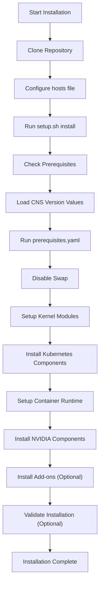

### Installation Components

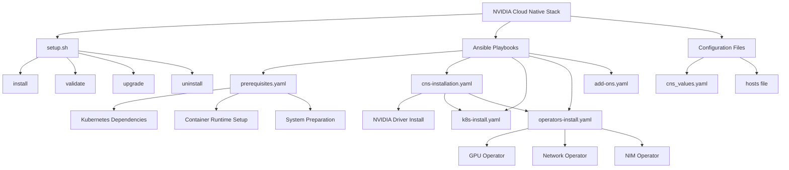

Sources: [playbooks/setup.sh:1-80](), [playbooks/cns-installation.yaml:1-309]()

## Installation Methods

NVIDIA Cloud Native Stack offers two installation methods:

1. **Automated installation** using Ansible playbooks
2. **Manual installation** following step-by-step guides

This page focuses on the automated installation using Ansible playbooks.

### Automated Installation with Ansible

#### Step 1: Clone the Repository

```bash
git clone https://github.com/NVIDIA/cloud-native-stack.git
cd cloud-native-stack/playbooks
```

#### Step 2: Configure the Hosts File

Update the hosts file with your master and worker node information:

```bash
nano hosts

[master]
10.110.16.178 ansible_ssh_user=nvidia ansible_ssh_pass=nvidipass ansible_sudo_pass=nvidiapass ansible_ssh_common_args='-o StrictHostKeyChecking=no'
[nodes]
10.110.16.179 ansible_ssh_user=nvidia ansible_ssh_pass=nvidiapass ansible_sudo_pass=nvidiapass ansible_ssh_common_args='-o StrictHostKeyChecking=no'
```

#### Step 3: Select CNS Version

Edit the `cns_version.yaml` file to specify which version you want to install:

```bash
nano cns_version.yaml
```

Available versions include:
- 15.0 (for Ubuntu 24.04)
- 14.1
- 13.3
- and others

#### Step 4: Run the Installation

Execute the installation using the setup.sh script:

```bash
bash setup.sh install
```

This script will:
1. Check prerequisites
2. Install Ansible if not present
3. Copy the appropriate version-specific values file
4. Launch the Ansible playbooks
5. Install Kubernetes and container runtime
6. Install NVIDIA components and operators

Sources: [README.md:100-125](), [playbooks/setup.sh:265-344](), [playbooks/readme.md:78-243]()

## Deployment Options

### Deployment Topologies

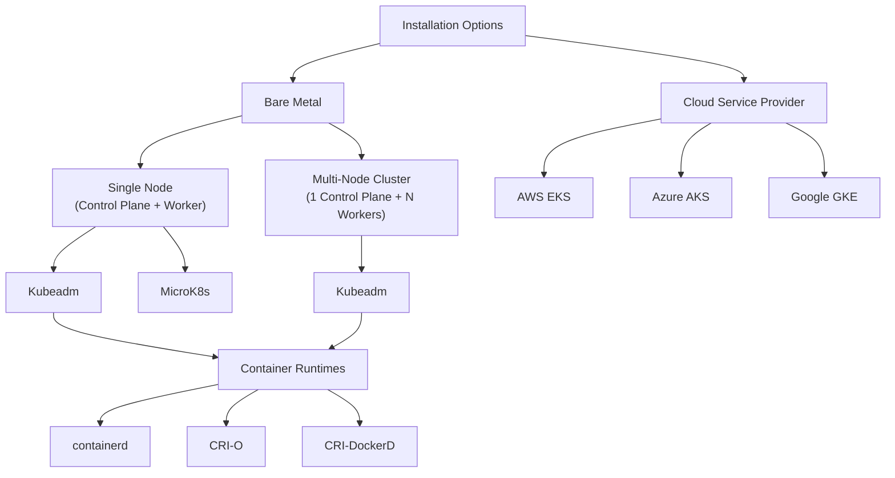

NVIDIA Cloud Native Stack supports two topologies:
- Single node with both control plane and worker functionalities
- One control plane node and any number of worker nodes

**Note**: CNS does not currently support deploying multiple control plane nodes.

Sources: [README.md:129-133]()

### Bare Metal Installation

For bare metal installations, the standard `setup.sh install` command is used. The installation automatically detects if it's running on a single machine and configures accordingly.

### Cloud Service Provider Installation

For deployment on cloud providers, use the following commands:

- **AWS EKS**:
  ```bash
  bash setup.sh install eks
  ```

- **Azure AKS**:
  ```bash
  bash setup.sh install aks
  ```

- **Google GKE**:
  ```bash
  bash setup.sh install gke
  ```

These commands will set up the necessary cloud provider tools, create a Kubernetes cluster with GPU nodes, and install the NVIDIA GPU Operator.

Sources: [playbooks/setup.sh:267-325](), [playbooks/readme.md:703-776]()

## Customization Options

### Container Runtime Selection

NVIDIA Cloud Native Stack supports three container runtimes:

1. **containerd** (default)
2. **CRI-O**
3. **CRI-dockerd**

To select a container runtime, modify the `container_runtime` value in your `cns_values_<version>.yaml` file:

```yaml
container_runtime: "containerd"
```

Sources: [playbooks/prerequisites.yaml:300-578](), [playbooks/readme.md:110-112]()

### Enable MicroK8s

To use MicroK8s instead of Kubeadm, set the `microk8s` parameter to `yes` in the CNS values file:

```yaml
microk8s: yes
```

Sources: [playbooks/readme.md:330-341](), [playbooks/cns-installation.yaml:276-277]()

### Enable Add-ons

Several add-ons can be enabled during installation:

| Add-on | Description | Configuration |
|--------|-------------|---------------|
| Storage | Local Path Provisioner and NFS Provisioner | `storage: yes` |
| Monitoring | Prometheus/Grafana with GPU metrics and Elastic Logging stack | `monitoring: yes` |
| LoadBalancer | MetalLB for load balancing | `loadbalancer: yes` |
| KServe | ML model serving platform | `kserve: yes` |
| LeaderWorkerSet | Kubernetes SIG LWS | `lws: yes` |

Sources: [playbooks/cns-installation.yaml:279-280](), [playbooks/readme.md:666-699]()

### NVIDIA Operators

By default, the installation includes:

1. **NVIDIA GPU Operator**: For managing NVIDIA GPUs in Kubernetes
2. **NVIDIA Network Operator** (optional): For managing Mellanox networking devices

You can enable/disable and customize these operators in the `cns_values_<version>.yaml` file:

```yaml
# GPU Operator Values
enable_gpu_operator: yes
gpu_driver_version: "570.124.06"
use_open_kernel_module: no
enable_mig: no

# Network Operator Values
enable_network_operator: no
enable_rdma: no
deploy_ofed: no
```

Sources: [playbooks/readme.md:136-156](), [playbooks/readme.md:164-170]()

### Confidential Computing

For confidential computing installations, use:

```bash
bash setup.sh install cc
```

This will configure the system BIOS for confidential computing, install the SNP kernel, and then reboot. After reboot, run the standard installation command:

```bash
bash setup.sh install
```

Sources: [playbooks/setup.sh:325-329](), [playbooks/readme.md:786-800]()

## Validation and Troubleshooting

### Validation

After installation, validate your NVIDIA Cloud Native Stack:

```bash
bash setup.sh validate
```

This will check:
- Kubernetes cluster status
- Node status
- Pod status
- Helm installation
- GPU Operator status
- Component versions
- NVIDIA driver and CUDA functionality

Sources: [playbooks/setup.sh:384-394](), [playbooks/readme.md:802-809]()

### Troubleshooting

For installation issues, consult the troubleshooting guide:

```bash
bash setup.sh troubleshoot
```

Or visit the [Troubleshooting page](#5.2) for common issues and solutions.

Sources: [README.md:135-137]()

## Upgrade and Uninstall

### Upgrade

To upgrade your NVIDIA Cloud Native Stack:

```bash
bash setup.sh upgrade
```

**Note**: Upgrades are only supported from the previous batch to the latest batch (e.g., 13.x to 14.x, not 13.x to 15.x).

Sources: [playbooks/readme.md:810-816](), [playbooks/setup.sh:345-355]()

### Uninstall

To uninstall NVIDIA Cloud Native Stack:

```bash
bash setup.sh uninstall
```

For cloud provider deployments:

```bash
bash setup.sh uninstall eks
bash setup.sh uninstall aks
bash setup.sh uninstall gke
```

Sources: [playbooks/setup.sh:356-383](), [playbooks/readme.md:818-825]()

## Component Matrix

The following table shows the key components in NVIDIA Cloud Native Stack 25.4.0 (latest release):

| Component | CNS v15.0 | CNS v14.1 | CNS v13.3 |
|-----------|-----------|-----------|-----------|
| OS | Ubuntu 24.04 LTS | Ubuntu 22.04 LTS | Ubuntu 22.04 LTS |
| Containerd | 2.0.3 | 2.0.3 | 1.7.27 |
| NVIDIA Container Toolkit | 1.17.5 | 1.17.5 | 1.17.5 |
| CRI-O | 1.32.1 | 1.31.5 | 1.30.10 |
| Kubernetes | 1.32.2 | 1.31.6 | 1.30.10 |
| CNI (Calico) | 3.29.2 | 3.29.2 | 3.29.2 |
| NVIDIA GPU Operator | 25.3.0 | 25.3.0 | 25.3.0 |
| NVIDIA Network Operator | 25.1.0 | 25.1.0 | 25.1.0 |
| NVIDIA Driver | 570.124.06 | 570.124.06 | 570.124.06 |
| Helm | 3.17.2 | 3.17.2 | 3.17.2 |

Sources: [README.md:38-54]()

## Conclusion

This page provided an overview of the installation process for NVIDIA Cloud Native Stack. By following these instructions, you can deploy a GPU-accelerated Kubernetes environment suitable for various workloads. For more detailed information about specific components and configurations, refer to the corresponding pages in this documentation.

---

# Page: Prerequisites

# Prerequisites

<details>
<summary>Relevant source files</summary>

The following files were used as context for generating this wiki page:

- [README.md](README.md)
- [playbooks/cns-installation.yaml](playbooks/cns-installation.yaml)
- [playbooks/prerequisites.yaml](playbooks/prerequisites.yaml)

</details>


This page details the system requirements and prerequisites needed before installing NVIDIA Cloud Native Stack (CNS). Fulfilling these prerequisites ensures a successful installation and optimal performance of GPU-accelerated Kubernetes environments.

For information about the actual installation process after prerequisites are met, see [Installation Process](#2.2).

## System Requirements Overview

Before deploying NVIDIA Cloud Native Stack, ensure your system meets the following minimum requirements:

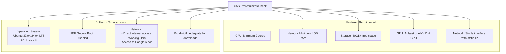

Sources: [README.md:85-99](), [playbooks/cns-installation.yaml:153-164]()

## Hardware Requirements

### Compute Resources

CNS requires minimum compute resources to run Kubernetes and NVIDIA components effectively:

| Resource | Minimum Requirement | Recommended |
|----------|---------------------|-------------|
| CPU | 2 cores | 4+ cores |
| Memory | 4GB RAM | 8GB+ RAM |
| Storage | 40GB free space | 100GB+ free space |
| GPU | 1 NVIDIA GPU | NVIDIA Certified System |

The prerequisites validation checks these requirements automatically:

```python
# CPU check (from cns-installation.yaml)
- name: Check Number of CPU's
  failed_when: ansible_processor_vcpus < 2
  shell: "echo 'minimum 2 CPUs required'"

# Memory check
- name: Check memory requirements
  failed_when: ansible_memtotal_mb < 4096
  shell: "echo 'minimum 4GB memory required'"

# Storage check
- name: check enough storage
  shell: df --block-size 1g / --output=avail | tail -1 | sed "s/ //g"
  register: size
  failed_when: " size.stdout | int <= 40 and ansible_architecture == 'x86_64'"
```

Sources: [playbooks/cns-installation.yaml:153-164]()

### Network Configuration

Network requirements are essential for proper CNS operation:

- System must have a single network interface configured with internet access
- Static IP address (not dynamically changing via DHCP)
- Firewall must allow required Kubernetes ports

For multi-node configurations, ensure network connectivity between all nodes.

Sources: [README.md:94-95]()

## Software Requirements

### Operating System

NVIDIA Cloud Native Stack supports the following operating systems:

| CNS Version | Supported Operating Systems |
|-------------|---------------------------|
| 15.0        | Ubuntu 24.04 LTS          |
| 14.1, 13.3  | Ubuntu 22.04 LTS          |
| ≤ 12.0      | Ubuntu 20.04 LTS, RHEL 8.x |

Note: CNS version 10.0 and later support RHEL systems. Earlier versions only support Ubuntu.

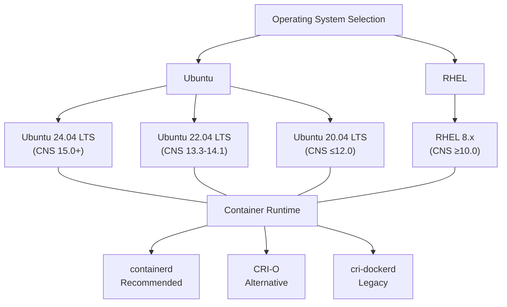

Sources: [README.md:43-45](), [playbooks/cns-installation.yaml:181-182]()

### Boot Configuration

UEFI Secure Boot must be disabled. The installation validates this requirement:

```python
# Secure boot check
- name: check secure boot
  shell: mokutil --sb-state | awk '{print $2}'
  register: secure_boot
  failed_when: "'enabled' in secure_boot.stdout"
  ignore_errors: true
```

Sources: [README.md:96](), [playbooks/cns-installation.yaml:147-151]()

### NVIDIA Driver Considerations

If you're using a system with an existing NVIDIA driver, be aware of the following:

- The nouveau driver must be disabled
- For DGX systems with RDMA or GDS enabled, existing drivers will be cleaned up
- Systems with Tegra/Jetson require specific JetPack versions

The installation process handles disabling the nouveau driver:

```python
- name: Checking Nouveau is disabled
  become: true
  shell: "lsmod | grep nouveau"
  register: nouveau_result
  failed_when: false

- name: unload nouveau
  when: nouveau_result.rc == 0
  become: true
  modprobe:
    name: nouveau
    state: absent
  ignore_errors: true
```

Sources: [playbooks/cns-installation.yaml:22-47]()

## Network Requirements

### Internet Connectivity

The CNS installation requires:

- Direct internet access (no air-gapped installations)
- Working DNS resolution
- Access to Google repositories (for Kubernetes)
- Access to NVIDIA repositories

The installation performs an internet speed test to ensure adequate bandwidth:

```python
- name: Check Internet Speed
  ignore_errors: true
  failed_when: false
  shell: /usr/bin/python3 /tmp/speedtest-cli --secure --simple
  register: speed
  async: 30

- name: Report Valid Internet Speed
  shell: echo {{ speed.stdout_lines[1] }} | awk '{print $3}'
  register: speedtest
  ignore_errors: true
  failed_when: "'Kbit/s' in speedtest.stdout"
```

Sources: [README.md:89-93](), [playbooks/cns-installation.yaml:121-146]()

## Prerequisite Validation Process

The CNS installation process automatically validates prerequisites through the `prerequisites.yaml` and `cns-installation.yaml` Ansible playbooks. Here's the validation flow:

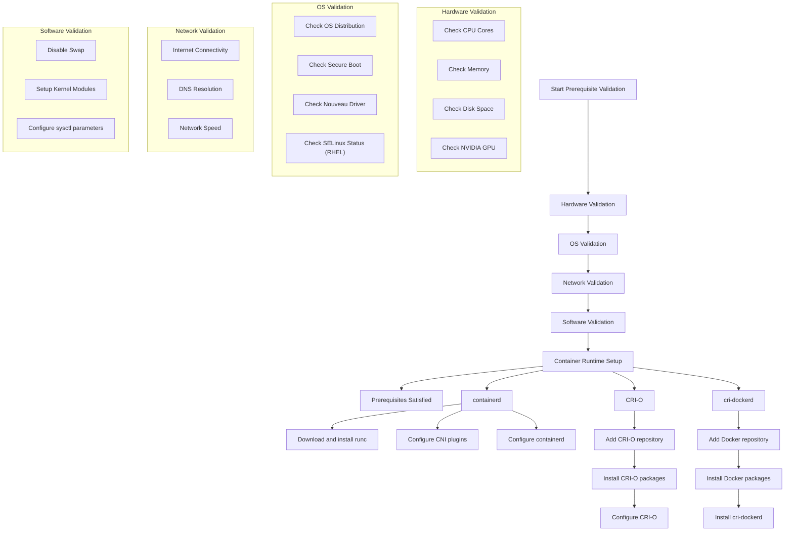

Sources: [playbooks/prerequisites.yaml](), [playbooks/cns-installation.yaml:147-164]()

## Platform-Specific Prerequisites

### NVIDIA Certified Servers

NVIDIA Certified Servers are the recommended platform for CNS deployments, providing validated hardware configurations that ensure compatibility.

### DGX Systems

DGX systems require specific considerations:

- The installation detects DGX systems and applies appropriate configurations
- For enabling RDMA or GDS, the existing NVIDIA drivers will be uninstalled

```python
- name: check dgx
  stat:
    path: /etc/dgx-release
  register: dgx

- name: NVIDIA Driver Clean Up on DGX
  when: dgx.stat.exists == True and ansible_distribution == 'Ubuntu' and enable_rdma == true or dgx.stat.exists == True and ansible_distribution == 'Ubuntu' and enable_gds == true
  become: true
  block:
    # Driver cleanup tasks
```

Sources: [playbooks/cns-installation.yaml:183-250]()

### Jetson/Tegra Systems

Jetson/Tegra platforms have specific JetPack requirements:

- The installation detects Tegra systems and handles JetPack updates
- Different CNS versions require different JetPack versions

```python
- name: Installing Latest Nvidia Jetson JetPack
  become: true
  block:
    - name: update Tegra Release to r35.4
      shell: sed -i "s/{{ tver.stdout }}/r35.4/g" /etc/apt/sources.list.d/nvidia-l4t-apt-source.list
      become: true
    
    - name: Install New Jetapck 5.1.2
      ignore_errors: yes
      apt:
        name: nvidia-jetpack
        state: present
        force: yes
        autoremove: yes
        update_cache: yes
  when: "release == 'tegra' and cns_version == 10.2 or release == 'tegra' and cns_version == 9.3 or release == 'tegra' and cns_version == 8.5"
```

Sources: [playbooks/prerequisites.yaml:1188-1258]()

## Container Runtime Requirements

CNS supports multiple container runtimes, each with specific version requirements:

| CNS Version | Containerd | CRI-O | Container Toolkit |
|-------------|------------|-------|-------------------|
| 15.0        | 2.0.3      | 1.32.1| 1.17.5            |
| 14.1        | 2.0.3      | 1.31.5| 1.17.5            |
| 13.3        | 1.7.27     | 1.30.10| 1.17.5           |

The installation playbook handles the setup of the selected container runtime including:

1. **containerd** (Recommended)
   - Downloads and installs containerd
   - Configures systemd cgroups
   - Sets up CNI plugins

2. **CRI-O** (Alternative)
   - Adds appropriate CRI-O repositories
   - Installs CRI-O packages
   - Configures storage directories

3. **cri-dockerd** (Legacy)
   - Installs Docker CE
   - Sets up cri-dockerd as the CRI implementation

Sources: [playbooks/prerequisites.yaml:300-523](), [README.md:45-47]()

## SELinux Considerations

For RHEL systems, SELinux must be set to permissive mode:

```python
- name: Check SELinux Status on RedHat
  when: ansible_distribution == 'RedHat'
  shell: sestatus | grep -i 'Current mode' | awk '{print $3}'
  register: selinuxstatus

- name: Update SELinux Status on RHEL system
  when: ansible_distribution == 'RedHat' and selinuxstatus.stdout == 'enforcing'
  become: true
  shell: sed -i 's/^SELINUX=enforcing$/SELINUX=permissive/' /etc/selinux/config
```

Sources: [playbooks/cns-installation.yaml:89-97]()

## Troubleshooting Prerequisites

If prerequisite validation fails, check the following common issues:

1. **Secure Boot is enabled**: 
   - Access UEFI settings during boot and disable Secure Boot

2. **Insufficient storage**:
   - Free up disk space or extend the root filesystem

3. **Network connectivity issues**:
   - Ensure DNS resolution works (`nslookup google.com`)
   - Verify internet connectivity (`ping 8.8.8.8`)
   - Check access to Google repos (`curl https://packages.cloud.google.com/apt/doc/apt-key.gpg`)

4. **nouveau driver is loaded**:
   - The installation will attempt to disable it, but may require a reboot

5. **SELinux issues on RHEL**:
   - The installation will attempt to set SELinux to permissive mode

For more detailed troubleshooting, refer to the [Troubleshooting](#5.2) section.

Sources: [README.md:136-137]()

## Next Steps

After ensuring that all prerequisites are met, proceed to the [Installation Process](#2.2) to deploy NVIDIA Cloud Native Stack.

---

# Page: Installation Process

# Installation Process

<details>
<summary>Relevant source files</summary>

The following files were used as context for generating this wiki page:

- [README.md](README.md)
- [cns.json](cns.json)
- [install-guides/readme.md](install-guides/readme.md)
- [playbooks/cns-installation.yaml](playbooks/cns-installation.yaml)
- [playbooks/cns-upgrade.yaml](playbooks/cns-upgrade.yaml)
- [playbooks/cns_version.yaml](playbooks/cns_version.yaml)
- [playbooks/hosts](playbooks/hosts)
- [playbooks/k8s-install.yaml](playbooks/k8s-install.yaml)
- [playbooks/nvidia-docker.yaml](playbooks/nvidia-docker.yaml)
- [playbooks/nvidia-driver.yaml](playbooks/nvidia-driver.yaml)
- [playbooks/operators-install.yaml](playbooks/operators-install.yaml)
- [playbooks/operators-upgrade.yaml](playbooks/operators-upgrade.yaml)
- [playbooks/prerequisites.yaml](playbooks/prerequisites.yaml)
- [playbooks/readme.md](playbooks/readme.md)
- [playbooks/setup.sh](playbooks/setup.sh)

</details>


This page provides a step-by-step guide for installing the NVIDIA Cloud Native Stack (CNS) using the `setup.sh` script. The installation process configures a Kubernetes cluster with NVIDIA GPU and networking capabilities through a series of automated Ansible playbooks. For information about system requirements before installation, see [Prerequisites](#2.1).

## Installation Overview

The NVIDIA Cloud Native Stack installation process automates the deployment of a Kubernetes environment optimized for NVIDIA GPUs. The installation uses Ansible playbooks orchestrated by the `setup.sh` script, which manages the entire workflow from validating prerequisites to deploying GPU operators.

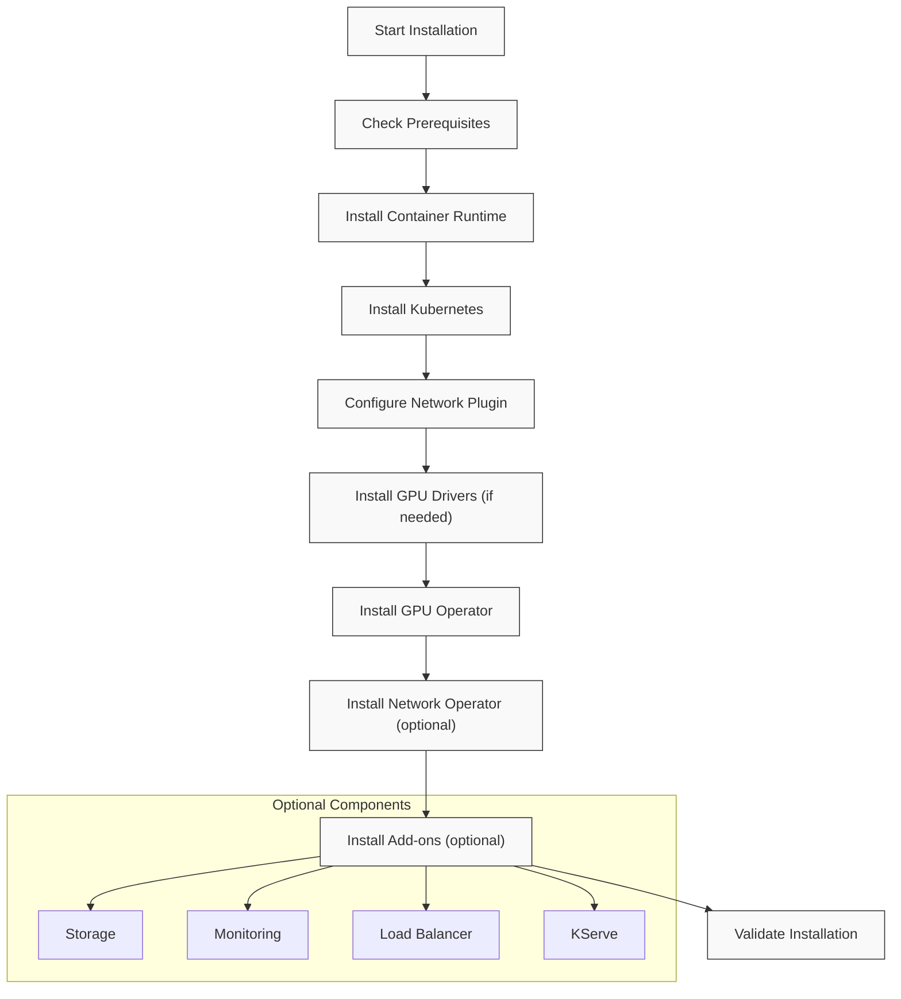

Sources: [playbooks/setup.sh:1-399](), [playbooks/cns-installation.yaml:1-267](), [playbooks/prerequisites.yaml:1-1018]()

## The setup.sh Script

The `setup.sh` script is the primary entry point for installing the NVIDIA Cloud Native Stack. It manages the installation process, checks prerequisites, and orchestrates the Ansible playbooks. The script supports multiple installation scenarios including bare metal installations and cloud provider deployments.

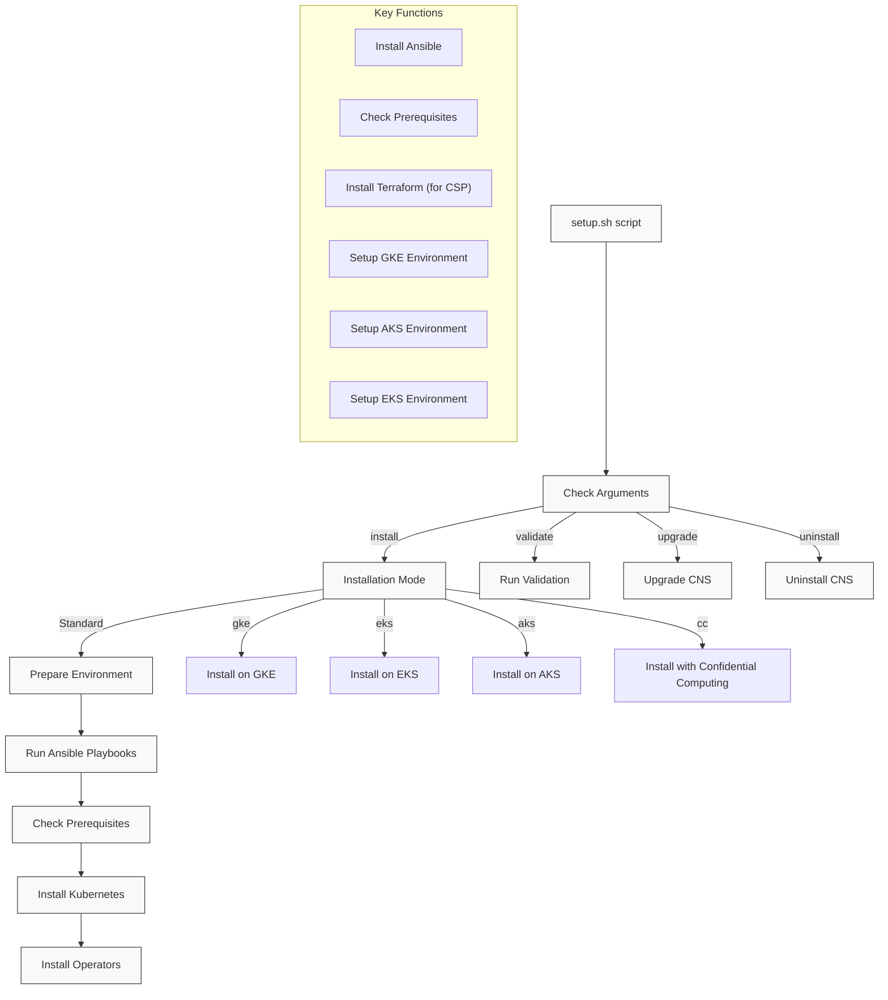

Sources: [playbooks/setup.sh:1-399]()

### Installation Command

The basic command to install NVIDIA Cloud Native Stack on a bare metal server is:

```bash
bash setup.sh install
```

The script accepts several options for different installation scenarios:

| Installation Option | Description |
|---------------------|-------------|
| `install` | Standard installation on bare metal |
| `install gke` | Installation on Google Kubernetes Engine |
| `install eks` | Installation on Amazon EKS |
| `install aks` | Installation on Azure AKS |
| `install cc` | Installation with Confidential Computing |
| `validate` | Validate an existing installation |
| `upgrade` | Upgrade an existing installation |
| `uninstall` | Uninstall the stack |

Sources: [playbooks/setup.sh:1-6](), [playbooks/setup.sh:265-345]()

## Installation Components and Workflow

The installation process configures multiple components in a specific sequence to ensure proper integration and functionality.

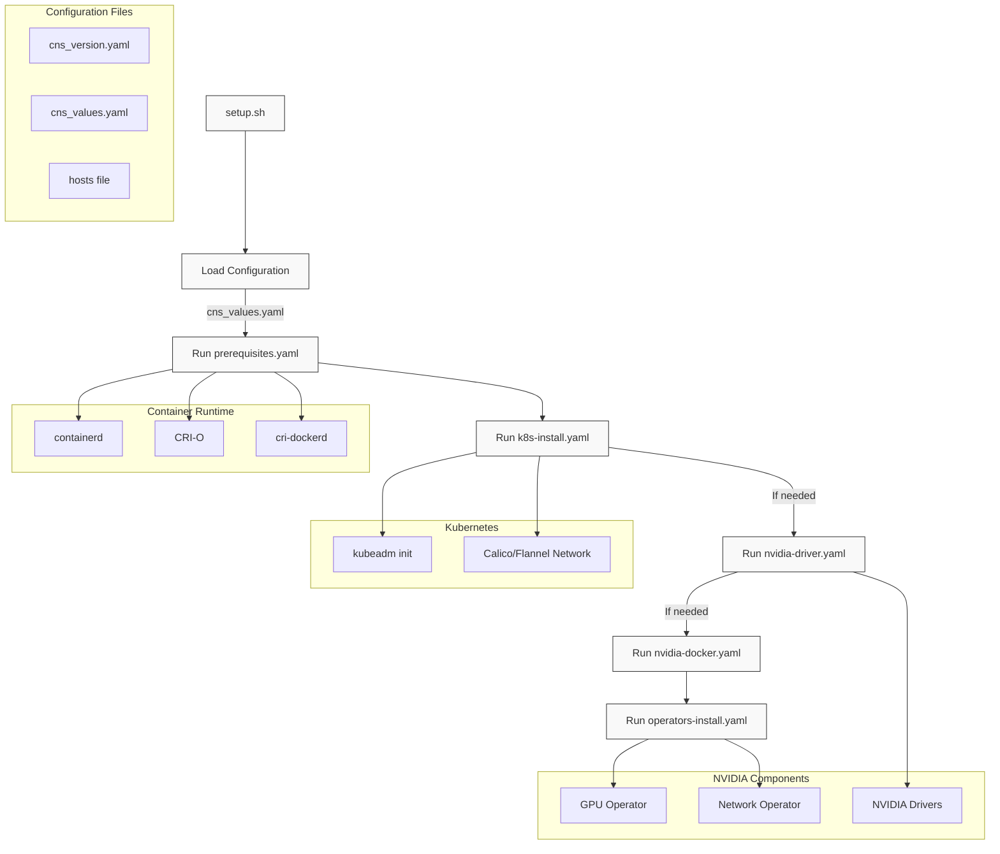

Sources: [playbooks/setup.sh:16-17](), [playbooks/cns-installation.yaml:1-267](), [playbooks/prerequisites.yaml:1-1018](), [playbooks/operators-install.yaml:1-483]()

### Component Installation Details

The installation process deploys the following main components:

1. **Container Runtime** - One of:
   - containerd (default)
   - CRI-O
   - cri-dockerd

2. **Kubernetes** - Configured using kubeadm with:
   - Network plugin (Calico for x86/ARM64, Flannel for Jetson)
   - Control plane configuration
   - kubelet configuration

3. **NVIDIA GPU Operator** - Manages:
   - NVIDIA drivers (if not pre-installed)
   - NVIDIA container toolkit
   - Device plugin
   - GPU feature discovery

4. **NVIDIA Network Operator** (optional) - Manages:
   - Mellanox OFED drivers
   - RDMA device plugin
   - Secondary network configurations

5. **Add-ons** (optional) - Based on configuration:
   - Storage (NFS, Local Path)
   - Monitoring (Prometheus, Grafana)
   - Load Balancer (MetalLB)
   - KServe

Sources: [playbooks/prerequisites.yaml:300-523](), [playbooks/k8s-install.yaml:200-213](), [playbooks/operators-install.yaml:238-507]()

## Installation Configuration

The installation is configured through several key files:

### Configuration Files

| File | Purpose |
|------|---------|
| `cns_version.yaml` | Specifies the CNS version to install |
| `cns_values_<version>.yaml` | Contains component versions and configuration for a specific CNS version |
| `hosts` | Ansible inventory file listing master and worker nodes with SSH details |

The `cns_values.yaml` file (generated from the version-specific template) controls which components are installed and their configuration.

Key configuration parameters include:

```yaml
# Container runtime selection (containerd, cri-o, cri-dockerd)
container_runtime: "containerd"

# Enable/disable components
enable_gpu_operator: yes
enable_network_operator: no
storage: no
monitoring: no
loadbalancer: no
kserve: no

# Driver configurations
gpu_driver_version: "570.124.06"
use_open_kernel_module: no
```

Sources: [playbooks/setup.sh:16-17](), [playbooks/readme.md:97-238]()

## Installation Process Steps

The installation process follows these detailed steps:

1. **Preparation and Prerequisites**
   - Clone the repository and navigate to the playbooks directory
   - Update the `hosts` file with node information
   - Run `setup.sh install` to begin installation
   - Prerequisites are checked (internet access, DNS, swap disabled, etc.)

2. **Container Runtime Installation**
   - Install the selected container runtime (containerd, CRI-O, or cri-dockerd)
   - Configure the runtime for GPU support
   - Set up container registry access

3. **Kubernetes Installation**
   - Install kubelet, kubeadm, and kubectl
   - Initialize the Kubernetes cluster with kubeadm
   - Deploy the network plugin (Calico or Flannel)
   - Configure control plane and worker nodes

4. **NVIDIA Driver and Docker Setup**
   - Install NVIDIA drivers (if not using GPU Operator to manage drivers)
   - Configure NVIDIA container toolkit
   - Set up GPU access for containers

5. **NVIDIA Operators Installation**
   - Deploy the GPU Operator to manage GPU components
   - Deploy the Network Operator (if enabled) to manage network components
   - Configure operator settings based on system hardware

6. **Add-ons Installation** (if enabled)
   - Set up storage providers
   - Deploy monitoring solutions (Prometheus/Grafana)
   - Configure load balancing (MetalLB)
   - Deploy KServe for inference serving

7. **Validation**
   - Verify the installation with validation tests
   - Check component status and functionality

Sources: [playbooks/cns-installation.yaml:1-267](), [playbooks/prerequisites.yaml:1-1018](), [playbooks/k8s-install.yaml:1-536](), [playbooks/operators-install.yaml:1-483]()

## Installation Methods

NVIDIA Cloud Native Stack supports multiple installation methods:

### Bare Metal Installation

The standard installation method for on-premises hardware:

```bash
git clone https://github.com/NVIDIA/cloud-native-stack.git
cd cloud-native-stack/playbooks
# Edit hosts file to add node information
nano hosts
# Run installation
bash setup.sh install
```

Sources: [README.md:104-107](), [playbooks/setup.sh:330-343]()

### Cloud Service Provider (CSP) Installation

For cloud-based deployments, specialized installation options are available:

```bash
# Google Kubernetes Engine (GKE)
bash setup.sh install gke

# Amazon Elastic Kubernetes Service (EKS)
bash setup.sh install eks

# Azure Kubernetes Service (AKS)
bash setup.sh install aks
```

These commands leverage Terraform templates to provision cloud resources and configure the NVIDIA Cloud Native Stack on the cloud platform.

Sources: [playbooks/setup.sh:267-324](), [README.md:67-68]()

### Specialized Deployments

For specialized use cases:

```bash
# Installation with Confidential Computing
bash setup.sh install cc

# Installation with MicroK8s
# Enable in cns_values.yaml: microk8s: yes
```

Sources: [playbooks/setup.sh:325-329](), [playbooks/readme.md:330-341]()

## Topology Options

The NVIDIA Cloud Native Stack supports several deployment topologies:

1. **Single-node** - Both control plane and worker on a single node
2. **Multi-node** - One control plane node with multiple worker nodes

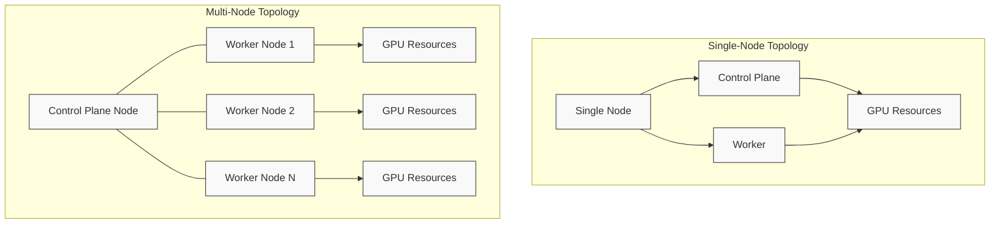

Sources: [README.md:128-133]()

## Customizing the Installation

The installation can be customized by modifying the `cns_values_<version>.yaml` file before running `setup.sh`:

### Enabling Add-ons

```yaml
# Storage options
storage: yes

# Monitoring stack
monitoring: yes

# Load balancer
loadbalancer: yes
loadbalancer_ip: "10.110.10.2/32"  # System IP or IP range

# KServe for inference
kserve: yes
```

### Enabling GPU and Network Features

```yaml
# GPU Operator options
enable_gpu_operator: yes
use_open_kernel_module: no  # Use open kernel module driver
enable_mig: no  # Enable Multi-Instance GPU
enable_gds: no  # Enable GPU Direct Storage

# Network Operator options
enable_network_operator: yes
enable_rdma: yes  # Enable RDMA
deploy_ofed: yes  # Deploy OFED drivers
```

Sources: [playbooks/readme.md:97-238](), [playbooks/readme.md:362-379]()

## Troubleshooting

If the installation encounters issues, troubleshooting resources are available:

1. Check the installation logs in the playbooks directory
2. Verify that all prerequisites are met
3. Ensure network connectivity to required repositories
4. Check node status and component health

For detailed troubleshooting guidance, refer to the [Troubleshooting](#5.2) page.

Sources: [README.md:136-138]()

## Validation

After installation, you can validate the deployment using:

```bash
bash setup.sh validate
```

This will run a series of tests to verify that all components are functioning correctly. For detailed validation instructions, see the [Validation](#5.1) page.

Sources: [playbooks/setup.sh:384-394]()

---

# Page: Bare Metal Installation

# Bare Metal Installation

<details>
<summary>Relevant source files</summary>

The following files were used as context for generating this wiki page:

- [README.md](README.md)
- [install-guides/readme.md](install-guides/readme.md)
- [playbooks/cns-installation.yaml](playbooks/cns-installation.yaml)
- [playbooks/prerequisites.yaml](playbooks/prerequisites.yaml)
- [playbooks/readme.md](playbooks/readme.md)
- [playbooks/setup.sh](playbooks/setup.sh)

</details>


This document provides detailed instructions for installing NVIDIA Cloud Native Stack (CNS) on physical server hardware. Bare metal installation offers direct access to NVIDIA GPUs for maximum performance in GPU-accelerated workloads. For cloud provider installations, see [Cloud Provider Installation](#2.4).

## System Requirements

Before starting the installation, ensure your system meets the following requirements:

| Requirement | Specification |
|-------------|---------------|
| Hardware | NVIDIA Certified System (x86-64) or Qualified System (ARM64) |
| GPU | At least one NVIDIA GPU |
| CPU | Minimum 2 CPU cores (4 recommended) |
| Memory | Minimum 4GB RAM (8GB recommended) |
| Storage | Minimum 40GB on root filesystem |
| Network | Static IP address on single interface with internet access |
| BIOS | UEFI secure boot disabled |
| OS | Ubuntu 22.04/24.04 LTS or RHEL 8.10 |

Sources: [README.md:85-98](), [playbooks/readme.md:15-26]()

## Installation Workflow

### Bare Metal Installation Process

```mermaid
flowchart TD
    start["Start Installation"] --> prereq["System Prerequisites Check"]
    prereq --> repo["Clone Repository"]
    repo --> inventory["Configure Inventory"]
    inventory --> setup["Run setup.sh script"]
    setup --> k8s["Install Kubernetes"]
    k8s --> runtime["Configure Container Runtime"]
    runtime --> init["Initialize Kubernetes Cluster"]
    runtime --> networkPlugin["Install CNI Plugin"]
    init --> gpuOperator["Install NVIDIA GPU Operator"]
    gpuOperator --> netOperator["Install Network Operator (optional)"]
    netOperator --> addons["Configure Add-ons (optional)"]
    addons --> validate["Validate Installation"]
    validate --> end["Installation Complete"]
```

Sources: [playbooks/setup.sh:1-399](), [playbooks/cns-installation.yaml:1-309]()

## Installation Steps

### 1. Clone the Repository

```bash
git clone https://github.com/NVIDIA/cloud-native-stack.git
cd cloud-native-stack/playbooks
```

### 2. Configure the Inventory File

Edit the `hosts` file to specify your master and worker nodes:

```
nano hosts

[master]
10.110.16.178 ansible_ssh_user=nvidia ansible_ssh_pass=nvidipass ansible_sudo_pass=nvidiapass ansible_ssh_common_args='-o StrictHostKeyChecking=no'
[nodes]
10.110.16.179 ansible_ssh_user=nvidia ansible_ssh_pass=nvidiapass ansible_sudo_pass=nvidiapass ansible_ssh_common_args='-o StrictHostKeyChecking=no'
```

Sources: [playbooks/readme.md:67-76](), [README.md:107-118]()

### 3. Choose CNS Version

NVIDIA Cloud Native Stack supports several versions. Edit the `cns_version.yaml` file to select the version you want to install:

```bash
nano cns_version.yaml
```

Available versions include:
- 15.0 (Ubuntu 24.04)
- 14.1 (Ubuntu 22.04)
- 13.3 (Ubuntu 22.04)

Sources: [playbooks/readme.md:79-90]()

### 4. Customize Installation (Optional)

You can customize the installation by editing the version-specific values file:

```bash
nano cns_values_14.1.yaml  # Replace with your chosen version
```

Key customization options include:

| Parameter | Description | Default |
|-----------|-------------|---------|
| container_runtime | Container runtime (containerd, cri-o, cri-dockerd) | containerd |
| k8s_version | Kubernetes version | Depends on CNS version |
| enable_gpu_operator | Install GPU Operator | yes |
| enable_network_operator | Install Network Operator | no |
| enable_rdma | Enable RDMA capabilities | no |
| storage | Deploy storage providers | no |
| monitoring | Deploy monitoring stack | no |
| loadbalancer | Deploy MetalLB for load balancing | no |

Sources: [playbooks/readme.md:97-236]()

### 5. Run the Installation

Execute the installation using the setup script:

```bash
bash setup.sh install
```

The installation process typically takes 15-30 minutes depending on system performance and internet speed.

Sources: [playbooks/setup.sh:264-344](), [README.md:122-125]()

## Component Architecture

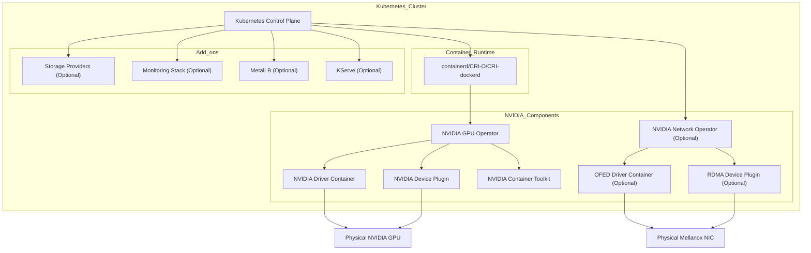

Sources: [README.md:60-72](), [playbooks/readme.md:832-861]()

## Configuration Details

### Container Runtime Options

The default container runtime is `containerd`. You can also choose `cri-o` or `cri-dockerd` by modifying the `container_runtime` parameter in your values file.

When using `containerd`, the installation sets up systemd cgroups and configures the runtime with NVIDIA container support.

Sources: [playbooks/prerequisites.yaml:254-577]()

### GPU Operator Configuration

The GPU Operator manages NVIDIA GPU resources in Kubernetes. Key configuration options include:

| Option | Description | Values |
|--------|-------------|--------|
| enable_mig | Enable Multi-Instance GPU | yes/no |
| mig_strategy | MIG deployment strategy | single/mixed |
| gpu_driver_version | NVIDIA driver version | Version number |
| enable_gds | Enable GPU Direct Storage | yes/no |
| enable_vgpu | Enable Virtual GPU support | yes/no |

Sources: [playbooks/readme.md:136-155]()

### Network Operator Configuration

For systems with NVIDIA Mellanox NICs, enable the Network Operator:

```yaml
# Network Operator Values
enable_network_operator: yes
# Enable RDMA yes for NVIDIA Certification
enable_rdma: yes
# Enable for MLNX-OFED Driver Deployment
deploy_ofed: yes
```

Sources: [playbooks/readme.md:164-170]()

## Validation

After installation completes, wait a few minutes for all components to initialize, then validate the installation:

```bash
bash setup.sh validate
```

The validation process checks:
- Kubernetes cluster status
- Node status and health
- Pod status across all namespaces
- GPU Operator component status
- NVIDIA driver and CUDA libraries functionality

If the validation reports any failures, refer to the troubleshooting section for guidance.

Sources: [playbooks/setup.sh:384-394](), [playbooks/readme.md:801-872]()

## Cluster Deployment Topologies

NVIDIA Cloud Native Stack supports two deployment topologies:

1. Single-node deployment: Control plane and worker functionality on one node
2. Multi-node deployment: One control plane node and any number of worker nodes

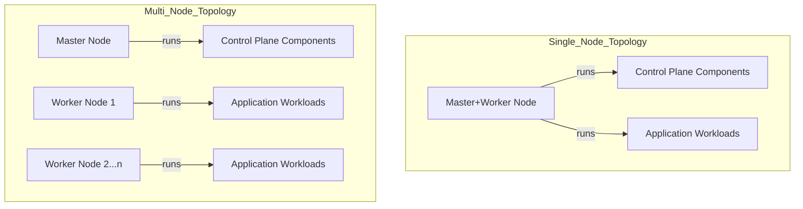

Note: Cloud Native Stack does not support deploying multiple control plane nodes.

Sources: [README.md:127-134]()

## Add-on Components

You can enable various add-on components during or after installation:

### Storage

Enable persistent storage options:
```yaml
# Local Path Provisioner and NFS Provisioner as Storage option
storage: yes
```

This deploys:
- Local Path Provisioner
- NFS Provisioner

Sources: [playbooks/readme.md:679-690]()

### Monitoring

Deploy monitoring tools for observability:
```yaml
# Monitoring Stack Prometheus/Grafana with GPU Metrics and Elastic Logging stack
monitoring: yes
```

This deploys:
- Prometheus for metrics collection
- Grafana for visualization (accessible at http://\<node-ip\>:32222, credentials: admin/cns-stack)
- Elastic Stack for logging (accessible at http://\<node-ip\>:32221, credentials: elastic/cns-stack)

Sources: [playbooks/readme.md:666-677]()

### Load Balancer

Deploy MetalLB for load balancing capabilities:
```yaml
# Install MetalLB
loadbalancer: yes
# Example input loadbalancer_ip: "10.117.20.50/32"
loadbalancer_ip: "<your-node-ip>/32"
```

Sources: [playbooks/readme.md:692-701]()

### KServe

Deploy KServe for machine learning model serving:
```yaml
# Enable Kserve on Cloud Native Stack with Istio and Cert-Manager
kserve: yes
```

Note: It's recommended to enable storage, monitoring, and loadbalancer when using KServe.

Sources: [playbooks/readme.md:357-485]()

## Troubleshooting

If you encounter issues during installation, check the following:

1. **Prerequisites verification:**
   - Check internet connectivity: `ping google.com`
   - Verify GPU is detected: `lspci | grep -i nvidia`
   - Ensure adequate disk space: `df -h /`

2. **Installation failures:**
   - Review Ansible logs in `cloud-native-stack/playbooks`
   - Check that secure boot is disabled: `mokutil --sb-state`
   - Verify nouveau blacklist: `lsmod | grep nouveau`

3. **GPU Operator issues:**
   - Check GPU operator pods: `kubectl get pods -n nvidia-gpu-operator`
   - View pod logs: `kubectl logs <pod-name> -n nvidia-gpu-operator`
   - Verify driver module: `lsmod | grep nvidia`

4. **DNS issues:**
   - Follow the [DNS Troubleshooting](#5.3) guide for resolving DNS-related problems

For more detailed troubleshooting information, refer to the [Troubleshooting](#5.2) page.

Sources: [README.md:135-138]()

## Next Steps

After successfully installing NVIDIA Cloud Native Stack on bare metal, you can:

1. Deploy GPU-accelerated workloads
2. Configure additional [Add-ons](#4.4) like storage, monitoring, or KServe
3. Explore the [NVIDIA GPU Operator](#4.1) capabilities
4. Set up [Multi-Node Deployments](#6.3) if needed

Sources: [README.md:142-151]()

---

# Page: Cloud Provider Installation

# Cloud Provider Installation

<details>
<summary>Relevant source files</summary>

The following files were used as context for generating this wiki page:

- [install-guides/readme.md](install-guides/readme.md)
- [playbooks/cns-validation.yaml](playbooks/cns-validation.yaml)
- [playbooks/cns_values.yaml](playbooks/cns_values.yaml)
- [playbooks/cns_values_13.0.yaml](playbooks/cns_values_13.0.yaml)
- [playbooks/cns_values_13.1.yaml](playbooks/cns_values_13.1.yaml)
- [playbooks/cns_values_13.2.yaml](playbooks/cns_values_13.2.yaml)
- [playbooks/cns_values_14.0.yaml](playbooks/cns_values_14.0.yaml)
- [playbooks/files/kube-prometheus-stack.values](playbooks/files/kube-prometheus-stack.values)
- [playbooks/files/network-operator-value.yaml](playbooks/files/network-operator-value.yaml)
- [playbooks/files/nic-cluster-policy.yaml](playbooks/files/nic-cluster-policy.yaml)
- [playbooks/gpu_operator.yaml](playbooks/gpu_operator.yaml)
- [playbooks/readme.md](playbooks/readme.md)
- [playbooks/setup.sh](playbooks/setup.sh)

</details>


This page provides detailed guidelines for deploying NVIDIA Cloud Native Stack (CNS) on major cloud service providers (CSPs): AWS EKS, Azure AKS, and Google GKE. For bare metal installation instructions, see [Bare Metal Installation](#2.3).

## Overview

NVIDIA Cloud Native Stack supports automated deployment on cloud platforms using Terraform modules to provision GPU-accelerated Kubernetes clusters. This automation simplifies the process of setting up and configuring GPU-enabled environments in the cloud.

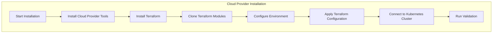

Sources: [playbooks/setup.sh:147-324]()

## Supported Cloud Providers

NVIDIA Cloud Native Stack officially supports the following cloud platforms:

| Cloud Provider | Service | Description |
|----------------|---------|-------------|
| Amazon Web Services | EKS (Elastic Kubernetes Service) | Managed Kubernetes service with GPU instance support |
| Microsoft Azure | AKS (Azure Kubernetes Service) | Managed Kubernetes service with GPU VM support |
| Google Cloud | GKE (Google Kubernetes Engine) | Managed Kubernetes service with GPU node support |

Sources: [playbooks/setup.sh:267-324](), [playbooks/readme.md:708-756]()

## Prerequisites

Before deploying CNS on cloud platforms, ensure you have:

1. A valid account on the target cloud platform with permissions to create resources
2. Sufficient quota for GPU instances
3. Local system with internet access to run the installation scripts

Sources: [playbooks/readme.md:15-26]()

## Common Installation Architecture

The following diagram illustrates the high-level architecture of the NVIDIA Cloud Native Stack deployment on cloud providers:

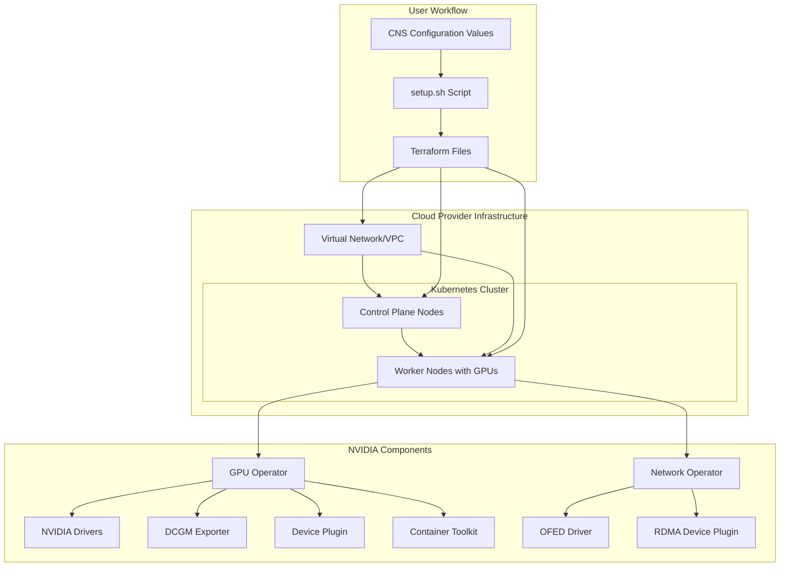

Sources: [playbooks/setup.sh:267-324](), [playbooks/cns_values.yaml:118-136]()

## Installation Process

The installation process uses the `setup.sh` script with cloud provider-specific commands to deploy CNS.

### Common Setup Steps

1. Clone the repository and navigate to the playbooks directory:
   ```bash
   git clone https://github.com/NVIDIA/cloud-native-stack.git
   cd cloud-native-stack/playbooks
   ```

2. Review and update the configuration in `cns_values.yaml` file for your chosen cloud provider.

Sources: [playbooks/setup.sh:265-324](), [playbooks/readme.md:708-756]()

## AWS EKS Installation

### Configuration Parameters

Edit the EKS-specific parameters in the CNS values file:

```yaml
# AWS EKS values
aws_region: us-east-2
aws_cluster_name: cns-cluster-1
aws_gpu_instance_type: g4dn.2xlarge
```

Key configuration parameters:
- `aws_region`: AWS region where the cluster will be deployed
- `aws_cluster_name`: Name for your EKS cluster
- `aws_gpu_instance_type`: GPU instance type to use (e.g., g4dn.2xlarge, p3.2xlarge)

### Installation Steps

1. Update AWS credentials in the `files/aws_credentials` file.

2. Run the installation command:
   ```bash
   bash setup.sh install eks
   ```

3. The script will:
   - Install AWS CLI tools
   - Install Terraform
   - Clone NVIDIA Terraform modules
   - Apply Terraform configuration to create the EKS cluster
   - Configure kubectl to connect to the cluster

Sources: [playbooks/setup.sh:306-324](), [playbooks/readme.md:708-723]()

## Azure AKS Installation

### Configuration Parameters

Edit the AKS-specific parameters in the CNS values file:

```yaml
# Azure AKS Values
aks_cluster_name: aks-cluster-1
aks_cluster_location: "West US 2"
azure_object_id: [""]
```

Key configuration parameters:
- `aks_cluster_name`: Name for your AKS cluster
- `aks_cluster_location`: Azure region where the cluster will be deployed
- `azure_object_id`: Azure Active Directory object IDs that need admin access

### Installation Steps

1. Run the installation command:
   ```bash
   bash setup.sh install aks
   ```

2. The script will:
   - Install Azure CLI tools
   - Install Terraform
   - Authenticate with Azure using device code login
   - Clone NVIDIA Terraform modules
   - Apply Terraform configuration to create the AKS cluster
   - Configure kubectl to connect to the cluster

Sources: [playbooks/setup.sh:267-283](), [playbooks/readme.md:725-739]()

## Google GKE Installation

### Configuration Parameters

Edit the GKE-specific parameters in the CNS values file:

```yaml
# Google Cloud GKE Values
gke_project_id: 
gke_region: us-west1
gke_node_zones: ["us-west1-b"]
gke_cluster_name: gke-cluster-1
```

Key configuration parameters:
- `gke_project_id`: Google Cloud project ID
- `gke_region`: GCP region where the cluster will be deployed
- `gke_node_zones`: Specific zones for deploying nodes
- `gke_cluster_name`: Name for your GKE cluster

### Installation Steps

1. Run the installation command:
   ```bash
   bash setup.sh install gke
   ```

2. The script will:
   - Install Google Cloud SDK tools
   - Install Terraform
   - Authenticate with Google Cloud
   - Clone NVIDIA Terraform modules
   - Apply Terraform configuration to create the GKE cluster
   - Configure kubectl to connect to the cluster

3. After GKE cluster creation, run the following command to properly configure the kubectl command:
   ```bash
   source $HOME/cloud-native-stack/playbooks/google-cloud-sdk/path.bash.inc
   ```

Sources: [playbooks/setup.sh:284-306](), [playbooks/readme.md:741-765]()

## Installation Workflow Diagram

The following diagram illustrates the detailed installation workflow for cloud providers:

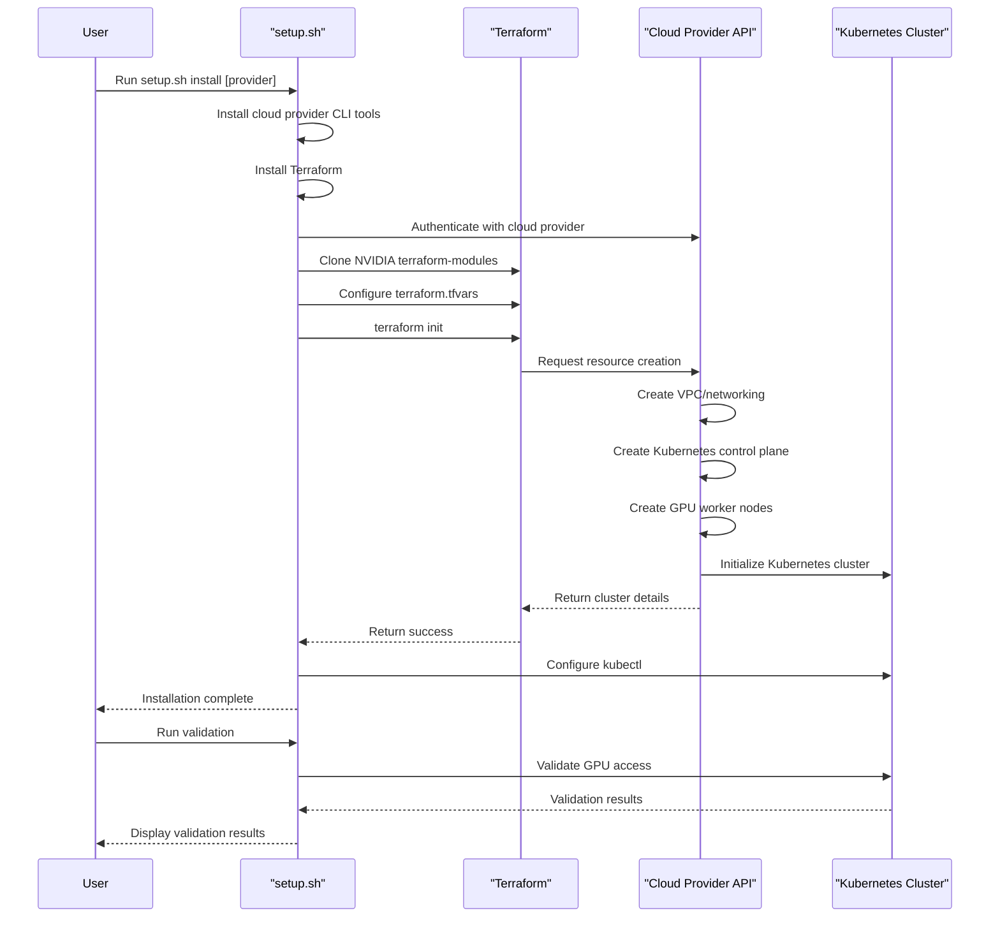

Sources: [playbooks/setup.sh:267-324](), [playbooks/cns-validation.yaml:1-445]()

## Terraform Module Structure

The installation process uses NVIDIA's Terraform modules to provision the required cloud resources.

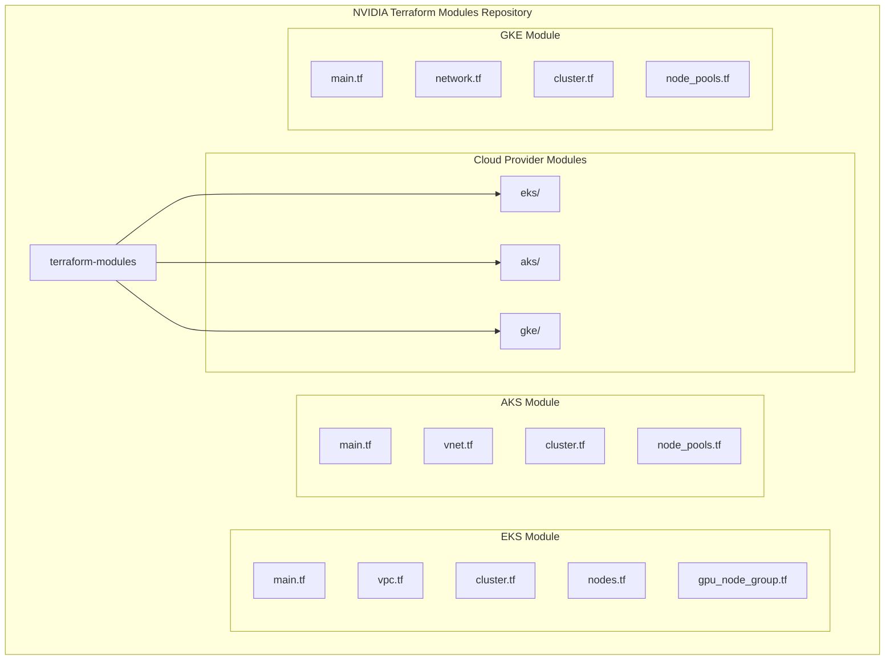

Sources: [playbooks/setup.sh:274-323]()

## Validation

After installing CNS on a cloud provider, you can validate the installation:

```bash
bash setup.sh validate
```

This runs the validation playbook which checks:
- Kubernetes cluster accessibility
- Running status of all pods
- GPU operator functionality
- NVIDIA driver installation
- Container runtime configuration

Sources: [playbooks/setup.sh:384-394](), [playbooks/cns-validation.yaml:1-445](), [playbooks/readme.md:802-809]()

## Uninstallation

To remove the CNS installation and clean up cloud resources:

```bash
bash setup.sh uninstall [provider]
```

Where `[provider]` is one of: `eks`, `aks`, or `gke`.

The uninstallation process:
1. Navigates to the appropriate Terraform module directory
2. Runs `terraform destroy` to remove all cloud resources
3. Cleans up local files created during installation

Sources: [playbooks/setup.sh:356-383](), [playbooks/readme.md:821-826]()

## Additional Resources

1. For additional information about Cloud Native Stack installation options, refer to the [Installation Process](#2.2) page.
2. For information about GPU Operator configuration, see the [NVIDIA GPU Operator](#4.1) page.
3. For bare metal installations, see the [Bare Metal Installation](#2.3) page.

Sources: [playbooks/readme.md:708-776](), [install-guides/readme.md:1-27]()

---

# Page: Configuration

# Configuration

<details>
<summary>Relevant source files</summary>

The following files were used as context for generating this wiki page:

- [playbooks/cns-validation.yaml](playbooks/cns-validation.yaml)
- [playbooks/cns_values.yaml](playbooks/cns_values.yaml)
- [playbooks/cns_values_13.0.yaml](playbooks/cns_values_13.0.yaml)
- [playbooks/cns_values_13.1.yaml](playbooks/cns_values_13.1.yaml)
- [playbooks/cns_values_13.2.yaml](playbooks/cns_values_13.2.yaml)
- [playbooks/cns_values_14.0.yaml](playbooks/cns_values_14.0.yaml)
- [playbooks/files/kube-prometheus-stack.values](playbooks/files/kube-prometheus-stack.values)
- [playbooks/files/network-operator-value.yaml](playbooks/files/network-operator-value.yaml)
- [playbooks/files/nic-cluster-policy.yaml](playbooks/files/nic-cluster-policy.yaml)
- [playbooks/gpu_operator.yaml](playbooks/gpu_operator.yaml)

</details>


The Configuration system is a core component of the NVIDIA Cloud Native Stack (CNS) that determines how the CNS environment is set up and deployed. This page provides a comprehensive overview of the configuration files, their parameters, and the relationships between different configuration components in the CNS.

For information about the installation process that utilizes these configuration files, see [Installation](#2).

## Overview of the Configuration System

The CNS configuration system consists of hierarchical YAML files that define component versions, feature flags, and deployment options. These configuration files determine which components are installed, their versions, and how they interact with each other within the Kubernetes environment.

```mermaid
graph TD
    subgraph "Configuration System"
        cnsvalues["cns_values.yaml"]
        versionfiles["Version-specific files<br>(cns_values_X.Y.yaml)"]
        gpuoperator["gpu_operator.yaml"]
        validation["cns-validation.yaml"]
        
        cnsvalues -->|"defines CNS version"| versionfiles
        cnsvalues -->|"imports"| gpuoperator
        cnsvalues -->|"validated by"| validation
        versionfiles -->|"define component versions"| components
    end
    
    subgraph "Components"
        k8s["Kubernetes"]
        container["Container Runtime"]
        gpu["GPU Operator"]
        network["Network Operator"]
        addon["Add-ons"]
    end
```

Sources: [playbooks/cns_values.yaml](). [playbooks/cns-validation.yaml](), [playbooks/gpu_operator.yaml]()

## Configuration File Structure

The configuration system relies on several key files, with a hierarchical relationship that determines which settings are applied.

### Main Configuration File

The primary configuration file is `cns_values.yaml`, which defines the CNS version and all configuration parameters. This file is used by the installation playbooks to determine which components to deploy and with what settings.

```mermaid
graph LR
    setup["setup.sh"] -->|"reads"| cnsvalues["cns_values.yaml"]
    cnsvalues -->|"imports based on<br>cns_version"| versionfile["cns_values_X.Y.yaml"]
    cnsvalues -->|"imports"| gpuoperator["gpu_operator.yaml"]
    
    subgraph "Configuration Parameters"
        versions["Component Versions"]
        features["Feature Flags"]
        deployment["Deployment Options"]
        operators["Operator Settings"]
    end
    
    versionfile --> versions
    versionfile --> features
    versionfile --> deployment
    versionfile --> operators
    
    gpuoperator -->|"defines versions for"| gpucomponents["GPU Operator Components"]
```

Sources: [playbooks/cns_values.yaml](), [playbooks/cns_values_13.0.yaml](), [playbooks/cns_values_13.1.yaml](), [playbooks/cns_values_13.2.yaml](), [playbooks/cns_values_14.0.yaml]()

### Version-Specific Configuration Files

CNS maintains version-specific configuration files (e.g., `cns_values_13.0.yaml`, `cns_values_14.0.yaml`) that contain predefined component versions and settings for each CNS release. These files ensure compatibility between components in a given CNS version.

For example, CNS version 14.1 (defined in `cns_values.yaml`) would use settings from `cns_values_14.1.yaml`.

### GPU Operator Configuration

The `gpu_operator.yaml` file contains detailed version specifications for each GPU Operator release. It defines the compatible versions of components such as the NVIDIA driver, container toolkit, device plugin, and monitoring tools for each GPU Operator version.

```yaml
# Example from gpu_operator.yaml
release_25_3_0:
  gpu_operator_version: v25.3.0
  gpu_driver_version: 570.124.06
  driver_manager_version: 0.8.0
  container_toolkit: v1.17.5
  device_plugin: v0.17.1
  dcgm_exporter_version: 4.1.1-4.0.4
  # ... more component versions
```

Sources: [playbooks/gpu_operator.yaml:1-25]()

## Key Configuration Parameters

The configuration files contain numerous parameters that control various aspects of the CNS deployment. Here are the most important categories:

### CNS Version and Deployment Type

```yaml
cns_version: 14.1
microk8s: no
install_k8s: yes
```

These parameters define the CNS version and whether to deploy a MicroK8s cluster or use Kubeadm for Kubernetes installation.

### Container Runtime Configuration

```yaml
container_runtime: "containerd"
containerd_version: "2.0.3"
runc_version: "1.2.6"
cni_plugins_version: "1.6.2"
containerd_max_concurrent_downloads: "5"
nvidia_container_toolkit_version: "1.17.5"
```

These settings control which container runtime is used (containerd, cri-o, or cri-dockerd) and their versions.

### Kubernetes and Networking Components

```yaml
k8s_version: "1.31.6"
calico_version: "3.29.3"
flannel_version: "0.25.6"
helm_version: "3.17.2"
```

These parameters define the versions of Kubernetes and related networking components.

### GPU Operator Configuration

```yaml
enable_gpu_operator: yes
confidential_computing: no
gpu_driver_version: "570.124.06"
use_open_kernel_module: no
enable_mig: no
mig_profile: all-disabled
mig_strategy: single
enable_gds: no
enable_secure_boot: no
enable_vgpu: no
```

These parameters control the GPU Operator deployment and enable specific GPU-related features like Multi-Instance GPU (MIG), GPU Direct Storage (GDS), and vGPU support.

### Network Operator Configuration

```yaml
enable_network_operator: no
enable_rdma: no
deploy_ofed: no
```

These settings control the Network Operator deployment and related features like RDMA (Remote Direct Memory Access) and OFED (OpenFabrics Enterprise Distribution) driver deployment.

### Add-on Components

```yaml
storage: no
monitoring: no
kserve: no
loadbalancer: no
enable_nim_operator: yes
```

These parameters enable optional add-on components like storage provisioners, monitoring stack (Prometheus/Grafana), KServe, and MetalLB load balancer.

Sources: [playbooks/cns_values.yaml:1-110](), [playbooks/cns_values_14.0.yaml:1-110]()

## Configuration Parameters Table

Below is a table of the most important configuration parameters and their descriptions:

| Parameter | Description | Default Value |
|-----------|-------------|---------------|
| `cns_version` | CNS version to deploy | 14.1 |
| `container_runtime` | Container runtime to use (containerd, cri-o, cri-dockerd) | "containerd" |
| `k8s_version` | Kubernetes version | "1.31.6" |
| `enable_gpu_operator` | Whether to deploy the GPU Operator | yes |
| `gpu_driver_version` | NVIDIA GPU driver version | "570.124.06" |
| `enable_mig` | Enable Multi-Instance GPU support | no |
| `enable_gds` | Enable GPU Direct Storage | no |
| `enable_network_operator` | Deploy the Network Operator | no |
| `enable_rdma` | Enable RDMA support | no |
| `storage` | Deploy storage provisioners | no |
| `monitoring` | Deploy Prometheus/Grafana monitoring stack | no |
| `kserve` | Deploy KServe for ML model serving | no |
| `loadbalancer` | Deploy MetalLB load balancer | no |
| `cns_validation` | Run validation after deployment | no |

Sources: [playbooks/cns_values.yaml:1-110]()

## Configuration Workflow

The configuration workflow in CNS follows a defined process that determines which settings are applied during deployment.

```mermaid
flowchart TD
    setup["setup.sh"] -->|"1. Reads"| cnsvalues["cns_values.yaml"]
    cnsvalues -->|"2. Determines CNS version"| version["cns_version: 14.1"]
    version -->|"3. Selects version file"| versionfile["cns_values_14.1.yaml"]
    
    versionfile -->|"4. Defines versions for"| components["Component Versions"]
    versionfile -->|"5. Controls"| features["Feature Flags"]
    
    components -->|"6. Applied during installation"| deployment["Deployment Process"]
    features -->|"6. Applied during installation"| deployment
    
    deployment -->|"7. Validation"| validation["cns-validation.yaml"]
    
    subgraph "Component Configuration"
        gpuop["GPU Operator"]
        netop["Network Operator"]
        addons["Add-ons"]
    end
    
    components --> gpuop
    components --> netop
    components --> addons
```

Sources: [playbooks/cns_values.yaml](), [playbooks/cns-validation.yaml:1-20]()

## GPU Operator Component Configuration

The GPU Operator is a critical component of CNS, and its configuration is defined in detail in the `gpu_operator.yaml` file. Each release of the GPU Operator has specific component versions that are known to work together.

```mermaid
graph TD
    subgraph "GPU Operator Release"
        gpuoperator["gpu_operator_version"]
        driver["NVIDIA Driver<br>gpu_driver_version"]
        toolkit["Container Toolkit<br>container_toolkit"]
        deviceplugin["Device Plugin<br>device_plugin"]
        dcgm["DCGM Exporter<br>dcgm_exporter_version"]
        nfd["Node Feature Discovery<br>nfd_version"]
        gfd["GPU Feature Discovery<br>gfd_version"]
        mig["MIG Manager<br>mig_manager_version"]
        validator["Validator<br>validator_version"]
    end
    
    gpuoperator --> driver
    gpuoperator --> toolkit
    gpuoperator --> deviceplugin
    gpuoperator --> dcgm
    gpuoperator --> nfd
    gpuoperator --> gfd
    gpuoperator --> mig
    gpuoperator --> validator
```

Sources: [playbooks/gpu_operator.yaml:1-26]()

## Validation System

CNS includes a validation system that verifies the configuration and deployed components match the expected versions and are functioning correctly. The `cns-validation.yaml` playbook performs these checks.

```mermaid
flowchart TD
    validation["cns-validation.yaml"] -->|"1. Checks"| k8s["Kubernetes Version"]
    validation -->|"2. Validates"| runtime["Container Runtime"]
    validation -->|"3. Verifies"| gpu["GPU Operator Components"]
    validation -->|"4. Tests"| cuda["CUDA Functionality"]
    
    subgraph "GPU Operator Validation"
        driver["Driver Version"]
        toolkit["Container Toolkit"]
        plugin["Device Plugin"] 
        monitoring["DCGM Exporter"]
        mig["MIG Manager"]
    end
    
    gpu --> driver
    gpu --> toolkit
    gpu --> plugin
    gpu --> monitoring
    gpu --> mig
    
    validation -->|"5. Generates report"| report["Validation Report"]
```

The validation system compares the installed component versions with the target versions defined in the configuration files and runs functional tests to ensure GPU capabilities are working correctly.

Sources: [playbooks/cns-validation.yaml:1-40](), [playbooks/cns-validation.yaml:242-334]()

## Network Operator Configuration

When the Network Operator is enabled, it can be configured through the `nic-cluster-policy.yaml` file, which defines settings for OFED drivers, RDMA device plugins, and secondary networks.

```yaml
# Example NIC Cluster Policy configuration
apiVersion: mellanox.com/v1alpha1
kind: NicClusterPolicy
metadata:
  name: nic-cluster-policy
spec:
  ofedDriver:
    image: doca-driver
    repository: nvcr.io/nvidia/mellanox
    version: 25.01-0.6.0.0-0
  rdmaSharedDevicePlugin:
    image: k8s-rdma-shared-dev-plugin
    repository: ghcr.io/mellanox
    version: v1.5.2
```

The Network Operator configuration can be enabled by setting `enable_network_operator: yes` in the main configuration file.

Sources: [playbooks/files/nic-cluster-policy.yaml:1-37](), [playbooks/files/network-operator-value.yaml]()

## Monitoring Configuration

When monitoring is enabled (`monitoring: yes`), CNS deploys the Prometheus and Grafana stack with configurations defined in `kube-prometheus-stack.values`. This includes GPU metrics collection through the DCGM exporter.

```yaml
# Example Prometheus configuration for GPU metrics
grafana:
  enabled: false
prometheus:
  service:
    type: NodePort
  prometheusSpec:
    serviceMonitorSelectorNilUsesHelmValues: false
  additionalScrapeConfigs:
  - job_name: gpu-metrics
    scrape_interval: 1s
    metrics_path: /metrics
    scheme: http
    kubernetes_sd_configs:
    - role: endpoints
      namespaces:
        names:
        - nvidia-gpu-operator
        - default
```

Sources: [playbooks/files/kube-prometheus-stack.values]()

## Best Practices for Configuration

When configuring the NVIDIA Cloud Native Stack, consider these best practices:

1. **Use version-specific configuration files** - The predefined version files provide tested, compatible component versions.

2. **Enable validation** - Set `cns_validation: yes` to automatically verify your configuration after deployment.

3. **Maintain version compatibility** - If customizing component versions, ensure compatibility between the GPU driver, container toolkit, device plugin, and other components.

4. **Configuration sequence** - Modify the main `cns_values.yaml` file rather than version-specific files to maintain upgrade paths.

5. **Operator configurations** - When enabling operators (GPU, Network), ensure the dependent features are also properly configured.

## Conclusion

The configuration system is the foundation of NVIDIA Cloud Native Stack deployments, determining which components are installed and how they interact. By understanding the configuration structure and parameters, you can customize CNS to suit your specific requirements while maintaining component compatibility.

For detailed information about specific components that can be configured, see [Components](#4). For information about validating your configuration, see [Validation and Troubleshooting](#5).

---

# Page: Configuration Files

# Configuration Files

<details>
<summary>Relevant source files</summary>

The following files were used as context for generating this wiki page:

- [playbooks/cns-validation.yaml](playbooks/cns-validation.yaml)
- [playbooks/cns_values.yaml](playbooks/cns_values.yaml)
- [playbooks/cns_values_13.0.yaml](playbooks/cns_values_13.0.yaml)
- [playbooks/cns_values_13.1.yaml](playbooks/cns_values_13.1.yaml)
- [playbooks/cns_values_13.2.yaml](playbooks/cns_values_13.2.yaml)
- [playbooks/cns_values_14.0.yaml](playbooks/cns_values_14.0.yaml)
- [playbooks/cns_version.yaml](playbooks/cns_version.yaml)
- [playbooks/files/kube-prometheus-stack.values](playbooks/files/kube-prometheus-stack.values)
- [playbooks/files/network-operator-value.yaml](playbooks/files/network-operator-value.yaml)
- [playbooks/files/nic-cluster-policy.yaml](playbooks/files/nic-cluster-policy.yaml)
- [playbooks/gpu_operator.yaml](playbooks/gpu_operator.yaml)
- [playbooks/hosts](playbooks/hosts)

</details>


This page provides a detailed explanation of the configuration files used in the NVIDIA Cloud Native Stack (CNS) and their parameters. These files are crucial for customizing your CNS deployment according to your specific requirements and environment. For information about version compatibility between different components, see [Version Compatibility](#3.2).

## Configuration File Structure

The NVIDIA Cloud Native Stack uses a hierarchical configuration system to manage deployments across different versions and deployment scenarios. Below is the structure of the configuration system and how different files interact with each other.

```mermaid
graph TD
    subgraph "Configuration System"
        direction TB
        cns_version["cns_version.yaml"]
        cns_values["cns_values.yaml"]
        cns_values_versioned["cns_values_XX.Y.yaml"]
        hosts["hosts file"]
        gpu_operator["gpu_operator.yaml"]
        
        cns_version -->|"Determines CNS version"| cns_values_versioned
        cns_values_versioned -->|"Version-specific defaults"| cns_values
        cns_values -->|"Main configuration"| deployment["Deployment Process"]
        hosts -->|"Defines nodes"| deployment
        gpu_operator -->|"Component versions"| deployment
    end
```

**Configuration File Hierarchy**

Sources: [playbooks/cns_values.yaml](), [playbooks/cns_version.yaml](), [playbooks/cns_values_13.0.yaml](), [playbooks/hosts](), [playbooks/gpu_operator.yaml]()

## Main Configuration Files

### cns_values.yaml

This is the primary configuration file that controls the entire CNS deployment. It contains values for:
- CNS version
- Kubernetes configuration
- Container runtime selection
- Component versions
- Feature enablement flags
- GPU Operator settings
- Network Operator settings
- Add-on configurations

#### Example Structure of cns_values.yaml

```mermaid
graph TD
    subgraph "cns_values.yaml"
        version["CNS Version"]
        k8s["Kubernetes Settings"]
        runtime["Container Runtime"]
        versions["Component Versions"]
        gpu["GPU Operator Settings"]
        network["Network Operator Settings"]
        addons["Add-ons Configuration"]
        misc["Miscellaneous Settings"]
    end
    
    version -->|"Specifies"| k8scompat["Kubernetes compatibility"]
    versions -->|"Defines"| components["Component compatibility"]
    runtime -->|"Options"| runtimeOptions["containerd/cri-o/cri-dockerd"]
    gpu -->|"Controls"| gpuFeatures["GPU features"]
    network -->|"Enables"| networkFeatures["Network capabilities"]
    addons -->|"Optional"| addonsList["Storage/Monitoring/Kserve"]
```

**cns_values.yaml Structure**

Sources: [playbooks/cns_values.yaml]()

### Version-Specific Configuration Files

These files (e.g., `cns_values_13.0.yaml`, `cns_values_13.1.yaml`, `cns_values_14.0.yaml`) contain predefined configurations specific to each CNS version. They define the recommended component versions and default settings for each CNS release.

Sources: [playbooks/cns_values_13.0.yaml](), [playbooks/cns_values_13.1.yaml](), [playbooks/cns_values_13.2.yaml](), [playbooks/cns_values_14.0.yaml]()

### cns_version.yaml

A simple file containing only the CNS version. This is used to determine which version-specific configuration file to load.

```
cns_version: 14.1
```

Sources: [playbooks/cns_version.yaml]()

### hosts

Ansible inventory file that defines the master and worker nodes for the CNS deployment.

```
[master]
#localhost ansible_ssh_user=nvidia ansible_ssh_pass=nvidiapass ansible_sudo_pass=nvidiapass ansible_ssh_common_args='-o StrictHostKeyChecking=no'
[nodes]
```

Sources: [playbooks/hosts]()

### gpu_operator.yaml

This file contains detailed version information for all components included in each GPU Operator release. It's organized in a hierarchical structure with each GPU Operator version having its own section listing all component versions.

```mermaid
graph TD
    subgraph "gpu_operator.yaml"
        release_25_3_0["release_25_3_0"]
        release_24_9_2["release_24_9_2"]
        release_24_6_2["release_24_6_2"]
        other_releases["... Other releases"]
        
        release_25_3_0 -->|"Contains"| versions_25_3_0["Driver, Toolkit, Device Plugin versions"]
        release_24_9_2 -->|"Contains"| versions_24_9_2["Driver, Toolkit, Device Plugin versions"]
        release_24_6_2 -->|"Contains"| versions_24_6_2["Driver, Toolkit, Device Plugin versions"]
    end
```

**GPU Operator Version Structure**

Sources: [playbooks/gpu_operator.yaml]()

## Key Configuration Parameters

The following table outlines the key configuration parameters found in the `cns_values.yaml` file, grouped by category:

| Category | Parameter | Description | Default Value |
|----------|-----------|-------------|--------------|
| **Basic Configuration** | cns_version | NVIDIA Cloud Native Stack version | 14.1 |
| | microk8s | Enable MicroK8s cluster deployment | no |
| | install_k8s | Install Kubernetes with Kubeadm | yes |
| **Container Runtime** | container_runtime | Container runtime selection | "containerd" |
| | containerd_version | Containerd version | "2.0.3" |
| | nvidia_container_toolkit_version | NVIDIA Container Toolkit version | "1.17.5" |
| **Kubernetes** | k8s_version | Kubernetes version | "1.31.6" |
| | calico_version | Calico network plugin version | "3.29.3" |
| | flannel_version | Flannel network plugin version | "0.25.6" |
| **NVIDIA Components** | enable_gpu_operator | Enable GPU Operator | yes |
| | gpu_operator_version | GPU Operator version | "25.3.0" |
| | gpu_driver_version | NVIDIA GPU driver version | "570.124.06" |
| | enable_network_operator | Enable Network Operator | no |
| | enable_nim_operator | Enable NIM Operator | yes |
| **GPU Features** | enable_mig | Enable Multi-Instance GPU | no |
| | use_open_kernel_module | Use open kernel module for driver | no |
| | enable_gds | Enable GPUDirect Storage | no |
| | enable_secure_boot | Enable Secure Boot (Ubuntu only) | no |
| **Add-ons** | storage | Enable storage options | no |
| | monitoring | Enable monitoring stack | no |
| | kserve | Enable KServe | no |
| | loadbalancer | Install MetalLB | no |

Sources: [playbooks/cns_values.yaml](), [playbooks/cns_values_13.0.yaml](), [playbooks/cns_values_13.1.yaml](), [playbooks/cns_values_13.2.yaml](), [playbooks/cns_values_14.0.yaml]()

## GPU Operator Configuration

The GPU Operator has several important configuration parameters that control its behavior and features:

```mermaid
graph TD
    subgraph "GPU Operator Configuration"
        enable_gpu_operator["enable_gpu_operator"]
        gpu_driver_version["gpu_driver_version"]
        use_open_kernel_module["use_open_kernel_module"]
        enable_mig["enable_mig"]
        mig_profile["mig_profile"]
        mig_strategy["mig_strategy"]
        enable_gds["enable_gds"]
        enable_secure_boot["enable_secure_boot"]
        enable_vgpu["enable_vgpu"]
        vgpu_license_server["vgpu_license_server"]
        gpu_operator_helm_chart["gpu_operator_helm_chart"]
        confidential_computing["confidential_computing"]
    end
```

**GPU Operator Configuration Options**

Sources: [playbooks/cns_values.yaml:35-54]()

## Network Operator Configuration

The Network Operator configuration controls advanced networking features in the CNS deployment:

```mermaid
graph TD
    subgraph "Network Operator Configuration"
        enable_network_operator["enable_network_operator"]
        enable_rdma["enable_rdma"]
        deploy_ofed["deploy_ofed"]
    end
    
    enable_network_operator -->|"Enables"| nic_cluster_policy["NicClusterPolicy"]
    enable_rdma -->|"Required for"| nvidia_certification["NVIDIA Certification"]
    deploy_ofed -->|"Deploys"| mellanox_drivers["Mellanox OFED Drivers"]
    
    subgraph "NicClusterPolicy Components"
        rdma_shared_device["RDMA Shared Device Plugin"]
        secondary_network["Secondary Network"]
        ofed_driver["OFED Driver"]
    end
    
    nic_cluster_policy --- rdma_shared_device
    nic_cluster_policy --- secondary_network
    nic_cluster_policy --- ofed_driver
```

**Network Operator Configuration Structure**

Sources: [playbooks/cns_values.yaml:64-70](), [playbooks/files/nic-cluster-policy.yaml]()

## Add-on Configurations

CNS supports several optional add-ons that can be enabled based on your requirements:

1. **Storage Options**
   - Local Path Provisioner
   - NFS Provisioner

2. **Monitoring**
   - Prometheus Stack
   - Grafana for visualization
   - DCGM Exporter for GPU metrics

3. **KServe** for machine learning model serving

4. **MetalLB** for load balancing in bare metal environments

These add-ons can be enabled by setting the corresponding parameters in the `cns_values.yaml` file.

Sources: [playbooks/cns_values.yaml:92-108](), [playbooks/files/kube-prometheus-stack.values]()

## Configuration File Validation

The CNS repository includes a validation playbook (`cns-validation.yaml`) that checks the installed components against the expected versions defined in the configuration files. This helps ensure that the deployed environment matches the intended configuration.

The validation system checks:
- Operating system version
- Container runtime version
- Kubernetes version
- GPU Operator and its component versions
- Network Operator and its component versions (if enabled)
- Add-on versions

Sources: [playbooks/cns-validation.yaml]()

## Customizing Configuration Files

When deploying CNS, you can customize the configuration in multiple ways:

1. Edit the `cns_values.yaml` file directly to change parameters
2. Update `cns_version.yaml` to switch to a different version's defaults
3. Modify the `hosts` file to define your cluster nodes
4. Create custom component configurations, such as network operator values

When customizing, be aware of version compatibility as defined in the GPU Operator and component version tables.

## Best Practices

1. **Version Consistency**: Ensure all component versions are compatible with each other and with your hardware
2. **Feature Planning**: Enable only the features you need to minimize complexity
3. **Validation**: Always run the validation after deployment to verify your configuration
4. **Documentation**: Document any custom changes to the configuration files
5. **Backup**: Keep backups of your configuration files before making changes

## Summary

The NVIDIA Cloud Native Stack uses a flexible configuration system based on YAML files to control deployment options. The main file is `cns_values.yaml`, which contains all the parameters needed for deployment. Version-specific defaults are provided in the `cns_values_XX.Y.yaml` files, and the `gpu_operator.yaml` file contains detailed component version information.

By understanding and properly configuring these files, you can tailor your CNS deployment to meet your specific requirements while ensuring compatibility between all components.

---

# Page: Version Compatibility

# Version Compatibility

<details>
<summary>Relevant source files</summary>

The following files were used as context for generating this wiki page:

- [README.md](README.md)
- [playbooks/cns-installation.yaml](playbooks/cns-installation.yaml)
- [playbooks/cns-validation.yaml](playbooks/cns-validation.yaml)
- [playbooks/cns_values.yaml](playbooks/cns_values.yaml)
- [playbooks/cns_values_13.0.yaml](playbooks/cns_values_13.0.yaml)
- [playbooks/cns_values_13.1.yaml](playbooks/cns_values_13.1.yaml)
- [playbooks/cns_values_13.2.yaml](playbooks/cns_values_13.2.yaml)
- [playbooks/cns_values_14.0.yaml](playbooks/cns_values_14.0.yaml)
- [playbooks/files/kube-prometheus-stack.values](playbooks/files/kube-prometheus-stack.values)
- [playbooks/files/network-operator-value.yaml](playbooks/files/network-operator-value.yaml)
- [playbooks/files/nic-cluster-policy.yaml](playbooks/files/nic-cluster-policy.yaml)
- [playbooks/gpu_operator.yaml](playbooks/gpu_operator.yaml)
- [playbooks/prerequisites.yaml](playbooks/prerequisites.yaml)

</details>


This page provides detailed information about component version compatibility within different NVIDIA Cloud Native Stack (CNS) releases. Understanding the compatibility between various components is essential for successful deployment and operation of CNS environments.

For information about configuration files and parameters, see [Configuration Files](#3.1).

## CNS Versioning Structure

NVIDIA Cloud Native Stack uses a dual-level versioning scheme consisting of "batches" and "versions":

- **Batch**: The major release cycle (e.g., 24.11.2, 25.4.0) typically aligned with calendar quarters
- **Version**: The minor release number within a batch (e.g., 13.3, 14.1, 15.0)

```mermaid
graph TD
    subgraph "CNS Versioning Structure"
        Batch["Batch (e.g., 25.4.0)"] --> Release["Release Schedule"]
        Version["Version (e.g., 15.0)"] --> Components["Component Selection"]
        
        Release --> GA["Generally Available"]
        Release --> Maintenance["Maintenance"]
        Release --> EOL["End of Life"]
        
        Components --> CoreComponents["Core Components"]
        Components --> Operators["Operators"]
        Components --> AddOns["Add-ons"]
    end
    
    classDef node rect
    class Batch,Version,Release,Components,GA,Maintenance,EOL,CoreComponents,Operators,AddOns node
```

Sources: [README.md:20-35](https://github.com/NVIDIA/cloud-native-stack)

### Lifecycle Management

Each CNS batch goes through the following lifecycle:

1. **Generally Available (GA)**: The latest batch release (currently 25.4.0)
2. **Maintenance**: The previous batch (currently 24.11.2), receiving only patch updates
3. **End of Life (EOL)**: All prior batches (24.5.0 and lower), receiving no updates

Upgrades are only supported from one batch to the next consecutive batch.

Sources: [README.md:20-35](https://github.com/NVIDIA/cloud-native-stack)

## Component Matrix

Each CNS version includes a specific set of tested and compatible component versions. The following table outlines the component versions for current CNS versions:

| Component | CNS 15.0 | CNS 14.1 | CNS 13.3 |
|-----------|----------|----------|----------|
| Supported OS | Ubuntu 24.04 LTS | Ubuntu 22.04 LTS | Ubuntu 22.04 LTS |
| Containerd | 2.0.3 | 2.0.3 | 1.7.27 |
| NVIDIA Container Toolkit | 1.17.5 | 1.17.5 | 1.17.5 |
| CRI-O | 1.32.1 | 1.31.5 | 1.30.10 |
| Kubernetes | 1.32.2 | 1.31.6 | 1.30.10 |
| CNI (Calico) | 3.29.2 | 3.29.2 | 3.29.2 |
| NVIDIA GPU Operator | 25.3.0 | 25.3.0 | 25.3.0 |
| NVIDIA Network Operator | 25.1.0 | 25.1.0 | 25.1.0 |
| NVIDIA Data Center Driver | 570.124.06 | 570.124.06 | 570.124.06 |
| Helm | 3.17.2 | 3.17.2 | 3.17.2 |

Sources: [README.md:38-54](https://github.com/NVIDIA/cloud-native-stack), [playbooks/cns_values.yaml:1-33](https://github.com/NVIDIA/cloud-native-stack)

### Add-on Component Versions

In addition to the core components, CNS supports several add-on components with specific compatible versions:

| Add-on Component | CNS 15.0 | CNS 14.1 | CNS 13.3 |
|------------------|----------|----------|----------|
| MicroK8s | 1.32 | 1.31 | 1.30 |
| KServe | 0.15 with Istio 1.23.2, Knative 1.15.7, CertManager 1.16.1 | 0.15 with Istio 1.23.2, Knative 1.15.7, CertManager 1.16.1 | 0.15 with Istio 1.23.2, Knative 1.15.7, CertManager 1.16.1 |
| LeaderWorkerSet | 0.5.1 | 0.5.1 | 0.5.1 |
| LoadBalancer (MetalLB) | 0.14.9 | 0.14.9 | 0.14.9 |
| Storage | NFS: 4.0.18, Local Path: 0.0.31 | NFS: 4.0.18, Local Path: 0.0.31 | NFS: 4.0.18, Local Path: 0.0.31 |
| Monitoring | Prometheus: 70.3.0, Prometheus Adapter: 4.13.0, Elastic: 8.17.4 | Prometheus: 70.3.0, Prometheus Adapter: 4.13.0, Elastic: 8.17.4 | Prometheus: 70.3.0, Prometheus Adapter: 4.13.0, Elastic: 8.17.4 |

Sources: [README.md:74-81](https://github.com/NVIDIA/cloud-native-stack)

## GPU Operator Component Versions

The NVIDIA GPU Operator consists of several subcomponents, each with its own versioning. The following table shows the component versions for GPU Operator 25.3.0, which is used in the latest CNS releases:

| GPU Operator Component | Version |
|------------------------|---------|
| GPU Driver | 570.124.06 |
| Driver Manager | 0.8.0 |
| Container Toolkit | v1.17.5 |
| Device Plugin | v0.17.1 |
| DCGM Exporter | 4.1.1-4.0.4 |
| Node Feature Discovery | v0.17.2 |
| GPU Feature Discovery | v0.17.1 |
| MIG Manager | v0.12.1 |
| DCGM | 4.1.1-2 |
| Validator | v25.3.0 |
| GDS Driver | 2.20.5 |

Sources: [playbooks/gpu_operator.yaml:1-14](https://github.com/NVIDIA/cloud-native-stack)

## Version Configuration Flow

CNS uses a configuration system to determine which component versions to use. The following diagram illustrates how version selection works:

```mermaid
flowchart TD
    A["setup.sh"] --> B["cns_values.yaml"]
    B --> C["cns_version Variable"]
    C --> D{"Select Version Configuration"}
    D --> |"version=13.3"| E["cns_values_13.3.yaml"]
    D --> |"version=14.1"| F["cns_values_14.1.yaml"]
    D --> |"version=15.0"| G["cns_values_15.0.yaml"]
    
    E --> H["GPU Operator Configuration"]
    F --> H
    G --> H
    
    H --> I["Container Runtime Selection"]
    I --> |"containerd"| J["containerd_version"]
    I --> |"cri-o"| K["crio_version"]
    I --> |"cri-dockerd"| L["cri_dockerd_version"]
    
    H --> M["Kubernetes Version Selection"]
    M --> N["k8s_version"]
    
    H --> O["GPU Operator Version Selection"]
    O --> P["gpu_operator_version"]
    P --> Q["gpu_operator.yaml lookup"]
    
    classDef configFile fill:#f9f,stroke:#333,stroke-width:1px;
    class B,E,F,G configFile
```

Sources: [playbooks/cns_values.yaml](https://github.com/NVIDIA/cloud-native-stack), [playbooks/cns_values_13.1.yaml](https://github.com/NVIDIA/cloud-native-stack), [playbooks/cns_values_14.0.yaml](https://github.com/NVIDIA/cloud-native-stack)

The version configuration process works as follows:

1. The `setup.sh` script uses the `cns_values.yaml` file as the primary configuration
2. The `cns_version` variable in this file determines which version-specific configuration to apply
3. Component versions are defined in the appropriate `cns_values_X.Y.yaml` file
4. The GPU Operator configuration is determined by the `gpu_operator_version` variable
5. The GPU Operator component versions are defined in `gpu_operator.yaml`

## Component Interdependencies

Understanding the dependencies between different components is crucial for ensuring compatibility. The following diagram illustrates the key dependencies:

```mermaid
graph TD
    K8S["Kubernetes<br/>Version"] --> CR["Container Runtime<br/>Version"]
    K8S --> CNI["CNI Plugin<br/>Version"]
    
    GPU_OP["GPU Operator<br/>Version"] --> DRIVER["NVIDIA Driver<br/>Version"]
    GPU_OP --> TOOLKIT["Container Toolkit<br/>Version"]
    GPU_OP --> K8S
    
    NET_OP["Network Operator<br/>Version"] --> K8S
    NET_OP --> RDMA["RDMA Support"]
    
    ADD_ONS["Add-ons<br/>(KServe, Monitoring)"] --> K8S
    
    OS["Operating System<br/>Version"] --> K8S
    OS --> CR
    OS --> DRIVER
    
    classDef critical stroke:#333,stroke-width:2px;
    class K8S,GPU_OP,CR critical
```

Sources: [playbooks/cns_values.yaml:1-33](https://github.com/NVIDIA/cloud-native-stack), [playbooks/prerequisites.yaml:157-165](https://github.com/NVIDIA/cloud-native-stack)

Key interdependencies include:

- Kubernetes version determines compatible container runtime versions
- GPU Operator version determines compatible NVIDIA driver and container toolkit versions
- Operating system version affects compatibility with Kubernetes, container runtimes, and NVIDIA drivers
- Network Operator requires specific RDMA support aligned with driver versions

## Version Selection Process

The CNS installation process selects component versions based on the following:

1. **CNS Version**: The primary determinant of component versions, specified in `cns_values.yaml`
2. **Container Runtime**: Selected via the `container_runtime` parameter (containerd, cri-o, or cri-dockerd)
3. **GPU Operator Version**: Determined by the `gpu_operator_version` parameter
4. **Network Operator**: Optional component enabled via `enable_network_operator`

```mermaid
graph TD
    subgraph "Configuration Files"
        A["cns_values.yaml"]
        B["cns_values_X.Y.yaml"]
        C["gpu_operator.yaml"]
    end
    
    subgraph "Version Selection"
        D["cns_version variable"]
        E["container_runtime variable"]
        F["gpu_operator_version variable"]
    end
    
    subgraph "Installation Process"
        G["prerequisites.yaml"]
        H["cns-installation.yaml"]
        I["operators-install.yaml"]
    end
    
    A --> D
    D --> B
    B --> E
    B --> F
    F --> C
    
    E --> G
    G --> H
    H --> I
    
    classDef config stroke:#333,stroke-width:2px;
    class A,B,C config
```

Sources: [playbooks/cns-installation.yaml:4-20](https://github.com/NVIDIA/cloud-native-stack), [playbooks/prerequisites.yaml:3-6](https://github.com/NVIDIA/cloud-native-stack)

## Validating Component Versions

CNS provides validation mechanisms to ensure the correct component versions are installed. The validation process is implemented in `cns-validation.yaml` and can be enabled by setting `cns_validation: yes` in the configuration.

```mermaid
flowchart TD
    A["Start Validation"] --> B["Check Kubernetes Version"]
    B --> C["Check Container Runtime Version"]
    C --> D["Check GPU Operator Version"]
    D --> E["Check GPU Driver Version"]
    E --> F["Check Container Toolkit Version"]
    F --> G["Check Device Plugin Version"]
    G --> H["Check DCGM Version"]
    H --> I["Check Add-on Versions"]
    I --> J["Compare Installed vs. Target Versions"]
    J --> K["Run CUDA Test"]
    
    subgraph "Validation Source Files"
        L["cns-validation.yaml"]
        M["gpu_operator.yaml"]
    end
    
    L --- A
    M --- J
    
    classDef validation stroke:#333,stroke-width:2px;
    class J,K validation
```

Sources: [playbooks/cns-validation.yaml:7-169](https://github.com/NVIDIA/cloud-native-stack), [playbooks/cns-validation.yaml:244-260](https://github.com/NVIDIA/cloud-native-stack)

The validation process:

1. Checks Kubernetes cluster status and version
2. Verifies container runtime version
3. Validates GPU Operator and all its component versions
4. Compares installed versions against target versions in `gpu_operator.yaml`
5. Runs CUDA tests to verify GPU functionality

## Version Compatibility Guidelines

When working with CNS, follow these version compatibility guidelines:

1. **Use Matching CNS Version Components**: Always use the component versions specified for your CNS version
2. **Upgrade Path**: Upgrade only from one batch to the next consecutive batch
3. **Container Runtime Consistency**: Choose one container runtime and use it consistently
4. **OS Compatibility**: Ensure your operating system version is supported for your CNS version
5. **Validation**: Run the validation process after installation to verify component versions

## Troubleshooting Version Issues

If you encounter version compatibility issues:

1. **Check Configuration**: Verify your `cns_values.yaml` has the correct `cns_version` set
2. **Validation Results**: Review the output of `cns-validation.yaml` to identify mismatched versions
3. **Component Logs**: Check component logs for version-related errors
4. **Clean Installation**: For persistent issues, consider a clean installation with the correct versions

Sources: [playbooks/cns-validation.yaml:244-334](https://github.com/NVIDIA/cloud-native-stack)

## Summary

Version compatibility is a critical aspect of successfully deploying and maintaining NVIDIA Cloud Native Stack. By understanding the component versioning scheme, interdependencies, and validation processes, you can ensure a correctly configured and functional CNS environment.

The current batch (25.4.0) includes CNS versions 15.0, 14.1, and 13.3, each with its own set of compatible component versions. Always refer to the component matrices in this document and the README to ensure you are using tested and compatible versions.

---

# Page: Components

# Components

<details>
<summary>Relevant source files</summary>

The following files were used as context for generating this wiki page:

- [README.md](README.md)
- [cns.json](cns.json)
- [playbooks/cns-installation.yaml](playbooks/cns-installation.yaml)
- [playbooks/cns-upgrade.yaml](playbooks/cns-upgrade.yaml)
- [playbooks/k8s-install.yaml](playbooks/k8s-install.yaml)
- [playbooks/nvidia-docker.yaml](playbooks/nvidia-docker.yaml)
- [playbooks/nvidia-driver.yaml](playbooks/nvidia-driver.yaml)
- [playbooks/operators-install.yaml](playbooks/operators-install.yaml)
- [playbooks/operators-upgrade.yaml](playbooks/operators-upgrade.yaml)
- [playbooks/prerequisites.yaml](playbooks/prerequisites.yaml)

</details>


This page provides a technical overview of the core components that make up the NVIDIA Cloud Native Stack (CNS). It covers the key software components, their roles, and how they work together to enable GPU acceleration for containerized workloads in Kubernetes environments.

For installation instructions, see [Installation](#2), and for configuration details, see [Configuration](#3).

## Key Components Overview

NVIDIA Cloud Native Stack is composed of several interdependent components that work together to provide GPU acceleration capabilities in Kubernetes environments. The following diagram shows the high-level architecture:

```mermaid
graph TD
    subgraph "Kubernetes Cluster"
        K8S["Kubernetes Control Plane"]
        CNR["Container Runtime"]
        NET["Network Plugin"]
        
        subgraph "NVIDIA Components"
            GPUOP["GPU Operator"]
            NETOP["Network Operator"]
            NIMOP["NIM Operator"]
        end
        
        subgraph "Optional Add-ons"
            MON["Monitoring Stack"]
            STORE["Storage"]
            LB["MetalLB"]
            KS["KServe"]
            LWS["LeaderWorkerSet"]
        end
    end
    
    K8S --- CNR
    K8S --- NET
    K8S --- GPUOP
    K8S --- NETOP
    K8S --- NIMOP
    K8S --- MON
    K8S --- STORE
    K8S --- LB
    K8S --- KS
    K8S --- LWS
```

Sources: [README.md:59-72](). The diagram is an abstraction of the relationships between components based on multiple source files.

## Core Components

### Kubernetes

Kubernetes serves as the foundation of the Cloud Native Stack, providing container orchestration capabilities. The CNS supports specific versions of Kubernetes based on the CNS version:

| CNS Version | Kubernetes Version |
|-------------|-------------------|
| 15.0        | 1.32.2            |
| 14.1        | 1.31.6            |
| 13.3        | 1.30.10           |

Sources: [README.md:38-51](), [cns.json:1-50]()

### NVIDIA GPU Operator

The GPU Operator automates the management of NVIDIA GPUs in Kubernetes clusters. It manages the full lifecycle of GPU software components within the Kubernetes environment.

```mermaid
graph TD
    subgraph "GPU Operator Components"
        GPUOP["NVIDIA GPU Operator"]
        
        GPUOP --> DRIVER["NVIDIA Driver"]
        GPUOP --> TOOLKIT["Container Toolkit"]
        GPUOP --> DEVICEP["Device Plugin"]
        GPUOP --> MIGMGR["MIG Manager"]
        GPUOP --> DCGM["DCGM Exporter"]
        GPUOP --> GDS["GPU Direct Storage"]
        
        DRIVER --> DVEROPT["Driver Options:
        - Version control
        - Open kernel modules
        - Precompiled drivers
        - Secure boot support"]
        
        TOOLKIT --> TKOPT["Toolkit Options:
        - CDI support
        - Runtime config"]
        
        DEVICEP --> DPOPT["Device Plugin Options:
        - GPU resource allocation
        - Time-slicing"]
        
        MIGMGR --> MIGOPT["MIG Options:
        - MIG strategy
        - MIG profiles"]
        
        DCGM --> DCGMOPT["Monitoring Options:
        - GPU metrics export
        - Integration with Prometheus"]
        
        GDS --> GDSOPT["GDS Options:
        - Direct storage access
        - Performance optimization"]
    end
```

The GPU Operator handles:

- Installation and lifecycle management of NVIDIA GPU drivers
- Deployment of the NVIDIA Container Toolkit for enabling GPU access in containers
- Configuration of the NVIDIA Device Plugin for exposing GPU resources to Kubernetes
- Management of Multi-Instance GPU (MIG) configurations
- Collection of GPU telemetry via DCGM Exporter
- Support for GPU Direct Storage (GDS)

Installation configurations include support for various features like:
- Confidential computing
- RDMA networking
- Multi-Instance GPU (MIG) partitioning
- vGPU virtualization
- Open kernel modules

Sources: [playbooks/operators-install.yaml:246-506](), [README.md:62-63]()

### NVIDIA Network Operator

The Network Operator manages high-performance networking components for NVIDIA Mellanox NICs in Kubernetes environments.

```mermaid
graph TD
    subgraph "Network Operator Components"
        NETOP["NVIDIA Network Operator"]
        
        NETOP --> OFED["OFED Driver"]
        NETOP --> RDMA["RDMA Device Plugin"]
        NETOP --> SECNET["Secondary Network"]
        NETOP --> NICPOL["NIC Cluster Policy"]
        
        OFED --> OFEDOPT["OFED Options:
        - Driver version
        - Mellanox NIC detection"]
        
        RDMA --> RDMAOPT["RDMA Options:
        - RDMA resource allocation
        - RDMA shared devices"]
        
        SECNET --> SECNETOPT["Secondary Network Options:
        - Network definitions
        - Interface configuration"]
        
        NICPOL --> NICPOLOPT["NIC Policy Options:
        - Interface selection
        - Policy configuration"]
    end
```

The Network Operator provides:

- Automated deployment of OFED (OpenFabrics Enterprise Distribution) drivers for Mellanox NICs
- Configuration of RDMA device plugins for exposing RDMA resources to Kubernetes
- Management of secondary network interfaces
- Integration with the GPU Operator for GPU Direct RDMA capabilities

Sources: [playbooks/operators-install.yaml:119-236](), [README.md:63-64]()

### NVIDIA NIM Operator

The NVIDIA NIM (NVIDIA Infrastructure Manager) Operator is a newer addition to the CNS ecosystem. It enables automated deployment and management of NVIDIA artificial intelligence and machine learning services within Kubernetes.

Sources: [README.md:64]()

## Container Runtimes

NVIDIA Cloud Native Stack supports multiple container runtimes, allowing flexibility in deployment options.

```mermaid
graph TD
    subgraph "Container Runtime Options"
        CRI["Container Runtime Interface"]
        
        CRI --> CONTAINERD["containerd"]
        CRI --> CRIO["CRI-O"]
        CRI --> CRIDOCKER["cri-dockerd"]
        
        CONTAINERD --> CONTOPT["containerd Options:
        - NVIDIA runtime integration
        - SystemdCgroup support
        - Version control"]
        
        CRIO --> CRIOOPT["CRI-O Options:
        - OCI hook configuration
        - NVIDIA integration
        - Storage configuration"]
        
        CRIDOCKER --> CRIDOPT["cri-dockerd Options:
        - Docker integration
        - Legacy support"]
    end
```

### containerd

containerd is the default container runtime for most CNS deployments. The CNS setup configures containerd with:

- NVIDIA Container Runtime integration
- SystemdCgroup support for better resource control
- Proxy configuration for environments with restricted internet access
- Optimized download concurrency settings

Sources: [playbooks/prerequisites.yaml:324-523](), [README.md:45-47]()

### CRI-O

CRI-O provides a lightweight alternative to containerd. The CNS configures CRI-O with:

- OCI hook support for NVIDIA GPU access
- Proper storage configuration
- Integration with the NVIDIA Container Toolkit

Sources: [playbooks/prerequisites.yaml:579-917](), [README.md:45-47]()

### cri-dockerd

cri-dockerd provides a bridge between Docker and Kubernetes CRI, allowing Docker to be used as a container runtime in Kubernetes. This support is primarily for backward compatibility.

Sources: [playbooks/k8s-install.yaml:69-79](), [README.md:45-47]()

## Add-on Components

NVIDIA Cloud Native Stack includes several optional add-on components that extend the functionality of the base system.

```mermaid
graph TD
    subgraph "Add-on Components"
        ADDONS["CNS Add-ons"]
        
        ADDONS --> MONITOR["Monitoring"]
        ADDONS --> STORAGE["Storage"]
        ADDONS --> LOADBAL["Load Balancer"]
        ADDONS --> KSERVE["KServe"]
        ADDONS --> LWS["LeaderWorkerSet"]
        
        MONITOR --> PROM["Prometheus"]
        MONITOR --> GRAFANA["Grafana"]
        MONITOR --> ELASTIC["Elastic Stack"]
        
        STORAGE --> NFS["NFS Storage"]
        STORAGE --> LOCAL["Local Path Storage"]
        
        LOADBAL --> METALLB["MetalLB"]
        
        KSERVE --> ISTIO["Istio"]
        KSERVE --> KNATIVE["Knative"]
        KSERVE --> CERTMGR["Cert Manager"]
        
        LWS --> LWSCOMP["LWS Components"]
    end
```

### Monitoring

The monitoring stack in CNS consists of:
- Prometheus for metrics collection
- Prometheus Adapter for Kubernetes metrics API
- Grafana for visualization
- Elastic Stack for log management

These components provide comprehensive monitoring of both Kubernetes and NVIDIA GPU resources.

Sources: [README.md:68-81]()

### Storage

Storage options in CNS include:
- NFS for shared network storage
- Local Path Provisioner for node-local storage

These provide persistent storage capabilities for stateful applications.

Sources: [README.md:68-81]()

### Load Balancer

MetalLB provides network load balancing capabilities for on-premises Kubernetes environments, allowing services to be exposed with dedicated IP addresses.

Sources: [README.md:68-81]()

### KServe

KServe provides a Kubernetes-native serverless framework for serving ML models. The CNS integrates KServe with:
- Istio for service mesh capabilities
- Knative for serverless functionality
- CertManager for certificate management

Sources: [README.md:68-81]()

### LeaderWorkerSet (LWS)

LeaderWorkerSet is a framework for deploying applications with leader-worker patterns in Kubernetes, useful for distributed computing workloads.

Sources: [README.md:68-81]()

## Component Versioning

The NVIDIA Cloud Native Stack follows a versioning scheme where each CNS version includes specific versions of all components that have been tested together. The following table shows the component versions for the latest CNS release:

| Component | Version (CNS 15.0) |
|-----------|-------------------|
| Kubernetes | 1.32.2 |
| containerd | 2.0.3 |
| CRI-O | 1.32.1 |
| Calico CNI | 3.29.2 |
| NVIDIA GPU Operator | 25.3.0 |
| NVIDIA Network Operator | 25.1.0 |
| NVIDIA Data Center Driver | 570.124.06 |
| Helm | 3.17.2 |

Sources: [README.md:38-54](), [cns.json:3-20]()

## Component Integration

The following diagram illustrates how the various components integrate with each other in a complete CNS deployment:

```mermaid
graph TD
    subgraph "NVIDIA Cloud Native Stack"
        K8S["Kubernetes (API Server, Scheduler, etc.)"]
        
        subgraph "Container Runtime Layer"
            CR["Container Runtime"]
            CR --- CONTAINERD["containerd"]
            CR --- CRIO["CRI-O"]
            CR --- CRIDOCKER["cri-dockerd"]
        end
        
        subgraph "Network Layer"
            CNI["Container Network Interface"]
            CNI --- CALICO["Calico CNI"]
            CNI --- FLANNEL["Flannel (Jetson only)"]
        end
        
        subgraph "NVIDIA Operator Layer"
            GPUOP["GPU Operator"]
            NETOP["Network Operator"]
            NIMOP["NIM Operator"]
            
            GPUOP --- GPUCOMP["GPU Components:
            driver-daemonset
            container-toolkit-daemonset
            device-plugin-daemonset
            mig-manager-daemonset
            dcgm-exporter-daemonset
            node-feature-discovery"]
            
            NETOP --- NETCOMP["Network Components:
            network-operator-controller
            sriov-network-operator
            mellanox-network-device-plugin
            ofed-driver-daemonset"]
        end
        
        subgraph "Add-on Layer"
            ADDONS["Add-ons"]
            ADDONS --- MONITOR["Monitoring:
            prometheus-operator
            grafana
            elastic-stack"]
            
            ADDONS --- STORAGE["Storage:
            nfs-provisioner
            local-path-provisioner"]
            
            ADDONS --- LOADBAL["Load Balancing:
            metallb-controller
            metallb-speaker"]
            
            ADDONS --- KSERVE["KServe:
            istio-components
            knative-components
            cert-manager-components
            kserve-components"]
            
            ADDONS --- LWS["LeaderWorkerSet"]
        end
        
        K8S --- CR
        K8S --- CNI
        K8S --- GPUOP
        K8S --- NETOP
        K8S --- NIMOP
        K8S --- ADDONS
        
        CR --- GPUOP
        NETOP --- GPUOP
    end
```

Sources: The integration diagram is derived from multiple files including [README.md:59-72](), [playbooks/operators-install.yaml:246-506](), and [playbooks/cns-installation.yaml:1-309]().

## Deployment Topologies

NVIDIA Cloud Native Stack supports the following deployment topologies:

1. Single-node deployment with both control plane and worker functionalities
2. Multi-node deployment with one control plane node and any number of worker nodes

The CNS does not currently support multi-control-plane high availability deployments.

Sources: [README.md:127-133]()

## Platform Support

NVIDIA Cloud Native Stack supports:

- NVIDIA Certified Servers (x86 and Arm64 architectures)
- DGX Servers
- Jetson devices (with specific components)

Operating system support varies by CNS version, with the latest version supporting:
- Ubuntu 24.04 LTS (CNS 15.0)
- Ubuntu 22.04 LTS (CNS 14.1, 13.3)

Sources: [README.md:42-44](), [cns.json:8-9](), [cns.json:28-30](), [cns.json:47-49](), [cns.json:84-86]()

---

# Page: NVIDIA GPU Operator

# NVIDIA GPU Operator

<details>
<summary>Relevant source files</summary>

The following files were used as context for generating this wiki page:

- [README.md](README.md)
- [cns.json](cns.json)
- [playbooks/cns-installation.yaml](playbooks/cns-installation.yaml)
- [playbooks/cns-upgrade.yaml](playbooks/cns-upgrade.yaml)
- [playbooks/cns-validation.yaml](playbooks/cns-validation.yaml)
- [playbooks/cns_values.yaml](playbooks/cns_values.yaml)
- [playbooks/cns_values_13.2.yaml](playbooks/cns_values_13.2.yaml)
- [playbooks/cns_values_14.0.yaml](playbooks/cns_values_14.0.yaml)
- [playbooks/files/kube-prometheus-stack.values](playbooks/files/kube-prometheus-stack.values)
- [playbooks/gpu_operator.yaml](playbooks/gpu_operator.yaml)
- [playbooks/k8s-install.yaml](playbooks/k8s-install.yaml)
- [playbooks/nvidia-docker.yaml](playbooks/nvidia-docker.yaml)
- [playbooks/nvidia-driver.yaml](playbooks/nvidia-driver.yaml)
- [playbooks/operators-install.yaml](playbooks/operators-install.yaml)
- [playbooks/operators-upgrade.yaml](playbooks/operators-upgrade.yaml)
- [playbooks/prerequisites.yaml](playbooks/prerequisites.yaml)

</details>


The NVIDIA GPU Operator automates the management and provisioning of NVIDIA GPUs in Kubernetes environments. It serves as a critical component of the NVIDIA Cloud Native Stack (CNS), handling driver deployment, container runtime configuration, device plugin management, and monitoring capabilities required for GPU-accelerated workloads.

For information about general Cloud Native Stack architecture, see [Overview](#1). For details about the Network Operator, see [NVIDIA Network Operator](#4.2).

## 1. Overview

The NVIDIA GPU Operator simplifies GPU management in Kubernetes by packaging all necessary components to provision, share, and operate NVIDIA GPUs. Rather than manually configuring each node with drivers and container runtime extensions, the GPU Operator provides a Kubernetes-native way to automate the entire GPU software stack deployment.

```mermaid
flowchart TD
    subgraph "Kubernetes Cluster"
        K["Kubernetes Control Plane"]
        
        subgraph "GPU Operator" 
            GO["ClusterPolicy <br> Custom Resource"]
            GO --> DM["Driver Manager"]
            GO --> DP["Device Plugin"]
            GO --> NP["NVIDIA Container Toolkit"]
            GO --> MM["MIG Manager"]
            GO --> DE["DCGM Exporter"]
            GO --> GD["GDS Driver"]
            GO --> NFD["Node Feature Discovery"]
            GO --> GFD["GPU Feature Discovery"]
        end
        
        DM --> D["NVIDIA GPU Driver"]
        
        K --> GO
    end
    
    classDef default fill:#f5f5f5,stroke:#333,stroke-width:1px;
```

Sources: [README.md:61-63](). [playbooks/operators-install.yaml:238-249]().

## 2. Components

The GPU Operator consists of several key components that work together to enable GPU capabilities in Kubernetes:

| Component | Purpose |
|-----------|---------|
| NVIDIA Driver | GPU device driver that enables CUDA capabilities |
| Container Toolkit | Configures container runtimes for GPU access |
| Device Plugin | Exposes GPUs to Kubernetes for pod scheduling |
| MIG Manager | Manages Multi-Instance GPU configurations |
| DCGM Exporter | Provides monitoring metrics for GPUs |
| GPU Feature Discovery | Labels nodes with GPU capabilities |
| Node Feature Discovery | Discovers hardware features on nodes |
| GDS Driver (optional) | Enables GPU Direct Storage for high-speed data transfers |

Sources: [playbooks/gpu_operator.yaml:1-209](), [README.md:61-64]().

### 2.1 Architecture and Workflow

The following diagram illustrates how these components interact within a Kubernetes cluster:

```mermaid
flowchart TD
    subgraph "Kubernetes"
        API["Kubernetes API"]
        
        subgraph "Controller"
            OP["GPU Operator Pod"]
            CR["ClusterPolicy <br> Custom Resource"]
        end
        
        subgraph "Worker Node"
            NFD["Node Feature <br> Discovery"]
            GFD["GPU Feature <br> Discovery"]
            DP["Device <br> Plugin"]
            Driver["NVIDIA Driver <br> Container"]
            Toolkit["Container <br> Toolkit"]
            DCGM["DCGM <br> Exporter"]
            MIG["MIG <br> Manager"]
            GDS["GDS <br> Driver"]
        end
        
        API <--> OP
        OP --> CR
        CR --> NFD
        CR --> Driver
        Driver --> Toolkit
        Toolkit --> DP
        NFD --> GFD
        CR --> DCGM
        CR --> MIG
        CR --> GDS
    end
    
    App["GPU Application <br> Pods"] --> DP
    
    classDef default fill:#f5f5f5,stroke:#333,stroke-width:1px;
```

The GPU Operator follows a Kubernetes operator pattern:

1. It defines a custom resource called `ClusterPolicy`
2. The operator monitors this resource and deploys the required components
3. Components are deployed as pods in the cluster
4. Each component has a specific role in enabling GPU workloads

Sources: [playbooks/operators-install.yaml:279-408](), [playbooks/gpu_operator.yaml:1-20]().

## 3. Key Features

### 3.1 GPU Management Capabilities

The GPU Operator supports various GPU management configurations:

- **Standard GPU Management**: Basic GPU provisioning for container workloads
- **Multi-Instance GPU (MIG)**: Partitioning of NVIDIA Ampere and newer GPUs into multiple isolated instances
- **Virtual GPU (vGPU)**: Support for NVIDIA virtual GPU technology
- **GPU Direct RDMA**: Remote direct memory access for high-performance computing
- **GPU Direct Storage (GDS)**: Direct path between storage and GPU memory

### 3.2 Deployment Options

The operator supports multiple deployment scenarios:

- **Pre-installed drivers**: Using existing NVIDIA drivers on the node
- **Operator-managed drivers**: Deploying drivers through the operator
- **Open Kernel Modules**: Using the open-source NVIDIA kernel modules
- **Confidential Computing**: Support for confidential computing features
- **CDI Support**: Container Device Interface for standardized device access

Sources: [playbooks/cns_values.yaml:36-54](), [playbooks/operators-install.yaml:311-481]().

## 4. Installation and Configuration

The GPU Operator can be installed through Helm and configured with various options based on your requirements.

```mermaid
flowchart LR
    Start("Installation <br> Start") --> CheckNode["Check Node <br> Requirements"]
    CheckNode --> AddRepo["Add Helm <br> Repository"]
    AddRepo --> InstallOp["Install GPU <br> Operator"]
    InstallOp --> Config["Configure <br> Options"]
    Config --> Validate["Validate <br> Installation"]
    
    subgraph "Configuration Options"
        MIG["MIG <br> Configuration"]
        Driver["Driver <br> Options"]
        RDMA["RDMA <br> Support"]
        GDS["GDS <br> Support"]
        CDI["CDI <br> Support"]
    end
    
    Config --> MIG
    Config --> Driver
    Config --> RDMA
    Config --> GDS
    Config --> CDI
    
    classDef default fill:#f5f5f5,stroke:#333,stroke-width:1px;
```

### 4.1 Basic Installation

The GPU Operator is typically installed using Helm:

```
helm install --namespace nvidia-gpu-operator \
  --create-namespace \
  nvidia/gpu-operator
```

For customized installations, you can provide additional parameters:

```
helm install --namespace nvidia-gpu-operator \
  --create-namespace \
  nvidia/gpu-operator \
  --set driver.version=VERSION \
  --set mig.strategy=STRATEGY \
  --set toolkit.enabled=ENABLED
```

Sources: [playbooks/operators-install.yaml:396-401](), [playbooks/operators-install.yaml:432-441]().

### 4.2 Configuration Parameters

Key configuration parameters include:

| Parameter | Description | Default |
|-----------|-------------|---------|
| `driver.version` | NVIDIA driver version | Based on CNS version |
| `driver.enabled` | Whether to deploy the driver | true |
| `driver.usePrecompiled` | Use precompiled driver | false |
| `driver.useOpenKernelModules` | Use open kernel modules | false |
| `toolkit.enabled` | Enable container toolkit | true |
| `mig.strategy` | MIG strategy (single, mixed) | none |
| `gds.enabled` | Enable GDS support | false |
| `driver.rdma.enabled` | Enable RDMA support | false |
| `cdi.enabled` | Enable CDI support | false |

Sources: [playbooks/cns_values.yaml:36-54](), [playbooks/operators-install.yaml:396-477]().

## 5. Versioning and Compatibility

### 5.1 Component Versions

The GPU Operator follows a versioning scheme that aligns with the Cloud Native Stack releases. Each release includes specific versions of the components:

| CNS Version | GPU Operator | Driver | Toolkit | Device Plugin | DCGM |
|-------------|--------------|--------|---------|--------------|------|
| 15.0 | 25.3.0 | 570.124.06 | 1.17.5 | 0.17.1 | 4.1.1-4.0.4 |
| 14.1 | 25.3.0 | 570.124.06 | 1.17.5 | 0.17.1 | 4.1.1-4.0.4 |
| 13.3 | 25.3.0 | 570.124.06 | 1.17.5 | 0.17.1 | 4.1.1-4.0.4 |
| 13.2 | 24.9.2 | 550.144.03 | 1.17.4 | 0.17.0 | 3.3.9-3.6.1 |

For a complete list of versions, see [Component Matrix](#3.2).

Sources: [README.md:38-54](), [playbooks/gpu_operator.yaml:1-209]().

### 5.2 Kubernetes Compatibility

The GPU Operator is tested with specific Kubernetes versions:

| CNS Version | Kubernetes Version |
|-------------|-------------------|
| 15.0 | 1.32.2 |
| 14.1 | 1.31.6 |
| 13.3 | 1.30.10 |
| 13.2 | 1.30.6 |

Sources: [README.md:38-54](), [cns.json:1-93]().

## 6. Operational Workflows

### 6.1 Validation and Monitoring

After deployment, you can validate the GPU Operator installation:

1. Check that all operator pods are running:
   ```
   kubectl get pods -n nvidia-gpu-operator
   ```

2. Verify GPU availability in the cluster:
   ```
   kubectl describe nodes | grep -A 6 Capacity | grep 'nvidia.com/gpu'
   ```

3. Test GPU functionality by running a sample workload:
   ```
   kubectl run nvidia-smi --restart=OnFailure --image=nvidia/cuda:12.6.0-base-ubuntu22.04 -- nvidia-smi
   ```

Sources: [playbooks/cns-validation.yaml:180-240]().

### 6.2 MIG Configuration

For Multi-Instance GPU (MIG) management:

```mermaid
flowchart TD
    Start("Enable MIG") --> DetectGPU["Detect MIG <br> Capable GPUs"]
    DetectGPU --> SetStrategy["Set MIG <br> Strategy"]
    SetStrategy --> LabelNodes["Label Nodes <br> with MIG Profile"]
    LabelNodes --> GpuOperator["GPU Operator <br> Configures MIG"]
    GpuOperator --> Instances["GPU Instances <br> Available"]
    
    classDef default fill:#f5f5f5,stroke:#333,stroke-width:1px;
```

MIG configurations are applied using node labels. The MIG Manager component observes these labels and configures GPU partitioning accordingly.

Sources: [playbooks/cns_values.yaml:36-43](), [playbooks/operators-install.yaml:433-449]().

### 6.3 Upgrading

The GPU Operator can be upgraded using Helm:

```
helm upgrade [RELEASE] nvidia/gpu-operator \
  --namespace nvidia-gpu-operator \
  --version [VERSION]
```

When upgrading, custom resources may need to be updated first:

```
kubectl delete crd clusterpolicies.nvidia.com
kubectl apply -f [NEW_CRD_YAML]
```

Sources: [playbooks/operators-upgrade.yaml:70-107](), [playbooks/cns-upgrade.yaml:87-199]().

## 7. Integration with Other Components

### 7.1 Network Operator Integration

The GPU Operator can be integrated with the NVIDIA Network Operator for high-performance networking capabilities:

```mermaid
flowchart TD
    subgraph "NVIDIA Cloud Native Stack"
        GPU["GPU Operator"]
        NET["Network Operator"]
        
        GPU <--> RDMA["RDMA <br> Configuration"]
        NET <--> OFED["OFED <br> Driver"]
        
        RDMA <--> OFED
    end
    
    K8S["Kubernetes <br> Cluster"] --> GPU
    K8S --> NET
    
    classDef default fill:#f5f5f5,stroke:#333,stroke-width:1px;
```

When integrated, the operators provide:
- GPU acceleration for compute workloads
- High-performance networking with RDMA/RoCE capabilities
- GPU Direct RDMA for direct GPU-to-GPU communication across nodes

Sources: [playbooks/operators-install.yaml:452-457](), [README.md:63-64]().

### 7.2 Monitoring Integration

The GPU Operator deploys the DCGM Exporter, which can be integrated with Prometheus for GPU metrics:

```
helm install prometheus-stack prometheus-community/kube-prometheus-stack \
  -f kube-prometheus-stack.values
```

Sample configuration for capturing GPU metrics:

```yaml
additionalScrapeConfigs:
- job_name: gpu-metrics
  scrape_interval: 1s
  metrics_path: /metrics
  kubernetes_sd_configs:
  - role: endpoints
    namespaces:
      names:
      - nvidia-gpu-operator
```

Sources: [playbooks/files/kube-prometheus-stack.values:1-22]().

## 8. Troubleshooting

Common troubleshooting areas include:

1. **Driver installation issues**:
   - Check driver container logs
   - Verify kernel headers are installed
   - Confirm hardware compatibility

2. **Device plugin issues**:
   - Verify that GPUs are visible to Kubernetes
   - Check device plugin logs for connectivity issues

3. **Container runtime issues**:
   - Verify that the NVIDIA Container Toolkit is properly configured
   - Check runtime configuration for correct settings

4. **MIG configuration issues**:
   - Verify GPU supports MIG (Ampere or newer)
   - Check MIG manager logs for configuration errors

Sources: [playbooks/cns-validation.yaml:167-221](), [README.md:135-137]().

## 9. Summary

The NVIDIA GPU Operator simplifies the deployment and management of GPU resources in Kubernetes environments. By automating the lifecycle of all components required for GPU workloads, it enables organizations to focus on developing and deploying their AI and HPC applications rather than managing infrastructure complexities.

As a core component of the NVIDIA Cloud Native Stack, the GPU Operator works with other components like the Network Operator to provide a comprehensive platform for GPU-accelerated workloads.

Sources: [README.md:5-7](), [README.md:61-64]().

---

# Page: NVIDIA Network Operator

# NVIDIA Network Operator

<details>
<summary>Relevant source files</summary>

The following files were used as context for generating this wiki page:

- [README.md](README.md)
- [cns.json](cns.json)
- [playbooks/cns-installation.yaml](playbooks/cns-installation.yaml)
- [playbooks/cns-upgrade.yaml](playbooks/cns-upgrade.yaml)
- [playbooks/cns_values_13.0.yaml](playbooks/cns_values_13.0.yaml)
- [playbooks/cns_values_13.1.yaml](playbooks/cns_values_13.1.yaml)
- [playbooks/files/network-operator-value.yaml](playbooks/files/network-operator-value.yaml)
- [playbooks/files/nic-cluster-policy.yaml](playbooks/files/nic-cluster-policy.yaml)
- [playbooks/k8s-install.yaml](playbooks/k8s-install.yaml)
- [playbooks/nvidia-docker.yaml](playbooks/nvidia-docker.yaml)
- [playbooks/nvidia-driver.yaml](playbooks/nvidia-driver.yaml)
- [playbooks/operators-install.yaml](playbooks/operators-install.yaml)
- [playbooks/operators-upgrade.yaml](playbooks/operators-upgrade.yaml)
- [playbooks/prerequisites.yaml](playbooks/prerequisites.yaml)

</details>


The NVIDIA Network Operator is a Kubernetes operator designed to automate the management of NVIDIA networking resources in Kubernetes environments. It enables high-performance networking capabilities for GPU-accelerated workloads as part of the NVIDIA Cloud Native Stack (CNS). This document explains the Network Operator's architecture, deployment, configuration, and integration with other CNS components.

## Purpose and Overview

The NVIDIA Network Operator serves as the networking infrastructure foundation for NVIDIA Cloud Native Stack. It provides automated deployment and management of networking components required for high-performance workloads, with particular emphasis on:

- RDMA (Remote Direct Memory Access) capabilities for high-throughput, low-latency communication
- NVIDIA Mellanox networking device management
- Secondary network configurations for specialized workloads
- Integration with GPU-accelerated computing environments

The Network Operator enables containerized applications to leverage the full performance capabilities of NVIDIA's networking hardware while maintaining Kubernetes-native deployment patterns.

Sources: [README.md:62-64](), [README.md:147-149]()

## Architecture and Components

The NVIDIA Network Operator consists of several key components that work together to enable high-performance networking in Kubernetes environments.

```mermaid
graph TD
    subgraph "Kubernetes Cluster"
        K["Kubernetes Control Plane"]
        
        subgraph "Network Operator Components"
            NOP["Network Operator Pod"]
            NOP --> OFED["OFED Driver Manager"]
            NOP --> RDMA["RDMA Shared Device Plugin"]
            NOP --> SN["Secondary Network"]
            
            SN --> MULTUS["Multus CNI"]
            SN --> CNIP["CNI Plugins"]
            SN --> IPAM["IPAM Plugin"]
            
            OFED --> DRIVER["NVIDIA OFED Driver Pods"]
        end
        
        subgraph "Node Resources"
            NODE["Kubernetes Node"]
            NODE --> NIC["Mellanox NICs"]
            NODE --> NICS["Network Interfaces"]
        end
        
        K --> NOP
        RDMA --> NODE
        DRIVER --> NODE
        MULTUS --> NODE
    end
```

### Core Components

1. **OFED Driver Manager**: Manages the NVIDIA OFED (OpenFabrics Enterprise Distribution) drivers required for RDMA communication
   
2. **RDMA Shared Device Plugin**: Discovers and exposes RDMA-capable devices to Kubernetes as consumable resources

3. **Secondary Network**:
   - **Multus CNI**: Enables attaching multiple network interfaces to pods
   - **CNI Plugins**: Network plugins for configuring pod networking
   - **IPAM Plugin**: IP Address Management for secondary networks

The Network Operator follows a controller pattern, constantly reconciling the desired state (defined in NicClusterPolicy CR) with the actual state in the cluster.

Sources: [playbooks/files/nic-cluster-policy.yaml:1-72](), [playbooks/operators-install.yaml:120-237]()

## Deployment and Configuration

The Network Operator is deployed in the NVIDIA Cloud Native Stack through Helm charts and configured via YAML files. The deployment process involves several steps:

```mermaid
sequenceDiagram
    participant User
    participant CNS as "CNS Installer"
    participant K8s as "Kubernetes"
    participant NIC as "Mellanox NICs"
    participant Op as "Network Operator"
    
    User->>CNS: Enable Network Operator
    CNS->>NIC: Detect active Mellanox NICs
    NIC-->>CNS: Return active interfaces
    CNS->>CNS: Generate configuration
    Note over CNS: Update NIC info in network-operator-values.yaml or nic-cluster-policy.yaml
    CNS->>K8s: Add Helm repository
    CNS->>K8s: Install Network Operator via Helm
    K8s->>Op: Deploy operator pods
    CNS->>K8s: Apply NicClusterPolicy
    Op->>NIC: Configure NICs with RDMA
    Op->>K8s: Register RDMA as resource
    User->>K8s: Deploy workloads using rdma/network resources
```

### Configuration Setup

The Network Operator is configured primarily through a `NicClusterPolicy` custom resource, which specifies:

1. **OFED Driver Configuration**:
   - Driver version and repository
   - Update policies and probe configurations
   - Environment variables

2. **RDMA Device Plugin Configuration**:
   - Resource allocations
   - Device selectors (vendors, interface names)

3. **Secondary Network Configuration**:
   - CNI plugins configuration
   - Multus deployment options
   - IPAM plugin settings

During installation, the CNS system automatically detects available Mellanox NICs and configures the operator to use them.

Sources: [playbooks/operators-install.yaml:129-200](), [playbooks/files/nic-cluster-policy.yaml:38-56]()

## Integration with GPU Operator

The NVIDIA Network Operator is designed to work in conjunction with the GPU Operator to enable high-performance computing workloads with accelerated networking capabilities.

```mermaid
graph TB
    subgraph "Kubernetes Cluster"
        subgraph "Control Plane"
            API["Kubernetes API Server"]
            SCHED["Kubernetes Scheduler"]
        end
        
        subgraph "NVIDIA Operators"
            GPU_OP["GPU Operator"]
            NET_OP["Network Operator"]
        end
        
        subgraph "Node Components"
            GPU_COMP["GPU Components"]
            NET_COMP["Network Components"]
            
            GPU_COMP --> DRIVER["NVIDIA GPU Driver"]
            GPU_COMP --> DEVP["Device Plugin"]
            GPU_COMP --> TOOLKIT["Container Toolkit"]
            
            NET_COMP --> OFED_D["OFED Driver"]
            NET_COMP --> RDMA_P["RDMA Plugin"]
            NET_COMP --> MULTUS["Multus CNI"]
        end
        
        API --> GPU_OP
        API --> NET_OP
        
        GPU_OP --> GPU_COMP
        NET_OP --> NET_COMP
        
        SCHED --> POD["Application Pod"]
        POD -.- GPU["GPU Resources"]
        POD -.- RDMA["RDMA Resources"]
    end
```

### Key Integration Points:

1. **Resource Coordination**: The GPU and Network Operators coordinate to ensure proper resource allocation for workloads that need both GPU and RDMA capabilities.

2. **RDMA for GPU Communication**: For multi-GPU or multi-node GPU workloads, RDMA provides high-speed, low-latency communication between GPUs.

3. **Driver Compatibility**: The Network Operator ensures that the networking drivers are compatible with the GPU drivers and container runtime.

When both operators are enabled in CNS, special configurations are applied to ensure they work together seamlessly:

```
helm install --version {{ gpu_operator_version }} --values {{ ansible_user_dir }}/values.yaml --create-namespace --namespace nvidia-gpu-operator --devel '{{ gpu_operator_helm_chart }}' --set driver.rdma.enabled=true,driver.version='{{ gpu_driver_version }}',driver.repository='{{ gpu_operator_driver_registry }}' --wait --generate-name
```

This command shows how the GPU Operator installation is configured with RDMA enabled when the Network Operator is present.

Sources: [playbooks/operators-install.yaml:451-457](), [README.md:62-64]()

## Deployment Options and Parameters

The Network Operator supports various deployment options through configuration parameters in the CNS installation:

| Parameter | Description | Default |
|-----------|-------------|---------|
| `enable_network_operator` | Enable or disable Network Operator deployment | `no` |
| `enable_rdma` | Enable RDMA capabilities | `no` |
| `deploy_ofed` | Deploy NVIDIA OFED drivers | `no` |
| `network_operator_version` | Version of Network Operator to deploy | Varies by CNS version |

These options are defined in the CNS values configuration files and can be adjusted based on your networking requirements.

### Example Values from Recent CNS Versions

| CNS Version | Network Operator Version |
|-------------|--------------------------|
| 15.0 | 25.1.0 |
| 14.1 | 25.1.0 |
| 13.3 | 25.1.0 |
| 13.1 | 24.4.1 |
| 13.0 | 24.1.1 |

Sources: [playbooks/cns_values_13.0.yaml:18-24](), [playbooks/cns_values_13.1.yaml:18-24](), [cns.json:10-19]()

## NIC Detection and Configuration

The Network Operator automatically detects and configures available Mellanox NICs in the Kubernetes cluster:

```mermaid
graph TD
    subgraph "NIC Detection Process"
        START["Start Network Operator Deployment"]
        DETECT["Detect Active Mellanox NICs"]
        COLLECT["Collect Active NIC Information"]
        UPDATE["Update Network Operator Configuration"]
        CONFIG["Generate NIC Cluster Policy"]
        APPLY["Apply Configuration to Cluster"]
        
        START --> DETECT
        DETECT --> COLLECT
        COLLECT --> UPDATE
        UPDATE --> CONFIG
        CONFIG --> APPLY
    end
    
    subgraph "NIC Resource Configuration"
        POLICY["NicClusterPolicy"]
        RDMA_RES["RDMA Shared Resources"]
        POD["Application Pod"]
        
        POLICY --> RDMA_RES
        RDMA_RES --> POD
    end
```

The process involves:

1. Detecting Mellanox NICs on each node using commands like:
   ```
   lshw -class network -short | grep -i ConnectX | awk '{print $2}'
   ```

2. Checking if NICs have active links:
   ```
   ethtool $device | grep -i 'Link detected'
   ```

3. Updating configuration files with active NIC information:
   ```
   sed -i "s/devices: \[.*\]/devices: \\[ {{ active_nic.stdout }}\]/g" {{ ansible_user_dir }}/network-operator-values.yaml
   ```

4. Applying configuration to make NICs available as Kubernetes resources:
   ```
   kubectl apply -f {{ ansible_user_dir }}/nic-cluster-policy.yaml
   ```

This automated detection ensures that the Network Operator is configured with the correct hardware information for the specific environment.

Sources: [playbooks/operators-install.yaml:129-147](), [playbooks/operators-install.yaml:163-200]()

## Common Usage Patterns

### RDMA for High-Performance Computing

The most common use case for the Network Operator is enabling RDMA for high-performance computing workloads. RDMA allows for direct memory access between devices, bypassing the CPU and reducing latency, which is crucial for:

- Multi-node deep learning training
- High-performance computing (HPC) workloads
- Data analytics with distributed processing

Applications request RDMA resources in their pod specifications:

```yaml
resources:
  limits:
    rdma/hca_shared_devices_a: 1
  requests:
    rdma/hca_shared_devices_a: 1
```

### Secondary Networks for Specialized Workloads

The Network Operator enables creating secondary networks for isolating specific traffic types:

- Storage networks for high-throughput data access
- Dedicated networks for east-west traffic between application components
- Isolated networks for tenant segregation in multi-tenant environments

This is achieved through the Multus CNI plugin that allows attaching multiple network interfaces to pods.

Sources: [playbooks/files/nic-cluster-policy.yaml:38-56](), [playbooks/files/nic-cluster-policy.yaml:57-72]()

## Troubleshooting

When troubleshooting Network Operator issues, focus on these common areas:

1. **Check Network Operator deployment status**:
   ```bash
   kubectl get pods -n network-operator
   ```

2. **Verify NIC detection**:
   Examine the active NIC detection logs in the CNS installation process

3. **Review NicClusterPolicy**:
   ```bash
   kubectl get nicclusterpolicies
   kubectl describe nicclusterpolicy nic-cluster-policy
   ```

4. **Validate RDMA resource availability**:
   ```bash
   kubectl describe node <node-name> | grep rdma
   ```

5. **Check OFED driver status**:
   ```bash
   kubectl get pods -n network-operator -l app=nvidia-driver
   ```

Sources: [playbooks/operators-install.yaml:120-128](), [playbooks/operators-install.yaml:248-254]()

## Conclusion

The NVIDIA Network Operator is a critical component of the NVIDIA Cloud Native Stack that enables high-performance networking for GPU-accelerated workloads. By automating the deployment and management of networking components like RDMA and OFED drivers, it allows applications to leverage the full capabilities of NVIDIA networking hardware within Kubernetes environments.

When used in conjunction with the GPU Operator, it creates a comprehensive platform for running GPU-accelerated workloads with high-performance networking, essential for modern AI, ML, and HPC applications.

---

# Page: Container Runtimes

# Container Runtimes

<details>
<summary>Relevant source files</summary>

The following files were used as context for generating this wiki page:

- [README.md](README.md)
- [cns.json](cns.json)
- [playbooks/cns-installation.yaml](playbooks/cns-installation.yaml)
- [playbooks/cns-upgrade.yaml](playbooks/cns-upgrade.yaml)
- [playbooks/cns-validation.yaml](playbooks/cns-validation.yaml)
- [playbooks/cns_values.yaml](playbooks/cns_values.yaml)
- [playbooks/cns_values_13.2.yaml](playbooks/cns_values_13.2.yaml)
- [playbooks/cns_values_14.0.yaml](playbooks/cns_values_14.0.yaml)
- [playbooks/files/kube-prometheus-stack.values](playbooks/files/kube-prometheus-stack.values)
- [playbooks/gpu_operator.yaml](playbooks/gpu_operator.yaml)
- [playbooks/k8s-install.yaml](playbooks/k8s-install.yaml)
- [playbooks/nvidia-docker.yaml](playbooks/nvidia-docker.yaml)
- [playbooks/nvidia-driver.yaml](playbooks/nvidia-driver.yaml)
- [playbooks/operators-install.yaml](playbooks/operators-install.yaml)
- [playbooks/operators-upgrade.yaml](playbooks/operators-upgrade.yaml)
- [playbooks/prerequisites.yaml](playbooks/prerequisites.yaml)

</details>


## Purpose and Scope

This document provides a technical overview of the container runtimes supported by NVIDIA Cloud Native Stack (CNS). It covers the configuration, integration, and management of containerd, CRI-O, and CRI-dockerd within CNS deployments. This page focuses specifically on the container runtime layer; for information about how these runtimes integrate with the GPU Operator, see [NVIDIA GPU Operator](#4.1).

## Overview

Container runtimes are a critical component in the NVIDIA Cloud Native Stack architecture, serving as the interface between Kubernetes and the container execution environment. CNS supports three container runtimes, each with specific configurations to enable GPU acceleration:

1. **containerd** - The default and recommended runtime
2. **CRI-O** - An alternative OCI-compliant runtime
3. **CRI-dockerd** - Docker with CRI adapter for Kubernetes compatibility

All supported runtimes are configured to work with the NVIDIA Container Toolkit, enabling GPU workloads to access NVIDIA GPUs.

```mermaid
flowchart TD
    K8S["Kubernetes"] --> CRI["Container Runtime Interface"]
    
    subgraph "Container Runtimes"
        CRI --> containerd["containerd"]
        CRI --> CRIO["CRI-O"]
        CRI --> CRIdockerd["CRI-dockerd"]
    end
    
    subgraph "NVIDIA Components"
        NVIDIA_CONTAINER_TOOLKIT["NVIDIA Container Toolkit"]
        OCI_HOOKS["OCI Hooks"]
        CDI["Container Device Interface"]
    end
    
    containerd --- NVIDIA_CONTAINER_TOOLKIT
    CRIO --- OCI_HOOKS
    CRIdockerd --- NVIDIA_CONTAINER_TOOLKIT
    
    NVIDIA_CONTAINER_TOOLKIT --- CDI
    OCI_HOOKS --- CDI
    
    CDI --> GPUS["NVIDIA GPUs"]
```

Sources: [README.md:44-46](). [playbooks/cns_values.yaml:9-16](). [playbooks/prerequisites.yaml:300-523]().

## Container Runtime Selection

The container runtime is selected during CNS installation by setting the `container_runtime` parameter in the `cns_values.yaml` file. The default value is "containerd", but it can be changed to "cri-o" or "cri-dockerd" as needed.

```yaml
# Container Runtime options are containerd, cri-o, cri-dockerd
container_runtime: "containerd"
```

When a runtime is selected, CNS will automatically install and configure the specified runtime with proper integration for NVIDIA GPU support.

Sources: [playbooks/cns_values.yaml:9-10](). [playbooks/cns-installation.yaml:261-272]().

## Supported Versions

The following table shows the container runtime versions supported in different CNS releases:

| CNS Version | Containerd | CRI-O | CRI-dockerd | NVIDIA Container Toolkit |
|-------------|------------|-------|------------|--------------------------|
| 15.0 (Ubuntu 24.04) | 2.0.3 | 1.32.1 | 0.3.16 | 1.17.5 |
| 14.1 (Ubuntu 22.04) | 2.0.3 | 1.31.5 | 0.3.16 | 1.17.5 |
| 13.3 (Ubuntu 22.04) | 1.7.27 | 1.30.10 | 0.3.16 | 1.17.5 |

Sources: [README.md:39-53](). [cns.json:1-70]().

## Container Runtime Architecture

The following diagram illustrates how container runtimes integrate with Kubernetes and NVIDIA components within the NVIDIA Cloud Native Stack:

```mermaid
graph TD
    subgraph "Kubernetes Control Plane"
        Kubelet["kubelet"]
    end
    
    subgraph "Container Runtime Layer"
        CRI["Container Runtime Interface"]
        containerd["containerd"]
        CRIO["CRI-O"]
        CRIdockerd["CRI-dockerd"]
        
        CRI -->|"unix:///run/containerd/containerd.sock"| containerd
        CRI -->|"unix:///var/run/crio/crio.sock"| CRIO
        CRI -->|"unix:///run/cri-dockerd.sock"| CRIdockerd
    end
    
    subgraph "OCI Layer"
        runc["runc"]
        OCIHooks["OCI Hooks"]
    end
    
    subgraph "NVIDIA Components"
        NVCT["NVIDIA Container Toolkit"]
        NVCRHook["nvidia-container-runtime-hook"]
    end
    
    Kubelet --> CRI
    
    containerd --> runc
    CRIO --> runc
    CRIdockerd --> runc
    
    runc --> OCIHooks
    OCIHooks --> NVCRHook
    
    NVCT --> NVCRHook
    NVCRHook --> GPU["NVIDIA GPU Devices"]
```

Sources: [playbooks/k8s-install.yaml:192-195](). [playbooks/prerequisites.yaml:300-523]().

## Containerd

Containerd is the default and recommended container runtime for NVIDIA Cloud Native Stack. It provides a minimal but complete implementation of the Kubernetes Container Runtime Interface (CRI).

### Installation and Configuration

CNS installs containerd using the following process:

1. Download containerd binaries from GitHub
2. Install runc and CNI plugins
3. Configure containerd to use systemd cgroups
4. Enable NVIDIA container runtime support

The containerd configuration is stored in `/etc/containerd/config.toml` and is set up to use systemd cgroups and the NVIDIA Container Toolkit.

```mermaid
sequenceDiagram
    participant Setup as setup.sh
    participant Ansible as Ansible Playbook
    participant System as Host System
    
    Setup->>Ansible: Execute prerequisites.yaml
    Ansible->>System: Download containerd v2.0.3
    Ansible->>System: Download runc v1.2.6
    Ansible->>System: Download CNI plugins v1.6.2
    Ansible->>System: Create /etc/containerd directory
    Ansible->>System: Generate default config.toml
    Ansible->>System: Enable systemd cgroups
    Ansible->>System: Configure NVIDIA integration
    Ansible->>System: Start containerd service
```

Sources: [playbooks/prerequisites.yaml:324-512](). [playbooks/nvidia-docker.yaml:321-359]().

### NVIDIA Integration

For containerd, the NVIDIA Container Toolkit is configured using the `nvidia-ctk` command-line tool:

```bash
nvidia-ctk runtime configure --runtime containerd --cdi.enabled
```

This setup allows containerd to recognize and properly mount NVIDIA GPU devices into containers that request them.

Sources: [playbooks/nvidia-docker.yaml:384-392]().

## CRI-O

CRI-O is an alternative container runtime specifically designed for Kubernetes. It is OCI-compliant and focuses exclusively on the requirements of Kubernetes, without extra features found in more general-purpose container engines.

### Installation and Configuration

CNS installs CRI-O using the following process:

1. Add the CRI-O repository appropriate for the OS version
2. Install CRI-O packages
3. Create overlay-images directory
4. Configure CRI-O for NVIDIA GPU support using OCI hooks

The main configuration file is `/etc/crio/crio.conf` or `/etc/crio/crio.conf.d/10-crio.conf` (depending on CRI-O version), and CNS adds the NVIDIA OCI hooks configuration.

```mermaid
sequenceDiagram
    participant Setup as setup.sh
    participant Ansible as Ansible Playbook
    participant System as Host System
    
    Setup->>Ansible: Execute prerequisites.yaml
    Ansible->>System: Add CRI-O repository key
    Ansible->>System: Add CRI-O repository
    Ansible->>System: Install CRI-O packages
    Ansible->>System: Create overlay-images directory
    Ansible->>System: Configure crio.conf with hooks_dir
    Ansible->>System: Create OCI hooks directory
    Ansible->>System: Configure NVIDIA OCI hook
    Ansible->>System: Start CRI-O service
```

Sources: [playbooks/prerequisites.yaml:579-1017](). [playbooks/operators-install.yaml:98-110]().

### NVIDIA Integration

For CRI-O, NVIDIA GPU support is implemented through the OCI hooks mechanism. CNS creates a JSON configuration file at `/usr/share/containers/oci/hooks.d/oci-nvidia-hook.json` that instructs CRI-O to execute the NVIDIA container runtime hook during container creation.

Sources: [playbooks/prerequisites.yaml:993-1017]().

## CRI-dockerd

CRI-dockerd is an adapter that allows Docker to be used as a Kubernetes container runtime by implementing the Container Runtime Interface. This is useful for environments where Docker is already in use or required.

### Installation and Configuration

Although there's less explicit code for CRI-dockerd in the playbooks, the installation process involves:

1. Installing Docker CE
2. Installing CRI-dockerd
3. Configuring Docker to use the NVIDIA container runtime
4. Starting the CRI-dockerd service

When Docker is configured with NVIDIA support, a daemon.json file is created with the following configuration:

```json
{
  "default-runtime": "nvidia",
  "runtimes": {
    "nvidia": {
      "path": "/usr/bin/nvidia-container-runtime",
      "runtimeArgs": []
    }
  }
}
```

Sources: [playbooks/nvidia-docker.yaml:234-319](). [playbooks/k8s-install.yaml:69-78]().

## NVIDIA Container Toolkit

The NVIDIA Container Toolkit is a key component that enables GPU support for all container runtimes. It provides:

1. The `nvidia-container-runtime` executable
2. OCI hooks for runtime integration
3. Container Device Interface (CDI) support for modern container runtimes

### Container Device Interface (CDI)

Newer versions of the NVIDIA Container Toolkit support the Container Device Interface (CDI), which provides a more standardized way to expose GPU devices to containers. CDI is configured as follows:

```bash
nvidia-ctk runtime configure --runtime containerd --cdi.enabled
nvidia-ctk runtime configure --runtime docker --cdi.enabled
nvidia-ctk cdi generate --output=/etc/cdi/nvidia.yaml
```

This generates a CDI specification file that describes how to access NVIDIA GPUs from containers, replacing the older volume-mount based approach.

Sources: [playbooks/nvidia-docker.yaml:384-392]().

## Runtime Selection Considerations

When selecting a container runtime for CNS, consider the following factors:

1. **Feature requirements**: Different runtimes support different feature sets
2. **Performance characteristics**: Runtime overhead varies
3. **Ecosystem compatibility**: Some applications may require specific runtimes
4. **Operational familiarity**: Your team's existing experience with particular runtimes

For most users, the default containerd runtime is recommended as it provides the best balance of performance, features, and compatibility with Kubernetes.

Sources: [README.md:44-46](). [playbooks/cns_values.yaml:9-16]().

## Integration with Kubernetes

Kubernetes is configured to use the selected container runtime through the kubelet configuration. The `cri-socket` parameter specifies the socket path used to communicate with the container runtime:

```yaml
CRI_SOCKET: "unix:///run/containerd/containerd.sockunix:///var/run/crio/crio.sockunix:///run/cri-dockerd.sock"
```

This configuration ensures that Kubernetes can communicate with the chosen container runtime for container lifecycle management.

Sources: [playbooks/k8s-install.yaml:192-195]().

## Troubleshooting

When troubleshooting container runtime issues in CNS, check the following:

1. **Service status**: Verify the container runtime service is running
   ```bash
   systemctl status containerd  # or crio, docker
   ```

2. **Socket availability**: Check if the runtime socket is available
   ```bash
   ls -la /run/containerd/containerd.sock  # or appropriate socket path
   ```

3. **Configuration**: Verify runtime configuration is correctly set up
   ```bash
   cat /etc/containerd/config.toml  # or appropriate config file
   ```

4. **Logs**: Check container runtime logs for errors
   ```bash
   journalctl -u containerd  # or crio, docker, cri-dockerd
   ```

5. **NVIDIA integration**: Test NVIDIA GPU access
   ```bash
   # For containerd:
   ctr run --rm --gpus 0 docker.io/nvidia/cuda:11.6.2-base-ubuntu20.04 cuda-test nvidia-smi
   
   # For Docker:
   docker run --rm --gpus all nvidia/cuda:11.6.2-base-ubuntu20.04 nvidia-smi
   ```

Sources: [playbooks/operators-install.yaml:59-67](). [playbooks/cns-validation.yaml:86-107]().

## Summary

Container runtimes form a critical layer in the NVIDIA Cloud Native Stack, providing the interface between Kubernetes and container execution. CNS supports three container runtimes—containerd, CRI-O, and CRI-dockerd—each integrated with the NVIDIA Container Toolkit to enable GPU-accelerated workloads. The default and recommended runtime is containerd, but the choice can be customized based on specific needs and preferences.

---

# Page: Add-ons

# Add-ons

<details>
<summary>Relevant source files</summary>

The following files were used as context for generating this wiki page:

- [README.md](README.md)
- [playbooks/cns-installation.yaml](playbooks/cns-installation.yaml)
- [playbooks/cns-validation.yaml](playbooks/cns-validation.yaml)
- [playbooks/cns_values.yaml](playbooks/cns_values.yaml)
- [playbooks/cns_values_13.2.yaml](playbooks/cns_values_13.2.yaml)
- [playbooks/cns_values_14.0.yaml](playbooks/cns_values_14.0.yaml)
- [playbooks/files/kube-prometheus-stack.values](playbooks/files/kube-prometheus-stack.values)
- [playbooks/gpu_operator.yaml](playbooks/gpu_operator.yaml)
- [playbooks/prerequisites.yaml](playbooks/prerequisites.yaml)

</details>


## Introduction

The NVIDIA Cloud Native Stack (CNS) Add-ons module provides optional components that extend the functionality of your GPU-accelerated Kubernetes environment. These add-ons enhance the core infrastructure with capabilities for storage, monitoring, load balancing, ML model serving, and workload management. This document covers the available add-ons, their configuration, and how they integrate with the core CNS components.

Sources: [README.md:67-72](), [playbooks/cns_values.yaml:92-107]()

## Add-on Components Overview

NVIDIA Cloud Native Stack includes several optional add-on components that can be deployed based on your specific requirements. These components are disabled by default and can be enabled through configuration settings.

```mermaid
flowchart TD
    subgraph "Core CNS"
        K8S["Kubernetes Cluster"]
        GPU_OP["GPU Operator"]
        NET_OP["Network Operator"]
        NIM_OP["NIM Operator"]
    end

    subgraph "Add-ons"
        STORAGE["Storage Options"]
        STORAGE --> LOCAL["Local Path Provisioner"]
        STORAGE --> NFS["NFS Provisioner"]
        
        MONITORING["Monitoring"]
        MONITORING --> PROM["Prometheus/Grafana"]
        MONITORING --> ELASTIC["Elastic Stack"]
        
        LB["LoadBalancer"]
        LB --> METAL_LB["MetalLB"]
        
        KSERVE["KServe"]
        KSERVE --> ISTIO["Istio"]
        KSERVE --> KNATIVE["Knative"]
        KSERVE --> CERT["Cert Manager"]
        
        LWS["LeaderWorkerSet (LWS)"]
    end

    K8S --> STORAGE
    K8S --> MONITORING
    K8S --> LB
    K8S --> KSERVE
    K8S --> LWS
    
    GPU_OP --> MONITORING
```

Sources: [README.md:67-72](), [README.md:75-81](), [playbooks/cns_values.yaml:92-107]()

## Available Add-ons

### Storage Options

Storage add-ons provide persistent storage capabilities for your containerized applications in the NVIDIA Cloud Native Stack. CNS supports two storage provisioner options:

1. **Local Path Provisioner** - For local node storage
2. **NFS Provisioner** - For shared network file system storage

```mermaid
flowchart TD
    subgraph "Storage Add-on"
        STORAGE_CONFIG["storage: true"]
        LOCAL_PATH["local_path_provisioner: 0.0.31"]
        NFS["nfs_provisioner: 4.0.18"]
    end
    
    subgraph "Kubernetes Integration"
        PV["PersistentVolumes"]
        PVC["PersistentVolumeClaims"]
        SC["StorageClasses"]
        PODS["Application Pods"]
    end
    
    STORAGE_CONFIG --> LOCAL_PATH
    STORAGE_CONFIG --> NFS
    LOCAL_PATH --> SC
    NFS --> SC
    SC --> PV
    PV --> PVC
    PVC --> PODS
```

Sources: [README.md:68](), [README.md:80](), [playbooks/cns_values.yaml:96-97]()

### Monitoring Stack

The monitoring add-on provides visibility into the performance and health of your GPU-enabled Kubernetes cluster. It includes:

1. **Prometheus and Grafana** - For metrics collection, storage, and visualization
2. **Prometheus Adapter** - For scaling based on custom metrics
3. **Elastic Stack** - For log aggregation and analysis

The configuration automatically sets up GPU metrics scraping from the NVIDIA GPU Operator.

```mermaid
flowchart TD
    subgraph "Monitoring Add-on"
        MON_CONFIG["monitoring: true"]
        PROM_STACK["prometheus_stack: 70.3.0"]
        PROM_ADAPTER["prometheus_adapter: 4.13.0"]
        GRAFANA_OP["grafana_operator: v5.17.0"]
        ELASTIC["elastic_stack: 8.17.4"]
    end
    
    subgraph "GPU Metrics Collection"
        DCGM["DCGM Exporter"]
        GPU_METRICS["GPU Metrics Endpoint"]
        SCRAPE_CONFIG["Prometheus ScrapeConfig"]
    end
    
    subgraph "Visualization & Alerting"
        DASHBOARDS["GPU Dashboards"]
        ALERTS["Alert Rules"]
        KIBANA["Kibana Dashboards"]
    end
    
    MON_CONFIG --> PROM_STACK
    MON_CONFIG --> PROM_ADAPTER
    MON_CONFIG --> GRAFANA_OP
    MON_CONFIG --> ELASTIC
    
    GPU_METRICS --> DCGM
    DCGM --> SCRAPE_CONFIG
    SCRAPE_CONFIG --> PROM_STACK
    
    PROM_STACK --> DASHBOARDS
    PROM_STACK --> ALERTS
    ELASTIC --> KIBANA
```

Prometheus is configured to scrape GPU metrics from the NVIDIA GPU Operator's DCGM exporter, providing visibility into GPU utilization, memory, temperature, and other critical metrics.

Sources: [README.md:69](), [README.md:81](), [playbooks/cns_values.yaml:98-100](), [playbooks/files/kube-prometheus-stack.values:1-22]()

### Load Balancer

The Load Balancer add-on provides external access to services deployed in your Kubernetes cluster. CNS uses MetalLB for this purpose, which is particularly useful in bare-metal environments without cloud provider load balancing.

```mermaid
flowchart TD
    subgraph "LoadBalancer Add-on"
        LB_CONFIG["loadbalancer: true"]
        METALLB["metallb_version: 0.14.9"]
        IP_POOL["loadbalancer_ip: x.x.x.x/32"]
    end
    
    subgraph "Kubernetes Services"
        SVC["Service Type: LoadBalancer"]
        EXTERNAL_IP["External IP Assignment"]
        CLIENT["External Client"]
    end
    
    LB_CONFIG --> METALLB
    LB_CONFIG --> IP_POOL
    METALLB --> SVC
    IP_POOL --> EXTERNAL_IP
    SVC --> EXTERNAL_IP
    CLIENT --> EXTERNAL_IP
```

MetalLB operates in Layer 2 mode, announcing the service IP through ARP/NDP. It requires a pool of available IP addresses to assign to LoadBalancer services.

Sources: [README.md:70](), [README.md:79](), [playbooks/cns_values.yaml:104-107]()

### KServe

KServe is a standardized ML model serving platform for Kubernetes, supporting multiple frameworks like TensorFlow, PyTorch, and ONNX. It leverages NVIDIA GPU acceleration for inference workloads.

```mermaid
flowchart TD
    subgraph "KServe Add-on"
        KSERVE_CONFIG["kserve: true"]
        KSERVE_VER["kserve_version: 0.15"]
        ISTIO["Istio: 1.23.2"]
        KNATIVE["Knative: 1.15.7"]
        CERT_MGR["CertManager: 1.16.1"]
    end
    
    subgraph "ML Model Serving"
        INF_SERVICE["InferenceService CR"]
        PREDICTOR["Predictor"]
        TRANSFORMER["Transformer"]
        EXPLAINER["Explainer"]
        STORAGE["Model Storage"]
    end
    
    subgraph "GPU Acceleration"
        GPU_RESOURCE["nvidia.com/gpu Resource"]
        CONTAINER_RUNTIME["NVIDIA Container Runtime"]
    end
    
    KSERVE_CONFIG --> KSERVE_VER
    KSERVE_VER --> ISTIO
    KSERVE_VER --> KNATIVE
    KSERVE_VER --> CERT_MGR
    
    KSERVE_VER --> INF_SERVICE
    INF_SERVICE --> PREDICTOR
    INF_SERVICE --> TRANSFORMER
    INF_SERVICE --> EXPLAINER
    PREDICTOR --> STORAGE
    
    PREDICTOR --> GPU_RESOURCE
    GPU_RESOURCE --> CONTAINER_RUNTIME
```

KServe components include Istio for traffic routing, Knative for serverless capabilities, and Cert-Manager for TLS certificate management. It integrates with the GPU Operator to access GPU resources for accelerated inference.

Sources: [README.md:71](), [README.md:77](), [playbooks/cns_values.yaml:101-103]()

### LeaderWorkerSet (LWS)

LeaderWorkerSet is a Kubernetes controller that simplifies the deployment and management of distributed workloads with leader-worker patterns, commonly used in machine learning and data processing.

```mermaid
flowchart TD
    subgraph "LeaderWorkerSet Add-on"
        LWS_CONFIG["lws: true"]
        LWS_VER["lws_version: 0.5.1"]
        LWS_CONTROLLER["LWS Controller"]
    end
    
    subgraph "Workload Management"
        LWS_CR["LeaderWorkerSet CR"]
        LEADER_POD["Leader Pod"]
        WORKER_POD1["Worker Pod 1"]
        WORKER_POD2["Worker Pod 2"]
        WORKER_POD3["Worker Pod 3"]
    end
    
    LWS_CONFIG --> LWS_VER
    LWS_VER --> LWS_CONTROLLER
    LWS_CONTROLLER --> LWS_CR
    LWS_CR --> LEADER_POD
    LWS_CR --> WORKER_POD1
    LWS_CR --> WORKER_POD2
    LWS_CR --> WORKER_POD3
```

LeaderWorkerSet simplifies deployment of distributed applications where coordination between leader and worker nodes is required, such as in distributed machine learning workloads.

Sources: [README.md:72](), [README.md:78](), [playbooks/cns_values.yaml:92-94]()

## Configuration and Deployment

Add-ons are configured through the `cns_values.yaml` file and deployed through the Ansible playbooks. Each add-on has a boolean flag that enables or disables its installation.

### Configuration Example

Here's the relevant section of the configuration that controls add-on deployment:

| Add-on       | Configuration Flag | Default Value |
|--------------|-------------------|---------------|
| LeaderWorkerSet | `lws`          | `no`          |
| Storage      | `storage`         | `no`          |
| Monitoring   | `monitoring`      | `no`          |
| KServe       | `kserve`          | `no`          |
| LoadBalancer | `loadbalancer`    | `no`          |

For LoadBalancer, an additional parameter `loadbalancer_ip` is required to specify the IP address pool.

```mermaid
flowchart TD
    subgraph "Configuration Process"
        VALUES_FILE["cns_values.yaml"]
        SET_FLAGS["Set add-on flags to 'yes'"]
        RUN_SETUP["Run setup.sh install"]
    end
    
    subgraph "Deployment Process"
        CNS_INSTALL["cns-installation.yaml"]
        ADDONS_PLAYBOOK["add-ons.yaml"]
        COMPONENT_INSTALLS["Individual Add-on Installations"]
    end
    
    VALUES_FILE --> SET_FLAGS
    SET_FLAGS --> RUN_SETUP
    RUN_SETUP --> CNS_INSTALL
    
    CNS_INSTALL -->|"When add-on flags are enabled"| ADDONS_PLAYBOOK
    ADDONS_PLAYBOOK --> COMPONENT_INSTALLS
```

The addons are deployed after the core CNS components are installed, ensuring that the necessary infrastructure is available.

Sources: [playbooks/cns-installation.yaml:279-280](), [playbooks/cns_values.yaml:92-107]()

## Version Matrix

The NVIDIA Cloud Native Stack maintains specific tested versions of add-ons for each CNS release. Below is the version matrix for CNS 15.0, 14.1, and 13.3:

| Add-on Component | Version in CNS 15.0/14.1/13.3 |
|------------------|------------------------------|
| MicroK8s         | 1.32/1.31/1.30               |
| KServe           | 0.15 (with Istio 1.23.2, Knative 1.15.7, CertManager 1.16.1) |
| LeaderWorkerSet  | 0.5.1                        |
| LoadBalancer     | MetalLB 0.14.9               |
| Storage          | NFS 4.0.18, Local Path 0.0.31 |
| Monitoring       | Prometheus 70.3.0, Prometheus Adapter 4.13.0, Elastic 8.17.4 |

These versions are tested for compatibility with the corresponding CNS release.

Sources: [README.md:74-81]()

## Integration with GPU Operator

Add-ons like Monitoring and KServe are designed to work with the NVIDIA GPU Operator to provide enhanced functionality for GPU-accelerated workloads.

```mermaid
flowchart TD
    subgraph "GPU Operator Components"
        DRIVER["NVIDIA Driver"]
        TOOLKIT["Container Toolkit"]
        DEVICE_PLUGIN["Device Plugin"]
        DCGM["DCGM Exporter"]
        MIG_MGR["MIG Manager"]
        GFD["GPU Feature Discovery"]
    end
    
    subgraph "Add-on Integration"
        PROM["Prometheus"]
        GRAFANA["Grafana"]
        KSERVE_INF["KServe InferenceService"]
        LWS_DIST["LWS Distributed Training"]
        PVC["Storage PVCs"]
    end
    
    DCGM -->|"Exports metrics"| PROM
    PROM -->|"Visualizes"| GRAFANA
    
    DEVICE_PLUGIN -->|"Allocates GPUs"| KSERVE_INF
    DEVICE_PLUGIN -->|"Allocates GPUs"| LWS_DIST
    
    GFD -->|"Provides GPU features"| KSERVE_INF
    
    TOOLKIT -->|"Enables GPU containers"| KSERVE_INF
    TOOLKIT -->|"Enables GPU containers"| LWS_DIST
    
    PVC -->|"Stores models"| KSERVE_INF
    PVC -->|"Stores training data"| LWS_DIST
```

The GPU Operator's components provide the necessary infrastructure for add-ons to leverage GPU acceleration:

1. **DCGM Exporter** provides GPU metrics that are collected by the Prometheus monitoring add-on
2. **Device Plugin** enables GPU resource allocation for KServe and LeaderWorkerSet workloads
3. **Container Toolkit** ensures containers can access GPUs
4. **GPU Feature Discovery** helps with scheduling optimizations

Sources: [playbooks/files/kube-prometheus-stack.values:8-22](), [playbooks/cns-validation.yaml:47-60]()

## Deployment Workflow

The following diagram illustrates how add-ons are installed as part of the CNS deployment process:

```mermaid
sequenceDiagram
    participant User
    participant Setup as setup.sh
    participant K8s as Kubernetes Installation
    participant GPU_Op as GPU Operator
    participant Net_Op as Network Operator
    participant Addons as add-ons.yaml
    
    User->>Setup: Run setup.sh install
    Setup->>K8s: Deploy Kubernetes
    K8s->>GPU_Op: Install GPU Operator
    K8s->>Net_Op: Install Network Operator
    
    alt Add-ons Enabled
        K8s->>Addons: Run add-ons.yaml
        Addons->>Addons: Check storage flag
        Addons->>Addons: Check monitoring flag
        Addons->>Addons: Check kserve flag
        Addons->>Addons: Check loadbalancer flag
        Addons->>Addons: Check lws flag
        
        alt storage: true
            Addons->>K8s: Deploy Storage Provisioners
        end
        
        alt monitoring: true
            Addons->>K8s: Deploy Prometheus Stack
            Addons->>K8s: Deploy Elastic Stack
        end
        
        alt kserve: true
            Addons->>K8s: Deploy Istio
            Addons->>K8s: Deploy Knative
            Addons->>K8s: Deploy CertManager
            Addons->>K8s: Deploy KServe
        end
        
        alt loadbalancer: true
            Addons->>K8s: Deploy MetalLB
        end
        
        alt lws: true
            Addons->>K8s: Deploy LeaderWorkerSet
        end
    end
```

Sources: [playbooks/cns-installation.yaml:262-280](), [playbooks/cns_values.yaml:92-107]()

## Validation

The CNS validation system can verify that add-ons are properly deployed and configured. This is handled by the `cns-validation.yaml` playbook which checks component versions and operational status.

For monitoring components, the validation verifies:
- Prometheus stack version
- GPU metrics scraping configuration
- Dashboard availability

For storage, the validation ensures:
- Storage classes are created
- Provisioners are running
- PVCs can be created and used

For KServe, it confirms:
- All required components (Istio, Knative, CertManager) are running
- InferenceService CRD is installed
- GPU resources are available for inference

Sources: [playbooks/cns-validation.yaml:1-505]()

## Summary

Add-ons extend the core NVIDIA Cloud Native Stack with essential capabilities for running production workloads:

1. **Storage** provides persistence for applications and data
2. **Monitoring** offers visibility into cluster and GPU performance
3. **LoadBalancer** enables external access to services
4. **KServe** facilitates GPU-accelerated ML model serving
5. **LeaderWorkerSet** simplifies distributed workload management

These add-ons are optional and can be enabled based on your specific requirements. They are designed to integrate seamlessly with the core CNS components, particularly leveraging GPU resources through the NVIDIA GPU Operator.

---

# Page: Validation and Troubleshooting

# Validation and Troubleshooting

<details>
<summary>Relevant source files</summary>

The following files were used as context for generating this wiki page:

- [playbooks/cns-validation.yaml](playbooks/cns-validation.yaml)
- [playbooks/cns_values.yaml](playbooks/cns_values.yaml)
- [playbooks/cns_values_13.2.yaml](playbooks/cns_values_13.2.yaml)
- [playbooks/cns_values_14.0.yaml](playbooks/cns_values_14.0.yaml)
- [playbooks/files/kube-prometheus-stack.values](playbooks/files/kube-prometheus-stack.values)
- [playbooks/gpu_operator.yaml](playbooks/gpu_operator.yaml)
- [troubleshooting/README.md](troubleshooting/README.md)
- [troubleshooting/dns.md](troubleshooting/dns.md)
- [troubleshooting/driver-container-logs.png](troubleshooting/driver-container-logs.png)

</details>


This page provides documentation on validating your NVIDIA Cloud Native Stack (CNS) deployment and troubleshooting common issues. The validation system helps verify that all components are correctly installed and functioning as expected, while the troubleshooting resources assist in diagnosing and resolving problems that may arise during deployment or operation.

## Validation System Overview

The CNS validation system verifies your deployment in a structured manner, checking everything from base components like Kubernetes and container runtimes to NVIDIA-specific components like the GPU Operator and drivers.

```mermaid
graph TD
    subgraph "CNS Validation System"
        cnsvalidation["cns-validation.yaml"] --> checkOS["Check OS Version"]
        cnsvalidation --> checkRuntime["Check Container Runtime"]
        cnsvalidation --> checkK8s["Check Kubernetes"]
        cnsvalidation --> checkHelm["Check Helm"]
        cnsvalidation --> checkGPU["Check GPU Operator"]
        cnsvalidation --> checkNodes["Check Node Status"]
        cnsvalidation --> checkPods["Check Pod Status"]
        
        checkGPU --> checkDriver["Validate Driver"]
        checkGPU --> checkToolkit["Validate Container Toolkit"]
        checkGPU --> checkDevicePlugin["Validate Device Plugin"]
        checkGPU --> checkDCGM["Validate DCGM Exporter"]
        checkGPU --> checkNFD["Validate NFD"]
        checkGPU --> checkGFD["Validate GFD"]
        
        checkNet{Network Operator Enabled?}
        cnsvalidation --> checkNet
        checkNet -->|Yes| validateNet["Validate Network Operator"]
        validateNet --> checkMOFED["Check MOFED Driver"]
        validateNet --> checkRDMA["Check RDMA Plugin"]
        validateNet --> checkSRIOV["Check SR-IOV Plugin"]
        validateNet --> checkMultus["Check Multus"]
        
        cnsvalidation --> runTests["Run Validation Tests"]
        runTests --> cudaTest["CUDA Vector Add Test"]
        runTests --> smiTest["nvidia-smi Test"]
    end
```

Sources: [playbooks/cns-validation.yaml:1-505]()

## Running Validation

The validation can be run either automatically during installation or manually after deployment.

### Automatic Validation

To enable automatic validation during installation, set the `cns_validation` parameter to `yes` in your CNS values file:

```yaml
## Cloud Native Stack Validation
cns_validation: yes
```

Sources: [playbooks/cns_values.yaml:110-111]()

### Manual Validation

To run validation manually, execute the validation playbook:

```bash
ansible-playbook -i hosts playbooks/cns-validation.yaml
```

### Validation Checks

The validation playbook performs numerous checks, including:

1. **Base System Validation**
   - Operating System version
   - Container runtime (containerd, cri-o, or cri-dockerd) version
   - Kubernetes version and cluster health
   - Helm version

2. **GPU Operator Component Validation**
   - GPU Operator version
   - NVIDIA Driver version
   - Container Toolkit version
   - Device Plugin version
   - DCGM Exporter version
   - Node Feature Discovery (NFD) version
   - GPU Feature Discovery (GFD) version
   - MIG Manager version (if applicable)
   - Validator version

3. **Network Operator Validation** (if enabled)
   - Network Operator version
   - MOFED Driver version
   - RDMA Shared Device Plugin version
   - SR-IOV Device Plugin version
   - Container Networking Plugins version
   - Multus version
   - Whereabouts version

4. **Functional Testing**
   - Running CUDA vector addition test
   - Running nvidia-smi test
   - Checking node readiness
   - Verifying all pods are in Running state

Sources: [playbooks/cns-validation.yaml:7-45](), [playbooks/cns-validation.yaml:47-95](), [playbooks/cns-validation.yaml:108-148](), [playbooks/cns-validation.yaml:425-442]()

## Interpreting Validation Results

The validation playbook provides a detailed output comparing installed component versions with target versions to ensure compatibility.

```mermaid
flowchart TD
    subgraph "Validation Result Flow"
        start["Start Validation"] --> collect["Collect Component Versions"]
        collect --> compare["Compare with Target Versions"]
        compare --> report["Generate Compatibility Report"]
        report --> test["Run Functional Tests"]
        test --> status["Report Status"]
    end
```

### Example Validation Output

```
===========================================================================================
  Components                          Target Version          ||     Installed Version    
===========================================================================================
GPU Operator Version                  v25.3.0                 ||     v25.3.0
NVIDIA Container Driver Version       570.124.06              ||     570.124.06
GPU Operator NV Toolkit Driver        v1.17.5                 ||     v1.17.5
K8sDevice Plugin Version              v0.17.1                 ||     v0.17.1
Data Center GPU Manager(DCGM) Version 4.1.1-4.0.4             ||     4.1.1-4.0.4
Node Feature Discovery Version        v0.17.2                 ||     v0.17.2
GPU Feature Discovery Version         v0.17.1                 ||     v0.17.1
NVIDIA validator version              v25.3.0                 ||     v25.3.0
NVIDIA MIG Manager version            v0.12.1                 ||     v0.12.1
```

Sources: [playbooks/cns-validation.yaml:318-334]()

## Component Version Compatibility

CNS ensures compatibility between all components through version validation. The validation system uses the appropriate target versions based on your CNS version.

| CNS Version | GPU Operator | NVIDIA Driver | Container Toolkit | Device Plugin |
|-------------|--------------|---------------|-------------------|---------------|
| 14.1        | v25.3.0      | 570.124.06    | v1.17.5           | v0.17.1       |
| 14.0        | v24.9.2      | 570.86.15     | v1.17.4           | v0.17.0       |
| 13.2        | v24.9.2      | 570.86.15     | v1.17.4           | v0.17.0       |
| 13.1        | v24.6.2      | 550.90.07     | v1.16.2           | v0.16.1       |

Sources: [playbooks/gpu_operator.yaml:1-27](), [playbooks/cns_values.yaml:1-34](), [playbooks/cns_values_14.0.yaml:1-34](), [playbooks/cns_values_13.2.yaml:1-34]()

## Troubleshooting Common Issues

### DNS Resolution Issues

DNS issues are a common source of problems in CNS deployments, particularly for the driver container which needs to download packages during initialization.

```mermaid
graph TD
    subgraph "DNS Troubleshooting Flow"
        issue["Driver Container DNS Issue"]
        deploy["Deploy dnsutils Pod"]
        test["Test DNS Resolution"]
        analyze["Analyze Results"]
        fix["Fix DNS Configuration"]
        
        issue --> deploy
        deploy --> test
        test --> analyze
        analyze -->|Issue Found| fix
        analyze -->|No Issue| other["Check Other Factors"]
    end
```

#### Diagnosing DNS Issues

1. Deploy the dnsutils debugging pod:
   ```bash
   kubectl apply -f https://k8s.io/examples/admin/dns/dnsutils.yaml
   ```

2. Test DNS resolution from within the cluster:
   ```bash
   kubectl exec -i -t dnsutils -- nslookup archive.ubuntu.com
   ```

3. In a properly functioning deployment, you should see output similar to:
   ```
   Server:     10.96.0.10
   Address:    10.96.0.10#53

   Non-authoritative answer:
   Name:   archive.ubuntu.com
   Address: 91.189.91.82
   ...
   ```

4. If DNS resolution fails or returns incorrect results, check your cluster's DNS configuration and network connectivity.

Sources: [troubleshooting/dns.md:1-62]()

### Driver Container Issues

If the driver container fails to start or initialize properly, this is often visible in the container logs:

1. Identify the driver container pod:
   ```bash
   kubectl get pods -n gpu-operator-resources | grep driver
   ```

2. Check the driver container logs:
   ```bash
   kubectl logs -n gpu-operator-resources <driver-pod-name>
   ```

3. Look for specific error messages related to:
   - Package download failures
   - DNS resolution issues
   - Kernel header mismatches
   - Build errors

Sources: [troubleshooting/dns.md:5-10]()

### GPU Operator Validation Issues

If the GPU Operator components don't function correctly:

1. Check the overall status of GPU Operator pods:
   ```bash
   kubectl get pods -n gpu-operator-resources
   ```

2. For specific component validation issues, check the appropriate component logs:
   ```bash
   kubectl logs -n gpu-operator-resources <component-pod-name>
   ```

3. Run a basic nvidia-smi test to validate GPU access:
   ```bash
   kubectl run nvidia-smi --rm -t -i --restart=Never \
     --image=nvidia/cuda:12.6.0-base-ubuntu22.04 -- nvidia-smi
   ```

4. Validate component versions match the expected ones for your CNS version:
   ```bash
   kubectl get pods --all-namespaces -o=jsonpath="{range .items[*]}{.metadata.name}{'\t'}{.spec.containers[*].image}{'\n'}" | grep 'nvidia'
   ```

Sources: [playbooks/cns-validation.yaml:433-437]()

## Monitoring GPU Components

For advanced troubleshooting, the CNS deployment can include monitoring tools such as Prometheus and Grafana, which can provide detailed metrics about GPU usage and health.

To enable monitoring during installation:

```yaml
# Monitoring Stack Prometheus/Grafana with GPU Metrics and Elastic Logging stack
monitoring: yes
```

The monitoring stack collects NVIDIA GPU metrics that can be used for troubleshooting performance or health issues:

```yaml
- job_name: gpu-metrics
  scrape_interval: 1s
  metrics_path: /metrics
  scheme: http
  kubernetes_sd_configs:
  - role: endpoints
    namespaces:
      names:
      - nvidia-gpu-operator
      - default
```

Sources: [playbooks/cns_values.yaml:98-100](), [playbooks/files/kube-prometheus-stack.values:1-22]()

## Network Operator Troubleshooting

If you're using the Network Operator for high-performance networking, additional validation and troubleshooting steps may be needed:

1. Validate Network Operator component status:
   ```bash
   kubectl get pods -n network-operator
   ```

2. Check MOFED driver installation status:
   ```bash
   kubectl get pods --all-namespaces | grep mofed
   ```

3. Verify RDMA device plugin status:
   ```bash
   kubectl get pods --all-namespaces | grep rdma-shared
   ```

4. For SR-IOV configuration issues, check the device plugin logs:
   ```bash
   kubectl logs -n network-operator <sriov-device-plugin-pod>
   ```

Sources: [playbooks/cns-validation.yaml:108-148]()

## Additional Resources

For more detailed information about specific components:

- For installation issues, see [Installation Process](#2)
- For configuration problems, see [Configuration](#3)
- For GPU Operator details, see [NVIDIA GPU Operator](#4.1)
- For Network Operator information, see [NVIDIA Network Operator](#4.2)

Sources: [playbooks/cns-validation.yaml](), [troubleshooting/README.md:1-6](), [troubleshooting/dns.md]()

---

# Page: Validation

# Validation

<details>
<summary>Relevant source files</summary>

The following files were used as context for generating this wiki page:

- [README.md](README.md)
- [install-guides/readme.md](install-guides/readme.md)
- [playbooks/cns-installation.yaml](playbooks/cns-installation.yaml)
- [playbooks/cns-validation.yaml](playbooks/cns-validation.yaml)
- [playbooks/cns_values.yaml](playbooks/cns_values.yaml)
- [playbooks/cns_values_13.2.yaml](playbooks/cns_values_13.2.yaml)
- [playbooks/cns_values_14.0.yaml](playbooks/cns_values_14.0.yaml)
- [playbooks/files/kube-prometheus-stack.values](playbooks/files/kube-prometheus-stack.values)
- [playbooks/gpu_operator.yaml](playbooks/gpu_operator.yaml)
- [playbooks/prerequisites.yaml](playbooks/prerequisites.yaml)
- [playbooks/readme.md](playbooks/readme.md)
- [playbooks/setup.sh](playbooks/setup.sh)

</details>


The Validation system in NVIDIA Cloud Native Stack (CNS) provides a systematic way to verify the correct installation and proper functioning of all components in a CNS environment. It checks component versions, validates the health of the Kubernetes cluster, and ensures that GPU functionality is working as expected.

This page describes the architecture, workflow, and usage of the validation system. For troubleshooting issues found during validation, see [Troubleshooting](#5.2).

## Validation System Overview

The CNS validation system is an automated verification framework that performs a series of checks to ensure that all components are properly installed and functioning correctly. The validation process is implemented as an Ansible playbook that performs various checks across the cluster.

```mermaid
flowchart LR
    subgraph "Validation System"
        setup["setup.sh validate"]
        cnsvalidation["cns-validation.yaml"]
        gpuoperator["gpu_operator.yaml"]
    end

    subgraph "Components Validated"
        k8sComponents["Kubernetes\nComponents"]
        gpuComponents["GPU Operator\nComponents"]
        networkComponents["Network Operator\nComponents (optional)"]
        containerRuntime["Container Runtime"]
        osComponents["Operating System"]
    end

    setup --> cnsvalidation
    cnsvalidation --> k8sComponents
    cnsvalidation --> gpuComponents
    cnsvalidation --> networkComponents
    cnsvalidation --> containerRuntime
    cnsvalidation --> osComponents
    gpuoperator --> cnsvalidation
```

Sources: [playbooks/cns-validation.yaml](), [playbooks/setup.sh:384-394](), [playbooks/gpu_operator.yaml]()

## Validation Process Flow

The validation process follows a systematic approach to check all components of the CNS stack. Below is the detailed workflow of the validation process:

```mermaid
flowchart TD
    start["Start Validation"] --> k8sCheck{{"Check Kubernetes\nCluster Status"}}
    k8sCheck --> versionCheck["Collect Component Versions"]
    versionCheck --> compareVersions["Compare with Target Versions"]
    compareVersions --> podCheck{{"Check Pod Status"}}
    podCheck --> nodeCheck{{"Check Node Status"}}
    nodeCheck --> cudaValidation["Run CUDA Test"]
    cudaValidation --> smiValidation["Run nvidia-smi Test"]
    smiValidation --> reportResults["Report Validation Results"]
    reportResults --> end["End Validation"]
```

Sources: [playbooks/cns-validation.yaml:7-438]()

## Validation Components

The validation system checks the following key components:

### 1. Kubernetes Environment Validation

- Kubernetes cluster status
- Node readiness
- Pod status across all namespaces

### 2. Component Version Validation

The system compares installed versions with target versions defined in the configuration files. The components checked include:

| Component Category | Components Checked |
|-------------------|-------------------|
| Operating System | Ubuntu/RHEL version |
| Container Runtime | Containerd, CRI-O, or CRI-Dockerd version |
| Kubernetes | Kubernetes, Etcd, Helm versions |
| GPU Operator | GPU Operator, NVIDIA Driver, Container Toolkit, Device Plugin, DCGM, MIG Manager, etc. |
| Network Operator | Network Operator, MOFED Driver, RDMA Device Plugin, SRIOV Device Plugin, etc. |
| Networking | Calico, Flannel versions |

Sources: [playbooks/cns-validation.yaml:13-168](), [playbooks/gpu_operator.yaml]()

### 3. Functionality Validation

The validation system runs functional tests to ensure that GPU functionality is working correctly:

- CUDA Vector Addition Test: Validates that CUDA applications can run on the cluster
- NVIDIA-SMI Test: Ensures that the NVIDIA System Management Interface is properly functioning

Sources: [playbooks/cns-validation.yaml:426-438]()

### 4. Result Reporting

The system generates detailed reports that show:

- Comparison between target and installed versions
- Status of all components
- Results of functionality tests
- Overall validation status

Sources: [playbooks/cns-validation.yaml:229-505]()

## Validation Architecture

The validation system consists of several key files that work together to perform the validation process:

```mermaid
flowchart TD
    setup["setup.sh"] --> cnsvalidation["cns-validation.yaml"]
    cnsvalues["cns_values.yaml"] --> cnsvalidation
    gpuoperator["gpu_operator.yaml"] --> cnsvalidation

    subgraph "Validation Checks"
        cnsvalidation --> k8svalidate["Kubernetes Validation"]
        cnsvalidation --> versionvalidate["Version Validation"]
        cnsvalidation --> functionvalidate["Functionality Validation"]
        cnsvalidation --> resultreport["Result Reporting"]
    end
```

Sources: [playbooks/setup.sh:384-394](), [playbooks/cns-validation.yaml](), [playbooks/cns_values.yaml](), [playbooks/gpu_operator.yaml]()

## Running the Validation System

To validate your CNS installation, follow these steps:

1. Make sure you're in the CNS playbooks directory:
   ```bash
   cd cloud-native-stack/playbooks
   ```

2. Run the validation script:
   ```bash
   bash setup.sh validate
   ```

3. The system will execute the validation process and display the results. A successful validation will show all components as "ok" or "changed", while failed validations will show as "failed" or "ignored".

Sources: [playbooks/setup.sh:384-394](), [README.md:385-394]()

## Understanding Validation Results

The validation system generates detailed reports comparing the installed versions of components with their target versions. Here's how to interpret the results:

### Component Version Comparison

The system outputs a table comparing target versions with installed versions:

```
===========================================================================================
  Components                          Target Version          ||     Installed Version    
===========================================================================================
GPU Operator Version                  v25.3.0                 ||     v25.3.0
NVIDIA Container Driver Version       570.124.06               ||     570.124.06
GPU Operator NV Toolkit Driver        v1.17.5                 ||     v1.17.5
```

Discrepancies between target and installed versions may indicate installation issues that need to be addressed.

### Functional Test Results

The validation system also outputs the results of the CUDA and NVIDIA-SMI tests. These should indicate successful execution and proper GPU functionality.

Sources: [playbooks/cns-validation.yaml:248-379]()

## Validation Checks Reference

Below is a comprehensive list of the key validation checks performed by the system:

| Category | Check | Description |
|----------|-------|-------------|
| Kubernetes | Cluster Status | Verifies Kubernetes control plane is accessible |
| Kubernetes | Node Readiness | Ensures all nodes are in Ready state |
| Kubernetes | Pod Status | Checks that all pods are Running or Completed |
| OS | Version | Validates OS version compatibility |
| Container Runtime | Version | Checks container runtime version |
| Kubernetes | Version | Verifies Kubernetes version |
| Kubernetes | Helm | Validates Helm is properly installed |
| GPU Operator | Component Versions | Checks all GPU Operator component versions |
| Network Operator | Component Versions | Validates Network Operator components if enabled |
| Functionality | CUDA Test | Runs a CUDA vector addition test |
| Functionality | NVIDIA-SMI | Executes nvidia-smi within a container |

Sources: [playbooks/cns-validation.yaml:7-438]()

## Automated Validation

The CNS validation system can be incorporated into continuous integration/continuous deployment (CI/CD) pipelines or regular system health checks. This ensures that any changes to the system do not break the expected functionality.

The `cns_validation` flag in the configuration files can be used to automatically run validation after installation:

```yaml
## Cloud Native Stack Validation
cns_validation: yes
```

Sources: [playbooks/cns_values.yaml:110](), [playbooks/cns-installation.yaml:306-309]()

## Common Validation Issues

Here are some common issues that may be identified during validation:

1. **Component Version Mismatch**: If installed component versions don't match target versions, it might indicate an incomplete or incorrect installation.

2. **Pod Status Issues**: Pods in states other than Running or Completed may indicate configuration or resource issues.

3. **CUDA Test Failure**: If the CUDA test fails, there might be issues with GPU drivers or device plugin.

4. **NVIDIA-SMI Failure**: Failure of the NVIDIA-SMI test suggests problems with the NVIDIA driver installation.

For detailed troubleshooting steps, refer to the [Troubleshooting](#5.2) page.

Sources: [playbooks/cns-validation.yaml:176-180](), [playbooks/cns-validation.yaml:426-438](), [README.md:135-137]()

## Summary

The NVIDIA Cloud Native Stack validation system provides a comprehensive framework for verifying the correct installation and proper functioning of all CNS components. By running the validation process, users can quickly identify any issues and ensure that their GPU-enabled Kubernetes environment is working as expected.

Regular validation is recommended after installation, upgrades, or significant system changes to ensure continued proper operation of the CNS environment.

---

# Page: Troubleshooting

# Troubleshooting

<details>
<summary>Relevant source files</summary>

The following files were used as context for generating this wiki page:

- [README.md](README.md)
- [playbooks/cns-installation.yaml](playbooks/cns-installation.yaml)
- [playbooks/prerequisites.yaml](playbooks/prerequisites.yaml)
- [troubleshooting/README.md](troubleshooting/README.md)
- [troubleshooting/dns.md](troubleshooting/dns.md)
- [troubleshooting/driver-container-logs.png](troubleshooting/driver-container-logs.png)

</details>


This page provides guidance for diagnosing and resolving common issues encountered when deploying and operating the NVIDIA Cloud Native Stack (CNS). For information about validating your CNS installation, please refer to [Validation](#5.1).

## Overview of Troubleshooting CNS

Troubleshooting complex container orchestration platforms involves analyzing multiple system components working together. CNS troubleshooting requires understanding Kubernetes, container runtime, NVIDIA drivers, GPU Operator, Network Operator, and their interactions.

```mermaid
flowchart TD
    subgraph "Troubleshooting Areas"
        installation["Installation Issues"]
        kubernetes["Kubernetes Issues"]
        gpu["GPU/Driver Issues"]
        dns["DNS Problems"]
        network["Network Connectivity"]
        operators["Operator Issues"]
    end

    subgraph "Troubleshooting Tools"
        kubectl["kubectl commands"]
        logs["Pod/Container Logs"]
        describe["kubectl describe"]
        events["Kubernetes Events"]
        dnsutils["DNS Utilities"]
    end

    installation --> logs
    kubernetes --> kubectl
    kubernetes --> describe
    kubernetes --> events
    gpu --> logs
    dns --> dnsutils
    network --> kubectl
    operators --> logs
    operators --> describe
```

Sources: [README.md:135-137]()/[troubleshooting/README.md:1-6]()

## Prerequisites and Installation Issues

Many deployment issues stem from unmet prerequisites. Verify these requirements before troubleshooting further:

### Common Prerequisites Failures

| Prerequisite | Error Symptoms | Troubleshooting Approach |
|--------------|----------------|--------------------------|
| Direct internet access | Package installation failures | Verify connectivity to required repositories |
| Adequate bandwidth | Slow or timing out downloads | Run network speed test with provided speedtest-cli |
| DNS server functionality | Package resolution failures | Test DNS resolution using the method in "DNS Issues" section |
| Network interface configuration | Network connectivity issues | Verify single interface with static IP |
| UEFI secure boot | Driver loading failures | Confirm UEFI secure boot is disabled |
| Root file system capacity | Storage-related failures | Verify at least 40GB of available space |
| Hardware requirements | Cluster stability issues | Ensure minimum 2 CPU and 4GB Memory | 
| At least one NVIDIA GPU | GPU Operator failures | Verify GPU is properly connected |

Sources: [README.md:85-98]()/[playbooks/cns-installation.yaml:134-146]()/[playbooks/cns-installation.yaml:147-151]()/[playbooks/cns-installation.yaml:152-156]()/[playbooks/cns-installation.yaml:158-164]()

### Installation Process Troubleshooting

If you encounter failures during the installation process, follow these steps:

1. Review the output of the `setup.sh install` command for error messages
2. Check specific component installation logs
3. Verify prerequisites have been met
4. Examine Kubernetes events for component failures

```mermaid
flowchart TD
    start["Installation Failure"] --> checkPrereq["Check Prerequisites"]
    checkPrereq --> checkLogs["Examine Logs"]
    
    checkLogs --> k8sLogs["Kubernetes Logs: 
    kubectl logs -n namespace pod-name"]
    
    checkLogs --> operatorLogs["Operator Logs: 
    kubectl logs -n nvidia-gpu-operator pod-name"]
    
    checkLogs --> nvDriverLogs["Driver Container Logs:
    kubectl logs -n nvidia-gpu-operator nvidia-driver-daemonset-xxx"]
    
    checkPrereq --> checkEvents["Check Kubernetes Events:
    kubectl get events --sort-by='.lastTimestamp'"]
    
    checkPrereq --> checkPods["Check Pod Status:
    kubectl get pods -A"]
```

Sources: [README.md:122-123]()/[playbooks/cns-installation.yaml:298-306]()

## DNS Issues

DNS resolution problems are a common source of failures in CNS deployments. The GPU Operator, for instance, requires access to external repositories, which depends on proper DNS resolution.

### Troubleshooting Driver Container DNS Issues

If you find errors like the driver container failing to access resources like `archive.ubuntu.com`, follow these steps:

1. Deploy a DNS diagnostics pod:
   ```bash
   kubectl apply -f https://k8s.io/examples/admin/dns/dnsutils.yaml
   ```

2. Test DNS resolution from within the cluster:
   ```bash
   kubectl exec -i -t dnsutils -- nslookup archive.ubuntu.com
   ```

3. Verify that you get proper name resolution output, with entries similar to:
   ```
   Server:         10.96.0.10
   Address:        10.96.0.10#53
   
   Non-authoritative answer:
   Name:   archive.ubuntu.com
   Address: 91.189.91.82
   ...
   ```

4. If DNS resolution fails or returns incorrect values, check your cluster's CoreDNS configuration:
   ```bash
   kubectl get configmap -n kube-system coredns -o yaml
   ```

5. Verify that your host system's DNS configuration is correct and that the cluster has network access to the DNS servers.

Sources: [troubleshooting/README.md:1-6]()/[troubleshooting/dns.md:1-62]()

## NVIDIA GPU Driver and Operator Issues

Issues with the NVIDIA GPU driver and operator are common sources of problems in CNS deployments.

### Driver Container Failures

If the GPU Operator's driver container fails to start or enters a crash loop, check for these common issues:

1. **Secure Boot Enabled**: The NVIDIA driver needs to load kernel modules, which may fail if secure boot is enabled.
   - Symptom: Driver container shows errors about module signing or loading
   - Solution: Disable secure boot in UEFI settings and reboot

2. **Nouveau Driver Conflict**: The open-source Nouveau driver conflicts with NVIDIA's proprietary driver.
   - Symptom: Driver container fails with module loading errors
   - Solution: CNS should automatically blacklist Nouveau, but verify by checking:
     ```bash
     lsmod | grep nouveau
     cat /etc/modprobe.d/blacklist-nouveau.conf
     ```

3. **Missing Kernel Headers**: The driver container builds against kernel headers.
   - Symptom: Container fails with compilation errors
   - Solution: Ensure correct kernel headers are installed:
     ```bash
     apt-get install linux-headers-$(uname -r)  # Ubuntu
     yum install kernel-devel kernel-headers    # RHEL
     ```

4. **Driver Mismatch**: The driver version may be incompatible with your GPU or OS.
   - Symptom: Driver loads but GPUs aren't recognized
   - Solution: Review compatibility in release notes and adjust GPU Operator configuration if needed

```mermaid
flowchart TD
    driverIssue["Driver Container Issues"] --> checkStatus["Check Pod Status:
    kubectl get pods -n nvidia-gpu-operator"]
    
    checkStatus --> checkLogs["Examine Driver Logs:
    kubectl logs -n nvidia-gpu-operator nvidia-driver-daemonset-xxx"]
    
    checkLogs --> checkSecureBoot["Secure Boot Enabled?"]
    checkLogs --> checkNouveau["Nouveau Driver Loaded?"]
    checkLogs --> checkHeaders["Kernel Headers Missing?"]
    checkLogs --> checkCompat["Driver Compatibility Issue?"]
    
    checkSecureBoot -->|Yes| disableSecureBoot["Disable Secure Boot in UEFI"]
    checkNouveau -->|Yes| blacklistNouveau["Blacklist Nouveau Driver"]
    checkHeaders -->|Yes| installHeaders["Install Kernel Headers"]
    checkCompat -->|Yes| reviewVersion["Review Driver Version Compatibility"]
```

Sources: [playbooks/cns-installation.yaml:22-47]()/[troubleshooting/driver-container-logs.png]()

### GPU Operator Pod Issues

If the GPU Operator pods fail to start properly:

1. Check pod status for specific error messages:
   ```bash
   kubectl get pods -n nvidia-gpu-operator
   kubectl describe pod -n nvidia-gpu-operator pod-name
   ```

2. Verify that the driver container has started successfully before other components

3. Check if CPU and memory resources are sufficient for all operators and pods

4. Examine GPU Operator logs to identify specific issues:
   ```bash
   kubectl logs -n nvidia-gpu-operator -l app=gpu-operator
   ```

Sources: [playbooks/cns-installation.yaml:193-250]()/[playbooks/cns-installation.yaml:294-306]()

## Kubernetes and Container Runtime Issues

Problems with the Kubernetes cluster or container runtime can prevent proper CNS functionality.

### Kubernetes Cluster Health Check

Begin troubleshooting by verifying your Kubernetes cluster's health:

```bash
kubectl cluster-info
kubectl get nodes
kubectl get pods -A
```

If these commands show errors or unhealthy components, address Kubernetes issues before troubleshooting CNS-specific problems.

### Container Runtime Troubleshooting

CNS supports multiple container runtimes (containerd, CRI-O, CRI-dockerd). Issues with these can manifest in various ways:

1. **Containerd Issues**:
   - Check containerd status: `systemctl status containerd`
   - Verify configuration: `cat /etc/containerd/config.toml`
   - Check logs: `journalctl -u containerd`

2. **CRI-O Issues**:
   - Check CRI-O status: `systemctl status crio`
   - Verify configuration: `cat /etc/crio/crio.conf`
   - Check logs: `journalctl -u crio`

3. **Common Runtime Problems**:
   - Verify proper GPU access from containers
   - Check NVIDIA Container Toolkit integration

```mermaid
flowchart TD
    k8sIssue["Kubernetes Issues"] --> clusterCheck["Check Cluster Status"]
    clusterCheck --> nodeCheck["Check Node Status"]
    clusterCheck --> podCheck["Check Pod Status"]
    
    nodeCheck -->|"NotReady"| nodeDebug["Debug Node Issues:
    - Check kubelet logs
    - Check container runtime"]
    
    podCheck -->|"Pending/Failed"| podDebug["Debug Pod Issues:
    - Check pod events
    - Check pod logs
    - Check node capacity"]
    
    runtimeIssue["Container Runtime Issues"] --> containerdCheck["Check containerd:
    systemctl status containerd"]
    
    runtimeIssue --> crioCheck["Check CRI-O:
    systemctl status crio"]
    
    containerdCheck -->|"Failing"| containerdDebug["Debug containerd:
    - Check config.toml
    - Check journal logs"]
    
    crioCheck -->|"Failing"| crioDebug["Debug CRI-O:
    - Check crio.conf
    - Check journal logs"]
```

Sources: [playbooks/prerequisites.yaml:196-577]()/[README.md:60-67]()

## Network Configuration and Connectivity Issues

Network issues can often cause problems in CNS deployments. Here are key areas to check:

1. **Cluster Network Configuration**:
   - Verify Pod and Service CIDR configurations
   - Check CNI plugin operation (default is Calico)
   - Ensure no network conflicts with existing infrastructure

2. **Node Connectivity**:
   - Ensure nodes can communicate with each other
   - Check network interface configuration matches expectations

3. **External Access**:
   - Verify access to package repositories and image registries
   - Test DNS resolution from nodes and pods

4. **Proxy Configuration**:
   - If using a proxy, verify it's correctly configured in:
     - Container runtime configuration
     - Kubernetes environment variables
     - Node environment

Sources: [playbooks/prerequisites.yaml:525-577]()/[README.md:85-98]()

## Advanced Troubleshooting Techniques

For complex issues, these advanced techniques can help identify root causes:

### Node and System Level Debugging

1. **System Resource Issues**:
   - Check for resource exhaustion: `top`, `df -h`, `free -m`
   - Look for hardware errors in system logs: `dmesg`
   - Examine kernel errors: `journalctl -k`

2. **NVIDIA Driver and GPU Issues**:
   - Check driver status: `nvidia-smi`
   - Verify NVIDIA modules are loaded: `lsmod | grep nvidia`
   - Test device accessibility: `ls -la /dev/nvidia*`

3. **Container Environment**:
   - Use debugging pods to test environment:

     ```yaml
     # nvidia-debug.yaml
     apiVersion: v1
     kind: Pod
     metadata:
       name: nvidia-debug
     spec:
       containers:
       - name: nvidia-debug
         image: nvidia/cuda:11.8.0-base-ubuntu22.04
         command: ["sleep", "infinity"]
         resources:
           limits:
             nvidia.com/gpu: 1
       restartPolicy: Never
     ```

   - Deploy and test:
     ```bash
     kubectl apply -f nvidia-debug.yaml
     kubectl exec -it nvidia-debug -- nvidia-smi
     ```

### NVIDIA Component Status Check

Here's a quick command set to verify the key NVIDIA components status:

```bash
# Check GPU operator pods
kubectl get pods -n nvidia-gpu-operator

# Check driver status
kubectl logs -n nvidia-gpu-operator -l app=nvidia-driver-daemonset

# Verify device plugin is working
kubectl get nodes -o json | jq '.items[].status.allocatable | select(has("nvidia.com/gpu"))'

# If Network Operator is installed
kubectl get pods -n nvidia-network-operator
```

Sources: [README.md:60-72]()/[playbooks/cns-installation.yaml:294-306]()

## Common Errors and Solutions

Below is a reference table of common errors and their solutions:

| Component | Error Symptom | Possible Cause | Solution |
|-----------|---------------|----------------|----------|
| Installation | `Failed to download packages` | Network or DNS issues | Check internet connectivity and DNS resolution |
| Kubernetes | `Node NotReady` | Kubelet or container runtime issues | Check kubelet logs and container runtime status |
| GPU Operator | `nvidia-driver-daemonset failed` | Driver installation issues | Check driver container logs, verify kernel headers |
| GPU Operator | `nvidia-container-toolkit failed` | Integration issues | Verify container runtime configuration |
| Network Operator | `NetworkAttachmentDefinition failures` | CNI plugin issues | Check Network Operator logs and CNI configuration |
| Validation | `Failed to detect GPUs` | Driver or device plugin issues | Verify driver installation and device plugin functionality |
| Pods | `ImagePullBackOff` | Registry access issues | Check network/proxy settings and registry credentials |
| DNS | `Failed to resolve hostnames` | CoreDNS or network issues | Follow DNS troubleshooting section |

Sources: [troubleshooting/README.md:1-6]()/[troubleshooting/dns.md:1-62]()

## Cluster Recovery Procedures

When facing severe issues, these recovery procedures may help:

### Component Reinstallation

For specific components:

1. **GPU Operator**:
   ```bash
   helm uninstall -n nvidia-gpu-operator gpu-operator
   helm install -n nvidia-gpu-operator gpu-operator nvidia/gpu-operator
   ```

2. **Network Operator**:
   ```bash
   helm uninstall -n nvidia-network-operator network-operator
   helm install -n nvidia-network-operator network-operator nvidia/network-operator
   ```

### Full Cluster Recovery

For severe issues requiring a reset:

1. Backup important configuration
2. Reset the Kubernetes cluster:
   ```bash
   kubeadm reset
   ```
3. Remove CNS components:
   ```bash
   rm -rf /etc/kubernetes /var/lib/kubelet /var/lib/etcd
   ```
4. Restart the installation process

**Note**: Before performing a full reset, ensure you've exhausted troubleshooting options as this will remove your entire cluster configuration.

Sources: [README.md:122-125]()/[playbooks/cns-installation.yaml:294-306]()

## Getting Help

If you're unable to resolve issues using this guide:

1. Open an issue on the [NVIDIA Cloud Native Stack GitHub repository](https://github.com/NVIDIA/cloud-native-stack/issues)
2. Include detailed information about your environment and the steps you've already taken
3. Share relevant logs and error messages to expedite assistance

For additional help, consult:
- The [NVIDIA GPU Operator documentation](https://docs.nvidia.com/datacenter/cloud-native/gpu-operator/overview.html)
- The [NVIDIA Network Operator documentation](https://docs.nvidia.com/networking/display/COKAN10/Network+Operator)

Sources: [README.md:139-151]()

---

# Page: DNS Troubleshooting

# DNS Troubleshooting

<details>
<summary>Relevant source files</summary>

The following files were used as context for generating this wiki page:

- [troubleshooting/README.md](troubleshooting/README.md)
- [troubleshooting/dns.md](troubleshooting/dns.md)
- [troubleshooting/driver-container-logs.png](troubleshooting/driver-container-logs.png)

</details>


## Introduction

This document provides guidance for diagnosing and resolving DNS resolution issues in NVIDIA Cloud Native Stack (CNS) deployments. DNS problems can prevent proper communication between components and cause deployment failures, particularly affecting the GPU Operator and Driver Container. For general troubleshooting information, see [Troubleshooting](#5.2).

Sources: [troubleshooting/README.md:1-6]()

## DNS Resolution Architecture in Kubernetes/CNS

In CNS deployments, DNS resolution follows the standard Kubernetes DNS architecture where all pod DNS queries are handled by the CoreDNS service:

```mermaid
graph TD
    pod["Pod"] -->|"DNS Query"| kubedns["CoreDNS Service\n(kube-dns)"]
    kubedns --> podsvc["Internal Service\nResolution"]
    kubedns --> externaldns["External DNS\nResolution"]
    externaldns --> upstreamdns["Upstream DNS\nServers"]
    podsvc -->|"Response"| kubedns
    externaldns -->|"Response"| kubedns
    kubedns -->|"DNS Response"| pod
    
    subgraph "Kubernetes Cluster"
        pod
        kubedns
        podsvc
    end
    
    subgraph "External Network"
        externaldns
        upstreamdns
    end
```

Sources: [troubleshooting/dns.md]()

## Common DNS Issues in CNS

DNS issues in CNS environments typically manifest as:

1. Pods unable to resolve external domains (like archive.ubuntu.com)
2. Driver Container failing to download packages or access external resources
3. Installation or update processes failing due to DNS resolution errors
4. Internal services unable to communicate with each other

## DNS Troubleshooting Process

The following diagram illustrates the systematic approach to troubleshooting DNS issues in CNS deployments:

```mermaid
flowchart TD
    issue["Identify DNS Issue"] --> deploy["Deploy dnsutils Pod"]
    deploy --> testint["Test Internal DNS\n(kubernetes.default)"]
    deploy --> testext["Test External DNS\n(archive.ubuntu.com)"]
    
    testint -->|"Fails"| coredns["Check CoreDNS Pods\nand Configuration"]
    testext -->|"Fails"| nodedns["Check Node DNS\nConfiguration"]
    
    coredns --> corednslogs["Examine CoreDNS Logs"]
    corednslogs --> corednsconfig["Verify CoreDNS ConfigMap"]
    corednsconfig --> restartcore["Restart CoreDNS\nif Needed"]
    
    nodedns --> resolv["Check /etc/resolv.conf\non Nodes"]
    nodedns --> netpol["Verify Network Policies\nAllow DNS Traffic"]
    
    restartcore --> verify["Verify Resolution"]
    resolv --> verify
    netpol --> verify
    
    verify -->|"Still Failing"| admin["Consult DNS Administrator"]
    verify -->|"Fixed"| apply["Apply Solution to\nAll Nodes"]
```

Sources: [troubleshooting/dns.md:13-15]()

## Deploying DNS Diagnostic Tools

The primary tool for diagnosing DNS issues in CNS is the `dnsutils` pod, which contains utilities like `nslookup` and `dig`.

### Deploying dnsutils Pod

1. Deploy the diagnostic pod:

```
kubectl apply -f https://k8s.io/examples/admin/dns/dnsutils.yaml
```

2. Verify the pod is running:

```
kubectl get pods dnsutils
```

Sources: [troubleshooting/dns.md:17-20]()

## Testing DNS Resolution

Once the `dnsutils` pod is running, you can use it to test DNS resolution within your CNS environment.

### Testing External Domain Resolution

To test resolution of external domains, which is critical for component installation and updates:

```
kubectl exec -i -t dnsutils -- nslookup archive.ubuntu.com
```

In a properly functioning CNS deployment, you should see output similar to:

```
Server:         10.96.0.10
Address:        10.96.0.10#53

Non-authoritative answer:
Name:   archive.ubuntu.com
Address: 91.189.91.82
Name:   archive.ubuntu.com
Address: 185.125.190.82
...additional addresses...
```

Key indicators of proper resolution:
- Server address should be your CoreDNS service IP (typically 10.96.0.10)
- The "Name" field must exactly match "archive.ubuntu.com"
- Multiple IP addresses should be returned

If the "Name" field differs from "archive.ubuntu.com", this indicates a DNS override that may require administrator intervention.

Sources: [troubleshooting/dns.md:24-58]()

### Testing Internal Service Resolution

To verify internal DNS resolution, test the Kubernetes API service:

```
kubectl exec -i -t dnsutils -- nslookup kubernetes.default
```

Proper resolution should return the Kubernetes service IP.

## Driver Container DNS Issues

### Driver Container Failed to Access archive.ubuntu.com

#### Issue:

The most common DNS issue in CNS involves the Driver Container failing to access external repositories during installation. The Driver Container logs may show errors like:

```
Err:1 http://archive.ubuntu.com/ubuntu focal InRelease
  Temporary failure resolving 'archive.ubuntu.com'
```

#### Troubleshooting:

1. Check DNS resolution using dnsutils:
   ```
   kubectl exec -i -t dnsutils -- nslookup archive.ubuntu.com
   ```

2. Verify that the Name field exactly matches "archive.ubuntu.com"

3. If the Name field shows a different domain, your organization's DNS may have created a custom entry for archive.ubuntu.com:
   - This could redirect to an internal mirror that's not accessible
   - Contact your DNS administrator to remove any custom entry for archive.ubuntu.com

Sources: [troubleshooting/dns.md:5-12](), [troubleshooting/dns.md:61-62]()

## Investigating CoreDNS Configuration

If DNS resolution fails, examine the CoreDNS configuration:

1. Check CoreDNS pod status:
   ```
   kubectl get pods -n kube-system | grep coredns
   ```

2. Examine CoreDNS logs for errors:
   ```
   kubectl logs -n kube-system coredns-<pod-id>
   ```

3. Verify CoreDNS ConfigMap:
   ```
   kubectl get configmap coredns -n kube-system -o yaml
   ```

4. Ensure the Corefile in the ConfigMap has the proper forward plugin configuration:
   ```
   forward . /etc/resolv.conf
   ```
   or
   ```
   forward . <upstream-dns-server>
   ```

5. Restart CoreDNS pods after any configuration changes:
   ```
   kubectl delete pod -n kube-system coredns-<pod-id>
   ```

## Checking Node DNS Configuration

DNS issues may also originate from the node's configuration:

1. Check the node's resolv.conf file:
   ```
   cat /etc/resolv.conf
   ```

2. Test direct DNS resolution from the node:
   ```
   nslookup archive.ubuntu.com
   ```

3. If node-level resolution fails, update DNS configuration on all nodes.

## Network Policy Considerations

In CNS deployments with network policies, ensure policies allow:
- Outbound DNS traffic (TCP/UDP port 53) from all pods
- Inbound DNS traffic to CoreDNS pods

This is especially important in secure environments where restrictive network policies are in place.

## Resolution Verification

After implementing fixes, verify DNS resolution:

1. Test using dnsutils:
   ```
   kubectl exec -i -t dnsutils -- nslookup archive.ubuntu.com
   ```

2. Verify Driver Container can access repositories:
   ```
   kubectl logs -n gpu-operator-resources nvidia-driver-daemonset-<pod-id>
   ```

Sources: [troubleshooting/dns.md:24-54]()

## Troubleshooting Table

| Issue | Possible Causes | Diagnostic Commands | Resolution |
|-------|----------------|---------------------|------------|
| Driver Container cannot resolve archive.ubuntu.com | Custom DNS entries, CoreDNS issues, Node DNS configuration | `kubectl exec -i -t dnsutils -- nslookup archive.ubuntu.com` | Remove custom DNS entries, fix CoreDNS configuration |
| CoreDNS pods in CrashLoopBackOff | Configuration errors, resource constraints | `kubectl logs -n kube-system coredns-<pod-id>` | Fix ConfigMap, increase resource limits |
| Internal services cannot resolve each other | CoreDNS service issues, Network policies | `kubectl exec -i -t dnsutils -- nslookup kubernetes.default` | Restart CoreDNS, update network policies |
| DNS works for some pods but not others | Pod-specific DNS configuration, Network policies | Test from affected pods, check NetworkPolicy resources | Update pod DNS config, modify network policies |

## Summary

DNS issues in CNS deployments can significantly impact the installation and operation of components like the GPU Operator. By systematically testing and troubleshooting DNS resolution using the tools and techniques described in this document, you can identify and resolve these issues efficiently.

Always verify both internal and external DNS resolution, examine CoreDNS configuration, and check node-level DNS settings to ensure proper operation of the NVIDIA Cloud Native Stack.

---

# Page: Advanced Topics

# Advanced Topics

<details>
<summary>Relevant source files</summary>

The following files were used as context for generating this wiki page:

- [README.md](README.md)
- [cns.json](cns.json)
- [playbooks/cns-installation.yaml](playbooks/cns-installation.yaml)
- [playbooks/cns-upgrade.yaml](playbooks/cns-upgrade.yaml)
- [playbooks/k8s-install.yaml](playbooks/k8s-install.yaml)
- [playbooks/nvidia-docker.yaml](playbooks/nvidia-docker.yaml)
- [playbooks/nvidia-driver.yaml](playbooks/nvidia-driver.yaml)
- [playbooks/operators-install.yaml](playbooks/operators-install.yaml)
- [playbooks/operators-upgrade.yaml](playbooks/operators-upgrade.yaml)
- [playbooks/prerequisites.yaml](playbooks/prerequisites.yaml)

</details>


This page covers advanced configuration and usage scenarios for the NVIDIA Cloud Native Stack. Here we explore specialized features, upgrade procedures, and complex deployment options that extend beyond basic installation. For standard installation procedures, see [Installation](#2) and for basic configuration options see [Configuration](#3).

## Upgrading NVIDIA Cloud Native Stack

Cloud Native Stack follows a defined versioning system with regular batches of updates. Understanding the upgrade process is crucial for maintaining system stability and access to new features.

```mermaid
flowchart TD
    Start["Start Upgrade"] --> Check["Check Current Version"]
    Check --> VersionCheck{"Is Current Version\nSupported for Upgrade?"}
    VersionCheck -->|"Yes"| PreUpgrade["Prepare for Upgrade\n- Backup configurations\n- Update inventory"]
    VersionCheck -->|"No"| FreshInstall["Perform Fresh Install"]
    PreUpgrade --> UpgradeK8s["Upgrade Kubernetes\nComponents"]
    UpgradeK8s --> NetworkPlugin["Update Network Plugin"]
    NetworkPlugin --> UpgradeGPUOp["Upgrade GPU Operator"]
    UpgradeGPUOp --> UpgradeNetOp["Upgrade Network Operator"]
    UpgradeNetOp --> ValidateUpgrade["Validate Upgrade\nSuccess"]
    ValidateUpgrade --> AddOns["Upgrade Add-ons\n(if installed)"]
</flowchart>

Sources: [playbooks/cns-upgrade.yaml:1-200](), [playbooks/operators-upgrade.yaml:1-162]()

### Upgrade Compatibility Matrix

Cloud Native Stack versioning follows a pattern where only upgrades from the previous batch to the latest batch are supported. The following table outlines the upgrade paths:

| From Version | Supported Upgrade Path | Kubernetes Version Transition |
|--------------|------------------------|------------------------------|
| 14.0         | 14.1                   | 1.31.2 → 1.31.6             |
| 13.2         | 13.3                   | 1.30.6 → 1.30.10            |
| 13.1         | 13.2                   | 1.30.2 → 1.30.6             |
| 13.0         | 13.1                   | 1.30.0 → 1.30.2             |
| 12.2         | 12.3                   | 1.29.6 → 1.29.9             |
| 12.1         | 12.2                   | 1.29.4 → 1.29.6             |
| 12.0         | 12.1                   | 1.29.2 → 1.29.4             |

Sources: [cns.json:1-705](), [playbooks/cns-upgrade.yaml:117-147]()

### Performing an Upgrade

The upgrade process typically consists of the following steps:

1. **Create or update version configuration**:
   ```bash
   git clone https://github.com/NVIDIA/cloud-native-stack.git
   cd cloud-native-stack/playbooks
   ```

2. **Run the upgrade script**:
   ```bash
   bash setup.sh upgrade
   ```

The upgrade process executes several key phases:
- Updates Kubernetes control plane components
- Applies newer network plugins (Calico or Flannel)
- Upgrades GPU and Network operators
- Reconfigures CRDs (Custom Resource Definitions)

Sources: [playbooks/cns-upgrade.yaml:94-199](), [playbooks/operators-upgrade.yaml:1-162]()

## Advanced Deployment Options

### Multi-Node Deployments

NVIDIA Cloud Native Stack supports both single-node and multi-node deployments with various topologies.

```mermaid
graph TD
    subgraph "Single-Node Deployment"
        SN["Single Node"] --> SNCP["Control Plane"]
        SN --> SNW["Worker"]
    end
    
    subgraph "Multi-Node Deployment"
        CP["Master Node"] --> MC["Control Plane\nComponents"]
        
        W1["Worker Node 1"] --> W1C["Container Runtime"]
        W1["Worker Node 1"] --> W1G["GPU Resources"]
        
        W2["Worker Node 2"] --> W2C["Container Runtime"]
        W2["Worker Node 2"] --> W2G["GPU Resources"]
        
        WN["Worker Node N"] --> WNC["Container Runtime"]
        WN["Worker Node N"] --> WNG["GPU Resources"]
        
        CP -.-> W1
        CP -.-> W2
        CP -.-> WN
    end
    
    classDef master fill:#f9f,stroke:#333,stroke-width:1px;
    classDef worker fill:#bbf,stroke:#333,stroke-width:1px;
    class CP master;
    class W1,W2,WN worker;
```

Sources: [README.md:128-133]()

To set up a multi-node deployment:

1. Configure the `hosts` inventory file with both master and worker nodes:
   ```
   [master]
   192.168.1.100 ansible_ssh_user=nvidia ansible_ssh_pass=password ansible_sudo_pass=password
   [nodes]
   192.168.1.101 ansible_ssh_user=nvidia ansible_ssh_pass=password ansible_sudo_pass=password
   192.168.1.102 ansible_ssh_user=nvidia ansible_ssh_pass=password ansible_sudo_pass=password
   ```

2. Execute the installation:
   ```bash
   bash setup.sh install
   ```

The installation process will:
- Initialize the Kubernetes control plane on the master node
- Generate join tokens for worker nodes
- Configure networking between nodes
- Label worker nodes appropriately

Sources: [playbooks/k8s-install.yaml:325-343](), [playbooks/k8s-install.yaml:344-407]()

Note: NVIDIA Cloud Native Stack does not support multiple control plane nodes, so high availability at the control plane level must be implemented through other means if required.

## Advanced GPU Features

NVIDIA Cloud Native Stack provides several advanced GPU features that can be enabled for specific workloads and use cases.

```mermaid
graph TD
    subgraph "GPU Advanced Features"
        GPUOp["GPU Operator"] --> MIG["Multi-Instance GPU (MIG)"]
        GPUOp --> vGPU["Virtual GPU (vGPU)"]
        GPUOp --> RDMA["RDMA"]
        GPUOp --> GDS["GPU Direct Storage (GDS)"]
        GPUOp --> ODM["Open Driver Module"]
        GPUOp --> CDI["Container Device Interface"]
    end
    
    subgraph "Configuration Methods"
        Helm["Helm Values"] --> GPUOp
        CLI["Command Line Options"] --> GPUOp
        YAML["YAML Configuration"] --> GPUOp
    end
    
    subgraph "Deployment Options"
        DockerRT["Docker Runtime"] -.-> GPUOp
        Containerd["Containerd"] -.-> GPUOp
        CRIO["CRI-O"] -.-> GPUOp
    end
```

Sources: [playbooks/operators-install.yaml:383-482]()

### Multi-Instance GPU (MIG)

MIG allows a single NVIDIA GPU to be partitioned into multiple logical GPU instances, each with dedicated compute resources. This feature is particularly useful for maximizing GPU utilization in multi-tenant environments.

To enable MIG with the GPU Operator:

1. Set the appropriate values when installing the GPU Operator:
   ```bash
   helm install gpu-operator nvidia/gpu-operator --set mig.strategy=single
   ```

2. Or specify it in your playbook configuration:
   ```yaml
   enable_mig: true
   mig_strategy: single
   ```

After installation, you can configure MIG profiles on individual nodes:
```bash
kubectl label nodes <node-name> nvidia.com/mig.config=<profile>
```

Available profiles include `all-disabled`, `all-enabled`, and various custom configurations.

Sources: [playbooks/operators-install.yaml:441-446](), [playbooks/nvidia-driver.yaml:322-329]()

### Virtual GPU (vGPU)

vGPU technology allows multiple virtual machines to share a single physical GPU, with each VM having access to its own dedicated GPU memory. This is primarily used in virtualized environments.

To enable vGPU support:

1. Create licensing configuration:
   ```bash
   kubectl create configmap licensing-config -n nvidia-gpu-operator --from-file=gridd.conf --from-file=client_configuration_token.tok
   ```

2. Install the GPU Operator with vGPU support:
   ```bash
   helm install gpu-operator nvidia/gpu-operator \
     --set driver.repository=nvcr.io/nvidia \
     --set driver.version=<version> \
     --set driver.licensingConfig.configMapName=licensing-config
   ```

Sources: [playbooks/operators-install.yaml:431-441]()

### RDMA (Remote Direct Memory Access)

RDMA enables high-throughput, low-latency networking by allowing direct memory access transfers between systems. This is particularly important for multi-node AI and HPC workloads.

To enable RDMA with the GPU Operator:

```bash
helm install gpu-operator nvidia/gpu-operator \
  --set driver.rdma.enabled=true
```

For systems with pre-installed MOFED (Mellanox OFED) drivers:

```bash
helm install gpu-operator nvidia/gpu-operator \
  --set driver.rdma.enabled=true \
  --set driver.rdma.useHostMofed=true
```

Sources: [playbooks/operators-install.yaml:452-457](), [playbooks/operators-install.yaml:484-489]()

### GPU Direct Storage (GDS)

GDS enables a direct data path between local or remote storage and GPU memory, bypassing the CPU and system memory. This significantly improves I/O performance for GPU-accelerated applications.

To enable GDS:

```bash
helm install gpu-operator nvidia/gpu-operator \
  --set gds.enabled=true
```

Or combine with other features like RDMA:

```bash
helm install gpu-operator nvidia/gpu-operator \
  --set driver.rdma.enabled=true \
  --set gds.enabled=true
```

Sources: [playbooks/operators-install.yaml:459-465](), [playbooks/operators-install.yaml:467-473]()

### Open Kernel Module

NVIDIA provides an option to use open kernel modules instead of proprietary ones. This can be enabled during GPU Operator installation:

```bash
helm install gpu-operator nvidia/gpu-operator \
  --set driver.useOpenKernelModules=true
```

Sources: [playbooks/operators-install.yaml:411-417](), [playbooks/nvidia-driver.yaml:284-301]()

### Container Device Interface (CDI)

CDI provides a standard way to expose device-specific functionality to containerized workloads, simplifying GPU access and management.

To enable CDI:

```bash
helm install gpu-operator nvidia/gpu-operator \
  --set cdi.enabled=true
```

Sources: [playbooks/operators-install.yaml:404-409](), [playbooks/nvidia-docker.yaml:384-392]()

## Advanced Security Features

NVIDIA Cloud Native Stack provides several security-focused features for enhanced protection in production environments.

### Confidential Computing

Confidential Computing protects data in use by performing computation in a hardware-based Trusted Execution Environment (TEE). NVIDIA supports this through integration with technologies like AMD SEV and Intel SGX.

```mermaid
flowchart TD
    Start["Enable Confidential Computing"] --> Label["Label Nodes with vm-passthrough\nkubectl label nodes --all nvidia.com/gpu.workload.config=vm-passthrough"]
    Label --> InstallContainers["Install Confidential Containers Operator"]
    InstallContainers --> ModifyConfigMap["Configure CC Runtime for NVIDIA GPUs"]
    ModifyConfigMap --> InstallGPUOp["Install GPU Operator with\nConfidential Computing Support"]
    InstallGPUOp --> EnableMode["Set Node Level Mode\nkubectl label nodes --all nvidia.com/cc.mode=on"]
    EnableMode --> Deployed["Confidential Computing Enabled"]
```

To enable Confidential Computing:

1. Label nodes for VM passthrough:
   ```bash
   kubectl label nodes --all nvidia.com/gpu.workload.config=vm-passthrough
   ```

2. Install the GPU Operator with Confidential Computing support:
   ```bash
   helm install gpu-operator nvidia/gpu-operator \
     --set sandboxWorkloads.enabled=true \
     --set kataManager.enabled=true \
     --set ccManager.enabled=true
   ```

3. Enable Confidential Computing mode:
   ```bash
   kubectl label nodes --all nvidia.com/cc.mode=on
   ```

Sources: [playbooks/operators-install.yaml:311-358](), [playbooks/cns-installation.yaml:67-78]()

### Secure Boot Support

NVIDIA Cloud Native Stack supports secure boot configurations where signed kernel modules are required. This is particularly important for environments with stringent security requirements.

To enable support for secure boot:

```bash
helm install gpu-operator nvidia/gpu-operator \
  --set driver.usePrecompiled=true
```

After installation, you may need to patch the cluster policy:

```bash
kubectl patch clusterpolicy/cluster-policy --type='json' -p='[{"op":"replace", "path":"/spec/driver/usePrecompiled", "value":true}]'
```

Sources: [playbooks/operators-install.yaml:419-429](), [playbooks/operators-upgrade.yaml:128-135]()

## Working with NGC Registry

NVIDIA GPU Cloud (NGC) Registry provides access to optimized containers for AI, machine learning, and HPC workloads. Advanced CNS deployments often require integration with NGC.

```mermaid
graph TD
    subgraph "NGC Integration Process"
        Auth["Configure NGC\nAuthentication"] --> Secret["Create Registry Secret\nin Kubernetes"]
        Secret --> UseSecret["Use Secret in\nGPU Operator Installation"]
        UseSecret --> PullImages["Pull NVIDIA Containers\nfrom NGC Registry"]
    end
    
    subgraph "NGC Resources"
        Registry["NGC Registry"] --> Containers["Optimized Containers"]
        Registry --> Models["Pre-trained Models"]
        Registry --> Scripts["Scripts and Utilities"]
    end
    
    Auth -.-> Registry
```

### Setting Up NGC Registry Access

1. Register for an NGC account at https://ngc.nvidia.com

2. Generate an API key in the NGC web interface

3. Create a Kubernetes secret for the NGC registry:
   ```bash
   kubectl create secret docker-registry ngc-secret \
     --docker-server=nvcr.io \
     --docker-username='$oauthtoken' \
     --docker-password='YOUR_NGC_API_KEY' \
     --namespace nvidia-gpu-operator
   ```

4. Reference this secret when installing operators:
   ```bash
   helm install gpu-operator nvidia/gpu-operator \
     --set driver.imagePullSecrets[0]=ngc-secret
   ```

Sources: [playbooks/operators-install.yaml:360-370](), [playbooks/nvidia-docker.yaml:394-434]()

### NGC CLI Setup

NVIDIA Cloud Native Stack includes the NGC CLI tool for enhanced interaction with the registry:

1. The NGC CLI is automatically installed during setup at `~/ngc-cli/`

2. The PATH is updated to include the NGC CLI

3. Authenticate with the CLI:
   ```bash
   ngc config set
   ```

4. Pull container images:
   ```bash
   ngc registry image pull nvcr.io/nvidia/tensorflow:xx.xx
   ```

Sources: [playbooks/nvidia-docker.yaml:394-434]()

## Troubleshooting Advanced Configurations

When working with advanced features in NVIDIA Cloud Native Stack, you may encounter specific issues that require specialized troubleshooting approaches.

### Common Issues with Advanced Features

| Feature | Common Issue | Troubleshooting Approach |
|---------|--------------|--------------------------|
| MIG     | MIG configuration not applied | Check GPU operator logs with `kubectl logs -n nvidia-gpu-operator <pod-name>` and verify node labels |
| vGPU    | Licensing issues | Verify licensing configuration and token files in the configmap |
| RDMA    | Network connectivity problems | Check Mellanox NIC detection and verify OFED driver installation |
| GDS     | Storage access failures | Verify compatible storage configuration and proper driver loading |
| Confidential Computing | TEE initialization failures | Check hardware compatibility and kernel configuration |

### Diagnostic Tools

1. **GPU Operator Status**: Check the status of GPU operator components:
   ```bash
   kubectl get pods -n nvidia-gpu-operator
   ```

2. **Node Feature Discovery**: Verify GPU-related features are properly detected:
   ```bash
   kubectl describe node <node-name> | grep nvidia
   ```

3. **NVIDIA SMI in Driver Container**: Run diagnostic commands inside the driver container:
   ```bash
   kubectl exec -it <driver-pod> -n nvidia-gpu-operator -- nvidia-smi
   ```

4. **Advanced Device Query**: For detailed device information:
   ```bash
   kubectl exec -it <driver-pod> -n nvidia-gpu-operator -- nvidia-smi -q
   ```

5. **MIG-specific Diagnostics**: For Multi-Instance GPU issues:
   ```bash
   kubectl exec -it <driver-pod> -n nvidia-gpu-operator -- nvidia-smi mig -i 0 -lgi
   ```

Sources: [playbooks/cns-upgrade.yaml:1-199](), [README.md:137-139]()

## Container Runtime Advanced Configurations

NVIDIA Cloud Native Stack supports multiple container runtimes, each with their own advanced configuration options.

### Containerd Advanced Configuration

Containerd is the default container runtime for NVIDIA Cloud Native Stack. Advanced configurations include:

1. **Concurrent Download Settings**:
   ```toml
   [plugins."io.containerd.grpc.v1.cri".registry]
      max_concurrent_downloads = 10
   ```

2. **NVIDIA Runtime Configuration**:
   ```toml
   [plugins."io.containerd.grpc.v1.cri".containerd.runtimes.nvidia]
      privileged_without_host_devices = false
      runtime_type = "io.containerd.runc.v2"
      [plugins."io.containerd.grpc.v1.cri".containerd.runtimes.nvidia.options]
         BinaryName = "/usr/bin/nvidia-container-runtime"
   ```

Sources: [playbooks/prerequisites.yaml:498-512](), [playbooks/nvidia-docker.yaml:321-359]()

### CRI-O Advanced Configuration

For CRI-O users, advanced configurations include:

1. **OCI Hooks for NVIDIA**:
   ```json
   {
       "version": "1.0.0",
       "hook": {
           "path": "/usr/bin/nvidia-container-runtime-hook",
           "args": ["nvidia-container-runtime-hook", "prestart"],
           "env": [
               "PATH=/usr/local/sbin:/usr/local/bin:/usr/sbin:/usr/bin:/sbin:/bin"
           ]
       },
       "when": {
           "always": true,
           "commands": [".*"]
       },
       "stages": ["prestart"]
   }
   ```

2. **CRI-O Configuration for NVIDIA**: Update the CRI-O configuration with:
   ```toml
   hooks_dir = [
       "/usr/share/containers/oci/hooks.d",
   ]
   ```

Sources: [playbooks/prerequisites.yaml:971-1017](), [playbooks/prerequisites.yaml:904-914]()

## Summary

This page covered advanced topics for NVIDIA Cloud Native Stack deployments, including:

1. Upgrading CNS to newer versions
2. Configuring multi-node deployments
3. Enabling advanced GPU features like MIG, vGPU, RDMA, and GDS
4. Implementing security features such as Confidential Computing and Secure Boot
5. Working with NGC Registry for optimized containers
6. Troubleshooting advanced configurations
7. Container runtime advanced configurations

These advanced features provide the flexibility to adapt NVIDIA Cloud Native Stack to a wide range of enterprise and specialized deployment scenarios.

---

# Page: Upgrading CNS

# Upgrading CNS

<details>
<summary>Relevant source files</summary>

The following files were used as context for generating this wiki page:

- [cns.json](cns.json)
- [install-guides/readme.md](install-guides/readme.md)
- [playbooks/cns-upgrade.yaml](playbooks/cns-upgrade.yaml)
- [playbooks/k8s-install.yaml](playbooks/k8s-install.yaml)
- [playbooks/nvidia-docker.yaml](playbooks/nvidia-docker.yaml)
- [playbooks/nvidia-driver.yaml](playbooks/nvidia-driver.yaml)
- [playbooks/operators-install.yaml](playbooks/operators-install.yaml)
- [playbooks/operators-upgrade.yaml](playbooks/operators-upgrade.yaml)
- [playbooks/readme.md](playbooks/readme.md)
- [playbooks/setup.sh](playbooks/setup.sh)

</details>


This document provides technical instructions for upgrading the NVIDIA Cloud Native Stack (CNS) to newer versions. It covers the upgrade process flow, supported upgrade paths, prerequisites, and post-upgrade validation. For information about installing CNS from scratch, see [Installation Process](#2.2).

## Overview of the Upgrade Process

The CNS upgrade process is automated through Ansible playbooks and involves updating multiple components including Kubernetes, container runtimes, network plugins, and NVIDIA operators. The upgrade detects your current version and applies the appropriate changes to move to the next minor version.

```mermaid
flowchart TD
    Start["Start Upgrade Process"] --> CheckPrereq["Check Prerequisites"]
    CheckPrereq --> DetectVersion["Detect Current K8s/CNS Version"]
    DetectVersion --> UpdateConfig["Update Configuration Files"]
    UpdateConfig --> UpgradeK8s["Upgrade Kubernetes Components"]
    UpgradeK8s --> UpdateNetwork["Update Network Plugins"]
    UpdateNetwork --> UpgradeOperators["Upgrade NVIDIA Operators"]
    UpgradeOperators --> ValidateUpgrade["Validate Upgrade"]
    ValidateUpgrade --> End["Upgrade Complete"]
```

Sources: [playbooks/setup.sh:345-355](), [playbooks/cns-upgrade.yaml:1-200]()

## Supported Upgrade Paths

CNS supports upgrades between consecutive minor versions within the same major version. You cannot skip versions or upgrade directly between major versions (e.g., from 13.x to 14.x).

```mermaid
graph LR
    subgraph "Version 12.x"
        CNS12_0["CNS 12.0"] --> CNS12_1["CNS 12.1"]
        CNS12_1 --> CNS12_2["CNS 12.2"]
        CNS12_2 --> CNS12_3["CNS 12.3"]
    end
    
    subgraph "Version 13.x"
        CNS13_0["CNS 13.0"] --> CNS13_1["CNS 13.1"]
        CNS13_1 --> CNS13_2["CNS 13.2"]
        CNS13_2 --> CNS13_3["CNS 13.3"]
    end
    
    subgraph "Version 14.x"
        CNS14_0["CNS 14.0"] --> CNS14_1["CNS 14.1"]
    end
```

The table below shows the Kubernetes versions associated with each CNS version:

| CNS Version | Kubernetes Version |
|-------------|-------------------|
| 14.1        | v1.31.6           |
| 14.0        | v1.31.2           |
| 13.3        | v1.30.10          |
| 13.2        | v1.30.6           |
| 13.1        | v1.30.2           |
| 13.0        | v1.30.0           |
| 12.3        | v1.29.9           |
| 12.2        | v1.29.6           |
| 12.1        | v1.29.4           |
| 12.0        | v1.29.2           |

Sources: [playbooks/cns-upgrade.yaml:24-72](), [cns.json:1-1560]()

## Prerequisites for Upgrading

Before upgrading CNS, ensure your environment meets these requirements:

1. A functional CNS installation with a supported version
2. Internet access for downloading updated components
3. Sufficient disk space (at least 10GB free)
4. Root or sudo access to the system
5. Backup of critical data and configurations
6. All nodes in the cluster should be in a healthy state

Sources: [playbooks/readme.md:15-39](), [playbooks/cns-upgrade.yaml:95-96]()

## Executing the Upgrade

The upgrade is performed using the provided `setup.sh` script:

```bash
bash setup.sh upgrade
```

This command executes different Ansible playbooks depending on your environment:

- For cloud VMs (AWS EC2, Azure, GCP): Uses a local connection
- For on-premises deployments: Uses the inventory defined in the `hosts` file

Sources: [playbooks/setup.sh:345-355]()

## Components Upgraded During the Process

```mermaid
graph TD
    subgraph "CNS Upgrade"
        subgraph "Kubernetes Components"
            kubeadm["kubeadm"]
            kubelet["kubelet"]
            network["Network Plugins"]
        end
        
        subgraph "NVIDIA Operators"
            gpu_op["GPU Operator"]
            net_op["Network Operator"]
            nim_op["NIM Operator"]
        end
        
        subgraph "GPU Components"
            driver["NVIDIA Driver"]
            toolkit["Container Toolkit"]
            device_plugin["Device Plugin"]
        end
    end
    
    kubeadm --> kubelet
    kubelet --> network
    network --> gpu_op
    gpu_op --> net_op
    net_op --> nim_op
    gpu_op --> driver
    driver --> toolkit
    toolkit --> device_plugin
```

Sources: [playbooks/cns-upgrade.yaml:107-196](), [playbooks/operators-upgrade.yaml:1-162]()

## Upgrade Process Details

The upgrade process consists of several key steps:

### 1. Version Detection and Configuration

The process starts by detecting your current Kubernetes version and determining the appropriate CNS version to upgrade to. It then creates and updates the necessary configuration files.

```bash
# Example of version detection
kubectl version -o json | jq .serverVersion.gitVersion | sed 's/\"//g'
```

Sources: [playbooks/cns-upgrade.yaml:24-87]()

### 2. Kubernetes Component Upgrade

The system upgrades Kubernetes components using `kubeadm upgrade apply` with the appropriate version:

```bash
# Example for upgrading from 13.2 to 13.3
kubeadm upgrade apply v1.30.10 --force --ignore-preflight-errors=CreateJob
```

Sources: [playbooks/cns-upgrade.yaml:114-150]()

### 3. Network Plugin Update

After Kubernetes is upgraded, the network plugin (Calico for x86/ARM systems or Flannel for Jetson systems) is updated to a compatible version:

```bash
# Example for CNS 13.3 or 14.1
kubectl apply -f https://raw.githubusercontent.com/projectcalico/calico/v3.29.3/manifests/calico.yaml
```

Sources: [playbooks/cns-upgrade.yaml:152-178]()

### 4. NVIDIA Operators Upgrade

The final step is upgrading the NVIDIA operators, which is handled by the `operators-upgrade.yaml` playbook:

#### GPU Operator Upgrade

The GPU Operator upgrade process:
1. Updates the operator CRDs (Custom Resource Definitions)
2. Obtains the new values file for configuration
3. Uses `helm upgrade` to update the operator

Different configurations are applied based on your environment settings:

- Systems with pre-installed drivers
- Systems using MIG (Multi-Instance GPU)
- Systems using RDMA (Remote Direct Memory Access)
- Systems with secure boot enabled
- Systems with vGPUs

Sources: [playbooks/operators-upgrade.yaml:69-142]()

#### Network Operator Upgrade

If the Network Operator is enabled, it's upgraded with:

```bash
helm upgrade $(helm ls -A | grep network-operator | awk '{print $1}') \
  mellanox/network-operator --version {{ network_operator_version }} \
  --namespace network-operator \
  --values {{ ansible_user_dir }}/network-operator-values.yaml
```

Sources: [playbooks/operators-upgrade.yaml:55-67]()

## Environment-Specific Considerations

### Jetson Devices

Jetson devices (with 'tegra' in the kernel release) use Flannel instead of Calico for networking and have specific upgrade paths:

```bash
# For Jetson systems upgrading to 12.1/11.2/10.5
kubectl apply -f https://raw.githubusercontent.com/coreos/flannel/v0.25.1/Documentation/kube-flannel.yml
```

Sources: [playbooks/cns-upgrade.yaml:172-178]()

### Cloud Provider Environments

The upgrade process detects if it's running in a cloud environment (AWS EC2, Microsoft Azure, or Google Cloud) and adjusts the playbook execution accordingly.

Sources: [playbooks/setup.sh:345-355]()

## Post-Upgrade Validation

After the upgrade completes, you should validate the system to ensure all components are functioning correctly:

```bash
bash setup.sh validate
```

This command runs the validation playbook, which verifies:
1. Kubernetes version matches the expected version
2. Container runtime is functioning correctly
3. Network plugin is running properly
4. NVIDIA operators are deployed and running
5. GPU resources are available and functional

Sources: [playbooks/setup.sh:384-394](), [playbooks/readme.md:802-809]()

## Troubleshooting Upgrade Issues

### Common Issues and Solutions

| Issue | Possible Cause | Solution |
|-------|---------------|----------|
| Kubeadm upgrade fails | API server unreachable | Ensure the Kubernetes API server is running |
| Operator upgrade fails | Helm repository connection issues | Check internet connectivity and proxy settings |
| Node not ready after upgrade | Container runtime or kubelet issues | Restart the container runtime and kubelet services |
| GPU resources unavailable | NVIDIA driver or device plugin issues | Check GPU Operator pod logs for errors |
| Network issues | Network plugin configuration | Verify network plugin pods are running correctly |

### Special Note on CNS 14.0 to 14.1 Upgrade

There is a known limitation when upgrading from CNS 14.0 to CNS 14.1 due to containerd issues. Refer to the [containerd issue #11535](https://github.com/containerd/containerd/issues/11535) for more details.

Sources: [playbooks/readme.md:818-819]()

## Notes on Upgrade Limitations

1. You can only upgrade to the next minor version within the same major version
2. All nodes in the cluster must be upgraded
3. Custom configurations may need manual adjustments after the upgrade
4. Consider backing up critical workloads before upgrading

Sources: [playbooks/readme.md:812-819]()

---

# Page: Multi-Node Deployments

# Multi-Node Deployments

<details>
<summary>Relevant source files</summary>

The following files were used as context for generating this wiki page:

- [README.md](README.md)
- [playbooks/cns-installation.yaml](playbooks/cns-installation.yaml)
- [playbooks/cns_version.yaml](playbooks/cns_version.yaml)
- [playbooks/hosts](playbooks/hosts)
- [playbooks/prerequisites.yaml](playbooks/prerequisites.yaml)

</details>


## Purpose and Scope

This document describes how to configure and deploy NVIDIA Cloud Native Stack (CNS) across multiple nodes. It covers the setup process, supported topologies, component distribution, and best practices for multi-node deployments. The focus is on distributing GPU-accelerated workloads across several machines to improve resource utilization and scalability.

For information about installation on cloud service providers, refer to [Cloud Provider Installation](#2.4).

## Supported Topologies

NVIDIA Cloud Native Stack supports two primary deployment topologies:

1. Single-node deployment (control plane and worker functionality on the same machine)
2. Multi-node deployment with one control plane node and any number of worker nodes

```mermaid
graph TD
    subgraph "Single-Node Deployment"
        sn["Single Node"]
        sn_cp["Control Plane Components"]
        sn_w["Worker Components"]
        sn --> sn_cp
        sn --> sn_w
    end

    subgraph "Multi-Node Deployment"
        cp["Control Plane Node"]
        w1["Worker Node 1"]
        w2["Worker Node 2"]
        wn["Worker Node N"]
        
        cp_comp["Control Plane Components"]
        cp --> cp_comp
        
        w1_comp["Worker Components"]
        w2_comp["Worker Components"]
        wn_comp["Worker Components"]
        
        w1 --> w1_comp
        w2 --> w2_comp
        wn --> wn_comp
    end
```

**Note:** Cloud Native Stack does not currently support high-availability deployments with multiple control plane nodes.

Sources: [README.md:127-133]()

## Multi-Node Architecture

In a multi-node deployment, CNS components are distributed across nodes according to their roles:

```mermaid
graph TD
    subgraph "Control Plane Node"
        apiserver["kube-apiserver"]
        scheduler["kube-scheduler"]
        controller["kube-controller-manager"]
        etcd["etcd"]
        cp_kubelet["kubelet"]
        cp_container_runtime["Container Runtime"]
        
        gpu_operator["GPU Operator Controller"]
        network_operator["Network Operator Controller"]
    end

    subgraph "Worker Node"
        w_kubelet["kubelet"]
        w_container_runtime["Container Runtime"]
        
        driver["NVIDIA Driver"]
        device_plugin["NVIDIA Device Plugin"]
        container_toolkit["NVIDIA Container Toolkit"]
        dcgm["DCGM Exporter"]
        
        network_components["Network Operator Components"]
        application_pods["GPU Application Pods"]
    end
    
    apiserver --> w_kubelet
    gpu_operator --> driver
    gpu_operator --> device_plugin
    gpu_operator --> container_toolkit
    gpu_operator --> dcgm
    
    network_operator --> network_components
    
    device_plugin --> application_pods
    network_components --> application_pods
```

This architecture ensures that the Kubernetes control plane runs on a dedicated node, while the worker nodes focus on running GPU-accelerated workloads.

Sources: [README.md:129-132](), [playbooks/cns-installation.yaml:261-280]()

## Configuring Multi-Node Deployments

### Hosts File Configuration

The key to setting up a multi-node deployment is properly configuring the Ansible inventory file (`hosts`). This file defines which machines will function as control plane and worker nodes.

Edit the `hosts` file in the playbooks directory with the following structure:

```
[master]
<master-IP> ansible_ssh_user=nvidia ansible_ssh_pass=nvidiapass ansible_sudo_pass=nvidiapass ansible_ssh_common_args='-o StrictHostKeyChecking=no'
[nodes]
<worker1-IP> ansible_ssh_user=nvidia ansible_ssh_pass=nvidiapass ansible_sudo_pass=nvidiapass ansible_ssh_common_args='-o StrictHostKeyChecking=no'
<worker2-IP> ansible_ssh_user=nvidia ansible_ssh_pass=nvidiapass ansible_sudo_pass=nvidiapass ansible_ssh_common_args='-o StrictHostKeyChecking=no'
```

Each entry includes:
- The node's IP address
- SSH credentials (username and password)
- Sudo password for privilege escalation
- SSH arguments to bypass host key checking

Sources: [playbooks/hosts:1-3](), [README.md:109-118]()

### Prerequisites for All Nodes

All nodes in a multi-node deployment must meet the following requirements:

| Requirement | Specification |
|-------------|---------------|
| Internet Access | Direct access with adequate bandwidth |
| Operating System | Ubuntu 22.04/24.04 LTS or supported OS |
| DNS | Working DNS resolution |
| Network | Single network interface with static IP |
| UEFI | Secure boot disabled |
| Storage | At least 40GB root filesystem |
| CPU | Minimum 2 CPU cores |
| Memory | Minimum 4GB RAM |
| GPU | At least one NVIDIA GPU per node |

Sources: [README.md:85-99]()

## Deployment Process

The multi-node deployment process follows these steps:

```mermaid
flowchart TD
    A["Clone Repository"] --> B["Edit hosts File"]
    B --> C["Configure Master and Worker Nodes"]
    C --> D["Run setup.sh install"]
    
    D --> E["Install Prerequisites on All Nodes"]
    E --> F["Install NVIDIA Drivers on All Nodes"]
    F --> G["Configure Container Runtime on All Nodes"]
    
    G --> H["Initialize Kubernetes on Master Node"]
    H --> I["Generate Join Command"]
    I --> J["Join Worker Nodes to Cluster"]
    
    J --> K["Deploy GPU Operator"]
    K --> L["Deploy Network Operator (if configured)"]
    L --> M["Deploy Add-ons (if configured)"]
    
    M --> N["Validate Installation"]
```

### Step-by-Step Instructions

1. Clone the NVIDIA Cloud Native Stack repository:
   ```bash
   git clone https://github.com/NVIDIA/cloud-native-stack.git
   cd cloud-native-stack/playbooks
   ```

2. Edit the `hosts` file to define your master and worker nodes:
   ```bash
   nano hosts
   ```

3. Run the installation script:
   ```bash
   bash setup.sh install
   ```

4. The deployment process will automatically:
   - Set up prerequisites on all nodes
   - Install NVIDIA drivers on nodes requiring them
   - Configure the selected container runtime
   - Initialize Kubernetes on the master node
   - Join worker nodes to the cluster
   - Deploy the NVIDIA GPU Operator and other configured operators
   - Install selected add-ons (storage, monitoring, etc.)

Sources: [README.md:104-125](), [playbooks/cns-installation.yaml:261-280]()

## Component Distribution

In a multi-node deployment, components are distributed across nodes as follows:

```mermaid
graph TD
    subgraph "Kubernetes Cluster"
        subgraph "Control Plane Node"
            kube_api["kube-apiserver"]
            kube_scheduler["kube-scheduler"]
            controller_manager["controller-manager"]
            etcd["etcd database"]
            operator_controllers["Operator Controllers"]
        end
        
        subgraph "Worker Node 1"
            kubelet1["kubelet"]
            container_runtime1["Container Runtime"]
            
            driver1["NVIDIA Driver"]
            toolkit1["Container Toolkit"]
            device_plugin1["Device Plugin"]
            
            app_pods1["Application Pods"]
        end
        
        subgraph "Worker Node 2"
            kubelet2["kubelet"]
            container_runtime2["Container Runtime"]
            
            driver2["NVIDIA Driver"]
            toolkit2["Container Toolkit"]
            device_plugin2["Device Plugin"]
            
            app_pods2["Application Pods"]
        end
    end
    
    kube_api --> kubelet1
    kube_api --> kubelet2
    
    operator_controllers --> driver1
    operator_controllers --> driver2
    operator_controllers --> toolkit1
    operator_controllers --> toolkit2
    operator_controllers --> device_plugin1
    operator_controllers --> device_plugin2
    
    device_plugin1 --> app_pods1
    device_plugin2 --> app_pods2
```

### Control Plane Node Components
- Kubernetes control plane (API server, scheduler, controller manager, etcd)
- Operator controllers (GPU Operator, Network Operator)
- CNI networking

### Worker Node Components
- Kubelet and kube-proxy
- Container runtime (containerd, CRI-O, or CRI-dockerd)
- NVIDIA software stack:
  - NVIDIA Driver
  - NVIDIA Container Toolkit
  - NVIDIA Device Plugin
  - DCGM Exporter
- Network components (if Network Operator is enabled)
- Application pods

Sources: [README.md:60-72](), [playbooks/cns-installation.yaml:273-280]()

## Container Runtime Options

Cloud Native Stack supports multiple container runtimes for multi-node deployments:

| Container Runtime | Configuration Variable | Description |
|-------------------|------------------------|-------------|
| containerd | `container_runtime: containerd` | Default runtime, installed on all nodes |
| CRI-O | `container_runtime: cri-o` | Alternative OCI-compliant runtime |
| CRI-dockerd | `container_runtime: cri-dockerd` | Docker-compatible runtime interface |

The container runtime is configured consistently across all nodes in the cluster.

Sources: [playbooks/prerequisites.yaml:300-323](), [playbooks/prerequisites.yaml:579-1023]()

## Operational Considerations

### Network Requirements
- Ensure reliable network connectivity between all nodes
- Control plane node must be reachable by all worker nodes on port 6443
- Allow required Kubernetes ports in any firewall configuration

### Resource Planning
- Control plane node: Minimum 2 CPU cores, 4GB RAM
- Worker nodes: Size according to workload requirements
- All nodes should have NVIDIA GPUs for running GPU workloads

### Scaling
To add additional worker nodes to an existing deployment:
1. Add the new node to the `hosts` file under the `[nodes]` section
2. Re-run the installation script to configure the new node

### Validation

After deployment, validate your multi-node cluster:

```bash
# Verify all nodes have joined the cluster
kubectl get nodes

# Check GPU availability across nodes
kubectl get nodes -o=custom-columns=NAME:.metadata.name,GPUs:.status.capacity.'nvidia\.com/gpu'

# Verify GPU operator components are running
kubectl get pods -n nvidia-gpu-operator
```

All nodes should show as `Ready` and display their GPU capacity.

Sources: [playbooks/cns-installation.yaml:294-306]()

## Add-ons for Multi-Node Deployments

Cloud Native Stack supports various add-ons that can enhance multi-node deployments:

| Add-on | Purpose | Configuration |
|--------|---------|---------------|
| Storage | Provides persistent storage | `storage: true` |
| Monitoring | Prometheus & Grafana monitoring | `monitoring: true` |
| LoadBalancer | MetalLB for bare-metal load balancing | `loadbalancer: true` |
| KServe | ML model serving platform | `kserve: true` |

These add-ons are deployed after the core cluster and NVIDIA operators are installed.

Sources: [README.md:67-71](), [playbooks/cns-installation.yaml:279-280]()

## Limitations

- Cloud Native Stack does not support multiple control plane nodes (no HA control plane)
- The installation is primarily for test and PoC environments, not production deployments
- Upgrading between CNS versions in multi-node deployments requires careful planning

Sources: [README.md:12-18]()