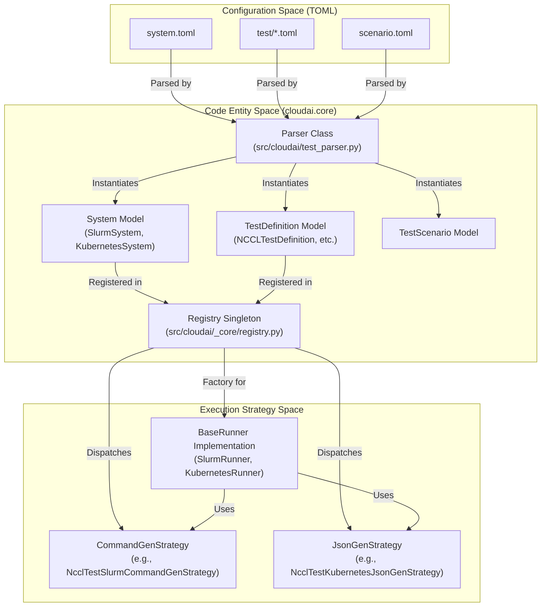
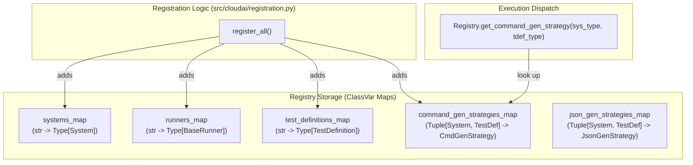

<!-- source: DeepWiki mcp.deepwiki.com · repo NVIDIA/cloudai · page 1 CloudAI Overview · fetched 2026-10-26 -->

# CloudAI Overview

Relevant source files

The following files were used as context for generating this wiki page:

- [.github/workflows/ci.yml](.github/workflows/ci.yml)
- [.github/workflows/docs.yml](.github/workflows/docs.yml)
- [.gitignore](.gitignore)
- [README.md](README.md)
- [doc/Makefile](doc/Makefile)
- [doc/conf.py](doc/conf.py)
- [doc/workloads/nemo_launcher.rst](doc/workloads/nemo_launcher.rst)
- [pyproject.toml](pyproject.toml)
- [src/cloudai/__init__.py](src/cloudai/__init__.py)
- [src/cloudai/_core/registry.py](src/cloudai/_core/registry.py)
- [src/cloudai/core.py](src/cloudai/core.py)
- [src/cloudai/registration.py](src/cloudai/registration.py)
- [src/cloudai/test_parser.py](src/cloudai/test_parser.py)
- [src/cloudai/util/hf_model_manager.py](src/cloudai/util/hf_model_manager.py)
- [tests/test_acceptance.py](tests/test_acceptance.py)
- [tests/test_hf_model_manager.py](tests/test_hf_model_manager.py)
- [tests/test_init.py](tests/test_init.py)
- [tests/test_registry.py](tests/test_registry.py)
- [uv.lock](uv.lock)

CloudAI is an automated benchmarking framework designed for grading and testing Data Center (DC) scale AI systems. It provides a unified technical interface for executing, monitoring, and analyzing high-performance machine learning workloads across diverse scheduler backends (Slurm, Kubernetes, RunAI, LSF, Standalone) with built-in support for over 19 workload types.

The framework is architected around a **Registry-driven plugin system**, which decouples the core orchestration logic from system-specific execution strategies and workload-specific command generation.

**Key Capabilities:**
- **Multi-Scheduler Support:** Native integrations for Slurm, Kubernetes, RunAI, LSF, and Standalone execution [tests/test_init.py:109-116]().
- **Three-Schema Configuration:** Declarative definition of System, Test, and TestScenario entities using TOML [README.md:18-26]().
- **Automated Lifecycle:** Handles prerequisite installation (Docker, Git, Python), job submission, status monitoring, and report generation [README.md:54-95]().
- **Complex Orchestration:** Supports sophisticated test dependency graphs including `start_post_init`, `start_post_comp`, and `end_post_comp` triggers.
- **Design Space Exploration (DSE):** Built-in Reinforcement Learning (RL) gym environment for automated hyperparameter optimization [src/cloudai/registration.py:38-46]().

For detailed technical documentation, see the following child pages:
- **[Getting Started](#1.1)** — Installation via `uv`, basic CLI usage (run, dry-run), and environment setup.
- **[Architecture Overview](#1.2)** — Deep dive into the Registry singleton, the three-schema system, and the execution lifecycle.

**Sources:** [README.md:1-12](), [src/cloudai/__init__.py:17-34](), [tests/test_init.py:109-127]()

## System and Workload Support Matrix

CloudAI provides a broad support matrix across different compute environments. Compatibility is implemented through specific `CommandGenStrategy` and `JsonGenStrategy` mappings in the Registry.

### Scheduler Support

| Scheduler | System Class | Runner Class | Installer Class |
| :--- | :--- | :--- | :--- |
| **Slurm** | `SlurmSystem` | `SlurmRunner` | `SlurmInstaller` |
| **Kubernetes** | `KubernetesSystem` | `KubernetesRunner` | `KubernetesInstaller` |
| **RunAI** | `RunAISystem` | `RunAIRunner` | `RunAIInstaller` |
| **LSF** | `LSFSystem` | `LSFRunner` | `LSFInstaller` |
| **Standalone** | `StandaloneSystem` | `StandaloneRunner` | `StandaloneInstaller` |

### Core Workloads

| Workload | Slurm | K8s | RunAI | Test Definition Class |
| :--- | :---: | :---: | :---: | :--- |
| **AI Dynamo** | ✅ | ✅ | ❌ | `AIDynamoTestDefinition` |
| **NCCL Test** | ✅ | ✅ | ✅ | `NCCLTestDefinition` |
| **NeMo Run (v2.0)** | ✅ | ❌ | ❌ | `NeMoRunTestDefinition` |
| **Megatron Run** | ✅ | ❌ | ❌ | `MegatronRunTestDefinition` |
| **NIXL Bench** | ✅ | ❌ | ❌ | `NIXLBenchTestDefinition` |
| **Sleep** | ✅ | ✅ | ❌ | `SleepTestDefinition` |

**Sources:** [README.md:29-52](), [tests/test_init.py:109-127](), [src/cloudai/registration.py:52-56]()

## High-Level Architecture

CloudAI bridges the gap between high-level user intent (TOML configurations) and low-level system execution (shell commands or API calls) through a layered abstraction.

### Component Mapping: From Configuration to Code Entities

This diagram illustrates how CloudAI translates "Natural Language" configuration concepts into specific Python classes and Registry entries.

**Sources:** [src/cloudai/_core/registry.py:48-62](), [src/cloudai/__init__.py:17-34](), [tests/test_init.py:129-163]()

## Registry-Driven Extension Model

The `Registry` is a singleton that serves as the central source of truth for all pluggable components. It is populated during package initialization by the `register_all()` function.

### Registry Structure and Dispatch Logic

The following diagram shows how the `Registry` maps pairs of `System` and `TestDefinition` types to specific execution strategies.

**Sources:** [src/cloudai/_core/registry.py:48-62](), [src/cloudai/registration.py:36-38](), [src/cloudai/registration.py:181-185]()

## Execution Lifecycle

CloudAI automates the entire benchmarking pipeline, from verifying local environment readiness to generating final performance reports.

1.  **Parsing & Validation:** The `Parser` loads TOML files and validates them against Pydantic models (System, Test, Scenario) [src/cloudai/__init__.py:17-24]().
2.  **Prerequisite Check:** The `BaseInstaller` (e.g., `SlurmInstaller`) checks if required `Installables` (Docker images, Git repos) are present [tests/test_init.py:21-24]().
3.  **Command Generation:** Based on the `System` type, CloudAI selects a `CommandGenStrategy` or `JsonGenStrategy` to generate execution scripts or manifests [tests/test_init.py:129-163]().
4.  **Job Submission:** The `BaseRunner` (e.g., `SlurmRunner`) submits jobs to the scheduler and tracks their `JobId` [tests/test_init.py:119-127]().
5.  **Monitoring:** The runner monitors job status via `is_job_completed()` and `is_job_running()` hooks [tests/test_acceptance.py:122-123]().
6.  **Reporting:** Once complete, the `ReportGenerationStrategy` extracts metrics and generates HTML/CSV reports [src/cloudai/registration.py:49-50]().

**Sources:** [README.md:54-85](), [src/cloudai/registration.py:49-50](), [tests/test_acceptance.py:108-132]()

---

