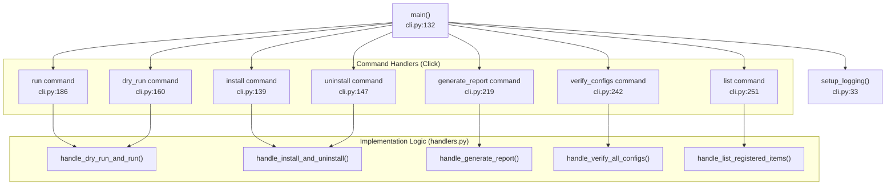
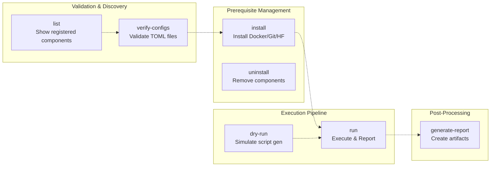

<!-- source: DeepWiki mcp.deepwiki.com · repo NVIDIA/cloudai · page 1.1 Getting Started · fetched 2026-10-26 -->

# Getting Started

<details>
<summary>Relevant source files</summary>

The following files were used as context for generating this wiki page:

- [.github/workflows/ci.yml](.github/workflows/ci.yml)
- [.github/workflows/docs.yml](.github/workflows/docs.yml)
- [.gitignore](.gitignore)
- [README.md](README.md)
- [doc/Makefile](doc/Makefile)
- [doc/conf.py](doc/conf.py)
- [doc/workloads/nemo_launcher.rst](doc/workloads/nemo_launcher.rst)
- [pyproject.toml](pyproject.toml)
- [src/cloudai/cli/__init__.py](src/cloudai/cli/__init__.py)
- [src/cloudai/cli/cli.py](src/cloudai/cli/cli.py)
- [src/cloudai/util/hf_model_manager.py](src/cloudai/util/hf_model_manager.py)
- [tests/test_cli.py](tests/test_cli.py)
- [tests/test_hf_model_manager.py](tests/test_hf_model_manager.py)
- [uv.lock](uv.lock)

</details>


## Purpose and Scope

This page provides installation instructions, basic usage examples, and an overview of CloudAI's CLI modes. You will learn how to install CloudAI, verify your installation, and execute your first benchmark scenario.

For architectural details about how CloudAI components interact, see [Architecture Overview](#1.2). For detailed information about configuration file schemas, see [Configuration System](#3.2).

---

## Installation

### Prerequisites

CloudAI requires:
- **Python 3.10 or higher** [pyproject.toml:34]()
- **Access to a compute cluster** with one of the supported schedulers:
  - Slurm
  - Kubernetes
  - Standalone (for non-cluster workloads)

### Using uv (Recommended)

The `uv` tool manages Python versions and dependencies automatically, providing the fastest path to getting started:

```bash
git clone git@github.com:NVIDIA/cloudai.git
cd cloudai
uv run cloudai --help
```

This approach requires no manual dependency management. The `uv` tool will automatically:
1. Install the correct Python version if needed
2. Create an isolated virtual environment
3. Install all required dependencies from [pyproject.toml:20-33]()

**Sources:** [README.md:6-12](), [pyproject.toml:34](), [uv.lock:1-8]()

### Using pip

For traditional pip-based installation:

```bash
git clone git@github.com:NVIDIA/cloudai.git
cd cloudai
pip install .
```

This installs CloudAI and its core dependencies including:
- `bokeh~=3.8` - Interactive visualization
- `pandas~=2.3` - Data processing
- `kubernetes~=35.0` - Kubernetes integration
- `pydantic~=2.12` - Configuration validation
- `toml~=0.10.2` - TOML file parsing
- `aiconfigurator~=0.5.0` - AI configuration management
- Additional dependencies listed in [pyproject.toml:20-33]()

**Sources:** [pyproject.toml:17-37](), [README.md:16](), [uv.lock:32-57]()

### Development Installation

For contributors or users who need development tools (linters, type checkers, testing frameworks):

```bash
pip install '.[dev]'
```

This additionally installs:
- `ruff~=0.15` - Code linting and formatting
- `pyright~=1.1` - Static type checking
- `pytest~=9.0` - Testing framework
- `import-linter~=2.10` - Import dependency validation
- `vulture==2.14` - Dead code detection
- Other development tools from [pyproject.toml:40-52]()

**Sources:** [pyproject.toml:39-52](), [.github/workflows/ci.yml:61]()

---

## Quick Start

### Verify Installation

After installation, verify CloudAI is working:

```bash
cloudai --help
```

Expected output shows available commands:
```
Usage: cloudai [OPTIONS] COMMAND [ARGS]...

  CloudAI is a benchmark framework focused on grading Data Center scale AI
  systems.

Commands:
  dry-run          Dry run a scenario without executing it.
  generate-report  Generate a report from the results of a scenario.
  install          Install the necessary components for workloads.
  list             List available in Registry items.
  run              Run all the workloads from a scenario.
  uninstall        Uninstall the components used by workloads.
  verify-configs   Verify the configuration TOML files.
```

The CLI entry point is defined at [pyproject.toml:36-37]() and implemented in [src/cloudai/cli/cli.py:128-134]().

**Sources:** [src/cloudai/cli/cli.py:128-254](), [tests/test_cli.py:25-38]()

### Run Your First Example

Execute a simple test scenario using the built-in Sleep workload:

```bash
cloudai run \
    --system-config conf/common/system/example_slurm_cluster.toml \
    --tests-dir conf/common/test \
    --test-scenario conf/common/test_scenario/sleep.toml
```

This command invokes the `run` command handler [src/cloudai/cli/cli.py:186-208](), which:
1. Parses the system configuration.
2. Checks if workload prerequisites are installed.
3. Auto-installs missing components if needed.
4. Executes the test scenario.
5. Generates reports.

**Sources:** [README.md:56-64](), [src/cloudai/cli/cli.py:186-208](), [src/cloudai/cli/handlers.py:24-30]()

---

## CLI Architecture

### Command Flow



**Sources:** [src/cloudai/cli/cli.py:24-30](), [src/cloudai/cli/cli.py:128-254]()

### Common CLI Options

Most execution modes share required arguments via the `common_options` decorator [src/cloudai/cli/cli.py:86-107]():

| Option | Type | Description | Reference |
|--------|------|-------------|-----------|
| `--system-config` | Path | System configuration TOML file | [cli.py:88-93]() |
| `--tests-dir` | Path | Directory containing test TOML files (Optional) | [cli.py:95-99]() |
| `--test-scenario` | Path | Test scenario TOML file | [cli.py:101-106]() |

Additional options for `run` and `dry-run` modes:

| Option | Type | Default | Description | Reference |
|--------|------|---------|-------------|-----------|
| `--output-dir` | Path | None | Override output directory | [cli.py:110-116]() |
| `--enable-cache-without-check` | Flag | False | Skip installation checks | [cli.py:117-122]() |
| `--single-sbatch` | Flag | False | Use single sbatch for all tests (Slurm only) | [cli.py:123-125]() |

**Sources:** [src/cloudai/cli/cli.py:86-126](), [tests/test_cli.py:40-47]()

---

## CLI Modes

### Mode Comparison



**Sources:** [README.md:54-126](), [src/cloudai/cli/cli.py:137-254]()

### run Mode

Executes workloads with automatic prerequisite installation and report generation.

**Example:**
```bash
cloudai run \
    --system-config conf/common/system/example_slurm_cluster.toml \
    --tests-dir conf/common/test \
    --test-scenario conf/common/test_scenario/sleep.toml
```

**Behavior:**
1. Parses configurations via `handle_dry_run_and_run` [src/cloudai/cli/cli.py:208]().
2. Automatically installs prerequisites if not met [README.md:57]().
3. Submits jobs to the cluster (Slurm, Kubernetes, etc.).
4. Generates HTML reports upon completion [README.md:77]().

**Sources:** [README.md:56-64](), [src/cloudai/cli/cli.py:186-208]()

### dry-run Mode

Simulates execution without running actual workloads. Useful for verifying configurations and testing experiment setups.

**Example:**
```bash
cloudai dry-run \
    --system-config conf/common/system/example_slurm_cluster.toml \
    --tests-dir conf/common/test \
    --test-scenario conf/common/test_scenario/sleep.toml
```

**Behavior:**
1. Validates TOML schemas and logic.
2. Simulates job submission.
3. Does not interact with the cluster scheduler for execution [README.md:67]().

**Sources:** [README.md:66-74](), [src/cloudai/cli/cli.py:160-178]()

### install Mode

Installs workload prerequisites such as Docker images, Git repositories, and HuggingFace models.

**Example:**
```bash
cloudai install \
    --system-config conf/common/system/example_slurm_cluster.toml \
    --tests-dir conf/common/test \
    --test-scenario conf/common/test_scenario/sleep.toml
```

**Implementation Detail:**
Uses managers like `HFModelManager` to download models into a central hub [src/cloudai/util/hf_model_manager.py:35-44]().

**Sources:** [README.md:94-102](), [src/cloudai/cli/cli.py:137-142](), [src/cloudai/util/hf_model_manager.py:30-44]()

### verify-configs Mode

Validates the correctness of system, test, and test scenario configuration files.

**Example:**
```bash
# Verify entire directory
cloudai verify-configs conf/

# Verify scenarios with specific test directory
cloudai verify-configs --tests-dir conf/common/test conf/common/test_scenario/
```

**Sources:** [README.md:120-132](), [src/cloudai/cli/cli.py:242-249](), [.github/workflows/ci.yml:94-99]()

---

## Configuration File Structure

CloudAI operates on three main schemas [README.md:20-26]():

### System Configuration
Describes the infrastructure, including the scheduler type, node list, and global environment variables [README.md:22]().
- **Key Field:** `scheduler` (e.g., `slurm`, `kubernetes`, `standalone`) [README.md:30]().

### Test Configuration
An instance of a test template (e.g., `NcclTest`, `MegatronRun`) with custom arguments and environment variables [README.md:23]().
- **Key Field:** `test_template_name`.

### Test Scenario Configuration
A set of tests with defined dependencies and descriptions [README.md:24]().
- **Key Field:** `[[Tests]]` array.

---

## Logging and Debugging

### Log Configuration

CloudAI uses a dual-handler logging system [src/cloudai/cli/cli.py:33-83]():
- **Console Handler:** Configurable via `--log-level` (default: INFO) [src/cloudai/cli/cli.py:130]().
- **File Handler:** Always logs at DEBUG level to the file specified by `--log-file` (default: `debug.log`) [src/cloudai/cli/cli.py:129]().

**Sources:** [src/cloudai/cli/cli.py:33-83](), [src/cloudai/cli/cli.py:128-134]()

### Common Debugging Patterns

**Validate Before Running:**
```bash
cloudai verify-configs conf/
```

**Check Available Components:**
```bash
cloudai list workloads
cloudai list systems
```

**Detailed Trace:**
Check `debug.log` for standard and `bokeh` specific logs [src/cloudai/cli/cli.py:67-81]().

**Sources:** [README.md:113-125](), [src/cloudai/cli/cli.py:45-83]()

---

