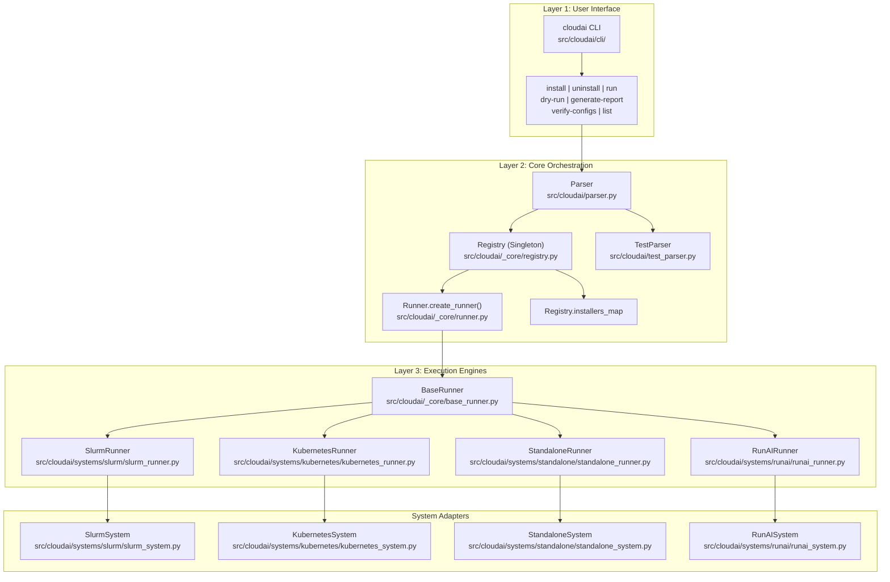
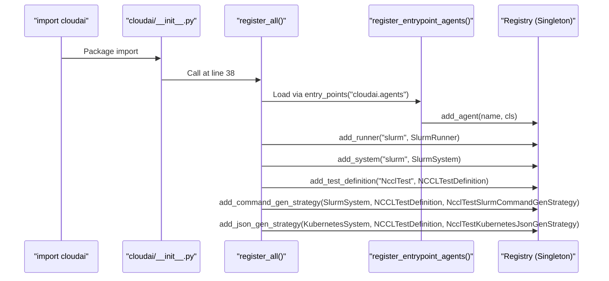
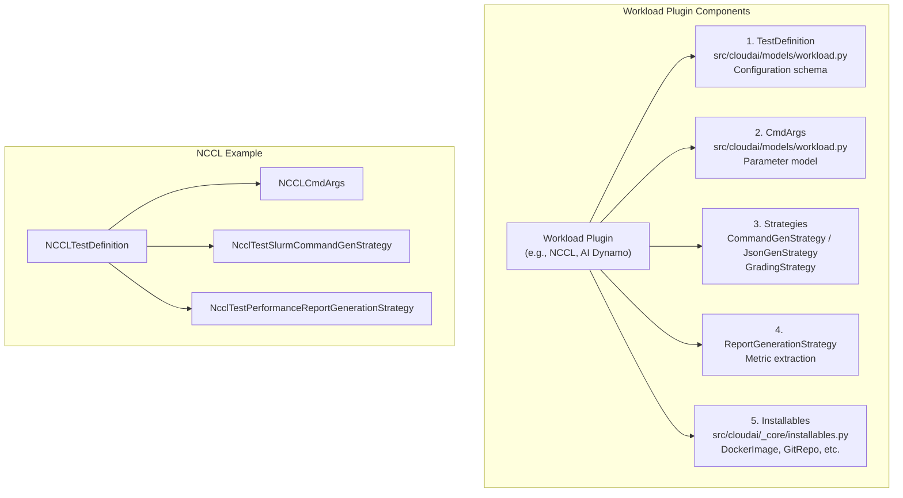
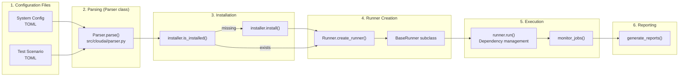

<!-- source: DeepWiki mcp.deepwiki.com · repo NVIDIA/cloudai · page 1.2 Architecture Overview · fetched 2026-10-26 -->

# Architecture Overview

Relevant source files

The following files were used as context for generating this wiki page:

- [src/cloudai/__init__.py](src/cloudai/__init__.py)
- [src/cloudai/_core/base_runner.py](src/cloudai/_core/base_runner.py)
- [src/cloudai/_core/registry.py](src/cloudai/_core/registry.py)
- [src/cloudai/_core/runner.py](src/cloudai/_core/runner.py)
- [src/cloudai/cli/handlers.py](src/cloudai/cli/handlers.py)
- [src/cloudai/core.py](src/cloudai/core.py)
- [src/cloudai/registration.py](src/cloudai/registration.py)
- [src/cloudai/systems/runai/runai_node.py](src/cloudai/systems/runai/runai_node.py)
- [src/cloudai/systems/runai/runai_rest_client.py](src/cloudai/systems/runai/runai_rest_client.py)
- [src/cloudai/systems/runai/runai_runner.py](src/cloudai/systems/runai/runai_runner.py)
- [src/cloudai/systems/runai/runai_system.py](src/cloudai/systems/runai/runai_system.py)
- [src/cloudai/test_parser.py](src/cloudai/test_parser.py)
- [tests/test_acceptance.py](tests/test_acceptance.py)
- [tests/test_base_runner.py](tests/test_base_runner.py)
- [tests/test_cloudaigym.py](tests/test_cloudaigym.py)
- [tests/test_init.py](tests/test_init.py)
- [tests/test_job_type_handler.py](tests/test_job_type_handler.py)
- [tests/test_registry.py](tests/test_registry.py)

## Purpose and Scope

This page describes the high-level architecture of CloudAI, focusing on how the core components interact to provide a flexible, extensible framework for running AI benchmarks across multiple schedulers. We cover the Registry-based plugin system, the three-layer architecture, and the strategy pattern that enables multi-scheduler support.

For details on specific components mentioned here, see:
- Registry implementation details: [2.1]()
- Test framework models: [2.2]()
- Configuration parsing: [2.3]()
- Runner system: [2.4]()
- CLI functionality: [3.1]()

## Three-Layer Architecture

CloudAI follows a three-layer architecture that separates user interface, orchestration logic, and execution engines:

Title: Three-Layer System Architecture

**Sources:** [src/cloudai/__init__.py:17-38](), [src/cloudai/_core/registry.py:48-62](), [src/cloudai/_core/runner.py:47-80](), [src/cloudai/cli/handlers.py:29-41]()

### Layer Responsibilities

| Layer | Components | Responsibilities |
|-------|-----------|------------------|
| **User Interface** | CLI handlers | Parse command-line arguments, invoke orchestration layer ([src/cloudai/cli/handlers.py:53-171]()) |
| **Core Orchestration** | Registry, Parser, Factories | Load configurations, validate schemas, select appropriate implementations ([src/cloudai/_core/registry.py:48-62]()) |
| **Execution Engines** | Runners, Systems | Submit jobs, monitor execution, handle scheduler-specific logic ([src/cloudai/_core/base_runner.py:33-51]()) |

The separation ensures that adding new schedulers or workloads requires changes only to Layer 3 components, with automatic registration into Layer 2 via `register_all()` ([src/cloudai/registration.py:36-180]()).

**Sources:** [src/cloudai/__init__.py:36-38](), [src/cloudai/cli/handlers.py:110-116]()

## Registry: The Central Nervous System

The `Registry` class is a Singleton that maintains all component mappings. It is populated at package import time via `register_all()` and serves as the lookup table for all runtime component selection.

Title: Registry Component Mapping

```mermaid
graph TB
    subgraph "Registry Singleton (src/cloudai/_core/registry.py)"
        RegClass["Registry (metaclass=Singleton)"]
        
        subgraph "Simple Mappings (str → Type)"
            SystemsMap["systems_map<br/>{'slurm': SlurmSystem, 'kubernetes': KubernetesSystem, ...}"]
            RunnersMap["runners_map<br/>{'slurm': SlurmRunner, 'kubernetes': KubernetesRunner, ...}"]
            TestDefsMap["test_definitions_map<br/>{'NcclTest': NCCLTestDefinition, 'Sleep': SleepTestDefinition, ...}"]
            InstallersMap["installers_map<br/>{'slurm': SlurmInstaller, ...}"]
            AgentsMap["agents_map<br/>{'grid_search': GridSearchAgent, ...}"]
        end
        
        subgraph "Strategy Mappings (Tuple[Type, Type] → Type)"
            CmdGenMap["command_gen_strategies_map<br/>{(SlurmSystem, NCCLTestDefinition): NcclTestSlurmCommandGenStrategy, ...}"]
            JsonGenMap["json_gen_strategies_map<br/>{(KubernetesSystem, NCCLTestDefinition): NcclTestKubernetesJsonGenStrategy, ...}"]
            GradingMap["grading_strategies_map<br/>{(SlurmSystem, NCCLTestDefinition): NcclTestGradingStrategy, ...}"]
        end
        
        subgraph "Report Mappings"
            ReportsMap["reports_map<br/>{NCCLTestDefinition: {NcclTestPerformanceReportGenerationStrategy, ...}, ...}"]
            ScenarioReports["scenario_reports<br/>{'per_test': PerTestReporter, 'status': StatusReporter, ...}"]
        end
    end
    
    subgraph "Registration Process"
        Init["cloudai.__init__:38<br/>register_all()"]
        EP["register_entrypoint_agents()"]
    end
    
    subgraph "Runtime Lookup"
        ParserLookup["Parser → systems_map"]
        FactoryLookup["Runner.create_runner() → runners_map"]
        StrategyLookup["BaseRunner → command_gen_strategies_map"]
    end
    
    Init --> EP
    Init --> RegClass
    RegClass --> SystemsMap
    RegClass --> RunnersMap
    RegClass --> TestDefsMap
    RegClass --> InstallersMap
    RegClass --> AgentsMap
    RegClass --> CmdGenMap
    RegClass --> JsonGenMap
    RegClass --> GradingMap
    RegClass --> ReportsMap
    RegClass --> ScenarioReports
    
    ParserLookup -.lookup.-> SystemsMap
    FactoryLookup -.lookup.-> RunnersMap
    StrategyLookup -.lookup.-> CmdGenMap
```

**Sources:** [src/cloudai/_core/registry.py:48-294](), [src/cloudai/__init__.py:36-38](), [tests/test_init.py:102-265](), [src/cloudai/registration.py:21-34]()

### Registry Map Types

The Registry maintains two categories of mappings ([src/cloudai/_core/registry.py:51-62]()):

**Simple Mappings (string keys):**
- `systems_map`: 5 scheduler types (`"slurm"`, `"kubernetes"`, `"runai"`, `"lsf"`, `"standalone"`)
- `runners_map`: 5 corresponding runner implementations
- `test_definitions_map`: 22+ workload types (e.g., `"NcclTest"`, `"Sleep"`, `"AIDynamo"`)
- `installers_map`: 5 installer implementations
- `agents_map`: Design space exploration agents (e.g., `"grid_search"`)

**Strategy Mappings (tuple keys):**
- `command_gen_strategies_map`: Maps `(System type, TestDefinition type)` to command generation strategies.
- `json_gen_strategies_map`: Entries for Kubernetes/RunAI manifest generation.
- `grading_strategies_map`: Maps `(System type, TestDefinition type)` to performance grading strategies.

**Sources:** [tests/test_init.py:102-265](), [src/cloudai/_core/registry.py:51-62]()

### Key Registry Methods

| Method | Purpose | Line Reference |
|--------|---------|----------------|
| `add_system(name, type)` | Register new scheduler system | [src/cloudai/_core/registry.py:132-155]() |
| `add_runner(name, type)` | Register runner implementation | [src/cloudai/_core/registry.py:64-87]() |
| `add_test_definition(name, type)` | Register workload type | [src/cloudai/_core/registry.py:157-180]() |
| `add_command_gen_strategy(sys, tdef, strategy)` | Register command generation strategy | [src/cloudai/_core/registry.py:251-264]() |
| `get_command_gen_strategy(sys, tdef)` | Lookup strategy at runtime | [src/cloudai/_core/registry.py:266-271]() |
| `add_json_gen_strategy(sys, tdef, strategy)` | Register JSON manifest strategy | [src/cloudai/_core/registry.py:273-286]() |
| `add_grading_strategy(sys, tdef, strategy)` | Register grading strategy | [src/cloudai/_core/registry.py:89-100]() |

**Sources:** [src/cloudai/_core/registry.py:64-294]()

## Component Registration

At package import time, CloudAI populates the Registry through a centralized registration process in `register_all()` ([src/cloudai/registration.py:36-180]()).

Title: Registration Lifecycle

**Sources:** [src/cloudai/__init__.py:36-38](), [src/cloudai/registration.py:21-180]()

## Strategy Pattern for Multi-Scheduler Support

CloudAI uses the Strategy pattern to support multiple schedulers without modifying core logic. Each `(System, TestDefinition)` pair maps to a specific strategy implementation ([src/cloudai/_core/registry.py:60-62]()).

### Strategy Selection at Runtime

Title: Strategy Dispatch Mechanism

```mermaid
graph TB
    subgraph "Runtime Strategy Selection"
        Runner["BaseRunner.run()"]
        SystemType["system: SlurmSystem"]
        TestDefType["test.test_definition: NCCLTestDefinition"]
        
        LookupKey["key = (type(system), type(test.test_definition))"]
        RegLookup["Registry().get_command_gen_strategy(key)"]
        
        Strategy["NcclTestSlurmCommandGenStrategy"]
        GenCmd["strategy.gen_exec_command(system, test)"]
        SlurmScript["Slurm sbatch script"]
    end
    
    subgraph "Alternative Path: Kubernetes"
        K8sSystem["system: KubernetesSystem"]
        K8sLookup["Registry().get_json_gen_strategy(key)"]
        K8sStrategy["NcclTestKubernetesJsonGenStrategy"]
        K8sManifest["Kubernetes manifest YAML"]
    end
    
    Runner --> SystemType
    Runner --> TestDefType
    SystemType --> LookupKey
    TestDefType --> LookupKey
    
    LookupKey --> RegLookup
    RegLookup --> Strategy
    Strategy --> GenCmd
    GenCmd --> SlurmScript
    
    K8sSystem --> K8sLookup
    K8sLookup --> K8sStrategy
    K8sStrategy --> K8sManifest
```

**Sources:** [src/cloudai/_core/registry.py:266-293](), [tests/test_init.py:129-163](), [src/cloudai/_core/base_runner.py:133-144]()

## Workload Plugin Architecture

Each workload is a self-contained plugin with core components defined in `src/cloudai/models/workload.py` and `src/cloudai/_core/`.

Title: Workload Plugin Components

**Sources:** [src/cloudai/models/workload.py:43-118](), [src/cloudai/registration.py:105-114](), [src/cloudai/_core/installables.py]()

### Component Details

**1. TestDefinition**
Defines the workload's schema, inheriting from `TestDefinition` ([src/cloudai/models/workload.py:43]()). It handles constraint checks via `constraint_check` and success validation via `was_run_successful`.

**2. CmdArgs**
Pydantic model specifying all command-line parameters. It supports Design Space Exploration (DSE) by allowing list-based values for parameters ([tests/test_job_type_handler.py:39-43]()).

**3. Strategies**
- `CommandGenStrategy`: Generates shell scripts for Slurm/Standalone/LSF.
- `JsonGenStrategy`: Generates Kubernetes/RunAI manifests ([src/cloudai/_core/json_gen_strategy.py]()).
- `GradingStrategy`: Provides performance scoring logic ([src/cloudai/_core/registry.py:89]()).

**4. Installables**
Specifies dependencies like `DockerImage`, `GitRepo`, `PythonExecutable`, `HFModel`, or `File` ([src/cloudai/cli/handlers.py:100-108]()).

**Sources:** [src/cloudai/models/workload.py:43-118](), [src/cloudai/_core/registry.py:89-105](), [src/cloudai/registration.py:105-114]()

## Configuration-to-Execution Pipeline

The transformation from TOML configurations to running jobs follows a defined lifecycle managed by the `Runner` ([src/cloudai/_core/runner.py]()) and `BaseRunner` ([src/cloudai/_core/base_runner.py]()).

Title: Execution Pipeline Flow

**Sources:** [src/cloudai/parser.py](), [src/cloudai/cli/handlers.py:62-94](), [src/cloudai/_core/runner.py:47-81](), [src/cloudai/_core/base_runner.py:82-98]()

### Pipeline Stages

**Stage 1: Configuration Loading**
The `Parser` reads system and scenario TOMLs, validating them against Pydantic models ([src/cloudai/cli/handlers.py:62-63]()).

**Stage 2: Installation**
The `BaseInstaller` subclass (selected by scheduler type) ensures all `Installable` objects required by the tests are present ([src/cloudai/cli/handlers.py:110-116]()).

**Stage 3: Runner Factory**
`Runner.create_runner()` looks up the appropriate runner in `Registry().runners_map` and initializes it with a timestamped results directory ([src/cloudai/_core/runner.py:47-80]()).

**Stage 4: Execution & Monitoring**
`BaseRunner.run()` manages the job lifecycle, including handling dependencies like `start_post_init` and `start_post_comp` ([src/cloudai/_core/base_runner.py:82-180]()).

**Stage 5: Reporting**
`generate_reports()` iterates through registered scenario reports, applying them to the results directory ([src/cloudai/cli/handlers.py:174-200]()).

**Sources:** [src/cloudai/cli/handlers.py:53-200](), [src/cloudai/_core/runner.py:47-81](), [src/cloudai/_core/base_runner.py:82-180]()

---

