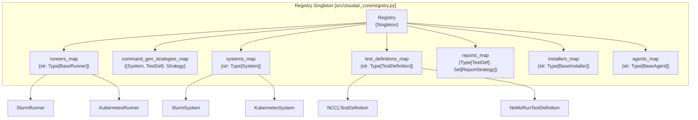
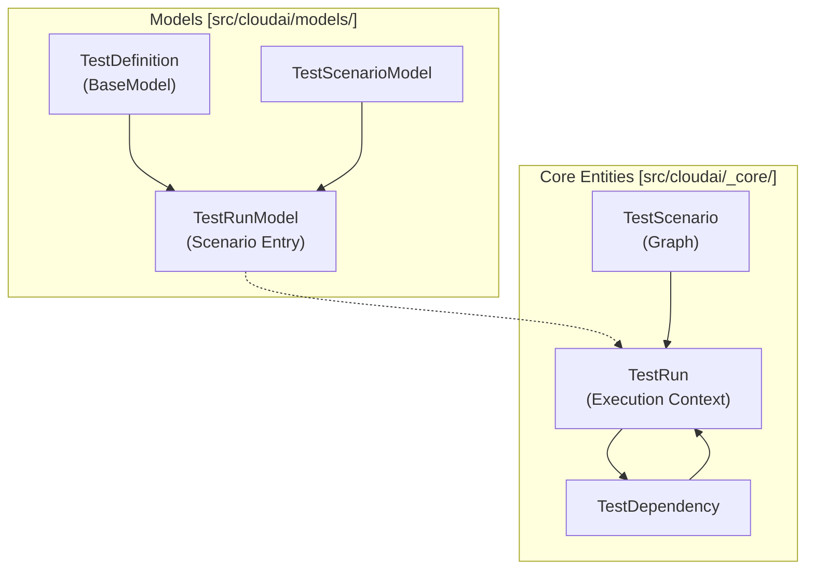
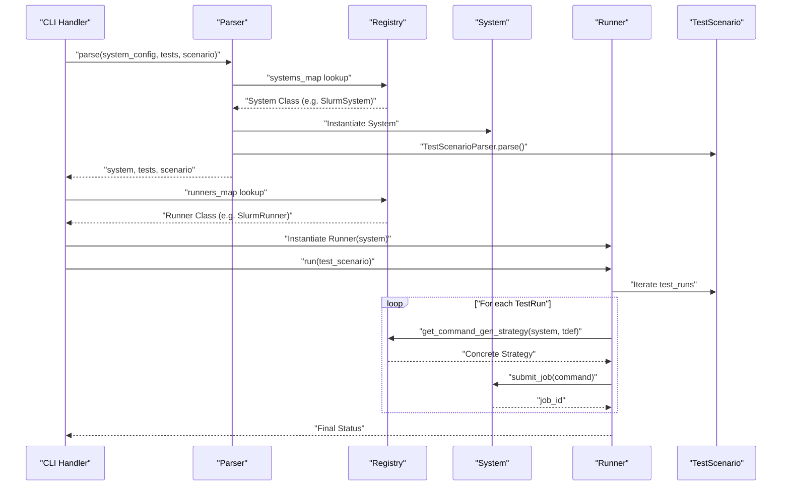

<!-- source: DeepWiki mcp.deepwiki.com · repo NVIDIA/cloudai · page 2 Core Components · fetched 2026-10-26 -->

# Core Components

Relevant source files

The following files were used as context for generating this wiki page:

- [src/cloudai/__init__.py](src/cloudai/__init__.py)
- [src/cloudai/_core/exceptions.py](src/cloudai/_core/exceptions.py)
- [src/cloudai/_core/registry.py](src/cloudai/_core/registry.py)
- [src/cloudai/_core/test_scenario.py](src/cloudai/_core/test_scenario.py)
- [src/cloudai/core.py](src/cloudai/core.py)
- [src/cloudai/models/scenario.py](src/cloudai/models/scenario.py)
- [src/cloudai/models/workload.py](src/cloudai/models/workload.py)
- [src/cloudai/parser.py](src/cloudai/parser.py)
- [src/cloudai/registration.py](src/cloudai/registration.py)
- [src/cloudai/test_parser.py](src/cloudai/test_parser.py)
- [src/cloudai/test_scenario_parser.py](src/cloudai/test_scenario_parser.py)
- [tests/test_acceptance.py](tests/test_acceptance.py)
- [tests/test_init.py](tests/test_init.py)
- [tests/test_registry.py](tests/test_registry.py)
- [tests/test_test_scenario.py](tests/test_test_scenario.py)

This document covers the fundamental building blocks that make up the CloudAI framework. These core components provide the foundational abstractions for test definition, execution orchestration, and system integration that enable CloudAI's automated testing capabilities.

For information about how these components are integrated with specific schedulers like Slurm, see [Scheduler Integrations](#4). For details on the command-line interface that coordinates these components, see [Command-Line Interface](#3).

## Component Registry System

The `Registry` class serves as the central component discovery and instantiation mechanism for CloudAI. It implements the singleton pattern and maintains mappings between abstract interfaces and concrete implementations, enabling dynamic component selection based on system type and test requirements.

### Registry Component Mappings

The registry maintains several key mapping structures used for strategy dispatch and component instantiation:

*   **System Mappings**: Maps scheduler names to `System` implementations [src/cloudai/_core/registry.py:53]().
*   **Runner Mappings**: Maps system names to `BaseRunner` implementations [src/cloudai/_core/registry.py:51]().
*   **Strategy Mappings**: Maps `(Type[System], Type[TestDefinition])` tuples to concrete strategies like `CommandGenStrategy` [src/cloudai/_core/registry.py:60](), `JsonGenStrategy` [src/cloudai/_core/registry.py:61](), and `GradingStrategy` [src/cloudai/_core/registry.py:62]().
*   **Agent Mappings**: Maps agent names to `BaseAgent` classes for Design Space Exploration [src/cloudai/_core/registry.py:55]().

Registration is triggered globally via `register_all()` in `src/cloudai/registration.py`, which populates these maps with built-in and entrypoint-based extensions [src/cloudai/registration.py:36-187]().

For details, see [Registry System](#2.1).

**Sources**: [src/cloudai/_core/registry.py:48-62](), [src/cloudai/registration.py:36-187](), [tests/test_init.py:109-157]()

## Test Framework Object Model

The test framework provides a hierarchical structure for defining and organizing tests, using Pydantic models for validation and schema enforcement.

### Test Component Hierarchy

*   **TestDefinition**: Abstract base class defining the workload, its `CmdArgs`, and `installables` (like `GitRepo`) [src/cloudai/models/workload.py:90-128]().
*   **TestRun**: Represents a specific execution instance of a test within a scenario. It tracks `num_nodes`, `iterations`, `time_limit`, and runtime `dependencies` [src/cloudai/_core/test_scenario.py:58-79]().
*   **TestScenario**: A collection of `TestRun` objects. It manages scenario-level hooks (`pre_test`, `post_test`) and total time limit aggregation [src/cloudai/_core/test_scenario.py:179-196]().
*   **Design Space Exploration (DSE)**: `TestRun` supports parameter expansion. If `num_nodes` is a list or `CmdArgs` contains lists, the framework treats it as a DSE job, enabling agents to explore the parameter space [src/cloudai/_core/test_scenario.py:114-156]().

For details, see [Test Framework](#2.2).

**Sources**: [src/cloudai/models/workload.py:90-142](), [src/cloudai/_core/test_scenario.py:58-196](), [src/cloudai/models/scenario.py:65-105]()

## Parser and Configuration Loading

The `Parser` coordinates the loading of the "Three-Schema" system: System, Test, and TestScenario.

### Configuration Lifecycle
1.  **System Parsing**: `Parser.parse_system` loads the system TOML, identifies the `scheduler`, and retrieves the corresponding `System` class from the `Registry` [src/cloudai/parser.py:165-185]().
2.  **Test Parsing**: `TestParser` loads individual test templates, validating them against the registered `TestDefinition` subclasses [src/cloudai/parser.py:159-162]().
3.  **Scenario Parsing**: `TestScenarioParser` resolves dependencies between tests and merges scenario-specific overrides into the base test definitions using `deep_merge` [src/cloudai/test_scenario_parser.py:107-168]().

For details, see [Parser and Configuration Loading](#2.3).

**Sources**: [src/cloudai/parser.py:42-162](), [src/cloudai/test_scenario_parser.py:73-168]()

## Runner and Job Management

The `BaseRunner` architecture defines how jobs are submitted and monitored across different schedulers.

*   **Strategy Dispatch**: Runners use the `Registry` to find the correct `CommandGenStrategy` for a given `System` and `TestDefinition` pair [tests/test_init.py:129-157]().
*   **Dependency Resolution**: The runner respects three dependency types: `start_post_init` (starts after dependency is submitted), `start_post_comp` (starts after dependency completes), and `end_post_comp` (must complete before dependency starts) [src/cloudai/models/scenario.py:61]().
*   **Job Lifecycle**: Runners manage the transition from command generation to submission, status polling, and finally report generation via `ReportGenerationStrategy` [src/cloudai/_core/test_scenario.py:106-112]().

For details, see [Runner System and Job Management](#2.4) and [Test Dependencies and Execution Flow](#2.5).

**Sources**: [src/cloudai/_core/registry.py:51-105](), [src/cloudai/_core/test_scenario.py:37-79](), [src/cloudai/models/scenario.py:54-62]()

## Component Interaction Flow

The following diagram illustrates how core components interact during a typical test execution:

**Sources**: [src/cloudai/parser.py:67-132](), [src/cloudai/_core/registry.py:48-105](), [src/cloudai/__init__.py:36-38]()

---

